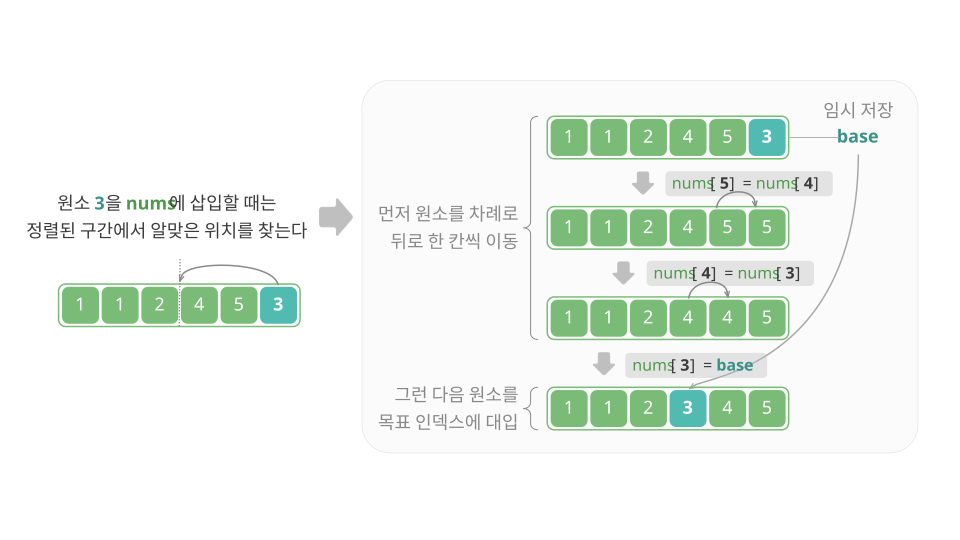

# 11.4 &nbsp; 삽입 정렬

<u>삽입 정렬(insertion sort)</u>은 손에 쥔 카드를 정리하는 과정과 원리가 매우 비슷한 간단한 정렬 알고리즘이다.

미정렬 구간에서 기준 원소를 하나 고른 뒤 왼쪽의 정렬된 구간에 있는 원소와 하나씩 크기를 비교하여 알맞은 위치에 삽입한다.

배열에 원소를 삽입하는 과정은 아래 그림(11-6)과 같다. 기준 원소가 `base`라면 목표 인덱스부터 `base` 사이의 원소를 모두 오른쪽으로 한 칸씩 옮긴 다음 목표 인덱스에 `base`를 대입한다.

{ class="animation-figure" }

<p align="center"> 그림 11-6 &nbsp; 원소 하나의 삽입 과정 </p>

## 11.4.1 &nbsp; 알고리즘의 동작 과정

삽입 정렬의 전체 과정은 아래 그림(11-7)과 같다.

1. 처음에는 배열의 첫 번째 원소가 이미 정렬되어 있다.
2. 배열의 두 번째 원소를 `base`로 선택하여 알맞은 위치에 삽입하면 **앞의 두 원소가 정렬된다**.
3. 세 번째 원소를 `base`로 선택하여 알맞은 위치에 삽입하면 **앞의 세 원소가 정렬된다**.
4. 이를 반복해 마지막 회전에서 마지막 원소를 `base`로 선택하고 알맞은 위치에 삽입하면 **모든 원소가 정렬된다**.

{ class="animation-figure" }

<p align="center"> 그림 11-7 &nbsp; 삽입 정렬 과정 </p>

예제 코드는 다음과 같다.

=== "Python"

    ```python title="insertion_sort.py"
    def insertion_sort(nums: list[int]):
        """삽입 정렬"""
        # 바깥 루프: 정렬된 구간은 [0, i-1]
        for i in range(1, len(nums)):
            base = nums[i]
            j = i - 1
            # 안쪽 루프: base를 정렬된 구간 [0, i-1]의 올바른 위치에 삽입
            while j >= 0 and nums[j] > base:
                nums[j + 1] = nums[j]  # nums[j]를 오른쪽으로 한 칸 이동
                j -= 1
            nums[j + 1] = base  # 올바른 위치에 base 대입
    ```

=== "C++"

    ```cpp title="insertion_sort.cpp"
    /* 삽입 정렬 */
    void insertionSort(vector<int> &nums) {
        // 바깥 루프: 정렬된 구간은 [0, i-1]
        for (int i = 1; i < nums.size(); i++) {
            int base = nums[i], j = i - 1;
            // 안쪽 루프: base를 정렬된 구간 [0, i-1]의 올바른 위치에 삽입
            while (j >= 0 && nums[j] > base) {
                nums[j + 1] = nums[j]; // nums[j]를 오른쪽으로 한 칸 이동
                j--;
            }
            nums[j + 1] = base; // 올바른 위치에 base 대입
        }
    }
    ```

=== "Java"

    ```java title="insertion_sort.java"
    /* 삽입 정렬 */
    void insertionSort(int[] nums) {
        // 바깥 루프: 정렬된 구간은 [0, i-1]
        for (int i = 1; i < nums.length; i++) {
            int base = nums[i], j = i - 1;
            // 안쪽 루프: base를 정렬된 구간 [0, i-1]의 올바른 위치에 삽입
            while (j >= 0 && nums[j] > base) {
                nums[j + 1] = nums[j]; // nums[j]를 오른쪽으로 한 칸 이동
                j--;
            }
            nums[j + 1] = base;        // 올바른 위치에 base 대입
        }
    }
    ```

=== "C#"

    ```csharp title="insertion_sort.cs"
    /* 삽입 정렬 */
    void InsertionSort(int[] nums) {
        // 바깥 루프: 정렬된 구간은 [0, i-1]
        for (int i = 1; i < nums.Length; i++) {
            int bas = nums[i], j = i - 1;
            // 안쪽 루프: base를 정렬된 구간 [0, i-1]의 올바른 위치에 삽입
            while (j >= 0 && nums[j] > bas) {
                nums[j + 1] = nums[j]; // nums[j]를 오른쪽으로 한 칸 이동
                j--;
            }
            nums[j + 1] = bas;         // 올바른 위치에 base 대입
        }
    }
    ```

=== "Go"

    ```go title="insertion_sort.go"
    /* 삽입 정렬 */
    func insertionSort(nums []int) {
        // 바깥 루프: 정렬된 구간은 [0, i-1]
        for i := 1; i < len(nums); i++ {
            base := nums[i]
            j := i - 1
            // 안쪽 루프: base를 정렬된 구간 [0, i-1]의 올바른 위치에 삽입
            for j >= 0 && nums[j] > base {
                nums[j+1] = nums[j] // nums[j]를 오른쪽으로 한 칸 이동
                j--
            }
            nums[j+1] = base // 올바른 위치에 base 대입
        }
    }
    ```

=== "Swift"

    ```swift title="insertion_sort.swift"
    /* 삽입 정렬 */
    func insertionSort(nums: inout [Int]) {
        // 바깥 루프: 정렬된 구간은 [0, i-1]
        for i in nums.indices.dropFirst() {
            let base = nums[i]
            var j = i - 1
            // 안쪽 루프: base를 정렬된 구간 [0, i-1]의 올바른 위치에 삽입
            while j >= 0, nums[j] > base {
                nums[j + 1] = nums[j] // nums[j]를 오른쪽으로 한 칸 이동
                j -= 1
            }
            nums[j + 1] = base // 올바른 위치에 base 대입
        }
    }
    ```

=== "JS"

    ```javascript title="insertion_sort.js"
    /* 삽입 정렬 */
    function insertionSort(nums) {
        // 바깥 루프: 정렬된 구간은 [0, i-1]
        for (let i = 1; i < nums.length; i++) {
            let base = nums[i],
                j = i - 1;
            // 안쪽 루프: base를 정렬된 구간 [0, i-1]의 올바른 위치에 삽입
            while (j >= 0 && nums[j] > base) {
                nums[j + 1] = nums[j]; // nums[j]를 오른쪽으로 한 칸 이동
                j--;
            }
            nums[j + 1] = base; // 올바른 위치에 base 대입
        }
    }
    ```

=== "TS"

    ```typescript title="insertion_sort.ts"
    /* 삽입 정렬 */
    function insertionSort(nums: number[]): void {
        // 바깥 루프: 정렬된 구간은 [0, i-1]
        for (let i = 1; i < nums.length; i++) {
            const base = nums[i];
            let j = i - 1;
            // 안쪽 루프: base를 정렬된 구간 [0, i-1]의 올바른 위치에 삽입
            while (j >= 0 && nums[j] > base) {
                nums[j + 1] = nums[j]; // nums[j]를 오른쪽으로 한 칸 이동
                j--;
            }
            nums[j + 1] = base; // 올바른 위치에 base 대입
        }
    }
    ```

=== "Dart"

    ```dart title="insertion_sort.dart"
    /* 삽입 정렬 */
    void insertionSort(List<int> nums) {
      // 바깥 루프: 정렬된 구간은 [0, i-1]
      for (int i = 1; i < nums.length; i++) {
        int base = nums[i], j = i - 1;
        // 안쪽 루프: base를 정렬된 구간 [0, i-1]의 올바른 위치에 삽입
        while (j >= 0 && nums[j] > base) {
          nums[j + 1] = nums[j]; // nums[j]를 오른쪽으로 한 칸 이동
          j--;
        }
        nums[j + 1] = base; // 올바른 위치에 base 대입
      }
    }
    ```

=== "Rust"

    ```rust title="insertion_sort.rs"
    /* 삽입 정렬 */
    fn insertion_sort(nums: &mut [i32]) {
        // 바깥 루프: 정렬된 구간은 [0, i-1]
        for i in 1..nums.len() {
            let (base, mut j) = (nums[i], (i - 1) as i32);
            // 안쪽 루프: base를 정렬된 구간 [0, i-1]의 올바른 위치에 삽입
            while j >= 0 && nums[j as usize] > base {
                nums[(j + 1) as usize] = nums[j as usize]; // nums[j]를 오른쪽으로 한 칸 이동
                j -= 1;
            }
            nums[(j + 1) as usize] = base; // 올바른 위치에 base 대입
        }
    }
    ```

=== "C"

    ```c title="insertion_sort.c"
    /* 삽입 정렬 */
    void insertionSort(int nums[], int size) {
        // 바깥 루프: 정렬된 구간은 [0, i-1]
        for (int i = 1; i < size; i++) {
            int base = nums[i], j = i - 1;
            // 안쪽 루프: base를 정렬된 구간 [0, i-1]의 올바른 위치에 삽입
            while (j >= 0 && nums[j] > base) {
                // nums[j]를 오른쪽으로 한 칸 이동
                nums[j + 1] = nums[j];
                j--;
            }
            // 올바른 위치에 base 대입
            nums[j + 1] = base;
        }
    }
    ```

=== "Kotlin"

    ```kotlin title="insertion_sort.kt"
    /* 삽입 정렬 */
    fun insertionSort(nums: IntArray) {
        //바깥 루프: 정렬된 원소 수는 1, 2, ..., n
        for (i in nums.indices) {
            val base = nums[i]
            var j = i - 1
            // 안쪽 루프: base를 정렬된 구간 [0, i-1]의 올바른 위치에 삽입
            while (j >= 0 && nums[j] > base) {
                nums[j + 1] = nums[j] // nums[j]를 오른쪽으로 한 칸 이동
                j--
            }
            nums[j + 1] = base        // 올바른 위치에 base 대입
        }
    }
    ```

=== "Ruby"

    ```ruby title="insertion_sort.rb"
    ### 삽입 정렬 ###
    def insertion_sort(nums)
      n = nums.length
      # 바깥 루프: 정렬된 구간은 [0, i-1]
      for i in 1...n
        base = nums[i]
        j = i - 1
        # 안쪽 루프: base를 정렬된 구간 [0, i-1]의 올바른 위치에 삽입
        while j >= 0 && nums[j] > base
          nums[j + 1] = nums[j] # nums[j]를 오른쪽으로 한 칸 이동
          j -= 1
        end
        nums[j + 1] = base # 올바른 위치에 base 대입
      end
    end
    ```

??? pythontutor "실행 과정 시각화"

    <div style="height: 513px; width: 100%;"><iframe class="pythontutor-iframe" title="실행 과정 시각화" src="https://pythontutor.com/iframe-embed.html#code=def%20insertion_sort%28nums%3A%20list%5Bint%5D%29%3A%0A%20%20%20%20%22%22%22%EC%82%BD%EC%9E%85%20%EC%A0%95%EB%A0%AC%22%22%22%0A%20%20%20%20%23%20%EB%B0%94%EA%B9%A5%20%EB%A3%A8%ED%94%84%3A%20%EC%A0%95%EB%A0%AC%EB%90%9C%20%EA%B5%AC%EA%B0%84%EC%9D%80%20%5B0,%20i-1%5D%0A%20%20%20%20for%20i%20in%20range%281,%20len%28nums%29%29%3A%0A%20%20%20%20%20%20%20%20base%20%3D%20nums%5Bi%5D%0A%20%20%20%20%20%20%20%20j%20%3D%20i%20-%201%0A%20%20%20%20%20%20%20%20%23%20%EC%95%88%EC%AA%BD%20%EB%A3%A8%ED%94%84%3A%20base%EB%A5%BC%20%EC%A0%95%EB%A0%AC%EB%90%9C%20%EA%B5%AC%EA%B0%84%20%5B0,%20i-1%5D%EC%9D%98%20%EC%98%AC%EB%B0%94%EB%A5%B8%20%EC%9C%84%EC%B9%98%EC%97%90%20%EC%82%BD%EC%9E%85%0A%20%20%20%20%20%20%20%20while%20j%20%3E%3D%200%20and%20nums%5Bj%5D%20%3E%20base%3A%0A%20%20%20%20%20%20%20%20%20%20%20%20nums%5Bj%20%2B%201%5D%20%3D%20nums%5Bj%5D%20%20%23%20nums%5Bj%5D%EB%A5%BC%20%EC%98%A4%EB%A5%B8%EC%AA%BD%EC%9C%BC%EB%A1%9C%20%ED%95%9C%20%EC%B9%B8%20%EC%9D%B4%EB%8F%99%0A%20%20%20%20%20%20%20%20%20%20%20%20j%20-%3D%201%0A%20%20%20%20%20%20%20%20nums%5Bj%20%2B%201%5D%20%3D%20base%20%20%23%20%EC%98%AC%EB%B0%94%EB%A5%B8%20%EC%9C%84%EC%B9%98%EC%97%90%20base%20%EB%8C%80%EC%9E%85%0A%0A%0A%22%22%22Driver%20Code%22%22%22%0Aif%20__name__%20%3D%3D%20%22__main__%22%3A%0A%20%20%20%20nums%20%3D%20%5B4,%201,%203,%201,%205,%202%5D%0A%20%20%20%20insertion_sort%28nums%29%0A%20%20%20%20print%28%22%EC%82%BD%EC%9E%85%20%EC%A0%95%EB%A0%AC%20%ED%9B%84%20nums%20%3D%22,%20nums%29&codeDivHeight=472&codeDivWidth=350&cumulative=false&curInstr=4&heapPrimitives=nevernest&origin=opt-frontend.js&py=311&rawInputLstJSON=%5B%5D&textReferences=false"> </iframe></div>
    <div style="margin-top: 5px;"><a href="https://pythontutor.com/iframe-embed.html#code=def%20insertion_sort%28nums%3A%20list%5Bint%5D%29%3A%0A%20%20%20%20%22%22%22%EC%82%BD%EC%9E%85%20%EC%A0%95%EB%A0%AC%22%22%22%0A%20%20%20%20%23%20%EB%B0%94%EA%B9%A5%20%EB%A3%A8%ED%94%84%3A%20%EC%A0%95%EB%A0%AC%EB%90%9C%20%EA%B5%AC%EA%B0%84%EC%9D%80%20%5B0,%20i-1%5D%0A%20%20%20%20for%20i%20in%20range%281,%20len%28nums%29%29%3A%0A%20%20%20%20%20%20%20%20base%20%3D%20nums%5Bi%5D%0A%20%20%20%20%20%20%20%20j%20%3D%20i%20-%201%0A%20%20%20%20%20%20%20%20%23%20%EC%95%88%EC%AA%BD%20%EB%A3%A8%ED%94%84%3A%20base%EB%A5%BC%20%EC%A0%95%EB%A0%AC%EB%90%9C%20%EA%B5%AC%EA%B0%84%20%5B0,%20i-1%5D%EC%9D%98%20%EC%98%AC%EB%B0%94%EB%A5%B8%20%EC%9C%84%EC%B9%98%EC%97%90%20%EC%82%BD%EC%9E%85%0A%20%20%20%20%20%20%20%20while%20j%20%3E%3D%200%20and%20nums%5Bj%5D%20%3E%20base%3A%0A%20%20%20%20%20%20%20%20%20%20%20%20nums%5Bj%20%2B%201%5D%20%3D%20nums%5Bj%5D%20%20%23%20nums%5Bj%5D%EB%A5%BC%20%EC%98%A4%EB%A5%B8%EC%AA%BD%EC%9C%BC%EB%A1%9C%20%ED%95%9C%20%EC%B9%B8%20%EC%9D%B4%EB%8F%99%0A%20%20%20%20%20%20%20%20%20%20%20%20j%20-%3D%201%0A%20%20%20%20%20%20%20%20nums%5Bj%20%2B%201%5D%20%3D%20base%20%20%23%20%EC%98%AC%EB%B0%94%EB%A5%B8%20%EC%9C%84%EC%B9%98%EC%97%90%20base%20%EB%8C%80%EC%9E%85%0A%0A%0A%22%22%22Driver%20Code%22%22%22%0Aif%20__name__%20%3D%3D%20%22__main__%22%3A%0A%20%20%20%20nums%20%3D%20%5B4,%201,%203,%201,%205,%202%5D%0A%20%20%20%20insertion_sort%28nums%29%0A%20%20%20%20print%28%22%EC%82%BD%EC%9E%85%20%EC%A0%95%EB%A0%AC%20%ED%9B%84%20nums%20%3D%22,%20nums%29&codeDivHeight=800&codeDivWidth=600&cumulative=false&curInstr=4&heapPrimitives=nevernest&origin=opt-frontend.js&py=311&rawInputLstJSON=%5B%5D&textReferences=false" target="_blank" rel="noopener noreferrer">전체 화면으로 보기 ></a></div>

## 11.4.2 &nbsp; 알고리즘의 특성

- **시간 복잡도 $O(n^2)$, 적응형 정렬**: 최악의 경우 각 삽입에 필요한 반복 횟수는 차례로 $n - 1$, $n-2$, $\dots$, $2$, $1$이고 그 합은 $(n - 1) n / 2$이므로 시간 복잡도는 $O(n^2)$이다. 이미 정렬된 데이터를 만나면 삽입 과정이 일찍 끝난다. 입력 배열 전체가 정렬되어 있으면 최선의 시간 복잡도 $O(n)$을 달성한다.
- **공간 복잡도 $O(1)$, 제자리 정렬**: 포인터 $i$와 $j$에 필요한 추가 공간은 상수 크기다.
- **안정 정렬**: 삽입할 원소는 값이 같은 원소의 오른쪽에 놓으므로 이들의 순서가 바뀌지 않는다.

## 11.4.3 &nbsp; 삽입 정렬의 장점

삽입 정렬의 시간 복잡도는 $O(n^2)$이고 곧 살펴볼 퀵 정렬의 시간 복잡도는 $O(n \log n)$이다. 삽입 정렬의 시간 복잡도가 더 높지만 **데이터가 적을 때는 대개 삽입 정렬이 더 빠르다**.

이는 선형 탐색과 이진 탐색이 각각 어떤 상황에 적합한지 살펴봤을 때와 비슷하다. 퀵 정렬처럼 시간 복잡도가 $O(n \log n)$인 분할 정복 기반 알고리즘에는 흔히 더 많은 기본 연산이 들어간다. 데이터가 적으면 $n^2$의 값과 $n \log n$의 값이 비슷하여 복잡도가 성능을 좌우하지 않고 회전마다 수행하는 기본 연산의 수가 결정적이다.

실제로 Java를 비롯한 여러 언어의 내장 정렬 함수가 삽입 정렬을 활용한다. 대체로 긴 배열에는 퀵 정렬 같은 분할 정복 방식의 정렬 알고리즘을 적용하고 짧은 배열에는 삽입 정렬을 바로 사용한다.

버블 정렬, 선택 정렬, 삽입 정렬의 시간 복잡도는 모두 $O(n^2)$이지만 실제로는 **삽입 정렬을 버블 정렬이나 선택 정렬보다 훨씬 자주 사용한다**. 주된 이유는 다음과 같다.

- 버블 정렬은 원소를 교환하므로 임시 변수가 필요하고 교환 한 번에 기본 연산이 세 번 든다. 삽입 정렬은 원소 대입을 사용하므로 한 번에 기본 연산이 한 번만 든다. 따라서 **버블 정렬의 연산 비용이 대개 삽입 정렬보다 크다**.
- 선택 정렬의 시간 복잡도는 어떤 경우에도 $O(n^2)$이다. **부분적으로 정렬된 데이터가 주어지면 삽입 정렬이 대개 선택 정렬보다 효율적이다**.
- 선택 정렬은 불안정 정렬이므로 여러 기준을 차례로 적용하는 정렬에 사용할 수 없다.
