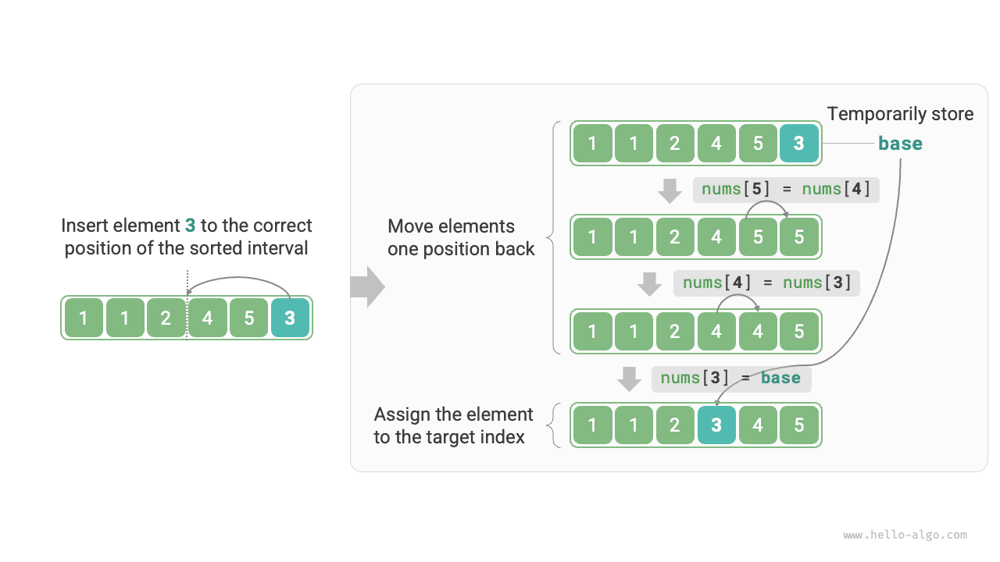

# 삽입 정렬

<u>삽입 정렬(insertion sort)</u>은 간단한 정렬 알고리즘으로, 손으로 카드 한 벌을 정리하는 과정과 원리가 매우 비슷하다.

구체적으로는 미정렬 구간에서 기준 원소 하나를 골라, 왼쪽의 정렬된 구간에 있는 원소들과 하나씩 크기를 비교한 뒤 올바른 위치에 삽입한다.

아래 그림은 배열에 원소를 삽입하는 과정을 보여 준다. 기준 원소를 `base`라고 하면 목표 인덱스부터 `base` 사이의 모든 원소를 오른쪽으로 한 칸씩 이동한 뒤, 목표 인덱스에 `base`를 대입한다.



## 알고리즘 과정

삽입 정렬의 전체 과정은 아래 그림과 같다.

1. 처음에는 배열의 첫 번째 원소가 정렬되어 있다.
2. 배열의 두 번째 원소를 `base`로 골라 올바른 위치에 삽입하면 **배열의 앞 2개 원소가 정렬된다**.
3. 세 번째 원소를 `base`로 골라 올바른 위치에 삽입하면 **배열의 앞 3개 원소가 정렬된다**.
4. 같은 과정을 반복한다. 마지막 회에서 마지막 원소를 `base`로 골라 올바른 위치에 삽입하면 **모든 원소가 정렬된다**.


예시 코드는 다음과 같다.

```src
[file]{insertion_sort}-[class]{}-[func]{insertion_sort}
```

## 알고리즘 특성

- **시간 복잡도 $O(n^2)$, 적응형 정렬**: 최악의 경우 각 삽입 연산에서 $n - 1$, $n-2$, $\dots$, $2$, $1$ 번 반복해야 한다. 합은 $(n - 1) n / 2$이므로 시간 복잡도는 $O(n^2)$이다. 정렬된 데이터를 만나면 삽입 연산이 일찍 끝난다. 입력 배열이 완전히 정렬되어 있으면 최선 시간 복잡도 $O(n)$에 도달한다.
- **공간 복잡도 $O(1)$, 제자리 정렬**: 포인터 $i$와 $j$는 상수 크기의 추가 공간을 사용한다.
- **안정 정렬**: 삽입할 때 값이 같은 원소의 오른쪽에 삽입하므로 상대적 순서가 바뀌지 않는다.

## 삽입 정렬의 장점

삽입 정렬의 시간 복잡도는 $O(n^2)$이고, 곧 배울 퀵 정렬의 시간 복잡도는 $O(n \log n)$이다. 삽입 정렬의 시간 복잡도가 더 높지만 **데이터가 적으면 보통 삽입 정렬이 더 빠르다**.

이는 선형 탐색과 이진 탐색의 적합한 사용 상황에서 내린 결론과 비슷하다. 퀵 정렬 같은 $O(n \log n)$ 알고리즘은 분할 정복 전략에 기반한 정렬 알고리즘으로, 기본 연산이 더 많은 경우가 많다. 데이터가 적으면 $n^2$과 $n \log n$의 값이 비슷하여 시간 복잡도가 결정적인 요인이 되지 못하고, 매 반복에서 수행하는 기본 연산 수가 결정적인 역할을 한다.

실제로 Java 등 여러 프로그래밍 언어의 내장 정렬 함수는 삽입 정렬을 활용한다. 대체로 긴 배열에는 퀵 정렬 같은 분할 정복 기반 정렬을 사용하고, 짧은 배열에는 삽입 정렬을 바로 적용한다.

버블 정렬, 선택 정렬, 삽입 정렬의 시간 복잡도는 모두 $O(n^2)$이지만, 실제로는 **삽입 정렬이 버블 정렬이나 선택 정렬보다 훨씬 자주 사용된다**. 주된 이유는 다음과 같다.

- 버블 정렬은 원소 교환으로 구현하므로 임시 변수가 필요하고 총 3회의 기본 연산을 수행한다. 삽입 정렬은 원소 대입으로 구현하므로 기본 연산이 1회만 필요하다. 따라서 **버블 정렬의 계산 비용은 보통 삽입 정렬보다 크다**.
- 선택 정렬의 시간 복잡도는 어떤 경우에도 $O(n^2)$이다. **데이터가 부분적으로 정렬되어 있다면 삽입 정렬이 보통 선택 정렬보다 효율적이다**.
- 선택 정렬은 불안정하므로 여러 기준으로 순차 정렬하는 데 사용할 수 없다.
