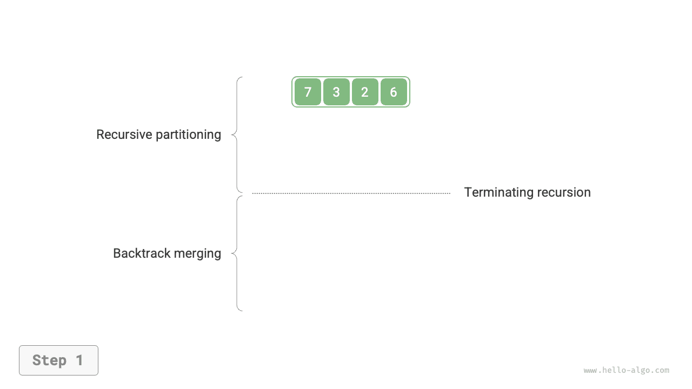
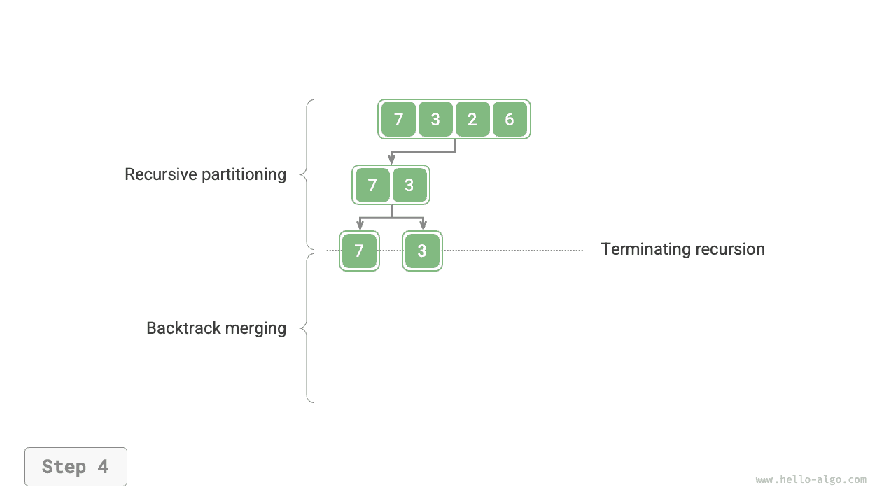
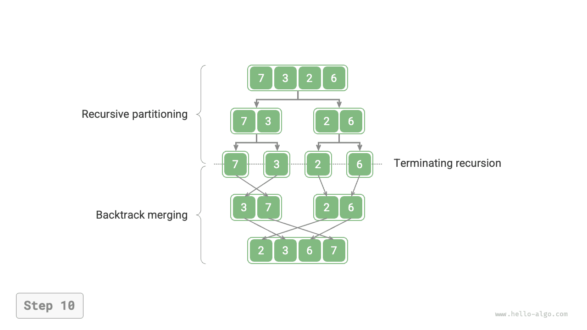

# 병합 정렬

<u>병합 정렬(merge sort)</u>은 분할 정복 전략에 기반한 정렬 알고리즘으로, 아래 그림의 '분할' 단계와 '병합' 단계로 이루어진다.

1. **분할 단계**: 재귀적으로 배열을 계속 중간에서 나누어, 긴 배열을 정렬하는 문제를 짧은 배열을 정렬하는 문제로 바꾼다.
2. **병합 단계**: 부분 배열의 길이가 1이 되면 분할을 멈추고 병합을 시작한다. 정렬된 짧은 왼쪽 배열과 오른쪽 배열을 하나의 더 긴 정렬된 배열로 계속 합치며, 끝날 때까지 반복한다.


## 알고리즘 과정

아래 그림과 같이 '분할 단계'에서는 위에서 아래로 재귀하며 배열을 중간에서 두 부분 배열로 나눈다.

1. 배열의 중간 인덱스 `mid`를 계산하고 왼쪽 부분 배열(구간 `[left, mid]`)과 오른쪽 부분 배열(구간 `[mid + 1, right]`)을 재귀적으로 나눈다.
2. 부분 배열 구간의 길이가 1이 될 때까지 `1.` 단계를 재귀적으로 반복한다.

'병합 단계'에서는 아래에서 위로 왼쪽 부분 배열과 오른쪽 부분 배열을 하나의 정렬된 배열로 합친다. 길이가 1인 부분 배열부터 병합하므로, 병합 단계의 각 부분 배열은 이미 정렬되어 있다.

=== "<1>"
    

=== "<2>"
    

=== "<3>"
    

=== "<4>"
    

=== "<5>"
    

=== "<6>"
    

=== "<7>"
    

=== "<8>"
    

=== "<9>"
    

=== "<10>"
    

병합 정렬의 재귀 순서는 이진 트리의 후위 순회와 같다는 것을 알 수 있다.

- **후위 순회**: 왼쪽 서브트리에 재귀한 다음 오른쪽 서브트리에 재귀하고, 마지막으로 루트 노드를 처리한다.
- **병합 정렬**: 왼쪽 부분 배열에 재귀한 다음 오른쪽 부분 배열에 재귀하고, 마지막으로 병합한다.

병합 정렬의 구현은 다음 코드와 같다. `nums`에서 병합할 구간은 `[left, right]`이고, 이에 대응하는 `tmp`의 구간은 `[0, right - left]`라는 점에 주의하자.

```src
[file]{merge_sort}-[class]{}-[func]{merge_sort}
```

## 알고리즘 특성

- **시간 복잡도 $O(n \log n)$, 비적응형 정렬**: 분할 과정에서 높이 $\log n$의 재귀 트리가 만들어지고, 각 레벨에서 병합에 필요한 총연산 수는 $n$이므로 전체 시간 복잡도는 $O(n \log n)$이다.
- **공간 복잡도 $O(n)$, 제자리 정렬이 아님**: 재귀 깊이가 $\log n$이므로 $O(\log n)$ 크기의 스택 프레임 공간을 사용한다. 병합에는 보조 배열이 필요하여 $O(n)$의 추가 공간을 사용한다.
- **안정 정렬**: 병합 과정에서 값이 같은 원소들의 순서가 유지된다.

## 연결 리스트 정렬

연결 리스트에서는 병합 정렬이 다른 정렬 알고리즘보다 뚜렷한 장점을 가진다. **연결 리스트 정렬의 공간 복잡도를 $O(1)$까지 최적화할 수 있다**.

- **분할 단계**: 연결 리스트를 나눌 때 '재귀' 대신 '반복'을 사용하면 재귀에 필요한 스택 프레임 공간을 없앨 수 있다.
- **병합 단계**: 연결 리스트에서는 참조(포인터)만 바꾸어 노드를 추가하거나 삭제할 수 있다. 따라서 정렬된 짧은 연결 리스트 두 개를 하나의 긴 연결 리스트로 합칠 때 추가 연결 리스트를 만들 필요가 없다.

구체적인 구현은 다소 복잡하므로, 관심 있는 독자는 관련 자료를 찾아 학습해 보자.
