# 병합 정렬

<u>병합 정렬(merge sort)</u>은 분할 정복 전략을 바탕으로 하는 정렬 알고리즘이다. 아래 그림에 나온 ‘분할’과 ‘병합’ 단계로 구성된다.

1. **분할 단계**: 재귀적으로 배열을 중간에서 계속 나누어 긴 배열의 정렬 문제를 짧은 배열의 정렬 문제로 바꾼다.
2. **병합 단계**: 부분 배열의 길이가 1이면 분할을 끝내고 병합을 시작한다. 짧은 두 정렬 배열을 하나의 더 긴 정렬 배열로 합치는 일을 끝까지 반복한다.

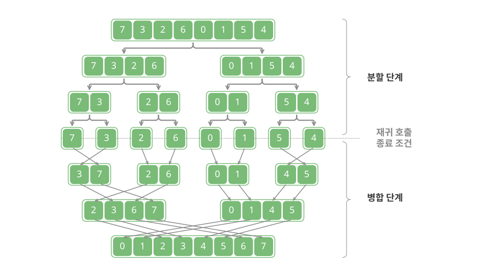

## 알고리즘의 동작 과정

아래 그림처럼 분할 단계에서는 위에서 아래로 재귀 호출하며 배열을 중간에서 두 부분 배열로 나눈다.

1. 배열의 중간점 `mid`를 계산하고 왼쪽 부분 배열(구간 `[left, mid]`)과 오른쪽 부분 배열(구간 `[mid + 1, right]`)을 재귀적으로 나눈다.
2. `1.`단계를 재귀적으로 수행하다가 부분 배열 구간의 길이가 1이 되면 멈춘다.

병합 단계에서는 아래에서 위로 왼쪽과 오른쪽 부분 배열을 하나의 정렬 배열로 합친다. 길이 1인 부분 배열부터 병합을 시작하므로 병합 단계의 각 부분 배열은 이미 정렬되어 있다.

=== "<1>"
    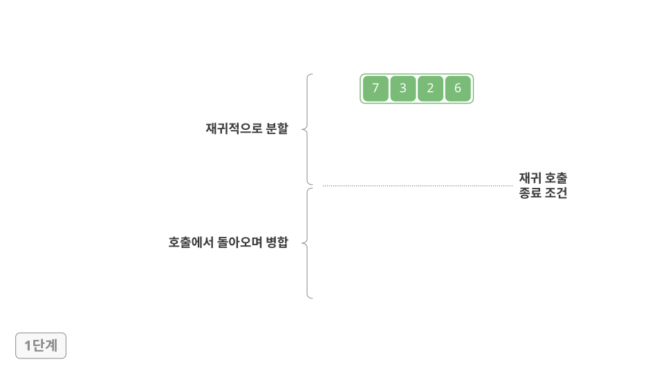

=== "<2>"
    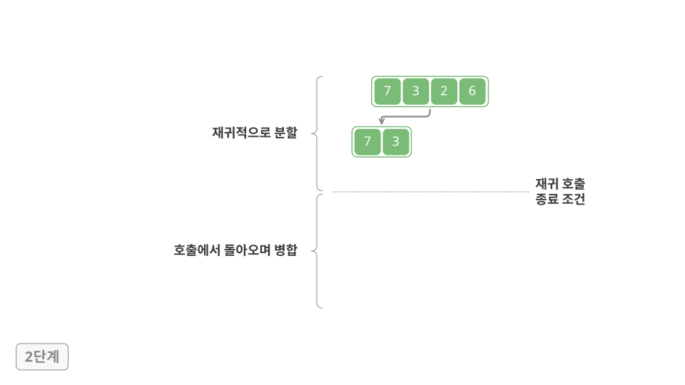

=== "<3>"
    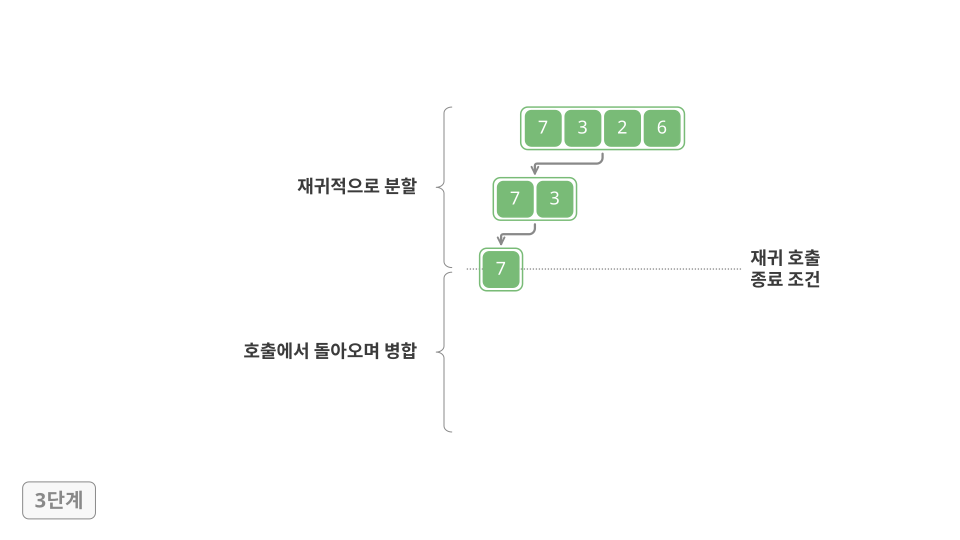

=== "<4>"
    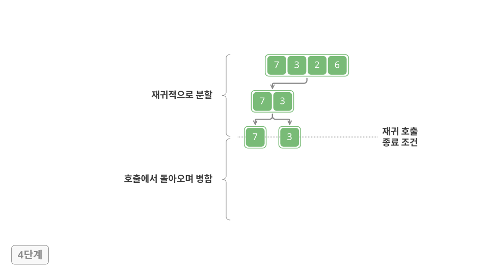

=== "<5>"
    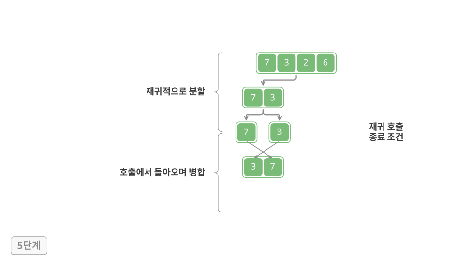

=== "<6>"
    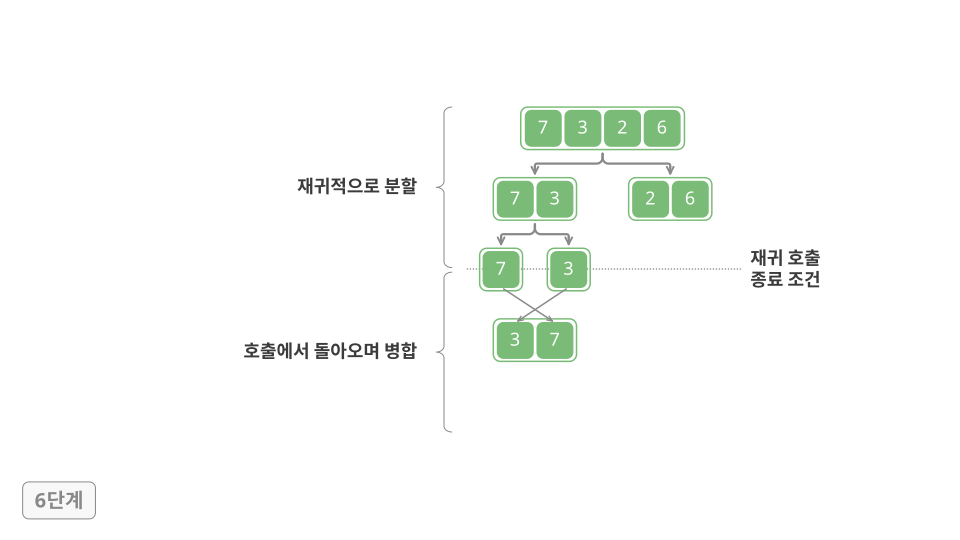

=== "<7>"
    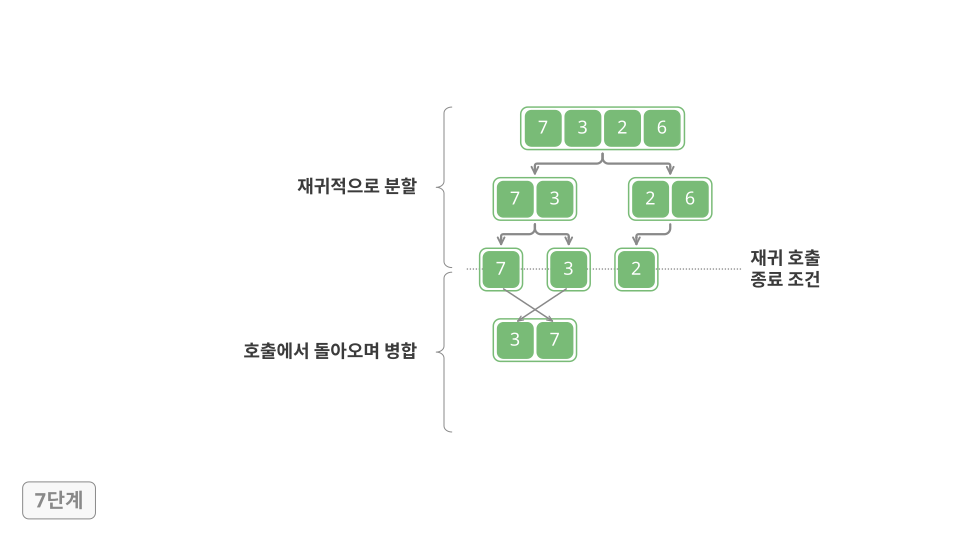

=== "<8>"
    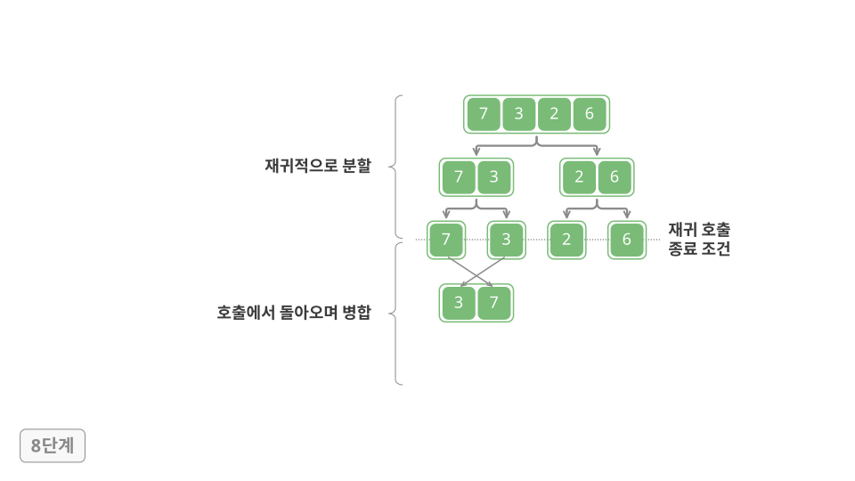

=== "<9>"
    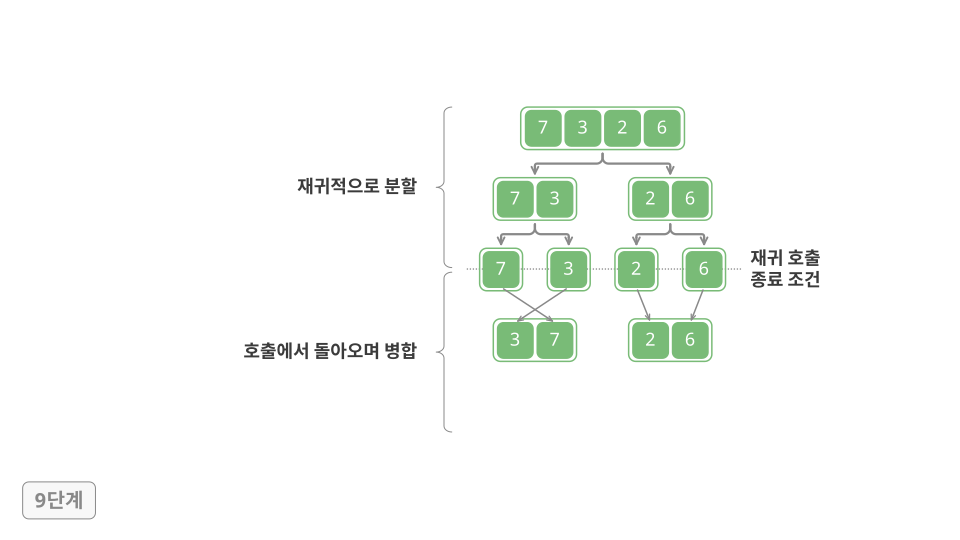

=== "<10>"
    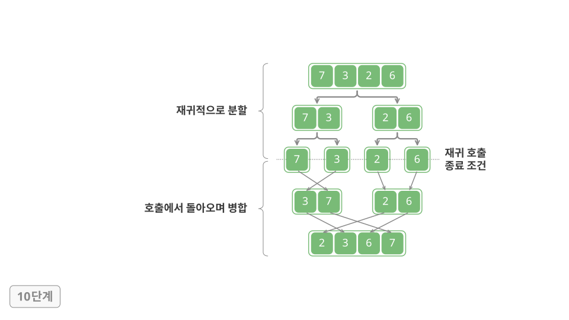

병합 정렬의 재귀 호출 순서를 살펴보면 이진 트리의 후위 순회와 같다는 것을 알 수 있다.

- **후위 순회**: 왼쪽 서브트리를 재귀적으로 순회하고 오른쪽 서브트리를 재귀적으로 순회한 뒤 마지막으로 루트 노드를 처리한다.
- **병합 정렬**: 왼쪽 부분 배열을 재귀적으로 정렬하고 오른쪽 부분 배열을 재귀적으로 정렬한 뒤 마지막으로 병합한다.

병합 정렬의 구현은 다음 코드와 같다. `nums`에서 병합할 구간은 `[left, right]`이고 `tmp`에서 이에 대응하는 구간은 `[0, right - left]`임에 주의하자.

```src
[file]{merge_sort}-[class]{}-[func]{merge_sort}
```

## 알고리즘의 특성

- **시간 복잡도 $O(n \log n)$, 비적응형 정렬**: 분할로 높이가 $\log n$인 재귀 트리가 만들어지고 각 층의 병합에 필요한 총 연산 수는 $n$이므로 전체 시간 복잡도는 $O(n \log n)$이다.
- **공간 복잡도 $O(n)$, 비제자리 정렬**: 재귀 깊이는 $\log n$이므로 스택 프레임에 $O(\log n)$의 공간을 쓴다. 병합 시 보조 배열을 사용하므로 $O(n)$의 추가 공간이 필요하다.
- **안정 정렬**: 병합 과정에서 값이 같은 원소들의 순서가 유지된다.

## 연결 리스트 정렬

연결 리스트에서는 병합 정렬에 다른 정렬 알고리즘보다 두드러진 장점이 있다. **리스트 정렬의 공간 복잡도를 $O(1)$까지 낮출 수 있다**.

- **분할 단계**: 연결 리스트를 나눌 때 재귀 대신 반복을 사용하면 재귀 호출의 스택 프레임 공간을 절약할 수 있다.
- **병합 단계**: 연결 리스트에서 노드의 삽입과 삭제는 참조(포인터)만 바꾸면 된다. 따라서 짧은 두 정렬 리스트를 긴 정렬 리스트 하나로 합칠 때 별도의 리스트를 만들 필요가 없다.

구현 세부 사항은 다소 복잡하므로 관심 있는 독자는 관련 자료를 참고하기 바란다.
