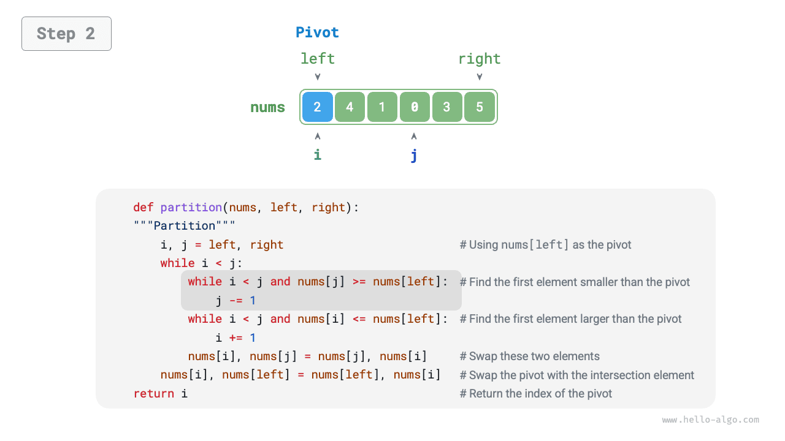
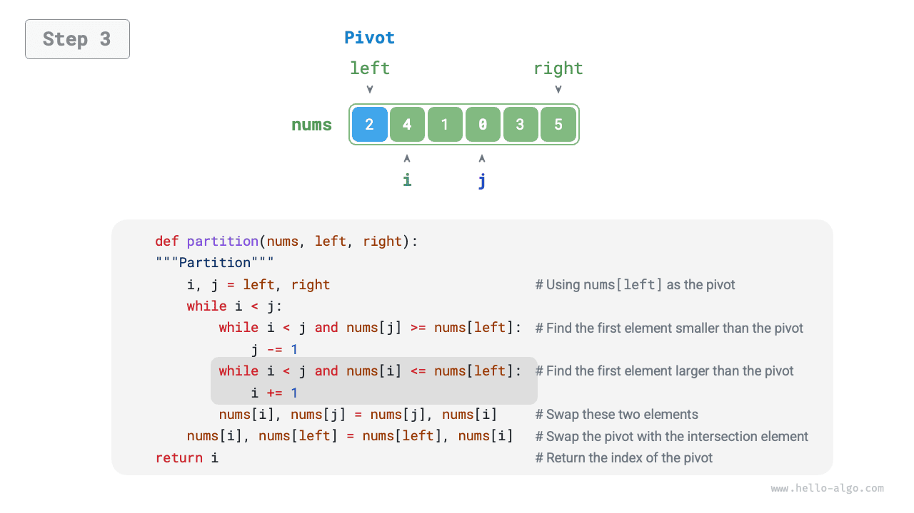
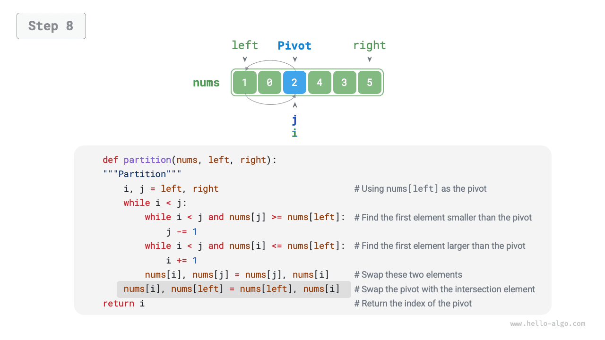

# 11.5 &nbsp; 퀵 정렬

<u>퀵 정렬(quick sort)</u>은 분할 정복 전략에 기반한 정렬 알고리즘으로, 실행 효율이 높고 널리 사용된다.

퀵 정렬의 핵심 연산은 '센티널 분할'이다. 배열의 한 원소를 '피벗'으로 고른 다음, 피벗보다 작은 원소는 모두 왼쪽으로, 큰 원소는 모두 오른쪽으로 옮기는 것이 목표다. 구체적인 과정은 아래 그림(11-8)과 같다.

1. 배열의 맨 왼쪽 원소를 피벗으로 고르고, 포인터 `i`와 `j`가 배열의 양 끝을 가리키도록 초기화한다.
2. 반복문을 실행하여 매번 `i`(`j`)로 피벗보다 큰(작은) 첫 번째 원소를 각각 찾은 뒤 두 원소를 교환한다.
3. `i`와 `j`가 만날 때까지 `2.` 단계를 반복한다. 마지막으로 피벗을 두 부분 배열의 경계로 옮긴다.

=== "<1>"
    { class="animation-figure" }

=== "<2>"
    { class="animation-figure" }

=== "<3>"
    { class="animation-figure" }

=== "<4>"
    { class="animation-figure" }

=== "<5>"
    { class="animation-figure" }

=== "<6>"
    { class="animation-figure" }

=== "<7>"
    { class="animation-figure" }

=== "<8>"
    { class="animation-figure" }

=== "<9>"
    { class="animation-figure" }

<p align="center"> 그림 11-8 &nbsp; 센티널 분할 단계 </p>

분할을 마치면 원래 배열은 왼쪽 부분 배열, 피벗, 오른쪽 부분 배열의 세 부분으로 나뉘며, '왼쪽 부분 배열의 모든 원소 $\leq$ 피벗 $\leq$ 오른쪽 부분 배열의 모든 원소'를 만족한다. 따라서 이후에는 두 부분 배열만 정렬하면 된다.

!!! note "퀵 정렬의 분할 정복 전략"

    센티널 분할은 본질적으로 긴 배열 하나를 정렬하는 문제를 짧은 배열 두 개를 정렬하는 문제로 단순화한다.

=== "Python"

    ```python title="quick_sort.py"
    def partition(self, nums: list[int], left: int, right: int) -> int:
        """센티널 분할"""
        # nums[left]를 피벗으로 삼는다
        i, j = left, right
        while i < j:
            while i < j and nums[j] >= nums[left]:
                j -= 1  # 오른쪽에서 왼쪽으로 피벗보다 작은 첫 번째 원소를 찾는다
            while i < j and nums[i] <= nums[left]:
                i += 1  # 왼쪽에서 오른쪽으로 피벗보다 큰 첫 번째 원소를 찾는다
            # 원소 교환
            nums[i], nums[j] = nums[j], nums[i]
        # 피벗을 두 부분 배열의 경계로 교환하여 옮긴다
        nums[i], nums[left] = nums[left], nums[i]
        return i  # 피벗의 인덱스를 반환한다
    ```

=== "C++"

    ```cpp title="quick_sort.cpp"
    /* 센티널 분할 */
    int partition(vector<int> &nums, int left, int right) {
        // nums[left]를 피벗으로 삼는다
        int i = left, j = right;
        while (i < j) {
            while (i < j && nums[j] >= nums[left])
                j--;                // 오른쪽에서 왼쪽으로 피벗보다 작은 첫 번째 원소를 찾는다
            while (i < j && nums[i] <= nums[left])
                i++;                // 왼쪽에서 오른쪽으로 피벗보다 큰 첫 번째 원소를 찾는다
            swap(nums[i], nums[j]); // 두 원소를 교환한다
        }
        swap(nums[i], nums[left]);  // 피벗을 두 부분 배열의 경계로 교환하여 옮긴다
        return i;                   // 피벗의 인덱스를 반환한다
    }
    ```

=== "Java"

    ```java title="quick_sort.java"
    /* 원소 교환 */
    void swap(int[] nums, int i, int j) {
        int tmp = nums[i];
        nums[i] = nums[j];
        nums[j] = tmp;
    }

    /* 센티널 분할 */
    int partition(int[] nums, int left, int right) {
        // nums[left]를 피벗으로 삼는다
        int i = left, j = right;
        while (i < j) {
            while (i < j && nums[j] >= nums[left])
                j--;          // 오른쪽에서 왼쪽으로 피벗보다 작은 첫 번째 원소를 찾는다
            while (i < j && nums[i] <= nums[left])
                i++;          // 왼쪽에서 오른쪽으로 피벗보다 큰 첫 번째 원소를 찾는다
            swap(nums, i, j); // 두 원소를 교환한다
        }
        swap(nums, i, left);  // 피벗을 두 부분 배열의 경계로 교환하여 옮긴다
        return i;             // 피벗의 인덱스를 반환한다
    }
    ```

=== "C#"

    ```csharp title="quick_sort.cs"
    /* 원소 교환 */
    void Swap(int[] nums, int i, int j) {
        (nums[j], nums[i]) = (nums[i], nums[j]);
    }

    /* 센티널 분할 */
    int Partition(int[] nums, int left, int right) {
        // nums[left]를 피벗으로 삼는다
        int i = left, j = right;
        while (i < j) {
            while (i < j && nums[j] >= nums[left])
                j--;          // 오른쪽에서 왼쪽으로 피벗보다 작은 첫 번째 원소를 찾는다
            while (i < j && nums[i] <= nums[left])
                i++;          // 왼쪽에서 오른쪽으로 피벗보다 큰 첫 번째 원소를 찾는다
            Swap(nums, i, j); // 두 원소를 교환한다
        }
        Swap(nums, i, left);  // 피벗을 두 부분 배열의 경계로 교환하여 옮긴다
        return i;             // 피벗의 인덱스를 반환한다
    }
    ```

=== "Go"

    ```go title="quick_sort.go"
    /* 센티널 분할 */
    func (q *quickSort) partition(nums []int, left, right int) int {
        // nums[left]를 피벗으로 삼는다
        i, j := left, right
        for i < j {
            for i < j && nums[j] >= nums[left] {
                j-- // 오른쪽에서 왼쪽으로 피벗보다 작은 첫 번째 원소를 찾는다
            }
            for i < j && nums[i] <= nums[left] {
                i++ // 왼쪽에서 오른쪽으로 피벗보다 큰 첫 번째 원소를 찾는다
            }
            // 원소 교환
            nums[i], nums[j] = nums[j], nums[i]
        }
        // 피벗을 두 부분 배열의 경계로 교환하여 옮긴다
        nums[i], nums[left] = nums[left], nums[i]
        return i // 피벗의 인덱스를 반환한다
    }
    ```

=== "Swift"

    ```swift title="quick_sort.swift"
    /* 센티널 분할 */
    func partition(nums: inout [Int], left: Int, right: Int) -> Int {
        // nums[left]를 피벗으로 삼는다
        var i = left
        var j = right
        while i < j {
            while i < j, nums[j] >= nums[left] {
                j -= 1 // 오른쪽에서 왼쪽으로 피벗보다 작은 첫 번째 원소를 찾는다
            }
            while i < j, nums[i] <= nums[left] {
                i += 1 // 왼쪽에서 오른쪽으로 피벗보다 큰 첫 번째 원소를 찾는다
            }
            nums.swapAt(i, j) // 두 원소를 교환한다
        }
        nums.swapAt(i, left) // 피벗을 두 부분 배열의 경계로 교환하여 옮긴다
        return i // 피벗의 인덱스를 반환한다
    }
    ```

=== "JS"

    ```javascript title="quick_sort.js"
    /* 원소 교환 */
    swap(nums, i, j) {
        let tmp = nums[i];
        nums[i] = nums[j];
        nums[j] = tmp;
    }

    /* 센티널 분할 */
    partition(nums, left, right) {
        // nums[left]를 피벗으로 삼는다
        let i = left,
            j = right;
        while (i < j) {
            while (i < j && nums[j] >= nums[left]) {
                j -= 1; // 오른쪽에서 왼쪽으로 피벗보다 작은 첫 번째 원소를 찾는다
            }
            while (i < j && nums[i] <= nums[left]) {
                i += 1; // 왼쪽에서 오른쪽으로 피벗보다 큰 첫 번째 원소를 찾는다
            }
            // 원소 교환
            this.swap(nums, i, j); // 두 원소를 교환한다
        }
        this.swap(nums, i, left); // 피벗을 두 부분 배열의 경계로 교환하여 옮긴다
        return i; // 피벗의 인덱스를 반환한다
    }
    ```

=== "TS"

    ```typescript title="quick_sort.ts"
    /* 원소 교환 */
    swap(nums: number[], i: number, j: number): void {
        let tmp = nums[i];
        nums[i] = nums[j];
        nums[j] = tmp;
    }

    /* 센티널 분할 */
    partition(nums: number[], left: number, right: number): number {
        // nums[left]를 피벗으로 삼는다
        let i = left,
            j = right;
        while (i < j) {
            while (i < j && nums[j] >= nums[left]) {
                j -= 1; // 오른쪽에서 왼쪽으로 피벗보다 작은 첫 번째 원소를 찾는다
            }
            while (i < j && nums[i] <= nums[left]) {
                i += 1; // 왼쪽에서 오른쪽으로 피벗보다 큰 첫 번째 원소를 찾는다
            }
            // 원소 교환
            this.swap(nums, i, j); // 두 원소를 교환한다
        }
        this.swap(nums, i, left); // 피벗을 두 부분 배열의 경계로 교환하여 옮긴다
        return i; // 피벗의 인덱스를 반환한다
    }
    ```

=== "Dart"

    ```dart title="quick_sort.dart"
    /* 원소 교환 */
    void _swap(List<int> nums, int i, int j) {
      int tmp = nums[i];
      nums[i] = nums[j];
      nums[j] = tmp;
    }

    /* 센티널 분할 */
    int _partition(List<int> nums, int left, int right) {
      // nums[left]를 피벗으로 삼는다
      int i = left, j = right;
      while (i < j) {
        while (i < j && nums[j] >= nums[left]) j--; // 오른쪽에서 왼쪽으로 피벗보다 작은 첫 번째 원소를 찾는다
        while (i < j && nums[i] <= nums[left]) i++; // 왼쪽에서 오른쪽으로 피벗보다 큰 첫 번째 원소를 찾는다
        _swap(nums, i, j); // 두 원소를 교환한다
      }
      _swap(nums, i, left); // 피벗을 두 부분 배열의 경계로 교환하여 옮긴다
      return i; // 피벗의 인덱스를 반환한다
    }
    ```

=== "Rust"

    ```rust title="quick_sort.rs"
    /* 센티널 분할 */
    fn partition(nums: &mut [i32], left: usize, right: usize) -> usize {
        // nums[left]를 피벗으로 삼는다
        let (mut i, mut j) = (left, right);
        while i < j {
            while i < j && nums[j] >= nums[left] {
                j -= 1; // 오른쪽에서 왼쪽으로 피벗보다 작은 첫 번째 원소를 찾는다
            }
            while i < j && nums[i] <= nums[left] {
                i += 1; // 왼쪽에서 오른쪽으로 피벗보다 큰 첫 번째 원소를 찾는다
            }
            nums.swap(i, j); // 두 원소를 교환한다
        }
        nums.swap(i, left); // 피벗을 두 부분 배열의 경계로 교환하여 옮긴다
        i // 피벗의 인덱스를 반환한다
    }
    ```

=== "C"

    ```c title="quick_sort.c"
    /* 원소 교환 */
    void swap(int nums[], int i, int j) {
        int tmp = nums[i];
        nums[i] = nums[j];
        nums[j] = tmp;
    }

    /* 센티널 분할 */
    int partition(int nums[], int left, int right) {
        // nums[left]를 피벗으로 삼는다
        int i = left, j = right;
        while (i < j) {
            while (i < j && nums[j] >= nums[left]) {
                j--; // 오른쪽에서 왼쪽으로 피벗보다 작은 첫 번째 원소를 찾는다
            }
            while (i < j && nums[i] <= nums[left]) {
                i++; // 왼쪽에서 오른쪽으로 피벗보다 큰 첫 번째 원소를 찾는다
            }
            // 두 원소를 교환한다
            swap(nums, i, j);
        }
        // 피벗을 두 부분 배열의 경계로 교환하여 옮긴다
        swap(nums, i, left);
        // 피벗의 인덱스를 반환한다
        return i;
    }
    ```

=== "Kotlin"

    ```kotlin title="quick_sort.kt"
    /* 원소 교환 */
    fun swap(nums: IntArray, i: Int, j: Int) {
        val temp = nums[i]
        nums[i] = nums[j]
        nums[j] = temp
    }

    /* 센티널 분할 */
    fun partition(nums: IntArray, left: Int, right: Int): Int {
        // nums[left]를 피벗으로 삼는다
        var i = left
        var j = right
        while (i < j) {
            while (i < j && nums[j] >= nums[left])
                j--           // 오른쪽에서 왼쪽으로 피벗보다 작은 첫 번째 원소를 찾는다
            while (i < j && nums[i] <= nums[left])
                i++           // 왼쪽에서 오른쪽으로 피벗보다 큰 첫 번째 원소를 찾는다
            swap(nums, i, j)  // 두 원소를 교환한다
        }
        swap(nums, i, left)   // 피벗을 두 부분 배열의 경계로 교환하여 옮긴다
        return i              // 피벗의 인덱스를 반환한다
    }
    ```

=== "Ruby"

    ```ruby title="quick_sort.rb"
    ### 센티널 분할 ###
    def partition(nums, left, right)
      # nums[left]를 피벗으로 삼는다
      i, j = left, right
      while i < j
        while i < j && nums[j] >= nums[left]
          j -= 1 # 오른쪽에서 왼쪽으로 피벗보다 작은 첫 번째 원소를 찾는다
        end
        while i < j && nums[i] <= nums[left]
          i += 1 # 왼쪽에서 오른쪽으로 피벗보다 큰 첫 번째 원소를 찾는다
        end
        # 원소 교환
        nums[i], nums[j] = nums[j], nums[i]
      end
      # 피벗을 두 부분 배열의 경계로 교환하여 옮긴다
      nums[i], nums[left] = nums[left], nums[i]
      i # 피벗의 인덱스를 반환한다
    end
    ```

??? pythontutor "코드 시각화"

    <div style="height: 549px; width: 100%;"><iframe class="pythontutor-iframe" title="코드 시각화" src="https://pythontutor.com/iframe-embed.html#code=def%20partition%28nums%3A%20list%5Bint%5D,%20left%3A%20int,%20right%3A%20int%29%20-%3E%20int%3A%0A%20%20%20%20%22%22%22%EC%84%BC%ED%8B%B0%EB%84%90%20%EB%B6%84%ED%95%A0%22%22%22%0A%20%20%20%20%23%20nums%5Bleft%5D%EB%A5%BC%20%ED%94%BC%EB%B2%97%EC%9C%BC%EB%A1%9C%20%EC%82%BC%EB%8A%94%EB%8B%A4%0A%20%20%20%20i,%20j%20%3D%20left,%20right%0A%20%20%20%20while%20i%20%3C%20j%3A%0A%20%20%20%20%20%20%20%20while%20i%20%3C%20j%20and%20nums%5Bj%5D%20%3E%3D%20nums%5Bleft%5D%3A%0A%20%20%20%20%20%20%20%20%20%20%20%20j%20-%3D%201%20%20%23%20%EC%98%A4%EB%A5%B8%EC%AA%BD%EC%97%90%EC%84%9C%20%EC%99%BC%EC%AA%BD%EC%9C%BC%EB%A1%9C%20%ED%94%BC%EB%B2%97%EB%B3%B4%EB%8B%A4%20%EC%9E%91%EC%9D%80%20%EC%B2%AB%20%EB%B2%88%EC%A7%B8%20%EC%9B%90%EC%86%8C%EB%A5%BC%20%EC%B0%BE%EB%8A%94%EB%8B%A4%0A%20%20%20%20%20%20%20%20while%20i%20%3C%20j%20and%20nums%5Bi%5D%20%3C%3D%20nums%5Bleft%5D%3A%0A%20%20%20%20%20%20%20%20%20%20%20%20i%20%2B%3D%201%20%20%23%20%EC%99%BC%EC%AA%BD%EC%97%90%EC%84%9C%20%EC%98%A4%EB%A5%B8%EC%AA%BD%EC%9C%BC%EB%A1%9C%20%ED%94%BC%EB%B2%97%EB%B3%B4%EB%8B%A4%20%ED%81%B0%20%EC%B2%AB%20%EB%B2%88%EC%A7%B8%20%EC%9B%90%EC%86%8C%EB%A5%BC%20%EC%B0%BE%EB%8A%94%EB%8B%A4%0A%20%20%20%20%20%20%20%20%23%20%EC%9B%90%EC%86%8C%20%EA%B5%90%ED%99%98%0A%20%20%20%20%20%20%20%20nums%5Bi%5D,%20nums%5Bj%5D%20%3D%20nums%5Bj%5D,%20nums%5Bi%5D%0A%20%20%20%20%23%20%ED%94%BC%EB%B2%97%EC%9D%84%20%EB%91%90%20%EB%B6%80%EB%B6%84%20%EB%B0%B0%EC%97%B4%EC%9D%98%20%EA%B2%BD%EA%B3%84%EB%A1%9C%20%EA%B5%90%ED%99%98%ED%95%98%EC%97%AC%20%EC%98%AE%EA%B8%B4%EB%8B%A4%0A%20%20%20%20nums%5Bi%5D,%20nums%5Bleft%5D%20%3D%20nums%5Bleft%5D,%20nums%5Bi%5D%0A%20%20%20%20return%20i%20%20%23%20%ED%94%BC%EB%B2%97%EC%9D%98%20%EC%9D%B8%EB%8D%B1%EC%8A%A4%EB%A5%BC%20%EB%B0%98%ED%99%98%ED%95%9C%EB%8B%A4%0A%0A%0A%22%22%22%EC%8B%A4%ED%96%89%20%EC%BD%94%EB%93%9C%22%22%22%0Aif%20__name__%20%3D%3D%20%22__main__%22%3A%0A%20%20%20%20nums%20%3D%20%5B2,%204,%201,%200,%203,%205%5D%0A%20%20%20%20partition%28nums,%200,%20len%28nums%29%20-%201%29%0A%20%20%20%20print%28%22%EC%84%BC%ED%8B%B0%EB%84%90%20%EB%B6%84%ED%95%A0%20%ED%9B%84%20nums%20%3D%22,%20nums%29&codeDivHeight=472&codeDivWidth=350&cumulative=false&curInstr=4&heapPrimitives=nevernest&origin=opt-frontend.js&py=311&rawInputLstJSON=%5B%5D&textReferences=false"> </iframe></div>
    <div style="margin-top: 5px;"><a href="https://pythontutor.com/iframe-embed.html#code=def%20partition%28nums%3A%20list%5Bint%5D,%20left%3A%20int,%20right%3A%20int%29%20-%3E%20int%3A%0A%20%20%20%20%22%22%22%EC%84%BC%ED%8B%B0%EB%84%90%20%EB%B6%84%ED%95%A0%22%22%22%0A%20%20%20%20%23%20nums%5Bleft%5D%EB%A5%BC%20%ED%94%BC%EB%B2%97%EC%9C%BC%EB%A1%9C%20%EC%82%BC%EB%8A%94%EB%8B%A4%0A%20%20%20%20i,%20j%20%3D%20left,%20right%0A%20%20%20%20while%20i%20%3C%20j%3A%0A%20%20%20%20%20%20%20%20while%20i%20%3C%20j%20and%20nums%5Bj%5D%20%3E%3D%20nums%5Bleft%5D%3A%0A%20%20%20%20%20%20%20%20%20%20%20%20j%20-%3D%201%20%20%23%20%EC%98%A4%EB%A5%B8%EC%AA%BD%EC%97%90%EC%84%9C%20%EC%99%BC%EC%AA%BD%EC%9C%BC%EB%A1%9C%20%ED%94%BC%EB%B2%97%EB%B3%B4%EB%8B%A4%20%EC%9E%91%EC%9D%80%20%EC%B2%AB%20%EB%B2%88%EC%A7%B8%20%EC%9B%90%EC%86%8C%EB%A5%BC%20%EC%B0%BE%EB%8A%94%EB%8B%A4%0A%20%20%20%20%20%20%20%20while%20i%20%3C%20j%20and%20nums%5Bi%5D%20%3C%3D%20nums%5Bleft%5D%3A%0A%20%20%20%20%20%20%20%20%20%20%20%20i%20%2B%3D%201%20%20%23%20%EC%99%BC%EC%AA%BD%EC%97%90%EC%84%9C%20%EC%98%A4%EB%A5%B8%EC%AA%BD%EC%9C%BC%EB%A1%9C%20%ED%94%BC%EB%B2%97%EB%B3%B4%EB%8B%A4%20%ED%81%B0%20%EC%B2%AB%20%EB%B2%88%EC%A7%B8%20%EC%9B%90%EC%86%8C%EB%A5%BC%20%EC%B0%BE%EB%8A%94%EB%8B%A4%0A%20%20%20%20%20%20%20%20%23%20%EC%9B%90%EC%86%8C%20%EA%B5%90%ED%99%98%0A%20%20%20%20%20%20%20%20nums%5Bi%5D,%20nums%5Bj%5D%20%3D%20nums%5Bj%5D,%20nums%5Bi%5D%0A%20%20%20%20%23%20%ED%94%BC%EB%B2%97%EC%9D%84%20%EB%91%90%20%EB%B6%80%EB%B6%84%20%EB%B0%B0%EC%97%B4%EC%9D%98%20%EA%B2%BD%EA%B3%84%EB%A1%9C%20%EA%B5%90%ED%99%98%ED%95%98%EC%97%AC%20%EC%98%AE%EA%B8%B4%EB%8B%A4%0A%20%20%20%20nums%5Bi%5D,%20nums%5Bleft%5D%20%3D%20nums%5Bleft%5D,%20nums%5Bi%5D%0A%20%20%20%20return%20i%20%20%23%20%ED%94%BC%EB%B2%97%EC%9D%98%20%EC%9D%B8%EB%8D%B1%EC%8A%A4%EB%A5%BC%20%EB%B0%98%ED%99%98%ED%95%9C%EB%8B%A4%0A%0A%0A%22%22%22%EC%8B%A4%ED%96%89%20%EC%BD%94%EB%93%9C%22%22%22%0Aif%20__name__%20%3D%3D%20%22__main__%22%3A%0A%20%20%20%20nums%20%3D%20%5B2,%204,%201,%200,%203,%205%5D%0A%20%20%20%20partition%28nums,%200,%20len%28nums%29%20-%201%29%0A%20%20%20%20print%28%22%EC%84%BC%ED%8B%B0%EB%84%90%20%EB%B6%84%ED%95%A0%20%ED%9B%84%20nums%20%3D%22,%20nums%29&codeDivHeight=800&codeDivWidth=600&cumulative=false&curInstr=4&heapPrimitives=nevernest&origin=opt-frontend.js&py=311&rawInputLstJSON=%5B%5D&textReferences=false" target="_blank" rel="noopener noreferrer">전체 화면 ></a></div>

## 11.5.1 &nbsp; 알고리즘 과정

퀵 정렬의 전체 과정은 아래 그림(11-9)과 같다.

1. 먼저 원래 배열에 '센티널 분할'을 한 번 수행하여 정렬되지 않은 왼쪽 부분 배열과 오른쪽 부분 배열을 얻는다.
2. 이어서 왼쪽 부분 배열과 오른쪽 부분 배열에 각각 '센티널 분할'을 재귀적으로 수행한다.
3. 부분 배열의 길이가 1이 될 때까지 재귀를 계속하면 배열 전체의 정렬이 완료된다.

{ class="animation-figure" }

<p align="center"> 그림 11-9 &nbsp; 퀵 정렬 과정 </p>

=== "Python"

    ```python title="quick_sort.py"
    def quick_sort(self, nums: list[int], left: int, right: int):
        """퀵 정렬"""
        # 부분 배열의 길이가 1이면 재귀를 종료한다
        if left >= right:
            return
        # 센티널 분할
        pivot = self.partition(nums, left, right)
        # 왼쪽 부분 배열과 오른쪽 부분 배열에 재귀 호출한다
        self.quick_sort(nums, left, pivot - 1)
        self.quick_sort(nums, pivot + 1, right)
    ```

=== "C++"

    ```cpp title="quick_sort.cpp"
    /* 퀵 정렬 */
    void quickSort(vector<int> &nums, int left, int right) {
        // 부분 배열의 길이가 1이면 재귀를 종료한다
        if (left >= right)
            return;
        // 센티널 분할
        int pivot = partition(nums, left, right);
        // 왼쪽 부분 배열과 오른쪽 부분 배열에 재귀 호출한다
        quickSort(nums, left, pivot - 1);
        quickSort(nums, pivot + 1, right);
    }
    ```

=== "Java"

    ```java title="quick_sort.java"
    /* 퀵 정렬 */
    void quickSort(int[] nums, int left, int right) {
        // 부분 배열의 길이가 1이면 재귀를 종료한다
        if (left >= right)
            return;
        // 센티널 분할
        int pivot = partition(nums, left, right);
        // 왼쪽 부분 배열과 오른쪽 부분 배열에 재귀 호출한다
        quickSort(nums, left, pivot - 1);
        quickSort(nums, pivot + 1, right);
    }
    ```

=== "C#"

    ```csharp title="quick_sort.cs"
    /* 퀵 정렬 */
    void QuickSort(int[] nums, int left, int right) {
        // 부분 배열의 길이가 1이면 재귀를 종료한다
        if (left >= right)
            return;
        // 센티널 분할
        int pivot = Partition(nums, left, right);
        // 왼쪽 부분 배열과 오른쪽 부분 배열에 재귀 호출한다
        QuickSort(nums, left, pivot - 1);
        QuickSort(nums, pivot + 1, right);
    }
    ```

=== "Go"

    ```go title="quick_sort.go"
    /* 퀵 정렬 */
    func (q *quickSort) quickSort(nums []int, left, right int) {
        // 부분 배열의 길이가 1이면 재귀를 종료한다
        if left >= right {
            return
        }
        // 센티널 분할
        pivot := q.partition(nums, left, right)
        // 왼쪽 부분 배열과 오른쪽 부분 배열에 재귀 호출한다
        q.quickSort(nums, left, pivot-1)
        q.quickSort(nums, pivot+1, right)
    }
    ```

=== "Swift"

    ```swift title="quick_sort.swift"
    /* 퀵 정렬 */
    func quickSort(nums: inout [Int], left: Int, right: Int) {
        // 부분 배열의 길이가 1이면 재귀를 종료한다
        if left >= right {
            return
        }
        // 센티널 분할
        let pivot = partition(nums: &nums, left: left, right: right)
        // 왼쪽 부분 배열과 오른쪽 부분 배열에 재귀 호출한다
        quickSort(nums: &nums, left: left, right: pivot - 1)
        quickSort(nums: &nums, left: pivot + 1, right: right)
    }
    ```

=== "JS"

    ```javascript title="quick_sort.js"
    /* 퀵 정렬 */
    quickSort(nums, left, right) {
        // 부분 배열의 길이가 1이면 재귀를 종료한다
        if (left >= right) return;
        // 센티널 분할
        const pivot = this.partition(nums, left, right);
        // 왼쪽 부분 배열과 오른쪽 부분 배열에 재귀 호출한다
        this.quickSort(nums, left, pivot - 1);
        this.quickSort(nums, pivot + 1, right);
    }
    ```

=== "TS"

    ```typescript title="quick_sort.ts"
    /* 퀵 정렬 */
    quickSort(nums: number[], left: number, right: number): void {
        // 부분 배열의 길이가 1이면 재귀를 종료한다
        if (left >= right) {
            return;
        }
        // 센티널 분할
        const pivot = this.partition(nums, left, right);
        // 왼쪽 부분 배열과 오른쪽 부분 배열에 재귀 호출한다
        this.quickSort(nums, left, pivot - 1);
        this.quickSort(nums, pivot + 1, right);
    }
    ```

=== "Dart"

    ```dart title="quick_sort.dart"
    /* 퀵 정렬 */
    void quickSort(List<int> nums, int left, int right) {
      // 부분 배열의 길이가 1이면 재귀를 종료한다
      if (left >= right) return;
      // 센티널 분할
      int pivot = _partition(nums, left, right);
      // 왼쪽 부분 배열과 오른쪽 부분 배열에 재귀 호출한다
      quickSort(nums, left, pivot - 1);
      quickSort(nums, pivot + 1, right);
    }
    ```

=== "Rust"

    ```rust title="quick_sort.rs"
    /* 퀵 정렬 */
    pub fn quick_sort(left: i32, right: i32, nums: &mut [i32]) {
        // 부분 배열의 길이가 1이면 재귀를 종료한다
        if left >= right {
            return;
        }
        // 센티널 분할
        let pivot = Self::partition(nums, left as usize, right as usize) as i32;
        // 왼쪽 부분 배열과 오른쪽 부분 배열에 재귀 호출한다
        Self::quick_sort(left, pivot - 1, nums);
        Self::quick_sort(pivot + 1, right, nums);
    }
    ```

=== "C"

    ```c title="quick_sort.c"
    /* 퀵 정렬 */
    void quickSort(int nums[], int left, int right) {
        // 부분 배열의 길이가 1이면 재귀를 종료한다
        if (left >= right) {
            return;
        }
        // 센티널 분할
        int pivot = partition(nums, left, right);
        // 왼쪽 부분 배열과 오른쪽 부분 배열에 재귀 호출한다
        quickSort(nums, left, pivot - 1);
        quickSort(nums, pivot + 1, right);
    }
    ```

=== "Kotlin"

    ```kotlin title="quick_sort.kt"
    /* 퀵 정렬 */
    fun quickSort(nums: IntArray, left: Int, right: Int) {
        // 부분 배열의 길이가 1이면 재귀를 종료한다
        if (left >= right) return
        // 센티널 분할
        val pivot = partition(nums, left, right)
        // 왼쪽 부분 배열과 오른쪽 부분 배열에 재귀 호출한다
        quickSort(nums, left, pivot - 1)
        quickSort(nums, pivot + 1, right)
    }
    ```

=== "Ruby"

    ```ruby title="quick_sort.rb"
    ### 퀵 정렬 클래스 ###
    def quick_sort(nums, left, right)
      # 부분 배열의 길이가 1이 아니면 재귀 호출한다
      if left < right
        # 센티널 분할
        pivot = partition(nums, left, right)
        # 왼쪽 부분 배열과 오른쪽 부분 배열에 재귀 호출한다
        quick_sort(nums, left, pivot - 1)
        quick_sort(nums, pivot + 1, right)
      end
      nums
    end
    ```

??? pythontutor "코드 시각화"

    <div style="height: 549px; width: 100%;"><iframe class="pythontutor-iframe" title="코드 시각화" src="https://pythontutor.com/iframe-embed.html#code=def%20partition%28nums%3A%20list%5Bint%5D,%20left%3A%20int,%20right%3A%20int%29%20-%3E%20int%3A%0A%20%20%20%20%22%22%22%EC%84%BC%ED%8B%B0%EB%84%90%20%EB%B6%84%ED%95%A0%22%22%22%0A%20%20%20%20%23%20nums%5Bleft%5D%EB%A5%BC%20%ED%94%BC%EB%B2%97%EC%9C%BC%EB%A1%9C%20%EC%82%BC%EB%8A%94%EB%8B%A4%0A%20%20%20%20i,%20j%20%3D%20left,%20right%0A%20%20%20%20while%20i%20%3C%20j%3A%0A%20%20%20%20%20%20%20%20while%20i%20%3C%20j%20and%20nums%5Bj%5D%20%3E%3D%20nums%5Bleft%5D%3A%0A%20%20%20%20%20%20%20%20%20%20%20%20j%20-%3D%201%20%20%23%20%EC%98%A4%EB%A5%B8%EC%AA%BD%EC%97%90%EC%84%9C%20%EC%99%BC%EC%AA%BD%EC%9C%BC%EB%A1%9C%20%ED%94%BC%EB%B2%97%EB%B3%B4%EB%8B%A4%20%EC%9E%91%EC%9D%80%20%EC%B2%AB%20%EB%B2%88%EC%A7%B8%20%EC%9B%90%EC%86%8C%EB%A5%BC%20%EC%B0%BE%EB%8A%94%EB%8B%A4%0A%20%20%20%20%20%20%20%20while%20i%20%3C%20j%20and%20nums%5Bi%5D%20%3C%3D%20nums%5Bleft%5D%3A%0A%20%20%20%20%20%20%20%20%20%20%20%20i%20%2B%3D%201%20%20%23%20%EC%99%BC%EC%AA%BD%EC%97%90%EC%84%9C%20%EC%98%A4%EB%A5%B8%EC%AA%BD%EC%9C%BC%EB%A1%9C%20%ED%94%BC%EB%B2%97%EB%B3%B4%EB%8B%A4%20%ED%81%B0%20%EC%B2%AB%20%EB%B2%88%EC%A7%B8%20%EC%9B%90%EC%86%8C%EB%A5%BC%20%EC%B0%BE%EB%8A%94%EB%8B%A4%0A%20%20%20%20%20%20%20%20%23%20%EC%9B%90%EC%86%8C%20%EA%B5%90%ED%99%98%0A%20%20%20%20%20%20%20%20nums%5Bi%5D,%20nums%5Bj%5D%20%3D%20nums%5Bj%5D,%20nums%5Bi%5D%0A%20%20%20%20%23%20%ED%94%BC%EB%B2%97%EC%9D%84%20%EB%91%90%20%EB%B6%80%EB%B6%84%20%EB%B0%B0%EC%97%B4%EC%9D%98%20%EA%B2%BD%EA%B3%84%EB%A1%9C%20%EA%B5%90%ED%99%98%ED%95%98%EC%97%AC%20%EC%98%AE%EA%B8%B4%EB%8B%A4%0A%20%20%20%20nums%5Bi%5D,%20nums%5Bleft%5D%20%3D%20nums%5Bleft%5D,%20nums%5Bi%5D%0A%20%20%20%20return%20i%20%20%23%20%ED%94%BC%EB%B2%97%EC%9D%98%20%EC%9D%B8%EB%8D%B1%EC%8A%A4%EB%A5%BC%20%EB%B0%98%ED%99%98%ED%95%9C%EB%8B%A4%0A%0Adef%20quick_sort%28nums%3A%20list%5Bint%5D,%20left%3A%20int,%20right%3A%20int%29%3A%0A%20%20%20%20%22%22%22%ED%80%B5%20%EC%A0%95%EB%A0%AC%22%22%22%0A%20%20%20%20%23%20%EB%B6%80%EB%B6%84%20%EB%B0%B0%EC%97%B4%EC%9D%98%20%EA%B8%B8%EC%9D%B4%EA%B0%80%201%EC%9D%B4%EB%A9%B4%20%EC%9E%AC%EA%B7%80%EB%A5%BC%20%EC%A2%85%EB%A3%8C%ED%95%9C%EB%8B%A4%0A%20%20%20%20if%20left%20%3E%3D%20right%3A%0A%20%20%20%20%20%20%20%20return%0A%20%20%20%20%23%20%EC%84%BC%ED%8B%B0%EB%84%90%20%EB%B6%84%ED%95%A0%0A%20%20%20%20pivot%20%3D%20partition%28nums,%20left,%20right%29%0A%20%20%20%20%23%20%EC%99%BC%EC%AA%BD%20%EB%B6%80%EB%B6%84%20%EB%B0%B0%EC%97%B4%EA%B3%BC%20%EC%98%A4%EB%A5%B8%EC%AA%BD%20%EB%B6%80%EB%B6%84%20%EB%B0%B0%EC%97%B4%EC%97%90%20%EC%9E%AC%EA%B7%80%20%ED%98%B8%EC%B6%9C%ED%95%9C%EB%8B%A4%0A%20%20%20%20quick_sort%28nums,%20left,%20pivot%20-%201%29%0A%20%20%20%20quick_sort%28nums,%20pivot%20%2B%201,%20right%29%0A%0A%0A%22%22%22%EC%8B%A4%ED%96%89%20%EC%BD%94%EB%93%9C%22%22%22%0Aif%20__name__%20%3D%3D%20%22__main__%22%3A%0A%20%20%20%20%23%20%ED%80%B5%20%EC%A0%95%EB%A0%AC%0A%20%20%20%20nums%20%3D%20%5B2,%204,%201,%200,%203,%205%5D%0A%20%20%20%20quick_sort%28nums,%200,%20len%28nums%29%20-%201%29%0A%20%20%20%20print%28%22%ED%80%B5%20%EC%A0%95%EB%A0%AC%EC%9D%84%20%EB%A7%88%EC%B9%9C%20%ED%9B%84%20nums%20%3D%22,%20nums%29&codeDivHeight=472&codeDivWidth=350&cumulative=false&curInstr=5&heapPrimitives=nevernest&origin=opt-frontend.js&py=311&rawInputLstJSON=%5B%5D&textReferences=false"> </iframe></div>
    <div style="margin-top: 5px;"><a href="https://pythontutor.com/iframe-embed.html#code=def%20partition%28nums%3A%20list%5Bint%5D,%20left%3A%20int,%20right%3A%20int%29%20-%3E%20int%3A%0A%20%20%20%20%22%22%22%EC%84%BC%ED%8B%B0%EB%84%90%20%EB%B6%84%ED%95%A0%22%22%22%0A%20%20%20%20%23%20nums%5Bleft%5D%EB%A5%BC%20%ED%94%BC%EB%B2%97%EC%9C%BC%EB%A1%9C%20%EC%82%BC%EB%8A%94%EB%8B%A4%0A%20%20%20%20i,%20j%20%3D%20left,%20right%0A%20%20%20%20while%20i%20%3C%20j%3A%0A%20%20%20%20%20%20%20%20while%20i%20%3C%20j%20and%20nums%5Bj%5D%20%3E%3D%20nums%5Bleft%5D%3A%0A%20%20%20%20%20%20%20%20%20%20%20%20j%20-%3D%201%20%20%23%20%EC%98%A4%EB%A5%B8%EC%AA%BD%EC%97%90%EC%84%9C%20%EC%99%BC%EC%AA%BD%EC%9C%BC%EB%A1%9C%20%ED%94%BC%EB%B2%97%EB%B3%B4%EB%8B%A4%20%EC%9E%91%EC%9D%80%20%EC%B2%AB%20%EB%B2%88%EC%A7%B8%20%EC%9B%90%EC%86%8C%EB%A5%BC%20%EC%B0%BE%EB%8A%94%EB%8B%A4%0A%20%20%20%20%20%20%20%20while%20i%20%3C%20j%20and%20nums%5Bi%5D%20%3C%3D%20nums%5Bleft%5D%3A%0A%20%20%20%20%20%20%20%20%20%20%20%20i%20%2B%3D%201%20%20%23%20%EC%99%BC%EC%AA%BD%EC%97%90%EC%84%9C%20%EC%98%A4%EB%A5%B8%EC%AA%BD%EC%9C%BC%EB%A1%9C%20%ED%94%BC%EB%B2%97%EB%B3%B4%EB%8B%A4%20%ED%81%B0%20%EC%B2%AB%20%EB%B2%88%EC%A7%B8%20%EC%9B%90%EC%86%8C%EB%A5%BC%20%EC%B0%BE%EB%8A%94%EB%8B%A4%0A%20%20%20%20%20%20%20%20%23%20%EC%9B%90%EC%86%8C%20%EA%B5%90%ED%99%98%0A%20%20%20%20%20%20%20%20nums%5Bi%5D,%20nums%5Bj%5D%20%3D%20nums%5Bj%5D,%20nums%5Bi%5D%0A%20%20%20%20%23%20%ED%94%BC%EB%B2%97%EC%9D%84%20%EB%91%90%20%EB%B6%80%EB%B6%84%20%EB%B0%B0%EC%97%B4%EC%9D%98%20%EA%B2%BD%EA%B3%84%EB%A1%9C%20%EA%B5%90%ED%99%98%ED%95%98%EC%97%AC%20%EC%98%AE%EA%B8%B4%EB%8B%A4%0A%20%20%20%20nums%5Bi%5D,%20nums%5Bleft%5D%20%3D%20nums%5Bleft%5D,%20nums%5Bi%5D%0A%20%20%20%20return%20i%20%20%23%20%ED%94%BC%EB%B2%97%EC%9D%98%20%EC%9D%B8%EB%8D%B1%EC%8A%A4%EB%A5%BC%20%EB%B0%98%ED%99%98%ED%95%9C%EB%8B%A4%0A%0Adef%20quick_sort%28nums%3A%20list%5Bint%5D,%20left%3A%20int,%20right%3A%20int%29%3A%0A%20%20%20%20%22%22%22%ED%80%B5%20%EC%A0%95%EB%A0%AC%22%22%22%0A%20%20%20%20%23%20%EB%B6%80%EB%B6%84%20%EB%B0%B0%EC%97%B4%EC%9D%98%20%EA%B8%B8%EC%9D%B4%EA%B0%80%201%EC%9D%B4%EB%A9%B4%20%EC%9E%AC%EA%B7%80%EB%A5%BC%20%EC%A2%85%EB%A3%8C%ED%95%9C%EB%8B%A4%0A%20%20%20%20if%20left%20%3E%3D%20right%3A%0A%20%20%20%20%20%20%20%20return%0A%20%20%20%20%23%20%EC%84%BC%ED%8B%B0%EB%84%90%20%EB%B6%84%ED%95%A0%0A%20%20%20%20pivot%20%3D%20partition%28nums,%20left,%20right%29%0A%20%20%20%20%23%20%EC%99%BC%EC%AA%BD%20%EB%B6%80%EB%B6%84%20%EB%B0%B0%EC%97%B4%EA%B3%BC%20%EC%98%A4%EB%A5%B8%EC%AA%BD%20%EB%B6%80%EB%B6%84%20%EB%B0%B0%EC%97%B4%EC%97%90%20%EC%9E%AC%EA%B7%80%20%ED%98%B8%EC%B6%9C%ED%95%9C%EB%8B%A4%0A%20%20%20%20quick_sort%28nums,%20left,%20pivot%20-%201%29%0A%20%20%20%20quick_sort%28nums,%20pivot%20%2B%201,%20right%29%0A%0A%0A%22%22%22%EC%8B%A4%ED%96%89%20%EC%BD%94%EB%93%9C%22%22%22%0Aif%20__name__%20%3D%3D%20%22__main__%22%3A%0A%20%20%20%20%23%20%ED%80%B5%20%EC%A0%95%EB%A0%AC%0A%20%20%20%20nums%20%3D%20%5B2,%204,%201,%200,%203,%205%5D%0A%20%20%20%20quick_sort%28nums,%200,%20len%28nums%29%20-%201%29%0A%20%20%20%20print%28%22%ED%80%B5%20%EC%A0%95%EB%A0%AC%EC%9D%84%20%EB%A7%88%EC%B9%9C%20%ED%9B%84%20nums%20%3D%22,%20nums%29&codeDivHeight=800&codeDivWidth=600&cumulative=false&curInstr=5&heapPrimitives=nevernest&origin=opt-frontend.js&py=311&rawInputLstJSON=%5B%5D&textReferences=false" target="_blank" rel="noopener noreferrer">전체 화면 ></a></div>

## 11.5.2 &nbsp; 알고리즘 특성

- **시간 복잡도 $O(n \log n)$, 비적응형 정렬**: 평균적으로 분할의 재귀 레벨 수는 $\log n$이고 각 레벨의 총반복 횟수는 $n$이므로 전체 시간은 $O(n \log n)$이다. 최악의 경우 매 분할에서 길이 $n$의 배열이 길이 $0$과 $n - 1$인 두 부분 배열로 나뉜다. 이때 재귀 레벨 수는 $n$에 이르고 각 레벨의 반복 횟수는 $n$이므로 전체 시간은 $O(n^2)$이다.
- **공간 복잡도 $O(n)$, 제자리 정렬**: 입력 배열이 완전히 역순이면 재귀 깊이가 최악의 값인 $n$에 이르므로 $O(n)$의 스택 프레임 공간을 사용한다. 정렬 자체는 추가 배열 없이 원래 배열에서 수행한다.
- **불안정 정렬**: 분할의 마지막 단계에서 피벗이 값이 같은 원소의 오른쪽으로 교환될 수 있다.

## 11.5.3 &nbsp; 퀵 정렬이 빠른 이유

이름에서도 알 수 있듯이 퀵 정렬은 효율 측면에서 장점이 있다. 평균 시간 복잡도는 '병합 정렬', '힙 정렬'과 같지만 보통 퀵 정렬이 더 효율적이다. 주요 이유는 다음과 같다.

- **최악의 경우가 발생할 확률이 낮다**: 퀵 정렬의 최악 시간 복잡도는 $O(n^2)$으로 병합 정렬만큼 안정적이지 않지만, 대부분의 경우 $O(n \log n)$ 시간에 실행된다.
- **캐시 활용 효율이 높다**: 분할을 수행할 때 시스템이 부분 배열 전체를 캐시에 올릴 수 있어 원소 접근이 효율적이다. 반면 '힙 정렬' 같은 알고리즘은 원소를 건너뛰며 접근하므로 이런 특성이 없다.
- **복잡도의 상수 계수가 작다**: 위 세 알고리즘 중 퀵 정렬은 비교, 대입, 교환 등의 총연산 수가 가장 적다. '삽입 정렬'이 '버블 정렬'보다 빠른 이유와 비슷하다.

## 11.5.4 &nbsp; 피벗 선택 최적화

**일부 입력에서는 퀵 정렬의 시간 효율이 떨어질 수 있다**. 극단적인 예로 입력 배열이 완전히 역순이라고 하자. 맨 왼쪽 원소를 피벗으로 고르면 분할 후 피벗이 맨 오른쪽으로 이동하여 왼쪽 부분 배열의 길이는 $n - 1$, 오른쪽 부분 배열의 길이는 $0$이 된다. 이런 식으로 재귀하면 매번 한쪽 부분 배열의 길이가 $0$이 되어 분할 정복 전략이 제 기능을 하지 못하고, 퀵 정렬은 '버블 정렬'과 비슷한 형태로 퇴화한다.

이 상황을 최대한 피하려면 **분할에 사용할 피벗의 선택 전략을 최적화할 수 있다**. 예를 들어 원소 하나를 무작위로 골라 피벗으로 삼을 수 있다. 하지만 운이 나빠 매번 좋지 않은 피벗을 고르면 여전히 만족스러운 효율을 얻지 못한다.

프로그래밍 언어가 일반적으로 생성하는 것은 '의사 난수'라는 점에 주의하자. 의사 난수 수열에 맞추어 특정 테스트 사례를 만들면 퀵 정렬의 효율이 여전히 저하될 수 있다.

더 개선하려면 배열에서 후보 원소 세 개(보통 첫 원소, 마지막 원소, 중간 원소)를 고르고, **이 세 후보의 중앙값을 피벗으로 사용한다**. 그러면 피벗이 '너무 작지도 크지도 않을' 확률이 크게 높아진다. 후보를 더 많이 골라 알고리즘의 견고함을 높일 수도 있다. 이 방법을 사용하면 시간 복잡도가 $O(n^2)$으로 저하될 확률이 크게 줄어든다.

예시 코드는 다음과 같다.

=== "Python"

    ```python title="quick_sort.py"
    def median_three(self, nums: list[int], left: int, mid: int, right: int) -> int:
        """세 후보 원소의 중앙값 선택"""
        l, m, r = nums[left], nums[mid], nums[right]
        if (l <= m <= r) or (r <= m <= l):
            return mid  # m은 l과 r 사이에 있다
        if (m <= l <= r) or (r <= l <= m):
            return left  # l은 m과 r 사이에 있다
        return right

    def partition(self, nums: list[int], left: int, right: int) -> int:
        """센티널 분할(세 수의 중앙값 선택)"""
        # nums[left]를 피벗으로 삼는다
        med = self.median_three(nums, left, (left + right) // 2, right)
        # 중앙값을 배열 맨 왼쪽으로 교환하여 옮긴다
        nums[left], nums[med] = nums[med], nums[left]
        # nums[left]를 피벗으로 삼는다
        i, j = left, right
        while i < j:
            while i < j and nums[j] >= nums[left]:
                j -= 1  # 오른쪽에서 왼쪽으로 피벗보다 작은 첫 번째 원소를 찾는다
            while i < j and nums[i] <= nums[left]:
                i += 1  # 왼쪽에서 오른쪽으로 피벗보다 큰 첫 번째 원소를 찾는다
            # 원소 교환
            nums[i], nums[j] = nums[j], nums[i]
        # 피벗을 두 부분 배열의 경계로 교환하여 옮긴다
        nums[i], nums[left] = nums[left], nums[i]
        return i  # 피벗의 인덱스를 반환한다
    ```

=== "C++"

    ```cpp title="quick_sort.cpp"
    /* 세 후보 원소의 중앙값 선택 */
    int medianThree(vector<int> &nums, int left, int mid, int right) {
        int l = nums[left], m = nums[mid], r = nums[right];
        if ((l <= m && m <= r) || (r <= m && m <= l))
            return mid; // m은 l과 r 사이에 있다
        if ((m <= l && l <= r) || (r <= l && l <= m))
            return left; // l은 m과 r 사이에 있다
        return right;
    }

    /* 센티널 분할(세 수의 중앙값 선택) */
    int partition(vector<int> &nums, int left, int right) {
        // 세 후보 원소의 중앙값 선택
        int med = medianThree(nums, left, (left + right) / 2, right);
        // 중앙값을 배열 맨 왼쪽으로 교환하여 옮긴다
        swap(nums[left], nums[med]);
        // nums[left]를 피벗으로 삼는다
        int i = left, j = right;
        while (i < j) {
            while (i < j && nums[j] >= nums[left])
                j--;                // 오른쪽에서 왼쪽으로 피벗보다 작은 첫 번째 원소를 찾는다
            while (i < j && nums[i] <= nums[left])
                i++;                // 왼쪽에서 오른쪽으로 피벗보다 큰 첫 번째 원소를 찾는다
            swap(nums[i], nums[j]); // 두 원소를 교환한다
        }
        swap(nums[i], nums[left]);  // 피벗을 두 부분 배열의 경계로 교환하여 옮긴다
        return i;                   // 피벗의 인덱스를 반환한다
    }
    ```

=== "Java"

    ```java title="quick_sort.java"
    /* 세 후보 원소의 중앙값 선택 */
    int medianThree(int[] nums, int left, int mid, int right) {
        int l = nums[left], m = nums[mid], r = nums[right];
        if ((l <= m && m <= r) || (r <= m && m <= l))
            return mid; // m은 l과 r 사이에 있다
        if ((m <= l && l <= r) || (r <= l && l <= m))
            return left; // l은 m과 r 사이에 있다
        return right;
    }

    /* 센티널 분할(세 수의 중앙값 선택) */
    int partition(int[] nums, int left, int right) {
        // 세 후보 원소의 중앙값 선택
        int med = medianThree(nums, left, (left + right) / 2, right);
        // 중앙값을 배열 맨 왼쪽으로 교환하여 옮긴다
        swap(nums, left, med);
        // nums[left]를 피벗으로 삼는다
        int i = left, j = right;
        while (i < j) {
            while (i < j && nums[j] >= nums[left])
                j--;          // 오른쪽에서 왼쪽으로 피벗보다 작은 첫 번째 원소를 찾는다
            while (i < j && nums[i] <= nums[left])
                i++;          // 왼쪽에서 오른쪽으로 피벗보다 큰 첫 번째 원소를 찾는다
            swap(nums, i, j); // 두 원소를 교환한다
        }
        swap(nums, i, left);  // 피벗을 두 부분 배열의 경계로 교환하여 옮긴다
        return i;             // 피벗의 인덱스를 반환한다
    }
    ```

=== "C#"

    ```csharp title="quick_sort.cs"
    /* 세 후보 원소의 중앙값 선택 */
    int MedianThree(int[] nums, int left, int mid, int right) {
        int l = nums[left], m = nums[mid], r = nums[right];
        if ((l <= m && m <= r) || (r <= m && m <= l))
            return mid; // m은 l과 r 사이에 있다
        if ((m <= l && l <= r) || (r <= l && l <= m))
            return left; // l은 m과 r 사이에 있다
        return right;
    }

    /* 센티널 분할(세 수의 중앙값 선택) */
    int Partition(int[] nums, int left, int right) {
        // 세 후보 원소의 중앙값 선택
        int med = MedianThree(nums, left, (left + right) / 2, right);
        // 중앙값을 배열 맨 왼쪽으로 교환하여 옮긴다
        Swap(nums, left, med);
        // nums[left]를 피벗으로 삼는다
        int i = left, j = right;
        while (i < j) {
            while (i < j && nums[j] >= nums[left])
                j--;          // 오른쪽에서 왼쪽으로 피벗보다 작은 첫 번째 원소를 찾는다
            while (i < j && nums[i] <= nums[left])
                i++;          // 왼쪽에서 오른쪽으로 피벗보다 큰 첫 번째 원소를 찾는다
            Swap(nums, i, j); // 두 원소를 교환한다
        }
        Swap(nums, i, left);  // 피벗을 두 부분 배열의 경계로 교환하여 옮긴다
        return i;             // 피벗의 인덱스를 반환한다
    }
    ```

=== "Go"

    ```go title="quick_sort.go"
    /* 세 후보 원소의 중앙값 선택 */
    func (q *quickSortMedian) medianThree(nums []int, left, mid, right int) int {
        l, m, r := nums[left], nums[mid], nums[right]
        if (l <= m && m <= r) || (r <= m && m <= l) {
            return mid // m은 l과 r 사이에 있다
        }
        if (m <= l && l <= r) || (r <= l && l <= m) {
            return left // l은 m과 r 사이에 있다
        }
        return right
    }

    /* 센티널 분할(세 수의 중앙값 선택)*/
    func (q *quickSortMedian) partition(nums []int, left, right int) int {
        // nums[left]를 피벗으로 삼는다
        med := q.medianThree(nums, left, (left+right)/2, right)
        // 중앙값을 배열 맨 왼쪽으로 교환하여 옮긴다
        nums[left], nums[med] = nums[med], nums[left]
        // nums[left]를 피벗으로 삼는다
        i, j := left, right
        for i < j {
            for i < j && nums[j] >= nums[left] {
                j-- //오른쪽에서 왼쪽으로 피벗보다 작은 첫 번째 원소를 찾는다
            }
            for i < j && nums[i] <= nums[left] {
                i++ //왼쪽에서 오른쪽으로 피벗보다 큰 첫 번째 원소를 찾는다
            }
            //원소 교환
            nums[i], nums[j] = nums[j], nums[i]
        }
        //피벗을 두 부분 배열의 경계로 교환하여 옮긴다
        nums[i], nums[left] = nums[left], nums[i]
        return i //피벗의 인덱스를 반환한다
    }
    ```

=== "Swift"

    ```swift title="quick_sort.swift"
    /* 세 후보 원소의 중앙값 선택 */
    func medianThree(nums: [Int], left: Int, mid: Int, right: Int) -> Int {
        let l = nums[left]
        let m = nums[mid]
        let r = nums[right]
        if (l <= m && m <= r) || (r <= m && m <= l) {
            return mid // m은 l과 r 사이에 있다
        }
        if (m <= l && l <= r) || (r <= l && l <= m) {
            return left // l은 m과 r 사이에 있다
        }
        return right
    }

    /* 센티널 분할(세 수의 중앙값 선택) */
    func partitionMedian(nums: inout [Int], left: Int, right: Int) -> Int {
        // 세 후보 원소의 중앙값 선택
        let med = medianThree(nums: nums, left: left, mid: left + (right - left) / 2, right: right)
        // 중앙값을 배열 맨 왼쪽으로 교환하여 옮긴다
        nums.swapAt(left, med)
        return partition(nums: &nums, left: left, right: right)
    }
    ```

=== "JS"

    ```javascript title="quick_sort.js"
    /* 세 후보 원소의 중앙값 선택 */
    medianThree(nums, left, mid, right) {
        let l = nums[left],
            m = nums[mid],
            r = nums[right];
        // m은 l과 r 사이에 있다
        if ((l <= m && m <= r) || (r <= m && m <= l)) return mid;
        // l은 m과 r 사이에 있다
        if ((m <= l && l <= r) || (r <= l && l <= m)) return left;
        return right;
    }

    /* 센티널 분할(세 수의 중앙값 선택) */
    partition(nums, left, right) {
        // 세 후보 원소의 중앙값 선택
        let med = this.medianThree(
            nums,
            left,
            Math.floor((left + right) / 2),
            right
        );
        // 중앙값을 배열 맨 왼쪽으로 교환하여 옮긴다
        this.swap(nums, left, med);
        // nums[left]를 피벗으로 삼는다
        let i = left,
            j = right;
        while (i < j) {
            while (i < j && nums[j] >= nums[left]) j--; // 오른쪽에서 왼쪽으로 피벗보다 작은 첫 번째 원소를 찾는다
            while (i < j && nums[i] <= nums[left]) i++; // 왼쪽에서 오른쪽으로 피벗보다 큰 첫 번째 원소를 찾는다
            this.swap(nums, i, j); // 두 원소를 교환한다
        }
        this.swap(nums, i, left); // 피벗을 두 부분 배열의 경계로 교환하여 옮긴다
        return i; // 피벗의 인덱스를 반환한다
    }
    ```

=== "TS"

    ```typescript title="quick_sort.ts"
    /* 세 후보 원소의 중앙값 선택 */
    medianThree(
        nums: number[],
        left: number,
        mid: number,
        right: number
    ): number {
        let l = nums[left],
            m = nums[mid],
            r = nums[right];
        // m은 l과 r 사이에 있다
        if ((l <= m && m <= r) || (r <= m && m <= l)) return mid;
        // l은 m과 r 사이에 있다
        if ((m <= l && l <= r) || (r <= l && l <= m)) return left;
        return right;
    }

    /* 센티널 분할(세 수의 중앙값 선택) */
    partition(nums: number[], left: number, right: number): number {
        // 세 후보 원소의 중앙값 선택
        let med = this.medianThree(
            nums,
            left,
            Math.floor((left + right) / 2),
            right
        );
        // 중앙값을 배열 맨 왼쪽으로 교환하여 옮긴다
        this.swap(nums, left, med);
        // nums[left]를 피벗으로 삼는다
        let i = left,
            j = right;
        while (i < j) {
            while (i < j && nums[j] >= nums[left]) {
                j--; // 오른쪽에서 왼쪽으로 피벗보다 작은 첫 번째 원소를 찾는다
            }
            while (i < j && nums[i] <= nums[left]) {
                i++; // 왼쪽에서 오른쪽으로 피벗보다 큰 첫 번째 원소를 찾는다
            }
            this.swap(nums, i, j); // 두 원소를 교환한다
        }
        this.swap(nums, i, left); // 피벗을 두 부분 배열의 경계로 교환하여 옮긴다
        return i; // 피벗의 인덱스를 반환한다
    }
    ```

=== "Dart"

    ```dart title="quick_sort.dart"
    /* 세 후보 원소의 중앙값 선택 */
    int _medianThree(List<int> nums, int left, int mid, int right) {
      int l = nums[left], m = nums[mid], r = nums[right];
      if ((l <= m && m <= r) || (r <= m && m <= l))
        return mid; // m은 l과 r 사이에 있다
      if ((m <= l && l <= r) || (r <= l && l <= m))
        return left; // l은 m과 r 사이에 있다
      return right;
    }

    /* 센티널 분할(세 수의 중앙값 선택) */
    int _partition(List<int> nums, int left, int right) {
      // 세 후보 원소의 중앙값 선택
      int med = _medianThree(nums, left, (left + right) ~/ 2, right);
      // 중앙값을 배열 맨 왼쪽으로 교환하여 옮긴다
      _swap(nums, left, med);
      // nums[left]를 피벗으로 삼는다
      int i = left, j = right;
      while (i < j) {
        while (i < j && nums[j] >= nums[left]) j--; // 오른쪽에서 왼쪽으로 피벗보다 작은 첫 번째 원소를 찾는다
        while (i < j && nums[i] <= nums[left]) i++; // 왼쪽에서 오른쪽으로 피벗보다 큰 첫 번째 원소를 찾는다
        _swap(nums, i, j); // 두 원소를 교환한다
      }
      _swap(nums, i, left); // 피벗을 두 부분 배열의 경계로 교환하여 옮긴다
      return i; // 피벗의 인덱스를 반환한다
    }
    ```

=== "Rust"

    ```rust title="quick_sort.rs"
    /* 세 후보 원소의 중앙값 선택 */
    fn median_three(nums: &mut [i32], left: usize, mid: usize, right: usize) -> usize {
        let (l, m, r) = (nums[left], nums[mid], nums[right]);
        if (l <= m && m <= r) || (r <= m && m <= l) {
            return mid; // m은 l과 r 사이에 있다
        }
        if (m <= l && l <= r) || (r <= l && l <= m) {
            return left; // l은 m과 r 사이에 있다
        }
        right
    }

    /* 센티널 분할(세 수의 중앙값 선택) */
    fn partition(nums: &mut [i32], left: usize, right: usize) -> usize {
        // 세 후보 원소의 중앙값 선택
        let med = Self::median_three(nums, left, (left + right) / 2, right);
        // 중앙값을 배열 맨 왼쪽으로 교환하여 옮긴다
        nums.swap(left, med);
        // nums[left]를 피벗으로 삼는다
        let (mut i, mut j) = (left, right);
        while i < j {
            while i < j && nums[j] >= nums[left] {
                j -= 1; // 오른쪽에서 왼쪽으로 피벗보다 작은 첫 번째 원소를 찾는다
            }
            while i < j && nums[i] <= nums[left] {
                i += 1; // 왼쪽에서 오른쪽으로 피벗보다 큰 첫 번째 원소를 찾는다
            }
            nums.swap(i, j); // 두 원소를 교환한다
        }
        nums.swap(i, left); // 피벗을 두 부분 배열의 경계로 교환하여 옮긴다
        i // 피벗의 인덱스를 반환한다
    }
    ```

=== "C"

    ```c title="quick_sort.c"
    /* 세 후보 원소의 중앙값 선택 */
    int medianThree(int nums[], int left, int mid, int right) {
        int l = nums[left], m = nums[mid], r = nums[right];
        if ((l <= m && m <= r) || (r <= m && m <= l))
            return mid; // m은 l과 r 사이에 있다
        if ((m <= l && l <= r) || (r <= l && l <= m))
            return left; // l은 m과 r 사이에 있다
        return right;
    }

    /* 센티널 분할(세 수의 중앙값 선택) */
    int partitionMedian(int nums[], int left, int right) {
        // 세 후보 원소의 중앙값 선택
        int med = medianThree(nums, left, (left + right) / 2, right);
        // 중앙값을 배열 맨 왼쪽으로 교환하여 옮긴다
        swap(nums, left, med);
        // nums[left]를 피벗으로 삼는다
        int i = left, j = right;
        while (i < j) {
            while (i < j && nums[j] >= nums[left])
                j--; // 오른쪽에서 왼쪽으로 피벗보다 작은 첫 번째 원소를 찾는다
            while (i < j && nums[i] <= nums[left])
                i++;          // 왼쪽에서 오른쪽으로 피벗보다 큰 첫 번째 원소를 찾는다
            swap(nums, i, j); // 두 원소를 교환한다
        }
        swap(nums, i, left); // 피벗을 두 부분 배열의 경계로 교환하여 옮긴다
        return i;            // 피벗의 인덱스를 반환한다
    }
    ```

=== "Kotlin"

    ```kotlin title="quick_sort.kt"
    /* 세 후보 원소의 중앙값 선택 */
    fun medianThree(nums: IntArray, left: Int, mid: Int, right: Int): Int {
        val l = nums[left]
        val m = nums[mid]
        val r = nums[right]
        if ((m in l..r) || (m in r..l))
            return mid  // m은 l과 r 사이에 있다
        if ((l in m..r) || (l in r..m))
            return left // l은 m과 r 사이에 있다
        return right
    }

    /* 센티널 분할(세 수의 중앙값 선택) */
    fun partitionMedian(nums: IntArray, left: Int, right: Int): Int {
        // 세 후보 원소의 중앙값 선택
        val med = medianThree(nums, left, (left + right) / 2, right)
        // 중앙값을 배열 맨 왼쪽으로 교환하여 옮긴다
        swap(nums, left, med)
        // nums[left]를 피벗으로 삼는다
        var i = left
        var j = right
        while (i < j) {
            while (i < j && nums[j] >= nums[left])
                j--                      // 오른쪽에서 왼쪽으로 피벗보다 작은 첫 번째 원소를 찾는다
            while (i < j && nums[i] <= nums[left])
                i++                      // 왼쪽에서 오른쪽으로 피벗보다 큰 첫 번째 원소를 찾는다
            swap(nums, i, j)             // 두 원소를 교환한다
        }
        swap(nums, i, left)              // 피벗을 두 부분 배열의 경계로 교환하여 옮긴다
        return i                         // 피벗의 인덱스를 반환한다
    }
    ```

=== "Ruby"

    ```ruby title="quick_sort.rb"
    ### 세 후보 원소의 중앙값 선택 ###
    def median_three(nums, left, mid, right)
      # 세 후보 원소의 중앙값 선택
      _l, _m, _r = nums[left], nums[mid], nums[right]
      # m은 l과 r 사이에 있다
      return mid if (_l <= _m && _m <= _r) || (_r <= _m && _m <= _l)
      # l은 m과 r 사이에 있다
      return left if (_m <= _l && _l <= _r) || (_r <= _l && _l <= _m)
      return right
    end

    ### 센티널 분할(세 수의 중앙값 선택)###
    def partition(nums, left, right)
      ### nums[left]를 피벗으로 삼는다
      med = median_three(nums, left, (left + right) / 2, right)
      # 중앙값을 배열 맨 왼쪽으로 교환하여 옮긴다
      nums[left], nums[med] = nums[med], nums[left]
      i, j = left, right
      while i < j
        while i < j && nums[j] >= nums[left]
          j -= 1 # 오른쪽에서 왼쪽으로 피벗보다 작은 첫 번째 원소를 찾는다
        end
        while i < j && nums[i] <= nums[left]
          i += 1 # 왼쪽에서 오른쪽으로 피벗보다 큰 첫 번째 원소를 찾는다
        end
        # 원소 교환
        nums[i], nums[j] = nums[j], nums[i]
      end
      # 피벗을 두 부분 배열의 경계로 교환하여 옮긴다
      nums[i], nums[left] = nums[left], nums[i]
      i # 피벗의 인덱스를 반환한다
    end
    ```

??? pythontutor "코드 시각화"

    <div style="height: 549px; width: 100%;"><iframe class="pythontutor-iframe" title="코드 시각화" src="https://pythontutor.com/iframe-embed.html#code=def%20median_three%28nums%3A%20list%5Bint%5D,%20left%3A%20int,%20mid%3A%20int,%20right%3A%20int%29%20-%3E%20int%3A%0A%20%20%20%20%22%22%22%EC%84%B8%20%ED%9B%84%EB%B3%B4%20%EC%9B%90%EC%86%8C%EC%9D%98%20%EC%A4%91%EC%95%99%EA%B0%92%20%EC%84%A0%ED%83%9D%22%22%22%0A%20%20%20%20l,%20m,%20r%20%3D%20nums%5Bleft%5D,%20nums%5Bmid%5D,%20nums%5Bright%5D%0A%20%20%20%20if%20%28l%20%3C%3D%20m%20%3C%3D%20r%29%20or%20%28r%20%3C%3D%20m%20%3C%3D%20l%29%3A%0A%20%20%20%20%20%20%20%20return%20mid%20%20%23%20m%EC%9D%80%20l%EA%B3%BC%20r%20%EC%82%AC%EC%9D%B4%EC%97%90%20%EC%9E%88%EB%8B%A4%0A%20%20%20%20if%20%28m%20%3C%3D%20l%20%3C%3D%20r%29%20or%20%28r%20%3C%3D%20l%20%3C%3D%20m%29%3A%0A%20%20%20%20%20%20%20%20return%20left%20%20%23%20l%EC%9D%80%20m%EA%B3%BC%20r%20%EC%82%AC%EC%9D%B4%EC%97%90%20%EC%9E%88%EB%8B%A4%0A%20%20%20%20return%20right%0A%0Adef%20partition%28nums%3A%20list%5Bint%5D,%20left%3A%20int,%20right%3A%20int%29%20-%3E%20int%3A%0A%20%20%20%20%22%22%22%EC%84%BC%ED%8B%B0%EB%84%90%20%EB%B6%84%ED%95%A0%28%EC%84%B8%20%EC%88%98%EC%9D%98%20%EC%A4%91%EC%95%99%EA%B0%92%20%EC%84%A0%ED%83%9D%29%22%22%22%0A%20%20%20%20%23%20nums%5Bleft%5D%EB%A5%BC%20%ED%94%BC%EB%B2%97%EC%9C%BC%EB%A1%9C%20%EC%82%BC%EB%8A%94%EB%8B%A4%0A%20%20%20%20med%20%3D%20median_three%28nums,%20left,%20%28left%20%2B%20right%29%20//%202,%20right%29%0A%20%20%20%20%23%20%EC%A4%91%EC%95%99%EA%B0%92%EC%9D%84%20%EB%B0%B0%EC%97%B4%20%EB%A7%A8%20%EC%99%BC%EC%AA%BD%EC%9C%BC%EB%A1%9C%20%EA%B5%90%ED%99%98%ED%95%98%EC%97%AC%20%EC%98%AE%EA%B8%B4%EB%8B%A4%0A%20%20%20%20nums%5Bleft%5D,%20nums%5Bmed%5D%20%3D%20nums%5Bmed%5D,%20nums%5Bleft%5D%0A%20%20%20%20%23%20nums%5Bleft%5D%EB%A5%BC%20%ED%94%BC%EB%B2%97%EC%9C%BC%EB%A1%9C%20%EC%82%BC%EB%8A%94%EB%8B%A4%0A%20%20%20%20i,%20j%20%3D%20left,%20right%0A%20%20%20%20while%20i%20%3C%20j%3A%0A%20%20%20%20%20%20%20%20while%20i%20%3C%20j%20and%20nums%5Bj%5D%20%3E%3D%20nums%5Bleft%5D%3A%0A%20%20%20%20%20%20%20%20%20%20%20%20j%20-%3D%201%20%20%23%20%EC%98%A4%EB%A5%B8%EC%AA%BD%EC%97%90%EC%84%9C%20%EC%99%BC%EC%AA%BD%EC%9C%BC%EB%A1%9C%20%ED%94%BC%EB%B2%97%EB%B3%B4%EB%8B%A4%20%EC%9E%91%EC%9D%80%20%EC%B2%AB%20%EB%B2%88%EC%A7%B8%20%EC%9B%90%EC%86%8C%EB%A5%BC%20%EC%B0%BE%EB%8A%94%EB%8B%A4%0A%20%20%20%20%20%20%20%20while%20i%20%3C%20j%20and%20nums%5Bi%5D%20%3C%3D%20nums%5Bleft%5D%3A%0A%20%20%20%20%20%20%20%20%20%20%20%20i%20%2B%3D%201%20%20%23%20%EC%99%BC%EC%AA%BD%EC%97%90%EC%84%9C%20%EC%98%A4%EB%A5%B8%EC%AA%BD%EC%9C%BC%EB%A1%9C%20%ED%94%BC%EB%B2%97%EB%B3%B4%EB%8B%A4%20%ED%81%B0%20%EC%B2%AB%20%EB%B2%88%EC%A7%B8%20%EC%9B%90%EC%86%8C%EB%A5%BC%20%EC%B0%BE%EB%8A%94%EB%8B%A4%0A%20%20%20%20%20%20%20%20%23%20%EC%9B%90%EC%86%8C%20%EA%B5%90%ED%99%98%0A%20%20%20%20%20%20%20%20nums%5Bi%5D,%20nums%5Bj%5D%20%3D%20nums%5Bj%5D,%20nums%5Bi%5D%0A%20%20%20%20%23%20%ED%94%BC%EB%B2%97%EC%9D%84%20%EB%91%90%20%EB%B6%80%EB%B6%84%20%EB%B0%B0%EC%97%B4%EC%9D%98%20%EA%B2%BD%EA%B3%84%EB%A1%9C%20%EA%B5%90%ED%99%98%ED%95%98%EC%97%AC%20%EC%98%AE%EA%B8%B4%EB%8B%A4%0A%20%20%20%20nums%5Bi%5D,%20nums%5Bleft%5D%20%3D%20nums%5Bleft%5D,%20nums%5Bi%5D%0A%20%20%20%20return%20i%20%20%23%20%ED%94%BC%EB%B2%97%EC%9D%98%20%EC%9D%B8%EB%8D%B1%EC%8A%A4%EB%A5%BC%20%EB%B0%98%ED%99%98%ED%95%9C%EB%8B%A4%0A%0A%0A%22%22%22%EC%8B%A4%ED%96%89%20%EC%BD%94%EB%93%9C%22%22%22%0Aif%20__name__%20%3D%3D%20%22__main__%22%3A%0A%20%20%20%20%23%20%EC%A4%91%EC%95%99%EA%B0%92%20%ED%94%BC%EB%B2%97%20%EC%B5%9C%EC%A0%81%ED%99%94%0A%20%20%20%20nums%20%3D%20%5B2,%204,%201,%200,%203,%205%5D%0A%20%20%20%20partition%28nums,%200,%20len%28nums%29%20-%201%29%0A%20%20%20%20print%28%22%EC%84%BC%ED%8B%B0%EB%84%90%20%EB%B6%84%ED%95%A0%28%EC%A4%91%EC%95%99%EA%B0%92%20%ED%94%BC%EB%B2%97%20%EC%B5%9C%EC%A0%81%ED%99%94%29%20%ED%9B%84%20nums%20%3D%22,%20nums%29&codeDivHeight=472&codeDivWidth=350&cumulative=false&curInstr=5&heapPrimitives=nevernest&origin=opt-frontend.js&py=311&rawInputLstJSON=%5B%5D&textReferences=false"> </iframe></div>
    <div style="margin-top: 5px;"><a href="https://pythontutor.com/iframe-embed.html#code=def%20median_three%28nums%3A%20list%5Bint%5D,%20left%3A%20int,%20mid%3A%20int,%20right%3A%20int%29%20-%3E%20int%3A%0A%20%20%20%20%22%22%22%EC%84%B8%20%ED%9B%84%EB%B3%B4%20%EC%9B%90%EC%86%8C%EC%9D%98%20%EC%A4%91%EC%95%99%EA%B0%92%20%EC%84%A0%ED%83%9D%22%22%22%0A%20%20%20%20l,%20m,%20r%20%3D%20nums%5Bleft%5D,%20nums%5Bmid%5D,%20nums%5Bright%5D%0A%20%20%20%20if%20%28l%20%3C%3D%20m%20%3C%3D%20r%29%20or%20%28r%20%3C%3D%20m%20%3C%3D%20l%29%3A%0A%20%20%20%20%20%20%20%20return%20mid%20%20%23%20m%EC%9D%80%20l%EA%B3%BC%20r%20%EC%82%AC%EC%9D%B4%EC%97%90%20%EC%9E%88%EB%8B%A4%0A%20%20%20%20if%20%28m%20%3C%3D%20l%20%3C%3D%20r%29%20or%20%28r%20%3C%3D%20l%20%3C%3D%20m%29%3A%0A%20%20%20%20%20%20%20%20return%20left%20%20%23%20l%EC%9D%80%20m%EA%B3%BC%20r%20%EC%82%AC%EC%9D%B4%EC%97%90%20%EC%9E%88%EB%8B%A4%0A%20%20%20%20return%20right%0A%0Adef%20partition%28nums%3A%20list%5Bint%5D,%20left%3A%20int,%20right%3A%20int%29%20-%3E%20int%3A%0A%20%20%20%20%22%22%22%EC%84%BC%ED%8B%B0%EB%84%90%20%EB%B6%84%ED%95%A0%28%EC%84%B8%20%EC%88%98%EC%9D%98%20%EC%A4%91%EC%95%99%EA%B0%92%20%EC%84%A0%ED%83%9D%29%22%22%22%0A%20%20%20%20%23%20nums%5Bleft%5D%EB%A5%BC%20%ED%94%BC%EB%B2%97%EC%9C%BC%EB%A1%9C%20%EC%82%BC%EB%8A%94%EB%8B%A4%0A%20%20%20%20med%20%3D%20median_three%28nums,%20left,%20%28left%20%2B%20right%29%20//%202,%20right%29%0A%20%20%20%20%23%20%EC%A4%91%EC%95%99%EA%B0%92%EC%9D%84%20%EB%B0%B0%EC%97%B4%20%EB%A7%A8%20%EC%99%BC%EC%AA%BD%EC%9C%BC%EB%A1%9C%20%EA%B5%90%ED%99%98%ED%95%98%EC%97%AC%20%EC%98%AE%EA%B8%B4%EB%8B%A4%0A%20%20%20%20nums%5Bleft%5D,%20nums%5Bmed%5D%20%3D%20nums%5Bmed%5D,%20nums%5Bleft%5D%0A%20%20%20%20%23%20nums%5Bleft%5D%EB%A5%BC%20%ED%94%BC%EB%B2%97%EC%9C%BC%EB%A1%9C%20%EC%82%BC%EB%8A%94%EB%8B%A4%0A%20%20%20%20i,%20j%20%3D%20left,%20right%0A%20%20%20%20while%20i%20%3C%20j%3A%0A%20%20%20%20%20%20%20%20while%20i%20%3C%20j%20and%20nums%5Bj%5D%20%3E%3D%20nums%5Bleft%5D%3A%0A%20%20%20%20%20%20%20%20%20%20%20%20j%20-%3D%201%20%20%23%20%EC%98%A4%EB%A5%B8%EC%AA%BD%EC%97%90%EC%84%9C%20%EC%99%BC%EC%AA%BD%EC%9C%BC%EB%A1%9C%20%ED%94%BC%EB%B2%97%EB%B3%B4%EB%8B%A4%20%EC%9E%91%EC%9D%80%20%EC%B2%AB%20%EB%B2%88%EC%A7%B8%20%EC%9B%90%EC%86%8C%EB%A5%BC%20%EC%B0%BE%EB%8A%94%EB%8B%A4%0A%20%20%20%20%20%20%20%20while%20i%20%3C%20j%20and%20nums%5Bi%5D%20%3C%3D%20nums%5Bleft%5D%3A%0A%20%20%20%20%20%20%20%20%20%20%20%20i%20%2B%3D%201%20%20%23%20%EC%99%BC%EC%AA%BD%EC%97%90%EC%84%9C%20%EC%98%A4%EB%A5%B8%EC%AA%BD%EC%9C%BC%EB%A1%9C%20%ED%94%BC%EB%B2%97%EB%B3%B4%EB%8B%A4%20%ED%81%B0%20%EC%B2%AB%20%EB%B2%88%EC%A7%B8%20%EC%9B%90%EC%86%8C%EB%A5%BC%20%EC%B0%BE%EB%8A%94%EB%8B%A4%0A%20%20%20%20%20%20%20%20%23%20%EC%9B%90%EC%86%8C%20%EA%B5%90%ED%99%98%0A%20%20%20%20%20%20%20%20nums%5Bi%5D,%20nums%5Bj%5D%20%3D%20nums%5Bj%5D,%20nums%5Bi%5D%0A%20%20%20%20%23%20%ED%94%BC%EB%B2%97%EC%9D%84%20%EB%91%90%20%EB%B6%80%EB%B6%84%20%EB%B0%B0%EC%97%B4%EC%9D%98%20%EA%B2%BD%EA%B3%84%EB%A1%9C%20%EA%B5%90%ED%99%98%ED%95%98%EC%97%AC%20%EC%98%AE%EA%B8%B4%EB%8B%A4%0A%20%20%20%20nums%5Bi%5D,%20nums%5Bleft%5D%20%3D%20nums%5Bleft%5D,%20nums%5Bi%5D%0A%20%20%20%20return%20i%20%20%23%20%ED%94%BC%EB%B2%97%EC%9D%98%20%EC%9D%B8%EB%8D%B1%EC%8A%A4%EB%A5%BC%20%EB%B0%98%ED%99%98%ED%95%9C%EB%8B%A4%0A%0A%0A%22%22%22%EC%8B%A4%ED%96%89%20%EC%BD%94%EB%93%9C%22%22%22%0Aif%20__name__%20%3D%3D%20%22__main__%22%3A%0A%20%20%20%20%23%20%EC%A4%91%EC%95%99%EA%B0%92%20%ED%94%BC%EB%B2%97%20%EC%B5%9C%EC%A0%81%ED%99%94%0A%20%20%20%20nums%20%3D%20%5B2,%204,%201,%200,%203,%205%5D%0A%20%20%20%20partition%28nums,%200,%20len%28nums%29%20-%201%29%0A%20%20%20%20print%28%22%EC%84%BC%ED%8B%B0%EB%84%90%20%EB%B6%84%ED%95%A0%28%EC%A4%91%EC%95%99%EA%B0%92%20%ED%94%BC%EB%B2%97%20%EC%B5%9C%EC%A0%81%ED%99%94%29%20%ED%9B%84%20nums%20%3D%22,%20nums%29&codeDivHeight=800&codeDivWidth=600&cumulative=false&curInstr=5&heapPrimitives=nevernest&origin=opt-frontend.js&py=311&rawInputLstJSON=%5B%5D&textReferences=false" target="_blank" rel="noopener noreferrer">전체 화면 ></a></div>

## 11.5.5 &nbsp; 재귀 깊이 최적화

**일부 입력에서는 퀵 정렬이 많은 공간을 차지할 수 있다**. 완전히 정렬된 입력 배열을 예로 들어 보자. 재귀 중인 부분 배열의 길이가 $m$이라면 매 분할에서 길이 $0$인 왼쪽 부분 배열과 길이 $m - 1$인 오른쪽 부분 배열이 생긴다. 이는 재귀 한 단계마다 줄어드는 문제 크기가 매우 작다는 뜻이다(원소 하나만 줄어든다). 재귀 트리의 높이는 $n - 1$에 이르며, $O(n)$ 크기의 스택 프레임 공간이 필요하다.

스택 프레임 공간이 쌓이지 않도록 매번 분할을 마친 뒤 두 부분 배열의 길이를 비교하여 **더 짧은 부분 배열에만 재귀를 수행할 수 있다**. 짧은 쪽의 길이는 $n / 2$를 넘지 않으므로 재귀 깊이를 $\log n$ 이하로 유지할 수 있다. 이로써 최악의 공간 복잡도를 $O(\log n)$으로 개선한다. 코드는 다음과 같다.

=== "Python"

    ```python title="quick_sort.py"
    def quick_sort(self, nums: list[int], left: int, right: int):
        """퀵 정렬(재귀 깊이 최적화)"""
        # 부분 배열의 길이가 1이면 종료한다
        while left < right:
            # 센티널 분할 연산
            pivot = self.partition(nums, left, right)
            # 두 부분 배열 중 더 짧은 쪽에 퀵 정렬을 수행한다
            if pivot - left < right - pivot:
                self.quick_sort(nums, left, pivot - 1)  # 왼쪽 부분 배열을 재귀적으로 정렬한다
                left = pivot + 1  # 남은 미정렬 구간은 [pivot + 1, right]이다
            else:
                self.quick_sort(nums, pivot + 1, right)  # 오른쪽 부분 배열을 재귀적으로 정렬한다
                right = pivot - 1  # 남은 미정렬 구간은 [left, pivot - 1]이다
    ```

=== "C++"

    ```cpp title="quick_sort.cpp"
    /* 퀵 정렬(재귀 깊이 최적화) */
    void quickSort(vector<int> &nums, int left, int right) {
        // 부분 배열의 길이가 1이면 종료한다
        while (left < right) {
            // 센티널 분할 연산
            int pivot = partition(nums, left, right);
            // 두 부분 배열 중 더 짧은 쪽에 퀵 정렬을 수행한다
            if (pivot - left < right - pivot) {
                quickSort(nums, left, pivot - 1); // 왼쪽 부분 배열을 재귀적으로 정렬한다
                left = pivot + 1;                 // 남은 미정렬 구간은 [pivot + 1, right]이다
            } else {
                quickSort(nums, pivot + 1, right); // 오른쪽 부분 배열을 재귀적으로 정렬한다
                right = pivot - 1;                 // 남은 미정렬 구간은 [left, pivot - 1]이다
            }
        }
    }
    ```

=== "Java"

    ```java title="quick_sort.java"
    /* 퀵 정렬(재귀 깊이 최적화) */
    void quickSort(int[] nums, int left, int right) {
        // 부분 배열의 길이가 1이면 종료한다
        while (left < right) {
            // 센티널 분할 연산
            int pivot = partition(nums, left, right);
            // 두 부분 배열 중 더 짧은 쪽에 퀵 정렬을 수행한다
            if (pivot - left < right - pivot) {
                quickSort(nums, left, pivot - 1); // 왼쪽 부분 배열을 재귀적으로 정렬한다
                left = pivot + 1; // 남은 미정렬 구간은 [pivot + 1, right]이다
            } else {
                quickSort(nums, pivot + 1, right); // 오른쪽 부분 배열을 재귀적으로 정렬한다
                right = pivot - 1; // 남은 미정렬 구간은 [left, pivot - 1]이다
            }
        }
    }
    ```

=== "C#"

    ```csharp title="quick_sort.cs"
    /* 퀵 정렬(재귀 깊이 최적화) */
    void QuickSort(int[] nums, int left, int right) {
        // 부분 배열의 길이가 1이면 종료한다
        while (left < right) {
            // 센티널 분할 연산
            int pivot = Partition(nums, left, right);
            // 두 부분 배열 중 더 짧은 쪽에 퀵 정렬을 수행한다
            if (pivot - left < right - pivot) {
                QuickSort(nums, left, pivot - 1);  // 왼쪽 부분 배열을 재귀적으로 정렬한다
                left = pivot + 1;  // 남은 미정렬 구간은 [pivot + 1, right]이다
            } else {
                QuickSort(nums, pivot + 1, right); // 오른쪽 부분 배열을 재귀적으로 정렬한다
                right = pivot - 1; // 남은 미정렬 구간은 [left, pivot - 1]이다
            }
        }
    }
    ```

=== "Go"

    ```go title="quick_sort.go"
    /* 퀵 정렬(재귀 깊이 최적화)*/
    func (q *quickSortTailCall) quickSort(nums []int, left, right int) {
        // 부분 배열의 길이가 1이면 종료한다
        for left < right {
            // 센티널 분할 연산
            pivot := q.partition(nums, left, right)
            // 두 부분 배열 중 더 짧은 쪽에 퀵 정렬을 수행한다
            if pivot-left < right-pivot {
                q.quickSort(nums, left, pivot-1) // 왼쪽 부분 배열을 재귀적으로 정렬한다
                left = pivot + 1                 // 남은 미정렬 구간은 [pivot + 1, right]이다
            } else {
                q.quickSort(nums, pivot+1, right) // 오른쪽 부분 배열을 재귀적으로 정렬한다
                right = pivot - 1                 // 남은 미정렬 구간은 [left, pivot - 1]이다
            }
        }
    }
    ```

=== "Swift"

    ```swift title="quick_sort.swift"
    /* 퀵 정렬(재귀 깊이 최적화) */
    func quickSortTailCall(nums: inout [Int], left: Int, right: Int) {
        var left = left
        var right = right
        // 부분 배열의 길이가 1이면 종료한다
        while left < right {
            // 센티널 분할 연산
            let pivot = partition(nums: &nums, left: left, right: right)
            // 두 부분 배열 중 더 짧은 쪽에 퀵 정렬을 수행한다
            if (pivot - left) < (right - pivot) {
                quickSortTailCall(nums: &nums, left: left, right: pivot - 1) // 왼쪽 부분 배열을 재귀적으로 정렬한다
                left = pivot + 1 // 남은 미정렬 구간은 [pivot + 1, right]이다
            } else {
                quickSortTailCall(nums: &nums, left: pivot + 1, right: right) // 오른쪽 부분 배열을 재귀적으로 정렬한다
                right = pivot - 1 // 남은 미정렬 구간은 [left, pivot - 1]이다
            }
        }
    }
    ```

=== "JS"

    ```javascript title="quick_sort.js"
    /* 퀵 정렬(재귀 깊이 최적화) */
    quickSort(nums, left, right) {
        // 부분 배열의 길이가 1이면 종료한다
        while (left < right) {
            // 센티널 분할 연산
            let pivot = this.partition(nums, left, right);
            // 두 부분 배열 중 더 짧은 쪽에 퀵 정렬을 수행한다
            if (pivot - left < right - pivot) {
                this.quickSort(nums, left, pivot - 1); // 왼쪽 부분 배열을 재귀적으로 정렬한다
                left = pivot + 1; // 남은 미정렬 구간은 [pivot + 1, right]이다
            } else {
                this.quickSort(nums, pivot + 1, right); // 오른쪽 부분 배열을 재귀적으로 정렬한다
                right = pivot - 1; // 남은 미정렬 구간은 [left, pivot - 1]이다
            }
        }
    }
    ```

=== "TS"

    ```typescript title="quick_sort.ts"
    /* 퀵 정렬(재귀 깊이 최적화) */
    quickSort(nums: number[], left: number, right: number): void {
        // 부분 배열의 길이가 1이면 종료한다
        while (left < right) {
            // 센티널 분할 연산
            let pivot = this.partition(nums, left, right);
            // 두 부분 배열 중 더 짧은 쪽에 퀵 정렬을 수행한다
            if (pivot - left < right - pivot) {
                this.quickSort(nums, left, pivot - 1); // 왼쪽 부분 배열을 재귀적으로 정렬한다
                left = pivot + 1; // 남은 미정렬 구간은 [pivot + 1, right]이다
            } else {
                this.quickSort(nums, pivot + 1, right); // 오른쪽 부분 배열을 재귀적으로 정렬한다
                right = pivot - 1; // 남은 미정렬 구간은 [left, pivot - 1]이다
            }
        }
    }
    ```

=== "Dart"

    ```dart title="quick_sort.dart"
    /* 퀵 정렬(재귀 깊이 최적화) */
    void quickSort(List<int> nums, int left, int right) {
      // 부분 배열의 길이가 1이면 종료한다
      while (left < right) {
        // 센티널 분할 연산
        int pivot = _partition(nums, left, right);
        // 두 부분 배열 중 더 짧은 쪽에 퀵 정렬을 수행한다
        if (pivot - left < right - pivot) {
          quickSort(nums, left, pivot - 1); // 왼쪽 부분 배열을 재귀적으로 정렬한다
          left = pivot + 1; // 남은 미정렬 구간은 [pivot + 1, right]이다
        } else {
          quickSort(nums, pivot + 1, right); // 오른쪽 부분 배열을 재귀적으로 정렬한다
          right = pivot - 1; // 남은 미정렬 구간은 [left, pivot - 1]이다
        }
      }
    }
    ```

=== "Rust"

    ```rust title="quick_sort.rs"
    /* 퀵 정렬(재귀 깊이 최적화) */
    pub fn quick_sort(mut left: i32, mut right: i32, nums: &mut [i32]) {
        // 부분 배열의 길이가 1이면 종료한다
        while left < right {
            // 센티널 분할 연산
            let pivot = Self::partition(nums, left as usize, right as usize) as i32;
            // 두 부분 배열 중 더 짧은 쪽에 퀵 정렬을 수행한다
            if pivot - left < right - pivot {
                Self::quick_sort(left, pivot - 1, nums); // 왼쪽 부분 배열을 재귀적으로 정렬한다
                left = pivot + 1; // 남은 미정렬 구간은 [pivot + 1, right]이다
            } else {
                Self::quick_sort(pivot + 1, right, nums); // 오른쪽 부분 배열을 재귀적으로 정렬한다
                right = pivot - 1; // 남은 미정렬 구간은 [left, pivot - 1]이다
            }
        }
    }
    ```

=== "C"

    ```c title="quick_sort.c"
    /* 퀵 정렬(재귀 깊이 최적화) */
    void quickSortTailCall(int nums[], int left, int right) {
        // 부분 배열의 길이가 1이면 종료한다
        while (left < right) {
            // 센티널 분할 연산
            int pivot = partition(nums, left, right);
            // 두 부분 배열 중 더 짧은 쪽에 퀵 정렬을 수행한다
            if (pivot - left < right - pivot) {
                // 왼쪽 부분 배열을 재귀적으로 정렬한다
                quickSortTailCall(nums, left, pivot - 1);
                // 남은 미정렬 구간은 [pivot + 1, right]이다
                left = pivot + 1;
            } else {
                // 오른쪽 부분 배열을 재귀적으로 정렬한다
                quickSortTailCall(nums, pivot + 1, right);
                // 남은 미정렬 구간은 [left, pivot - 1]이다
                right = pivot - 1;
            }
        }
    }
    ```

=== "Kotlin"

    ```kotlin title="quick_sort.kt"
    /* 퀵 정렬(재귀 깊이 최적화) */
    fun quickSortTailCall(nums: IntArray, left: Int, right: Int) {
        // 부분 배열의 길이가 1이면 종료한다
        var l = left
        var r = right
        while (l < r) {
            // 센티널 분할 연산
            val pivot = partition(nums, l, r)
            // 두 부분 배열 중 더 짧은 쪽에 퀵 정렬을 수행한다
            if (pivot - l < r - pivot) {
                quickSort(nums, l, pivot - 1) // 왼쪽 부분 배열을 재귀적으로 정렬한다
                l = pivot + 1 // 남은 미정렬 구간은 [pivot + 1, right]이다
            } else {
                quickSort(nums, pivot + 1, r) // 오른쪽 부분 배열을 재귀적으로 정렬한다
                r = pivot - 1 // 남은 미정렬 구간은 [left, pivot - 1]이다
            }
        }
    }
    ```

=== "Ruby"

    ```ruby title="quick_sort.rb"
    ### 퀵 정렬(재귀 깊이 최적화)###
    def quick_sort(nums, left, right)
      # 부분 배열의 길이가 1이 아니면 재귀 호출한다
      while left < right
        # 센티널 분할
        pivot = partition(nums, left, right)
        # 두 부분 배열 중 더 짧은 쪽에 퀵 정렬을 수행한다
        if pivot - left < right - pivot
          quick_sort(nums, left, pivot - 1)
          left = pivot + 1 # 남은 미정렬 구간은 [pivot + 1, right]이다
        else
          quick_sort(nums, pivot + 1, right)
          right = pivot - 1 # 남은 미정렬 구간은 [left, pivot - 1]이다
        end
      end
    end
    ```

??? pythontutor "코드 시각화"

    <div style="height: 549px; width: 100%;"><iframe class="pythontutor-iframe" title="코드 시각화" src="https://pythontutor.com/iframe-embed.html#code=def%20partition%28nums%3A%20list%5Bint%5D,%20left%3A%20int,%20right%3A%20int%29%20-%3E%20int%3A%0A%20%20%20%20%22%22%22%EC%84%BC%ED%8B%B0%EB%84%90%20%EB%B6%84%ED%95%A0%22%22%22%0A%20%20%20%20%23%20nums%5Bleft%5D%EB%A5%BC%20%ED%94%BC%EB%B2%97%EC%9C%BC%EB%A1%9C%20%EC%82%BC%EB%8A%94%EB%8B%A4%0A%20%20%20%20i,%20j%20%3D%20left,%20right%0A%20%20%20%20while%20i%20%3C%20j%3A%0A%20%20%20%20%20%20%20%20while%20i%20%3C%20j%20and%20nums%5Bj%5D%20%3E%3D%20nums%5Bleft%5D%3A%0A%20%20%20%20%20%20%20%20%20%20%20%20j%20-%3D%201%20%20%23%20%EC%98%A4%EB%A5%B8%EC%AA%BD%EC%97%90%EC%84%9C%20%EC%99%BC%EC%AA%BD%EC%9C%BC%EB%A1%9C%20%ED%94%BC%EB%B2%97%EB%B3%B4%EB%8B%A4%20%EC%9E%91%EC%9D%80%20%EC%B2%AB%20%EB%B2%88%EC%A7%B8%20%EC%9B%90%EC%86%8C%EB%A5%BC%20%EC%B0%BE%EB%8A%94%EB%8B%A4%0A%20%20%20%20%20%20%20%20while%20i%20%3C%20j%20and%20nums%5Bi%5D%20%3C%3D%20nums%5Bleft%5D%3A%0A%20%20%20%20%20%20%20%20%20%20%20%20i%20%2B%3D%201%20%20%23%20%EC%99%BC%EC%AA%BD%EC%97%90%EC%84%9C%20%EC%98%A4%EB%A5%B8%EC%AA%BD%EC%9C%BC%EB%A1%9C%20%ED%94%BC%EB%B2%97%EB%B3%B4%EB%8B%A4%20%ED%81%B0%20%EC%B2%AB%20%EB%B2%88%EC%A7%B8%20%EC%9B%90%EC%86%8C%EB%A5%BC%20%EC%B0%BE%EB%8A%94%EB%8B%A4%0A%20%20%20%20%20%20%20%20%23%20%EC%9B%90%EC%86%8C%20%EA%B5%90%ED%99%98%0A%20%20%20%20%20%20%20%20nums%5Bi%5D,%20nums%5Bj%5D%20%3D%20nums%5Bj%5D,%20nums%5Bi%5D%0A%20%20%20%20%23%20%ED%94%BC%EB%B2%97%EC%9D%84%20%EB%91%90%20%EB%B6%80%EB%B6%84%20%EB%B0%B0%EC%97%B4%EC%9D%98%20%EA%B2%BD%EA%B3%84%EB%A1%9C%20%EA%B5%90%ED%99%98%ED%95%98%EC%97%AC%20%EC%98%AE%EA%B8%B4%EB%8B%A4%0A%20%20%20%20nums%5Bi%5D,%20nums%5Bleft%5D%20%3D%20nums%5Bleft%5D,%20nums%5Bi%5D%0A%20%20%20%20return%20i%20%20%23%20%ED%94%BC%EB%B2%97%EC%9D%98%20%EC%9D%B8%EB%8D%B1%EC%8A%A4%EB%A5%BC%20%EB%B0%98%ED%99%98%ED%95%9C%EB%8B%A4%0A%0Adef%20quick_sort%28nums%3A%20list%5Bint%5D,%20left%3A%20int,%20right%3A%20int%29%3A%0A%20%20%20%20%22%22%22%ED%80%B5%20%EC%A0%95%EB%A0%AC%28%EA%BC%AC%EB%A6%AC%20%EC%9E%AC%EA%B7%80%20%EC%B5%9C%EC%A0%81%ED%99%94%29%22%22%22%0A%20%20%20%20%23%20%EB%B6%80%EB%B6%84%20%EB%B0%B0%EC%97%B4%EC%9D%98%20%EA%B8%B8%EC%9D%B4%EA%B0%80%201%EC%9D%B4%EB%A9%B4%20%EC%A2%85%EB%A3%8C%ED%95%9C%EB%8B%A4%0A%20%20%20%20while%20left%20%3C%20right%3A%0A%20%20%20%20%20%20%20%20%23%20%EC%84%BC%ED%8B%B0%EB%84%90%20%EB%B6%84%ED%95%A0%20%EC%97%B0%EC%82%B0%0A%20%20%20%20%20%20%20%20pivot%20%3D%20partition%28nums,%20left,%20right%29%0A%20%20%20%20%20%20%20%20%23%20%EB%91%90%20%EB%B6%80%EB%B6%84%20%EB%B0%B0%EC%97%B4%20%EC%A4%91%20%EB%8D%94%20%EC%A7%A7%EC%9D%80%20%EC%AA%BD%EC%97%90%20%ED%80%B5%20%EC%A0%95%EB%A0%AC%EC%9D%84%20%EC%88%98%ED%96%89%ED%95%9C%EB%8B%A4%0A%20%20%20%20%20%20%20%20if%20pivot%20-%20left%20%3C%20right%20-%20pivot%3A%0A%20%20%20%20%20%20%20%20%20%20%20%20quick_sort%28nums,%20left,%20pivot%20-%201%29%20%20%23%20%EC%99%BC%EC%AA%BD%20%EB%B6%80%EB%B6%84%20%EB%B0%B0%EC%97%B4%EC%9D%84%20%EC%9E%AC%EA%B7%80%EC%A0%81%EC%9C%BC%EB%A1%9C%20%EC%A0%95%EB%A0%AC%ED%95%9C%EB%8B%A4%0A%20%20%20%20%20%20%20%20%20%20%20%20left%20%3D%20pivot%20%2B%201%20%20%23%20%EB%82%A8%EC%9D%80%20%EB%AF%B8%EC%A0%95%EB%A0%AC%20%EA%B5%AC%EA%B0%84%EC%9D%80%20%5Bpivot%20%2B%201,%20right%5D%EC%9D%B4%EB%8B%A4%0A%20%20%20%20%20%20%20%20else%3A%0A%20%20%20%20%20%20%20%20%20%20%20%20quick_sort%28nums,%20pivot%20%2B%201,%20right%29%20%20%23%20%EC%98%A4%EB%A5%B8%EC%AA%BD%20%EB%B6%80%EB%B6%84%20%EB%B0%B0%EC%97%B4%EC%9D%84%20%EC%9E%AC%EA%B7%80%EC%A0%81%EC%9C%BC%EB%A1%9C%20%EC%A0%95%EB%A0%AC%ED%95%9C%EB%8B%A4%0A%20%20%20%20%20%20%20%20%20%20%20%20right%20%3D%20pivot%20-%201%20%20%23%20%EB%82%A8%EC%9D%80%20%EB%AF%B8%EC%A0%95%EB%A0%AC%20%EA%B5%AC%EA%B0%84%EC%9D%80%20%5Bleft,%20pivot%20-%201%5D%EC%9D%B4%EB%8B%A4%0A%0A%22%22%22%EC%8B%A4%ED%96%89%20%EC%BD%94%EB%93%9C%22%22%22%0Aif%20__name__%20%3D%3D%20%22__main__%22%3A%0A%20%20%20%20%23%20%ED%80%B5%20%EC%A0%95%EB%A0%AC%28%EA%BC%AC%EB%A6%AC%20%EC%9E%AC%EA%B7%80%20%EC%B5%9C%EC%A0%81%ED%99%94%29%0A%20%20%20%20nums%20%3D%20%5B2,%204,%201,%200,%203,%205%5D%0A%20%20%20%20quick_sort%28nums,%200,%20len%28nums%29%20-%201%29%0A%20%20%20%20print%28%22%ED%80%B5%20%EC%A0%95%EB%A0%AC%28%EA%BC%AC%EB%A6%AC%20%EC%9E%AC%EA%B7%80%20%EC%B5%9C%EC%A0%81%ED%99%94%29%20%ED%9B%84%20nums%20%3D%22,%20nums%29&codeDivHeight=472&codeDivWidth=350&cumulative=false&curInstr=5&heapPrimitives=nevernest&origin=opt-frontend.js&py=311&rawInputLstJSON=%5B%5D&textReferences=false"> </iframe></div>
    <div style="margin-top: 5px;"><a href="https://pythontutor.com/iframe-embed.html#code=def%20partition%28nums%3A%20list%5Bint%5D,%20left%3A%20int,%20right%3A%20int%29%20-%3E%20int%3A%0A%20%20%20%20%22%22%22%EC%84%BC%ED%8B%B0%EB%84%90%20%EB%B6%84%ED%95%A0%22%22%22%0A%20%20%20%20%23%20nums%5Bleft%5D%EB%A5%BC%20%ED%94%BC%EB%B2%97%EC%9C%BC%EB%A1%9C%20%EC%82%BC%EB%8A%94%EB%8B%A4%0A%20%20%20%20i,%20j%20%3D%20left,%20right%0A%20%20%20%20while%20i%20%3C%20j%3A%0A%20%20%20%20%20%20%20%20while%20i%20%3C%20j%20and%20nums%5Bj%5D%20%3E%3D%20nums%5Bleft%5D%3A%0A%20%20%20%20%20%20%20%20%20%20%20%20j%20-%3D%201%20%20%23%20%EC%98%A4%EB%A5%B8%EC%AA%BD%EC%97%90%EC%84%9C%20%EC%99%BC%EC%AA%BD%EC%9C%BC%EB%A1%9C%20%ED%94%BC%EB%B2%97%EB%B3%B4%EB%8B%A4%20%EC%9E%91%EC%9D%80%20%EC%B2%AB%20%EB%B2%88%EC%A7%B8%20%EC%9B%90%EC%86%8C%EB%A5%BC%20%EC%B0%BE%EB%8A%94%EB%8B%A4%0A%20%20%20%20%20%20%20%20while%20i%20%3C%20j%20and%20nums%5Bi%5D%20%3C%3D%20nums%5Bleft%5D%3A%0A%20%20%20%20%20%20%20%20%20%20%20%20i%20%2B%3D%201%20%20%23%20%EC%99%BC%EC%AA%BD%EC%97%90%EC%84%9C%20%EC%98%A4%EB%A5%B8%EC%AA%BD%EC%9C%BC%EB%A1%9C%20%ED%94%BC%EB%B2%97%EB%B3%B4%EB%8B%A4%20%ED%81%B0%20%EC%B2%AB%20%EB%B2%88%EC%A7%B8%20%EC%9B%90%EC%86%8C%EB%A5%BC%20%EC%B0%BE%EB%8A%94%EB%8B%A4%0A%20%20%20%20%20%20%20%20%23%20%EC%9B%90%EC%86%8C%20%EA%B5%90%ED%99%98%0A%20%20%20%20%20%20%20%20nums%5Bi%5D,%20nums%5Bj%5D%20%3D%20nums%5Bj%5D,%20nums%5Bi%5D%0A%20%20%20%20%23%20%ED%94%BC%EB%B2%97%EC%9D%84%20%EB%91%90%20%EB%B6%80%EB%B6%84%20%EB%B0%B0%EC%97%B4%EC%9D%98%20%EA%B2%BD%EA%B3%84%EB%A1%9C%20%EA%B5%90%ED%99%98%ED%95%98%EC%97%AC%20%EC%98%AE%EA%B8%B4%EB%8B%A4%0A%20%20%20%20nums%5Bi%5D,%20nums%5Bleft%5D%20%3D%20nums%5Bleft%5D,%20nums%5Bi%5D%0A%20%20%20%20return%20i%20%20%23%20%ED%94%BC%EB%B2%97%EC%9D%98%20%EC%9D%B8%EB%8D%B1%EC%8A%A4%EB%A5%BC%20%EB%B0%98%ED%99%98%ED%95%9C%EB%8B%A4%0A%0Adef%20quick_sort%28nums%3A%20list%5Bint%5D,%20left%3A%20int,%20right%3A%20int%29%3A%0A%20%20%20%20%22%22%22%ED%80%B5%20%EC%A0%95%EB%A0%AC%28%EA%BC%AC%EB%A6%AC%20%EC%9E%AC%EA%B7%80%20%EC%B5%9C%EC%A0%81%ED%99%94%29%22%22%22%0A%20%20%20%20%23%20%EB%B6%80%EB%B6%84%20%EB%B0%B0%EC%97%B4%EC%9D%98%20%EA%B8%B8%EC%9D%B4%EA%B0%80%201%EC%9D%B4%EB%A9%B4%20%EC%A2%85%EB%A3%8C%ED%95%9C%EB%8B%A4%0A%20%20%20%20while%20left%20%3C%20right%3A%0A%20%20%20%20%20%20%20%20%23%20%EC%84%BC%ED%8B%B0%EB%84%90%20%EB%B6%84%ED%95%A0%20%EC%97%B0%EC%82%B0%0A%20%20%20%20%20%20%20%20pivot%20%3D%20partition%28nums,%20left,%20right%29%0A%20%20%20%20%20%20%20%20%23%20%EB%91%90%20%EB%B6%80%EB%B6%84%20%EB%B0%B0%EC%97%B4%20%EC%A4%91%20%EB%8D%94%20%EC%A7%A7%EC%9D%80%20%EC%AA%BD%EC%97%90%20%ED%80%B5%20%EC%A0%95%EB%A0%AC%EC%9D%84%20%EC%88%98%ED%96%89%ED%95%9C%EB%8B%A4%0A%20%20%20%20%20%20%20%20if%20pivot%20-%20left%20%3C%20right%20-%20pivot%3A%0A%20%20%20%20%20%20%20%20%20%20%20%20quick_sort%28nums,%20left,%20pivot%20-%201%29%20%20%23%20%EC%99%BC%EC%AA%BD%20%EB%B6%80%EB%B6%84%20%EB%B0%B0%EC%97%B4%EC%9D%84%20%EC%9E%AC%EA%B7%80%EC%A0%81%EC%9C%BC%EB%A1%9C%20%EC%A0%95%EB%A0%AC%ED%95%9C%EB%8B%A4%0A%20%20%20%20%20%20%20%20%20%20%20%20left%20%3D%20pivot%20%2B%201%20%20%23%20%EB%82%A8%EC%9D%80%20%EB%AF%B8%EC%A0%95%EB%A0%AC%20%EA%B5%AC%EA%B0%84%EC%9D%80%20%5Bpivot%20%2B%201,%20right%5D%EC%9D%B4%EB%8B%A4%0A%20%20%20%20%20%20%20%20else%3A%0A%20%20%20%20%20%20%20%20%20%20%20%20quick_sort%28nums,%20pivot%20%2B%201,%20right%29%20%20%23%20%EC%98%A4%EB%A5%B8%EC%AA%BD%20%EB%B6%80%EB%B6%84%20%EB%B0%B0%EC%97%B4%EC%9D%84%20%EC%9E%AC%EA%B7%80%EC%A0%81%EC%9C%BC%EB%A1%9C%20%EC%A0%95%EB%A0%AC%ED%95%9C%EB%8B%A4%0A%20%20%20%20%20%20%20%20%20%20%20%20right%20%3D%20pivot%20-%201%20%20%23%20%EB%82%A8%EC%9D%80%20%EB%AF%B8%EC%A0%95%EB%A0%AC%20%EA%B5%AC%EA%B0%84%EC%9D%80%20%5Bleft,%20pivot%20-%201%5D%EC%9D%B4%EB%8B%A4%0A%0A%22%22%22%EC%8B%A4%ED%96%89%20%EC%BD%94%EB%93%9C%22%22%22%0Aif%20__name__%20%3D%3D%20%22__main__%22%3A%0A%20%20%20%20%23%20%ED%80%B5%20%EC%A0%95%EB%A0%AC%28%EA%BC%AC%EB%A6%AC%20%EC%9E%AC%EA%B7%80%20%EC%B5%9C%EC%A0%81%ED%99%94%29%0A%20%20%20%20nums%20%3D%20%5B2,%204,%201,%200,%203,%205%5D%0A%20%20%20%20quick_sort%28nums,%200,%20len%28nums%29%20-%201%29%0A%20%20%20%20print%28%22%ED%80%B5%20%EC%A0%95%EB%A0%AC%28%EA%BC%AC%EB%A6%AC%20%EC%9E%AC%EA%B7%80%20%EC%B5%9C%EC%A0%81%ED%99%94%29%20%ED%9B%84%20nums%20%3D%22,%20nums%29&codeDivHeight=800&codeDivWidth=600&cumulative=false&curInstr=5&heapPrimitives=nevernest&origin=opt-frontend.js&py=311&rawInputLstJSON=%5B%5D&textReferences=false" target="_blank" rel="noopener noreferrer">전체 화면 ></a></div>
