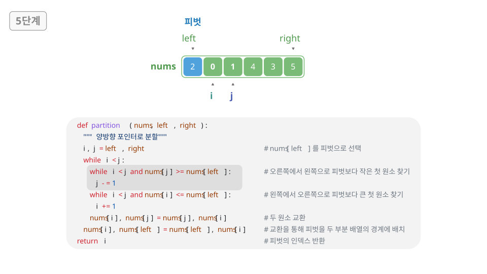
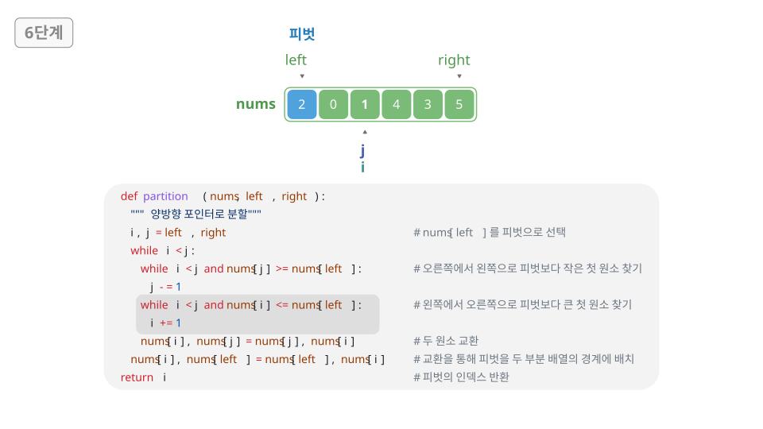
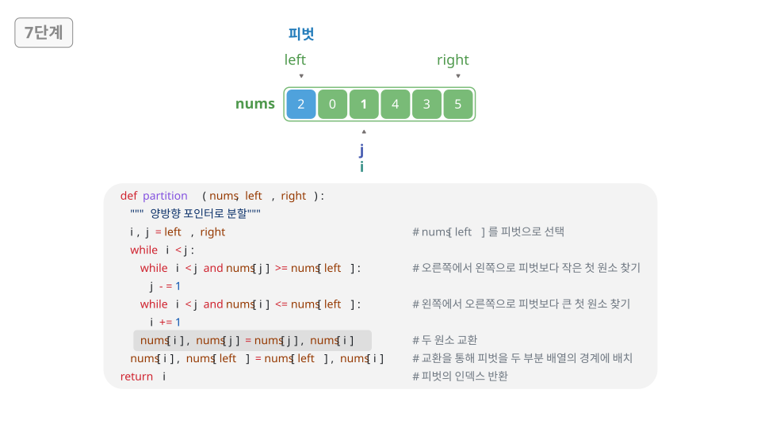

# 퀵 정렬

<u>퀵 정렬(quick sort)</u>은 분할 정복 전략을 이용하는 효율적인 정렬 알고리즘으로 널리 쓰인다.

퀵 정렬의 핵심 연산은 ‘양방향 분할’이다. 배열의 한 원소를 ‘피벗’으로 정하고 이보다 작은 원소는 모두 왼쪽으로, 큰 원소는 모두 오른쪽으로 옮기는 것이 목표다. 구체적인 과정은 아래 그림과 같다.

1. 배열 맨 왼쪽 원소를 피벗으로 고르고 두 포인터 `i`와 `j`가 각각 배열의 양 끝을 가리키도록 초기화한다.
2. 루프를 돌며 매 회전마다 `i`로 피벗보다 큰 첫 원소를, `j`로 피벗보다 작은 첫 원소를 찾은 다음 두 원소를 교환한다.
3. `2.`단계를 반복하다가 `i`와 `j`가 만나면 멈추고 마지막으로 피벗을 두 부분 배열의 경계로 교환한다.

=== "<1>"
    

=== "<2>"
    

=== "<3>"
    

=== "<4>"
    

=== "<5>"
    

=== "<6>"
    

=== "<7>"
    

=== "<8>"
    

=== "<9>"
    

분할이 끝나면 원래 배열은 왼쪽 부분 배열, 피벗, 오른쪽 부분 배열로 나뉜다. 이때 ‘왼쪽의 임의의 원소 $\leq$ 피벗 $\leq$ 오른쪽의 임의의 원소’가 성립한다. 이제 두 부분 배열만 정렬하면 된다.

!!! note "퀵 정렬의 분할 정복 전략"

    양방향 분할은 긴 배열 하나를 정렬하는 문제를 더 짧은 두 배열을 정렬하는 문제로 단순화한다.

```src
[file]{quick_sort}-[class]{quick_sort}-[func]{partition}
```

## 알고리즘의 동작 과정

퀵 정렬의 전체 과정은 아래 그림과 같다.

1. 먼저 원래 배열을 한 번 양방향으로 분할하여 아직 정렬되지 않은 왼쪽과 오른쪽 부분 배열을 얻는다.
2. 그런 다음 두 부분 배열에 각각 양방향 분할을 재귀적으로 적용한다.
3. 재귀를 계속하다 부분 배열의 길이가 1이 되면 멈춘다. 이로써 전체 배열의 정렬이 끝난다.


```src
[file]{quick_sort}-[class]{quick_sort}-[func]{quick_sort}
```

## 알고리즘의 특성

- **시간 복잡도 $O(n \log n)$, 비적응형 정렬**: 평균적으로 양방향 분할의 재귀 층수는 $\log n$이고 층별 총 반복 횟수는 $n$이므로 전체에 $O(n \log n)$의 시간이 걸린다. 최악의 경우 매번 길이 $n$인 배열을 길이 $0$과 $n - 1$인 두 부분 배열로 나눈다. 재귀 층수가 $n$에 이르고 층별 반복 횟수는 $n$이어서 총 $O(n^2)$의 시간이 걸린다.
- **공간 복잡도 $O(n)$, 제자리 정렬**: 입력 배열이 완전히 역순이면 최악의 재귀 깊이 $n$에 이르러 스택 프레임 공간을 $O(n)$만큼 사용한다. 정렬은 원래 배열에서 이루어지며 추가 배열은 사용하지 않는다.
- **불안정 정렬**: 양방향 분할의 마지막 단계에서 피벗이 값이 같은 원소의 오른쪽으로 옮겨질 수 있다.

## 퀵 정렬이 빠른 이유

이름에서 짐작할 수 있듯이 퀵 정렬에는 효율 면에서 장점이 있다. 평균 시간 복잡도는 병합 정렬 및 힙 정렬과 같지만 일반적으로 퀵 정렬이 더 효율적이다. 주된 이유는 다음과 같다.

- **최악의 경우가 발생할 확률이 매우 낮다**. 퀵 정렬의 최악 시간 복잡도는 $O(n^2)$이므로 실행 시간이 병합 정렬만큼 일정하지는 않지만 대다수의 경우 $O(n \log n)$의 시간 복잡도로 실행된다.
- **캐시를 효율적으로 사용한다**. 양방향 분할을 실행할 때 시스템이 부분 배열 전체를 캐시에 불러올 수 있어 원소에 효율적으로 접근한다. 힙 정렬처럼 원소 사이를 건너뛰며 접근하는 알고리즘에는 이런 특성이 없다.
- **시간 복잡도의 상수 계수가 작다**. 위 세 알고리즘 중 퀵 정렬이 비교, 대입, 교환 등 전체 연산 수가 가장 적다. 삽입 정렬이 버블 정렬보다 빠른 이유와 비슷하다.

## 피벗 선택 최적화

**일부 입력에서 퀵 정렬의 시간 효율이 떨어질 수 있다**. 극단적인 예로 입력 배열이 완전히 역순이라고 하자. 맨 왼쪽 원소를 피벗으로 고르면 분할 후 피벗이 오른쪽 끝으로 옮겨져 왼쪽 부분 배열의 길이는 $n - 1$, 오른쪽 길이는 $0$이 된다. 이대로 재귀 호출하면 매번 한쪽의 길이가 $0$이 되어 분할 정복의 효과가 사라지고 퀵 정렬은 버블 정렬과 비슷한 형태로 퇴화한다.

이런 상황을 최대한 피하려면 **양방향 분할의 피벗 선택 전략을 개선할 수 있다**. 예를 들어 원소 하나를 무작위로 골라 피벗으로 쓸 수 있다. 그래도 운이 나빠 매번 좋지 않은 피벗을 고르면 효율은 여전히 떨어진다.

프로그래밍 언어가 일반적으로 생성하는 것은 ‘의사 난수’라는 점에 주의하자. 의사 난수열에 맞추어 특정 테스트 사례를 만들면 퀵 정렬의 효율이 여전히 떨어질 수 있다.

한 걸음 더 나아가 배열에서 후보 원소 세 개(보통 처음, 끝, 중간 원소)를 고른 뒤 **세 값의 중앙값을 피벗으로 사용할 수 있다**. 그러면 피벗이 너무 작지도 크지도 않을 확률이 크게 높아진다. 후보를 더 많이 선택해 알고리즘이 다양한 입력에서도 잘 작동하도록 할 수도 있다. 이 방식을 쓰면 시간 복잡도가 $O(n^2)$까지 나빠질 확률이 크게 낮아진다.

예제 코드는 다음과 같다.

```src
[file]{quick_sort}-[class]{quick_sort_median}-[func]{partition}
```

## 재귀 깊이 최적화

**일부 입력에서 퀵 정렬은 공간을 많이 사용할 수 있다**. 완전히 정렬된 입력 배열을 예로 들자. 재귀 호출에서 부분 배열의 길이가 $m$이면 매번 분할할 때 길이 $0$인 왼쪽 부분 배열과 길이 $m - 1$인 오른쪽 부분 배열이 생긴다. 재귀 호출 한 층마다 문제의 크기가 원소 하나만큼만 줄어 재귀 트리 높이가 $n - 1$에 이른다. 이때 스택 프레임 공간이 $O(n)$만큼 필요하다.

스택 프레임이 계속 쌓이는 것을 막으려면 매번 양방향 분할 뒤 두 부분 배열의 길이를 비교해 **더 짧은 쪽만 재귀 호출한다**. 짧은 쪽의 길이는 $n / 2$를 넘지 않으므로 재귀 깊이는 $\log n$ 이하가 되고 최악의 공간 복잡도는 $O(\log n)$으로 개선된다. 코드는 다음과 같다.

```src
[file]{quick_sort}-[class]{quick_sort_tail_call}-[func]{quick_sort}
```
