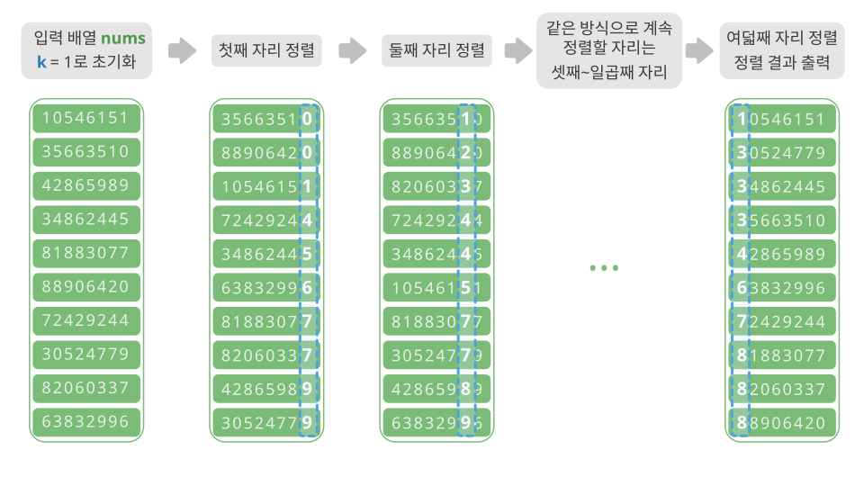

# 11.10 &nbsp; 기수 정렬

앞 절에서 살펴본 계수 정렬은 데이터 수 $n$은 많지만 값의 범위 $m$은 좁을 때 적합하다. 학번 $n = 10^6$개를 정렬해야 하고 각 학번이 $8$자리 수라고 하자. 값의 범위가 $m = 10^8$로 매우 커서 계수 정렬에는 많은 메모리가 필요하지만 기수 정렬은 이를 피할 수 있다.

<u>기수 정렬(radix sort)</u>의 핵심 아이디어는 계수 정렬과 같다. 개수를 세어 정렬하는 것이다. 여기에 자릿값 사이의 우선순위를 활용하여 각 자리를 차례로 정렬함으로써 최종 정렬 결과를 얻는다.

## 11.10.1 &nbsp; 알고리즘의 동작 과정

학번을 예로 들어 가장 낮은 자리를 $1$번째, 가장 높은 자리를 $8$번째 자리라고 하자. 기수 정렬의 과정은 아래 그림(11-18)과 같다.

1. 자리 번호를 $k = 1$로 초기화한다.
2. 학번의 $k$번째 자리를 기준으로 계수 정렬한다. 그러면 데이터가 $k$번째 자릿값에 따라 오름차순으로 정렬된다.
3. $k$를 $1$만큼 늘리고 `2.`단계로 돌아가 반복한다. 모든 자리의 정렬이 끝나면 종료한다.

{ class="animation-figure" }

<p align="center"> 그림 11-18 &nbsp; 기수 정렬 과정 </p>

코드 구현을 살펴보자. $d$진수 $x$의 $k$번째 자릿값 $x_k$를 구하는 공식은 다음과 같다.

$$
x_k = \lfloor\frac{x}{d^{k-1}}\rfloor \bmod d
$$

여기서 $\lfloor a \rfloor$는 실수 $a$를 내림하는 연산이며 $\bmod \: d$는 $d$에 대한 나머지 연산이다. 학번 데이터에서는 $d = 10$이고 $k \in [1, 8]$이다.

계수 정렬 코드도 숫자의 $k$번째 자릿값을 기준으로 정렬하도록 조금 수정해야 한다.

=== "Python"

    ```python title="radix_sort.py"
    def digit(num: int, exp: int) -> int:
        """원소 num의 k번째 자릿값 구하기. 여기서 exp = 10^(k-1)"""
        # k 대신 exp를 전달하여 비용이 큰 거듭제곱 연산의 반복 방지
        return (num // exp) % 10

    def counting_sort_digit(nums: list[int], exp: int):
        """계수 정렬(nums의 k번째 자릿값 기준)"""
        # 십진수 한 자리의 값은 0~9이므로 길이 10인 버킷 배열이 필요함
        counter = [0] * 10
        n = len(nums)
        # 0~9의 각 숫자가 나타난 횟수 세기
        for i in range(n):
            d = digit(nums[i], exp)  # nums[i]의 k번째 자릿값을 구해 d에 저장
            counter[d] += 1  # 숫자 d의 출현 횟수 세기
        # 누적합을 구해 ‘출현 횟수’를 ‘배열 인덱스’로 변환
        for i in range(1, 10):
            counter[i] += counter[i - 1]
        # 역순으로 순회하며 버킷별 계수 결과에 따라 각 원소를 res에 채우기
        res = [0] * n
        for i in range(n - 1, -1, -1):
            d = digit(nums[i], exp)
            j = counter[d] - 1  # 배열에서 d가 들어갈 인덱스 j 구하기
            res[j] = nums[i]  # 현재 원소를 인덱스 j에 배치
            counter[d] -= 1  # d의 개수를 1 줄이기
        # 결과로 원래 배열 nums를 덮어쓰기
        for i in range(n):
            nums[i] = res[i]

    def radix_sort(nums: list[int]):
        """기수 정렬"""
        # 최대 자릿수를 알아내기 위해 배열의 최댓값 구하기
        m = max(nums)
        # 낮은 자리부터 높은 자리까지 차례로 순회
        exp = 1
        while exp <= m:
            # 배열 원소의 k번째 자릿값을 기준으로 계수 정렬 수행
            # k = 1 -> exp = 1
            # k = 2 -> exp = 10
            # 즉, exp = 10^(k-1)
            counting_sort_digit(nums, exp)
            exp *= 10
    ```

=== "C++"

    ```cpp title="radix_sort.cpp"
    /* 원소 num의 k번째 자릿값 구하기. 여기서 exp = 10^(k-1) */
    int digit(int num, int exp) {
        // k 대신 exp를 전달하여 비용이 큰 거듭제곱 연산의 반복 방지
        return (num / exp) % 10;
    }

    /* 계수 정렬(nums의 k번째 자릿값 기준) */
    void countingSortDigit(vector<int> &nums, int exp) {
        // 십진수 한 자리의 값은 0~9이므로 길이 10인 버킷 배열이 필요함
        vector<int> counter(10, 0);
        int n = nums.size();
        // 0~9의 각 숫자가 나타난 횟수 세기
        for (int i = 0; i < n; i++) {
            int d = digit(nums[i], exp); // nums[i]의 k번째 자릿값을 구해 d에 저장
            counter[d]++;                // 숫자 d의 출현 횟수 세기
        }
        // 누적합을 구해 ‘출현 횟수’를 ‘배열 인덱스’로 변환
        for (int i = 1; i < 10; i++) {
            counter[i] += counter[i - 1];
        }
        // 역순으로 순회하며 버킷별 계수 결과에 따라 각 원소를 res에 채우기
        vector<int> res(n, 0);
        for (int i = n - 1; i >= 0; i--) {
            int d = digit(nums[i], exp);
            int j = counter[d] - 1; // 배열에서 d가 들어갈 인덱스 j 구하기
            res[j] = nums[i];       // 현재 원소를 인덱스 j에 배치
            counter[d]--;           // d의 개수를 1 줄이기
        }
        // 결과로 원래 배열 nums를 덮어쓰기
        for (int i = 0; i < n; i++)
            nums[i] = res[i];
    }

    /* 기수 정렬 */
    void radixSort(vector<int> &nums) {
        // 최대 자릿수를 알아내기 위해 배열의 최댓값 구하기
        int m = *max_element(nums.begin(), nums.end());
        // 낮은 자리부터 높은 자리까지 차례로 순회
        for (int exp = 1; exp <= m; exp *= 10)
            // 배열 원소의 k번째 자릿값을 기준으로 계수 정렬 수행
            // k = 1 -> exp = 1
            // k = 2 -> exp = 10
            // 즉, exp = 10^(k-1)
            countingSortDigit(nums, exp);
    }
    ```

=== "Java"

    ```java title="radix_sort.java"
    /* 원소 num의 k번째 자릿값 구하기. 여기서 exp = 10^(k-1) */
    int digit(int num, int exp) {
        // k 대신 exp를 전달하여 비용이 큰 거듭제곱 연산의 반복 방지
        return (num / exp) % 10;
    }

    /* 계수 정렬(nums의 k번째 자릿값 기준) */
    void countingSortDigit(int[] nums, int exp) {
        // 십진수 한 자리의 값은 0~9이므로 길이 10인 버킷 배열이 필요함
        int[] counter = new int[10];
        int n = nums.length;
        // 0~9의 각 숫자가 나타난 횟수 세기
        for (int i = 0; i < n; i++) {
            int d = digit(nums[i], exp); // nums[i]의 k번째 자릿값을 구해 d에 저장
            counter[d]++;                // 숫자 d의 출현 횟수 세기
        }
        // 누적합을 구해 ‘출현 횟수’를 ‘배열 인덱스’로 변환
        for (int i = 1; i < 10; i++) {
            counter[i] += counter[i - 1];
        }
        // 역순으로 순회하며 버킷별 계수 결과에 따라 각 원소를 res에 채우기
        int[] res = new int[n];
        for (int i = n - 1; i >= 0; i--) {
            int d = digit(nums[i], exp);
            int j = counter[d] - 1; // 배열에서 d가 들어갈 인덱스 j 구하기
            res[j] = nums[i];       // 현재 원소를 인덱스 j에 배치
            counter[d]--;           // d의 개수를 1 줄이기
        }
        // 결과로 원래 배열 nums를 덮어쓰기
        for (int i = 0; i < n; i++)
            nums[i] = res[i];
    }

    /* 기수 정렬 */
    void radixSort(int[] nums) {
        // 최대 자릿수를 알아내기 위해 배열의 최댓값 구하기
        int m = Integer.MIN_VALUE;
        for (int num : nums)
            if (num > m)
                m = num;
        // 낮은 자리부터 높은 자리까지 차례로 순회
        for (int exp = 1; exp <= m; exp *= 10) {
            // 배열 원소의 k번째 자릿값을 기준으로 계수 정렬 수행
            // k = 1 -> exp = 1
            // k = 2 -> exp = 10
            // 즉, exp = 10^(k-1)
            countingSortDigit(nums, exp);
        }
    }
    ```

=== "C#"

    ```csharp title="radix_sort.cs"
    /* 원소 num의 k번째 자릿값 구하기. 여기서 exp = 10^(k-1) */
    int Digit(int num, int exp) {
        // k 대신 exp를 전달하여 비용이 큰 거듭제곱 연산의 반복 방지
        return (num / exp) % 10;
    }

    /* 계수 정렬(nums의 k번째 자릿값 기준) */
    void CountingSortDigit(int[] nums, int exp) {
        // 십진수 한 자리의 값은 0~9이므로 길이 10인 버킷 배열이 필요함
        int[] counter = new int[10];
        int n = nums.Length;
        // 0~9의 각 숫자가 나타난 횟수 세기
        for (int i = 0; i < n; i++) {
            int d = Digit(nums[i], exp); // nums[i]의 k번째 자릿값을 구해 d에 저장
            counter[d]++;                // 숫자 d의 출현 횟수 세기
        }
        // 누적합을 구해 ‘출현 횟수’를 ‘배열 인덱스’로 변환
        for (int i = 1; i < 10; i++) {
            counter[i] += counter[i - 1];
        }
        // 역순으로 순회하며 버킷별 계수 결과에 따라 각 원소를 res에 채우기
        int[] res = new int[n];
        for (int i = n - 1; i >= 0; i--) {
            int d = Digit(nums[i], exp);
            int j = counter[d] - 1; // 배열에서 d가 들어갈 인덱스 j 구하기
            res[j] = nums[i];       // 현재 원소를 인덱스 j에 배치
            counter[d]--;           // d의 개수를 1 줄이기
        }
        // 결과로 원래 배열 nums를 덮어쓰기
        for (int i = 0; i < n; i++) {
            nums[i] = res[i];
        }
    }

    /* 기수 정렬 */
    void RadixSort(int[] nums) {
        // 최대 자릿수를 알아내기 위해 배열의 최댓값 구하기
        int m = int.MinValue;
        foreach (int num in nums) {
            if (num > m) m = num;
        }
        // 낮은 자리부터 높은 자리까지 차례로 순회
        for (int exp = 1; exp <= m; exp *= 10) {
            // 배열 원소의 k번째 자릿값을 기준으로 계수 정렬 수행
            // k = 1 -> exp = 1
            // k = 2 -> exp = 10
            // 즉, exp = 10^(k-1)
            CountingSortDigit(nums, exp);
        }
    }
    ```

=== "Go"

    ```go title="radix_sort.go"
    /* 원소 num의 k번째 자릿값 구하기. 여기서 exp = 10^(k-1) */
    func digit(num, exp int) int {
        // k 대신 exp를 전달하여 비용이 큰 거듭제곱 연산의 반복 방지
        return (num / exp) % 10
    }

    /* 계수 정렬(nums의 k번째 자릿값 기준) */
    func countingSortDigit(nums []int, exp int) {
        // 십진수 한 자리의 값은 0~9이므로 길이 10인 버킷 배열이 필요함
        counter := make([]int, 10)
        n := len(nums)
        // 0~9의 각 숫자가 나타난 횟수 세기
        for i := 0; i < n; i++ {
            d := digit(nums[i], exp) // nums[i]의 k번째 자릿값을 구해 d에 저장
            counter[d]++             // 숫자 d의 출현 횟수 세기
        }
        // 누적합을 구해 ‘출현 횟수’를 ‘배열 인덱스’로 변환
        for i := 1; i < 10; i++ {
            counter[i] += counter[i-1]
        }
        // 역순으로 순회하며 버킷별 계수 결과에 따라 각 원소를 res에 채우기
        res := make([]int, n)
        for i := n - 1; i >= 0; i-- {
            d := digit(nums[i], exp)
            j := counter[d] - 1 // 배열에서 d가 들어갈 인덱스 j 구하기
            res[j] = nums[i]    // 현재 원소를 인덱스 j에 배치
            counter[d]--        // d의 개수를 1 줄이기
        }
        // 결과로 원래 배열 nums를 덮어쓰기
        for i := 0; i < n; i++ {
            nums[i] = res[i]
        }
    }

    /* 기수 정렬 */
    func radixSort(nums []int) {
        // 최대 자릿수를 알아내기 위해 배열의 최댓값 구하기
        max := math.MinInt
        for _, num := range nums {
            if num > max {
                max = num
            }
        }
        // 낮은 자리부터 높은 자리까지 차례로 순회
        for exp := 1; max >= exp; exp *= 10 {
            // 배열 원소의 k번째 자릿값을 기준으로 계수 정렬 수행
            // k = 1 -> exp = 1
            // k = 2 -> exp = 10
            // 즉, exp = 10^(k-1)
            countingSortDigit(nums, exp)
        }
    }
    ```

=== "Swift"

    ```swift title="radix_sort.swift"
    /* 원소 num의 k번째 자릿값 구하기. 여기서 exp = 10^(k-1) */
    func digit(num: Int, exp: Int) -> Int {
        // k 대신 exp를 전달하여 비용이 큰 거듭제곱 연산의 반복 방지
        (num / exp) % 10
    }

    /* 계수 정렬(nums의 k번째 자릿값 기준) */
    func countingSortDigit(nums: inout [Int], exp: Int) {
        // 십진수 한 자리의 값은 0~9이므로 길이 10인 버킷 배열이 필요함
        var counter = Array(repeating: 0, count: 10)
        // 0~9의 각 숫자가 나타난 횟수 세기
        for i in nums.indices {
            let d = digit(num: nums[i], exp: exp) // nums[i]의 k번째 자릿값을 구해 d에 저장
            counter[d] += 1 // 숫자 d의 출현 횟수 세기
        }
        // 누적합을 구해 ‘출현 횟수’를 ‘배열 인덱스’로 변환
        for i in 1 ..< 10 {
            counter[i] += counter[i - 1]
        }
        // 역순으로 순회하며 버킷별 계수 결과에 따라 각 원소를 res에 채우기
        var res = Array(repeating: 0, count: nums.count)
        for i in nums.indices.reversed() {
            let d = digit(num: nums[i], exp: exp)
            let j = counter[d] - 1 // 배열에서 d가 들어갈 인덱스 j 구하기
            res[j] = nums[i] // 현재 원소를 인덱스 j에 배치
            counter[d] -= 1 // d의 개수를 1 줄이기
        }
        // 결과로 원래 배열 nums를 덮어쓰기
        for i in nums.indices {
            nums[i] = res[i]
        }
    }

    /* 기수 정렬 */
    func radixSort(nums: inout [Int]) {
        // 최대 자릿수를 알아내기 위해 배열의 최댓값 구하기
        var m = Int.min
        for num in nums {
            if num > m {
                m = num
            }
        }
        // 낮은 자리부터 높은 자리까지 차례로 순회
        for exp in sequence(first: 1, next: { m >= ($0 * 10) ? $0 * 10 : nil }) {
            // 배열 원소의 k번째 자릿값을 기준으로 계수 정렬 수행
            // k = 1 -> exp = 1
            // k = 2 -> exp = 10
            // 즉, exp = 10^(k-1)
            countingSortDigit(nums: &nums, exp: exp)
        }
    }
    ```

=== "JS"

    ```javascript title="radix_sort.js"
    /* 원소 num의 k번째 자릿값 구하기. 여기서 exp = 10^(k-1) */
    function digit(num, exp) {
        // k 대신 exp를 전달하여 비용이 큰 거듭제곱 연산의 반복 방지
        return Math.floor(num / exp) % 10;
    }

    /* 계수 정렬(nums의 k번째 자릿값 기준) */
    function countingSortDigit(nums, exp) {
        // 십진수 한 자리의 값은 0~9이므로 길이 10인 버킷 배열이 필요함
        const counter = new Array(10).fill(0);
        const n = nums.length;
        // 0~9의 각 숫자가 나타난 횟수 세기
        for (let i = 0; i < n; i++) {
            const d = digit(nums[i], exp); // nums[i]의 k번째 자릿값을 구해 d에 저장
            counter[d]++; // 숫자 d의 출현 횟수 세기
        }
        // 누적합을 구해 ‘출현 횟수’를 ‘배열 인덱스’로 변환
        for (let i = 1; i < 10; i++) {
            counter[i] += counter[i - 1];
        }
        // 역순으로 순회하며 버킷별 계수 결과에 따라 각 원소를 res에 채우기
        const res = new Array(n).fill(0);
        for (let i = n - 1; i >= 0; i--) {
            const d = digit(nums[i], exp);
            const j = counter[d] - 1; // 배열에서 d가 들어갈 인덱스 j 구하기
            res[j] = nums[i]; // 현재 원소를 인덱스 j에 배치
            counter[d]--; // d의 개수를 1 줄이기
        }
        // 결과로 원래 배열 nums를 덮어쓰기
        for (let i = 0; i < n; i++) {
            nums[i] = res[i];
        }
    }

    /* 기수 정렬 */
    function radixSort(nums) {
        // 최대 자릿수를 알아내기 위해 배열의 최댓값 구하기
        let m = Math.max(... nums);
        // 낮은 자리부터 높은 자리까지 차례로 순회
        for (let exp = 1; exp <= m; exp *= 10) {
            // 배열 원소의 k번째 자릿값을 기준으로 계수 정렬 수행
            // k = 1 -> exp = 1
            // k = 2 -> exp = 10
            // 즉, exp = 10^(k-1)
            countingSortDigit(nums, exp);
        }
    }
    ```

=== "TS"

    ```typescript title="radix_sort.ts"
    /* 원소 num의 k번째 자릿값 구하기. 여기서 exp = 10^(k-1) */
    function digit(num: number, exp: number): number {
        // k 대신 exp를 전달하여 비용이 큰 거듭제곱 연산의 반복 방지
        return Math.floor(num / exp) % 10;
    }

    /* 계수 정렬(nums의 k번째 자릿값 기준) */
    function countingSortDigit(nums: number[], exp: number): void {
        // 십진수 한 자리의 값은 0~9이므로 길이 10인 버킷 배열이 필요함
        const counter = new Array(10).fill(0);
        const n = nums.length;
        // 0~9의 각 숫자가 나타난 횟수 세기
        for (let i = 0; i < n; i++) {
            const d = digit(nums[i], exp); // nums[i]의 k번째 자릿값을 구해 d에 저장
            counter[d]++; // 숫자 d의 출현 횟수 세기
        }
        // 누적합을 구해 ‘출현 횟수’를 ‘배열 인덱스’로 변환
        for (let i = 1; i < 10; i++) {
            counter[i] += counter[i - 1];
        }
        // 역순으로 순회하며 버킷별 계수 결과에 따라 각 원소를 res에 채우기
        const res = new Array(n).fill(0);
        for (let i = n - 1; i >= 0; i--) {
            const d = digit(nums[i], exp);
            const j = counter[d] - 1; // 배열에서 d가 들어갈 인덱스 j 구하기
            res[j] = nums[i]; // 현재 원소를 인덱스 j에 배치
            counter[d]--; // d의 개수를 1 줄이기
        }
        // 결과로 원래 배열 nums를 덮어쓰기
        for (let i = 0; i < n; i++) {
            nums[i] = res[i];
        }
    }

    /* 기수 정렬 */
    function radixSort(nums: number[]): void {
        // 최대 자릿수를 알아내기 위해 배열의 최댓값 구하기
        let m: number = Math.max(... nums);
        // 낮은 자리부터 높은 자리까지 차례로 순회
        for (let exp = 1; exp <= m; exp *= 10) {
            // 배열 원소의 k번째 자릿값을 기준으로 계수 정렬 수행
            // k = 1 -> exp = 1
            // k = 2 -> exp = 10
            // 즉, exp = 10^(k-1)
            countingSortDigit(nums, exp);
        }
    }
    ```

=== "Dart"

    ```dart title="radix_sort.dart"
    /* 원소 _num의 k번째 자릿값 구하기. 여기서 exp = 10^(k-1) */
    int digit(int _num, int exp) {
      // k 대신 exp를 전달하여 비용이 큰 거듭제곱 연산의 반복 방지
      return (_num ~/ exp) % 10;
    }

    /* 계수 정렬(nums의 k번째 자릿값 기준) */
    void countingSortDigit(List<int> nums, int exp) {
      // 십진수 한 자리의 값은 0~9이므로 길이 10인 버킷 배열이 필요함
      List<int> counter = List<int>.filled(10, 0);
      int n = nums.length;
      // 0~9의 각 숫자가 나타난 횟수 세기
      for (int i = 0; i < n; i++) {
        int d = digit(nums[i], exp); // nums[i]의 k번째 자릿값을 구해 d에 저장
        counter[d]++; // 숫자 d의 출현 횟수 세기
      }
      // 누적합을 구해 ‘출현 횟수’를 ‘배열 인덱스’로 변환
      for (int i = 1; i < 10; i++) {
        counter[i] += counter[i - 1];
      }
      // 역순으로 순회하며 버킷별 계수 결과에 따라 각 원소를 res에 채우기
      List<int> res = List<int>.filled(n, 0);
      for (int i = n - 1; i >= 0; i--) {
        int d = digit(nums[i], exp);
        int j = counter[d] - 1; // 배열에서 d가 들어갈 인덱스 j 구하기
        res[j] = nums[i]; // 현재 원소를 인덱스 j에 배치
        counter[d]--; // d의 개수를 1 줄이기
      }
      // 결과로 원래 배열 nums를 덮어쓰기
      for (int i = 0; i < n; i++) nums[i] = res[i];
    }

    /* 기수 정렬 */
    void radixSort(List<int> nums) {
      // 최대 자릿수를 알아내기 위해 배열의 최댓값 구하기
      // Dart에서 int의 길이는 64비트
      int m = -1 << 63;
      for (int _num in nums) if (_num > m) m = _num;
      // 낮은 자리부터 높은 자리까지 차례로 순회
      for (int exp = 1; exp <= m; exp *= 10)
        // 배열 원소의 k번째 자릿값을 기준으로 계수 정렬 수행
        // k = 1 -> exp = 1
        // k = 2 -> exp = 10
        // 즉, exp = 10^(k-1)
        countingSortDigit(nums, exp);
    }
    ```

=== "Rust"

    ```rust title="radix_sort.rs"
    /* 원소 num의 k번째 자릿값 구하기. 여기서 exp = 10^(k-1) */
    fn digit(num: i32, exp: i32) -> usize {
        // k 대신 exp를 전달하여 비용이 큰 거듭제곱 연산의 반복 방지
        return ((num / exp) % 10) as usize;
    }

    /* 계수 정렬(nums의 k번째 자릿값 기준) */
    fn counting_sort_digit(nums: &mut [i32], exp: i32) {
        // 십진수 한 자리의 값은 0~9이므로 길이 10인 버킷 배열이 필요함
        let mut counter = [0; 10];
        let n = nums.len();
        // 0~9의 각 숫자가 나타난 횟수 세기
        for i in 0..n {
            let d = digit(nums[i], exp); // nums[i]의 k번째 자릿값을 구해 d에 저장
            counter[d] += 1; // 숫자 d의 출현 횟수 세기
        }
        // 누적합을 구해 ‘출현 횟수’를 ‘배열 인덱스’로 변환
        for i in 1..10 {
            counter[i] += counter[i - 1];
        }
        // 역순으로 순회하며 버킷별 계수 결과에 따라 각 원소를 res에 채우기
        let mut res = vec![0; n];
        for i in (0..n).rev() {
            let d = digit(nums[i], exp);
            let j = counter[d] - 1; // 배열에서 d가 들어갈 인덱스 j 구하기
            res[j] = nums[i]; // 현재 원소를 인덱스 j에 배치
            counter[d] -= 1; // d의 개수를 1 줄이기
        }
        // 결과로 원래 배열 nums를 덮어쓰기
        nums.copy_from_slice(&res);
    }

    /* 기수 정렬 */
    fn radix_sort(nums: &mut [i32]) {
        // 최대 자릿수를 알아내기 위해 배열의 최댓값 구하기
        let m = *nums.into_iter().max().unwrap();
        // 낮은 자리부터 높은 자리까지 차례로 순회
        let mut exp = 1;
        while exp <= m {
            counting_sort_digit(nums, exp);
            exp *= 10;
        }
    }
    ```

=== "C"

    ```c title="radix_sort.c"
    /* 원소 num의 k번째 자릿값 구하기. 여기서 exp = 10^(k-1) */
    int digit(int num, int exp) {
        // k 대신 exp를 전달하여 비용이 큰 거듭제곱 연산의 반복 방지
        return (num / exp) % 10;
    }

    /* 계수 정렬(nums의 k번째 자릿값 기준) */
    void countingSortDigit(int nums[], int size, int exp) {
        // 십진수 한 자리의 값은 0~9이므로 길이 10인 버킷 배열이 필요함
        int *counter = (int *)malloc((sizeof(int) * 10));
        memset(counter, 0, sizeof(int) * 10); // 나중에 메모리를 해제할 수 있도록 0으로 초기화
        // 0~9의 각 숫자가 나타난 횟수 세기
        for (int i = 0; i < size; i++) {
            // nums[i]의 k번째 자릿값을 구해 d에 저장
            int d = digit(nums[i], exp);
            // 숫자 d의 출현 횟수 세기
            counter[d]++;
        }
        // 누적합을 구해 ‘출현 횟수’를 ‘배열 인덱스’로 변환
        for (int i = 1; i < 10; i++) {
            counter[i] += counter[i - 1];
        }
        // 역순으로 순회하며 버킷별 계수 결과에 따라 각 원소를 res에 채우기
        int *res = (int *)malloc(sizeof(int) * size);
        for (int i = size - 1; i >= 0; i--) {
            int d = digit(nums[i], exp);
            int j = counter[d] - 1; // 배열에서 d가 들어갈 인덱스 j 구하기
            res[j] = nums[i];       // 현재 원소를 인덱스 j에 배치
            counter[d]--;           // d의 개수를 1 줄이기
        }
        // 결과로 원래 배열 nums를 덮어쓰기
        for (int i = 0; i < size; i++) {
            nums[i] = res[i];
        }
        // 메모리 해제
        free(res);
        free(counter);
    }

    /* 기수 정렬 */
    void radixSort(int nums[], int size) {
        // 최대 자릿수를 알아내기 위해 배열의 최댓값 구하기
        int max = INT32_MIN;
        for (int i = 0; i < size; i++) {
            if (nums[i] > max) {
                max = nums[i];
            }
        }
        // 낮은 자리부터 높은 자리까지 차례로 순회
        for (int exp = 1; max >= exp; exp *= 10)
            // 배열 원소의 k번째 자릿값을 기준으로 계수 정렬 수행
            // k = 1 -> exp = 1
            // k = 2 -> exp = 10
            // 즉, exp = 10^(k-1)
            countingSortDigit(nums, size, exp);
    }
    ```

=== "Kotlin"

    ```kotlin title="radix_sort.kt"
    /* 원소 num의 k번째 자릿값 구하기. 여기서 exp = 10^(k-1) */
    fun digit(num: Int, exp: Int): Int {
        // k 대신 exp를 전달하여 비용이 큰 거듭제곱 연산의 반복 방지
        return (num / exp) % 10
    }

    /* 계수 정렬(nums의 k번째 자릿값 기준) */
    fun countingSortDigit(nums: IntArray, exp: Int) {
        // 십진수 한 자리의 값은 0~9이므로 길이 10인 버킷 배열이 필요함
        val counter = IntArray(10)
        val n = nums.size
        // 0~9의 각 숫자가 나타난 횟수 세기
        for (i in 0..<n) {
            val d = digit(nums[i], exp) // nums[i]의 k번째 자릿값을 구해 d에 저장
            counter[d]++                // 숫자 d의 출현 횟수 세기
        }
        // 누적합을 구해 ‘출현 횟수’를 ‘배열 인덱스’로 변환
        for (i in 1..9) {
            counter[i] += counter[i - 1]
        }
        // 역순으로 순회하며 버킷별 계수 결과에 따라 각 원소를 res에 채우기
        val res = IntArray(n)
        for (i in n - 1 downTo 0) {
            val d = digit(nums[i], exp)
            val j = counter[d] - 1 // 배열에서 d가 들어갈 인덱스 j 구하기
            res[j] = nums[i]       // 현재 원소를 인덱스 j에 배치
            counter[d]--           // d의 개수를 1 줄이기
        }
        // 결과로 원래 배열 nums를 덮어쓰기
        for (i in 0..<n)
            nums[i] = res[i]
    }

    /* 기수 정렬 */
    fun radixSort(nums: IntArray) {
        // 최대 자릿수를 알아내기 위해 배열의 최댓값 구하기
        var m = Int.MIN_VALUE
        for (num in nums) if (num > m) m = num
        var exp = 1
        // 낮은 자리부터 높은 자리까지 차례로 순회
        while (exp <= m) {
            // 배열 원소의 k번째 자릿값을 기준으로 계수 정렬 수행
            // k = 1 -> exp = 1
            // k = 2 -> exp = 10
            // 즉, exp = 10^(k-1)
            countingSortDigit(nums, exp)
            exp *= 10
        }
    }
    ```

=== "Ruby"

    ```ruby title="radix_sort.rb"
    ### 원소 num의 k번째 자릿값 구하기. 여기서 exp = 10^(k-1) ###
    def digit(num, exp)
      # k 대신 exp를 전달하여 비용이 큰 거듭제곱 연산의 반복 방지
      (num / exp) % 10
    end

    ### 계수 정렬(nums의 k번째 자릿값 기준)###
    def counting_sort_digit(nums, exp)
      # 십진수 한 자리의 값은 0~9이므로 길이 10인 버킷 배열이 필요함
      counter = Array.new(10, 0)
      n = nums.length
      # 0~9의 각 숫자가 나타난 횟수 세기
      for i in 0...n
        d = digit(nums[i], exp) # nums[i]의 k번째 자릿값을 구해 d에 저장
        counter[d] += 1 # 숫자 d의 출현 횟수 세기
      end
      # 누적합을 구해 ‘출현 횟수’를 ‘배열 인덱스’로 변환
      (1...10).each { |i| counter[i] += counter[i - 1] }
      # 역순으로 순회하며 버킷별 계수 결과에 따라 각 원소를 res에 채우기
      res = Array.new(n, 0)
      for i in (n - 1).downto(0)
        d = digit(nums[i], exp)
        j = counter[d] - 1 # 배열에서 d가 들어갈 인덱스 j 구하기
        res[j] = nums[i] # 현재 원소를 인덱스 j에 배치
        counter[d] -= 1 # d의 개수를 1 줄이기
      end
      # 결과로 원래 배열 nums를 덮어쓰기
      (0...n).each { |i| nums[i] = res[i] }
    end

    ### 기수 정렬 ###
    def radix_sort(nums)
      # 최대 자릿수를 알아내기 위해 배열의 최댓값 구하기
      m = nums.max
      # 낮은 자리부터 높은 자리까지 차례로 순회
      exp = 1
      while exp <= m
        # 배열 원소의 k번째 자릿값을 기준으로 계수 정렬 수행
        # k = 1 -> exp = 1
        # k = 2 -> exp = 10
        # 즉, exp = 10^(k-1)
        counting_sort_digit(nums, exp)
        exp *= 10
      end
    end
    ```

??? pythontutor "실행 과정 시각화"

    <div style="height: 549px; width: 100%;"><iframe class="pythontutor-iframe" title="실행 과정 시각화" src="https://pythontutor.com/iframe-embed.html#code=def%20digit%28num%3A%20int,%20exp%3A%20int%29%20-%3E%20int%3A%0A%20%20%20%20%22%22%22%EC%9B%90%EC%86%8C%20num%EC%9D%98%20k%EB%B2%88%EC%A7%B8%20%EC%9E%90%EB%A6%BF%EA%B0%92%20%EA%B5%AC%ED%95%98%EA%B8%B0.%20%EC%97%AC%EA%B8%B0%EC%84%9C%20exp%20%3D%2010%5E%28k-1%29%22%22%22%0A%20%20%20%20%23%20k%20%EB%8C%80%EC%8B%A0%20exp%EB%A5%BC%20%EC%A0%84%EB%8B%AC%ED%95%98%EC%97%AC%20%EB%B9%84%EC%9A%A9%EC%9D%B4%20%ED%81%B0%20%EA%B1%B0%EB%93%AD%EC%A0%9C%EA%B3%B1%20%EC%97%B0%EC%82%B0%EC%9D%98%20%EB%B0%98%EB%B3%B5%20%EB%B0%A9%EC%A7%80%0A%20%20%20%20return%20%28num%20//%20exp%29%20%25%2010%0A%0Adef%20counting_sort_digit%28nums%3A%20list%5Bint%5D,%20exp%3A%20int%29%3A%0A%20%20%20%20%22%22%22%EA%B3%84%EC%88%98%20%EC%A0%95%EB%A0%AC%28nums%EC%9D%98%20k%EB%B2%88%EC%A7%B8%20%EC%9E%90%EB%A6%BF%EA%B0%92%20%EA%B8%B0%EC%A4%80%29%22%22%22%0A%20%20%20%20%23%20%EC%8B%AD%EC%A7%84%EC%88%98%20%ED%95%9C%20%EC%9E%90%EB%A6%AC%EC%9D%98%20%EA%B0%92%EC%9D%80%200~9%EC%9D%B4%EB%AF%80%EB%A1%9C%20%EA%B8%B8%EC%9D%B4%2010%EC%9D%B8%20%EB%B2%84%ED%82%B7%20%EB%B0%B0%EC%97%B4%EC%9D%B4%20%ED%95%84%EC%9A%94%ED%95%A8%0A%20%20%20%20counter%20%3D%20%5B0%5D%20%2A%2010%0A%20%20%20%20n%20%3D%20len%28nums%29%0A%20%20%20%20%23%200~9%EC%9D%98%20%EA%B0%81%20%EC%88%AB%EC%9E%90%EA%B0%80%20%EB%82%98%ED%83%80%EB%82%9C%20%ED%9A%9F%EC%88%98%20%EC%84%B8%EA%B8%B0%0A%20%20%20%20for%20i%20in%20range%28n%29%3A%0A%20%20%20%20%20%20%20%20d%20%3D%20digit%28nums%5Bi%5D,%20exp%29%20%20%23%20nums%5Bi%5D%EC%9D%98%20k%EB%B2%88%EC%A7%B8%20%EC%9E%90%EB%A6%BF%EA%B0%92%EC%9D%84%20%EA%B5%AC%ED%95%B4%20d%EC%97%90%20%EC%A0%80%EC%9E%A5%0A%20%20%20%20%20%20%20%20counter%5Bd%5D%20%2B%3D%201%20%20%23%20%EC%88%AB%EC%9E%90%20d%EC%9D%98%20%EC%B6%9C%ED%98%84%20%ED%9A%9F%EC%88%98%20%EC%84%B8%EA%B8%B0%0A%20%20%20%20%23%20%EB%88%84%EC%A0%81%ED%95%A9%EC%9D%84%20%EA%B5%AC%ED%95%B4%20%E2%80%98%EC%B6%9C%ED%98%84%20%ED%9A%9F%EC%88%98%E2%80%99%EB%A5%BC%20%E2%80%98%EB%B0%B0%EC%97%B4%20%EC%9D%B8%EB%8D%B1%EC%8A%A4%E2%80%99%EB%A1%9C%20%EB%B3%80%ED%99%98%0A%20%20%20%20for%20i%20in%20range%281,%2010%29%3A%0A%20%20%20%20%20%20%20%20counter%5Bi%5D%20%2B%3D%20counter%5Bi%20-%201%5D%0A%20%20%20%20%23%20%EC%97%AD%EC%88%9C%EC%9C%BC%EB%A1%9C%20%EC%88%9C%ED%9A%8C%ED%95%98%EB%A9%B0%20%EB%B2%84%ED%82%B7%EB%B3%84%20%EA%B3%84%EC%88%98%20%EA%B2%B0%EA%B3%BC%EC%97%90%20%EB%94%B0%EB%9D%BC%20%EA%B0%81%20%EC%9B%90%EC%86%8C%EB%A5%BC%20res%EC%97%90%20%EC%B1%84%EC%9A%B0%EA%B8%B0%0A%20%20%20%20res%20%3D%20%5B0%5D%20%2A%20n%0A%20%20%20%20for%20i%20in%20range%28n%20-%201,%20-1,%20-1%29%3A%0A%20%20%20%20%20%20%20%20d%20%3D%20digit%28nums%5Bi%5D,%20exp%29%0A%20%20%20%20%20%20%20%20j%20%3D%20counter%5Bd%5D%20-%201%20%20%23%20%EB%B0%B0%EC%97%B4%EC%97%90%EC%84%9C%20d%EA%B0%80%20%EB%93%A4%EC%96%B4%EA%B0%88%20%EC%9D%B8%EB%8D%B1%EC%8A%A4%20j%20%EA%B5%AC%ED%95%98%EA%B8%B0%0A%20%20%20%20%20%20%20%20res%5Bj%5D%20%3D%20nums%5Bi%5D%20%20%23%20%ED%98%84%EC%9E%AC%20%EC%9B%90%EC%86%8C%EB%A5%BC%20%EC%9D%B8%EB%8D%B1%EC%8A%A4%20j%EC%97%90%20%EB%B0%B0%EC%B9%98%0A%20%20%20%20%20%20%20%20counter%5Bd%5D%20-%3D%201%20%20%23%20d%EC%9D%98%20%EA%B0%9C%EC%88%98%EB%A5%BC%201%20%EC%A4%84%EC%9D%B4%EA%B8%B0%0A%20%20%20%20%23%20%EA%B2%B0%EA%B3%BC%EB%A1%9C%20%EC%9B%90%EB%9E%98%20%EB%B0%B0%EC%97%B4%20nums%EB%A5%BC%20%EB%8D%AE%EC%96%B4%EC%93%B0%EA%B8%B0%0A%20%20%20%20for%20i%20in%20range%28n%29%3A%0A%20%20%20%20%20%20%20%20nums%5Bi%5D%20%3D%20res%5Bi%5D%0A%0Adef%20radix_sort%28nums%3A%20list%5Bint%5D%29%3A%0A%20%20%20%20%22%22%22%EA%B8%B0%EC%88%98%20%EC%A0%95%EB%A0%AC%22%22%22%0A%20%20%20%20%23%20%EC%B5%9C%EB%8C%80%20%EC%9E%90%EB%A6%BF%EC%88%98%EB%A5%BC%20%EC%95%8C%EC%95%84%EB%82%B4%EA%B8%B0%20%EC%9C%84%ED%95%B4%20%EB%B0%B0%EC%97%B4%EC%9D%98%20%EC%B5%9C%EB%8C%93%EA%B0%92%20%EA%B5%AC%ED%95%98%EA%B8%B0%0A%20%20%20%20m%20%3D%20max%28nums%29%0A%20%20%20%20%23%20%EB%82%AE%EC%9D%80%20%EC%9E%90%EB%A6%AC%EB%B6%80%ED%84%B0%20%EB%86%92%EC%9D%80%20%EC%9E%90%EB%A6%AC%EA%B9%8C%EC%A7%80%20%EC%B0%A8%EB%A1%80%EB%A1%9C%20%EC%88%9C%ED%9A%8C%0A%20%20%20%20exp%20%3D%201%0A%20%20%20%20while%20exp%20%3C%3D%20m%3A%0A%20%20%20%20%20%20%20%20%23%20%EB%B0%B0%EC%97%B4%20%EC%9B%90%EC%86%8C%EC%9D%98%20k%EB%B2%88%EC%A7%B8%20%EC%9E%90%EB%A6%BF%EA%B0%92%EC%9D%84%20%EA%B8%B0%EC%A4%80%EC%9C%BC%EB%A1%9C%20%EA%B3%84%EC%88%98%20%EC%A0%95%EB%A0%AC%20%EC%88%98%ED%96%89%0A%20%20%20%20%20%20%20%20%23%20k%20%3D%201%20-%3E%20exp%20%3D%201%0A%20%20%20%20%20%20%20%20%23%20k%20%3D%202%20-%3E%20exp%20%3D%2010%0A%20%20%20%20%20%20%20%20%23%20%EC%A6%89,%20exp%20%3D%2010%5E%28k-1%29%0A%20%20%20%20%20%20%20%20counting_sort_digit%28nums,%20exp%29%0A%20%20%20%20%20%20%20%20exp%20%2A%3D%2010%0A%0A%22%22%22Driver%20Code%22%22%22%0Aif%20__name__%20%3D%3D%20%22__main__%22%3A%0A%20%20%20%20%23%20%EA%B8%B0%EC%88%98%20%EC%A0%95%EB%A0%AC%0A%20%20%20%20nums%20%3D%20%5B%0A%20%20%20%20%20%20%20%20105,%0A%20%20%20%20%20%20%20%20356,%0A%20%20%20%20%20%20%20%20428,%0A%20%20%20%20%20%20%20%20348,%0A%20%20%20%20%20%20%20%20818,%0A%20%20%20%20%5D%0A%20%20%20%20radix_sort%28nums%29%0A%20%20%20%20print%28%22%EA%B8%B0%EC%88%98%20%EC%A0%95%EB%A0%AC%20%ED%9B%84%20nums%20%3D%22,%20nums%29&codeDivHeight=472&codeDivWidth=350&cumulative=false&curInstr=6&heapPrimitives=nevernest&origin=opt-frontend.js&py=311&rawInputLstJSON=%5B%5D&textReferences=false"> </iframe></div>
    <div style="margin-top: 5px;"><a href="https://pythontutor.com/iframe-embed.html#code=def%20digit%28num%3A%20int,%20exp%3A%20int%29%20-%3E%20int%3A%0A%20%20%20%20%22%22%22%EC%9B%90%EC%86%8C%20num%EC%9D%98%20k%EB%B2%88%EC%A7%B8%20%EC%9E%90%EB%A6%BF%EA%B0%92%20%EA%B5%AC%ED%95%98%EA%B8%B0.%20%EC%97%AC%EA%B8%B0%EC%84%9C%20exp%20%3D%2010%5E%28k-1%29%22%22%22%0A%20%20%20%20%23%20k%20%EB%8C%80%EC%8B%A0%20exp%EB%A5%BC%20%EC%A0%84%EB%8B%AC%ED%95%98%EC%97%AC%20%EB%B9%84%EC%9A%A9%EC%9D%B4%20%ED%81%B0%20%EA%B1%B0%EB%93%AD%EC%A0%9C%EA%B3%B1%20%EC%97%B0%EC%82%B0%EC%9D%98%20%EB%B0%98%EB%B3%B5%20%EB%B0%A9%EC%A7%80%0A%20%20%20%20return%20%28num%20//%20exp%29%20%25%2010%0A%0Adef%20counting_sort_digit%28nums%3A%20list%5Bint%5D,%20exp%3A%20int%29%3A%0A%20%20%20%20%22%22%22%EA%B3%84%EC%88%98%20%EC%A0%95%EB%A0%AC%28nums%EC%9D%98%20k%EB%B2%88%EC%A7%B8%20%EC%9E%90%EB%A6%BF%EA%B0%92%20%EA%B8%B0%EC%A4%80%29%22%22%22%0A%20%20%20%20%23%20%EC%8B%AD%EC%A7%84%EC%88%98%20%ED%95%9C%20%EC%9E%90%EB%A6%AC%EC%9D%98%20%EA%B0%92%EC%9D%80%200~9%EC%9D%B4%EB%AF%80%EB%A1%9C%20%EA%B8%B8%EC%9D%B4%2010%EC%9D%B8%20%EB%B2%84%ED%82%B7%20%EB%B0%B0%EC%97%B4%EC%9D%B4%20%ED%95%84%EC%9A%94%ED%95%A8%0A%20%20%20%20counter%20%3D%20%5B0%5D%20%2A%2010%0A%20%20%20%20n%20%3D%20len%28nums%29%0A%20%20%20%20%23%200~9%EC%9D%98%20%EA%B0%81%20%EC%88%AB%EC%9E%90%EA%B0%80%20%EB%82%98%ED%83%80%EB%82%9C%20%ED%9A%9F%EC%88%98%20%EC%84%B8%EA%B8%B0%0A%20%20%20%20for%20i%20in%20range%28n%29%3A%0A%20%20%20%20%20%20%20%20d%20%3D%20digit%28nums%5Bi%5D,%20exp%29%20%20%23%20nums%5Bi%5D%EC%9D%98%20k%EB%B2%88%EC%A7%B8%20%EC%9E%90%EB%A6%BF%EA%B0%92%EC%9D%84%20%EA%B5%AC%ED%95%B4%20d%EC%97%90%20%EC%A0%80%EC%9E%A5%0A%20%20%20%20%20%20%20%20counter%5Bd%5D%20%2B%3D%201%20%20%23%20%EC%88%AB%EC%9E%90%20d%EC%9D%98%20%EC%B6%9C%ED%98%84%20%ED%9A%9F%EC%88%98%20%EC%84%B8%EA%B8%B0%0A%20%20%20%20%23%20%EB%88%84%EC%A0%81%ED%95%A9%EC%9D%84%20%EA%B5%AC%ED%95%B4%20%E2%80%98%EC%B6%9C%ED%98%84%20%ED%9A%9F%EC%88%98%E2%80%99%EB%A5%BC%20%E2%80%98%EB%B0%B0%EC%97%B4%20%EC%9D%B8%EB%8D%B1%EC%8A%A4%E2%80%99%EB%A1%9C%20%EB%B3%80%ED%99%98%0A%20%20%20%20for%20i%20in%20range%281,%2010%29%3A%0A%20%20%20%20%20%20%20%20counter%5Bi%5D%20%2B%3D%20counter%5Bi%20-%201%5D%0A%20%20%20%20%23%20%EC%97%AD%EC%88%9C%EC%9C%BC%EB%A1%9C%20%EC%88%9C%ED%9A%8C%ED%95%98%EB%A9%B0%20%EB%B2%84%ED%82%B7%EB%B3%84%20%EA%B3%84%EC%88%98%20%EA%B2%B0%EA%B3%BC%EC%97%90%20%EB%94%B0%EB%9D%BC%20%EA%B0%81%20%EC%9B%90%EC%86%8C%EB%A5%BC%20res%EC%97%90%20%EC%B1%84%EC%9A%B0%EA%B8%B0%0A%20%20%20%20res%20%3D%20%5B0%5D%20%2A%20n%0A%20%20%20%20for%20i%20in%20range%28n%20-%201,%20-1,%20-1%29%3A%0A%20%20%20%20%20%20%20%20d%20%3D%20digit%28nums%5Bi%5D,%20exp%29%0A%20%20%20%20%20%20%20%20j%20%3D%20counter%5Bd%5D%20-%201%20%20%23%20%EB%B0%B0%EC%97%B4%EC%97%90%EC%84%9C%20d%EA%B0%80%20%EB%93%A4%EC%96%B4%EA%B0%88%20%EC%9D%B8%EB%8D%B1%EC%8A%A4%20j%20%EA%B5%AC%ED%95%98%EA%B8%B0%0A%20%20%20%20%20%20%20%20res%5Bj%5D%20%3D%20nums%5Bi%5D%20%20%23%20%ED%98%84%EC%9E%AC%20%EC%9B%90%EC%86%8C%EB%A5%BC%20%EC%9D%B8%EB%8D%B1%EC%8A%A4%20j%EC%97%90%20%EB%B0%B0%EC%B9%98%0A%20%20%20%20%20%20%20%20counter%5Bd%5D%20-%3D%201%20%20%23%20d%EC%9D%98%20%EA%B0%9C%EC%88%98%EB%A5%BC%201%20%EC%A4%84%EC%9D%B4%EA%B8%B0%0A%20%20%20%20%23%20%EA%B2%B0%EA%B3%BC%EB%A1%9C%20%EC%9B%90%EB%9E%98%20%EB%B0%B0%EC%97%B4%20nums%EB%A5%BC%20%EB%8D%AE%EC%96%B4%EC%93%B0%EA%B8%B0%0A%20%20%20%20for%20i%20in%20range%28n%29%3A%0A%20%20%20%20%20%20%20%20nums%5Bi%5D%20%3D%20res%5Bi%5D%0A%0Adef%20radix_sort%28nums%3A%20list%5Bint%5D%29%3A%0A%20%20%20%20%22%22%22%EA%B8%B0%EC%88%98%20%EC%A0%95%EB%A0%AC%22%22%22%0A%20%20%20%20%23%20%EC%B5%9C%EB%8C%80%20%EC%9E%90%EB%A6%BF%EC%88%98%EB%A5%BC%20%EC%95%8C%EC%95%84%EB%82%B4%EA%B8%B0%20%EC%9C%84%ED%95%B4%20%EB%B0%B0%EC%97%B4%EC%9D%98%20%EC%B5%9C%EB%8C%93%EA%B0%92%20%EA%B5%AC%ED%95%98%EA%B8%B0%0A%20%20%20%20m%20%3D%20max%28nums%29%0A%20%20%20%20%23%20%EB%82%AE%EC%9D%80%20%EC%9E%90%EB%A6%AC%EB%B6%80%ED%84%B0%20%EB%86%92%EC%9D%80%20%EC%9E%90%EB%A6%AC%EA%B9%8C%EC%A7%80%20%EC%B0%A8%EB%A1%80%EB%A1%9C%20%EC%88%9C%ED%9A%8C%0A%20%20%20%20exp%20%3D%201%0A%20%20%20%20while%20exp%20%3C%3D%20m%3A%0A%20%20%20%20%20%20%20%20%23%20%EB%B0%B0%EC%97%B4%20%EC%9B%90%EC%86%8C%EC%9D%98%20k%EB%B2%88%EC%A7%B8%20%EC%9E%90%EB%A6%BF%EA%B0%92%EC%9D%84%20%EA%B8%B0%EC%A4%80%EC%9C%BC%EB%A1%9C%20%EA%B3%84%EC%88%98%20%EC%A0%95%EB%A0%AC%20%EC%88%98%ED%96%89%0A%20%20%20%20%20%20%20%20%23%20k%20%3D%201%20-%3E%20exp%20%3D%201%0A%20%20%20%20%20%20%20%20%23%20k%20%3D%202%20-%3E%20exp%20%3D%2010%0A%20%20%20%20%20%20%20%20%23%20%EC%A6%89,%20exp%20%3D%2010%5E%28k-1%29%0A%20%20%20%20%20%20%20%20counting_sort_digit%28nums,%20exp%29%0A%20%20%20%20%20%20%20%20exp%20%2A%3D%2010%0A%0A%22%22%22Driver%20Code%22%22%22%0Aif%20__name__%20%3D%3D%20%22__main__%22%3A%0A%20%20%20%20%23%20%EA%B8%B0%EC%88%98%20%EC%A0%95%EB%A0%AC%0A%20%20%20%20nums%20%3D%20%5B%0A%20%20%20%20%20%20%20%20105,%0A%20%20%20%20%20%20%20%20356,%0A%20%20%20%20%20%20%20%20428,%0A%20%20%20%20%20%20%20%20348,%0A%20%20%20%20%20%20%20%20818,%0A%20%20%20%20%5D%0A%20%20%20%20radix_sort%28nums%29%0A%20%20%20%20print%28%22%EA%B8%B0%EC%88%98%20%EC%A0%95%EB%A0%AC%20%ED%9B%84%20nums%20%3D%22,%20nums%29&codeDivHeight=800&codeDivWidth=600&cumulative=false&curInstr=6&heapPrimitives=nevernest&origin=opt-frontend.js&py=311&rawInputLstJSON=%5B%5D&textReferences=false" target="_blank" rel="noopener noreferrer">전체 화면으로 보기 ></a></div>

!!! question "왜 가장 낮은 자리부터 정렬할까?"

    여러 회전을 연달아 정렬하면 나중 회전의 정렬 결과가 앞선 회전의 결과에 우선한다. 예를 들어 첫 회전의 결과가 $a < b$이고 둘째 회전의 결과가 $a > b$이면 둘째 결과가 첫째 결과를 대신한다. 높은 자리는 낮은 자리보다 우선순위가 높으므로 낮은 자리를 먼저 정렬하고 높은 자리를 나중에 정렬해야 한다.

## 11.10.2 &nbsp; 알고리즘의 특성

기수 정렬은 계수 정렬보다 값의 범위가 큰 경우에 적합하다. **단, 데이터를 고정 자릿수 형식으로 나타낼 수 있어야 하고 자릿수가 너무 커서는 안 된다**. 예를 들어 부동 소수점 수는 자릿수 $k$가 너무 커서 $O(nk) \gg O(n^2)$인 경우가 생길 수 있으므로 기수 정렬에 적합하지 않다.

- **시간 복잡도 $O(nk)$, 비적응형 정렬**: $d$진법 데이터 $n$개가 있고 최대 자릿수가 $k$라면 한 자리를 계수 정렬하는 데 $O(n + d)$의 시간이 걸리고 $k$자리 전체를 정렬하는 데는 $O((n + d)k)$의 시간이 걸린다. 일반적으로 $d$와 $k$는 비교적 작아 시간 복잡도는 $O(n)$에 가까워진다.
- **공간 복잡도 $O(n + d)$, 비제자리 정렬**: 계수 정렬과 마찬가지로 길이가 $n$과 $d$인 배열 `res`와 `counter`가 필요하다.
- **안정 정렬**: 계수 정렬이 안정적이면 기수 정렬도 안정적이다. 계수 정렬이 불안정하면 기수 정렬에서 올바른 정렬 결과를 보장할 수 없다.
