# 선택 정렬

<u>선택 정렬(selection sort)</u>의 원리는 단순하다. 매 회전마다 미정렬 구간에서 가장 작은 원소를 골라 정렬된 구간의 맨 뒤에 놓는다.

배열의 길이가 $n$일 때 선택 정렬의 과정은 아래 그림과 같다.

1. 처음에는 모든 원소가 미정렬 상태다. 즉, 미정렬 인덱스 구간은 $[0, n-1]$이다.
2. 구간 $[0, n-1]$에서 가장 작은 원소를 골라 인덱스 $0$의 원소와 교환한다. 그러면 배열의 첫 원소가 정렬된다.
3. 구간 $[1, n-1]$에서 가장 작은 원소를 골라 인덱스 $1$의 원소와 교환한다. 그러면 배열의 처음 두 원소가 정렬된다.
4. 같은 방식으로 선택과 교환을 $n - 1$회 반복하면 배열의 앞쪽 $n - 1$개 원소가 정렬된다.
5. 남은 원소 하나는 반드시 최댓값이므로 정렬할 필요가 없다. 이로써 배열의 정렬이 끝난다.

=== "<1>"
    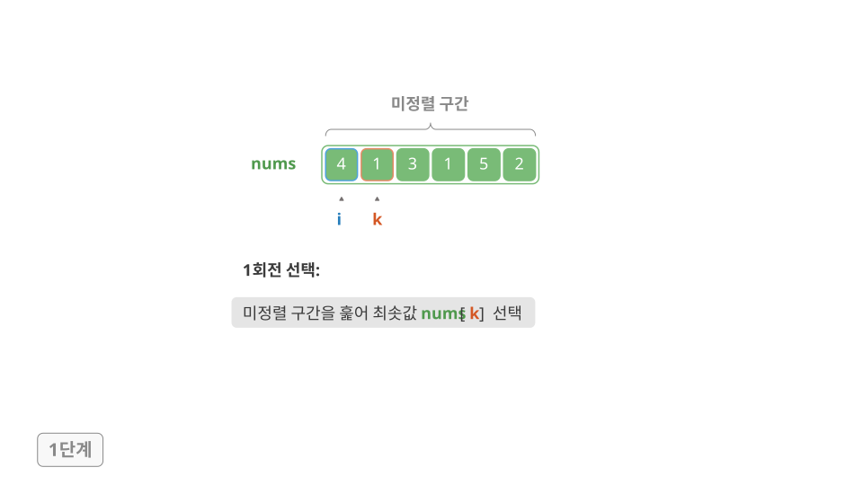

=== "<2>"
    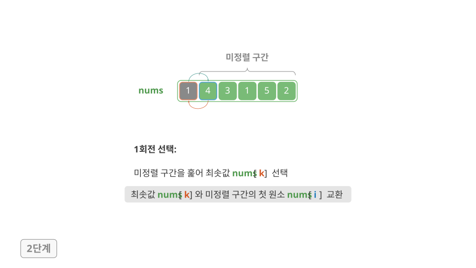

=== "<3>"
    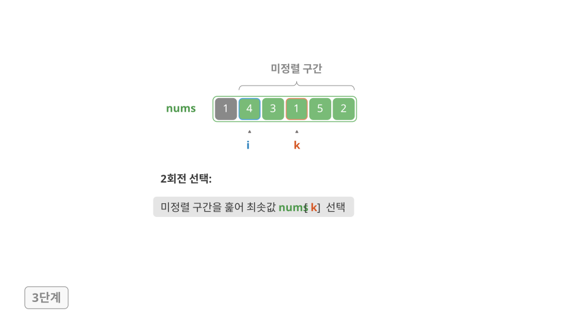

=== "<4>"
    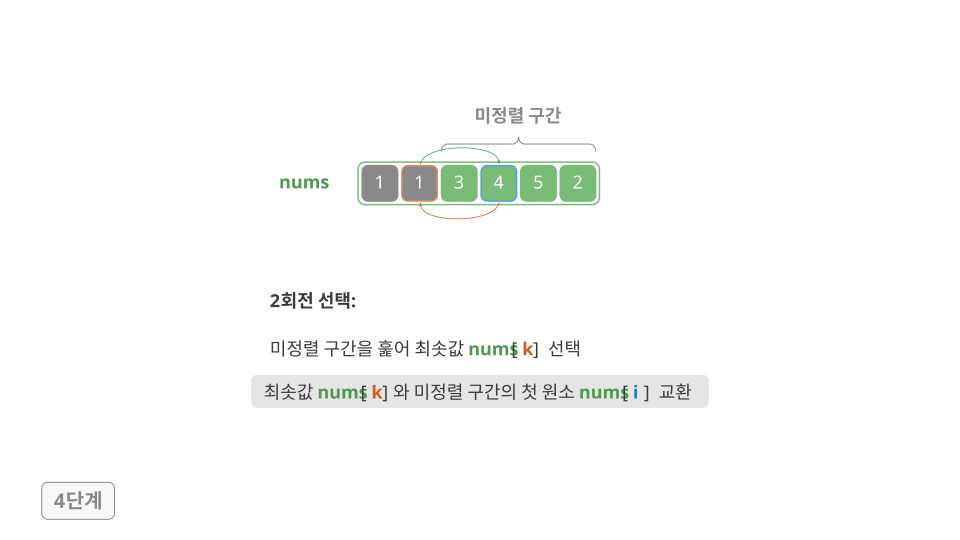

=== "<5>"
    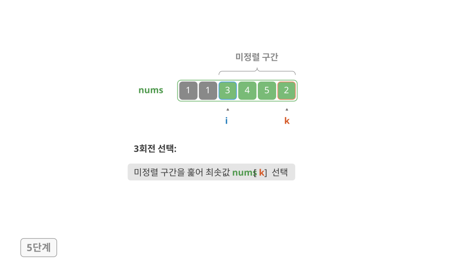

=== "<6>"
    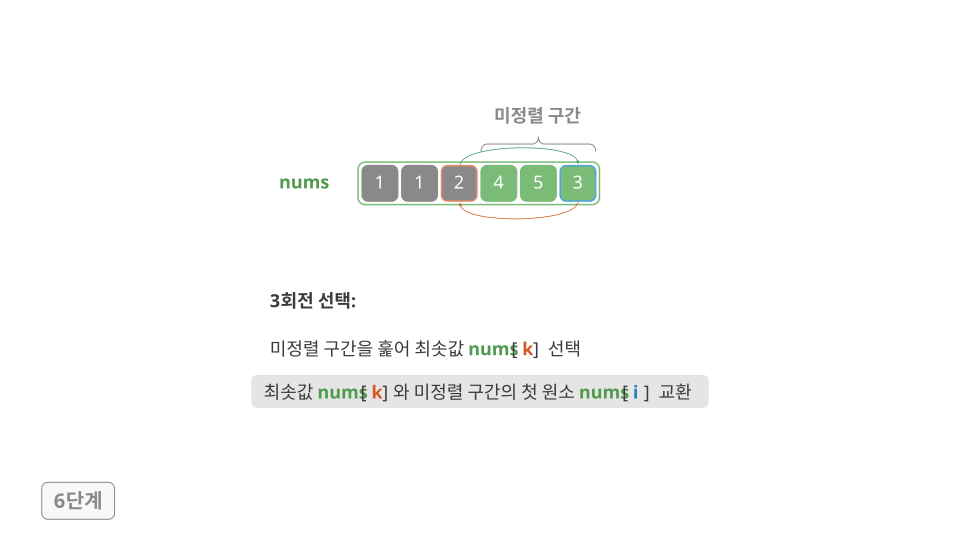

=== "<7>"
    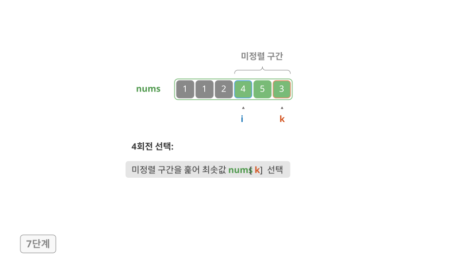

=== "<8>"
    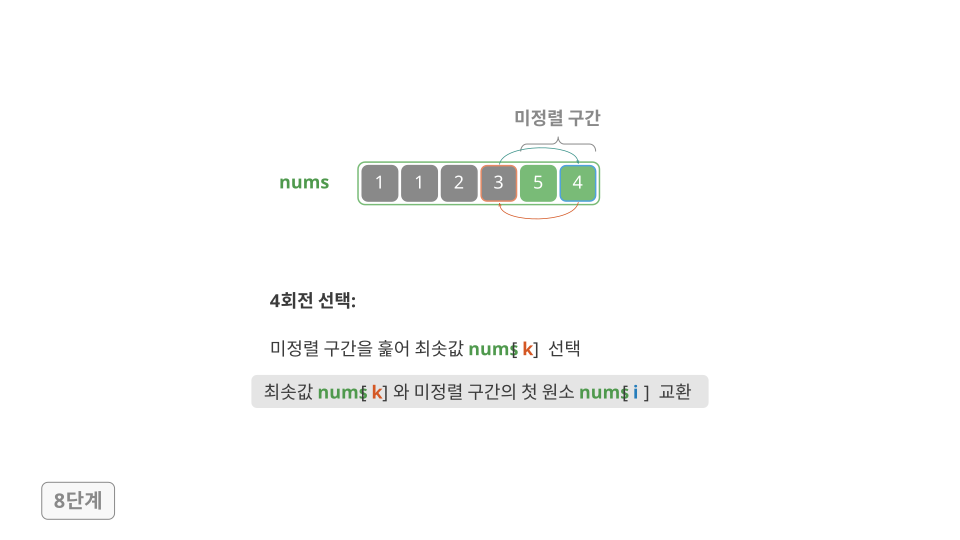

=== "<9>"
    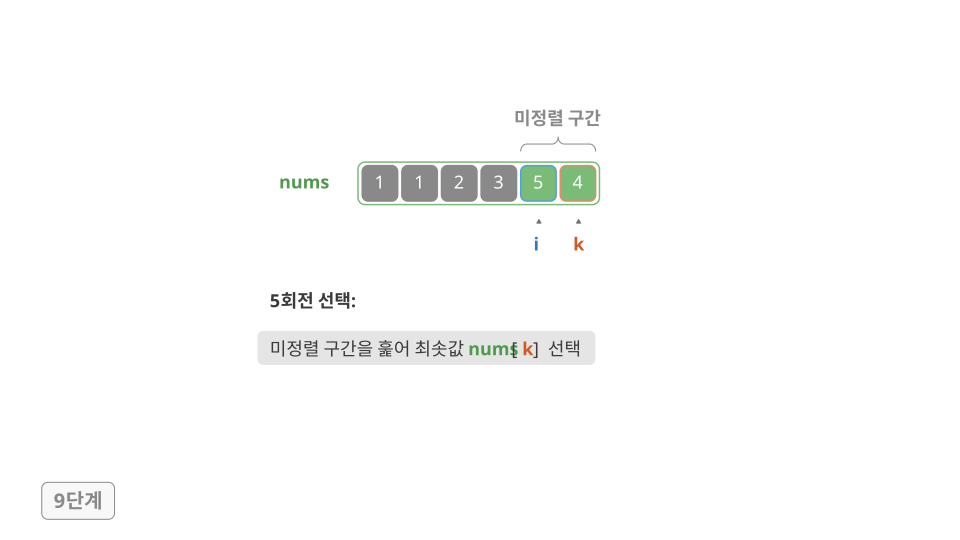

=== "<10>"
    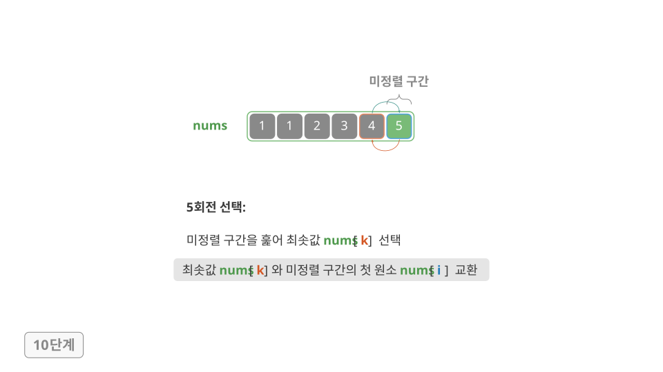

=== "<11>"
    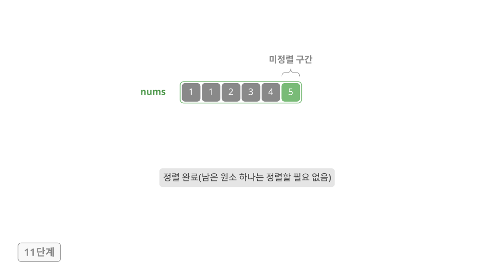

코드에서는 $k$로 미정렬 구간의 최솟값 위치를 기록한다.

```src
[file]{selection_sort}-[class]{}-[func]{selection_sort}
```

## 알고리즘의 특성

- **시간 복잡도 $O(n^2)$, 비적응형 정렬**: 바깥 루프는 총 $n - 1$회 실행된다. 안쪽 루프는 첫 회전에 $n - 1$번, 마지막 회전에 $1$번 실행된다. 즉, 회전별 반복 횟수는 $n - 1$, $n - 2$, $\dots$, $2$, $1$이고 합은 $\frac{n(n - 1)}{2}$이다.
- **공간 복잡도 $O(1)$, 제자리 정렬**: 포인터 $i$와 $j$에 필요한 추가 공간은 상수 크기다.
- **불안정 정렬**: 아래 그림처럼 원소 `nums[i]`가 값이 같은 다른 원소의 오른쪽으로 옮겨져 두 원소의 상대적 순서가 바뀔 수 있다.

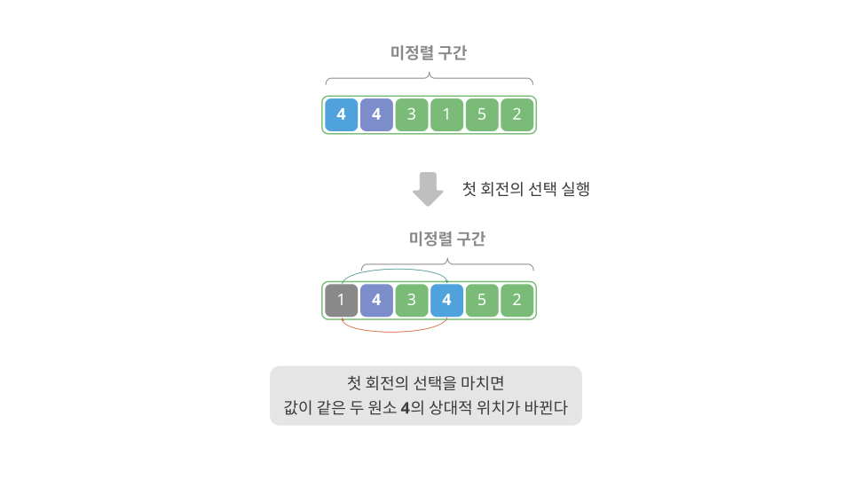
