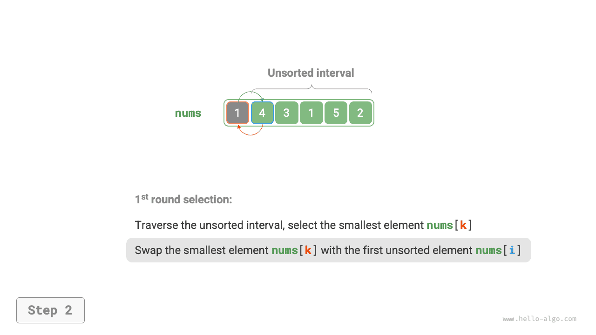
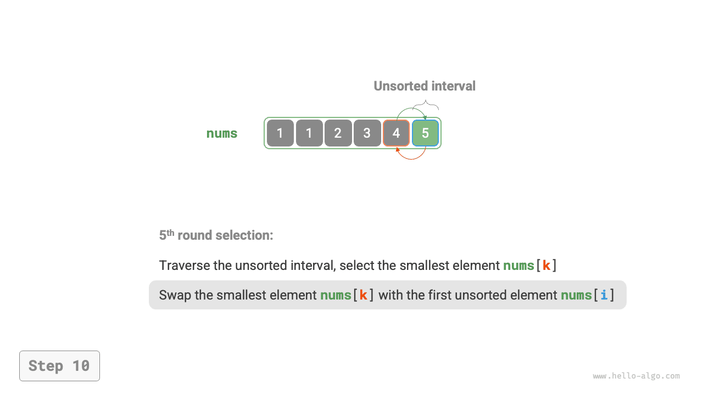
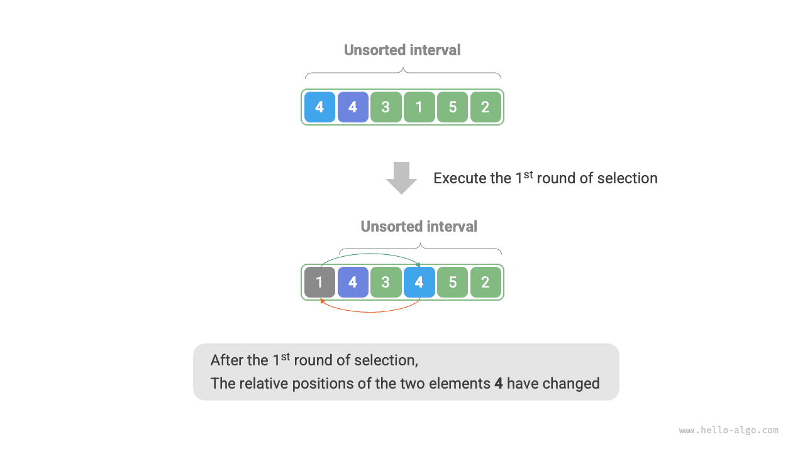

# 선택 정렬

<u>선택 정렬(selection sort)</u>의 원리는 매우 간단하다. 반복문을 실행하여 매번 정렬되지 않은 구간에서 가장 작은 원소를 고른 뒤 정렬된 구간의 끝에 놓는다.

배열의 길이가 $n$일 때 선택 정렬의 과정은 아래 그림과 같다.

1. 처음에는 모든 원소가 정렬되지 않았으므로 미정렬 구간(인덱스)은 $[0, n-1]$이다.
2. 구간 $[0, n-1]$에서 가장 작은 원소를 골라 인덱스 $0$의 원소와 교환한다. 그러면 배열의 앞 1개 원소가 정렬된다.
3. 구간 $[1, n-1]$에서 가장 작은 원소를 골라 인덱스 $1$의 원소와 교환한다. 그러면 배열의 앞 2개 원소가 정렬된다.
4. 같은 과정을 반복한다. $n - 1$ 번 선택하고 교환하면 배열의 앞 $n - 1$ 개 원소가 정렬된다.
5. 남은 원소 하나는 반드시 가장 큰 원소이므로 정렬할 필요가 없으며, 배열 정렬이 완료된다.

=== "<1>"
    

=== "<2>"
    

=== "<3>"
    

=== "<4>"
    

=== "<5>"
    

=== "<6>"
    

=== "<7>"
    

=== "<8>"
    

=== "<9>"
    

=== "<10>"
    

=== "<11>"
    

코드에서는 $k$로 미정렬 구간의 최소 원소를 기록한다.

```src
[file]{selection_sort}-[class]{}-[func]{selection_sort}
```

## 알고리즘 특성

- **시간 복잡도 $O(n^2)$, 비적응형 정렬**: 바깥 반복문은 $n - 1$ 번 실행된다. 안쪽 반복문은 첫 회에 $n - 1$ 번, 마지막 회에 $1$ 번 실행된다. 즉, 각 회의 실행 횟수는 $n - 1$, $n - 2$, $\dots$, $2$, $1$이고 합은 $\frac{n(n - 1)}{2}$이다.
- **공간 복잡도 $O(1)$, 제자리 정렬**: 포인터 $i$와 $j$는 상수 크기의 추가 공간을 사용한다.
- **불안정 정렬**: 아래 그림과 같이 원소 `nums[i]`가 자신과 값이 같은 원소의 오른쪽으로 교환되어 두 원소의 상대적 순서가 바뀔 수 있다.


