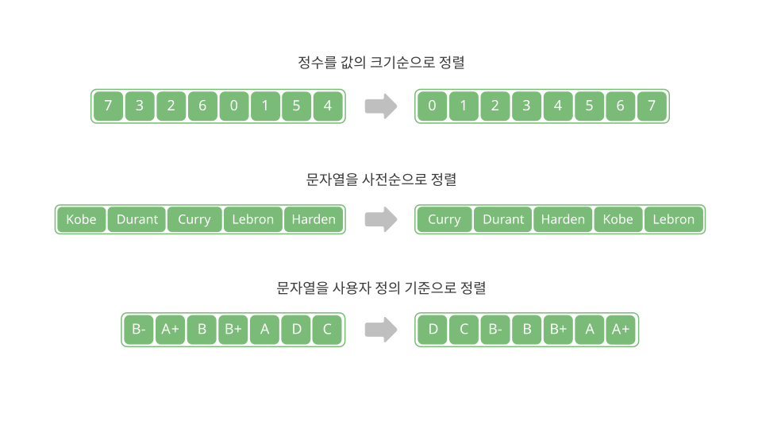

# 정렬 알고리즘

<u>정렬 알고리즘(sorting algorithm)</u>은 데이터 집합을 특정한 순서로 배열한다. 정렬된 데이터는 대개 탐색, 분석, 처리를 더 효율적으로 할 수 있어 정렬 알고리즘은 널리 쓰인다.

아래 그림처럼 정렬 대상은 정수, 부동 소수점 수, 문자, 문자열 등 다양한 유형일 수 있다. 필요에 따라 숫자의 크기, 문자의 ASCII 코드 순서 또는 사용자 정의 규칙을 정렬 기준으로 삼을 수 있다.



## 평가 기준

**실행 효율**: 정렬 알고리즘은 시간 복잡도가 낮고 총 연산 수도 적을수록 좋다(시간 복잡도의 상수 계수가 작아진다). 데이터가 많을수록 실행 효율이 특히 중요하다.

**제자리 정렬 여부**: 이름 그대로 <u>제자리 정렬</u>은 원래 배열에서 직접 정렬한다. 추가 보조 배열이 필요 없어 메모리를 절약한다. 일반적으로 제자리 정렬은 데이터를 옮기는 연산도 적어 더 빠르게 실행된다.

**안정성**: <u>안정 정렬</u>은 정렬 후에도 배열에서 값이 같은 원소들의 상대적 순서를 유지한다.

여러 기준으로 차례로 정렬하려면 안정 정렬이 필요하다. 학생 정보 표의 첫째 열이 이름이고 둘째 열이 나이라고 하자. 이때 <u>불안정 정렬</u>을 사용하면 입력 데이터의 기존 순서가 깨질 수 있다.

```shell
# 입력 데이터는 이름순으로 정렬되어 있다
# (name, age)
  ('A', 19)
  ('B', 18)
  ('C', 21)
  ('D', 19)
  ('E', 23)

# 불안정 정렬 알고리즘으로 목록을 나이순으로 정렬하면
# 결과에서 ('D', 19)와 ('A', 19)의 상대적 위치가 달라져
# 입력 데이터에 있던 이름순 정렬이 깨진다
  ('B', 18)
  ('D', 19)
  ('A', 19)
  ('C', 21)
  ('E', 23)
```

**적응성**: <u>적응형 정렬</u>은 입력 데이터에 이미 있는 순서 정보를 활용해 연산량을 줄이고 시간 효율을 높인다. 적응형 정렬 알고리즘의 최선 시간 복잡도는 대개 평균 시간 복잡도보다 낮다.

**비교 기반 여부**: <u>비교 기반 정렬</u>은 비교 연산자($<$, $=$, $>$)로 원소의 상대적 순서를 판단해 배열 전체를 정렬한다. 최악 시간 복잡도의 하한은 $\Omega(n \log n)$이다. <u>비교를 사용하지 않는 정렬</u>은 비교 연산자를 쓰지 않아 시간 복잡도가 $O(n)$에 이를 수 있지만 적용 범위가 비교적 좁다.

## 이상적인 정렬 알고리즘

**빠르고, 제자리에서 정렬하며, 안정적이고, 적응성이 있고, 범용성이 높다**. 지금까지 이 모든 특성을 갖춘 정렬 알고리즘은 발견되지 않았다. 따라서 구체적인 데이터 특성과 문제의 요구 사항에 따라 정렬 알고리즘을 선택해야 한다.

이제 다양한 정렬 알고리즘을 익히고 위의 평가 기준에 따라 각각의 장단점을 분석해 보자.
