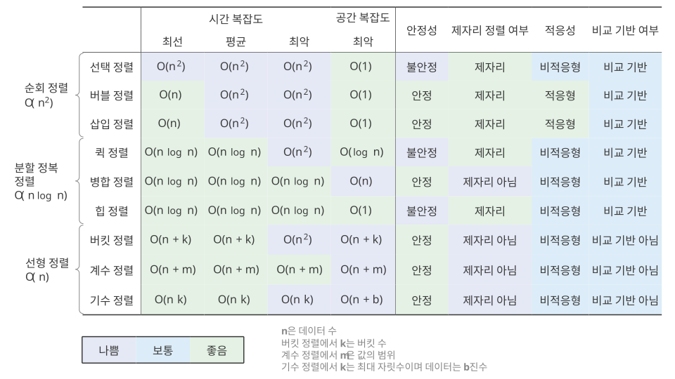

# 요약

### 핵심 내용 돌아보기

- 버블 정렬은 이웃한 원소를 교환해 정렬한다. 플래그를 추가해 일찍 반환하도록 하면 최선 시간 복잡도를 $O(n)$까지 낮출 수 있다.
- 삽입 정렬은 매 회전마다 미정렬 구간의 원소를 정렬된 구간의 알맞은 위치에 끼워 넣는다. 시간 복잡도는 $O(n^2)$이지만 기본 연산이 비교적 적어 데이터가 적은 정렬 작업에 널리 쓰인다.
- 퀵 정렬은 양방향 분할을 이용한다. 매번 최악의 피벗을 고르면 시간 복잡도가 $O(n^2)$까지 나빠질 수 있다. 중앙값이나 무작위로 고른 값을 피벗으로 사용하면 이런 경우가 발생할 확률을 낮출 수 있다. 짧은 부분 구간부터 재귀 호출하면 재귀 깊이를 효과적으로 줄여 공간 복잡도를 $O(\log n)$으로 개선할 수 있다.
- 병합 정렬은 분할과 병합이라는 두 단계로 이루어져 분할 정복 전략을 잘 보여 준다. 배열을 병합 정렬하려면 보조 배열이 필요해 공간 복잡도가 $O(n)$이지만 연결 리스트를 정렬할 때는 공간 복잡도를 $O(1)$까지 낮출 수 있다.
- 버킷 정렬은 데이터를 버킷에 배분하고 각 버킷을 정렬한 뒤 결과를 합치는 세 단계로 이루어진다. 역시 분할 정복 전략을 보여 주며 대용량 데이터에 적합하다. 데이터를 고르게 나누는 것이 관건이다.
- 계수 정렬은 버킷 정렬의 특수한 경우로, 데이터의 출현 횟수를 세어 정렬한다. 데이터가 많고 값의 범위가 제한적일 때 적합하며 데이터를 양의 정수로 변환할 수 있어야 한다.
- 기수 정렬은 자릿값별로 차례로 정렬하는 방법으로, 데이터를 고정된 자릿수의 수로 나타낼 수 있어야 한다.
- 효율이 높고 안정적이면서 제자리 정렬과 적응성까지 갖춘 알고리즘이 있다면 이상적이다. 그러나 다른 자료 구조나 알고리즘과 마찬가지로 이 조건들을 모두 충족하는 정렬 알고리즘은 없다. 실제로는 데이터의 특성에 맞게 정렬 알고리즘을 골라야 한다.
- 아래 그림은 대표적인 정렬 알고리즘의 효율, 안정성, 제자리 정렬 여부, 적응성 등을 비교한다.

### Q & A

**Q**: 정렬 알고리즘의 안정성이 꼭 필요한 경우는 언제인가?

실제 문제에서는 객체의 특정 속성을 기준으로 정렬할 때가 있다. 예를 들어 학생에게 이름과 키라는 두 속성이 있다고 하자. 여러 기준을 차례로 적용하기 위해 먼저 이름순으로 정렬해 `(A, 180) (B, 185) (C, 170) (D, 170)`을 얻고 다음에 키순으로 정렬한다. 정렬 알고리즘이 불안정하면 결과가 `(D, 170) (C, 170) (A, 180) (B, 185)`이 될 수 있다.

학생 D와 C의 위치가 뒤바뀌어 이름순 정렬이 깨졌다. 이는 원하던 결과가 아니다.

**Q**: 양방향 분할에서 ‘오른쪽에서 왼쪽으로 찾기’와 ‘왼쪽에서 오른쪽으로 찾기’의 순서를 바꿔도 되는가?

안 된다. 맨 왼쪽 원소를 피벗으로 삼으면 반드시 오른쪽에서 왼쪽으로 먼저 찾고 나서 왼쪽에서 오른쪽으로 찾아야 한다. 직관과는 다소 어긋나는 이 결론의 이유를 살펴보자.

양방향 분할 `partition()`의 마지막 단계에서는 `nums[left]`와 `nums[i]`를 교환한다. 교환 후에는 피벗 왼쪽의 모든 원소에 대해 ‘원소 `<=` 피벗’이 성립해야 한다. **따라서 마지막 교환 직전에 `nums[left] >= nums[i]`가 반드시 성립해야 한다**. 왼쪽에서 오른쪽으로 먼저 찾는데 피벗보다 큰 원소를 찾지 못한다면 **`i == j`일 때 루프를 빠져나오고 이때 `nums[j] == nums[i] > nums[left]`일 수 있다**. 그러면 마지막 교환으로 피벗보다 큰 원소가 배열의 맨 왼쪽으로 가서 분할에 실패한다.

예를 들어 배열 `[0, 0, 0, 0, 1]`에서 왼쪽부터 오른쪽으로 먼저 찾으면 분할 결과가 `[1, 0, 0, 0, 0]`이 되어 올바르지 않다.

조금 더 생각해 보자. `nums[right]`를 피벗으로 선택하면 반대로 왼쪽에서 오른쪽으로 먼저 찾아야 한다.

**Q**: 퀵 정렬의 재귀 깊이를 최적화할 때 짧은 배열을 고르면 깊이가 $\log n$을 넘지 않는 이유는 무엇인가?

재귀 깊이는 현재 호출되어 아직 반환하지 않은 재귀 함수의 수다. 양방향 분할은 매번 원래 배열을 두 부분 배열로 나눈다. 깊이를 최적화하면 다음 재귀 호출에서 다루는 길이는 최대 원래 배열 길이의 절반이다. 최악의 경우에도 계속 절반씩 줄어 최종 재귀 깊이는 $\log n$이 된다.

원래의 퀵 정렬은 긴 쪽 배열을 연달아 재귀 호출할 수 있다. 최악의 경우 길이가 $n$, $n - 1$, $\dots$, $2$, $1$로 이어져 재귀 깊이가 $n$에 이른다. 깊이를 최적화하면 이를 피할 수 있다.

**Q**: 배열의 모든 원소가 같으면 퀵 정렬의 시간 복잡도는 $O(n^2)$인가? 이런 성능 저하를 어떻게 처리할 수 있는가?

그렇다. 이런 경우에는 피벗보다 작은 부분, 같은 부분, 큰 부분으로 세 구간을 나누고 작은 부분과 큰 부분만 재귀 호출할 수 있다. 이 방법이면 모든 원소가 같은 입력 배열은 단 한 번의 분할로 정렬이 끝난다.

**Q**: 버킷 정렬의 최악 시간 복잡도는 왜 $O(n^2)$인가?

최악의 경우 모든 원소가 같은 버킷에 들어간다. 이 원소들을 $O(n^2)$ 알고리즘으로 정렬하면 시간 복잡도는 $O(n^2)$이다.
