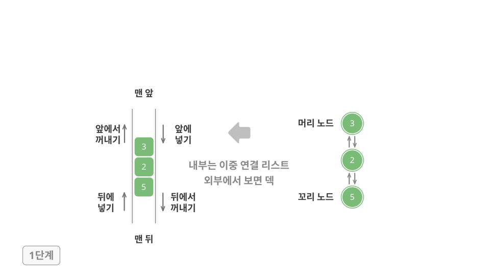
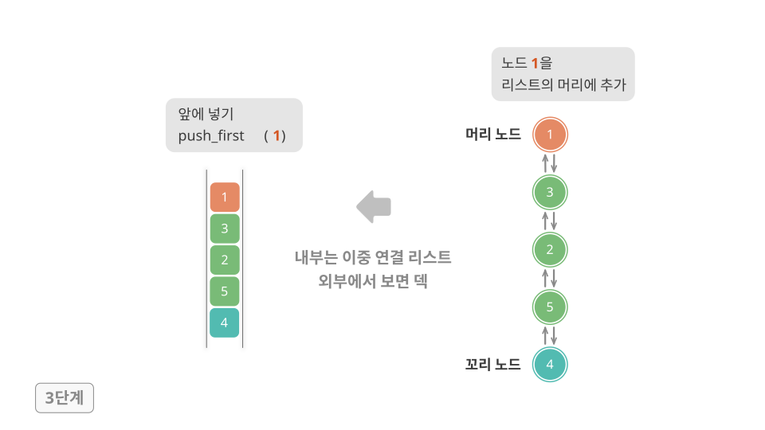
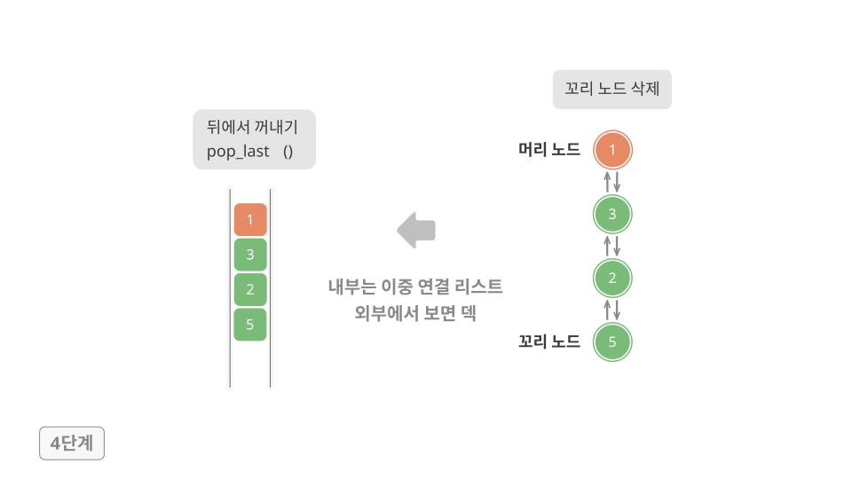
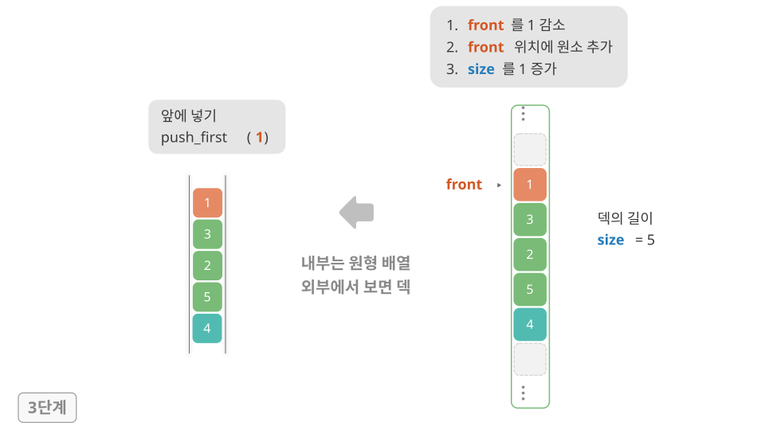
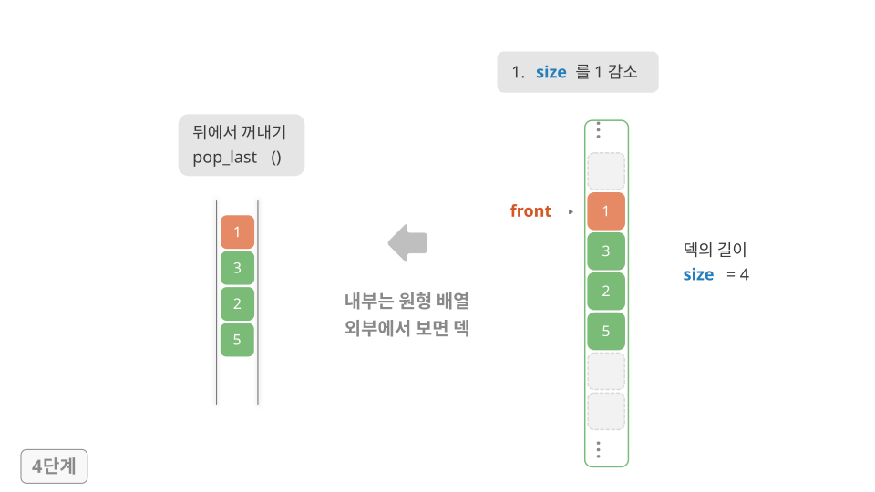
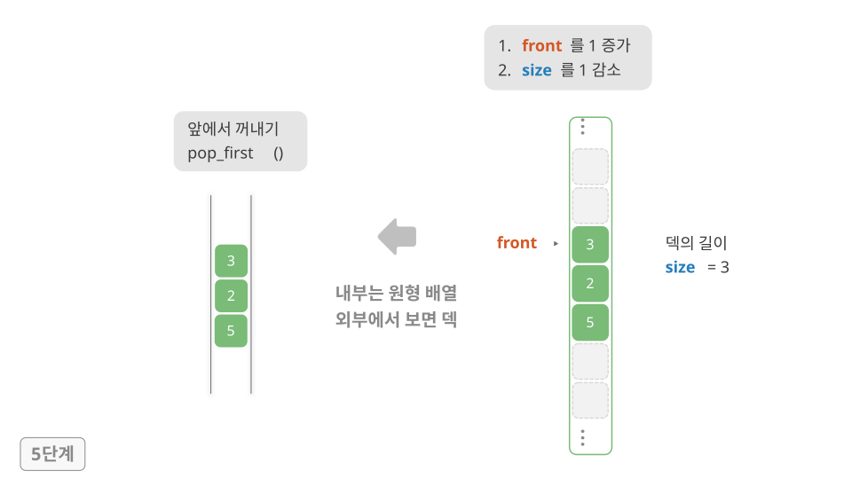

# 덱

큐에서는 맨 앞의 원소를 삭제하거나 맨 뒤에 원소를 추가하는 것만 가능하다. 아래 그림처럼 <u>덱(double-ended queue)</u>은 앞뒤 양쪽에서 원소를 추가하거나 삭제할 수 있어 더 유연하다.


## 덱의 기본 연산

덱의 기본 연산은 아래 표와 같다. 실제 메서드 이름은 사용하는 프로그래밍 언어에 따라 달라진다.

<p align="center"> 표 <id> &nbsp; 덱 연산의 효율 </p>

| 메서드 이름         | 설명             | 시간 복잡도 |
| -------------- | ---------------- | ---------- |
| `push_first()` | 맨 앞에 원소 추가 | $O(1)$     |
| `push_last()`  | 맨 뒤에 원소 추가 | $O(1)$     |
| `pop_first()`  | 맨 앞의 원소 삭제     | $O(1)$     |
| `pop_last()`   | 맨 뒤의 원소 삭제     | $O(1)$     |
| `peek_first()` | 맨 앞의 원소 조회     | $O(1)$     |
| `peek_last()`  | 맨 뒤의 원소 조회     | $O(1)$     |

덱도 프로그래밍 언어에서 제공하는 클래스를 다음과 같이 바로 사용할 수 있다.

```snippet
deque_operations
```

??? pythontutor "실행 과정 시각화"

    @tutor deque_operations_tutor

## 덱 구현 *

덱도 큐처럼 연결 리스트나 배열을 내부 자료 구조로 사용해 구현할 수 있다.

### 이중 연결 리스트로 구현하기

앞 절에서는 일반적인 단일 연결 리스트로 큐를 구현했다. 머리 노드를 삭제하거나 꼬리 노드 뒤에 새 노드를 추가하기 쉽기 때문이다. 머리 노드 삭제는 큐에서 꺼내기에, 꼬리 노드 뒤에 추가하는 일은 큐에 넣기에 해당한다.

덱에서는 앞과 뒤에서 모두 원소를 넣고 꺼낼 수 있다. 즉, 큐의 연산에 더해 반대 방향의 연산도 구현해야 한다. 이를 위해 덱의 내부 자료 구조로 이중 연결 리스트를 사용한다.

아래 그림처럼 이중 연결 리스트의 머리 노드를 덱의 맨 앞, 꼬리 노드를 맨 뒤로 삼고 양 끝에서 노드를 추가하고 삭제하는 기능을 구현한다.

=== "<1>"
    

=== "<2>"
    

=== "<3>"
    

=== "<4>"
    

=== "<5>"
    

구현 코드는 다음과 같다.

```src
[file]{linkedlist_deque}-[class]{linked_list_deque}-[func]{}
```

### 배열로 구현하기

아래 그림처럼 배열로 큐를 구현할 때와 마찬가지로 원형 배열을 사용해 덱을 구현할 수 있다.

=== "<1>"
    

=== "<2>"
    

=== "<3>"
    

=== "<4>"
    

=== "<5>"
    

큐를 구현한 코드에 ‘앞에 넣기’와 ‘뒤에서 꺼내기’ 메서드만 추가하면 된다.

```src
[file]{array_deque}-[class]{array_deque}-[func]{}
```

## 덱의 활용

덱은 스택과 큐의 동작 방식을 모두 지원한다. **따라서 스택이나 큐가 쓰이는 모든 상황에서 활용할 수 있으며, 연산을 더 자유롭게 조합할 수 있다**.

소프트웨어의 ‘실행 취소’ 기능은 보통 스택으로 구현한다. 시스템은 변경 작업이 일어날 때마다 `push` 연산으로 작업을 스택에 넣고 `pop` 연산으로 실행을 취소한다. 다만 시스템 자원에는 한계가 있어 보통 취소 가능한 횟수를 제한한다. 예를 들어 최근 $50$단계까지만 저장할 수 있다면 스택의 길이가 $50$을 넘었을 때 스택의 바닥(덱의 맨 앞)에서 작업 하나를 삭제해야 한다. **스택은 이 연산을 지원하지 않으므로 이때는 스택 대신 덱을 사용해야 한다**. 실행 취소의 핵심 원리는 여전히 스택의 후입선출이다. 덱을 사용하면 여기에 필요한 추가 동작을 더 유연하게 구현할 수 있다.
