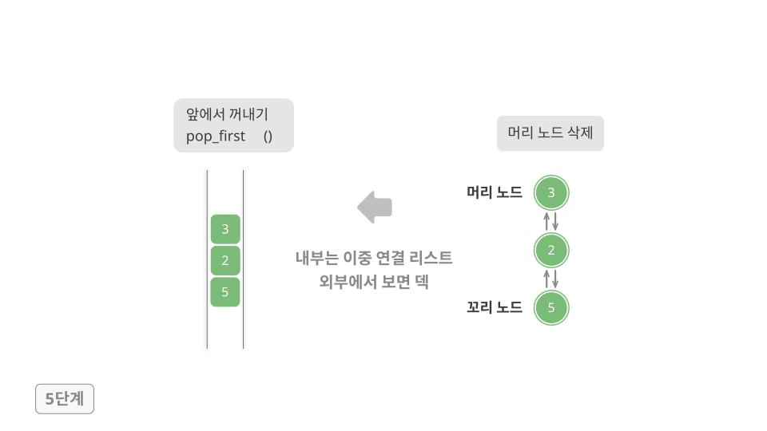
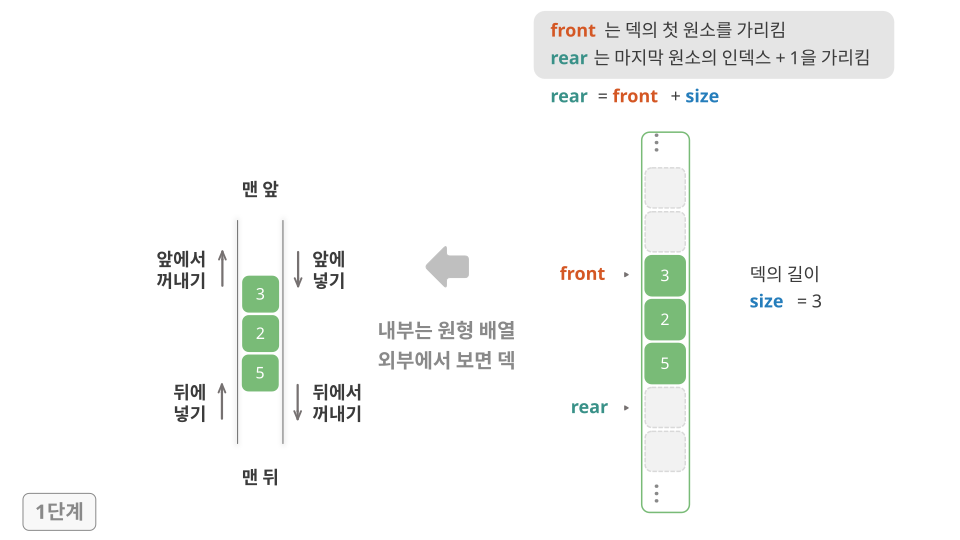
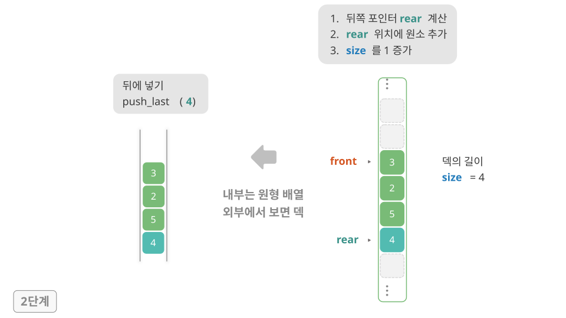

# 덱

큐에서는 맨 앞 원소를 삭제하거나 맨 뒤에 원소를 추가하는 것만 가능하다. 아래 그림의 <u>덱(double-ended queue)</u>은 앞뒤 양쪽에서 원소를 추가하고 삭제할 수 있어 더 유연하다.


## 덱의 기본 연산

덱의 기본 연산은 아래 표와 같다. 구체적인 메서드 이름은 사용하는 프로그래밍 언어에 따라 정해진다.

<p align="center"> 표 <id> &nbsp; 덱의 연산 효율 </p>

| 메서드         | 설명             | 시간 복잡도 |
| -------------- | ---------------- | ---------- |
| `push_first()` | 맨 앞에 원소 추가 | $O(1)$     |
| `push_last()`  | 맨 뒤에 원소 추가 | $O(1)$     |
| `pop_first()`  | 맨 앞 원소 삭제     | $O(1)$     |
| `pop_last()`   | 맨 뒤 원소 삭제     | $O(1)$     |
| `peek_first()` | 맨 앞 원소에 접근     | $O(1)$     |
| `peek_last()`  | 맨 뒤 원소에 접근     | $O(1)$     |

마찬가지로 프로그래밍 언어가 제공하는 덱 클래스를 바로 사용할 수 있다.

```snippet
deque_operations
```

??? pythontutor "코드 시각화"

    @tutor deque_operations_tutor

## 덱 구현 *

덱의 구현은 큐와 비슷하며, 기반 자료 구조로 연결 리스트나 배열을 선택할 수 있다.

### 이중 연결 리스트 기반 구현

앞 절에서는 일반적인 단일 연결 리스트로 큐를 구현했다. 머리 노드를 삭제하는 연산(큐에서 꺼내기)과 꼬리 노드 뒤에 새 노드를 추가하는 연산(큐에 삽입하기)을 쉽게 수행할 수 있기 때문이다.

덱에서는 앞과 뒤 모두 삽입과 꺼내기를 수행할 수 있다. 즉, 큐와 대칭되는 반대 방향의 연산도 구현해야 한다. 이를 위해 ‘이중 연결 리스트’를 덱의 기반 자료 구조로 사용한다.

아래 그림과 같이 이중 연결 리스트의 머리 노드와 꼬리 노드를 덱의 맨 앞과 맨 뒤로 보고, 양 끝에서 노드를 추가하고 삭제하는 기능을 구현한다.

=== "<1>"
    

=== "<2>"
    

=== "<3>"
    

=== "<4>"
    

=== "<5>"
    

구현 코드는 다음과 같다.

```src
[file]{linkedlist_deque}-[class]{linked_list_deque}-[func]{}
```

### 배열 기반 구현

아래 그림과 같이 배열 기반 큐와 마찬가지로 원형 배열을 사용하여 덱을 구현할 수 있다.

=== "<1>"
    

=== "<2>"
    

=== "<3>"
    

=== "<4>"
    

=== "<5>"
    

큐 구현에 ‘맨 앞에 삽입하기’와 ‘맨 뒤에서 꺼내기’ 메서드만 추가하면 된다.

```src
[file]{array_deque}-[class]{array_deque}-[func]{}
```

## 덱의 활용

덱은 스택과 큐의 논리를 모두 갖추므로 **둘의 모든 활용 상황에 적용할 수 있으며, 더 높은 자유도도 제공한다**.

소프트웨어의 ‘실행 취소’는 보통 스택으로 구현한다. 시스템이 각 변경 작업을 스택에 `push`하고, `pop`으로 취소한다. 다만 자원 제약 때문에 보통 취소 가능한 단계 수를 제한한다(예를 들어 $50$단계만 저장). 스택 길이가 $50$을 넘으면 바닥(덱의 맨 앞)에서 삭제해야 한다. **스택은 이 기능을 지원하지 않으므로 덱으로 대체해야 한다**. ‘실행 취소’의 핵심 논리는 여전히 스택의 후입선출 원리를 따르며, 덱은 여기에 필요한 추가 논리를 더 유연하게 구현하게 해 준다.
