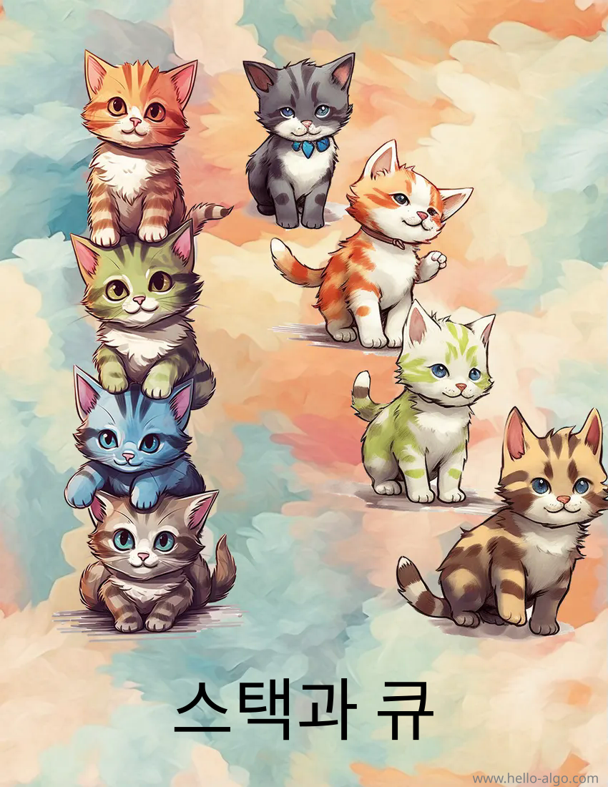

# 제 5 장 &nbsp; 스택과 큐

{ class="cover-image" }

!!! abstract

    스택은 고양이들이 층층이 포개진 모습과 같고, 큐는 고양이들이 한 줄로 늘어선 모습과 같다.
    
    스택은 나중에 들어간 것이 먼저 나오는 후입선출을, 큐는 먼저 들어간 것이 먼저 나오는 선입선출을 나타낸다.

## 이 장의 내용

- [5.1 &nbsp; 스택](stack.md)
- [5.2 &nbsp; 큐](queue.md)
- [5.3 &nbsp; 덱](deque.md)
- [5.4 &nbsp; 요약](summary.md)
- [5.5 &nbsp; 연습 문제](exercises.md)
