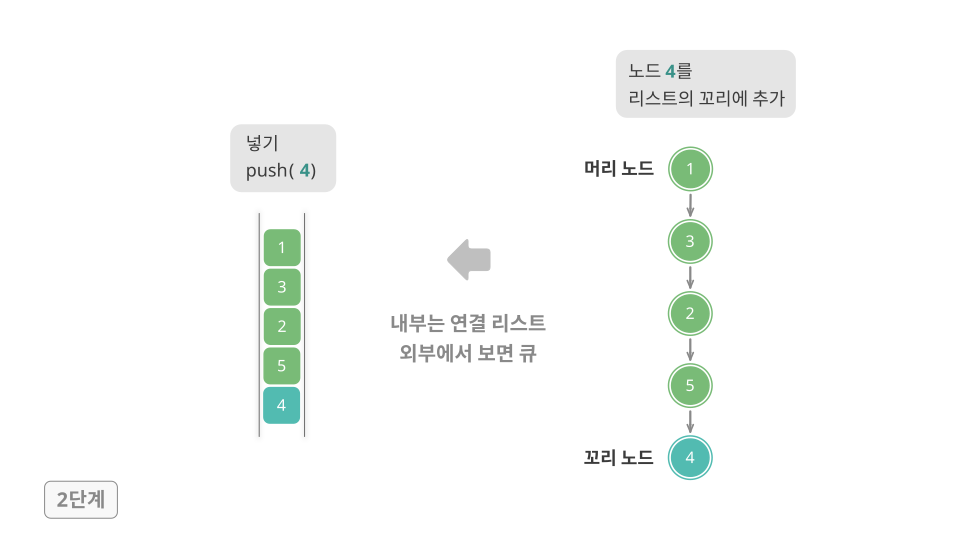
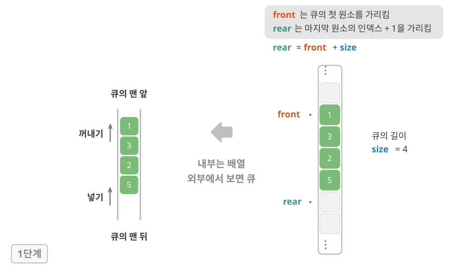

# 큐

<u>큐(queue)</u>는 선입선출 규칙을 따르는 선형 자료 구조다. 이름 그대로 줄 서는 현상을 재현한다. 새로 온 사람은 계속 줄의 뒤에 서고, 맨 앞에 있는 사람부터 하나씩 떠난다.

아래 그림과 같이 큐의 앞쪽을 ‘큐의 맨 앞’, 뒤쪽을 ‘큐의 맨 뒤’라고 한다. 맨 뒤에 원소를 추가하는 연산을 ‘큐에 삽입하기’, 맨 앞 원소를 삭제하는 연산을 ‘큐에서 꺼내기’라고 한다.


## 큐의 기본 연산

큐의 기본 연산은 아래 표와 같다. 메서드 이름은 프로그래밍 언어에 따라 다를 수 있으며, 여기서는 스택과 같은 이름을 사용한다.

<p align="center"> 표 <id> &nbsp; 큐의 연산 효율 </p>

| 메서드   | 설명                         | 시간 복잡도 |
| -------- | ---------------------------- | ---------- |
| `push()` | 큐에 원소 삽입, 즉 맨 뒤에 추가 | $O(1)$     |
| `pop()`  | 큐의 맨 앞 원소를 꺼냄                 | $O(1)$     |
| `peek()` | 큐의 맨 앞 원소에 접근                 | $O(1)$     |

프로그래밍 언어가 제공하는 큐 클래스를 바로 사용할 수 있다.

```snippet
queue_operations
```

??? pythontutor "코드 시각화"

    @tutor queue_operations_tutor

## 큐 구현

큐를 구현하려면 한쪽 끝에서 원소를 추가하고 반대쪽 끝에서 삭제할 수 있는 자료 구조가 필요하다. 연결 리스트와 배열 모두 이 조건을 만족한다.

### 연결 리스트 기반 구현

아래 그림과 같이 연결 리스트의 ‘머리 노드’와 ‘꼬리 노드’를 각각 ‘큐의 맨 앞’과 ‘큐의 맨 뒤’로 볼 수 있다. 맨 뒤에서는 노드 추가만, 맨 앞에서는 노드 삭제만 허용한다.

=== "<1>"
    

=== "<2>"
    

=== "<3>"
    

연결 리스트로 큐를 구현한 코드는 다음과 같다.

```src
[file]{linkedlist_queue}-[class]{linked_list_queue}-[func]{}
```

### 배열 기반 구현

배열에서 첫 원소를 삭제하는 시간 복잡도는 $O(n)$이므로, 큐에서 원소를 꺼내는 효율이 낮아진다. 그러나 다음과 같은 방법으로 이 문제를 피할 수 있다.

변수 `front`로 큐의 맨 앞 원소 인덱스를 가리키고, 변수 `size`로 큐의 길이를 기록한다. `rear = front + size`로 정의하면 `rear`는 큐의 맨 뒤 원소 바로 다음 위치를 가리킨다.

이 설계에서는 **배열에서 원소가 들어 있는 유효 구간이 `[front, rear - 1]`이며**, 각 연산의 구현 방법은 아래 그림과 같다.

- 삽입: 인덱스 `rear`에 입력 원소를 대입하고 `size`를 1 늘린다.
- 꺼내기: `front`를 1 늘리고 `size`를 1 줄이면 된다.

두 연산 모두 한 번의 처리만 필요하므로 시간 복잡도는 $O(1)$이다.

=== "<1>"
    

=== "<2>"
    

=== "<3>"
    

여기에는 한 가지 문제가 있다. 삽입과 꺼내기를 반복하면 `front`와 `rear`가 계속 오른쪽으로 이동하다가 **배열의 끝에 도달하면 더 이상 움직일 수 없다**. 이를 해결하려면 배열을 앞뒤가 이어진 ‘원형 배열’로 볼 수 있다.

원형 배열에서는 `front`나 `rear`가 배열의 끝을 넘으면 곧바로 처음으로 돌아와 순회를 계속하게 해야 한다. 이 주기적 규칙은 ‘나머지 연산’으로 구현할 수 있다. 코드는 다음과 같다.

```src
[file]{array_queue}-[class]{array_queue}-[func]{}
```

위 큐 구현에는 여전히 길이를 바꿀 수 없다는 한계가 있다. 하지만 배열을 동적 배열로 바꾸어 용량 확장 방식을 도입하면 쉽게 해결할 수 있다. 관심 있는 독자는 직접 구현해 보자.

두 구현의 비교 결과는 스택과 같으므로 여기서는 반복해서 설명하지 않는다.

## 큐의 대표적인 활용

- **타오바오 주문**. 구매자가 주문하면 큐에 들어가고, 시스템은 순서대로 처리한다. 광군제 기간에는 짧은 시간에 엄청난 주문이 몰리므로 높은 동시성을 처리하는 일이 엔지니어들의 핵심 과제가 된다.
- **여러 종류의 대기 작업**. 프린터 작업 대기열, 식당 음식 제공 대기열 등 ‘먼저 온 순서’를 지켜야 하는 상황에서 큐는 처리 순서를 효과적으로 유지한다.
