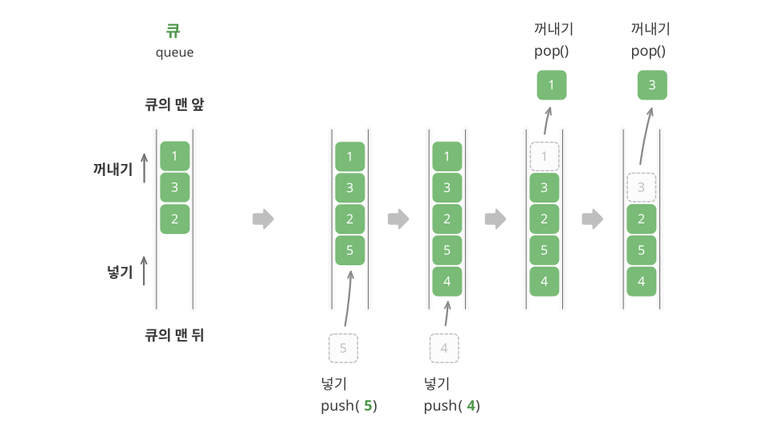
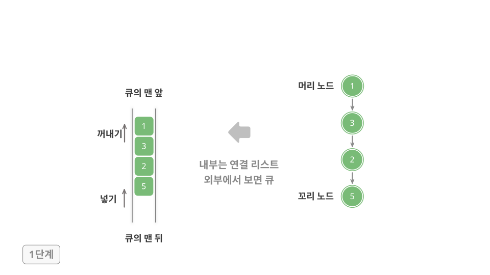
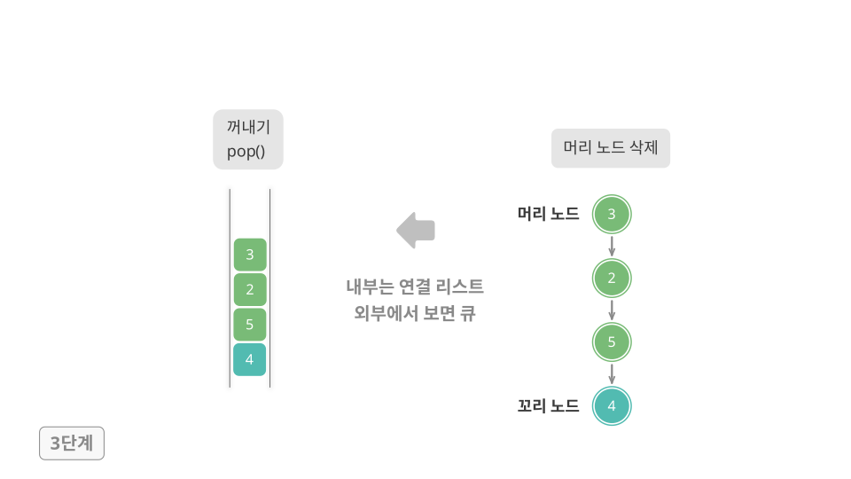
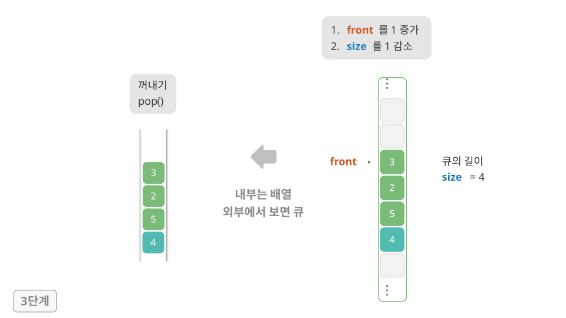

# 큐

<u>큐(queue)</u>는 선입선출 원칙을 따르는 선형 자료 구조다. 사람들이 줄을 서는 모습과 같다. 새로 온 사람은 줄의 맨 뒤에 서고 맨 앞에 있는 사람부터 한 명씩 빠져나간다.

아래 그림에서 원소가 나가는 쪽이 ‘큐의 맨 앞’, 새 원소가 들어오는 쪽이 ‘큐의 맨 뒤’다. 맨 뒤에 원소를 추가하는 연산을 ‘넣기’, 맨 앞의 원소를 삭제하는 연산을 ‘꺼내기’라고 한다.



## 큐의 기본 연산

큐의 기본 연산은 아래 표와 같다. 메서드 이름은 프로그래밍 언어에 따라 다를 수 있다. 여기서는 스택에서 사용한 것과 같은 이름을 쓴다.

<p align="center"> 표 <id> &nbsp; 큐 연산의 효율 </p>

| 메서드 이름   | 설명                         | 시간 복잡도 |
| -------- | ---------------------------- | ---------- |
| `push()` | 원소 넣기(큐의 맨 뒤에 추가) | $O(1)$     |
| `pop()`  | 맨 앞의 원소 꺼내기                 | $O(1)$     |
| `peek()` | 맨 앞의 원소 조회                 | $O(1)$     |

프로그래밍 언어에서 제공하는 큐 클래스를 다음과 같이 바로 사용할 수 있다.

```snippet
queue_operations
```

??? pythontutor "실행 과정 시각화"

    @tutor queue_operations_tutor

## 큐 구현

큐를 구현하려면 한쪽 끝에 원소를 추가하고 반대쪽 끝에서 원소를 삭제할 수 있는 자료 구조가 필요하다. 연결 리스트와 배열이 모두 이 조건을 만족한다.

### 연결 리스트로 구현하기

아래 그림처럼 연결 리스트의 머리 노드를 큐의 맨 앞, 꼬리 노드를 큐의 맨 뒤로 볼 수 있다. 맨 뒤에서는 노드 추가만, 맨 앞에서는 노드 삭제만 허용한다.

=== "<1>"
    

=== "<2>"
    

=== "<3>"
    

연결 리스트로 큐를 구현한 코드는 다음과 같다.

```src
[file]{linkedlist_queue}-[class]{linked_list_queue}-[func]{}
```

### 배열로 구현하기

배열에서 첫 원소를 삭제하는 데 드는 시간 복잡도는 $O(n)$이므로 큐에서 원소를 꺼내는 연산의 효율이 낮아진다. 다음과 같은 방법으로 이 문제를 피할 수 있다.

`front`에는 큐의 첫 원소가 있는 인덱스를 저장하고, `size`에는 큐의 길이를 기록한다. `rear = front + size`라고 정의하면 이렇게 계산한 `rear`는 마지막 원소 바로 다음 위치를 가리킨다.

이 설계에서 **배열에 큐의 원소가 들어 있는 유효 구간은 `[front, rear - 1]`이다**. 각 연산을 구현하는 방법은 아래 그림과 같다.

- 넣기: 인덱스 `rear`에 입력 원소를 저장하고 `size`를 1 늘린다.
- 꺼내기: `front`를 1 늘리고 `size`를 1 줄이면 된다.

넣기와 꺼내기 모두 한 번의 처리로 끝나므로 시간 복잡도는 각각 $O(1)$이다.

=== "<1>"
    

=== "<2>"
    

=== "<3>"
    

그런데 원소를 계속 넣고 꺼내다 보면 `front`와 `rear`가 모두 오른쪽으로 이동해 **배열 끝에 도달하면 더 이상 움직일 수 없다**. 이를 해결하기 위해 배열의 끝과 처음이 이어진 ‘원형 배열’로 생각할 수 있다.

원형 배열에서는 `front`나 `rear`가 배열 끝을 넘어가면 곧바로 처음으로 돌아가 순회를 이어 가야 한다. 다음 코드처럼 나머지 연산을 이용하면 인덱스가 주기적으로 되돌아오게 할 수 있다.

```src
[file]{array_queue}-[class]{array_queue}-[func]{}
```

위에서 구현한 큐에는 길이가 고정되어 있다는 제약이 있다. 이 문제는 배열을 동적 배열로 바꾸어 용량을 늘릴 수 있게 하면 쉽게 해결할 수 있다. 관심이 있다면 직접 구현해 보자.

두 구현 방식의 비교 결과는 스택에서 살펴본 것과 같다.

## 큐의 대표적인 활용 사례

- **타오바오 주문**. 구매자가 주문하면 주문이 큐에 들어가고 시스템은 큐에 쌓인 순서대로 주문을 처리한다. 광군제 기간에는 짧은 시간에 막대한 주문이 몰리므로 수많은 요청을 동시에 처리하는 일이 엔지니어들의 주요 과제가 된다.
- **다양한 대기 작업**. 프린터의 인쇄 대기열이나 식당에서 음식을 내보내는 순서처럼 먼저 온 일을 먼저 처리해야 하는 상황에서는 큐로 처리 순서를 효과적으로 유지할 수 있다.
