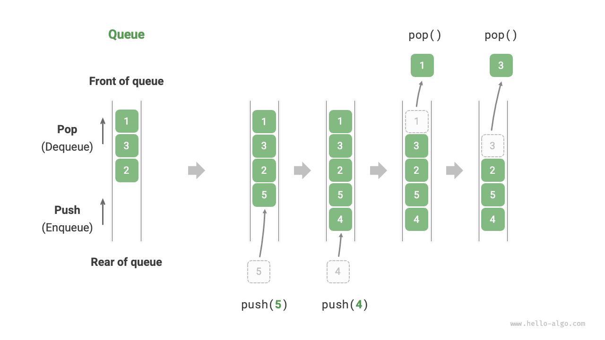
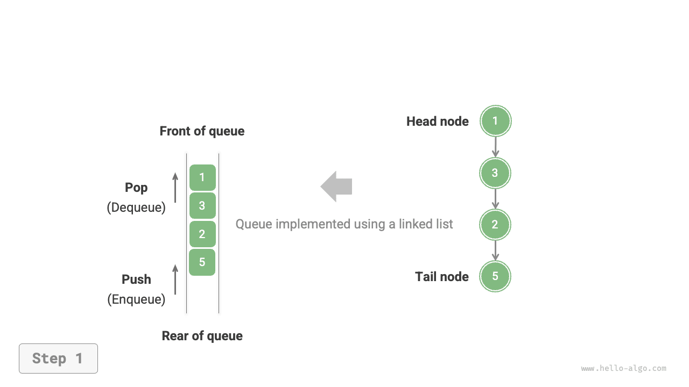
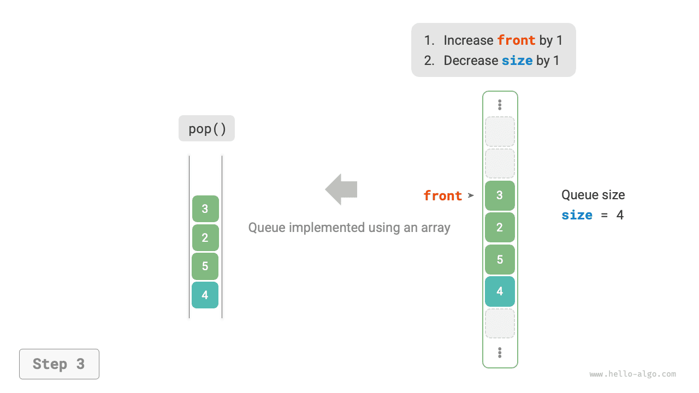

# 큐

<u>큐(queue)</u>는 선입선출 규칙을 따르는 선형 자료 구조다. 이름 그대로 줄 서는 현상을 재현한다. 새로 온 사람은 계속 줄의 뒤에 서고, 맨 앞에 있는 사람부터 하나씩 떠난다.

아래 그림과 같이 큐의 앞쪽을 ‘큐의 맨 앞’, 뒤쪽을 ‘큐의 맨 뒤’라고 한다. 맨 뒤에 원소를 추가하는 연산을 ‘큐에 삽입하기’, 맨 앞 원소를 삭제하는 연산을 ‘큐에서 꺼내기’라고 한다.



## 큐의 기본 연산

큐의 기본 연산은 아래 표와 같다. 메서드 이름은 프로그래밍 언어에 따라 다를 수 있으며, 여기서는 스택과 같은 이름을 사용한다.

<p align="center"> 표 <id> &nbsp; 큐의 연산 효율 </p>

| 메서드   | 설명                         | 시간 복잡도 |
| -------- | ---------------------------- | ---------- |
| `push()` | 큐에 원소 삽입, 즉 맨 뒤에 추가 | $O(1)$     |
| `pop()`  | 큐의 맨 앞 원소를 꺼냄                 | $O(1)$     |
| `peek()` | 큐의 맨 앞 원소에 접근                 | $O(1)$     |

프로그래밍 언어가 제공하는 큐 클래스를 바로 사용할 수 있다.

=== "Python"

    ```python title="queue.py"
    from collections import deque

    # 큐 초기화
    # Python에서는 보통 덱 클래스 deque를 큐로 사용한다
    # queue.Queue()는 전용 큐 클래스이지만 사용이 불편하므로 권하지 않는다
    que: deque[int] = deque()

    # 큐에 원소 삽입
    que.append(1)
    que.append(3)
    que.append(2)
    que.append(5)
    que.append(4)

    # 큐의 맨 앞 원소에 접근
    front: int = que[0]

    # 큐에서 원소 꺼내기
    pop: int = que.popleft()

    # 큐 길이 구하기
    size: int = len(que)

    # 큐가 비어 있는지 확인
    is_empty: bool = len(que) == 0
    ```

=== "C++"

    ```cpp title="queue.cpp"
    /* 큐 초기화 */
    queue<int> queue;

    /* 큐에 원소 삽입 */
    queue.push(1);
    queue.push(3);
    queue.push(2);
    queue.push(5);
    queue.push(4);

    /* 큐의 맨 앞 원소에 접근 */
    int front = queue.front();

    /* 큐에서 원소 꺼내기 */
    queue.pop();

    /* 큐 길이 구하기 */
    int size = queue.size();

    /* 큐가 비어 있는지 확인 */
    bool empty = queue.empty();
    ```

=== "Java"

    ```java title="queue.java"
    /* 큐 초기화 */
    Queue<Integer> queue = new LinkedList<>();

    /* 큐에 원소 삽입 */
    queue.offer(1);
    queue.offer(3);
    queue.offer(2);
    queue.offer(5);
    queue.offer(4);

    /* 큐의 맨 앞 원소에 접근 */
    int peek = queue.peek();

    /* 큐에서 원소 꺼내기 */
    int pop = queue.poll();

    /* 큐 길이 구하기 */
    int size = queue.size();

    /* 큐가 비어 있는지 확인 */
    boolean isEmpty = queue.isEmpty();
    ```

=== "C#"

    ```csharp title="queue.cs"
    /* 큐 초기화 */
    Queue<int> queue = new();

    /* 큐에 원소 삽입 */
    queue.Enqueue(1);
    queue.Enqueue(3);
    queue.Enqueue(2);
    queue.Enqueue(5);
    queue.Enqueue(4);

    /* 큐의 맨 앞 원소에 접근 */
    int peek = queue.Peek();

    /* 큐에서 원소 꺼내기 */
    int pop = queue.Dequeue();

    /* 큐 길이 구하기 */
    int size = queue.Count;

    /* 큐가 비어 있는지 확인 */
    bool isEmpty = queue.Count == 0;
    ```

=== "Go"

    ```go title="queue_test.go"
    /* 큐 초기화 */
    // Go에서는 list를 큐로 사용한다
    queue := list.New()

    /* 큐에 원소 삽입 */
    queue.PushBack(1)
    queue.PushBack(3)
    queue.PushBack(2)
    queue.PushBack(5)
    queue.PushBack(4)

    /* 큐의 맨 앞 원소에 접근 */
    peek := queue.Front()

    /* 큐에서 원소 꺼내기 */
    pop := queue.Front()
    queue.Remove(pop)

    /* 큐 길이 구하기 */
    size := queue.Len()

    /* 큐가 비어 있는지 확인 */
    isEmpty := queue.Len() == 0
    ```

=== "Swift"

    ```swift title="queue.swift"
    /* 큐 초기화 */
    // Swift에는 내장 큐 클래스가 없으므로 Array를 큐로 사용할 수 있다
    var queue: [Int] = []

    /* 큐에 원소 삽입 */
    queue.append(1)
    queue.append(3)
    queue.append(2)
    queue.append(5)
    queue.append(4)

    /* 큐의 맨 앞 원소에 접근 */
    let peek = queue.first!

    /* 큐에서 원소 꺼내기 */
    // 배열이므로 removeFirst의 복잡도는 O(n)이다
    let pop = queue.removeFirst()

    /* 큐 길이 구하기 */
    let size = queue.count

    /* 큐가 비어 있는지 확인 */
    let isEmpty = queue.isEmpty
    ```

=== "JS"

    ```javascript title="queue.js"
    /* 큐 초기화 */
    // JavaScript에는 내장 큐가 없으므로 Array를 큐로 사용할 수 있다
    const queue = [];

    /* 큐에 원소 삽입 */
    queue.push(1);
    queue.push(3);
    queue.push(2);
    queue.push(5);
    queue.push(4);

    /* 큐의 맨 앞 원소에 접근 */
    const peek = queue[0];

    /* 큐에서 원소 꺼내기 */
    // 기반이 배열이므로 shift() 메서드의 시간 복잡도는 O(n)이다
    const pop = queue.shift();

    /* 큐 길이 구하기 */
    const size = queue.length;

    /* 큐가 비어 있는지 확인 */
    const empty = queue.length === 0;
    ```

=== "TS"

    ```typescript title="queue.ts"
    /* 큐 초기화 */
    // TypeScript에는 내장 큐가 없으므로 Array를 큐로 사용할 수 있다
    const queue: number[] = [];

    /* 큐에 원소 삽입 */
    queue.push(1);
    queue.push(3);
    queue.push(2);
    queue.push(5);
    queue.push(4);

    /* 큐의 맨 앞 원소에 접근 */
    const peek = queue[0];

    /* 큐에서 원소 꺼내기 */
    // 기반이 배열이므로 shift() 메서드의 시간 복잡도는 O(n)이다
    const pop = queue.shift();

    /* 큐 길이 구하기 */
    const size = queue.length;

    /* 큐가 비어 있는지 확인 */
    const empty = queue.length === 0;
    ```

=== "Dart"

    ```dart title="queue.dart"
    /* 큐 초기화 */
    // Dart의 Queue 클래스는 덱이며 일반 큐로도 사용할 수 있다
    Queue<int> queue = Queue();

    /* 큐에 원소 삽입 */
    queue.add(1);
    queue.add(3);
    queue.add(2);
    queue.add(5);
    queue.add(4);

    /* 큐의 맨 앞 원소에 접근 */
    int peek = queue.first;

    /* 큐에서 원소 꺼내기 */
    int pop = queue.removeFirst();

    /* 큐 길이 구하기 */
    int size = queue.length;

    /* 큐가 비어 있는지 확인 */
    bool isEmpty = queue.isEmpty;
    ```

=== "Rust"

    ```rust title="queue.rs"
    /* 덱 초기화 */
    // Rust에서는 덱을 일반 큐로 사용한다
    let mut deque: VecDeque<u32> = VecDeque::new();

    /* 큐에 원소 삽입 */
    deque.push_back(1);
    deque.push_back(3);
    deque.push_back(2);
    deque.push_back(5);
    deque.push_back(4);

    /* 큐의 맨 앞 원소에 접근 */
    if let Some(front) = deque.front() {
    }

    /* 큐에서 원소 꺼내기 */
    if let Some(pop) = deque.pop_front() {
    }

    /* 큐 길이 구하기 */
    let size = deque.len();

    /* 큐가 비어 있는지 확인 */
    let is_empty = deque.is_empty();
    ```

=== "C"

    ```c title="queue.c"
    // C는 내장 큐를 제공하지 않는다
    ```

=== "Kotlin"

    ```kotlin title="queue.kt"
    /* 큐 초기화 */
    val queue = LinkedList<Int>()

    /* 큐에 원소 삽입 */
    queue.offer(1)
    queue.offer(3)
    queue.offer(2)
    queue.offer(5)
    queue.offer(4)

    /* 큐의 맨 앞 원소에 접근 */
    val peek = queue.peek()

    /* 큐에서 원소 꺼내기 */
    val pop = queue.poll()

    /* 큐 길이 구하기 */
    val size = queue.size

    /* 큐가 비어 있는지 확인 */
    val isEmpty = queue.isEmpty()
    ```

=== "Ruby"

    ```ruby title="queue.rb"
    # 큐 초기화
    # Ruby의 내장 큐(Thread::Queue)에는 peek와 순회 메서드가 없으므로 Array를 큐로 사용할 수 있다
    queue = []

    # 큐에 원소 삽입
    queue.push(1)
    queue.push(3)
    queue.push(2)
    queue.push(5)
    queue.push(4)

    # 큐 원소에 접근
    peek = queue.first

    # 큐에서 원소 꺼내기
    # 배열이므로 Array#shift 메서드의 시간 복잡도는 O(n)임에 주의
    pop = queue.shift

    # 큐 길이 구하기
    size = queue.length

    # 큐가 비어 있는지 확인
    is_empty = queue.empty?
    ```

??? pythontutor "코드 시각화"

    https://pythontutor.com/render.html#code=from%20collections%20import%20deque%0A%0A%22%22%22%EC%8B%A4%ED%96%89%20%EC%BD%94%EB%93%9C%22%22%22%0Aif%20__name__%20%3D%3D%20%22__main__%22%3A%0A%20%20%20%20%23%20%ED%81%90%20%EC%B4%88%EA%B8%B0%ED%99%94%0A%20%20%20%20%23%20Python%EC%97%90%EC%84%9C%EB%8A%94%20%EB%B3%B4%ED%86%B5%20%EB%8D%B1%20%ED%81%B4%EB%9E%98%EC%8A%A4%20deque%EB%A5%BC%20%ED%81%90%EB%A1%9C%20%EC%82%AC%EC%9A%A9%ED%95%9C%EB%8B%A4%0A%20%20%20%20%23%20queue.Queue%28%29%EB%8A%94%20%EC%A0%84%EC%9A%A9%20%ED%81%90%20%ED%81%B4%EB%9E%98%EC%8A%A4%EC%9D%B4%EC%A7%80%EB%A7%8C%20%EC%82%AC%EC%9A%A9%EC%9D%B4%20%EB%B6%88%ED%8E%B8%ED%95%98%EB%8B%A4%0A%20%20%20%20que%20%3D%20deque%28%29%0A%0A%20%20%20%20%23%20%ED%81%90%EC%97%90%20%EC%9B%90%EC%86%8C%20%EC%82%BD%EC%9E%85%0A%20%20%20%20que.append%281%29%0A%20%20%20%20que.append%283%29%0A%20%20%20%20que.append%282%29%0A%20%20%20%20que.append%285%29%0A%20%20%20%20que.append%284%29%0A%20%20%20%20print%28%22%ED%81%90%20que%20%3D%22%2C%20que%29%0A%0A%20%20%20%20%23%20%ED%81%90%EC%9D%98%20%EB%A7%A8%20%EC%95%9E%20%EC%9B%90%EC%86%8C%EC%97%90%20%EC%A0%91%EA%B7%BC%0A%20%20%20%20front%20%3D%20que%5B0%5D%0A%20%20%20%20print%28%22%ED%81%90%EC%9D%98%20%EB%A7%A8%20%EC%95%9E%20%EC%9B%90%EC%86%8C%20front%20%3D%22%2C%20front%29%0A%0A%20%20%20%20%23%20%ED%81%90%EC%97%90%EC%84%9C%20%EC%9B%90%EC%86%8C%20%EA%BA%BC%EB%82%B4%EA%B8%B0%0A%20%20%20%20pop%20%3D%20que.popleft%28%29%0A%20%20%20%20print%28%22%EA%BA%BC%EB%82%B8%20%EC%9B%90%EC%86%8C%20pop%20%3D%22%2C%20pop%29%0A%20%20%20%20print%28%22%EC%9B%90%EC%86%8C%EB%A5%BC%20%EA%BA%BC%EB%82%B8%20%EB%92%A4%20que%20%3D%22%2C%20que%29%0A%0A%20%20%20%20%23%20%ED%81%90%20%EA%B8%B8%EC%9D%B4%20%EA%B5%AC%ED%95%98%EA%B8%B0%0A%20%20%20%20size%20%3D%20len%28que%29%0A%20%20%20%20print%28%22%ED%81%90%20%EA%B8%B8%EC%9D%B4%20size%20%3D%22%2C%20size%29%0A%0A%20%20%20%20%23%20%ED%81%90%EA%B0%80%20%EB%B9%84%EC%96%B4%20%EC%9E%88%EB%8A%94%EC%A7%80%20%ED%99%95%EC%9D%B8%0A%20%20%20%20is_empty%20%3D%20len%28que%29%20%3D%3D%200%0A%20%20%20%20print%28%22%ED%81%90%EA%B0%80%20%EB%B9%84%EC%96%B4%20%EC%9E%88%EB%8A%94%EA%B0%80%20%3D%22%2C%20is_empty%29&cumulative=false&curInstr=3&heapPrimitives=nevernest&mode=display&origin=opt-frontend.js&py=311&rawInputLstJSON=%5B%5D&textReferences=false

## 큐 구현

큐를 구현하려면 한쪽 끝에서 원소를 추가하고 반대쪽 끝에서 삭제할 수 있는 자료 구조가 필요하다. 연결 리스트와 배열 모두 이 조건을 만족한다.

### 연결 리스트 기반 구현

아래 그림과 같이 연결 리스트의 ‘머리 노드’와 ‘꼬리 노드’를 각각 ‘큐의 맨 앞’과 ‘큐의 맨 뒤’로 볼 수 있다. 맨 뒤에서는 노드 추가만, 맨 앞에서는 노드 삭제만 허용한다.

=== "<1>"
    

=== "<2>"
    

=== "<3>"
    

연결 리스트로 큐를 구현한 코드는 다음과 같다.

```src
[file]{linkedlist_queue}-[class]{linked_list_queue}-[func]{}
```

### 배열 기반 구현

배열에서 첫 원소를 삭제하는 시간 복잡도는 $O(n)$이므로, 큐에서 원소를 꺼내는 효율이 낮아진다. 그러나 다음과 같은 방법으로 이 문제를 피할 수 있다.

변수 `front`로 큐의 맨 앞 원소 인덱스를 가리키고, 변수 `size`로 큐의 길이를 기록한다. `rear = front + size`로 정의하면 `rear`는 큐의 맨 뒤 원소 바로 다음 위치를 가리킨다.

이 설계에서는 **배열에서 원소가 들어 있는 유효 구간이 `[front, rear - 1]`이며**, 각 연산의 구현 방법은 아래 그림과 같다.

- 삽입: 인덱스 `rear`에 입력 원소를 대입하고 `size`를 1 늘린다.
- 꺼내기: `front`를 1 늘리고 `size`를 1 줄이면 된다.

두 연산 모두 한 번의 처리만 필요하므로 시간 복잡도는 $O(1)$이다.

=== "<1>"
    

=== "<2>"
    

=== "<3>"
    

여기에는 한 가지 문제가 있다. 삽입과 꺼내기를 반복하면 `front`와 `rear`가 계속 오른쪽으로 이동하다가 **배열의 끝에 도달하면 더 이상 움직일 수 없다**. 이를 해결하려면 배열을 앞뒤가 이어진 ‘원형 배열’로 볼 수 있다.

원형 배열에서는 `front`나 `rear`가 배열의 끝을 넘으면 곧바로 처음으로 돌아와 순회를 계속하게 해야 한다. 이 주기적 규칙은 ‘나머지 연산’으로 구현할 수 있다. 코드는 다음과 같다.

```src
[file]{array_queue}-[class]{array_queue}-[func]{}
```

위 큐 구현에는 여전히 길이를 바꿀 수 없다는 한계가 있다. 하지만 배열을 동적 배열로 바꾸어 용량 확장 방식을 도입하면 쉽게 해결할 수 있다. 관심 있는 독자는 직접 구현해 보자.

두 구현의 비교 결과는 스택과 같으므로 여기서는 반복해서 설명하지 않는다.

## 큐의 대표적인 활용

- **타오바오 주문**. 구매자가 주문하면 큐에 들어가고, 시스템은 순서대로 처리한다. 광군제 기간에는 짧은 시간에 엄청난 주문이 몰리므로 높은 동시성을 처리하는 일이 엔지니어들의 핵심 과제가 된다.
- **여러 종류의 대기 작업**. 프린터 작업 대기열, 식당 음식 제공 대기열 등 ‘먼저 온 순서’를 지켜야 하는 상황에서 큐는 처리 순서를 효과적으로 유지한다.
