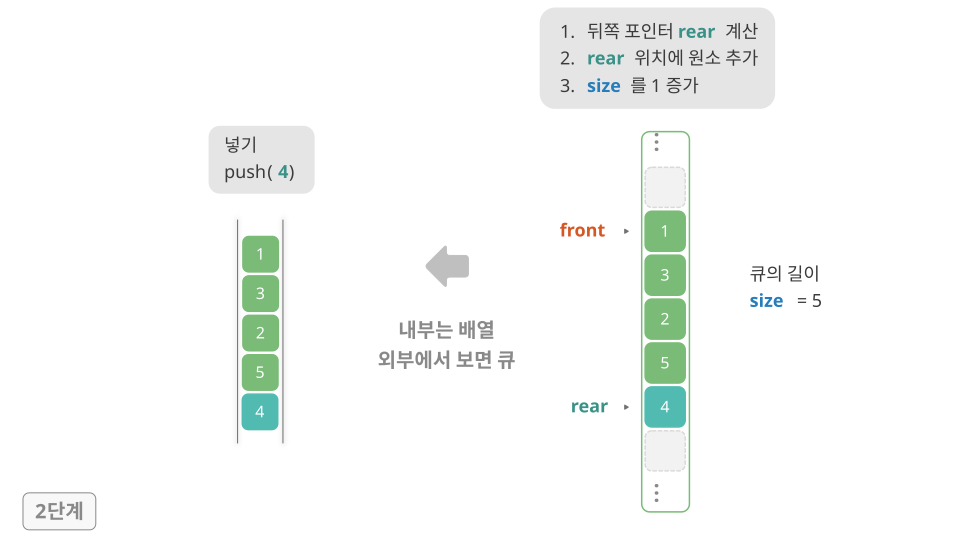

# 5.2 &nbsp; 큐

<u>큐(queue)</u>는 선입선출 원칙을 따르는 선형 자료 구조다. 사람들이 줄을 서는 모습과 같다. 새로 온 사람은 줄의 맨 뒤에 서고 맨 앞에 있는 사람부터 한 명씩 빠져나간다.

아래 그림(5-4)에서 원소가 나가는 쪽이 ‘큐의 맨 앞’, 새 원소가 들어오는 쪽이 ‘큐의 맨 뒤’다. 맨 뒤에 원소를 추가하는 연산을 ‘넣기’, 맨 앞의 원소를 삭제하는 연산을 ‘꺼내기’라고 한다.

{ class="animation-figure" }

<p align="center"> 그림 5-4 &nbsp; 큐의 선입선출 원칙 </p>

## 5.2.1 &nbsp; 큐의 기본 연산

큐의 기본 연산은 아래 표(5-2)와 같다. 메서드 이름은 프로그래밍 언어에 따라 다를 수 있다. 여기서는 스택에서 사용한 것과 같은 이름을 쓴다.

<p align="center"> 표 5-2 &nbsp; 큐 연산의 효율 </p>

<div class="center-table" markdown>

| 메서드 이름   | 설명                         | 시간 복잡도 |
| -------- | ---------------------------- | ---------- |
| `push()` | 원소 넣기(큐의 맨 뒤에 추가) | $O(1)$     |
| `pop()`  | 맨 앞의 원소 꺼내기                 | $O(1)$     |
| `peek()` | 맨 앞의 원소 조회                 | $O(1)$     |

</div>

프로그래밍 언어에서 제공하는 큐 클래스를 다음과 같이 바로 사용할 수 있다.

=== "Python"

    ```python title="queue.py"
    from collections import deque

    # 큐 초기화
    # Python에서는 일반적으로 덱을 구현한 deque 클래스를 큐로 사용한다
    # queue.Queue()는 큐 전용 클래스이지만 사용하기 불편하므로 권장하지 않는다
    que: deque[int] = deque()

    # 큐에 원소 삽입
    que.append(1)
    que.append(3)
    que.append(2)
    que.append(5)
    que.append(4)

    # 맨 앞 원소 조회
    front: int = que[0]

    # 큐에서 원소 꺼내기
    pop: int = que.popleft()

    # 큐의 길이 조회
    size: int = len(que)

    # 큐가 비어 있는지 확인
    is_empty: bool = len(que) == 0
    ```

=== "C++"

    ```cpp title="queue.cpp"
    /* 큐 초기화 */
    queue<int> queue;

    /* 큐에 원소 삽입 */
    queue.push(1);
    queue.push(3);
    queue.push(2);
    queue.push(5);
    queue.push(4);

    /* 맨 앞 원소 조회 */
    int front = queue.front();

    /* 큐에서 원소 꺼내기 */
    queue.pop();

    /* 큐의 길이 조회 */
    int size = queue.size();

    /* 큐가 비어 있는지 확인 */
    bool empty = queue.empty();
    ```

=== "Java"

    ```java title="queue.java"
    /* 큐 초기화 */
    Queue<Integer> queue = new LinkedList<>();

    /* 큐에 원소 삽입 */
    queue.offer(1);
    queue.offer(3);
    queue.offer(2);
    queue.offer(5);
    queue.offer(4);

    /* 맨 앞 원소 조회 */
    int peek = queue.peek();

    /* 큐에서 원소 꺼내기 */
    int pop = queue.poll();

    /* 큐의 길이 조회 */
    int size = queue.size();

    /* 큐가 비어 있는지 확인 */
    boolean isEmpty = queue.isEmpty();
    ```

=== "C#"

    ```csharp title="queue.cs"
    /* 큐 초기화 */
    Queue<int> queue = new();

    /* 큐에 원소 삽입 */
    queue.Enqueue(1);
    queue.Enqueue(3);
    queue.Enqueue(2);
    queue.Enqueue(5);
    queue.Enqueue(4);

    /* 맨 앞 원소 조회 */
    int peek = queue.Peek();

    /* 큐에서 원소 꺼내기 */
    int pop = queue.Dequeue();

    /* 큐의 길이 조회 */
    int size = queue.Count;

    /* 큐가 비어 있는지 확인 */
    bool isEmpty = queue.Count == 0;
    ```

=== "Go"

    ```go title="queue_test.go"
    /* 큐 초기화 */
    // Go에서는 list를 큐로 사용한다
    queue := list.New()

    /* 큐에 원소 삽입 */
    queue.PushBack(1)
    queue.PushBack(3)
    queue.PushBack(2)
    queue.PushBack(5)
    queue.PushBack(4)

    /* 맨 앞 원소 조회 */
    peek := queue.Front()

    /* 큐에서 원소 꺼내기 */
    pop := queue.Front()
    queue.Remove(pop)

    /* 큐의 길이 조회 */
    size := queue.Len()

    /* 큐가 비어 있는지 확인 */
    isEmpty := queue.Len() == 0
    ```

=== "Swift"

    ```swift title="queue.swift"
    /* 큐 초기화 */
    // Swift에는 내장 큐 클래스가 없으므로 Array를 큐로 사용할 수 있다
    var queue: [Int] = []

    /* 큐에 원소 삽입 */
    queue.append(1)
    queue.append(3)
    queue.append(2)
    queue.append(5)
    queue.append(4)

    /* 맨 앞 원소 조회 */
    let peek = queue.first!

    /* 큐에서 원소 꺼내기 */
    // Array로 구현할 때 removeFirst의 시간 복잡도는 O(n)이다
    let pop = queue.removeFirst()

    /* 큐의 길이 조회 */
    let size = queue.count

    /* 큐가 비어 있는지 확인 */
    let isEmpty = queue.isEmpty
    ```

=== "JS"

    ```javascript title="queue.js"
    /* 큐 초기화 */
    // JavaScript에는 내장 큐가 없으므로 Array를 큐로 사용할 수 있다
    const queue = [];

    /* 큐에 원소 삽입 */
    queue.push(1);
    queue.push(3);
    queue.push(2);
    queue.push(5);
    queue.push(4);

    /* 맨 앞 원소 조회 */
    const peek = queue[0];

    /* 큐에서 원소 꺼내기 */
    // 배열을 기반으로 하므로 shift() 메서드의 시간 복잡도는 O(n)이다
    const pop = queue.shift();

    /* 큐의 길이 조회 */
    const size = queue.length;

    /* 큐가 비어 있는지 확인 */
    const isEmpty = queue.length === 0;
    ```

=== "TS"

    ```typescript title="queue.ts"
    /* 큐 초기화 */
    // TypeScript에는 내장 큐가 없으므로 Array를 큐로 사용할 수 있다
    const queue: number[] = [];

    /* 큐에 원소 삽입 */
    queue.push(1);
    queue.push(3);
    queue.push(2);
    queue.push(5);
    queue.push(4);

    /* 맨 앞 원소 조회 */
    const peek = queue[0];

    /* 큐에서 원소 꺼내기 */
    // 배열을 기반으로 하므로 shift() 메서드의 시간 복잡도는 O(n)이다
    const pop = queue.shift();

    /* 큐의 길이 조회 */
    const size = queue.length;

    /* 큐가 비어 있는지 확인 */
    const isEmpty = queue.length === 0;
    ```

=== "Dart"

    ```dart title="queue.dart"
    /* 큐 초기화 */
    // Dart에서는 일반적으로 덱 클래스인 Queue를 큐로 사용한다
    final Queue<int> queue = Queue();

    /* 큐에 원소 삽입 */
    queue.add(1);
    queue.add(3);
    queue.add(2);
    queue.add(5);
    queue.add(4);

    /* 맨 앞 원소 조회 */
    final int peek = queue.first;

    /* 큐에서 원소 꺼내기 */
    final int pop = queue.removeFirst();

    /* 큐의 길이 조회 */
    final int size = queue.length;

    /* 큐가 비어 있는지 확인 */
    final bool isEmpty = queue.isEmpty;
    ```

=== "Rust"

    ```rust title="queue.rs"
    // 큐 초기화
    // Rust에서는 일반적으로 덱을 구현한 VecDeque 타입을 큐로 사용한다
    let mut queue: VecDeque<i32> = VecDeque::new();

    // 큐에 원소 삽입
    queue.push_back(1);
    queue.push_back(3);
    queue.push_back(2);
    queue.push_back(5);
    queue.push_back(4);

    // 맨 앞 원소 조회
    let peek = queue.front().unwrap();

    // 큐에서 원소 꺼내기
    let pop = queue.pop_front().unwrap();

    // 큐의 길이 조회
    let size = queue.len();

    // 큐가 비어 있는지 확인
    let is_empty = queue.is_empty();
    ```

=== "C"

    ```c title="queue.c"
    // C는 내장 큐를 제공하지 않는다
    ```

=== "Kotlin"

    ```kotlin title="queue.kt"
    /* 큐 초기화 */
    val queue = LinkedList<Int>()

    /* 큐에 원소 삽입 */
    queue.offer(1)
    queue.offer(3)
    queue.offer(2)
    queue.offer(5)
    queue.offer(4)

    /* 맨 앞 원소 조회 */
    val peek = queue.peek()

    /* 큐에서 원소 꺼내기 */
    val pop = queue.poll()

    /* 큐의 길이 조회 */
    val size = queue.size

    /* 큐가 비어 있는지 확인 */
    val isEmpty = queue.isEmpty()
    ```

=== "Ruby"

    ```ruby title="queue.rb"
    # 큐 초기화
    # Ruby 내장 큐(Thread::Queue)에는 peek 메서드와 순회 메서드가 없으므로 Array를 큐로 사용할 수 있다
    queue = []

    # 큐에 원소 삽입
    queue.push(1)
    queue.push(3)
    queue.push(2)
    queue.push(5)
    queue.push(4)

    # 큐의 원소 조회
    peek = queue.first

    # 큐에서 원소 꺼내기
    # Array는 배열이므로 Array#shift 메서드의 시간 복잡도는 O(n)이다
    pop = queue.shift

    # 큐의 길이 조회
    size = queue.length

    # 큐가 비어 있는지 확인
    is_empty = queue.empty?
    ```

??? pythontutor "실행 과정 시각화"

    <div style="height: 549px; width: 100%;"><iframe class="pythontutor-iframe" title="실행 과정 시각화" src="https://pythontutor.com/iframe-embed.html#code=from%20collections%20import%20deque%0A%0A%22%22%22Driver%20Code%22%22%22%0Aif%20__name__%20%3D%3D%20%22__main__%22%3A%0A%20%20%20%20%23%20%ED%81%90%20%EC%B4%88%EA%B8%B0%ED%99%94%0A%20%20%20%20%23%20%ED%8C%8C%EC%9D%B4%EC%8D%AC%EC%97%90%EC%84%9C%EB%8A%94%20%EB%B3%B4%ED%86%B5%20%EC%96%91%EB%B0%A9%ED%96%A5%20%ED%81%90%20%ED%81%B4%EB%9E%98%EC%8A%A4%EC%9D%B8%20deque%EB%A5%BC%20%ED%81%90%EB%A1%9C%20%EC%82%AC%EC%9A%A9%ED%95%9C%EB%8B%A4%0A%20%20%20%20%23%20queue.Queue%28%29%EB%8A%94%20%ED%81%90%20%EC%A0%84%EC%9A%A9%20%ED%81%B4%EB%9E%98%EC%8A%A4%EC%A7%80%EB%A7%8C%20%EC%93%B0%EA%B8%B0%EA%B0%80%20%EB%8B%A4%EC%86%8C%20%EB%B6%88%ED%8E%B8%ED%95%98%EB%8B%A4%0A%20%20%20%20que%20%3D%20deque%28%29%0A%0A%20%20%20%20%23%20%EC%9B%90%EC%86%8C%20%EB%84%A3%EA%B8%B0%0A%20%20%20%20que.append%281%29%0A%20%20%20%20que.append%283%29%0A%20%20%20%20que.append%282%29%0A%20%20%20%20que.append%285%29%0A%20%20%20%20que.append%284%29%0A%20%20%20%20print%28%22%ED%81%90%20que%20%3D%22,%20que%29%0A%0A%20%20%20%20%23%20%EB%A7%A8%20%EC%95%9E%20%EC%9B%90%EC%86%8C%20%EC%A1%B0%ED%9A%8C%0A%20%20%20%20front%20%3D%20que%5B0%5D%0A%20%20%20%20print%28%22%EB%A7%A8%20%EC%95%9E%20%EC%9B%90%EC%86%8C%20front%20%3D%22,%20front%29%0A%0A%20%20%20%20%23%20%EC%9B%90%EC%86%8C%20%EA%BA%BC%EB%82%B4%EA%B8%B0%0A%20%20%20%20pop%20%3D%20que.popleft%28%29%0A%20%20%20%20print%28%22%EA%BA%BC%EB%82%B8%20%EC%9B%90%EC%86%8C%20pop%20%3D%22,%20pop%29%0A%20%20%20%20print%28%22%EC%9B%90%EC%86%8C%EB%A5%BC%20%EA%BA%BC%EB%82%B8%20%EB%92%A4%EC%9D%98%20que%20%3D%22,%20que%29%0A%0A%20%20%20%20%23%20%ED%81%90%20%EA%B8%B8%EC%9D%B4%20%ED%99%95%EC%9D%B8%0A%20%20%20%20size%20%3D%20len%28que%29%0A%20%20%20%20print%28%22%ED%81%90%20%EA%B8%B8%EC%9D%B4%20size%20%3D%22,%20size%29%0A%0A%20%20%20%20%23%20%ED%81%90%EA%B0%80%20%EB%B9%84%EC%97%88%EB%8A%94%EC%A7%80%20%ED%99%95%EC%9D%B8%0A%20%20%20%20is_empty%20%3D%20len%28que%29%20%3D%3D%200%0A%20%20%20%20print%28%22%ED%81%90%EA%B0%80%20%EB%B9%84%EC%96%B4%20%EC%9E%88%EC%9D%8C%20%3D%22,%20is_empty%29&codeDivHeight=472&codeDivWidth=350&cumulative=false&curInstr=3&heapPrimitives=nevernest&origin=opt-frontend.js&py=311&rawInputLstJSON=%5B%5D&textReferences=false"> </iframe></div>
    <div style="margin-top: 5px;"><a href="https://pythontutor.com/iframe-embed.html#code=from%20collections%20import%20deque%0A%0A%22%22%22Driver%20Code%22%22%22%0Aif%20__name__%20%3D%3D%20%22__main__%22%3A%0A%20%20%20%20%23%20%ED%81%90%20%EC%B4%88%EA%B8%B0%ED%99%94%0A%20%20%20%20%23%20%ED%8C%8C%EC%9D%B4%EC%8D%AC%EC%97%90%EC%84%9C%EB%8A%94%20%EB%B3%B4%ED%86%B5%20%EC%96%91%EB%B0%A9%ED%96%A5%20%ED%81%90%20%ED%81%B4%EB%9E%98%EC%8A%A4%EC%9D%B8%20deque%EB%A5%BC%20%ED%81%90%EB%A1%9C%20%EC%82%AC%EC%9A%A9%ED%95%9C%EB%8B%A4%0A%20%20%20%20%23%20queue.Queue%28%29%EB%8A%94%20%ED%81%90%20%EC%A0%84%EC%9A%A9%20%ED%81%B4%EB%9E%98%EC%8A%A4%EC%A7%80%EB%A7%8C%20%EC%93%B0%EA%B8%B0%EA%B0%80%20%EB%8B%A4%EC%86%8C%20%EB%B6%88%ED%8E%B8%ED%95%98%EB%8B%A4%0A%20%20%20%20que%20%3D%20deque%28%29%0A%0A%20%20%20%20%23%20%EC%9B%90%EC%86%8C%20%EB%84%A3%EA%B8%B0%0A%20%20%20%20que.append%281%29%0A%20%20%20%20que.append%283%29%0A%20%20%20%20que.append%282%29%0A%20%20%20%20que.append%285%29%0A%20%20%20%20que.append%284%29%0A%20%20%20%20print%28%22%ED%81%90%20que%20%3D%22,%20que%29%0A%0A%20%20%20%20%23%20%EB%A7%A8%20%EC%95%9E%20%EC%9B%90%EC%86%8C%20%EC%A1%B0%ED%9A%8C%0A%20%20%20%20front%20%3D%20que%5B0%5D%0A%20%20%20%20print%28%22%EB%A7%A8%20%EC%95%9E%20%EC%9B%90%EC%86%8C%20front%20%3D%22,%20front%29%0A%0A%20%20%20%20%23%20%EC%9B%90%EC%86%8C%20%EA%BA%BC%EB%82%B4%EA%B8%B0%0A%20%20%20%20pop%20%3D%20que.popleft%28%29%0A%20%20%20%20print%28%22%EA%BA%BC%EB%82%B8%20%EC%9B%90%EC%86%8C%20pop%20%3D%22,%20pop%29%0A%20%20%20%20print%28%22%EC%9B%90%EC%86%8C%EB%A5%BC%20%EA%BA%BC%EB%82%B8%20%EB%92%A4%EC%9D%98%20que%20%3D%22,%20que%29%0A%0A%20%20%20%20%23%20%ED%81%90%20%EA%B8%B8%EC%9D%B4%20%ED%99%95%EC%9D%B8%0A%20%20%20%20size%20%3D%20len%28que%29%0A%20%20%20%20print%28%22%ED%81%90%20%EA%B8%B8%EC%9D%B4%20size%20%3D%22,%20size%29%0A%0A%20%20%20%20%23%20%ED%81%90%EA%B0%80%20%EB%B9%84%EC%97%88%EB%8A%94%EC%A7%80%20%ED%99%95%EC%9D%B8%0A%20%20%20%20is_empty%20%3D%20len%28que%29%20%3D%3D%200%0A%20%20%20%20print%28%22%ED%81%90%EA%B0%80%20%EB%B9%84%EC%96%B4%20%EC%9E%88%EC%9D%8C%20%3D%22,%20is_empty%29&codeDivHeight=800&codeDivWidth=600&cumulative=false&curInstr=3&heapPrimitives=nevernest&origin=opt-frontend.js&py=311&rawInputLstJSON=%5B%5D&textReferences=false" target="_blank" rel="noopener noreferrer">전체 화면으로 보기 ></a></div>

## 5.2.2 &nbsp; 큐 구현

큐를 구현하려면 한쪽 끝에 원소를 추가하고 반대쪽 끝에서 원소를 삭제할 수 있는 자료 구조가 필요하다. 연결 리스트와 배열이 모두 이 조건을 만족한다.

### 1. &nbsp; 연결 리스트로 구현하기

아래 그림(5-5)처럼 연결 리스트의 머리 노드를 큐의 맨 앞, 꼬리 노드를 큐의 맨 뒤로 볼 수 있다. 맨 뒤에서는 노드 추가만, 맨 앞에서는 노드 삭제만 허용한다.

=== "<1>"
    { class="animation-figure" }

=== "<2>"
    { class="animation-figure" }

=== "<3>"
    { class="animation-figure" }

<p align="center"> 그림 5-5 &nbsp; 연결 리스트로 구현한 큐의 삽입과 삭제 </p>

연결 리스트로 큐를 구현한 코드는 다음과 같다.

=== "Python"

    ```python title="linkedlist_queue.py"
    class LinkedListQueue:
        """연결 리스트로 구현한 큐"""

        def __init__(self):
            """생성자"""
            self._front: ListNode | None = None  # 첫 노드 front
            self._rear: ListNode | None = None  # 마지막 노드 rear
            self._size: int = 0

        def size(self) -> int:
            """큐의 길이 조회"""
            return self._size

        def is_empty(self) -> bool:
            """큐가 비어 있는지 확인"""
            return self._size == 0

        def push(self, num: int):
            """큐에 삽입"""
            # 마지막 노드 뒤에 num을 추가한다
            node = ListNode(num)
            # 큐가 비어 있으면 앞쪽과 뒤쪽 포인터가 모두 이 노드를 가리키게 한다
            if self._front is None:
                self._front = node
                self._rear = node
            # 큐가 비어 있지 않으면 마지막 노드 뒤에 이 노드를 추가한다
            else:
                self._rear.next = node
                self._rear = node
            self._size += 1

        def pop(self) -> int:
            """큐에서 꺼내기"""
            num = self.peek()
            # 첫 노드 삭제
            self._front = self._front.next
            self._size -= 1
            return num

        def peek(self) -> int:
            """맨 앞 원소 조회"""
            if self.is_empty():
                raise IndexError("큐가 비어 있다")
            return self._front.val

        def to_list(self) -> list[int]:
            """출력할 수 있도록 리스트로 변환한다"""
            queue = []
            temp = self._front
            while temp:
                queue.append(temp.val)
                temp = temp.next
            return queue
    ```

=== "C++"

    ```cpp title="linkedlist_queue.cpp"
    /* 연결 리스트로 구현한 큐 */
    class LinkedListQueue {
      private:
        ListNode *front, *rear; // 첫 노드 front와 마지막 노드 rear
        int queSize;

      public:
        LinkedListQueue() {
            front = nullptr;
            rear = nullptr;
            queSize = 0;
        }

        ~LinkedListQueue() {
            // 연결 리스트를 순회하면서 노드를 삭제하고 메모리를 해제한다
            freeMemoryLinkedList(front);
        }

        /* 큐의 길이 조회 */
        int size() {
            return queSize;
        }

        /* 큐가 비어 있는지 확인 */
        bool isEmpty() {
            return queSize == 0;
        }

        /* 큐에 삽입 */
        void push(int num) {
            // 마지막 노드 뒤에 num을 추가한다
            ListNode *node = new ListNode(num);
            // 큐가 비어 있으면 앞쪽과 뒤쪽 포인터가 모두 이 노드를 가리키게 한다
            if (front == nullptr) {
                front = node;
                rear = node;
            }
            // 큐가 비어 있지 않으면 마지막 노드 뒤에 이 노드를 추가한다
            else {
                rear->next = node;
                rear = node;
            }
            queSize++;
        }

        /* 큐에서 꺼내기 */
        int pop() {
            int num = peek();
            // 첫 노드 삭제
            ListNode *tmp = front;
            front = front->next;
            // 메모리 해제
            delete tmp;
            queSize--;
            return num;
        }

        /* 맨 앞 원소 조회 */
        int peek() {
            if (size() == 0)
                throw out_of_range("큐가 비어 있다");
            return front->val;
        }

        /* 연결 리스트를 vector로 변환해 반환한다 */
        vector<int> toVector() {
            ListNode *node = front;
            vector<int> res(size());
            for (int i = 0; i < res.size(); i++) {
                res[i] = node->val;
                node = node->next;
            }
            return res;
        }
    };
    ```

=== "Java"

    ```java title="linkedlist_queue.java"
    /* 연결 리스트로 구현한 큐 */
    class LinkedListQueue {
        private ListNode front, rear; // 첫 노드 front와 마지막 노드 rear
        private int queSize = 0;

        public LinkedListQueue() {
            front = null;
            rear = null;
        }

        /* 큐의 길이 조회 */
        public int size() {
            return queSize;
        }

        /* 큐가 비어 있는지 확인 */
        public boolean isEmpty() {
            return size() == 0;
        }

        /* 큐에 삽입 */
        public void push(int num) {
            // 마지막 노드 뒤에 num을 추가한다
            ListNode node = new ListNode(num);
            // 큐가 비어 있으면 앞쪽과 뒤쪽 포인터가 모두 이 노드를 가리키게 한다
            if (front == null) {
                front = node;
                rear = node;
            // 큐가 비어 있지 않으면 마지막 노드 뒤에 이 노드를 추가한다
            } else {
                rear.next = node;
                rear = node;
            }
            queSize++;
        }

        /* 큐에서 꺼내기 */
        public int pop() {
            int num = peek();
            // 첫 노드 삭제
            front = front.next;
            queSize--;
            return num;
        }

        /* 맨 앞 원소 조회 */
        public int peek() {
            if (isEmpty())
                throw new IndexOutOfBoundsException();
            return front.val;
        }

        /* 연결 리스트를 배열로 변환해 반환한다 */
        public int[] toArray() {
            ListNode node = front;
            int[] res = new int[size()];
            for (int i = 0; i < res.length; i++) {
                res[i] = node.val;
                node = node.next;
            }
            return res;
        }
    }
    ```

=== "C#"

    ```csharp title="linkedlist_queue.cs"
    /* 연결 리스트로 구현한 큐 */
    class LinkedListQueue {
        ListNode? front, rear;  // 첫 노드 front와 마지막 노드 rear 
        int queSize = 0;

        public LinkedListQueue() {
            front = null;
            rear = null;
        }

        /* 큐의 길이 조회 */
        public int Size() {
            return queSize;
        }

        /* 큐가 비어 있는지 확인 */
        public bool IsEmpty() {
            return Size() == 0;
        }

        /* 큐에 삽입 */
        public void Push(int num) {
            // 마지막 노드 뒤에 num을 추가한다
            ListNode node = new(num);
            // 큐가 비어 있으면 앞쪽과 뒤쪽 포인터가 모두 이 노드를 가리키게 한다
            if (front == null) {
                front = node;
                rear = node;
                // 큐가 비어 있지 않으면 마지막 노드 뒤에 이 노드를 추가한다
            } else if (rear != null) {
                rear.next = node;
                rear = node;
            }
            queSize++;
        }

        /* 큐에서 꺼내기 */
        public int Pop() {
            int num = Peek();
            // 첫 노드 삭제
            front = front?.next;
            queSize--;
            return num;
        }

        /* 맨 앞 원소 조회 */
        public int Peek() {
            if (IsEmpty())
                throw new Exception();
            return front!.val;
        }

        /* 연결 리스트를 배열로 변환해 반환한다 */
        public int[] ToArray() {
            if (front == null)
                return [];

            ListNode? node = front;
            int[] res = new int[Size()];
            for (int i = 0; i < res.Length; i++) {
                res[i] = node!.val;
                node = node.next;
            }
            return res;
        }
    }
    ```

=== "Go"

    ```go title="linkedlist_queue.go"
    /* 연결 리스트로 구현한 큐 */
    type linkedListQueue struct {
        // 표준 라이브러리의 list 패키지로 큐를 구현한다
        data *list.List
    }

    /* 큐 초기화 */
    func newLinkedListQueue() *linkedListQueue {
        return &linkedListQueue{
            data: list.New(),
        }
    }

    /* 큐에 삽입 */
    func (s *linkedListQueue) push(value any) {
        s.data.PushBack(value)
    }

    /* 큐에서 꺼내기 */
    func (s *linkedListQueue) pop() any {
        if s.isEmpty() {
            return nil
        }
        e := s.data.Front()
        s.data.Remove(e)
        return e.Value
    }

    /* 맨 앞 원소 조회 */
    func (s *linkedListQueue) peek() any {
        if s.isEmpty() {
            return nil
        }
        e := s.data.Front()
        return e.Value
    }

    /* 큐의 길이 조회 */
    func (s *linkedListQueue) size() int {
        return s.data.Len()
    }

    /* 큐가 비어 있는지 확인 */
    func (s *linkedListQueue) isEmpty() bool {
        return s.data.Len() == 0
    }

    /* 출력에 사용할 list.List 반환 */
    func (s *linkedListQueue) toList() *list.List {
        return s.data
    }
    ```

=== "Swift"

    ```swift title="linkedlist_queue.swift"
    /* 연결 리스트로 구현한 큐 */
    class LinkedListQueue {
        private var front: ListNode? // 첫 노드
        private var rear: ListNode? // 마지막 노드
        private var _size: Int

        init() {
            _size = 0
        }

        /* 큐의 길이 조회 */
        func size() -> Int {
            _size
        }

        /* 큐가 비어 있는지 확인 */
        func isEmpty() -> Bool {
            size() == 0
        }

        /* 큐에 삽입 */
        func push(num: Int) {
            // 마지막 노드 뒤에 num을 추가한다
            let node = ListNode(x: num)
            // 큐가 비어 있으면 앞쪽과 뒤쪽 포인터가 모두 이 노드를 가리키게 한다
            if front == nil {
                front = node
                rear = node
            }
            // 큐가 비어 있지 않으면 마지막 노드 뒤에 이 노드를 추가한다
            else {
                rear?.next = node
                rear = node
            }
            _size += 1
        }

        /* 큐에서 꺼내기 */
        @discardableResult
        func pop() -> Int {
            let num = peek()
            // 첫 노드 삭제
            front = front?.next
            _size -= 1
            return num
        }

        /* 맨 앞 원소 조회 */
        func peek() -> Int {
            if isEmpty() {
                fatalError("큐가 비어 있다")
            }
            return front!.val
        }

        /* 연결 리스트를 배열로 변환해 반환한다 */
        func toArray() -> [Int] {
            var node = front
            var res = Array(repeating: 0, count: size())
            for i in res.indices {
                res[i] = node!.val
                node = node?.next
            }
            return res
        }
    }
    ```

=== "JS"

    ```javascript title="linkedlist_queue.js"
    /* 연결 리스트로 구현한 큐 */
    class LinkedListQueue {
        #front; // 첫 노드 #front
        #rear; // 마지막 노드 #rear
        #queSize = 0;

        constructor() {
            this.#front = null;
            this.#rear = null;
        }

        /* 큐의 길이 조회 */
        get size() {
            return this.#queSize;
        }

        /* 큐가 비어 있는지 확인 */
        isEmpty() {
            return this.size === 0;
        }

        /* 큐에 삽입 */
        push(num) {
            // 마지막 노드 뒤에 num을 추가한다
            const node = new ListNode(num);
            // 큐가 비어 있으면 앞쪽과 뒤쪽 포인터가 모두 이 노드를 가리키게 한다
            if (!this.#front) {
                this.#front = node;
                this.#rear = node;
                // 큐가 비어 있지 않으면 마지막 노드 뒤에 이 노드를 추가한다
            } else {
                this.#rear.next = node;
                this.#rear = node;
            }
            this.#queSize++;
        }

        /* 큐에서 꺼내기 */
        pop() {
            const num = this.peek();
            // 첫 노드 삭제
            this.#front = this.#front.next;
            this.#queSize--;
            return num;
        }

        /* 맨 앞 원소 조회 */
        peek() {
            if (this.size === 0) throw new Error('큐가 비어 있다');
            return this.#front.val;
        }

        /* 연결 리스트를 배열로 변환해 반환한다 */
        toArray() {
            let node = this.#front;
            const res = new Array(this.size);
            for (let i = 0; i < res.length; i++) {
                res[i] = node.val;
                node = node.next;
            }
            return res;
        }
    }
    ```

=== "TS"

    ```typescript title="linkedlist_queue.ts"
    /* 연결 리스트로 구현한 큐 */
    class LinkedListQueue {
        private front: ListNode | null; // 첫 노드 front
        private rear: ListNode | null; // 마지막 노드 rear
        private queSize: number = 0;

        constructor() {
            this.front = null;
            this.rear = null;
        }

        /* 큐의 길이 조회 */
        get size(): number {
            return this.queSize;
        }

        /* 큐가 비어 있는지 확인 */
        isEmpty(): boolean {
            return this.size === 0;
        }

        /* 큐에 삽입 */
        push(num: number): void {
            // 마지막 노드 뒤에 num을 추가한다
            const node = new ListNode(num);
            // 큐가 비어 있으면 앞쪽과 뒤쪽 포인터가 모두 이 노드를 가리키게 한다
            if (!this.front) {
                this.front = node;
                this.rear = node;
                // 큐가 비어 있지 않으면 마지막 노드 뒤에 이 노드를 추가한다
            } else {
                this.rear!.next = node;
                this.rear = node;
            }
            this.queSize++;
        }

        /* 큐에서 꺼내기 */
        pop(): number {
            const num = this.peek();
            if (!this.front) throw new Error('큐가 비어 있다');
            // 첫 노드 삭제
            this.front = this.front.next;
            this.queSize--;
            return num;
        }

        /* 맨 앞 원소 조회 */
        peek(): number {
            if (this.size === 0) throw new Error('큐가 비어 있다');
            return this.front!.val;
        }

        /* 연결 리스트를 배열로 변환해 반환한다 */
        toArray(): number[] {
            let node = this.front;
            const res = new Array<number>(this.size);
            for (let i = 0; i < res.length; i++) {
                res[i] = node!.val;
                node = node!.next;
            }
            return res;
        }
    }
    ```

=== "Dart"

    ```dart title="linkedlist_queue.dart"
    /* 연결 리스트로 구현한 큐 */
    class LinkedListQueue {
      ListNode? _front; // 첫 노드 _front
      ListNode? _rear; // 마지막 노드 _rear
      int _queSize = 0; // 큐의 길이

      LinkedListQueue() {
        _front = null;
        _rear = null;
      }

      /* 큐의 길이 조회 */
      int size() {
        return _queSize;
      }

      /* 큐가 비어 있는지 확인 */
      bool isEmpty() {
        return _queSize == 0;
      }

      /* 큐에 삽입 */
      void push(int _num) {
        // 마지막 노드 뒤에 _num을 추가한다
        final node = ListNode(_num);
        // 큐가 비어 있으면 앞쪽과 뒤쪽 포인터가 모두 이 노드를 가리키게 한다
        if (_front == null) {
          _front = node;
          _rear = node;
        } else {
          // 큐가 비어 있지 않으면 마지막 노드 뒤에 이 노드를 추가한다
          _rear!.next = node;
          _rear = node;
        }
        _queSize++;
      }

      /* 큐에서 꺼내기 */
      int pop() {
        final int _num = peek();
        // 첫 노드 삭제
        _front = _front!.next;
        _queSize--;
        return _num;
      }

      /* 맨 앞 원소 조회 */
      int peek() {
        if (_queSize == 0) {
          throw Exception('큐가 비어 있다');
        }
        return _front!.val;
      }

      /* 연결 리스트를 리스트로 변환해 반환한다 */
      List<int> toArray() {
        ListNode? node = _front;
        final List<int> queue = [];
        while (node != null) {
          queue.add(node.val);
          node = node.next;
        }
        return queue;
      }
    }
    ```

=== "Rust"

    ```rust title="linkedlist_queue.rs"
    /* 연결 리스트로 구현한 큐 */
    #[allow(dead_code)]
    pub struct LinkedListQueue<T> {
        front: Option<Rc<RefCell<ListNode<T>>>>, // 첫 노드 front
        rear: Option<Rc<RefCell<ListNode<T>>>>,  // 마지막 노드 rear
        que_size: usize,                         // 큐의 길이
    }

    impl<T: Copy> LinkedListQueue<T> {
        pub fn new() -> Self {
            Self {
                front: None,
                rear: None,
                que_size: 0,
            }
        }

        /* 큐의 길이 조회 */
        pub fn size(&self) -> usize {
            return self.que_size;
        }

        /* 큐가 비어 있는지 확인 */
        pub fn is_empty(&self) -> bool {
            return self.que_size == 0;
        }

        /* 큐에 삽입 */
        pub fn push(&mut self, num: T) {
            // 마지막 노드 뒤에 num을 추가한다
            let new_rear = ListNode::new(num);
            match self.rear.take() {
                // 큐가 비어 있지 않으면 마지막 노드 뒤에 이 노드를 추가한다
                Some(old_rear) => {
                    old_rear.borrow_mut().next = Some(new_rear.clone());
                    self.rear = Some(new_rear);
                }
                // 큐가 비어 있으면 앞쪽과 뒤쪽 포인터가 모두 이 노드를 가리키게 한다
                None => {
                    self.front = Some(new_rear.clone());
                    self.rear = Some(new_rear);
                }
            }
            self.que_size += 1;
        }

        /* 큐에서 꺼내기 */
        pub fn pop(&mut self) -> Option<T> {
            self.front.take().map(|old_front| {
                match old_front.borrow_mut().next.take() {
                    Some(new_front) => {
                        self.front = Some(new_front);
                    }
                    None => {
                        self.rear.take();
                    }
                }
                self.que_size -= 1;
                old_front.borrow().val
            })
        }

        /* 맨 앞 원소 조회 */
        pub fn peek(&self) -> Option<&Rc<RefCell<ListNode<T>>>> {
            self.front.as_ref()
        }

        /* 연결 리스트를 동적 배열(Vec)로 변환해 반환한다 */
        pub fn to_array(&self, head: Option<&Rc<RefCell<ListNode<T>>>>) -> Vec<T> {
            let mut res: Vec<T> = Vec::new();

            fn recur<T: Copy>(cur: Option<&Rc<RefCell<ListNode<T>>>>, res: &mut Vec<T>) {
                if let Some(cur) = cur {
                    res.push(cur.borrow().val);
                    recur(cur.borrow().next.as_ref(), res);
                }
            }

            recur(head, &mut res);

            res
        }
    }
    ```

=== "C"

    ```c title="linkedlist_queue.c"
    /* 연결 리스트로 구현한 큐 */
    typedef struct {
        ListNode *front, *rear;
        int queSize;
    } LinkedListQueue;

    /* 생성자 */
    LinkedListQueue *newLinkedListQueue() {
        LinkedListQueue *queue = (LinkedListQueue *)malloc(sizeof(LinkedListQueue));
        queue->front = NULL;
        queue->rear = NULL;
        queue->queSize = 0;
        return queue;
    }

    /* 소멸자 */
    void delLinkedListQueue(LinkedListQueue *queue) {
        // 모든 노드의 메모리 해제
        while (queue->front != NULL) {
            ListNode *tmp = queue->front;
            queue->front = queue->front->next;
            free(tmp);
        }
        // queue 구조체의 메모리 해제
        free(queue);
    }

    /* 큐의 길이 조회 */
    int size(LinkedListQueue *queue) {
        return queue->queSize;
    }

    /* 큐가 비어 있는지 확인 */
    bool empty(LinkedListQueue *queue) {
        return (size(queue) == 0);
    }

    /* 큐에 삽입 */
    void push(LinkedListQueue *queue, int num) {
        // 마지막 노드 뒤에 node를 추가한다
        ListNode *node = newListNode(num);
        // 큐가 비어 있으면 앞쪽과 뒤쪽 포인터가 모두 이 노드를 가리키게 한다
        if (queue->front == NULL) {
            queue->front = node;
            queue->rear = node;
        }
        // 큐가 비어 있지 않으면 마지막 노드 뒤에 이 노드를 추가한다
        else {
            queue->rear->next = node;
            queue->rear = node;
        }
        queue->queSize++;
    }

    /* 맨 앞 원소 조회 */
    int peek(LinkedListQueue *queue) {
        assert(size(queue) && queue->front);
        return queue->front->val;
    }

    /* 큐에서 꺼내기 */
    int pop(LinkedListQueue *queue) {
        int num = peek(queue);
        ListNode *tmp = queue->front;
        queue->front = queue->front->next;
        free(tmp);
        queue->queSize--;
        return num;
    }

    /* 큐 출력 */
    void printLinkedListQueue(LinkedListQueue *queue) {
        int *arr = malloc(sizeof(int) * queue->queSize);
        // 연결 리스트의 데이터를 배열에 복사한다
        int i;
        ListNode *node;
        for (i = 0, node = queue->front; i < queue->queSize; i++) {
            arr[i] = node->val;
            node = node->next;
        }
        printArray(arr, queue->queSize);
        free(arr);
    }
    ```

=== "Kotlin"

    ```kotlin title="linkedlist_queue.kt"
    /* 연결 리스트로 구현한 큐 */
    class LinkedListQueue(
        // 첫 노드 front와 마지막 노드 rear
        private var front: ListNode? = null,
        private var rear: ListNode? = null,
        private var queSize: Int = 0
    ) {

        /* 큐의 길이 조회 */
        fun size(): Int {
            return queSize
        }

        /* 큐가 비어 있는지 확인 */
        fun isEmpty(): Boolean {
            return size() == 0
        }

        /* 큐에 삽입 */
        fun push(num: Int) {
            // 마지막 노드 뒤에 num을 추가한다
            val node = ListNode(num)
            // 큐가 비어 있으면 앞쪽과 뒤쪽 포인터가 모두 이 노드를 가리키게 한다
            if (front == null) {
                front = node
                rear = node
                // 큐가 비어 있지 않으면 마지막 노드 뒤에 이 노드를 추가한다
            } else {
                rear?.next = node
                rear = node
            }
            queSize++
        }

        /* 큐에서 꺼내기 */
        fun pop(): Int {
            val num = peek()
            // 첫 노드 삭제
            front = front?.next
            queSize--
            return num
        }

        /* 맨 앞 원소 조회 */
        fun peek(): Int {
            if (isEmpty()) throw IndexOutOfBoundsException()
            return front!!._val
        }

        /* 연결 리스트를 배열로 변환해 반환한다 */
        fun toArray(): IntArray {
            var node = front
            val res = IntArray(size())
            for (i in res.indices) {
                res[i] = node!!._val
                node = node.next
            }
            return res
        }
    }
    ```

=== "Ruby"

    ```ruby title="linkedlist_queue.rb"
    ### 연결 리스트로 구현한 큐 ###
    class LinkedListQueue
      ### 큐의 길이 조회 ###
      attr_reader :size

      ### 생성자 ###
      def initialize
        @front = nil  # 첫 노드 front
        @rear = nil   # 마지막 노드 rear
        @size = 0
      end

      ### 큐가 비어 있는지 확인 ###
      def is_empty?
        @front.nil?
      end

      ### 큐에 삽입 ###
      def push(num)
        # 마지막 노드 뒤에 num을 추가한다
        node = ListNode.new(num)

        # 큐가 비어 있으면 앞쪽과 뒤쪽 포인터가 모두 이 노드를 가리키게 한다
        if @front.nil?
          @front = node
          @rear = node
        # 큐가 비어 있지 않으면 마지막 노드 뒤에 이 노드를 추가한다
        else
          @rear.next = node
          @rear = node
        end

        @size += 1
      end

      ### 큐에서 꺼내기 ###
      def pop
        num = peek
        # 첫 노드 삭제
        @front = @front.next
        @size -= 1
        num
      end

      ### 맨 앞 원소 조회 ###
      def peek
        raise IndexError, '큐가 비어 있다' if is_empty?

        @front.val
      end

      ### 연결 리스트를 Array로 변환해 반환한다 ###
      def to_array
        queue = []
        temp = @front
        while temp
          queue << temp.val
          temp = temp.next
        end
        queue
      end
    end
    ```

??? pythontutor "실행 과정 시각화"

    <div style="height: 549px; width: 100%;"><iframe class="pythontutor-iframe" title="실행 과정 시각화" src="https://pythontutor.com/iframe-embed.html#code=class%20ListNode%3A%0A%20%20%22%22%22%EC%97%B0%EA%B2%B0%20%EB%A6%AC%EC%8A%A4%ED%8A%B8%EC%9D%98%20%EB%85%B8%EB%93%9C%20%ED%81%B4%EB%9E%98%EC%8A%A4%22%22%22%0A%20%20def%20__init__%28self,%20val%3A%20int%29%3A%0A%20%20%20%20self.val%3A%20int%20%3D%20val%20%20%23%20%EB%85%B8%EB%93%9C%EC%9D%98%20%EA%B0%92%0A%20%20%20%20self.next%3A%20ListNode%20%7C%20None%20%3D%20None%20%20%23%20%EB%8B%A4%EC%9D%8C%20%EB%85%B8%EB%93%9C%EC%97%90%20%EB%8C%80%ED%95%9C%20%EC%B0%B8%EC%A1%B0%0A%0A%0Aclass%20LinkedListQueue%3A%0A%20%20%22%22%22%EC%97%B0%EA%B2%B0%20%EB%A6%AC%EC%8A%A4%ED%8A%B8%EB%A1%9C%20%EA%B5%AC%ED%98%84%ED%95%9C%20%ED%81%90%22%22%22%0A%0A%20%20def%20__init__%28self%29%3A%0A%20%20%20%20%22%22%22%EC%83%9D%EC%84%B1%EC%9E%90%22%22%22%0A%20%20%20%20self._front%3A%20ListNode%20%7C%20None%20%3D%20None%20%20%23%20%EC%B2%AB%20%EB%85%B8%EB%93%9C%20front%0A%20%20%20%20self._rear%3A%20ListNode%20%7C%20None%20%3D%20None%20%20%23%20%EB%A7%88%EC%A7%80%EB%A7%89%20%EB%85%B8%EB%93%9C%20rear%0A%20%20%20%20self._size%3A%20int%20%3D%200%0A%0A%20%20def%20size%28self%29%20-%3E%20int%3A%0A%20%20%20%20%22%22%22%ED%81%90%EC%9D%98%20%EA%B8%B8%EC%9D%B4%20%EC%A1%B0%ED%9A%8C%22%22%22%0A%20%20%20%20return%20self._size%0A%0A%20%20def%20is_empty%28self%29%20-%3E%20bool%3A%0A%20%20%20%20%22%22%22%ED%81%90%EA%B0%80%20%EB%B9%84%EC%96%B4%20%EC%9E%88%EB%8A%94%EC%A7%80%20%ED%99%95%EC%9D%B8%22%22%22%0A%20%20%20%20return%20not%20self._front%0A%0A%20%20def%20push%28self,%20num%3A%20int%29%3A%0A%20%20%20%20%22%22%22%ED%81%90%EC%97%90%20%EC%82%BD%EC%9E%85%22%22%22%0A%20%20%20%20%23%20%EB%A7%88%EC%A7%80%EB%A7%89%20%EB%85%B8%EB%93%9C%20%EB%92%A4%EC%97%90%20num%EC%9D%84%20%EC%B6%94%EA%B0%80%ED%95%9C%EB%8B%A4%0A%20%20%20%20node%20%3D%20ListNode%28num%29%0A%20%20%20%20%23%20%ED%81%90%EA%B0%80%20%EB%B9%84%EC%96%B4%20%EC%9E%88%EC%9C%BC%EB%A9%B4%20%EC%95%9E%EC%AA%BD%EA%B3%BC%20%EB%92%A4%EC%AA%BD%20%ED%8F%AC%EC%9D%B8%ED%84%B0%EA%B0%80%20%EB%AA%A8%EB%91%90%20%EC%9D%B4%20%EB%85%B8%EB%93%9C%EB%A5%BC%20%EA%B0%80%EB%A6%AC%ED%82%A4%EA%B2%8C%20%ED%95%9C%EB%8B%A4%0A%20%20%20%20if%20self._front%20is%20None%3A%0A%20%20%20%20%20%20self._front%20%3D%20node%0A%20%20%20%20%20%20self._rear%20%3D%20node%0A%20%20%20%20%23%20%ED%81%90%EA%B0%80%20%EB%B9%84%EC%96%B4%20%EC%9E%88%EC%A7%80%20%EC%95%8A%EC%9C%BC%EB%A9%B4%20%EB%A7%88%EC%A7%80%EB%A7%89%20%EB%85%B8%EB%93%9C%20%EB%92%A4%EC%97%90%20%EC%9D%B4%20%EB%85%B8%EB%93%9C%EB%A5%BC%20%EC%B6%94%EA%B0%80%ED%95%9C%EB%8B%A4%0A%20%20%20%20else%3A%0A%20%20%20%20%20%20self._rear.next%20%3D%20node%0A%20%20%20%20%20%20self._rear%20%3D%20node%0A%20%20%20%20self._size%20%2B%3D%201%0A%0A%20%20def%20pop%28self%29%20-%3E%20int%3A%0A%20%20%20%20%22%22%22%ED%81%90%EC%97%90%EC%84%9C%20%EA%BA%BC%EB%82%B4%EA%B8%B0%22%22%22%0A%20%20%20%20num%20%3D%20self.peek%28%29%0A%20%20%20%20%23%20%EC%B2%AB%20%EB%85%B8%EB%93%9C%20%EC%82%AD%EC%A0%9C%0A%20%20%20%20self._front%20%3D%20self._front.next%0A%20%20%20%20self._size%20-%3D%201%0A%20%20%20%20return%20num%0A%0A%20%20def%20peek%28self%29%20-%3E%20int%3A%0A%20%20%20%20%22%22%22%EB%A7%A8%20%EC%95%9E%20%EC%9B%90%EC%86%8C%20%EC%A1%B0%ED%9A%8C%22%22%22%0A%20%20%20%20if%20self.is_empty%28%29%3A%0A%20%20%20%20%20%20raise%20IndexError%28%22%ED%81%90%EA%B0%80%20%EB%B9%84%EC%96%B4%20%EC%9E%88%EB%8B%A4%22%29%0A%20%20%20%20return%20self._front.val%0A%0A%20%20def%20to_list%28self%29%20-%3E%20list%5Bint%5D%3A%0A%20%20%20%20%22%22%22%EC%B6%9C%EB%A0%A5%ED%95%A0%20%EC%88%98%20%EC%9E%88%EB%8F%84%EB%A1%9D%20%EB%A6%AC%EC%8A%A4%ED%8A%B8%EB%A1%9C%20%EB%B3%80%ED%99%98%ED%95%9C%EB%8B%A4%22%22%22%0A%20%20%20%20queue%20%3D%20%5B%5D%0A%20%20%20%20temp%20%3D%20self._front%0A%20%20%20%20while%20temp%3A%0A%20%20%20%20%20%20queue.append%28temp.val%29%0A%20%20%20%20%20%20temp%20%3D%20temp.next%0A%20%20%20%20return%20queue%0A%0A%0A%22%22%22Driver%20Code%22%22%22%0Aif%20__name__%20%3D%3D%20%22__main__%22%3A%0A%20%20%23%20%ED%81%90%20%EC%B4%88%EA%B8%B0%ED%99%94%0A%20%20queue%20%3D%20LinkedListQueue%28%29%0A%0A%20%20%23%20%ED%81%90%EC%97%90%20%EC%9B%90%EC%86%8C%20%EC%82%BD%EC%9E%85%0A%20%20queue.push%281%29%0A%20%20queue.push%283%29%0A%20%20queue.push%282%29%0A%20%20queue.push%285%29%0A%20%20queue.push%284%29%0A%20%20print%28%22%ED%81%90%20queue%20%3D%22,%20queue.to_list%28%29%29%0A%0A%20%20%23%20%EB%A7%A8%20%EC%95%9E%20%EC%9B%90%EC%86%8C%20%EC%A1%B0%ED%9A%8C%0A%20%20peek%20%3D%20queue.peek%28%29%0A%20%20print%28%22%EB%A7%A8%20%EC%95%9E%20%EC%9B%90%EC%86%8C%20front%20%3D%22,%20peek%29%0A%0A%20%20%23%20%ED%81%90%EC%97%90%EC%84%9C%20%EC%9B%90%EC%86%8C%20%EA%BA%BC%EB%82%B4%EA%B8%B0%0A%20%20pop_front%20%3D%20queue.pop%28%29%0A%20%20print%28%22%EA%BA%BC%EB%82%B8%20%EC%9B%90%EC%86%8C%20pop%20%3D%22,%20pop_front%29%0A%20%20print%28%22%EA%BA%BC%EB%82%B8%20%ED%9B%84%20queue%20%3D%22,%20queue.to_list%28%29%29%0A%0A%20%20%23%20%ED%81%90%EC%9D%98%20%EA%B8%B8%EC%9D%B4%20%EC%A1%B0%ED%9A%8C%0A%20%20size%20%3D%20queue.size%28%29%0A%20%20print%28%22%ED%81%90%EC%9D%98%20%EA%B8%B8%EC%9D%B4%20size%20%3D%22,%20size%29%0A%0A%20%20%23%20%ED%81%90%EA%B0%80%20%EB%B9%84%EC%96%B4%20%EC%9E%88%EB%8A%94%EC%A7%80%20%ED%99%95%EC%9D%B8%0A%20%20is_empty%20%3D%20queue.is_empty%28%29%0A%20%20print%28%22%ED%81%90%EA%B0%80%20%EB%B9%84%EC%96%B4%20%EC%9E%88%EB%8A%94%EA%B0%80%20%3D%22,%20is_empty%29&codeDivHeight=472&codeDivWidth=350&cumulative=false&curInstr=4&heapPrimitives=nevernest&origin=opt-frontend.js&py=311&rawInputLstJSON=%5B%5D&textReferences=false"> </iframe></div>
    <div style="margin-top: 5px;"><a href="https://pythontutor.com/iframe-embed.html#code=class%20ListNode%3A%0A%20%20%22%22%22%EC%97%B0%EA%B2%B0%20%EB%A6%AC%EC%8A%A4%ED%8A%B8%EC%9D%98%20%EB%85%B8%EB%93%9C%20%ED%81%B4%EB%9E%98%EC%8A%A4%22%22%22%0A%20%20def%20__init__%28self,%20val%3A%20int%29%3A%0A%20%20%20%20self.val%3A%20int%20%3D%20val%20%20%23%20%EB%85%B8%EB%93%9C%EC%9D%98%20%EA%B0%92%0A%20%20%20%20self.next%3A%20ListNode%20%7C%20None%20%3D%20None%20%20%23%20%EB%8B%A4%EC%9D%8C%20%EB%85%B8%EB%93%9C%EC%97%90%20%EB%8C%80%ED%95%9C%20%EC%B0%B8%EC%A1%B0%0A%0A%0Aclass%20LinkedListQueue%3A%0A%20%20%22%22%22%EC%97%B0%EA%B2%B0%20%EB%A6%AC%EC%8A%A4%ED%8A%B8%EB%A1%9C%20%EA%B5%AC%ED%98%84%ED%95%9C%20%ED%81%90%22%22%22%0A%0A%20%20def%20__init__%28self%29%3A%0A%20%20%20%20%22%22%22%EC%83%9D%EC%84%B1%EC%9E%90%22%22%22%0A%20%20%20%20self._front%3A%20ListNode%20%7C%20None%20%3D%20None%20%20%23%20%EC%B2%AB%20%EB%85%B8%EB%93%9C%20front%0A%20%20%20%20self._rear%3A%20ListNode%20%7C%20None%20%3D%20None%20%20%23%20%EB%A7%88%EC%A7%80%EB%A7%89%20%EB%85%B8%EB%93%9C%20rear%0A%20%20%20%20self._size%3A%20int%20%3D%200%0A%0A%20%20def%20size%28self%29%20-%3E%20int%3A%0A%20%20%20%20%22%22%22%ED%81%90%EC%9D%98%20%EA%B8%B8%EC%9D%B4%20%EC%A1%B0%ED%9A%8C%22%22%22%0A%20%20%20%20return%20self._size%0A%0A%20%20def%20is_empty%28self%29%20-%3E%20bool%3A%0A%20%20%20%20%22%22%22%ED%81%90%EA%B0%80%20%EB%B9%84%EC%96%B4%20%EC%9E%88%EB%8A%94%EC%A7%80%20%ED%99%95%EC%9D%B8%22%22%22%0A%20%20%20%20return%20not%20self._front%0A%0A%20%20def%20push%28self,%20num%3A%20int%29%3A%0A%20%20%20%20%22%22%22%ED%81%90%EC%97%90%20%EC%82%BD%EC%9E%85%22%22%22%0A%20%20%20%20%23%20%EB%A7%88%EC%A7%80%EB%A7%89%20%EB%85%B8%EB%93%9C%20%EB%92%A4%EC%97%90%20num%EC%9D%84%20%EC%B6%94%EA%B0%80%ED%95%9C%EB%8B%A4%0A%20%20%20%20node%20%3D%20ListNode%28num%29%0A%20%20%20%20%23%20%ED%81%90%EA%B0%80%20%EB%B9%84%EC%96%B4%20%EC%9E%88%EC%9C%BC%EB%A9%B4%20%EC%95%9E%EC%AA%BD%EA%B3%BC%20%EB%92%A4%EC%AA%BD%20%ED%8F%AC%EC%9D%B8%ED%84%B0%EA%B0%80%20%EB%AA%A8%EB%91%90%20%EC%9D%B4%20%EB%85%B8%EB%93%9C%EB%A5%BC%20%EA%B0%80%EB%A6%AC%ED%82%A4%EA%B2%8C%20%ED%95%9C%EB%8B%A4%0A%20%20%20%20if%20self._front%20is%20None%3A%0A%20%20%20%20%20%20self._front%20%3D%20node%0A%20%20%20%20%20%20self._rear%20%3D%20node%0A%20%20%20%20%23%20%ED%81%90%EA%B0%80%20%EB%B9%84%EC%96%B4%20%EC%9E%88%EC%A7%80%20%EC%95%8A%EC%9C%BC%EB%A9%B4%20%EB%A7%88%EC%A7%80%EB%A7%89%20%EB%85%B8%EB%93%9C%20%EB%92%A4%EC%97%90%20%EC%9D%B4%20%EB%85%B8%EB%93%9C%EB%A5%BC%20%EC%B6%94%EA%B0%80%ED%95%9C%EB%8B%A4%0A%20%20%20%20else%3A%0A%20%20%20%20%20%20self._rear.next%20%3D%20node%0A%20%20%20%20%20%20self._rear%20%3D%20node%0A%20%20%20%20self._size%20%2B%3D%201%0A%0A%20%20def%20pop%28self%29%20-%3E%20int%3A%0A%20%20%20%20%22%22%22%ED%81%90%EC%97%90%EC%84%9C%20%EA%BA%BC%EB%82%B4%EA%B8%B0%22%22%22%0A%20%20%20%20num%20%3D%20self.peek%28%29%0A%20%20%20%20%23%20%EC%B2%AB%20%EB%85%B8%EB%93%9C%20%EC%82%AD%EC%A0%9C%0A%20%20%20%20self._front%20%3D%20self._front.next%0A%20%20%20%20self._size%20-%3D%201%0A%20%20%20%20return%20num%0A%0A%20%20def%20peek%28self%29%20-%3E%20int%3A%0A%20%20%20%20%22%22%22%EB%A7%A8%20%EC%95%9E%20%EC%9B%90%EC%86%8C%20%EC%A1%B0%ED%9A%8C%22%22%22%0A%20%20%20%20if%20self.is_empty%28%29%3A%0A%20%20%20%20%20%20raise%20IndexError%28%22%ED%81%90%EA%B0%80%20%EB%B9%84%EC%96%B4%20%EC%9E%88%EB%8B%A4%22%29%0A%20%20%20%20return%20self._front.val%0A%0A%20%20def%20to_list%28self%29%20-%3E%20list%5Bint%5D%3A%0A%20%20%20%20%22%22%22%EC%B6%9C%EB%A0%A5%ED%95%A0%20%EC%88%98%20%EC%9E%88%EB%8F%84%EB%A1%9D%20%EB%A6%AC%EC%8A%A4%ED%8A%B8%EB%A1%9C%20%EB%B3%80%ED%99%98%ED%95%9C%EB%8B%A4%22%22%22%0A%20%20%20%20queue%20%3D%20%5B%5D%0A%20%20%20%20temp%20%3D%20self._front%0A%20%20%20%20while%20temp%3A%0A%20%20%20%20%20%20queue.append%28temp.val%29%0A%20%20%20%20%20%20temp%20%3D%20temp.next%0A%20%20%20%20return%20queue%0A%0A%0A%22%22%22Driver%20Code%22%22%22%0Aif%20__name__%20%3D%3D%20%22__main__%22%3A%0A%20%20%23%20%ED%81%90%20%EC%B4%88%EA%B8%B0%ED%99%94%0A%20%20queue%20%3D%20LinkedListQueue%28%29%0A%0A%20%20%23%20%ED%81%90%EC%97%90%20%EC%9B%90%EC%86%8C%20%EC%82%BD%EC%9E%85%0A%20%20queue.push%281%29%0A%20%20queue.push%283%29%0A%20%20queue.push%282%29%0A%20%20queue.push%285%29%0A%20%20queue.push%284%29%0A%20%20print%28%22%ED%81%90%20queue%20%3D%22,%20queue.to_list%28%29%29%0A%0A%20%20%23%20%EB%A7%A8%20%EC%95%9E%20%EC%9B%90%EC%86%8C%20%EC%A1%B0%ED%9A%8C%0A%20%20peek%20%3D%20queue.peek%28%29%0A%20%20print%28%22%EB%A7%A8%20%EC%95%9E%20%EC%9B%90%EC%86%8C%20front%20%3D%22,%20peek%29%0A%0A%20%20%23%20%ED%81%90%EC%97%90%EC%84%9C%20%EC%9B%90%EC%86%8C%20%EA%BA%BC%EB%82%B4%EA%B8%B0%0A%20%20pop_front%20%3D%20queue.pop%28%29%0A%20%20print%28%22%EA%BA%BC%EB%82%B8%20%EC%9B%90%EC%86%8C%20pop%20%3D%22,%20pop_front%29%0A%20%20print%28%22%EA%BA%BC%EB%82%B8%20%ED%9B%84%20queue%20%3D%22,%20queue.to_list%28%29%29%0A%0A%20%20%23%20%ED%81%90%EC%9D%98%20%EA%B8%B8%EC%9D%B4%20%EC%A1%B0%ED%9A%8C%0A%20%20size%20%3D%20queue.size%28%29%0A%20%20print%28%22%ED%81%90%EC%9D%98%20%EA%B8%B8%EC%9D%B4%20size%20%3D%22,%20size%29%0A%0A%20%20%23%20%ED%81%90%EA%B0%80%20%EB%B9%84%EC%96%B4%20%EC%9E%88%EB%8A%94%EC%A7%80%20%ED%99%95%EC%9D%B8%0A%20%20is_empty%20%3D%20queue.is_empty%28%29%0A%20%20print%28%22%ED%81%90%EA%B0%80%20%EB%B9%84%EC%96%B4%20%EC%9E%88%EB%8A%94%EA%B0%80%20%3D%22,%20is_empty%29&codeDivHeight=800&codeDivWidth=600&cumulative=false&curInstr=4&heapPrimitives=nevernest&origin=opt-frontend.js&py=311&rawInputLstJSON=%5B%5D&textReferences=false" target="_blank" rel="noopener noreferrer">전체 화면으로 보기 ></a></div>

### 2. &nbsp; 배열로 구현하기

배열에서 첫 원소를 삭제하는 데 드는 시간 복잡도는 $O(n)$이므로 큐에서 원소를 꺼내는 연산의 효율이 낮아진다. 다음과 같은 방법으로 이 문제를 피할 수 있다.

`front`에는 큐의 첫 원소가 있는 인덱스를 저장하고, `size`에는 큐의 길이를 기록한다. `rear = front + size`라고 정의하면 이렇게 계산한 `rear`는 마지막 원소 바로 다음 위치를 가리킨다.

이 설계에서 **배열에 큐의 원소가 들어 있는 유효 구간은 `[front, rear - 1]`이다**. 각 연산을 구현하는 방법은 아래 그림(5-6)과 같다.

- 넣기: 인덱스 `rear`에 입력 원소를 저장하고 `size`를 1 늘린다.
- 꺼내기: `front`를 1 늘리고 `size`를 1 줄이면 된다.

넣기와 꺼내기 모두 한 번의 처리로 끝나므로 시간 복잡도는 각각 $O(1)$이다.

=== "<1>"
    { class="animation-figure" }

=== "<2>"
    { class="animation-figure" }

=== "<3>"
    { class="animation-figure" }

<p align="center"> 그림 5-6 &nbsp; 배열로 구현한 큐의 삽입과 삭제 </p>

그런데 원소를 계속 넣고 꺼내다 보면 `front`와 `rear`가 모두 오른쪽으로 이동해 **배열 끝에 도달하면 더 이상 움직일 수 없다**. 이를 해결하기 위해 배열의 끝과 처음이 이어진 ‘원형 배열’로 생각할 수 있다.

원형 배열에서는 `front`나 `rear`가 배열 끝을 넘어가면 곧바로 처음으로 돌아가 순회를 이어 가야 한다. 다음 코드처럼 나머지 연산을 이용하면 인덱스가 주기적으로 되돌아오게 할 수 있다.

=== "Python"

    ```python title="array_queue.py"
    class ArrayQueue:
        """원형 배열로 구현한 큐"""

        def __init__(self, size: int):
            """생성자"""
            self._nums: list[int] = [0] * size  # 큐의 원소를 저장하는 배열
            self._front: int = 0  # 맨 앞 원소를 가리키는 앞쪽 포인터
            self._size: int = 0  # 큐의 길이

        def capacity(self) -> int:
            """큐의 용량 조회"""
            return len(self._nums)

        def size(self) -> int:
            """큐의 길이 조회"""
            return self._size

        def is_empty(self) -> bool:
            """큐가 비어 있는지 확인"""
            return self._size == 0

        def push(self, num: int):
            """큐에 삽입"""
            if self._size == self.capacity():
                raise IndexError("큐가 가득 찼다")
            # 맨 뒤 원소의 다음 칸(맨 뒤 인덱스 + 1)을 가리키는 뒤쪽 포인터를 구한다
            # 나머지 연산을 이용해 rear가 배열의 끝을 넘으면 처음으로 돌아가게 한다
            rear: int = (self._front + self._size) % self.capacity()
            # 맨 뒤에 num을 추가한다
            self._nums[rear] = num
            self._size += 1

        def pop(self) -> int:
            """큐에서 꺼내기"""
            num: int = self.peek()
            # 앞쪽 포인터를 한 칸 전진시킨다. 배열의 끝을 넘으면 처음으로 돌아간다
            self._front = (self._front + 1) % self.capacity()
            self._size -= 1
            return num

        def peek(self) -> int:
            """맨 앞 원소 조회"""
            if self.is_empty():
                raise IndexError("큐가 비어 있다")
            return self._nums[self._front]

        def to_list(self) -> list[int]:
            """출력할 리스트 반환"""
            res = [0] * self.size()
            j: int = self._front
            for i in range(self.size()):
                res[i] = self._nums[(j % self.capacity())]
                j += 1
            return res
    ```

=== "C++"

    ```cpp title="array_queue.cpp"
    /* 원형 배열로 구현한 큐 */
    class ArrayQueue {
      private:
        int *nums;       // 큐의 원소를 저장하는 배열
        int front;       // 맨 앞 원소를 가리키는 앞쪽 포인터
        int queSize;     // 큐의 길이
        int queCapacity; // 큐의 용량

      public:
        ArrayQueue(int capacity) {
            // 배열 초기화
            nums = new int[capacity];
            queCapacity = capacity;
            front = queSize = 0;
        }

        ~ArrayQueue() {
            delete[] nums;
        }

        /* 큐의 용량 조회 */
        int capacity() {
            return queCapacity;
        }

        /* 큐의 길이 조회 */
        int size() {
            return queSize;
        }

        /* 큐가 비어 있는지 확인 */
        bool isEmpty() {
            return size() == 0;
        }

        /* 큐에 삽입 */
        void push(int num) {
            if (queSize == queCapacity) {
                cout << "큐가 가득 찼다" << endl;
                return;
            }
            // 맨 뒤 원소의 다음 칸(맨 뒤 인덱스 + 1)을 가리키는 뒤쪽 포인터를 구한다
            // 나머지 연산을 이용해 rear가 배열의 끝을 넘으면 처음으로 돌아가게 한다
            int rear = (front + queSize) % queCapacity;
            // 맨 뒤에 num을 추가한다
            nums[rear] = num;
            queSize++;
        }

        /* 큐에서 꺼내기 */
        int pop() {
            int num = peek();
            // 앞쪽 포인터를 한 칸 전진시킨다. 배열의 끝을 넘으면 처음으로 돌아간다
            front = (front + 1) % queCapacity;
            queSize--;
            return num;
        }

        /* 맨 앞 원소 조회 */
        int peek() {
            if (isEmpty())
                throw out_of_range("큐가 비어 있다");
            return nums[front];
        }

        /* 배열을 vector로 변환해 반환한다 */
        vector<int> toVector() {
            // 실제 원소가 차지하는 범위의 리스트 원소만 변환한다
            vector<int> arr(queSize);
            for (int i = 0, j = front; i < queSize; i++, j++) {
                arr[i] = nums[j % queCapacity];
            }
            return arr;
        }
    };
    ```

=== "Java"

    ```java title="array_queue.java"
    /* 원형 배열로 구현한 큐 */
    class ArrayQueue {
        private int[] nums; // 큐의 원소를 저장하는 배열
        private int front; // 맨 앞 원소를 가리키는 앞쪽 포인터
        private int queSize; // 큐의 길이

        public ArrayQueue(int capacity) {
            nums = new int[capacity];
            front = queSize = 0;
        }

        /* 큐의 용량 조회 */
        public int capacity() {
            return nums.length;
        }

        /* 큐의 길이 조회 */
        public int size() {
            return queSize;
        }

        /* 큐가 비어 있는지 확인 */
        public boolean isEmpty() {
            return queSize == 0;
        }

        /* 큐에 삽입 */
        public void push(int num) {
            if (queSize == capacity()) {
                System.out.println("큐가 가득 찼다");
                return;
            }
            // 맨 뒤 원소의 다음 칸(맨 뒤 인덱스 + 1)을 가리키는 뒤쪽 포인터를 구한다
            // 나머지 연산을 이용해 rear가 배열의 끝을 넘으면 처음으로 돌아가게 한다
            int rear = (front + queSize) % capacity();
            // 맨 뒤에 num을 추가한다
            nums[rear] = num;
            queSize++;
        }

        /* 큐에서 꺼내기 */
        public int pop() {
            int num = peek();
            // 앞쪽 포인터를 한 칸 전진시킨다. 배열의 끝을 넘으면 처음으로 돌아간다
            front = (front + 1) % capacity();
            queSize--;
            return num;
        }

        /* 맨 앞 원소 조회 */
        public int peek() {
            if (isEmpty())
                throw new IndexOutOfBoundsException();
            return nums[front];
        }

        /* 배열 반환 */
        public int[] toArray() {
            // 실제 원소가 차지하는 범위의 리스트 원소만 변환한다
            int[] res = new int[queSize];
            for (int i = 0, j = front; i < queSize; i++, j++) {
                res[i] = nums[j % capacity()];
            }
            return res;
        }
    }
    ```

=== "C#"

    ```csharp title="array_queue.cs"
    /* 원형 배열로 구현한 큐 */
    class ArrayQueue {
        int[] nums;  // 큐의 원소를 저장하는 배열
        int front;   // 맨 앞 원소를 가리키는 앞쪽 포인터
        int queSize; // 큐의 길이

        public ArrayQueue(int capacity) {
            nums = new int[capacity];
            front = queSize = 0;
        }

        /* 큐의 용량 조회 */
        int Capacity() {
            return nums.Length;
        }

        /* 큐의 길이 조회 */
        public int Size() {
            return queSize;
        }

        /* 큐가 비어 있는지 확인 */
        public bool IsEmpty() {
            return queSize == 0;
        }

        /* 큐에 삽입 */
        public void Push(int num) {
            if (queSize == Capacity()) {
                Console.WriteLine("큐가 가득 찼다");
                return;
            }
            // 맨 뒤 원소의 다음 칸(맨 뒤 인덱스 + 1)을 가리키는 뒤쪽 포인터를 구한다
            // 나머지 연산을 이용해 rear가 배열의 끝을 넘으면 처음으로 돌아가게 한다
            int rear = (front + queSize) % Capacity();
            // 맨 뒤에 num을 추가한다
            nums[rear] = num;
            queSize++;
        }

        /* 큐에서 꺼내기 */
        public int Pop() {
            int num = Peek();
            // 앞쪽 포인터를 한 칸 전진시킨다. 배열의 끝을 넘으면 처음으로 돌아간다
            front = (front + 1) % Capacity();
            queSize--;
            return num;
        }

        /* 맨 앞 원소 조회 */
        public int Peek() {
            if (IsEmpty())
                throw new Exception();
            return nums[front];
        }

        /* 배열 반환 */
        public int[] ToArray() {
            // 실제 원소가 차지하는 범위의 리스트 원소만 변환한다
            int[] res = new int[queSize];
            for (int i = 0, j = front; i < queSize; i++, j++) {
                res[i] = nums[j % this.Capacity()];
            }
            return res;
        }
    }
    ```

=== "Go"

    ```go title="array_queue.go"
    /* 원형 배열로 구현한 큐 */
    type arrayQueue struct {
        nums        []int // 큐의 원소를 저장하는 배열
        front       int   // 맨 앞 원소를 가리키는 앞쪽 포인터
        queSize     int   // 큐의 길이
        queCapacity int   // 큐의 용량(저장할 수 있는 최대 원소 수)
    }

    /* 큐 초기화 */
    func newArrayQueue(queCapacity int) *arrayQueue {
        return &arrayQueue{
            nums:        make([]int, queCapacity),
            queCapacity: queCapacity,
            front:       0,
            queSize:     0,
        }
    }

    /* 큐의 길이 조회 */
    func (q *arrayQueue) size() int {
        return q.queSize
    }

    /* 큐가 비어 있는지 확인 */
    func (q *arrayQueue) isEmpty() bool {
        return q.queSize == 0
    }

    /* 큐에 삽입 */
    func (q *arrayQueue) push(num int) {
        // queSize == queCapacity 조건이 참이면 큐가 가득 찼다는 뜻이다
        if q.queSize == q.queCapacity {
            return
        }
        // 맨 뒤 원소의 다음 칸(맨 뒤 인덱스 + 1)을 가리키는 뒤쪽 포인터를 구한다
        // 나머지 연산을 이용해 rear가 배열의 끝을 넘으면 처음으로 돌아가게 한다
        rear := (q.front + q.queSize) % q.queCapacity
        // 맨 뒤에 num을 추가한다
        q.nums[rear] = num
        q.queSize++
    }

    /* 큐에서 꺼내기 */
    func (q *arrayQueue) pop() any {
        num := q.peek()
        if num == nil {
            return nil
        }

        // 앞쪽 포인터를 한 칸 전진시킨다. 배열의 끝을 넘으면 처음으로 돌아간다
        q.front = (q.front + 1) % q.queCapacity
        q.queSize--
        return num
    }

    /* 맨 앞 원소 조회 */
    func (q *arrayQueue) peek() any {
        if q.isEmpty() {
            return nil
        }
        return q.nums[q.front]
    }

    /* 출력에 사용할 슬라이스 반환 */
    func (q *arrayQueue) toSlice() []int {
        rear := (q.front + q.queSize)
        if rear >= q.queCapacity {
            rear %= q.queCapacity
            return append(q.nums[q.front:], q.nums[:rear]...)
        }
        return q.nums[q.front:rear]
    }
    ```

=== "Swift"

    ```swift title="array_queue.swift"
    /* 원형 배열로 구현한 큐 */
    class ArrayQueue {
        private var nums: [Int] // 큐의 원소를 저장하는 배열
        private var front: Int // 맨 앞 원소를 가리키는 앞쪽 포인터
        private var _size: Int // 큐의 길이

        init(capacity: Int) {
            // 배열 초기화
            nums = Array(repeating: 0, count: capacity)
            front = 0
            _size = 0
        }

        /* 큐의 용량 조회 */
        func capacity() -> Int {
            nums.count
        }

        /* 큐의 길이 조회 */
        func size() -> Int {
            _size
        }

        /* 큐가 비어 있는지 확인 */
        func isEmpty() -> Bool {
            size() == 0
        }

        /* 큐에 삽입 */
        func push(num: Int) {
            if size() == capacity() {
                print("큐가 가득 찼다")
                return
            }
            // 맨 뒤 원소의 다음 칸(맨 뒤 인덱스 + 1)을 가리키는 뒤쪽 포인터를 구한다
            // 나머지 연산을 이용해 rear가 배열의 끝을 넘으면 처음으로 돌아가게 한다
            let rear = (front + size()) % capacity()
            // 맨 뒤에 num을 추가한다
            nums[rear] = num
            _size += 1
        }

        /* 큐에서 꺼내기 */
        @discardableResult
        func pop() -> Int {
            let num = peek()
            // 앞쪽 포인터를 한 칸 전진시킨다. 배열의 끝을 넘으면 처음으로 돌아간다
            front = (front + 1) % capacity()
            _size -= 1
            return num
        }

        /* 맨 앞 원소 조회 */
        func peek() -> Int {
            if isEmpty() {
                fatalError("큐가 비어 있다")
            }
            return nums[front]
        }

        /* 배열 반환 */
        func toArray() -> [Int] {
            // 실제 원소가 차지하는 범위의 리스트 원소만 변환한다
            (front ..< front + size()).map { nums[$0 % capacity()] }
        }
    }
    ```

=== "JS"

    ```javascript title="array_queue.js"
    /* 원형 배열로 구현한 큐 */
    class ArrayQueue {
        #nums; // 큐의 원소를 저장하는 배열
        #front = 0; // 맨 앞 원소를 가리키는 앞쪽 포인터
        #queSize = 0; // 큐의 길이

        constructor(capacity) {
            this.#nums = new Array(capacity);
        }

        /* 큐의 용량 조회 */
        get capacity() {
            return this.#nums.length;
        }

        /* 큐의 길이 조회 */
        get size() {
            return this.#queSize;
        }

        /* 큐가 비어 있는지 확인 */
        isEmpty() {
            return this.#queSize === 0;
        }

        /* 큐에 삽입 */
        push(num) {
            if (this.size === this.capacity) {
                console.log('큐가 가득 찼다');
                return;
            }
            // 맨 뒤 원소의 다음 칸(맨 뒤 인덱스 + 1)을 가리키는 뒤쪽 포인터를 구한다
            // 나머지 연산을 이용해 rear가 배열의 끝을 넘으면 처음으로 돌아가게 한다
            const rear = (this.#front + this.size) % this.capacity;
            // 맨 뒤에 num을 추가한다
            this.#nums[rear] = num;
            this.#queSize++;
        }

        /* 큐에서 꺼내기 */
        pop() {
            const num = this.peek();
            // 앞쪽 포인터를 한 칸 전진시킨다. 배열의 끝을 넘으면 처음으로 돌아간다
            this.#front = (this.#front + 1) % this.capacity;
            this.#queSize--;
            return num;
        }

        /* 맨 앞 원소 조회 */
        peek() {
            if (this.isEmpty()) throw new Error('큐가 비어 있다');
            return this.#nums[this.#front];
        }

        /* Array 반환 */
        toArray() {
            // 실제 원소가 차지하는 범위의 리스트 원소만 변환한다
            const arr = new Array(this.size);
            for (let i = 0, j = this.#front; i < this.size; i++, j++) {
                arr[i] = this.#nums[j % this.capacity];
            }
            return arr;
        }
    }
    ```

=== "TS"

    ```typescript title="array_queue.ts"
    /* 원형 배열로 구현한 큐 */
    class ArrayQueue {
        private nums: number[]; // 큐의 원소를 저장하는 배열
        private front: number; // 맨 앞 원소를 가리키는 앞쪽 포인터
        private queSize: number; // 큐의 길이

        constructor(capacity: number) {
            this.nums = new Array(capacity);
            this.front = this.queSize = 0;
        }

        /* 큐의 용량 조회 */
        get capacity(): number {
            return this.nums.length;
        }

        /* 큐의 길이 조회 */
        get size(): number {
            return this.queSize;
        }

        /* 큐가 비어 있는지 확인 */
        isEmpty(): boolean {
            return this.queSize === 0;
        }

        /* 큐에 삽입 */
        push(num: number): void {
            if (this.size === this.capacity) {
                console.log('큐가 가득 찼다');
                return;
            }
            // 맨 뒤 원소의 다음 칸(맨 뒤 인덱스 + 1)을 가리키는 뒤쪽 포인터를 구한다
            // 나머지 연산을 이용해 rear가 배열의 끝을 넘으면 처음으로 돌아가게 한다
            const rear = (this.front + this.queSize) % this.capacity;
            // 맨 뒤에 num을 추가한다
            this.nums[rear] = num;
            this.queSize++;
        }

        /* 큐에서 꺼내기 */
        pop(): number {
            const num = this.peek();
            // 앞쪽 포인터를 한 칸 전진시킨다. 배열의 끝을 넘으면 처음으로 돌아간다
            this.front = (this.front + 1) % this.capacity;
            this.queSize--;
            return num;
        }

        /* 맨 앞 원소 조회 */
        peek(): number {
            if (this.isEmpty()) throw new Error('큐가 비어 있다');
            return this.nums[this.front];
        }

        /* Array 반환 */
        toArray(): number[] {
            // 실제 원소가 차지하는 범위의 리스트 원소만 변환한다
            const arr = new Array(this.size);
            for (let i = 0, j = this.front; i < this.size; i++, j++) {
                arr[i] = this.nums[j % this.capacity];
            }
            return arr;
        }
    }
    ```

=== "Dart"

    ```dart title="array_queue.dart"
    /* 원형 배열로 구현한 큐 */
    class ArrayQueue {
      late List<int> _nums; // 큐의 원소를 저장하는 배열
      late int _front; // 맨 앞 원소를 가리키는 앞쪽 포인터
      late int _queSize; // 큐의 길이

      ArrayQueue(int capacity) {
        _nums = List.filled(capacity, 0);
        _front = _queSize = 0;
      }

      /* 큐의 용량 조회 */
      int capaCity() {
        return _nums.length;
      }

      /* 큐의 길이 조회 */
      int size() {
        return _queSize;
      }

      /* 큐가 비어 있는지 확인 */
      bool isEmpty() {
        return _queSize == 0;
      }

      /* 큐에 삽입 */
      void push(int _num) {
        if (_queSize == capaCity()) {
          throw Exception("큐가 가득 찼다");
        }
        // 맨 뒤 원소의 다음 칸(맨 뒤 인덱스 + 1)을 가리키는 뒤쪽 포인터를 구한다
        // 나머지 연산을 이용해 rear가 배열의 끝을 넘으면 처음으로 돌아가게 한다
        int rear = (_front + _queSize) % capaCity();
        // 맨 뒤에 _num을 추가한다
        _nums[rear] = _num;
        _queSize++;
      }

      /* 큐에서 꺼내기 */
      int pop() {
        int _num = peek();
        // 앞쪽 포인터를 한 칸 전진시킨다. 배열의 끝을 넘으면 처음으로 돌아간다
        _front = (_front + 1) % capaCity();
        _queSize--;
        return _num;
      }

      /* 맨 앞 원소 조회 */
      int peek() {
        if (isEmpty()) {
          throw Exception("큐가 비어 있다");
        }
        return _nums[_front];
      }

      /* 리스트 반환 */
      List<int> toArray() {
        // 실제 원소가 차지하는 범위의 리스트 원소만 변환한다
        final List<int> res = List.filled(_queSize, 0);
        for (int i = 0, j = _front; i < _queSize; i++, j++) {
          res[i] = _nums[j % capaCity()];
        }
        return res;
      }
    }
    ```

=== "Rust"

    ```rust title="array_queue.rs"
    /* 원형 배열로 구현한 큐 */
    struct ArrayQueue<T> {
        nums: Vec<T>,      // 큐의 원소를 저장하는 배열
        front: i32,        // 맨 앞 원소를 가리키는 앞쪽 포인터
        que_size: i32,     // 큐의 길이
        que_capacity: i32, // 큐의 용량
    }

    impl<T: Copy + Default> ArrayQueue<T> {
        /* 생성자 */
        fn new(capacity: i32) -> ArrayQueue<T> {
            ArrayQueue {
                nums: vec![T::default(); capacity as usize],
                front: 0,
                que_size: 0,
                que_capacity: capacity,
            }
        }

        /* 큐의 용량 조회 */
        fn capacity(&self) -> i32 {
            self.que_capacity
        }

        /* 큐의 길이 조회 */
        fn size(&self) -> i32 {
            self.que_size
        }

        /* 큐가 비어 있는지 확인 */
        fn is_empty(&self) -> bool {
            self.que_size == 0
        }

        /* 큐에 삽입 */
        fn push(&mut self, num: T) {
            if self.que_size == self.capacity() {
                println!("큐가 가득 찼다");
                return;
            }
            // 맨 뒤 원소의 다음 칸(맨 뒤 인덱스 + 1)을 가리키는 뒤쪽 포인터를 구한다
            // 나머지 연산을 이용해 rear가 배열의 끝을 넘으면 처음으로 돌아가게 한다
            let rear = (self.front + self.que_size) % self.que_capacity;
            // 맨 뒤에 num을 추가한다
            self.nums[rear as usize] = num;
            self.que_size += 1;
        }

        /* 큐에서 꺼내기 */
        fn pop(&mut self) -> T {
            let num = self.peek();
            // 앞쪽 포인터를 한 칸 전진시킨다. 배열의 끝을 넘으면 처음으로 돌아간다
            self.front = (self.front + 1) % self.que_capacity;
            self.que_size -= 1;
            num
        }

        /* 맨 앞 원소 조회 */
        fn peek(&self) -> T {
            if self.is_empty() {
                panic!("인덱스가 범위를 벗어났다");
            }
            self.nums[self.front as usize]
        }

        /* 동적 배열(Vec) 반환 */
        fn to_vector(&self) -> Vec<T> {
            let cap = self.que_capacity;
            let mut j = self.front;
            let mut arr = vec![T::default(); cap as usize];
            for i in 0..self.que_size {
                arr[i as usize] = self.nums[(j % cap) as usize];
                j += 1;
            }
            arr
        }
    }
    ```

=== "C"

    ```c title="array_queue.c"
    /* 원형 배열로 구현한 큐 */
    typedef struct {
        int *nums;       // 큐의 원소를 저장하는 배열
        int front;       // 맨 앞 원소를 가리키는 앞쪽 포인터
        int queSize;     // 현재 큐에 들어 있는 원소 수
        int queCapacity; // 큐의 용량
    } ArrayQueue;

    /* 생성자 */
    ArrayQueue *newArrayQueue(int capacity) {
        ArrayQueue *queue = (ArrayQueue *)malloc(sizeof(ArrayQueue));
        // 배열 초기화
        queue->queCapacity = capacity;
        queue->nums = (int *)malloc(sizeof(int) * queue->queCapacity);
        queue->front = queue->queSize = 0;
        return queue;
    }

    /* 소멸자 */
    void delArrayQueue(ArrayQueue *queue) {
        free(queue->nums);
        free(queue);
    }

    /* 큐의 용량 조회 */
    int capacity(ArrayQueue *queue) {
        return queue->queCapacity;
    }

    /* 큐의 길이 조회 */
    int size(ArrayQueue *queue) {
        return queue->queSize;
    }

    /* 큐가 비어 있는지 확인 */
    bool empty(ArrayQueue *queue) {
        return queue->queSize == 0;
    }

    /* 맨 앞 원소 조회 */
    int peek(ArrayQueue *queue) {
        assert(size(queue) != 0);
        return queue->nums[queue->front];
    }

    /* 큐에 삽입 */
    void push(ArrayQueue *queue, int num) {
        if (size(queue) == capacity(queue)) {
            printf("큐가 가득 찼다\r\n");
            return;
        }
        // 맨 뒤 원소의 다음 칸(맨 뒤 인덱스 + 1)을 가리키는 뒤쪽 포인터를 구한다
        // 나머지 연산을 이용해 rear가 배열의 끝을 넘으면 처음으로 돌아가게 한다
        int rear = (queue->front + queue->queSize) % queue->queCapacity;
        // 맨 뒤에 num을 추가한다
        queue->nums[rear] = num;
        queue->queSize++;
    }

    /* 큐에서 꺼내기 */
    int pop(ArrayQueue *queue) {
        int num = peek(queue);
        // 앞쪽 포인터를 한 칸 전진시킨다. 배열의 끝을 넘으면 처음으로 돌아간다
        queue->front = (queue->front + 1) % queue->queCapacity;
        queue->queSize--;
        return num;
    }

    /* 출력할 배열 반환 */
    int *toArray(ArrayQueue *queue, int *queSize) {
        *queSize = queue->queSize;
        int *res = (int *)calloc(queue->queSize, sizeof(int));
        int j = queue->front;
        for (int i = 0; i < queue->queSize; i++) {
            res[i] = queue->nums[j % queue->queCapacity];
            j++;
        }
        return res;
    }
    ```

=== "Kotlin"

    ```kotlin title="array_queue.kt"
    /* 원형 배열로 구현한 큐 */
    class ArrayQueue(capacity: Int) {
        private val nums: IntArray = IntArray(capacity) // 큐의 원소를 저장하는 배열
        private var front: Int = 0 // 맨 앞 원소를 가리키는 앞쪽 포인터
        private var queSize: Int = 0 // 큐의 길이

        /* 큐의 용량 조회 */
        fun capacity(): Int {
            return nums.size
        }

        /* 큐의 길이 조회 */
        fun size(): Int {
            return queSize
        }

        /* 큐가 비어 있는지 확인 */
        fun isEmpty(): Boolean {
            return queSize == 0
        }

        /* 큐에 삽입 */
        fun push(num: Int) {
            if (queSize == capacity()) {
                println("큐가 가득 찼다")
                return
            }
            // 맨 뒤 원소의 다음 칸(맨 뒤 인덱스 + 1)을 가리키는 뒤쪽 포인터를 구한다
            // 나머지 연산을 이용해 rear가 배열의 끝을 넘으면 처음으로 돌아가게 한다
            val rear = (front + queSize) % capacity()
            // 맨 뒤에 num을 추가한다
            nums[rear] = num
            queSize++
        }

        /* 큐에서 꺼내기 */
        fun pop(): Int {
            val num = peek()
            // 앞쪽 포인터를 한 칸 전진시킨다. 배열의 끝을 넘으면 처음으로 돌아간다
            front = (front + 1) % capacity()
            queSize--
            return num
        }

        /* 맨 앞 원소 조회 */
        fun peek(): Int {
            if (isEmpty()) throw IndexOutOfBoundsException()
            return nums[front]
        }

        /* 배열 반환 */
        fun toArray(): IntArray {
            // 실제 원소가 차지하는 범위의 리스트 원소만 변환한다
            val res = IntArray(queSize)
            var i = 0
            var j = front
            while (i < queSize) {
                res[i] = nums[j % capacity()]
                i++
                j++
            }
            return res
        }
    }
    ```

=== "Ruby"

    ```ruby title="array_queue.rb"
    ### 원형 배열로 구현한 큐 ###
    class ArrayQueue
      ### 큐의 길이 조회 ###
      attr_reader :size

      ### 생성자 ###
      def initialize(size)
        @nums = Array.new(size, 0) # 큐의 원소를 저장하는 배열
        @front = 0 # 맨 앞 원소를 가리키는 앞쪽 포인터
        @size = 0 # 큐의 길이
      end

      ### 큐의 용량 조회 ###
      def capacity
        @nums.length
      end

      ### 큐가 비어 있는지 확인 ###
      def is_empty?
        size.zero?
      end

      ### 큐에 삽입 ###
      def push(num)
        raise IndexError, '큐가 가득 찼다' if size == capacity

        # 맨 뒤 원소의 다음 칸(맨 뒤 인덱스 + 1)을 가리키는 뒤쪽 포인터를 구한다
        # 나머지 연산을 이용해 rear가 배열의 끝을 넘으면 처음으로 돌아가게 한다
        rear = (@front + size) % capacity
        # 맨 뒤에 num을 추가한다
        @nums[rear] = num
        @size += 1
      end

      ### 큐에서 꺼내기 ###
      def pop
        num = peek
        # 앞쪽 포인터를 한 칸 전진시킨다. 배열의 끝을 넘으면 처음으로 돌아간다
        @front = (@front + 1) % capacity
        @size -= 1
        num
      end

      ### 맨 앞 원소 조회 ###
      def peek
        raise IndexError, '큐가 비어 있다' if is_empty?

        @nums[@front]
      end

      ### 출력할 배열 반환 ###
      def to_array
        res = Array.new(size, 0)
        j = @front

        for i in 0...size
          res[i] = @nums[j % capacity]
          j += 1
        end

        res
      end
    end
    ```

??? pythontutor "실행 과정 시각화"

    <div style="height: 549px; width: 100%;"><iframe class="pythontutor-iframe" title="실행 과정 시각화" src="https://pythontutor.com/iframe-embed.html#code=class%20ArrayQueue%3A%0A%20%20%22%22%22%EC%9B%90%ED%98%95%20%EB%B0%B0%EC%97%B4%EB%A1%9C%20%EA%B5%AC%ED%98%84%ED%95%9C%20%ED%81%90%22%22%22%0A%0A%20%20def%20__init__%28self,%20size%3A%20int%29%3A%0A%20%20%20%20%22%22%22%EC%83%9D%EC%84%B1%EC%9E%90%22%22%22%0A%20%20%20%20self._nums%3A%20list%5Bint%5D%20%3D%20%5B0%5D%20%2A%20size%20%20%23%20%ED%81%90%EC%9D%98%20%EC%9B%90%EC%86%8C%EB%A5%BC%20%EC%A0%80%EC%9E%A5%ED%95%98%EB%8A%94%20%EB%B0%B0%EC%97%B4%0A%20%20%20%20self._front%3A%20int%20%3D%200%20%20%23%20%EB%A7%A8%20%EC%95%9E%20%EC%9B%90%EC%86%8C%EB%A5%BC%20%EA%B0%80%EB%A6%AC%ED%82%A4%EB%8A%94%20%EC%95%9E%EC%AA%BD%20%ED%8F%AC%EC%9D%B8%ED%84%B0%0A%20%20%20%20self._size%3A%20int%20%3D%200%20%20%23%20%ED%81%90%EC%9D%98%20%EA%B8%B8%EC%9D%B4%0A%0A%20%20def%20capacity%28self%29%20-%3E%20int%3A%0A%20%20%20%20%22%22%22%ED%81%90%EC%9D%98%20%EC%9A%A9%EB%9F%89%20%EC%A1%B0%ED%9A%8C%22%22%22%0A%20%20%20%20return%20len%28self._nums%29%0A%0A%20%20def%20size%28self%29%20-%3E%20int%3A%0A%20%20%20%20%22%22%22%ED%81%90%EC%9D%98%20%EA%B8%B8%EC%9D%B4%20%EC%A1%B0%ED%9A%8C%22%22%22%0A%20%20%20%20return%20self._size%0A%0A%20%20def%20is_empty%28self%29%20-%3E%20bool%3A%0A%20%20%20%20%22%22%22%ED%81%90%EA%B0%80%20%EB%B9%84%EC%96%B4%20%EC%9E%88%EB%8A%94%EC%A7%80%20%ED%99%95%EC%9D%B8%22%22%22%0A%20%20%20%20return%20self._size%20%3D%3D%200%0A%0A%20%20def%20push%28self,%20num%3A%20int%29%3A%0A%20%20%20%20%22%22%22%ED%81%90%EC%97%90%20%EC%82%BD%EC%9E%85%22%22%22%0A%20%20%20%20if%20self._size%20%3D%3D%20self.capacity%28%29%3A%0A%20%20%20%20%20%20raise%20IndexError%28%22%ED%81%90%EA%B0%80%20%EA%B0%80%EB%93%9D%20%EC%B0%BC%EB%8B%A4%22%29%0A%20%20%20%20%23%20%EB%A7%A8%20%EB%92%A4%20%EC%9B%90%EC%86%8C%EC%9D%98%20%EB%8B%A4%EC%9D%8C%20%EC%B9%B8%28%EB%A7%A8%20%EB%92%A4%20%EC%9D%B8%EB%8D%B1%EC%8A%A4%20%2B%201%29%EC%9D%84%20%EA%B0%80%EB%A6%AC%ED%82%A4%EB%8A%94%20%EB%92%A4%EC%AA%BD%20%ED%8F%AC%EC%9D%B8%ED%84%B0%EB%A5%BC%20%EA%B5%AC%ED%95%9C%EB%8B%A4%0A%20%20%20%20%23%20%EB%82%98%EB%A8%B8%EC%A7%80%20%EC%97%B0%EC%82%B0%EC%9D%84%20%EC%9D%B4%EC%9A%A9%ED%95%B4%20rear%EA%B0%80%20%EB%B0%B0%EC%97%B4%EC%9D%98%20%EB%81%9D%EC%9D%84%20%EB%84%98%EC%9C%BC%EB%A9%B4%20%EC%B2%98%EC%9D%8C%EC%9C%BC%EB%A1%9C%20%EB%8F%8C%EC%95%84%EA%B0%80%EA%B2%8C%20%ED%95%9C%EB%8B%A4%0A%20%20%20%20rear%3A%20int%20%3D%20%28self._front%20%2B%20self._size%29%20%25%20self.capacity%28%29%0A%20%20%20%20%23%20%EB%A7%A8%20%EB%92%A4%EC%97%90%20num%EC%9D%84%20%EC%B6%94%EA%B0%80%ED%95%9C%EB%8B%A4%0A%20%20%20%20self._nums%5Brear%5D%20%3D%20num%0A%20%20%20%20self._size%20%2B%3D%201%0A%0A%20%20def%20pop%28self%29%20-%3E%20int%3A%0A%20%20%20%20%22%22%22%ED%81%90%EC%97%90%EC%84%9C%20%EA%BA%BC%EB%82%B4%EA%B8%B0%22%22%22%0A%20%20%20%20num%3A%20int%20%3D%20self.peek%28%29%0A%20%20%20%20%23%20%EC%95%9E%EC%AA%BD%20%ED%8F%AC%EC%9D%B8%ED%84%B0%EB%A5%BC%20%ED%95%9C%20%EC%B9%B8%20%EC%A0%84%EC%A7%84%EC%8B%9C%ED%82%A8%EB%8B%A4.%20%EB%B0%B0%EC%97%B4%EC%9D%98%20%EB%81%9D%EC%9D%84%20%EB%84%98%EC%9C%BC%EB%A9%B4%20%EC%B2%98%EC%9D%8C%EC%9C%BC%EB%A1%9C%20%EB%8F%8C%EC%95%84%EA%B0%84%EB%8B%A4%0A%20%20%20%20self._front%20%3D%20%28self._front%20%2B%201%29%20%25%20self.capacity%28%29%0A%20%20%20%20self._size%20-%3D%201%0A%20%20%20%20return%20num%0A%0A%20%20def%20peek%28self%29%20-%3E%20int%3A%0A%20%20%20%20%22%22%22%EB%A7%A8%20%EC%95%9E%20%EC%9B%90%EC%86%8C%20%EC%A1%B0%ED%9A%8C%22%22%22%0A%20%20%20%20if%20self.is_empty%28%29%3A%0A%20%20%20%20%20%20raise%20IndexError%28%22%ED%81%90%EA%B0%80%20%EB%B9%84%EC%96%B4%20%EC%9E%88%EB%8B%A4%22%29%0A%20%20%20%20return%20self._nums%5Bself._front%5D%0A%0A%20%20def%20to_list%28self%29%20-%3E%20list%5Bint%5D%3A%0A%20%20%20%20%22%22%22%EC%B6%9C%EB%A0%A5%ED%95%A0%20%EB%A6%AC%EC%8A%A4%ED%8A%B8%20%EB%B0%98%ED%99%98%22%22%22%0A%20%20%20%20res%20%3D%20%5B0%5D%20%2A%20self.size%28%29%0A%20%20%20%20j%3A%20int%20%3D%20self._front%0A%20%20%20%20for%20i%20in%20range%28self.size%28%29%29%3A%0A%20%20%20%20%20%20res%5Bi%5D%20%3D%20self._nums%5B%28j%20%25%20self.capacity%28%29%29%5D%0A%20%20%20%20%20%20j%20%2B%3D%201%0A%20%20%20%20return%20res%0A%0A%0A%22%22%22Driver%20Code%22%22%22%0Aif%20__name__%20%3D%3D%20%22__main__%22%3A%0A%20%20%23%20%ED%81%90%20%EC%B4%88%EA%B8%B0%ED%99%94%0A%20%20queue%20%3D%20ArrayQueue%2810%29%0A%0A%20%20%23%20%ED%81%90%EC%97%90%20%EC%9B%90%EC%86%8C%20%EC%82%BD%EC%9E%85%0A%20%20queue.push%281%29%0A%20%20queue.push%283%29%0A%20%20queue.push%282%29%0A%20%20queue.push%285%29%0A%20%20queue.push%284%29%0A%0A%20%20%23%20%EB%A7%A8%20%EC%95%9E%20%EC%9B%90%EC%86%8C%20%EC%A1%B0%ED%9A%8C%0A%20%20peek%20%3D%20queue.peek%28%29%0A%20%20print%28%22%EB%A7%A8%20%EC%95%9E%20%EC%9B%90%EC%86%8C%20peek%20%3D%22,%20peek%29%0A%0A%20%20%23%20%ED%81%90%EC%97%90%EC%84%9C%20%EC%9B%90%EC%86%8C%20%EA%BA%BC%EB%82%B4%EA%B8%B0%0A%20%20pop%20%3D%20queue.pop%28%29%0A%20%20print%28%22%EA%BA%BC%EB%82%B8%20%EC%9B%90%EC%86%8C%20pop%20%3D%22,%20pop%29%0A%0A%20%20%23%20%ED%81%90%EC%9D%98%20%EA%B8%B8%EC%9D%B4%20%EC%A1%B0%ED%9A%8C%0A%20%20size%20%3D%20queue.size%28%29%0A%20%20print%28%22%ED%81%90%EC%9D%98%20%EA%B8%B8%EC%9D%B4%20size%20%3D%22,%20size%29%0A%0A%20%20%23%20%ED%81%90%EA%B0%80%20%EB%B9%84%EC%96%B4%20%EC%9E%88%EB%8A%94%EC%A7%80%20%ED%99%95%EC%9D%B8%0A%20%20is_empty%20%3D%20queue.is_empty%28%29%0A%20%20print%28%22%ED%81%90%EA%B0%80%20%EB%B9%84%EC%96%B4%20%EC%9E%88%EB%8A%94%EA%B0%80%20%3D%22,%20is_empty%29&codeDivHeight=472&codeDivWidth=350&cumulative=false&curInstr=3&heapPrimitives=nevernest&origin=opt-frontend.js&py=311&rawInputLstJSON=%5B%5D&textReferences=false"> </iframe></div>
    <div style="margin-top: 5px;"><a href="https://pythontutor.com/iframe-embed.html#code=class%20ArrayQueue%3A%0A%20%20%22%22%22%EC%9B%90%ED%98%95%20%EB%B0%B0%EC%97%B4%EB%A1%9C%20%EA%B5%AC%ED%98%84%ED%95%9C%20%ED%81%90%22%22%22%0A%0A%20%20def%20__init__%28self,%20size%3A%20int%29%3A%0A%20%20%20%20%22%22%22%EC%83%9D%EC%84%B1%EC%9E%90%22%22%22%0A%20%20%20%20self._nums%3A%20list%5Bint%5D%20%3D%20%5B0%5D%20%2A%20size%20%20%23%20%ED%81%90%EC%9D%98%20%EC%9B%90%EC%86%8C%EB%A5%BC%20%EC%A0%80%EC%9E%A5%ED%95%98%EB%8A%94%20%EB%B0%B0%EC%97%B4%0A%20%20%20%20self._front%3A%20int%20%3D%200%20%20%23%20%EB%A7%A8%20%EC%95%9E%20%EC%9B%90%EC%86%8C%EB%A5%BC%20%EA%B0%80%EB%A6%AC%ED%82%A4%EB%8A%94%20%EC%95%9E%EC%AA%BD%20%ED%8F%AC%EC%9D%B8%ED%84%B0%0A%20%20%20%20self._size%3A%20int%20%3D%200%20%20%23%20%ED%81%90%EC%9D%98%20%EA%B8%B8%EC%9D%B4%0A%0A%20%20def%20capacity%28self%29%20-%3E%20int%3A%0A%20%20%20%20%22%22%22%ED%81%90%EC%9D%98%20%EC%9A%A9%EB%9F%89%20%EC%A1%B0%ED%9A%8C%22%22%22%0A%20%20%20%20return%20len%28self._nums%29%0A%0A%20%20def%20size%28self%29%20-%3E%20int%3A%0A%20%20%20%20%22%22%22%ED%81%90%EC%9D%98%20%EA%B8%B8%EC%9D%B4%20%EC%A1%B0%ED%9A%8C%22%22%22%0A%20%20%20%20return%20self._size%0A%0A%20%20def%20is_empty%28self%29%20-%3E%20bool%3A%0A%20%20%20%20%22%22%22%ED%81%90%EA%B0%80%20%EB%B9%84%EC%96%B4%20%EC%9E%88%EB%8A%94%EC%A7%80%20%ED%99%95%EC%9D%B8%22%22%22%0A%20%20%20%20return%20self._size%20%3D%3D%200%0A%0A%20%20def%20push%28self,%20num%3A%20int%29%3A%0A%20%20%20%20%22%22%22%ED%81%90%EC%97%90%20%EC%82%BD%EC%9E%85%22%22%22%0A%20%20%20%20if%20self._size%20%3D%3D%20self.capacity%28%29%3A%0A%20%20%20%20%20%20raise%20IndexError%28%22%ED%81%90%EA%B0%80%20%EA%B0%80%EB%93%9D%20%EC%B0%BC%EB%8B%A4%22%29%0A%20%20%20%20%23%20%EB%A7%A8%20%EB%92%A4%20%EC%9B%90%EC%86%8C%EC%9D%98%20%EB%8B%A4%EC%9D%8C%20%EC%B9%B8%28%EB%A7%A8%20%EB%92%A4%20%EC%9D%B8%EB%8D%B1%EC%8A%A4%20%2B%201%29%EC%9D%84%20%EA%B0%80%EB%A6%AC%ED%82%A4%EB%8A%94%20%EB%92%A4%EC%AA%BD%20%ED%8F%AC%EC%9D%B8%ED%84%B0%EB%A5%BC%20%EA%B5%AC%ED%95%9C%EB%8B%A4%0A%20%20%20%20%23%20%EB%82%98%EB%A8%B8%EC%A7%80%20%EC%97%B0%EC%82%B0%EC%9D%84%20%EC%9D%B4%EC%9A%A9%ED%95%B4%20rear%EA%B0%80%20%EB%B0%B0%EC%97%B4%EC%9D%98%20%EB%81%9D%EC%9D%84%20%EB%84%98%EC%9C%BC%EB%A9%B4%20%EC%B2%98%EC%9D%8C%EC%9C%BC%EB%A1%9C%20%EB%8F%8C%EC%95%84%EA%B0%80%EA%B2%8C%20%ED%95%9C%EB%8B%A4%0A%20%20%20%20rear%3A%20int%20%3D%20%28self._front%20%2B%20self._size%29%20%25%20self.capacity%28%29%0A%20%20%20%20%23%20%EB%A7%A8%20%EB%92%A4%EC%97%90%20num%EC%9D%84%20%EC%B6%94%EA%B0%80%ED%95%9C%EB%8B%A4%0A%20%20%20%20self._nums%5Brear%5D%20%3D%20num%0A%20%20%20%20self._size%20%2B%3D%201%0A%0A%20%20def%20pop%28self%29%20-%3E%20int%3A%0A%20%20%20%20%22%22%22%ED%81%90%EC%97%90%EC%84%9C%20%EA%BA%BC%EB%82%B4%EA%B8%B0%22%22%22%0A%20%20%20%20num%3A%20int%20%3D%20self.peek%28%29%0A%20%20%20%20%23%20%EC%95%9E%EC%AA%BD%20%ED%8F%AC%EC%9D%B8%ED%84%B0%EB%A5%BC%20%ED%95%9C%20%EC%B9%B8%20%EC%A0%84%EC%A7%84%EC%8B%9C%ED%82%A8%EB%8B%A4.%20%EB%B0%B0%EC%97%B4%EC%9D%98%20%EB%81%9D%EC%9D%84%20%EB%84%98%EC%9C%BC%EB%A9%B4%20%EC%B2%98%EC%9D%8C%EC%9C%BC%EB%A1%9C%20%EB%8F%8C%EC%95%84%EA%B0%84%EB%8B%A4%0A%20%20%20%20self._front%20%3D%20%28self._front%20%2B%201%29%20%25%20self.capacity%28%29%0A%20%20%20%20self._size%20-%3D%201%0A%20%20%20%20return%20num%0A%0A%20%20def%20peek%28self%29%20-%3E%20int%3A%0A%20%20%20%20%22%22%22%EB%A7%A8%20%EC%95%9E%20%EC%9B%90%EC%86%8C%20%EC%A1%B0%ED%9A%8C%22%22%22%0A%20%20%20%20if%20self.is_empty%28%29%3A%0A%20%20%20%20%20%20raise%20IndexError%28%22%ED%81%90%EA%B0%80%20%EB%B9%84%EC%96%B4%20%EC%9E%88%EB%8B%A4%22%29%0A%20%20%20%20return%20self._nums%5Bself._front%5D%0A%0A%20%20def%20to_list%28self%29%20-%3E%20list%5Bint%5D%3A%0A%20%20%20%20%22%22%22%EC%B6%9C%EB%A0%A5%ED%95%A0%20%EB%A6%AC%EC%8A%A4%ED%8A%B8%20%EB%B0%98%ED%99%98%22%22%22%0A%20%20%20%20res%20%3D%20%5B0%5D%20%2A%20self.size%28%29%0A%20%20%20%20j%3A%20int%20%3D%20self._front%0A%20%20%20%20for%20i%20in%20range%28self.size%28%29%29%3A%0A%20%20%20%20%20%20res%5Bi%5D%20%3D%20self._nums%5B%28j%20%25%20self.capacity%28%29%29%5D%0A%20%20%20%20%20%20j%20%2B%3D%201%0A%20%20%20%20return%20res%0A%0A%0A%22%22%22Driver%20Code%22%22%22%0Aif%20__name__%20%3D%3D%20%22__main__%22%3A%0A%20%20%23%20%ED%81%90%20%EC%B4%88%EA%B8%B0%ED%99%94%0A%20%20queue%20%3D%20ArrayQueue%2810%29%0A%0A%20%20%23%20%ED%81%90%EC%97%90%20%EC%9B%90%EC%86%8C%20%EC%82%BD%EC%9E%85%0A%20%20queue.push%281%29%0A%20%20queue.push%283%29%0A%20%20queue.push%282%29%0A%20%20queue.push%285%29%0A%20%20queue.push%284%29%0A%0A%20%20%23%20%EB%A7%A8%20%EC%95%9E%20%EC%9B%90%EC%86%8C%20%EC%A1%B0%ED%9A%8C%0A%20%20peek%20%3D%20queue.peek%28%29%0A%20%20print%28%22%EB%A7%A8%20%EC%95%9E%20%EC%9B%90%EC%86%8C%20peek%20%3D%22,%20peek%29%0A%0A%20%20%23%20%ED%81%90%EC%97%90%EC%84%9C%20%EC%9B%90%EC%86%8C%20%EA%BA%BC%EB%82%B4%EA%B8%B0%0A%20%20pop%20%3D%20queue.pop%28%29%0A%20%20print%28%22%EA%BA%BC%EB%82%B8%20%EC%9B%90%EC%86%8C%20pop%20%3D%22,%20pop%29%0A%0A%20%20%23%20%ED%81%90%EC%9D%98%20%EA%B8%B8%EC%9D%B4%20%EC%A1%B0%ED%9A%8C%0A%20%20size%20%3D%20queue.size%28%29%0A%20%20print%28%22%ED%81%90%EC%9D%98%20%EA%B8%B8%EC%9D%B4%20size%20%3D%22,%20size%29%0A%0A%20%20%23%20%ED%81%90%EA%B0%80%20%EB%B9%84%EC%96%B4%20%EC%9E%88%EB%8A%94%EC%A7%80%20%ED%99%95%EC%9D%B8%0A%20%20is_empty%20%3D%20queue.is_empty%28%29%0A%20%20print%28%22%ED%81%90%EA%B0%80%20%EB%B9%84%EC%96%B4%20%EC%9E%88%EB%8A%94%EA%B0%80%20%3D%22,%20is_empty%29&codeDivHeight=800&codeDivWidth=600&cumulative=false&curInstr=3&heapPrimitives=nevernest&origin=opt-frontend.js&py=311&rawInputLstJSON=%5B%5D&textReferences=false" target="_blank" rel="noopener noreferrer">전체 화면으로 보기 ></a></div>

위에서 구현한 큐에는 길이가 고정되어 있다는 제약이 있다. 이 문제는 배열을 동적 배열로 바꾸어 용량을 늘릴 수 있게 하면 쉽게 해결할 수 있다. 관심이 있다면 직접 구현해 보자.

두 구현 방식의 비교 결과는 스택에서 살펴본 것과 같다.

## 5.2.3 &nbsp; 큐의 대표적인 활용 사례

- **타오바오 주문**. 구매자가 주문하면 주문이 큐에 들어가고 시스템은 큐에 쌓인 순서대로 주문을 처리한다. 광군제 기간에는 짧은 시간에 막대한 주문이 몰리므로 수많은 요청을 동시에 처리하는 일이 엔지니어들의 주요 과제가 된다.
- **다양한 대기 작업**. 프린터의 인쇄 대기열이나 식당에서 음식을 내보내는 순서처럼 먼저 온 일을 먼저 처리해야 하는 상황에서는 큐로 처리 순서를 효과적으로 유지할 수 있다.
