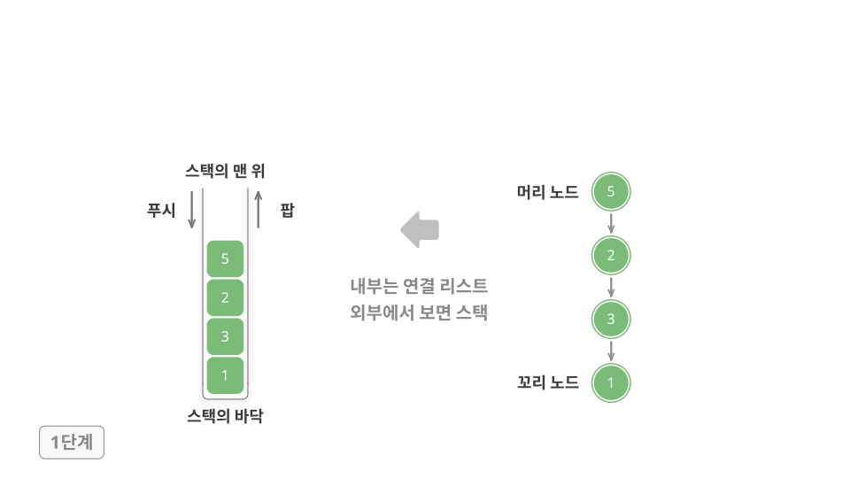
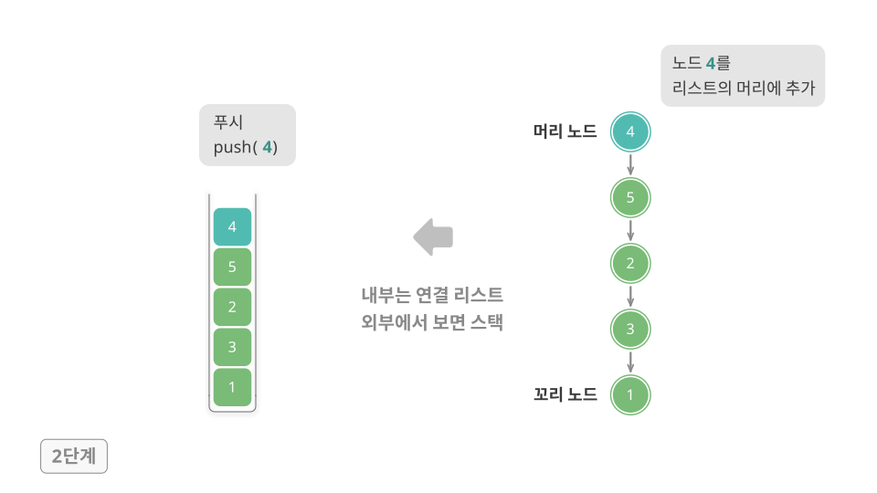
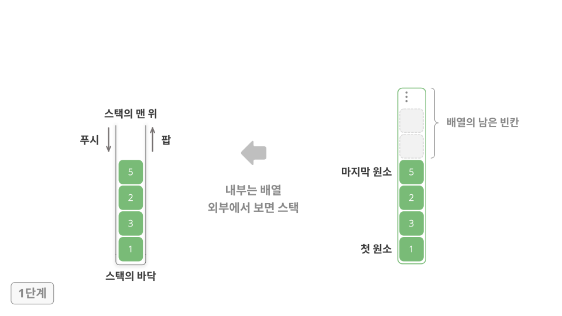
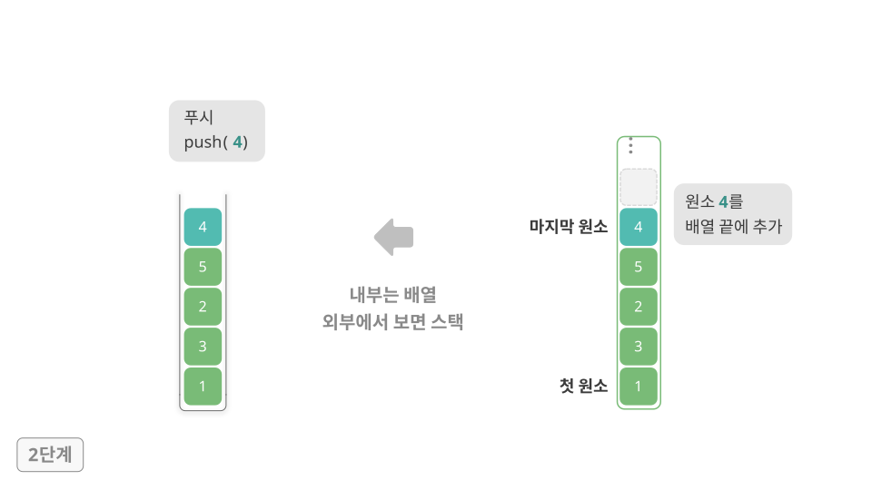

# 스택

<u>스택(stack)</u>은 후입선출 원칙을 따르는 선형 자료 구조다.

탁자 위에 접시가 한 무더기 쌓여 있다고 생각해 보자. 한 번에 접시를 하나씩만 옮길 수 있다고 하자. 그러면 맨 아래 접시를 꺼내려면 그 위의 접시부터 차례로 치워야 한다. 접시를 정수, 문자, 객체 등 다양한 자료형의 원소로 바꾸면 스택이라는 자료 구조가 된다.

아래 그림처럼 원소가 쌓인 맨 꼭대기를 ‘스택의 맨 위’, 맨 아래를 ‘스택의 바닥’이라고 한다. 스택의 맨 위에 원소를 넣는 연산을 ‘푸시’, 맨 위의 원소를 꺼내는 연산을 ‘팝’이라고 한다.


## 스택의 기본 연산

스택의 기본 연산은 아래 표와 같다. 실제 메서드 이름은 사용하는 프로그래밍 언어에 따라 달라진다. 여기서는 흔히 쓰이는 `push()`, `pop()`, `peek()`를 예로 든다.

<p align="center"> 표 <id> &nbsp; 스택 연산의 효율 </p>

| 메서드     | 설명                   | 시간 복잡도 |
| -------- | ---------------------- | ---------- |
| `push()` | 원소 푸시(스택 맨 위에 추가) | $O(1)$     |
| `pop()`  | 맨 위의 원소 팝           | $O(1)$     |
| `peek()` | 맨 위의 원소 조회           | $O(1)$     |

대개는 프로그래밍 언어에 내장된 스택 클래스를 바로 사용할 수 있다. 전용 스택 클래스가 없는 언어에서는 그 언어의 배열이나 연결 리스트를 스택으로 사용하고, 스택과 무관한 연산은 프로그램에서 사용하지 않으면 된다.

```snippet
stack_operations
```

??? pythontutor "실행 과정 시각화"

    @tutor stack_operations_tutor

## 스택 구현

스택의 동작 원리를 더 자세히 이해하기 위해 스택 클래스를 직접 구현해 보자.

스택은 후입선출 원칙을 따르므로 맨 위에서만 원소를 추가하거나 삭제할 수 있다. 배열과 연결 리스트는 어느 위치에서나 원소를 추가하고 삭제할 수 있으므로 **스택은 배열이나 연결 리스트에서 쓸 수 있는 연산을 제한한 자료 구조로 볼 수 있다**. 다시 말해 배열이나 연결 리스트의 연산 중 스택과 무관한 부분을 감추면 외부에서는 스택처럼 동작한다.

### 연결 리스트로 구현하기

연결 리스트로 스택을 구현할 때는 머리 노드를 스택의 맨 위, 꼬리 노드를 바닥으로 볼 수 있다.

아래 그림처럼 푸시할 때는 리스트의 맨 앞에 원소를 삽입하면 된다. 이렇게 노드를 넣는 방식을 ‘머리 삽입’이라고 한다. 팝할 때는 리스트에서 머리 노드를 삭제하면 된다.

=== "<1>"
    

=== "<2>"
    

=== "<3>"
    

연결 리스트로 스택을 구현한 예제 코드는 다음과 같다.

```src
[file]{linkedlist_stack}-[class]{linked_list_stack}-[func]{}
```

### 배열로 구현하기

배열로 스택을 구현할 때는 배열의 끝을 스택의 맨 위로 삼을 수 있다. 아래 그림처럼 푸시는 배열 끝에 원소를 추가하는 연산에, 팝은 배열 끝에서 원소를 삭제하는 연산에 해당한다. 두 연산의 시간 복잡도는 모두 $O(1)$이다.

=== "<1>"
    

=== "<2>"
    

=== "<3>"
    

스택에는 원소가 계속 추가될 수 있다. 동적 배열을 사용하면 배열의 용량을 늘리는 일을 직접 처리할 필요가 없다. 예제 코드는 다음과 같다.

```src
[file]{array_stack}-[class]{array_stack}-[func]{}
```

## 두 구현 방식의 비교

**지원하는 연산**

두 구현 방식 모두 스택에 정의된 모든 연산을 지원한다. 배열로 구현하면 임의 접근도 가능하지만, 스택의 정의를 벗어나는 연산이므로 보통 사용하지 않는다.

**시간 효율**

배열로 구현하면 푸시와 팝은 미리 할당된 연속된 메모리에서 이루어진다. 캐시 지역성이 좋아서 효율이 높다. 다만 푸시할 때 배열의 용량을 초과하면 용량을 늘려야 하므로 그 한 번의 푸시에 드는 시간 복잡도는 $O(n)$이 된다.

연결 리스트는 크기를 유연하게 늘릴 수 있어 배열의 용량을 늘릴 때처럼 효율이 떨어지는 일이 없다. 다만 푸시할 때 노드 객체를 초기화하고 포인터를 바꿔야 하므로 상대적으로 효율이 낮다. 넣으려는 원소 자체가 노드 객체라면 초기화 단계를 생략해 효율을 높일 수 있다.

푸시하거나 팝하는 원소가 `int`나 `double` 같은 기본 자료형이라면 다음과 같이 정리할 수 있다.

- 배열로 구현한 스택은 용량을 늘릴 때 효율이 떨어지지만 용량을 늘리는 일은 드물어 평균 효율이 더 높다.
- 연결 리스트로 구현한 스택은 연산 시간이 더 일정하다.

**공간 효율**

리스트를 초기화하면 시스템이 초기 용량만큼 공간을 할당하는데, 실제로 필요한 양보다 클 수 있다. 또 용량은 보통 일정한 배수(예를 들어 2배)로 늘리므로 확장한 뒤의 용량도 필요한 양을 초과할 수 있다. 따라서 **배열로 구현한 스택에서는 일부 공간이 낭비될 수 있다**.

한편 연결 리스트의 노드는 포인터를 추가로 저장해야 하므로 **노드 하나가 차지하는 공간은 상대적으로 크다**.

결국 어느 구현 방식이 메모리를 더 절약하는지는 한마디로 단정할 수 없다. 구체적인 상황에 따라 판단해야 한다.

## 스택의 대표적인 활용 사례

- **브라우저의 뒤로 가기와 앞으로 가기, 소프트웨어의 실행 취소와 다시 실행**. 새 웹 페이지를 열 때마다 브라우저는 직전 페이지를 스택에 넣는다. 그래서 뒤로 가기로 이전 페이지에 돌아갈 수 있다. 뒤로 가기는 실제로 스택에서 원소를 꺼내는 연산이다. 뒤로 가기와 앞으로 가기를 모두 지원하려면 스택 두 개를 함께 사용해야 한다.
- **프로그램의 메모리 관리**. 함수를 호출할 때마다 시스템은 함수의 실행 문맥을 기록하는 스택 프레임을 스택 맨 위에 추가한다. 재귀 함수에서는 호출이 깊어질수록 푸시 연산이 반복되고 호출에서 거슬러 돌아올 때는 팝 연산이 반복된다.
