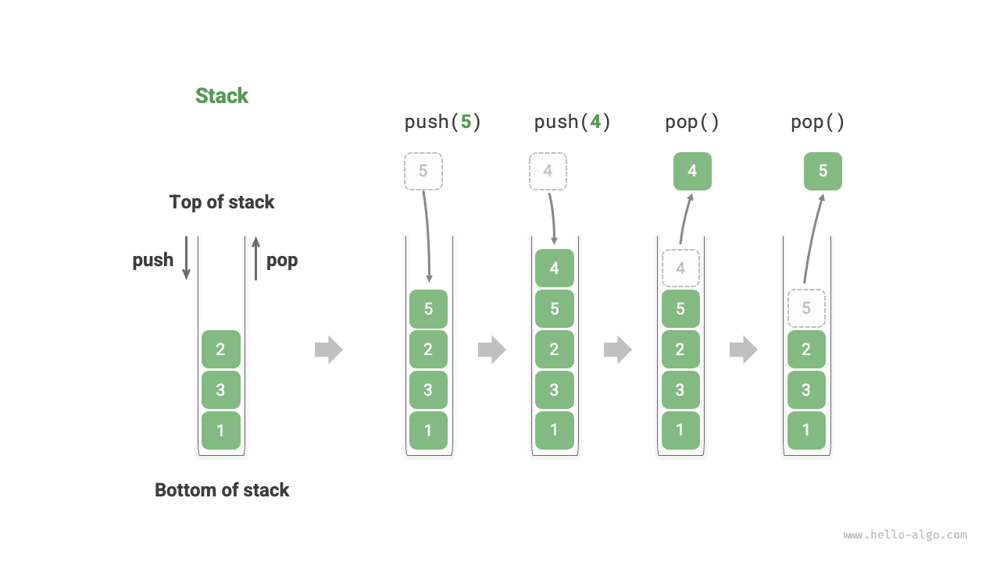
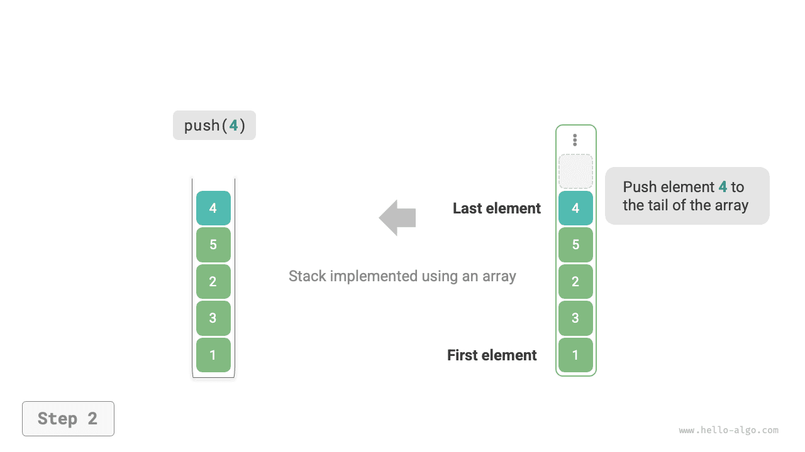

# 스택

<u>스택(stack)</u>은 후입선출 원리를 따르는 선형 자료 구조다.

스택은 탁자 위에 쌓인 접시에 비유할 수 있다. 한 번에 접시 하나만 옮길 수 있다면 맨 아래 접시를 꺼내려면 위의 접시들을 차례로 치워야 한다. 접시를 정수, 문자, 객체 등 여러 자료형의 원소로 바꾸면 스택이라는 자료 구조가 된다.

아래 그림과 같이 원소가 쌓인 맨 위를 ‘스택의 꼭대기’, 맨 아래를 ‘스택의 바닥’이라고 한다. 맨 위에 원소를 추가하는 연산을 ‘스택에 삽입하기’, 맨 위 원소를 삭제하는 연산을 ‘스택에서 꺼내기’라고 한다.



## 스택의 기본 연산

스택의 기본 연산은 아래 표와 같다. 구체적인 메서드 이름은 프로그래밍 언어에 따라 다르며, 여기서는 흔히 쓰이는 `push()`, `pop()`, `peek()`를 예로 든다.

<p align="center"> 표 <id> &nbsp; 스택의 연산 효율 </p>

| 메서드     | 설명                   | 시간 복잡도 |
| -------- | ---------------------- | ---------- |
| `push()` | 원소를 스택에 삽입(맨 위에 추가) | $O(1)$     |
| `pop()`  | 스택 맨 위 원소를 꺼냄           | $O(1)$     |
| `peek()` | 스택 맨 위 원소에 접근           | $O(1)$     |

보통 프로그래밍 언어에 내장된 스택 클래스를 바로 사용할 수 있다. 전용 스택 클래스가 없는 언어에서는 ‘배열’이나 ‘연결 리스트’를 스택으로 사용하면서, 프로그램 논리상 스택과 무관한 연산은 사용하지 않으면 된다.

=== "Python"

    ```python title="stack.py"
    # 스택 초기화
    # Python에는 내장 스택 클래스가 없으므로 list를 스택으로 사용할 수 있다
    stack: list[int] = []

    # 스택에 원소 삽입
    stack.append(1)
    stack.append(3)
    stack.append(2)
    stack.append(5)
    stack.append(4)

    # 스택 맨 위 원소에 접근
    peek: int = stack[-1]

    # 스택에서 원소 꺼내기
    pop: int = stack.pop()

    # 스택 길이 구하기
    size: int = len(stack)

    # 비어 있는지 확인
    is_empty: bool = len(stack) == 0
    ```

=== "C++"

    ```cpp title="stack.cpp"
    /* 스택 초기화 */
    stack<int> stack;

    /* 스택에 원소 삽입 */
    stack.push(1);
    stack.push(3);
    stack.push(2);
    stack.push(5);
    stack.push(4);

    /* 스택 맨 위 원소에 접근 */
    int top = stack.top();

    /* 스택에서 원소 꺼내기 */
    stack.pop(); // 반환값 없음

    /* 스택 길이 구하기 */
    int size = stack.size();

    /* 비어 있는지 확인 */
    bool empty = stack.empty();
    ```

=== "Java"

    ```java title="stack.java"
    /* 스택 초기화 */
    Stack<Integer> stack = new Stack<>();

    /* 스택에 원소 삽입 */
    stack.push(1);
    stack.push(3);
    stack.push(2);
    stack.push(5);
    stack.push(4);

    /* 스택 맨 위 원소에 접근 */
    int peek = stack.peek();

    /* 스택에서 원소 꺼내기 */
    int pop = stack.pop();

    /* 스택 길이 구하기 */
    int size = stack.size();

    /* 비어 있는지 확인 */
    boolean isEmpty = stack.isEmpty();
    ```

=== "C#"

    ```csharp title="stack.cs"
    /* 스택 초기화 */
    Stack<int> stack = new();

    /* 스택에 원소 삽입 */
    stack.Push(1);
    stack.Push(3);
    stack.Push(2);
    stack.Push(5);
    stack.Push(4);

    /* 스택 맨 위 원소에 접근 */
    int peek = stack.Peek();

    /* 스택에서 원소 꺼내기 */
    int pop = stack.Pop();

    /* 스택 길이 구하기 */
    int size = stack.Count;

    /* 비어 있는지 확인 */
    bool isEmpty = stack.Count == 0;
    ```

=== "Go"

    ```go title="stack_test.go"
    /* 스택 초기화 */
    // Go에서는 Slice를 스택으로 사용하는 것을 권한다
    var stack []int

    /* 스택에 원소 삽입 */
    stack = append(stack, 1)
    stack = append(stack, 3)
    stack = append(stack, 2)
    stack = append(stack, 5)
    stack = append(stack, 4)

    /* 스택 맨 위 원소에 접근 */
    peek := stack[len(stack)-1]

    /* 스택에서 원소 꺼내기 */
    pop := stack[len(stack)-1]
    stack = stack[:len(stack)-1]

    /* 스택 길이 구하기 */
    size := len(stack)

    /* 비어 있는지 확인 */
    isEmpty := len(stack) == 0
    ```

=== "Swift"

    ```swift title="stack.swift"
    /* 스택 초기화 */
    // Swift에는 내장 스택 클래스가 없으므로 Array를 스택으로 사용할 수 있다
    var stack: [Int] = []

    /* 스택에 원소 삽입 */
    stack.append(1)
    stack.append(3)
    stack.append(2)
    stack.append(5)
    stack.append(4)

    /* 스택 맨 위 원소에 접근 */
    let peek = stack.last!

    /* 스택에서 원소 꺼내기 */
    let pop = stack.removeLast()

    /* 스택 길이 구하기 */
    let size = stack.count

    /* 비어 있는지 확인 */
    let isEmpty = stack.isEmpty
    ```

=== "JS"

    ```javascript title="stack.js"
    /* 스택 초기화 */
    // JavaScript에는 내장 스택 클래스가 없으므로 Array를 스택으로 사용할 수 있다
    const stack = [];

    /* 스택에 원소 삽입 */
    stack.push(1);
    stack.push(3);
    stack.push(2);
    stack.push(5);
    stack.push(4);

    /* 스택 맨 위 원소에 접근 */
    const peek = stack[stack.length-1];

    /* 스택에서 원소 꺼내기 */
    const pop = stack.pop();

    /* 스택 길이 구하기 */
    const size = stack.length;

    /* 비어 있는지 확인 */
    const is_empty = stack.length === 0;
    ```

=== "TS"

    ```typescript title="stack.ts"
    /* 스택 초기화 */
    // TypeScript에는 내장 스택 클래스가 없으므로 Array를 스택으로 사용할 수 있다
    const stack: number[] = [];

    /* 스택에 원소 삽입 */
    stack.push(1);
    stack.push(3);
    stack.push(2);
    stack.push(5);
    stack.push(4);

    /* 스택 맨 위 원소에 접근 */
    const peek = stack[stack.length - 1];

    /* 스택에서 원소 꺼내기 */
    const pop = stack.pop();

    /* 스택 길이 구하기 */
    const size = stack.length;

    /* 비어 있는지 확인 */
    const is_empty = stack.length === 0;
    ```

=== "Dart"

    ```dart title="stack.dart"
    /* 스택 초기화 */
    // Dart에는 내장 스택 클래스가 없으므로 List를 스택으로 사용할 수 있다
    List<int> stack = [];

    /* 스택에 원소 삽입 */
    stack.add(1);
    stack.add(3);
    stack.add(2);
    stack.add(5);
    stack.add(4);

    /* 스택 맨 위 원소에 접근 */
    int peek = stack.last;

    /* 스택에서 원소 꺼내기 */
    int pop = stack.removeLast();

    /* 스택 길이 구하기 */
    int size = stack.length;

    /* 비어 있는지 확인 */
    bool isEmpty = stack.isEmpty;
    ```

=== "Rust"

    ```rust title="stack.rs"
    /* 스택 초기화 */
    // Vec를 스택으로 사용
    let mut stack: Vec<i32> = Vec::new();

    /* 스택에 원소 삽입 */
    stack.push(1);
    stack.push(3);
    stack.push(2);
    stack.push(5);
    stack.push(4);

    /* 스택 맨 위 원소에 접근 */
    let top = stack.last().unwrap();

    /* 스택에서 원소 꺼내기 */
    let pop = stack.pop().unwrap();

    /* 스택 길이 구하기 */
    let size = stack.len();

    /* 비어 있는지 확인 */
    let is_empty = stack.is_empty();
    ```

=== "C"

    ```c title="stack.c"
    // C는 내장 스택을 제공하지 않는다
    ```

=== "Kotlin"

    ```kotlin title="stack.kt"
    /* 스택 초기화 */
    val stack = Stack<Int>()

    /* 스택에 원소 삽입 */
    stack.push(1)
    stack.push(3)
    stack.push(2)
    stack.push(5)
    stack.push(4)

    /* 스택 맨 위 원소에 접근 */
    val peek = stack.peek()

    /* 스택에서 원소 꺼내기 */
    val pop = stack.pop()

    /* 스택 길이 구하기 */
    val size = stack.size

    /* 비어 있는지 확인 */
    val isEmpty = stack.isEmpty()
    ```

=== "Ruby"

    ```ruby title="stack.rb"
    # 스택 초기화
    # Ruby에는 내장 스택 클래스가 없으므로 Array를 스택으로 사용할 수 있다
    stack = []

    # 스택에 원소 삽입
    stack << 1
    stack << 3
    stack << 2
    stack << 5
    stack << 4

    # 스택 맨 위 원소에 접근
    peek = stack.last

    # 스택에서 원소 꺼내기
    pop = stack.pop

    # 스택 길이 구하기
    size = stack.length

    # 비어 있는지 확인
    is_empty = stack.empty?
    ```

??? pythontutor "코드 시각화"

    https://pythontutor.com/render.html#code=%22%22%22%EC%8B%A4%ED%96%89%20%EC%BD%94%EB%93%9C%22%22%22%0Aif%20__name__%20%3D%3D%20%22__main__%22%3A%0A%20%20%20%20%23%20%EC%8A%A4%ED%83%9D%20%EC%B4%88%EA%B8%B0%ED%99%94%0A%20%20%20%20%23%20Python%EC%97%90%EB%8A%94%20%EB%82%B4%EC%9E%A5%20%EC%8A%A4%ED%83%9D%20%ED%81%B4%EB%9E%98%EC%8A%A4%EA%B0%80%20%EC%97%86%EC%9C%BC%EB%AF%80%EB%A1%9C%20list%EB%A5%BC%20%EC%8A%A4%ED%83%9D%EC%9C%BC%EB%A1%9C%20%EC%82%AC%EC%9A%A9%ED%95%A0%20%EC%88%98%20%EC%9E%88%EB%8B%A4%0A%20%20%20%20stack%20%3D%20%5B%5D%0A%0A%20%20%20%20%23%20%EC%8A%A4%ED%83%9D%EC%97%90%20%EC%9B%90%EC%86%8C%20%EC%82%BD%EC%9E%85%0A%20%20%20%20stack.append%281%29%0A%20%20%20%20stack.append%283%29%0A%20%20%20%20stack.append%282%29%0A%20%20%20%20stack.append%285%29%0A%20%20%20%20stack.append%284%29%0A%20%20%20%20print%28%22%EC%8A%A4%ED%83%9D%20stack%20%3D%22%2C%20stack%29%0A%0A%20%20%20%20%23%20%EC%8A%A4%ED%83%9D%20%EB%A7%A8%20%EC%9C%84%20%EC%9B%90%EC%86%8C%EC%97%90%20%EC%A0%91%EA%B7%BC%0A%20%20%20%20peek%20%3D%20stack%5B-1%5D%0A%20%20%20%20print%28%22%EC%8A%A4%ED%83%9D%20%EB%A7%A8%20%EC%9C%84%20%EC%9B%90%EC%86%8C%20peek%20%3D%22%2C%20peek%29%0A%0A%20%20%20%20%23%20%EC%8A%A4%ED%83%9D%EC%97%90%EC%84%9C%20%EC%9B%90%EC%86%8C%20%EA%BA%BC%EB%82%B4%EA%B8%B0%0A%20%20%20%20pop%20%3D%20stack.pop%28%29%0A%20%20%20%20print%28%22%EA%BA%BC%EB%82%B8%20%EC%9B%90%EC%86%8C%20pop%20%3D%22%2C%20pop%29%0A%20%20%20%20print%28%22%EC%9B%90%EC%86%8C%EB%A5%BC%20%EA%BA%BC%EB%82%B8%20%EB%92%A4%20stack%20%3D%22%2C%20stack%29%0A%0A%20%20%20%20%23%20%EC%8A%A4%ED%83%9D%20%EA%B8%B8%EC%9D%B4%20%EA%B5%AC%ED%95%98%EA%B8%B0%0A%20%20%20%20size%20%3D%20len%28stack%29%0A%20%20%20%20print%28%22%EC%8A%A4%ED%83%9D%20%EA%B8%B8%EC%9D%B4%20size%20%3D%22%2C%20size%29%0A%0A%20%20%20%20%23%20%EB%B9%84%EC%96%B4%20%EC%9E%88%EB%8A%94%EC%A7%80%20%ED%99%95%EC%9D%B8%0A%20%20%20%20is_empty%20%3D%20len%28stack%29%20%3D%3D%200%0A%20%20%20%20print%28%22%EC%8A%A4%ED%83%9D%EC%9D%B4%20%EB%B9%84%EC%96%B4%20%EC%9E%88%EB%8A%94%EA%B0%80%20%3D%22%2C%20is_empty%29&cumulative=false&curInstr=2&heapPrimitives=nevernest&mode=display&origin=opt-frontend.js&py=311&rawInputLstJSON=%5B%5D&textReferences=false

## 스택 구현

스택의 작동 원리를 깊이 이해하기 위해 스택 클래스를 직접 구현해 보자.

스택은 후입선출 원리를 따르므로 맨 위에서만 원소를 추가하거나 삭제할 수 있다. 반면 배열과 연결 리스트는 어느 위치에서든 추가와 삭제가 가능하므로, **스택은 제약을 가한 배열이나 연결 리스트로 볼 수 있다**. 즉, 일부 무관한 연산을 ‘가려서’ 외부에 보이는 논리가 스택의 특성에 맞도록 만들 수 있다.

### 연결 리스트 기반 구현

연결 리스트로 스택을 구현할 때는 머리 노드를 스택의 꼭대기로, 꼬리 노드를 바닥으로 볼 수 있다.

아래 그림과 같이 스택에 삽입할 때는 연결 리스트의 맨 앞에 원소를 넣으면 된다. 이 방식을 ‘머리 삽입’이라고 한다. 스택에서 꺼낼 때는 머리 노드를 삭제하면 된다.

=== "<1>"
    

=== "<2>"
    

=== "<3>"
    

연결 리스트로 스택을 구현한 예제 코드는 다음과 같다.

```src
[file]{linkedlist_stack}-[class]{linked_list_stack}-[func]{}
```

### 배열 기반 구현

배열로 스택을 구현할 때는 배열의 끝을 스택의 꼭대기로 볼 수 있다. 아래 그림과 같이 삽입과 꺼내기는 각각 배열 끝에 원소를 추가하고 삭제하는 연산에 해당하며, 시간 복잡도는 모두 $O(1)$이다.

=== "<1>"
    

=== "<2>"
    

=== "<3>"
    

스택에 삽입되는 원소가 계속 늘어날 수 있으므로 동적 배열을 사용하면 배열의 용량 확장을 직접 처리하지 않아도 된다. 예제 코드는 다음과 같다.

```src
[file]{array_stack}-[class]{array_stack}-[func]{}
```

## 두 구현의 비교

**지원 연산**

두 구현 모두 스택 정의에 포함된 모든 연산을 지원한다. 배열 기반 구현은 임의 접근도 지원하지만, 이는 스택의 정의를 벗어나므로 일반적으로 사용하지 않는다.

**시간 효율**

배열 기반 구현에서는 삽입과 꺼내기를 미리 할당한 연속 메모리에서 수행한다. 캐시 지역성이 좋아 효율이 높다. 다만 삽입 시 배열 용량을 넘으면 확장이 발생하여 그 삽입 연산의 시간 복잡도는 $O(n)$이 된다.

연결 리스트 기반 구현은 크기를 유연하게 늘릴 수 있어 배열 확장에 따른 효율 저하가 없다. 하지만 삽입 시 노드 객체를 초기화하고 포인터를 수정해야 하므로 상대적으로 효율이 낮다. 삽입할 원소 자체가 노드 객체라면 초기화 단계를 생략하여 효율을 높일 수 있다.

따라서 삽입하고 꺼내는 원소가 `int`나 `double` 같은 기본 자료형이라면 다음과 같이 정리할 수 있다.

- 배열 기반 스택은 용량 확장이 발생할 때 효율이 낮아지지만, 확장은 드물게 일어나므로 평균 효율은 더 높다.
- 연결 리스트 기반 스택은 더 안정적인 효율을 제공한다.

**공간 효율**

리스트를 초기화할 때 시스템은 ‘초기 용량’을 할당하며, 이 용량은 실제 필요보다 클 수 있다. 또한 확장 시 보통 2배처럼 일정한 비율로 늘리므로 확장 후 용량도 실제 필요보다 클 수 있다. 따라서 **배열 기반 스택은 어느 정도 공간을 낭비할 수 있다**.

반면 연결 리스트 노드는 포인터를 추가로 저장해야 하므로 **노드 하나가 차지하는 공간이 상대적으로 크다**.

따라서 어느 구현이 메모리를 더 절약하는지는 단정할 수 없으며 구체적인 상황에 따라 분석해야 한다.

## 스택의 대표적인 활용

- **브라우저의 뒤로 및 앞으로, 소프트웨어의 실행 취소 및 다시 실행**. 새 웹 페이지를 열 때마다 브라우저는 이전 페이지를 스택에 넣어 뒤로 가기로 돌아갈 수 있게 한다. 뒤로 가기는 실제로 스택에서 원소를 꺼내는 연산이다. 뒤로 가기와 앞으로 가기를 함께 지원하려면 스택 두 개를 사용해야 한다.
- **프로그램 메모리 관리**. 함수가 호출될 때마다 시스템은 스택 맨 위에 스택 프레임을 추가해 함수의 문맥 정보를 기록한다. 재귀 함수에서는 아래로 호출을 이어 가는 단계에서 스택에 계속 넣고, 위로 되돌아오는 단계에서 계속 꺼낸다.
