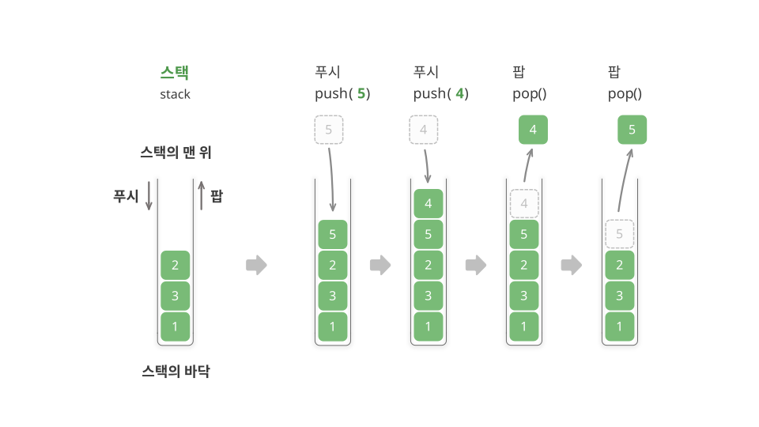
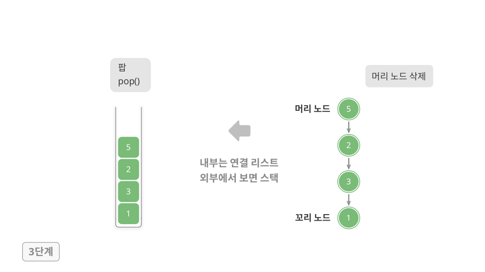
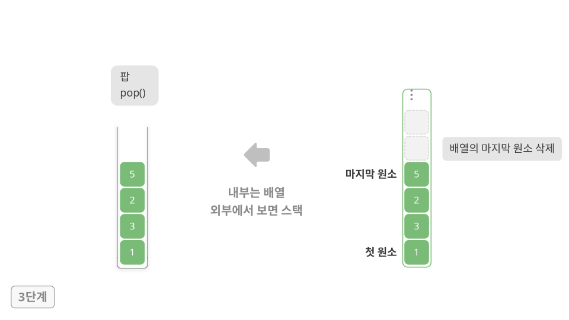

# 스택

<u>스택(stack)</u>은 후입선출 원리를 따르는 선형 자료 구조다.

스택은 탁자 위에 쌓인 접시에 비유할 수 있다. 한 번에 접시 하나만 옮길 수 있다면 맨 아래 접시를 꺼내려면 위의 접시들을 차례로 치워야 한다. 접시를 정수, 문자, 객체 등 여러 자료형의 원소로 바꾸면 스택이라는 자료 구조가 된다.

아래 그림과 같이 원소가 쌓인 맨 위를 ‘스택의 꼭대기’, 맨 아래를 ‘스택의 바닥’이라고 한다. 맨 위에 원소를 추가하는 연산을 ‘스택에 삽입하기’, 맨 위 원소를 삭제하는 연산을 ‘스택에서 꺼내기’라고 한다.



## 스택의 기본 연산

스택의 기본 연산은 아래 표와 같다. 구체적인 메서드 이름은 프로그래밍 언어에 따라 다르며, 여기서는 흔히 쓰이는 `push()`, `pop()`, `peek()`를 예로 든다.

<p align="center"> 표 <id> &nbsp; 스택의 연산 효율 </p>

| 메서드     | 설명                   | 시간 복잡도 |
| -------- | ---------------------- | ---------- |
| `push()` | 원소를 스택에 삽입(맨 위에 추가) | $O(1)$     |
| `pop()`  | 스택 맨 위 원소를 꺼냄           | $O(1)$     |
| `peek()` | 스택 맨 위 원소에 접근           | $O(1)$     |

보통 프로그래밍 언어에 내장된 스택 클래스를 바로 사용할 수 있다. 전용 스택 클래스가 없는 언어에서는 ‘배열’이나 ‘연결 리스트’를 스택으로 사용하면서, 프로그램 논리상 스택과 무관한 연산은 사용하지 않으면 된다.

```snippet
stack_operations
```

??? pythontutor "코드 시각화"

    @tutor stack_operations_tutor

## 스택 구현

스택의 작동 원리를 깊이 이해하기 위해 스택 클래스를 직접 구현해 보자.

스택은 후입선출 원리를 따르므로 맨 위에서만 원소를 추가하거나 삭제할 수 있다. 반면 배열과 연결 리스트는 어느 위치에서든 추가와 삭제가 가능하므로, **스택은 제약을 가한 배열이나 연결 리스트로 볼 수 있다**. 즉, 일부 무관한 연산을 ‘가려서’ 외부에 보이는 논리가 스택의 특성에 맞도록 만들 수 있다.

### 연결 리스트 기반 구현

연결 리스트로 스택을 구현할 때는 머리 노드를 스택의 꼭대기로, 꼬리 노드를 바닥으로 볼 수 있다.

아래 그림과 같이 스택에 삽입할 때는 연결 리스트의 맨 앞에 원소를 넣으면 된다. 이 방식을 ‘머리 삽입’이라고 한다. 스택에서 꺼낼 때는 머리 노드를 삭제하면 된다.

=== "<1>"
    

=== "<2>"
    

=== "<3>"
    

연결 리스트로 스택을 구현한 예제 코드는 다음과 같다.

```src
[file]{linkedlist_stack}-[class]{linked_list_stack}-[func]{}
```

### 배열 기반 구현

배열로 스택을 구현할 때는 배열의 끝을 스택의 꼭대기로 볼 수 있다. 아래 그림과 같이 삽입과 꺼내기는 각각 배열 끝에 원소를 추가하고 삭제하는 연산에 해당하며, 시간 복잡도는 모두 $O(1)$이다.

=== "<1>"
    

=== "<2>"
    

=== "<3>"
    

스택에 삽입되는 원소가 계속 늘어날 수 있으므로 동적 배열을 사용하면 배열의 용량 확장을 직접 처리하지 않아도 된다. 예제 코드는 다음과 같다.

```src
[file]{array_stack}-[class]{array_stack}-[func]{}
```

## 두 구현의 비교

**지원 연산**

두 구현 모두 스택 정의에 포함된 모든 연산을 지원한다. 배열 기반 구현은 임의 접근도 지원하지만, 이는 스택의 정의를 벗어나므로 일반적으로 사용하지 않는다.

**시간 효율**

배열 기반 구현에서는 삽입과 꺼내기를 미리 할당한 연속 메모리에서 수행한다. 캐시 지역성이 좋아 효율이 높다. 다만 삽입 시 배열 용량을 넘으면 확장이 발생하여 그 삽입 연산의 시간 복잡도는 $O(n)$이 된다.

연결 리스트 기반 구현은 크기를 유연하게 늘릴 수 있어 배열 확장에 따른 효율 저하가 없다. 하지만 삽입 시 노드 객체를 초기화하고 포인터를 수정해야 하므로 상대적으로 효율이 낮다. 삽입할 원소 자체가 노드 객체라면 초기화 단계를 생략하여 효율을 높일 수 있다.

따라서 삽입하고 꺼내는 원소가 `int`나 `double` 같은 기본 자료형이라면 다음과 같이 정리할 수 있다.

- 배열 기반 스택은 용량 확장이 발생할 때 효율이 낮아지지만, 확장은 드물게 일어나므로 평균 효율은 더 높다.
- 연결 리스트 기반 스택은 더 안정적인 효율을 제공한다.

**공간 효율**

리스트를 초기화할 때 시스템은 ‘초기 용량’을 할당하며, 이 용량은 실제 필요보다 클 수 있다. 또한 확장 시 보통 2배처럼 일정한 비율로 늘리므로 확장 후 용량도 실제 필요보다 클 수 있다. 따라서 **배열 기반 스택은 어느 정도 공간을 낭비할 수 있다**.

반면 연결 리스트 노드는 포인터를 추가로 저장해야 하므로 **노드 하나가 차지하는 공간이 상대적으로 크다**.

따라서 어느 구현이 메모리를 더 절약하는지는 단정할 수 없으며 구체적인 상황에 따라 분석해야 한다.

## 스택의 대표적인 활용

- **브라우저의 뒤로 및 앞으로, 소프트웨어의 실행 취소 및 다시 실행**. 새 웹 페이지를 열 때마다 브라우저는 이전 페이지를 스택에 넣어 뒤로 가기로 돌아갈 수 있게 한다. 뒤로 가기는 실제로 스택에서 원소를 꺼내는 연산이다. 뒤로 가기와 앞으로 가기를 함께 지원하려면 스택 두 개를 사용해야 한다.
- **프로그램 메모리 관리**. 함수가 호출될 때마다 시스템은 스택 맨 위에 스택 프레임을 추가해 함수의 문맥 정보를 기록한다. 재귀 함수에서는 아래로 호출을 이어 가는 단계에서 스택에 계속 넣고, 위로 되돌아오는 단계에서 계속 꺼낸다.
