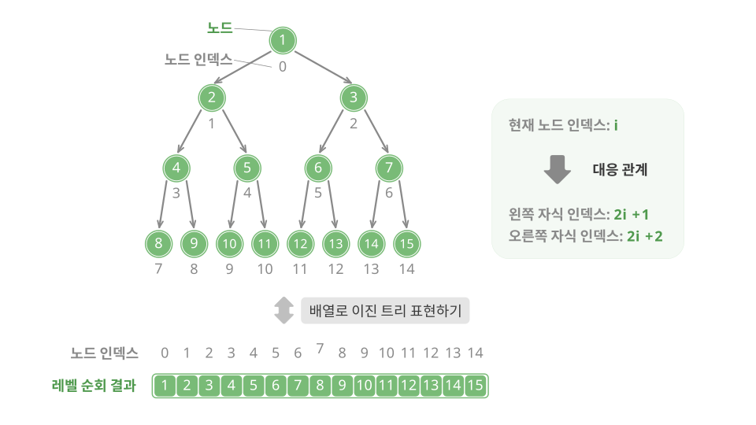
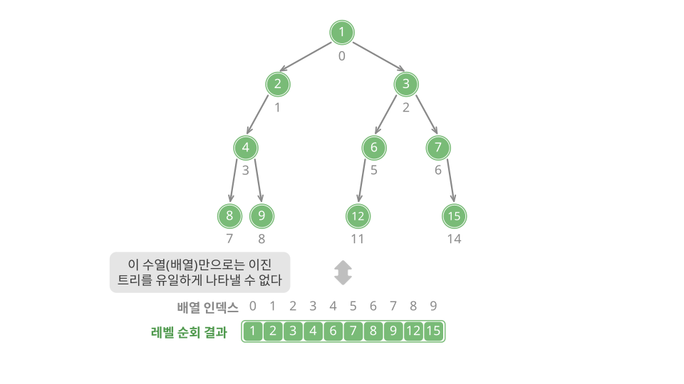
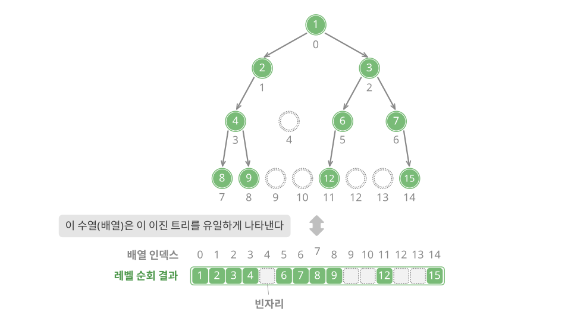
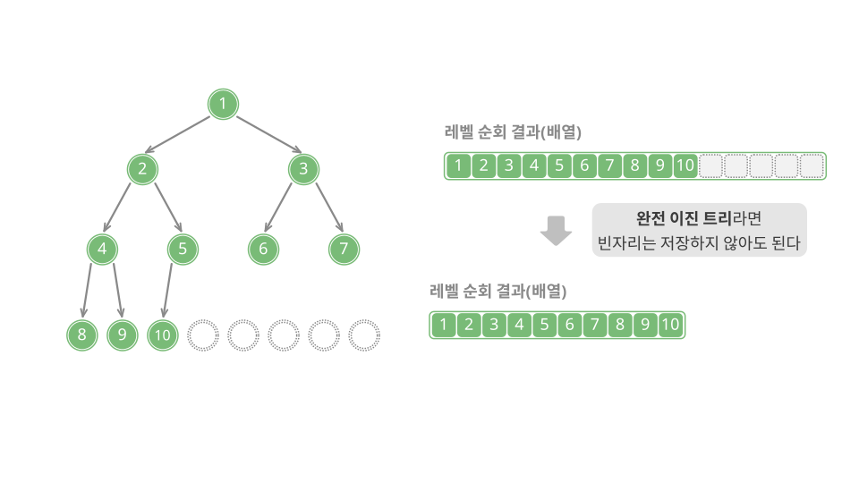

# 이진 트리의 배열 표현

연결 리스트로 이진 트리를 표현할 때 저장 단위는 노드 `TreeNode`이며 포인터로 노드를 연결한다. 앞 절에서는 이렇게 표현한 이진 트리의 기본 연산을 살펴보았다.

그렇다면 배열로도 이진 트리를 표현할 수 있을까? 물론 가능하다.

## 포화 이진 트리 표현하기

간단한 예부터 살펴보자. 포화 이진 트리의 모든 노드를 레벨 순회 순서대로 배열에 저장하면 각 노드에 고유한 배열 인덱스가 대응한다.

레벨 순회의 특성을 이용하면 부모와 자식의 인덱스를 연결하는 식을 유도할 수 있다. **어떤 노드의 인덱스가 $i$라면 왼쪽 자식의 인덱스는 $2i + 1$이고 오른쪽 자식의 인덱스는 $2i + 2$이다**. 다음 그림은 각 노드 인덱스 사이의 대응 관계를 보여 준다.



**이 대응식은 연결 리스트의 노드 참조(포인터)와 같은 역할을 한다**. 배열의 어느 노드에서든 이 식으로 왼쪽 또는 오른쪽 자식에 접근할 수 있다.

## 임의의 이진 트리 표현하기

포화 이진 트리는 특수한 경우다. 일반적인 이진 트리의 중간 레벨에는 `None`이 많이 나타난다. 레벨 순회 결과에는 이런 `None`이 들어 있지 않아서 결과만으로는 `None`의 개수와 위치를 알아낼 수 없다. **따라서 여러 모양의 이진 트리가 같은 레벨 순회 결과를 가질 수 있다**.

다음 그림처럼 포화 이진 트리가 아니면 위의 배열 표현이 더 이상 통하지 않는다.



이 문제를 해결하려면 **레벨 순회 결과에 모든 `None`을 명시적으로 적으면 된다**. 다음 그림처럼 이렇게 하면 레벨 순회 결과가 하나의 이진 트리를 유일하게 나타낸다. 예시 코드는 다음과 같다.

```snippet
tree_array_representation
```



특히 **완전 이진 트리는 배열로 표현하기에 적합하다**. 완전 이진 트리의 정의를 떠올려 보자. `None`은 맨 아래 레벨의 오른쪽에만 나타난다. **따라서 모든 `None`은 반드시 레벨 순회 결과의 끝에 모인다**.

따라서 완전 이진 트리를 배열로 표현할 때는 `None`을 모두 생략할 수 있어 편리하다. 다음 그림이 그 예다.



다음 코드는 배열 기반 이진 트리를 구현하며 다음 연산을 제공한다.

- 주어진 노드의 값과 왼쪽 또는 오른쪽 자식, 부모 노드를 구한다.
- 전위, 중위, 후위, 레벨 순회 결과를 구한다.

```src
[file]{array_binary_tree}-[class]{array_binary_tree}-[func]{}
```

## 장점과 한계

이진 트리를 배열로 표현하면 다음과 같은 장점이 있다.

- 배열은 연속된 메모리 공간에 저장되어 캐시를 효율적으로 활용하므로 접근과 순회가 빠르다.
- 포인터를 저장할 필요가 없어 공간을 절약한다.
- 임의의 노드에 바로 접근할 수 있다.

다만 배열 표현에는 다음과 같은 한계도 있다.

- 연속된 메모리 공간이 필요하므로 데이터가 지나치게 많은 트리를 저장하기에는 적합하지 않다.
- 노드를 추가하거나 삭제하려면 배열의 삽입 및 삭제 연산이 필요해 효율이 낮다.
- 이진 트리에 `None`이 많으면 배열에서 실제 노드 데이터가 차지하는 비율이 작아 공간 활용도가 낮다.
