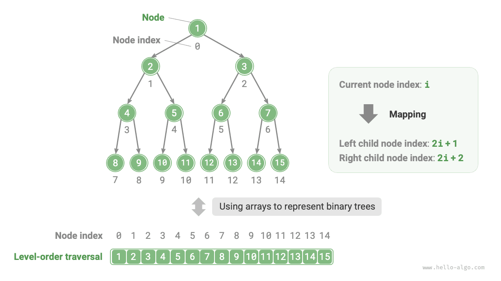

# 이진 트리의 배열 표현

연결 리스트로 표현할 때 이진 트리의 저장 단위는 노드 `TreeNode`이며, 노드들은 포인터로 연결된다. 앞 절에서는 이 표현을 사용하는 이진 트리의 기본 연산들을 살펴보았다.

그렇다면 배열로도 이진 트리를 표현할 수 있을까? 가능하다.

## 포화 이진 트리 표현

먼저 간단한 경우를 살펴보자. 포화 이진 트리의 모든 노드를 레벨 순서 순회 순서대로 배열에 저장하면 각 노드는 고유한 배열 인덱스에 대응한다.

레벨 순서 순회의 특성에서 부모와 자식 인덱스 사이의 '매핑 공식'을 도출할 수 있다. **노드의 인덱스가 $i$이면 왼쪽 자식의 인덱스는 $2i + 1$, 오른쪽 자식의 인덱스는 $2i + 2$다**. 아래 그림은 노드 인덱스 사이의 매핑 관계를 보여 준다.



**매핑 공식은 연결 리스트의 노드 참조(포인터)와 같은 역할을 한다**. 배열의 임의의 노드가 주어지면 이 공식으로 왼쪽(오른쪽) 자식에 접근할 수 있다.

## 임의의 이진 트리 표현

포화 이진 트리는 특수한 경우이며, 일반적인 이진 트리의 중간 레벨에는 `None`이 많이 존재한다. 레벨 순서 순회 결과에는 이 `None`들이 포함되지 않으므로 결과만으로는 개수와 위치를 알 수 없다. **즉, 같은 레벨 순서 순회 결과에 여러 이진 트리 구조가 대응할 수 있다**.

아래 그림처럼 포화 이진 트리가 아니면 앞의 배열 표현 방법은 더 이상 유효하지 않다.


이를 해결하려면 **레벨 순서 순회 결과에 모든 `None`을 명시적으로 넣을 수 있다**. 아래 그림처럼 처리하면 순회 결과가 이진 트리를 유일하게 나타낸다. 예시 코드는 다음과 같다.

=== "Python"

    ```python title=""
    # 이진 트리의 배열 표현
    # None으로 빈자리 표시
    tree = [1, 2, 3, 4, None, 6, 7, 8, 9, None, None, 12, None, None, 15]
    ```

=== "C++"

    ```cpp title=""
    /* 이진 트리의 배열 표현 */
    // int의 최댓값 INT_MAX로 빈자리 표시
    vector<int> tree = {1, 2, 3, 4, INT_MAX, 6, 7, 8, 9, INT_MAX, INT_MAX, 12, INT_MAX, INT_MAX, 15};
    ```

=== "Java"

    ```java title=""
    /* 이진 트리의 배열 표현 */
    // int의 래퍼 클래스 Integer를 사용하면 null로 빈자리를 표시할 수 있다
    Integer[] tree = { 1, 2, 3, 4, null, 6, 7, 8, 9, null, null, 12, null, null, 15 };
    ```

=== "C#"

    ```csharp title=""
    /* 이진 트리의 배열 표현 */
    // 널 허용 타입 int?를 사용하면 null로 빈자리를 표시할 수 있다
    int?[] tree = [1, 2, 3, 4, null, 6, 7, 8, 9, null, null, 12, null, null, 15];
    ```

=== "Go"

    ```go title=""
    /* 이진 트리의 배열 표현 */
    // any 타입의 슬라이스를 사용하면 nil로 빈자리를 표시할 수 있다
    tree := []any{1, 2, 3, 4, nil, 6, 7, 8, 9, nil, nil, 12, nil, nil, 15}
    ```

=== "Swift"

    ```swift title=""
    /* 이진 트리의 배열 표현 */
    // 널 허용 타입 Int?를 사용하면 nil로 빈자리를 표시할 수 있다
    let tree: [Int?] = [1, 2, 3, 4, nil, 6, 7, 8, 9, nil, nil, 12, nil, nil, 15]
    ```

=== "JS"

    ```javascript title=""
    /* 이진 트리의 배열 표현 */
    // null로 빈자리 표시
    let tree = [1, 2, 3, 4, null, 6, 7, 8, 9, null, null, 12, null, null, 15];
    ```

=== "TS"

    ```typescript title=""
    /* 이진 트리의 배열 표현 */
    // null로 빈자리 표시
    let tree: (number | null)[] = [1, 2, 3, 4, null, 6, 7, 8, 9, null, null, 12, null, null, 15];
    ```

=== "Dart"

    ```dart title=""
    /* 이진 트리의 배열 표현 */
    // 널 허용 타입 int?를 사용하면 null로 빈자리를 표시할 수 있다
    List<int?> tree = [1, 2, 3, 4, null, 6, 7, 8, 9, null, null, 12, null, null, 15];
    ```

=== "Rust"

    ```rust title=""
    /* 이진 트리의 배열 표현 */
    // None으로 빈자리 표시
    let tree = [Some(1), Some(2), Some(3), Some(4), None, Some(6), Some(7), Some(8), Some(9), None, None, Some(12), None, None, Some(15)];
    ```

=== "C"

    ```c title=""
    /* 이진 트리의 배열 표현 */
    // int의 최댓값으로 빈자리를 표시하므로 노드 값은 INT_MAX이면 안 된다
    int tree[] = {1, 2, 3, 4, INT_MAX, 6, 7, 8, 9, INT_MAX, INT_MAX, 12, INT_MAX, INT_MAX, 15};
    ```

=== "Kotlin"

    ```kotlin title=""
    /* 이진 트리의 배열 표현 */
    // null로 빈자리 표시
    val tree = arrayOf( 1, 2, 3, 4, null, 6, 7, 8, 9, null, null, 12, null, null, 15 )
    ```

=== "Ruby"

    ```ruby title=""
    ### 이진 트리의 배열 표현 ###
    # nil로 빈자리 표시
    tree = [1, 2, 3, 4, nil, 6, 7, 8, 9, nil, nil, 12, nil, nil, 15]
    ```


**완전 이진 트리는 배열로 표현하기에 매우 적합하다**. 정의를 떠올려 보면 `None`은 맨 아래 레벨의 오른쪽에만 있으므로 **레벨 순서 순회 결과의 끝에만 나타난다**.

따라서 완전 이진 트리를 배열로 표현할 때는 모든 `None`의 저장을 생략할 수 있어 매우 편리하다. 아래 그림은 그 예다.


다음 코드는 배열로 표현한 이진 트리를 구현하며 아래 연산들을 포함한다.

- 주어진 노드의 값, 왼쪽(오른쪽) 자식, 부모 노드를 구한다.
- 전위, 중위, 후위, 레벨 순서 순회 결과를 구한다.

```src
[file]{array_binary_tree}-[class]{array_binary_tree}-[func]{}
```

## 장점과 한계

이진 트리의 배열 표현에는 다음 장점이 있다.

- 배열은 연속된 메모리에 저장되어 캐시 친화적이며, 접근과 순회가 빠르다.
- 포인터를 저장할 필요가 없어 공간을 절약한다.
- 노드에 임의 접근할 수 있다.

하지만 다음과 같은 한계도 있다.

- 연속된 메모리가 필요하므로 데이터가 지나치게 많은 트리를 저장하기에는 적합하지 않다.
- 노드를 추가하거나 삭제하려면 배열의 삽입과 삭제 연산을 수행해야 하므로 효율이 낮다.
- 트리에 `None`이 많으면 배열에서 실제 노드 데이터가 차지하는 비율이 낮아 공간 활용률이 떨어진다.
