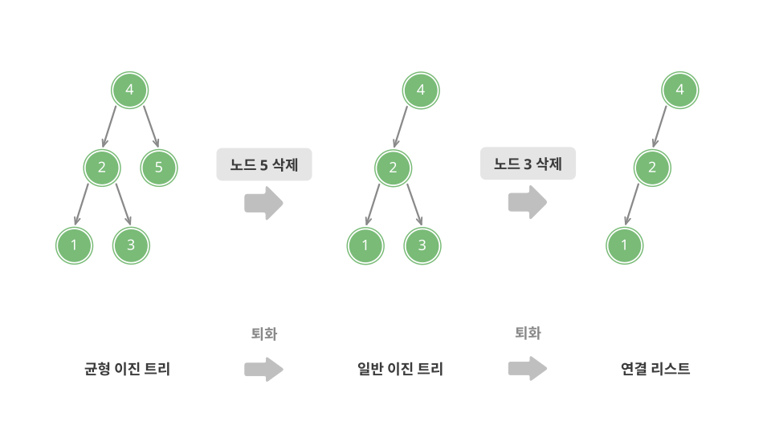
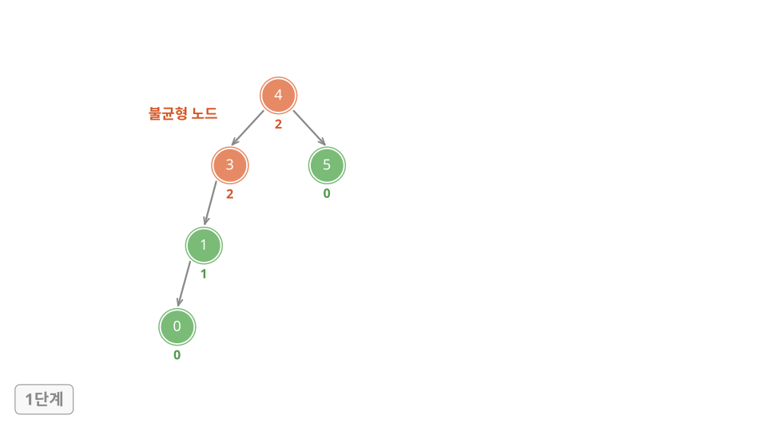
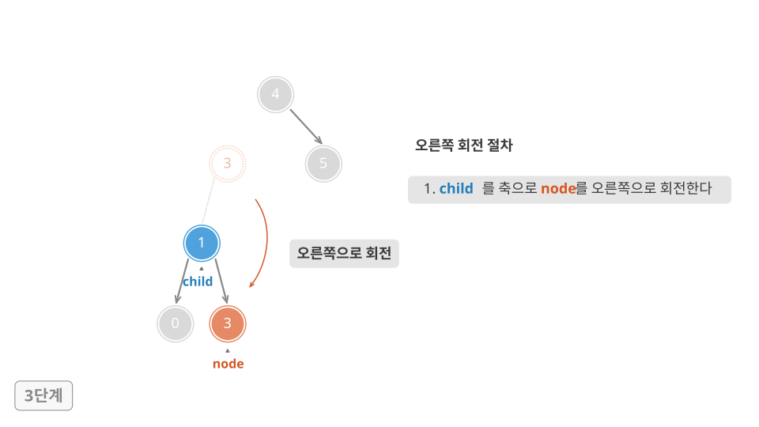
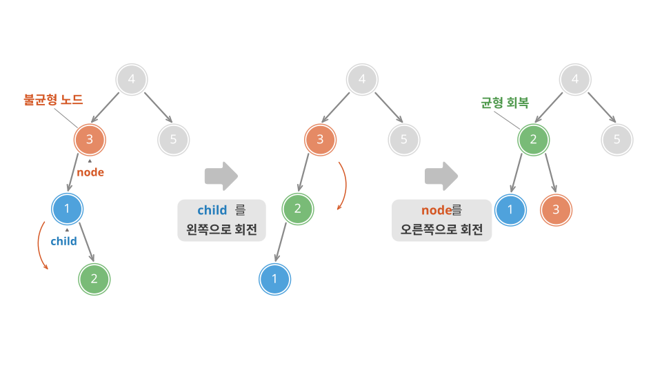
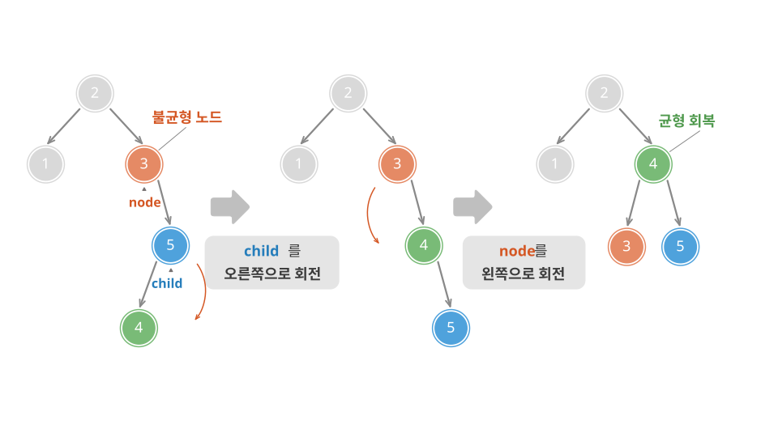

# AVL 트리 *

‘이진 탐색 트리’ 절에서 살펴보았듯이 삽입과 삭제를 여러 번 반복하면 이진 탐색 트리가 연결 리스트로 퇴화할 수 있다. 그러면 모든 연산의 시간 복잡도가 $O(\log n)$에서 $O(n)$으로 나빠진다.

다음 그림에서는 노드를 두 번만 삭제해도 이진 탐색 트리가 연결 리스트로 퇴화한다.



또 다른 예로 다음 그림의 포화 이진 트리에 노드를 두 개 삽입하면 트리가 왼쪽으로 크게 기울면서 탐색 연산의 시간 복잡도도 나빠진다.


1962년 G. M. Adelson-Velsky와 E. M. Landis는 논문 “An algorithm for the organization of information”에서 <u>AVL 트리</u>를 제안했다. 이 논문은 노드를 계속 추가하고 삭제해도 트리가 퇴화하지 않도록 하는 일련의 연산을 자세히 설명한다. 덕분에 여러 연산의 시간 복잡도를 $O(\log n)$ 수준으로 유지할 수 있다. 즉, 삽입·삭제·조회·수정이 잦은 환경에서도 AVL 트리는 데이터를 꾸준히 효율적으로 처리할 수 있어 활용 가치가 높다.

## AVL 트리의 주요 용어

AVL 트리는 이진 탐색 트리이면서 균형 이진 트리다. 두 종류의 트리가 갖는 성질을 모두 만족하므로 <u>균형 이진 탐색 트리(balanced binary search tree)</u>에 해당한다.

### 노드 높이

AVL 트리 연산에는 노드의 높이가 필요하므로 노드 클래스에 `height` 변수를 추가한다.

```snippet
avl_tree_node
```

‘노드의 높이’는 그 노드에서 가장 먼 리프까지의 거리, 즉 경로의 간선 수다. 리프 노드의 높이는 $0$이고 빈 노드의 높이는 $-1$이라는 점에 유의하자. 노드 높이를 구하는 함수와 갱신하는 함수를 각각 작성한다.

```src
[file]{avl_tree}-[class]{avl_tree}-[func]{update_height}
```

### 노드의 균형 인수

노드의 <u>균형 인수(balance factor)</u>는 왼쪽 서브트리 높이에서 오른쪽 서브트리 높이를 뺀 값이다. 빈 노드의 균형 인수는 $0$으로 정한다. 이후에 편리하게 쓸 수 있도록 균형 인수를 구하는 기능도 함수로 만든다.

```src
[file]{avl_tree}-[class]{avl_tree}-[func]{balance_factor}
```

!!! tip

    균형 인수를 $f$라 하면 AVL 트리의 모든 노드에서 $-1 \le f \le 1$이 성립한다.

## AVL 트리의 회전

AVL 트리의 특징은 ‘회전’ 연산이다. 회전하면 이진 트리의 중위 순회 결과를 바꾸지 않고 불균형 노드의 균형을 회복할 수 있다. 즉, **회전은 ‘이진 탐색 트리’의 성질을 유지하면서 트리를 다시 ‘균형 이진 트리’로 만든다**.

균형 인수의 절댓값이 $> 1$인 노드를 ‘불균형 노드’라고 한다. 불균형 형태에 따라 회전 방법은 오른쪽 회전, 왼쪽 회전, 오른쪽 회전 후 왼쪽 회전, 왼쪽 회전 후 오른쪽 회전의 네 가지다. 하나씩 살펴보자.

### 오른쪽 회전

다음 그림에서 노드 아래의 수는 균형 인수다. 아래에서 위로 보면 처음 만나는 불균형 노드는 3이다. 이 노드를 루트로 하는 서브트리에 주목하자. 이 노드를 `node`, 그 왼쪽 자식을 `child`로 표시하고 오른쪽 회전을 수행한다. 회전 후 서브트리는 균형을 되찾고 이진 탐색 트리의 성질도 유지한다.

=== "<1>"
    

=== "<2>"
    

=== "<3>"
    

=== "<4>"
    

다음 그림처럼 `child`에 오른쪽 자식(`grand_child`)이 있으면 오른쪽 회전에 한 단계가 더 필요하다. `grand_child`를 `node`의 왼쪽 자식으로 연결한다.


‘오른쪽으로 회전한다’는 표현은 모양의 변화를 나타낸다. 실제로는 다음 코드처럼 노드 포인터를 바꾸어 구현한다.

```src
[file]{avl_tree}-[class]{avl_tree}-[func]{right_rotate}
```

### 왼쪽 회전

위의 불균형 이진 트리를 거울에 비춘 모양이라면 다음 그림처럼 ‘왼쪽 회전’이 필요하다.


마찬가지로 다음 그림처럼 `child`에 왼쪽 자식(`grand_child`)이 있으면 왼쪽 회전에 한 단계가 더 필요하다. `grand_child`를 `node`의 오른쪽 자식으로 연결한다.


**오른쪽 회전과 왼쪽 회전의 논리는 좌우 대칭이며 두 연산이 해결하는 불균형 형태도 서로 대칭이다**. 따라서 오른쪽 회전 코드에 있는 모든 `left`를 `right`로, 모든 `right`를 `left`로 서로 바꾸면 다음과 같은 왼쪽 회전 코드가 된다.

```src
[file]{avl_tree}-[class]{avl_tree}-[func]{left_rotate}
```

### 왼쪽 회전 후 오른쪽 회전

다음 그림의 불균형 노드 3은 왼쪽 회전이나 오른쪽 회전 한 번만으로는 서브트리의 균형을 회복할 수 없다. 먼저 `child`를 왼쪽으로 회전한 뒤 `node`를 오른쪽으로 회전해야 한다.



### 오른쪽 회전 후 왼쪽 회전

다음 그림처럼 앞선 불균형 이진 트리와 좌우 대칭인 경우에는 먼저 `child`를 오른쪽으로 회전하고 이어서 `node`를 왼쪽으로 회전한다.



### 회전 방법 선택

다음 그림의 네 가지 불균형은 앞에서 살펴본 사례에 각각 대응한다. 왼쪽부터 오른쪽 회전, 왼쪽 회전 후 오른쪽 회전, 오른쪽 회전 후 왼쪽 회전, 왼쪽 회전이 필요하다.


다음 표처럼 불균형 노드와 높은 쪽 자식 노드의 균형 인수 부호를 살펴보면 위 그림의 어느 경우에 해당하는지 판단할 수 있다.

<p align="center"> 표 <id> &nbsp; 네 가지 회전의 선택 조건 </p>

| 불균형 노드의 균형 인수 | 자식 노드의 균형 인수 | 적용할 회전 방법 |
| ------------------ | ---------------- | ---------------- |
| $> 1$(왼쪽으로 치우친 트리)   | $\geq 0$         | 오른쪽 회전             |
| $> 1$(왼쪽으로 치우친 트리)   | $<0$             | 왼쪽 회전 후 오른쪽 회전     |
| $< -1$(오른쪽으로 치우친 트리)  | $\leq 0$         | 왼쪽 회전             |
| $< -1$(오른쪽으로 치우친 트리)  | $>0$             | 오른쪽 회전 후 왼쪽 회전     |

편리하게 사용할 수 있도록 회전 연산을 함수로 만든다. **이 함수는 각각의 불균형 형태에 맞는 회전을 수행하여 불균형 노드의 균형을 회복한다**. 코드는 다음과 같다.

```src
[file]{avl_tree}-[class]{avl_tree}-[func]{rotate}
```

## AVL 트리의 주요 연산

### 노드 삽입

AVL 트리에 노드를 삽입하는 과정은 대체로 이진 탐색 트리와 같다. 차이는 AVL 트리에 노드를 삽입한 뒤 그 노드에서 루트까지의 경로에 불균형 노드가 여럿 생길 수 있다는 점이다. 따라서 **삽입한 노드부터 위로 올라가며 회전하여 모든 불균형 노드의 균형을 회복해야 한다**. 코드는 다음과 같다.

```src
[file]{avl_tree}-[class]{avl_tree}-[func]{insert_helper}
```

### 노드 삭제

삭제도 마찬가지다. 이진 탐색 트리의 노드 삭제 방법에 더해 아래에서 위로 회전하여 모든 불균형 노드의 균형을 회복해야 한다. 코드는 다음과 같다.

```src
[file]{avl_tree}-[class]{avl_tree}-[func]{remove_helper}
```

### 노드 탐색

AVL 트리의 노드 탐색은 이진 탐색 트리와 같으므로 여기서는 설명을 생략한다.

## AVL 트리의 대표적인 활용 사례

- 대규모 데이터를 정리하고 저장한다. 탐색은 잦고 삽입과 삭제는 드문 경우에 적합하다.
- 데이터베이스의 인덱스 시스템을 구축하는 데 사용한다.
- 레드-블랙 트리도 흔히 쓰이는 균형 이진 탐색 트리다. AVL 트리보다 균형 조건이 느슨해 삽입과 삭제에 필요한 회전 횟수가 적으며, 노드 삽입과 삭제의 평균 효율이 더 높다.
