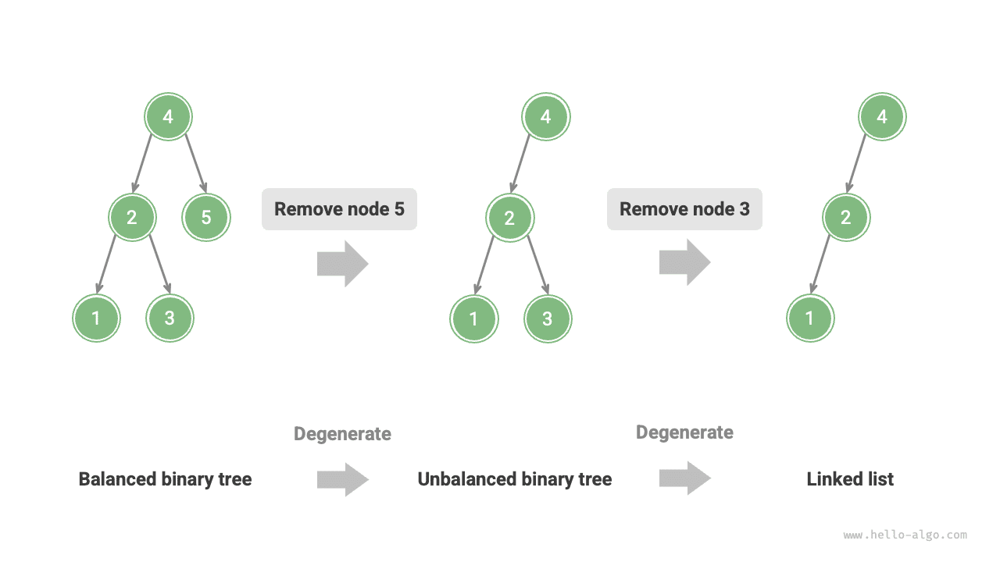
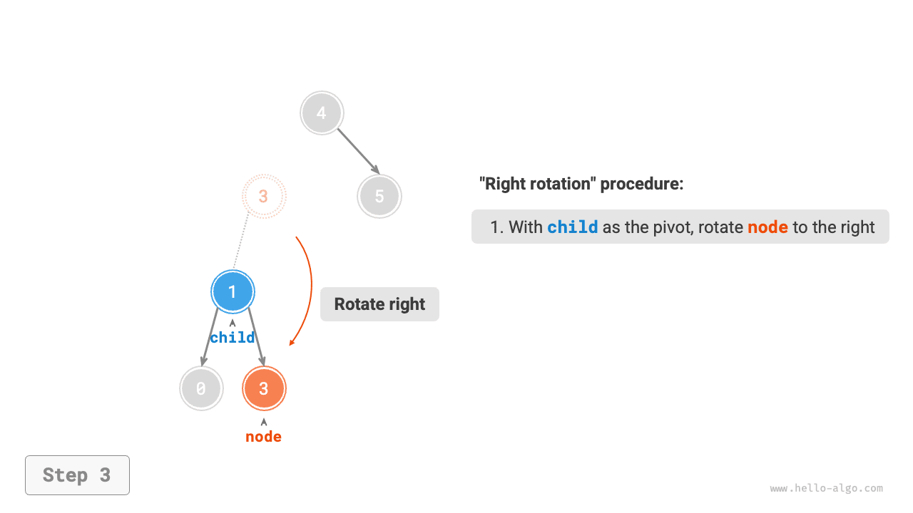
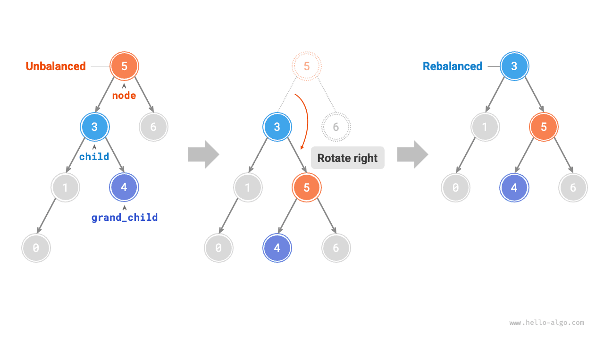
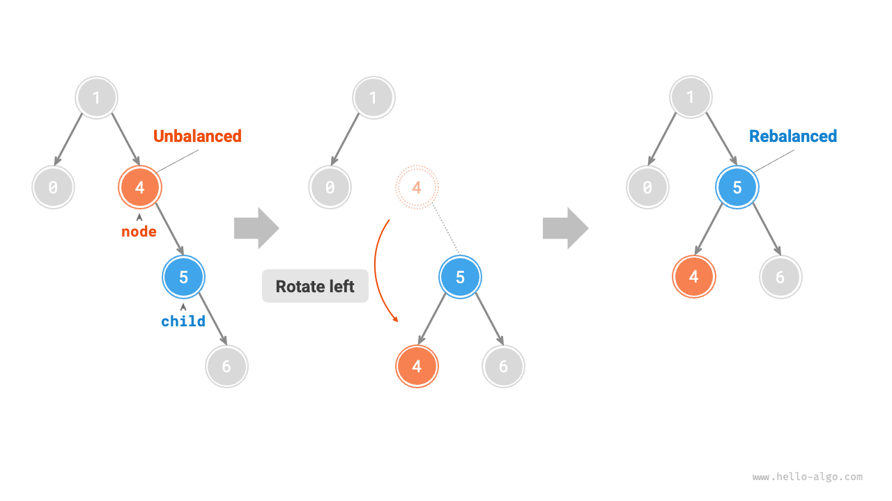
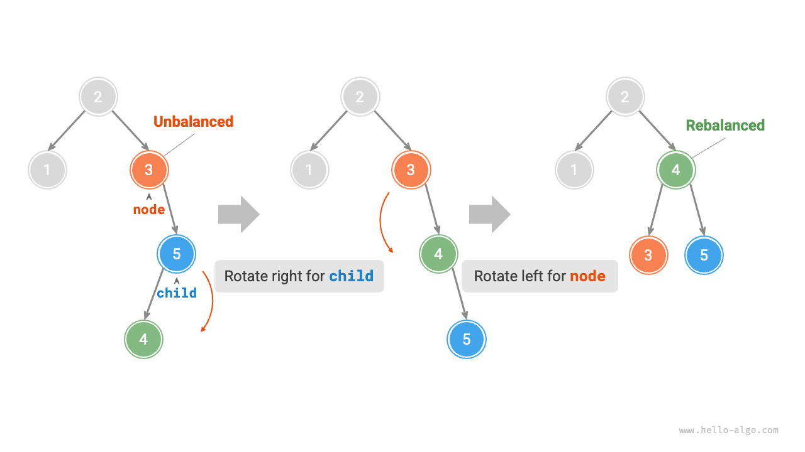
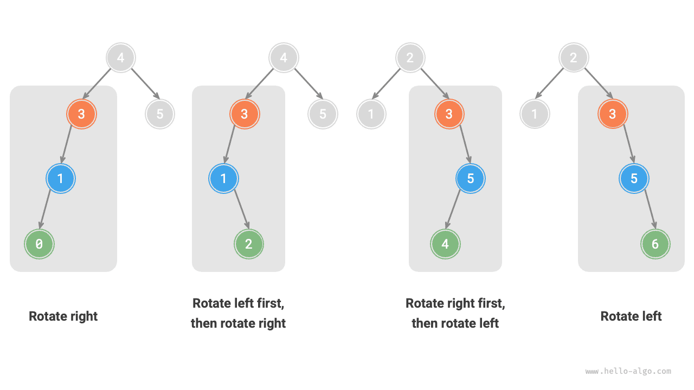

# 7.5 &nbsp; AVL 트리 *

'이진 탐색 트리' 절에서 삽입과 삭제를 여러 번 수행하면 트리가 연결 리스트로 퇴화할 수 있다고 설명했다. 이 경우 모든 연산의 시간 복잡도가 $O(\log n)$에서 $O(n)$으로 저하된다.

아래 그림(7-24)의 이진 탐색 트리는 노드를 두 번 삭제하면 연결 리스트로 퇴화한다.

{ class="animation-figure" }

<p align="center"> 그림 7-24 &nbsp; 노드 삭제 후 퇴화한 AVL 트리 </p>

또한 아래 그림(7-25)의 포화 이진 트리에 노드 두 개를 삽입하면 왼쪽으로 심하게 기울어 탐색의 시간 복잡도도 저하된다.

{ class="animation-figure" }

<p align="center"> 그림 7-25 &nbsp; 노드 삽입 후 퇴화한 AVL 트리 </p>

1962년 G. M. Adelson-Velsky와 E. M. Landis는 논문 'An algorithm for the organization of information'에서 <u>AVL 트리</u>를 제안했다. 논문은 노드를 계속 추가하거나 삭제해도 트리가 퇴화하지 않게 하는 일련의 연산을 상세히 설명하여, 각 연산의 시간 복잡도를 $O(\log n)$으로 유지하도록 했다. 즉, 추가, 삭제, 조회, 수정이 잦은 상황에서도 효율적인 데이터 연산 성능을 유지하므로 활용 가치가 높다.

## 7.5.1 &nbsp; AVL 트리의 주요 용어

AVL 트리는 이진 탐색 트리이면서 균형 이진 트리다. 두 종류의 모든 성질을 함께 만족하므로 <u>균형 이진 탐색 트리(balanced binary search tree)</u>다.

### 1. &nbsp; 노드 높이

AVL 트리 연산에는 노드 높이가 필요하므로 노드 클래스에 `height` 변수를 추가해야 한다.

=== "Python"

    ```python title=""
    class TreeNode:
        """AVL 트리 노드 클래스"""
        def __init__(self, val: int):
            self.val: int = val                 # 노드 값
            self.height: int = 0                # 노드 높이
            self.left: TreeNode | None = None   # 왼쪽 자식 노드 참조
            self.right: TreeNode | None = None  # 오른쪽 자식 노드 참조
    ```

=== "C++"

    ```cpp title=""
    /* AVL 트리 노드 클래스 */
    struct TreeNode {
        int val{};          // 노드 값
        int height = 0;     // 노드 높이
        TreeNode *left{};   // 왼쪽 자식 노드
        TreeNode *right{};  // 오른쪽 자식 노드
        TreeNode() = default;
        explicit TreeNode(int x) : val(x){}
    };
    ```

=== "Java"

    ```java title=""
    /* AVL 트리 노드 클래스 */
    class TreeNode {
        public int val;        // 노드 값
        public int height;     // 노드 높이
        public TreeNode left;  // 왼쪽 자식 노드
        public TreeNode right; // 오른쪽 자식 노드
        public TreeNode(int x) { val = x; }
    }
    ```

=== "C#"

    ```csharp title=""
    /* AVL 트리 노드 클래스 */
    class TreeNode(int? x) {
        public int? val = x;    // 노드 값
        public int height;      // 노드 높이
        public TreeNode? left;  // 왼쪽 자식 노드 참조
        public TreeNode? right; // 오른쪽 자식 노드 참조
    }
    ```

=== "Go"

    ```go title=""
    /* AVL 트리 노드 구조체 */
    type TreeNode struct {
        Val    int       // 노드 값
        Height int       // 노드 높이
        Left   *TreeNode // 왼쪽 자식 노드 참조
        Right  *TreeNode // 오른쪽 자식 노드 참조
    }
    ```

=== "Swift"

    ```swift title=""
    /* AVL 트리 노드 클래스 */
    class TreeNode {
        var val: Int // 노드 값
        var height: Int // 노드 높이
        var left: TreeNode? // 왼쪽 자식 노드
        var right: TreeNode? // 오른쪽 자식 노드

        init(x: Int) {
            val = x
            height = 0
        }
    }
    ```

=== "JS"

    ```javascript title=""
    /* AVL 트리 노드 클래스 */
    class TreeNode {
        val; // 노드 값
        height; //노드 높이
        left; // 왼쪽 자식 노드 포인터
        right; // 오른쪽 자식 노드 포인터
        constructor(val, left, right, height) {
            this.val = val === undefined ? 0 : val;
            this.height = height === undefined ? 0 : height;
            this.left = left === undefined ? null : left;
            this.right = right === undefined ? null : right;
        }
    }
    ```

=== "TS"

    ```typescript title=""
    /* AVL 트리 노드 클래스 */
    class TreeNode {
        val: number;            // 노드 값
        height: number;         // 노드 높이
        left: TreeNode | null;  // 왼쪽 자식 노드 포인터
        right: TreeNode | null; // 오른쪽 자식 노드 포인터
        constructor(val?: number, height?: number, left?: TreeNode | null, right?: TreeNode | null) {
            this.val = val === undefined ? 0 : val;
            this.height = height === undefined ? 0 : height;
            this.left = left === undefined ? null : left;
            this.right = right === undefined ? null : right;
        }
    }
    ```

=== "Dart"

    ```dart title=""
    /* AVL 트리 노드 클래스 */
    class TreeNode {
      int val;         // 노드 값
      int height;      // 노드 높이
      TreeNode? left;  // 왼쪽 자식 노드
      TreeNode? right; // 오른쪽 자식 노드
      TreeNode(this.val, [this.height = 0, this.left, this.right]);
    }
    ```

=== "Rust"

    ```rust title=""
    use std::rc::Rc;
    use std::cell::RefCell;

    /* AVL 트리 노드 구조체 */
    struct TreeNode {
        val: i32,                               // 노드 값
        height: i32,                            // 노드 높이
        left: Option<Rc<RefCell<TreeNode>>>,    // 왼쪽 자식 노드
        right: Option<Rc<RefCell<TreeNode>>>,   // 오른쪽 자식 노드
    }

    impl TreeNode {
        /* 생성자 */
        fn new(val: i32) -> Rc<RefCell<Self>> {
            Rc::new(RefCell::new(Self {
                val,
                height: 0,
                left: None,
                right: None
            }))
        }
    }
    ```

=== "C"

    ```c title=""
    /* AVL 트리 노드 구조체 */
    typedef struct TreeNode {
        int val;
        int height;
        struct TreeNode *left;
        struct TreeNode *right;
    } TreeNode;

    /* 생성자 */
    TreeNode *newTreeNode(int val) {
        TreeNode *node;

        node = (TreeNode *)malloc(sizeof(TreeNode));
        node->val = val;
        node->height = 0;
        node->left = NULL;
        node->right = NULL;
        return node;
    }
    ```

=== "Kotlin"

    ```kotlin title=""
    /* AVL 트리 노드 클래스 */
    class TreeNode(val _val: Int) {  // 노드 값
        var height: Int = 0          // 노드 높이
        var left: TreeNode? = null   // 왼쪽 자식 노드
        var right: TreeNode? = null  // 오른쪽 자식 노드
    }
    ```

=== "Ruby"

    ```ruby title=""
    ### AVL 트리 노드 클래스 ###
    class TreeNode
      attr_accessor :val    # 노드 값
      attr_accessor :height # 노드 높이
      attr_accessor :left   # 왼쪽 자식 노드 참조
      attr_accessor :right  # 오른쪽 자식 노드 참조

      def initialize(val)
        @val = val
        @height = 0
      end
    end
    ```

'노드 높이'는 해당 노드에서 가장 먼 리프까지의 거리, 즉 거치는 '간선' 수다. 특히 리프의 높이는 $0$, 빈 노드의 높이는 $-1$임에 주의하자. 높이를 조회하고 갱신하는 두 보조 함수를 만든다.

=== "Python"

    ```python title="avl_tree.py"
    def height(self, node: TreeNode | None) -> int:
        """노드 높이 반환"""
        # 빈 노드의 높이는 -1이고, 리프 노드의 높이는 0이다
        if node is not None:
            return node.height
        return -1

    def update_height(self, node: TreeNode | None):
        """노드 높이를 갱신한다"""
        # 노드 높이는 가장 높은 서브트리의 높이 + 1이다
        node.height = max([self.height(node.left), self.height(node.right)]) + 1
    ```

=== "C++"

    ```cpp title="avl_tree.cpp"
    /* 노드 높이 반환 */
    int height(TreeNode *node) {
        // 빈 노드의 높이는 -1이고, 리프 노드의 높이는 0이다
        return node == nullptr ? -1 : node->height;
    }

    /* 노드 높이를 갱신한다 */
    void updateHeight(TreeNode *node) {
        // 노드 높이는 가장 높은 서브트리의 높이 + 1이다
        node->height = max(height(node->left), height(node->right)) + 1;
    }
    ```

=== "Java"

    ```java title="avl_tree.java"
    /* 노드 높이 반환 */
    int height(TreeNode node) {
        // 빈 노드의 높이는 -1이고, 리프 노드의 높이는 0이다
        return node == null ? -1 : node.height;
    }

    /* 노드 높이를 갱신한다 */
    void updateHeight(TreeNode node) {
        // 노드 높이는 가장 높은 서브트리의 높이 + 1이다
        node.height = Math.max(height(node.left), height(node.right)) + 1;
    }
    ```

=== "C#"

    ```csharp title="avl_tree.cs"
    /* 노드 높이 반환 */
    int Height(TreeNode? node) {
        // 빈 노드의 높이는 -1이고, 리프 노드의 높이는 0이다
        return node == null ? -1 : node.height;
    }

    /* 노드 높이를 갱신한다 */
    void UpdateHeight(TreeNode node) {
        // 노드 높이는 가장 높은 서브트리의 높이 + 1이다
        node.height = Math.Max(Height(node.left), Height(node.right)) + 1;
    }
    ```

=== "Go"

    ```go title="avl_tree.go"
    /* 노드 높이 반환 */
    func (t *aVLTree) height(node *TreeNode) int {
        // 빈 노드의 높이는 -1이고, 리프 노드의 높이는 0이다
        if node != nil {
            return node.Height
        }
        return -1
    }

    /* 노드 높이를 갱신한다 */
    func (t *aVLTree) updateHeight(node *TreeNode) {
        lh := t.height(node.Left)
        rh := t.height(node.Right)
        // 노드 높이는 가장 높은 서브트리의 높이 + 1이다
        if lh > rh {
            node.Height = lh + 1
        } else {
            node.Height = rh + 1
        }
    }
    ```

=== "Swift"

    ```swift title="avl_tree.swift"
    /* 노드 높이 반환 */
    func height(node: TreeNode?) -> Int {
        // 빈 노드의 높이는 -1이고, 리프 노드의 높이는 0이다
        node?.height ?? -1
    }

    /* 노드 높이를 갱신한다 */
    func updateHeight(node: TreeNode?) {
        // 노드 높이는 가장 높은 서브트리의 높이 + 1이다
        node?.height = max(height(node: node?.left), height(node: node?.right)) + 1
    }
    ```

=== "JS"

    ```javascript title="avl_tree.js"
    /* 노드 높이 반환 */
    height(node) {
        // 빈 노드의 높이는 -1이고, 리프 노드의 높이는 0이다
        return node === null ? -1 : node.height;
    }

    /* 노드 높이를 갱신한다 */
    #updateHeight(node) {
        // 노드 높이는 가장 높은 서브트리의 높이 + 1이다
        node.height =
            Math.max(this.height(node.left), this.height(node.right)) + 1;
    }
    ```

=== "TS"

    ```typescript title="avl_tree.ts"
    /* 노드 높이 반환 */
    height(node: TreeNode): number {
        // 빈 노드의 높이는 -1이고, 리프 노드의 높이는 0이다
        return node === null ? -1 : node.height;
    }

    /* 노드 높이를 갱신한다 */
    updateHeight(node: TreeNode): void {
        // 노드 높이는 가장 높은 서브트리의 높이 + 1이다
        node.height =
            Math.max(this.height(node.left), this.height(node.right)) + 1;
    }
    ```

=== "Dart"

    ```dart title="avl_tree.dart"
    /* 노드 높이 반환 */
    int height(TreeNode? node) {
      // 빈 노드의 높이는 -1이고, 리프 노드의 높이는 0이다
      return node == null ? -1 : node.height;
    }

    /* 노드 높이를 갱신한다 */
    void updateHeight(TreeNode? node) {
      // 노드 높이는 가장 높은 서브트리의 높이 + 1이다
      node!.height = max(height(node.left), height(node.right)) + 1;
    }
    ```

=== "Rust"

    ```rust title="avl_tree.rs"
    /* 노드 높이 반환 */
    fn height(node: OptionTreeNodeRc) -> i32 {
        // 빈 노드의 높이는 -1이고, 리프 노드의 높이는 0이다
        match node {
            Some(node) => node.borrow().height,
            None => -1,
        }
    }

    /* 노드 높이를 갱신한다 */
    fn update_height(node: OptionTreeNodeRc) {
        if let Some(node) = node {
            let left = node.borrow().left.clone();
            let right = node.borrow().right.clone();
            // 노드 높이는 가장 높은 서브트리의 높이 + 1이다
            node.borrow_mut().height = std::cmp::max(Self::height(left), Self::height(right)) + 1;
        }
    }
    ```

=== "C"

    ```c title="avl_tree.c"
    /* 노드 높이 반환 */
    int height(TreeNode *node) {
        // 빈 노드의 높이는 -1이고, 리프 노드의 높이는 0이다
        if (node != NULL) {
            return node->height;
        }
        return -1;
    }

    /* 노드 높이를 갱신한다 */
    void updateHeight(TreeNode *node) {
        int lh = height(node->left);
        int rh = height(node->right);
        // 노드 높이는 가장 높은 서브트리의 높이 + 1이다
        if (lh > rh) {
            node->height = lh + 1;
        } else {
            node->height = rh + 1;
        }
    }
    ```

=== "Kotlin"

    ```kotlin title="avl_tree.kt"
    /* 노드 높이 반환 */
    fun height(node: TreeNode?): Int {
        // 빈 노드의 높이는 -1이고, 리프 노드의 높이는 0이다
        return node?.height ?: -1
    }

    /* 노드 높이를 갱신한다 */
    fun updateHeight(node: TreeNode?) {
        // 노드 높이는 가장 높은 서브트리의 높이 + 1이다
        node?.height = max(height(node?.left), height(node?.right)) + 1
    }
    ```

=== "Ruby"

    ```ruby title="avl_tree.rb"
    ### 노드 높이 반환 ###
    def height(node)
      # 빈 노드의 높이는 -1이고, 리프 노드의 높이는 0이다
      return node.height unless node.nil?

      -1
    end

    ### 노드 높이를 갱신한다 ###
    def update_height(node)
      # 노드 높이는 가장 높은 서브트리의 높이 + 1이다
      node.height = [height(node.left), height(node.right)].max + 1
    end
    ```

### 2. &nbsp; 노드의 균형 인수

노드의 <u>균형 인수(balance factor)</u>는 왼쪽 서브트리 높이에서 오른쪽 서브트리 높이를 뺀 값이며, 빈 노드의 균형 인수는 $0$으로 정한다. 이후 편리하게 쓰도록 균형 인수를 구하는 기능도 함수로 만든다.

=== "Python"

    ```python title="avl_tree.py"
    def balance_factor(self, node: TreeNode | None) -> int:
        """균형 인수 반환"""
        # 빈 노드의 균형 인수는 0이다
        if node is None:
            return 0
        # 노드의 균형 인수 = 왼쪽 서브트리 높이 - 오른쪽 서브트리 높이
        return self.height(node.left) - self.height(node.right)
    ```

=== "C++"

    ```cpp title="avl_tree.cpp"
    /* 균형 인수 반환 */
    int balanceFactor(TreeNode *node) {
        // 빈 노드의 균형 인수는 0이다
        if (node == nullptr)
            return 0;
        // 노드의 균형 인수 = 왼쪽 서브트리 높이 - 오른쪽 서브트리 높이
        return height(node->left) - height(node->right);
    }
    ```

=== "Java"

    ```java title="avl_tree.java"
    /* 균형 인수 반환 */
    int balanceFactor(TreeNode node) {
        // 빈 노드의 균형 인수는 0이다
        if (node == null)
            return 0;
        // 노드의 균형 인수 = 왼쪽 서브트리 높이 - 오른쪽 서브트리 높이
        return height(node.left) - height(node.right);
    }
    ```

=== "C#"

    ```csharp title="avl_tree.cs"
    /* 균형 인수 반환 */
    int BalanceFactor(TreeNode? node) {
        // 빈 노드의 균형 인수는 0이다
        if (node == null) return 0;
        // 노드의 균형 인수 = 왼쪽 서브트리 높이 - 오른쪽 서브트리 높이
        return Height(node.left) - Height(node.right);
    }
    ```

=== "Go"

    ```go title="avl_tree.go"
    /* 균형 인수 반환 */
    func (t *aVLTree) balanceFactor(node *TreeNode) int {
        // 빈 노드의 균형 인수는 0이다
        if node == nil {
            return 0
        }
        // 노드의 균형 인수 = 왼쪽 서브트리 높이 - 오른쪽 서브트리 높이
        return t.height(node.Left) - t.height(node.Right)
    }
    ```

=== "Swift"

    ```swift title="avl_tree.swift"
    /* 균형 인수 반환 */
    func balanceFactor(node: TreeNode?) -> Int {
        // 빈 노드의 균형 인수는 0이다
        guard let node = node else { return 0 }
        // 노드의 균형 인수 = 왼쪽 서브트리 높이 - 오른쪽 서브트리 높이
        return height(node: node.left) - height(node: node.right)
    }
    ```

=== "JS"

    ```javascript title="avl_tree.js"
    /* 균형 인수 반환 */
    balanceFactor(node) {
        // 빈 노드의 균형 인수는 0이다
        if (node === null) return 0;
        // 노드의 균형 인수 = 왼쪽 서브트리 높이 - 오른쪽 서브트리 높이
        return this.height(node.left) - this.height(node.right);
    }
    ```

=== "TS"

    ```typescript title="avl_tree.ts"
    /* 균형 인수 반환 */
    balanceFactor(node: TreeNode): number {
        // 빈 노드의 균형 인수는 0이다
        if (node === null) return 0;
        // 노드의 균형 인수 = 왼쪽 서브트리 높이 - 오른쪽 서브트리 높이
        return this.height(node.left) - this.height(node.right);
    }
    ```

=== "Dart"

    ```dart title="avl_tree.dart"
    /* 균형 인수 반환 */
    int balanceFactor(TreeNode? node) {
      // 빈 노드의 균형 인수는 0이다
      if (node == null) return 0;
      // 노드의 균형 인수 = 왼쪽 서브트리 높이 - 오른쪽 서브트리 높이
      return height(node.left) - height(node.right);
    }
    ```

=== "Rust"

    ```rust title="avl_tree.rs"
    /* 균형 인수 반환 */
    fn balance_factor(node: OptionTreeNodeRc) -> i32 {
        match node {
            // 빈 노드의 균형 인수는 0이다
            None => 0,
            // 노드의 균형 인수 = 왼쪽 서브트리 높이 - 오른쪽 서브트리 높이
            Some(node) => {
                Self::height(node.borrow().left.clone()) - Self::height(node.borrow().right.clone())
            }
        }
    }
    ```

=== "C"

    ```c title="avl_tree.c"
    /* 균형 인수 반환 */
    int balanceFactor(TreeNode *node) {
        // 빈 노드의 균형 인수는 0이다
        if (node == NULL) {
            return 0;
        }
        // 노드의 균형 인수 = 왼쪽 서브트리 높이 - 오른쪽 서브트리 높이
        return height(node->left) - height(node->right);
    }
    ```

=== "Kotlin"

    ```kotlin title="avl_tree.kt"
    /* 균형 인수 반환 */
    fun balanceFactor(node: TreeNode?): Int {
        // 빈 노드의 균형 인수는 0이다
        if (node == null) return 0
        // 노드의 균형 인수 = 왼쪽 서브트리 높이 - 오른쪽 서브트리 높이
        return height(node.left) - height(node.right)
    }
    ```

=== "Ruby"

    ```ruby title="avl_tree.rb"
    ### 균형 인수 반환 ###
    def balance_factor(node)
      # 빈 노드의 균형 인수는 0이다
      return 0 if node.nil?

      # 노드의 균형 인수 = 왼쪽 서브트리 높이 - 오른쪽 서브트리 높이
      height(node.left) - height(node.right)
    end
    ```

!!! tip "참고"

    균형 인수를 $f$라고 하면 AVL 트리의 모든 노드는 $-1 \le f \le 1$을 만족한다.

## 7.5.2 &nbsp; AVL 트리의 회전

AVL 트리의 특징은 '회전' 연산이다. 이진 트리의 중위 순회 결과를 바꾸지 않으면서 불균형 노드의 균형을 회복한다. 즉, **회전은 '이진 탐색 트리'의 성질을 유지하면서 트리를 다시 '균형 이진 트리'로 만든다**.

균형 인수의 절댓값이 $> 1$인 노드를 '불균형 노드'라고 한다. 불균형 상황에 따라 오른쪽 회전, 왼쪽 회전, 오른쪽 후 왼쪽 회전, 왼쪽 후 오른쪽 회전의 네 종류로 나뉜다. 각각 자세히 알아보자.

### 1. &nbsp; 오른쪽 회전

아래 그림(7-26)에서 노드 아래의 수는 균형 인수다. 아래에서 위로 볼 때 첫 불균형 노드는 '노드 3'이다. 이 노드를 루트로 하는 서브트리에 주목하여 불균형 노드를 `node`, 왼쪽 자식을 `child`라고 하고 '오른쪽 회전'을 수행한다. 회전 후 서브트리는 균형을 되찾으며 이진 탐색 트리의 성질도 유지한다.

=== "<1>"
    { class="animation-figure" }

=== "<2>"
    { class="animation-figure" }

=== "<3>"
    { class="animation-figure" }

=== "<4>"
    { class="animation-figure" }

<p align="center"> 그림 7-26 &nbsp; 오른쪽 회전 단계 </p>

아래 그림(7-27)처럼 `child`에 오른쪽 자식 `grand_child`가 있으면, 오른쪽 회전 중 `grand_child`를 `node`의 왼쪽 자식으로 연결하는 단계를 추가해야 한다.

{ class="animation-figure" }

<p align="center"> 그림 7-27 &nbsp; grand_child가 있는 오른쪽 회전 </p>

'오른쪽으로 회전한다'는 시각적인 표현이며, 실제로는 노드 포인터를 수정하여 구현한다. 코드는 다음과 같다.

=== "Python"

    ```python title="avl_tree.py"
    def right_rotate(self, node: TreeNode | None) -> TreeNode | None:
        """오른쪽 회전 연산"""
        child = node.left
        grand_child = child.right
        # child를 중심으로 node를 오른쪽으로 회전한다
        child.right = node
        node.left = grand_child
        # 노드 높이를 갱신한다
        self.update_height(node)
        self.update_height(child)
        # 회전한 서브트리의 루트 노드를 반환한다
        return child
    ```

=== "C++"

    ```cpp title="avl_tree.cpp"
    /* 오른쪽 회전 연산 */
    TreeNode *rightRotate(TreeNode *node) {
        TreeNode *child = node->left;
        TreeNode *grandChild = child->right;
        // child를 중심으로 node를 오른쪽으로 회전한다
        child->right = node;
        node->left = grandChild;
        // 노드 높이를 갱신한다
        updateHeight(node);
        updateHeight(child);
        // 회전한 서브트리의 루트 노드를 반환한다
        return child;
    }
    ```

=== "Java"

    ```java title="avl_tree.java"
    /* 오른쪽 회전 연산 */
    TreeNode rightRotate(TreeNode node) {
        TreeNode child = node.left;
        TreeNode grandChild = child.right;
        // child를 중심으로 node를 오른쪽으로 회전한다
        child.right = node;
        node.left = grandChild;
        // 노드 높이를 갱신한다
        updateHeight(node);
        updateHeight(child);
        // 회전한 서브트리의 루트 노드를 반환한다
        return child;
    }
    ```

=== "C#"

    ```csharp title="avl_tree.cs"
    /* 오른쪽 회전 연산 */
    TreeNode? RightRotate(TreeNode? node) {
        TreeNode? child = node?.left;
        TreeNode? grandChild = child?.right;
        // child를 중심으로 node를 오른쪽으로 회전한다
        child.right = node;
        node.left = grandChild;
        // 노드 높이를 갱신한다
        UpdateHeight(node);
        UpdateHeight(child);
        // 회전한 서브트리의 루트 노드를 반환한다
        return child;
    }
    ```

=== "Go"

    ```go title="avl_tree.go"
    /* 오른쪽 회전 연산 */
    func (t *aVLTree) rightRotate(node *TreeNode) *TreeNode {
        child := node.Left
        grandChild := child.Right
        // child를 중심으로 node를 오른쪽으로 회전한다
        child.Right = node
        node.Left = grandChild
        // 노드 높이를 갱신한다
        t.updateHeight(node)
        t.updateHeight(child)
        // 회전한 서브트리의 루트 노드를 반환한다
        return child
    }
    ```

=== "Swift"

    ```swift title="avl_tree.swift"
    /* 오른쪽 회전 연산 */
    func rightRotate(node: TreeNode?) -> TreeNode? {
        let child = node?.left
        let grandChild = child?.right
        // child를 중심으로 node를 오른쪽으로 회전한다
        child?.right = node
        node?.left = grandChild
        // 노드 높이를 갱신한다
        updateHeight(node: node)
        updateHeight(node: child)
        // 회전한 서브트리의 루트 노드를 반환한다
        return child
    }
    ```

=== "JS"

    ```javascript title="avl_tree.js"
    /* 오른쪽 회전 연산 */
    #rightRotate(node) {
        const child = node.left;
        const grandChild = child.right;
        // child를 중심으로 node를 오른쪽으로 회전한다
        child.right = node;
        node.left = grandChild;
        // 노드 높이를 갱신한다
        this.#updateHeight(node);
        this.#updateHeight(child);
        // 회전한 서브트리의 루트 노드를 반환한다
        return child;
    }
    ```

=== "TS"

    ```typescript title="avl_tree.ts"
    /* 오른쪽 회전 연산 */
    rightRotate(node: TreeNode): TreeNode {
        const child = node.left;
        const grandChild = child.right;
        // child를 중심으로 node를 오른쪽으로 회전한다
        child.right = node;
        node.left = grandChild;
        // 노드 높이를 갱신한다
        this.updateHeight(node);
        this.updateHeight(child);
        // 회전한 서브트리의 루트 노드를 반환한다
        return child;
    }
    ```

=== "Dart"

    ```dart title="avl_tree.dart"
    /* 오른쪽 회전 연산 */
    TreeNode? rightRotate(TreeNode? node) {
      TreeNode? child = node!.left;
      TreeNode? grandChild = child!.right;
      // child를 중심으로 node를 오른쪽으로 회전한다
      child.right = node;
      node.left = grandChild;
      // 노드 높이를 갱신한다
      updateHeight(node);
      updateHeight(child);
      // 회전한 서브트리의 루트 노드를 반환한다
      return child;
    }
    ```

=== "Rust"

    ```rust title="avl_tree.rs"
    /* 오른쪽 회전 연산 */
    fn right_rotate(node: OptionTreeNodeRc) -> OptionTreeNodeRc {
        match node {
            Some(node) => {
                let child = node.borrow().left.clone().unwrap();
                let grand_child = child.borrow().right.clone();
                // child를 중심으로 node를 오른쪽으로 회전한다
                child.borrow_mut().right = Some(node.clone());
                node.borrow_mut().left = grand_child;
                // 노드 높이를 갱신한다
                Self::update_height(Some(node));
                Self::update_height(Some(child.clone()));
                // 회전한 서브트리의 루트 노드를 반환한다
                Some(child)
            }
            None => None,
        }
    }
    ```

=== "C"

    ```c title="avl_tree.c"
    /* 오른쪽 회전 연산 */
    TreeNode *rightRotate(TreeNode *node) {
        TreeNode *child, *grandChild;
        child = node->left;
        grandChild = child->right;
        // child를 중심으로 node를 오른쪽으로 회전한다
        child->right = node;
        node->left = grandChild;
        // 노드 높이를 갱신한다
        updateHeight(node);
        updateHeight(child);
        // 회전한 서브트리의 루트 노드를 반환한다
        return child;
    }
    ```

=== "Kotlin"

    ```kotlin title="avl_tree.kt"
    /* 오른쪽 회전 연산 */
    fun rightRotate(node: TreeNode?): TreeNode {
        val child = node!!.left
        val grandChild = child!!.right
        // child를 중심으로 node를 오른쪽으로 회전한다
        child.right = node
        node.left = grandChild
        // 노드 높이를 갱신한다
        updateHeight(node)
        updateHeight(child)
        // 회전한 서브트리의 루트 노드를 반환한다
        return child
    }
    ```

=== "Ruby"

    ```ruby title="avl_tree.rb"
    ### 오른쪽 회전 연산 ###
    def right_rotate(node)
      child = node.left
      grand_child = child.right
      # child를 중심으로 node를 오른쪽으로 회전한다
      child.right = node
      node.left = grand_child
      # 노드 높이를 갱신한다
      update_height(node)
      update_height(child)
      # 회전한 서브트리의 루트 노드를 반환한다
      child
    end
    ```

### 2. &nbsp; 왼쪽 회전

앞의 불균형 이진 트리를 '거울에 비춘' 경우에는 아래 그림(7-28)과 같이 '왼쪽 회전'이 필요하다.

{ class="animation-figure" }

<p align="center"> 그림 7-28 &nbsp; 왼쪽 회전 </p>

마찬가지로 아래 그림(7-29)처럼 `child`에 왼쪽 자식 `grand_child`가 있으면, 왼쪽 회전 중 `grand_child`를 `node`의 오른쪽 자식으로 연결하는 단계를 추가해야 한다.

{ class="animation-figure" }

<p align="center"> 그림 7-29 &nbsp; grand_child가 있는 왼쪽 회전 </p>

**오른쪽 회전과 왼쪽 회전은 논리적으로 거울 대칭이며, 각각 해결하는 불균형 상황도 대칭이다**. 따라서 오른쪽 회전 코드의 모든 `left`를 `right`로, 모든 `right`를 `left`로 바꾸면 왼쪽 회전 코드를 얻는다.

=== "Python"

    ```python title="avl_tree.py"
    def left_rotate(self, node: TreeNode | None) -> TreeNode | None:
        """왼쪽 회전 연산"""
        child = node.right
        grand_child = child.left
        # child를 중심으로 node를 왼쪽으로 회전한다
        child.left = node
        node.right = grand_child
        # 노드 높이를 갱신한다
        self.update_height(node)
        self.update_height(child)
        # 회전한 서브트리의 루트 노드를 반환한다
        return child
    ```

=== "C++"

    ```cpp title="avl_tree.cpp"
    /* 왼쪽 회전 연산 */
    TreeNode *leftRotate(TreeNode *node) {
        TreeNode *child = node->right;
        TreeNode *grandChild = child->left;
        // child를 중심으로 node를 왼쪽으로 회전한다
        child->left = node;
        node->right = grandChild;
        // 노드 높이를 갱신한다
        updateHeight(node);
        updateHeight(child);
        // 회전한 서브트리의 루트 노드를 반환한다
        return child;
    }
    ```

=== "Java"

    ```java title="avl_tree.java"
    /* 왼쪽 회전 연산 */
    TreeNode leftRotate(TreeNode node) {
        TreeNode child = node.right;
        TreeNode grandChild = child.left;
        // child를 중심으로 node를 왼쪽으로 회전한다
        child.left = node;
        node.right = grandChild;
        // 노드 높이를 갱신한다
        updateHeight(node);
        updateHeight(child);
        // 회전한 서브트리의 루트 노드를 반환한다
        return child;
    }
    ```

=== "C#"

    ```csharp title="avl_tree.cs"
    /* 왼쪽 회전 연산 */
    TreeNode? LeftRotate(TreeNode? node) {
        TreeNode? child = node?.right;
        TreeNode? grandChild = child?.left;
        // child를 중심으로 node를 왼쪽으로 회전한다
        child.left = node;
        node.right = grandChild;
        // 노드 높이를 갱신한다
        UpdateHeight(node);
        UpdateHeight(child);
        // 회전한 서브트리의 루트 노드를 반환한다
        return child;
    }
    ```

=== "Go"

    ```go title="avl_tree.go"
    /* 왼쪽 회전 연산 */
    func (t *aVLTree) leftRotate(node *TreeNode) *TreeNode {
        child := node.Right
        grandChild := child.Left
        // child를 중심으로 node를 왼쪽으로 회전한다
        child.Left = node
        node.Right = grandChild
        // 노드 높이를 갱신한다
        t.updateHeight(node)
        t.updateHeight(child)
        // 회전한 서브트리의 루트 노드를 반환한다
        return child
    }
    ```

=== "Swift"

    ```swift title="avl_tree.swift"
    /* 왼쪽 회전 연산 */
    func leftRotate(node: TreeNode?) -> TreeNode? {
        let child = node?.right
        let grandChild = child?.left
        // child를 중심으로 node를 왼쪽으로 회전한다
        child?.left = node
        node?.right = grandChild
        // 노드 높이를 갱신한다
        updateHeight(node: node)
        updateHeight(node: child)
        // 회전한 서브트리의 루트 노드를 반환한다
        return child
    }
    ```

=== "JS"

    ```javascript title="avl_tree.js"
    /* 왼쪽 회전 연산 */
    #leftRotate(node) {
        const child = node.right;
        const grandChild = child.left;
        // child를 중심으로 node를 왼쪽으로 회전한다
        child.left = node;
        node.right = grandChild;
        // 노드 높이를 갱신한다
        this.#updateHeight(node);
        this.#updateHeight(child);
        // 회전한 서브트리의 루트 노드를 반환한다
        return child;
    }
    ```

=== "TS"

    ```typescript title="avl_tree.ts"
    /* 왼쪽 회전 연산 */
    leftRotate(node: TreeNode): TreeNode {
        const child = node.right;
        const grandChild = child.left;
        // child를 중심으로 node를 왼쪽으로 회전한다
        child.left = node;
        node.right = grandChild;
        // 노드 높이를 갱신한다
        this.updateHeight(node);
        this.updateHeight(child);
        // 회전한 서브트리의 루트 노드를 반환한다
        return child;
    }
    ```

=== "Dart"

    ```dart title="avl_tree.dart"
    /* 왼쪽 회전 연산 */
    TreeNode? leftRotate(TreeNode? node) {
      TreeNode? child = node!.right;
      TreeNode? grandChild = child!.left;
      // child를 중심으로 node를 왼쪽으로 회전한다
      child.left = node;
      node.right = grandChild;
      // 노드 높이를 갱신한다
      updateHeight(node);
      updateHeight(child);
      // 회전한 서브트리의 루트 노드를 반환한다
      return child;
    }
    ```

=== "Rust"

    ```rust title="avl_tree.rs"
    /* 왼쪽 회전 연산 */
    fn left_rotate(node: OptionTreeNodeRc) -> OptionTreeNodeRc {
        match node {
            Some(node) => {
                let child = node.borrow().right.clone().unwrap();
                let grand_child = child.borrow().left.clone();
                // child를 중심으로 node를 왼쪽으로 회전한다
                child.borrow_mut().left = Some(node.clone());
                node.borrow_mut().right = grand_child;
                // 노드 높이를 갱신한다
                Self::update_height(Some(node));
                Self::update_height(Some(child.clone()));
                // 회전한 서브트리의 루트 노드를 반환한다
                Some(child)
            }
            None => None,
        }
    }
    ```

=== "C"

    ```c title="avl_tree.c"
    /* 왼쪽 회전 연산 */
    TreeNode *leftRotate(TreeNode *node) {
        TreeNode *child, *grandChild;
        child = node->right;
        grandChild = child->left;
        // child를 중심으로 node를 왼쪽으로 회전한다
        child->left = node;
        node->right = grandChild;
        // 노드 높이를 갱신한다
        updateHeight(node);
        updateHeight(child);
        // 회전한 서브트리의 루트 노드를 반환한다
        return child;
    }
    ```

=== "Kotlin"

    ```kotlin title="avl_tree.kt"
    /* 왼쪽 회전 연산 */
    fun leftRotate(node: TreeNode?): TreeNode {
        val child = node!!.right
        val grandChild = child!!.left
        // child를 중심으로 node를 왼쪽으로 회전한다
        child.left = node
        node.right = grandChild
        // 노드 높이를 갱신한다
        updateHeight(node)
        updateHeight(child)
        // 회전한 서브트리의 루트 노드를 반환한다
        return child
    }
    ```

=== "Ruby"

    ```ruby title="avl_tree.rb"
    ### 왼쪽 회전 연산 ###
    def left_rotate(node)
      child = node.right
      grand_child = child.left
      # child를 중심으로 node를 왼쪽으로 회전한다
      child.left = node
      node.right = grand_child
      # 노드 높이를 갱신한다
      update_height(node)
      update_height(child)
      # 회전한 서브트리의 루트 노드를 반환한다
      child
    end
    ```

### 3. &nbsp; 왼쪽 회전 후 오른쪽 회전

아래 그림(7-30)의 불균형 노드 3은 왼쪽 회전이나 오른쪽 회전 한 번만으로 균형을 회복할 수 없다. 먼저 `child`를 '왼쪽 회전'한 뒤 `node`를 '오른쪽 회전'해야 한다.

{ class="animation-figure" }

<p align="center"> 그림 7-30 &nbsp; 왼쪽 회전 후 오른쪽 회전 </p>

### 4. &nbsp; 오른쪽 회전 후 왼쪽 회전

아래 그림(7-31)처럼 앞 상황의 거울 대칭인 경우에는 먼저 `child`를 '오른쪽 회전'한 뒤 `node`를 '왼쪽 회전'해야 한다.

{ class="animation-figure" }

<p align="center"> 그림 7-31 &nbsp; 오른쪽 회전 후 왼쪽 회전 </p>

### 5. &nbsp; 회전 선택

아래 그림(7-32)의 네 불균형 상황은 앞의 예시들과 각각 대응한다. 순서대로 오른쪽 회전, 왼쪽 후 오른쪽 회전, 오른쪽 후 왼쪽 회전, 왼쪽 회전이 필요하다.

{ class="animation-figure" }

<p align="center"> 그림 7-32 &nbsp; AVL 트리의 네 가지 회전 상황 </p>

아래 표(7-3)처럼 불균형 노드의 균형 인수와 더 높은 쪽 자식의 균형 인수 부호를 확인하여 어느 상황에 해당하는지 판단한다.

<p align="center"> 표 7-3 &nbsp; 네 가지 회전의 선택 조건 </p>

<div class="center-table" markdown>

| 불균형 노드의 균형 인수 | 자식 노드의 균형 인수 | 사용할 회전 |
| ------------------ | ---------------- | ---------------- |
| $> 1$ (왼쪽으로 치우친 트리) | $\geq 0$ | 오른쪽 회전 |
| $> 1$ (왼쪽으로 치우친 트리) | $<0$ | 왼쪽 회전 후 오른쪽 회전 |
| $< -1$ (오른쪽으로 치우친 트리) | $\leq 0$ | 왼쪽 회전 |
| $< -1$ (오른쪽으로 치우친 트리) | $>0$ | 오른쪽 회전 후 왼쪽 회전 |

</div>

편리하게 사용하도록 회전 연산을 함수 하나로 묶는다. **이 함수를 사용하면 여러 불균형 상황에 맞게 회전하여 노드의 균형을 복구할 수 있다**. 코드는 다음과 같다.

=== "Python"

    ```python title="avl_tree.py"
    def rotate(self, node: TreeNode | None) -> TreeNode | None:
        """회전 연산을 수행하여 해당 서브트리의 균형 복원"""
        # 노드 node의 균형 인수를 구한다
        balance_factor = self.balance_factor(node)
        # 왼쪽으로 치우친 트리
        if balance_factor > 1:
            if self.balance_factor(node.left) >= 0:
                # 오른쪽 회전
                return self.right_rotate(node)
            else:
                # 왼쪽으로 회전한 후 오른쪽으로 회전한다
                node.left = self.left_rotate(node.left)
                return self.right_rotate(node)
        # 오른쪽으로 치우친 트리
        elif balance_factor < -1:
            if self.balance_factor(node.right) <= 0:
                # 왼쪽 회전
                return self.left_rotate(node)
            else:
                # 오른쪽으로 회전한 후 왼쪽으로 회전한다
                node.right = self.right_rotate(node.right)
                return self.left_rotate(node)
        # 균형 트리이므로 회전할 필요 없이 바로 반환한다
        return node
    ```

=== "C++"

    ```cpp title="avl_tree.cpp"
    /* 회전 연산을 수행하여 해당 서브트리의 균형 복원 */
    TreeNode *rotate(TreeNode *node) {
        // 노드 node의 균형 인수를 구한다
        int _balanceFactor = balanceFactor(node);
        // 왼쪽으로 치우친 트리
        if (_balanceFactor > 1) {
            if (balanceFactor(node->left) >= 0) {
                // 오른쪽 회전
                return rightRotate(node);
            } else {
                // 왼쪽으로 회전한 후 오른쪽으로 회전한다
                node->left = leftRotate(node->left);
                return rightRotate(node);
            }
        }
        // 오른쪽으로 치우친 트리
        if (_balanceFactor < -1) {
            if (balanceFactor(node->right) <= 0) {
                // 왼쪽 회전
                return leftRotate(node);
            } else {
                // 오른쪽으로 회전한 후 왼쪽으로 회전한다
                node->right = rightRotate(node->right);
                return leftRotate(node);
            }
        }
        // 균형 트리이므로 회전할 필요 없이 바로 반환한다
        return node;
    }
    ```

=== "Java"

    ```java title="avl_tree.java"
    /* 회전 연산을 수행하여 해당 서브트리의 균형 복원 */
    TreeNode rotate(TreeNode node) {
        // 노드 node의 균형 인수를 구한다
        int balanceFactor = balanceFactor(node);
        // 왼쪽으로 치우친 트리
        if (balanceFactor > 1) {
            if (balanceFactor(node.left) >= 0) {
                // 오른쪽 회전
                return rightRotate(node);
            } else {
                // 왼쪽으로 회전한 후 오른쪽으로 회전한다
                node.left = leftRotate(node.left);
                return rightRotate(node);
            }
        }
        // 오른쪽으로 치우친 트리
        if (balanceFactor < -1) {
            if (balanceFactor(node.right) <= 0) {
                // 왼쪽 회전
                return leftRotate(node);
            } else {
                // 오른쪽으로 회전한 후 왼쪽으로 회전한다
                node.right = rightRotate(node.right);
                return leftRotate(node);
            }
        }
        // 균형 트리이므로 회전할 필요 없이 바로 반환한다
        return node;
    }
    ```

=== "C#"

    ```csharp title="avl_tree.cs"
    /* 회전 연산을 수행하여 해당 서브트리의 균형 복원 */
    TreeNode? Rotate(TreeNode? node) {
        // 노드 node의 균형 인수를 구한다
        int balanceFactorInt = BalanceFactor(node);
        // 왼쪽으로 치우친 트리
        if (balanceFactorInt > 1) {
            if (BalanceFactor(node?.left) >= 0) {
                // 오른쪽 회전
                return RightRotate(node);
            } else {
                // 왼쪽으로 회전한 후 오른쪽으로 회전한다
                node!.left = LeftRotate(node!.left);
                return RightRotate(node);
            }
        }
        // 오른쪽으로 치우친 트리
        if (balanceFactorInt < -1) {
            if (BalanceFactor(node?.right) <= 0) {
                // 왼쪽 회전
                return LeftRotate(node);
            } else {
                // 오른쪽으로 회전한 후 왼쪽으로 회전한다
                node!.right = RightRotate(node!.right);
                return LeftRotate(node);
            }
        }
        // 균형 트리이므로 회전할 필요 없이 바로 반환한다
        return node;
    }
    ```

=== "Go"

    ```go title="avl_tree.go"
    /* 회전 연산을 수행하여 해당 서브트리의 균형 복원 */
    func (t *aVLTree) rotate(node *TreeNode) *TreeNode {
        // 노드 node의 균형 인수를 구한다
        // Go에서는 짧은 변수명을 권장한다. 여기서 bf는 t.balanceFactor를 나타낸다
        bf := t.balanceFactor(node)
        // 왼쪽으로 치우친 트리
        if bf > 1 {
            if t.balanceFactor(node.Left) >= 0 {
                // 오른쪽 회전
                return t.rightRotate(node)
            } else {
                // 왼쪽으로 회전한 후 오른쪽으로 회전한다
                node.Left = t.leftRotate(node.Left)
                return t.rightRotate(node)
            }
        }
        // 오른쪽으로 치우친 트리
        if bf < -1 {
            if t.balanceFactor(node.Right) <= 0 {
                // 왼쪽 회전
                return t.leftRotate(node)
            } else {
                // 오른쪽으로 회전한 후 왼쪽으로 회전한다
                node.Right = t.rightRotate(node.Right)
                return t.leftRotate(node)
            }
        }
        // 균형 트리이므로 회전할 필요 없이 바로 반환한다
        return node
    }
    ```

=== "Swift"

    ```swift title="avl_tree.swift"
    /* 회전 연산을 수행하여 해당 서브트리의 균형 복원 */
    func rotate(node: TreeNode?) -> TreeNode? {
        // 노드 node의 균형 인수를 구한다
        let balanceFactor = balanceFactor(node: node)
        // 왼쪽으로 치우친 트리
        if balanceFactor > 1 {
            if self.balanceFactor(node: node?.left) >= 0 {
                // 오른쪽 회전
                return rightRotate(node: node)
            } else {
                // 왼쪽으로 회전한 후 오른쪽으로 회전한다
                node?.left = leftRotate(node: node?.left)
                return rightRotate(node: node)
            }
        }
        // 오른쪽으로 치우친 트리
        if balanceFactor < -1 {
            if self.balanceFactor(node: node?.right) <= 0 {
                // 왼쪽 회전
                return leftRotate(node: node)
            } else {
                // 오른쪽으로 회전한 후 왼쪽으로 회전한다
                node?.right = rightRotate(node: node?.right)
                return leftRotate(node: node)
            }
        }
        // 균형 트리이므로 회전할 필요 없이 바로 반환한다
        return node
    }
    ```

=== "JS"

    ```javascript title="avl_tree.js"
    /* 회전 연산을 수행하여 해당 서브트리의 균형 복원 */
    #rotate(node) {
        // 노드 node의 균형 인수를 구한다
        const balanceFactor = this.balanceFactor(node);
        // 왼쪽으로 치우친 트리
        if (balanceFactor > 1) {
            if (this.balanceFactor(node.left) >= 0) {
                // 오른쪽 회전
                return this.#rightRotate(node);
            } else {
                // 왼쪽으로 회전한 후 오른쪽으로 회전한다
                node.left = this.#leftRotate(node.left);
                return this.#rightRotate(node);
            }
        }
        // 오른쪽으로 치우친 트리
        if (balanceFactor < -1) {
            if (this.balanceFactor(node.right) <= 0) {
                // 왼쪽 회전
                return this.#leftRotate(node);
            } else {
                // 오른쪽으로 회전한 후 왼쪽으로 회전한다
                node.right = this.#rightRotate(node.right);
                return this.#leftRotate(node);
            }
        }
        // 균형 트리이므로 회전할 필요 없이 바로 반환한다
        return node;
    }
    ```

=== "TS"

    ```typescript title="avl_tree.ts"
    /* 회전 연산을 수행하여 해당 서브트리의 균형 복원 */
    rotate(node: TreeNode): TreeNode {
        // 노드 node의 균형 인수를 구한다
        const balanceFactor = this.balanceFactor(node);
        // 왼쪽으로 치우친 트리
        if (balanceFactor > 1) {
            if (this.balanceFactor(node.left) >= 0) {
                // 오른쪽 회전
                return this.rightRotate(node);
            } else {
                // 왼쪽으로 회전한 후 오른쪽으로 회전한다
                node.left = this.leftRotate(node.left);
                return this.rightRotate(node);
            }
        }
        // 오른쪽으로 치우친 트리
        if (balanceFactor < -1) {
            if (this.balanceFactor(node.right) <= 0) {
                // 왼쪽 회전
                return this.leftRotate(node);
            } else {
                // 오른쪽으로 회전한 후 왼쪽으로 회전한다
                node.right = this.rightRotate(node.right);
                return this.leftRotate(node);
            }
        }
        // 균형 트리이므로 회전할 필요 없이 바로 반환한다
        return node;
    }
    ```

=== "Dart"

    ```dart title="avl_tree.dart"
    /* 회전 연산을 수행하여 해당 서브트리의 균형 복원 */
    TreeNode? rotate(TreeNode? node) {
      // 노드 node의 균형 인수를 구한다
      int factor = balanceFactor(node);
      // 왼쪽으로 치우친 트리
      if (factor > 1) {
        if (balanceFactor(node!.left) >= 0) {
          // 오른쪽 회전
          return rightRotate(node);
        } else {
          // 왼쪽으로 회전한 후 오른쪽으로 회전한다
          node.left = leftRotate(node.left);
          return rightRotate(node);
        }
      }
      // 오른쪽으로 치우친 트리
      if (factor < -1) {
        if (balanceFactor(node!.right) <= 0) {
          // 왼쪽 회전
          return leftRotate(node);
        } else {
          // 오른쪽으로 회전한 후 왼쪽으로 회전한다
          node.right = rightRotate(node.right);
          return leftRotate(node);
        }
      }
      // 균형 트리이므로 회전할 필요 없이 바로 반환한다
      return node;
    }
    ```

=== "Rust"

    ```rust title="avl_tree.rs"
    /* 회전 연산을 수행하여 해당 서브트리의 균형 복원 */
    fn rotate(node: OptionTreeNodeRc) -> OptionTreeNodeRc {
        // 노드 node의 균형 인수를 구한다
        let balance_factor = Self::balance_factor(node.clone());
        // 왼쪽으로 치우친 트리
        if balance_factor > 1 {
            let node = node.unwrap();
            if Self::balance_factor(node.borrow().left.clone()) >= 0 {
                // 오른쪽 회전
                Self::right_rotate(Some(node))
            } else {
                // 왼쪽으로 회전한 후 오른쪽으로 회전한다
                let left = node.borrow().left.clone();
                node.borrow_mut().left = Self::left_rotate(left);
                Self::right_rotate(Some(node))
            }
        }
        // 오른쪽으로 치우친 트리
        else if balance_factor < -1 {
            let node = node.unwrap();
            if Self::balance_factor(node.borrow().right.clone()) <= 0 {
                // 왼쪽 회전
                Self::left_rotate(Some(node))
            } else {
                // 오른쪽으로 회전한 후 왼쪽으로 회전한다
                let right = node.borrow().right.clone();
                node.borrow_mut().right = Self::right_rotate(right);
                Self::left_rotate(Some(node))
            }
        } else {
            // 균형 트리이므로 회전할 필요 없이 바로 반환한다
            node
        }
    }
    ```

=== "C"

    ```c title="avl_tree.c"
    /* 회전 연산을 수행하여 해당 서브트리의 균형 복원 */
    TreeNode *rotate(TreeNode *node) {
        // 노드 node의 균형 인수를 구한다
        int bf = balanceFactor(node);
        // 왼쪽으로 치우친 트리
        if (bf > 1) {
            if (balanceFactor(node->left) >= 0) {
                // 오른쪽 회전
                return rightRotate(node);
            } else {
                // 왼쪽으로 회전한 후 오른쪽으로 회전한다
                node->left = leftRotate(node->left);
                return rightRotate(node);
            }
        }
        // 오른쪽으로 치우친 트리
        if (bf < -1) {
            if (balanceFactor(node->right) <= 0) {
                // 왼쪽 회전
                return leftRotate(node);
            } else {
                // 오른쪽으로 회전한 후 왼쪽으로 회전한다
                node->right = rightRotate(node->right);
                return leftRotate(node);
            }
        }
        // 균형 트리이므로 회전할 필요 없이 바로 반환한다
        return node;
    }
    ```

=== "Kotlin"

    ```kotlin title="avl_tree.kt"
    /* 회전 연산을 수행하여 해당 서브트리의 균형 복원 */
    fun rotate(node: TreeNode): TreeNode {
        // 노드 node의 균형 인수를 구한다
        val balanceFactor = balanceFactor(node)
        // 왼쪽으로 치우친 트리
        if (balanceFactor > 1) {
            if (balanceFactor(node.left) >= 0) {
                // 오른쪽 회전
                return rightRotate(node)
            } else {
                // 왼쪽으로 회전한 후 오른쪽으로 회전한다
                node.left = leftRotate(node.left)
                return rightRotate(node)
            }
        }
        // 오른쪽으로 치우친 트리
        if (balanceFactor < -1) {
            if (balanceFactor(node.right) <= 0) {
                // 왼쪽 회전
                return leftRotate(node)
            } else {
                // 오른쪽으로 회전한 후 왼쪽으로 회전한다
                node.right = rightRotate(node.right)
                return leftRotate(node)
            }
        }
        // 균형 트리이므로 회전할 필요 없이 바로 반환한다
        return node
    }
    ```

=== "Ruby"

    ```ruby title="avl_tree.rb"
    ### 회전 연산을 수행하여 해당 서브트리의 균형 복원 ###
    def rotate(node)
      # 노드 node의 균형 인수를 구한다
      balance_factor = balance_factor(node)
      # 왼쪽으로 치우친 트리
      if balance_factor > 1
        if balance_factor(node.left) >= 0
          # 오른쪽 회전
          return right_rotate(node)
        else
          # 왼쪽으로 회전한 후 오른쪽으로 회전한다
          node.left = left_rotate(node.left)
          return right_rotate(node)
        end
      # 오른쪽으로 치우친 트리
      elsif balance_factor < -1
        if balance_factor(node.right) <= 0
          # 왼쪽 회전
          return left_rotate(node)
        else
          # 오른쪽으로 회전한 후 왼쪽으로 회전한다
          node.right = right_rotate(node.right)
          return left_rotate(node)
        end
      end
      # 균형 트리이므로 회전할 필요 없이 바로 반환한다
      node
    end
    ```

## 7.5.3 &nbsp; AVL 트리의 주요 연산

### 1. &nbsp; 노드 삽입

AVL 트리의 삽입은 기본적으로 이진 탐색 트리와 비슷하다. 다만 삽입한 노드에서 루트까지의 경로에 불균형 노드가 여러 개 생길 수 있다는 차이가 있다. 따라서 **삽입한 노드부터 아래에서 위로 회전하여 모든 불균형 노드의 균형을 회복해야 한다**. 코드는 다음과 같다.

=== "Python"

    ```python title="avl_tree.py"
    def insert(self, val):
        """노드 삽입"""
        self._root = self.insert_helper(self._root, val)

    def insert_helper(self, node: TreeNode | None, val: int) -> TreeNode:
        """노드의 재귀적 삽입(보조 메서드)"""
        if node is None:
            return TreeNode(val)
        # 1. 삽입 위치를 찾아 노드를 삽입한다
        if val < node.val:
            node.left = self.insert_helper(node.left, val)
        elif val > node.val:
            node.right = self.insert_helper(node.right, val)
        else:
            # 중복 노드는 삽입하지 않고 바로 반환한다
            return node
        # 노드 높이를 갱신한다
        self.update_height(node)
        # 2. 회전 연산을 수행하여 해당 서브트리의 균형을 복원한다
        return self.rotate(node)
    ```

=== "C++"

    ```cpp title="avl_tree.cpp"
    /* 노드 삽입 */
    void insert(int val) {
        root = insertHelper(root, val);
    }

    /* 노드의 재귀적 삽입(보조 메서드) */
    TreeNode *insertHelper(TreeNode *node, int val) {
        if (node == nullptr)
            return new TreeNode(val);
        /* 1. 삽입 위치를 찾아 노드를 삽입한다 */
        if (val < node->val)
            node->left = insertHelper(node->left, val);
        else if (val > node->val)
            node->right = insertHelper(node->right, val);
        else
            return node;    // 중복 노드는 삽입하지 않고 바로 반환한다
        updateHeight(node); // 노드 높이를 갱신한다
        /* 2. 회전 연산을 수행하여 해당 서브트리의 균형을 복원한다 */
        node = rotate(node);
        // 서브트리의 루트 노드를 반환한다
        return node;
    }
    ```

=== "Java"

    ```java title="avl_tree.java"
    /* 노드 삽입 */
    void insert(int val) {
        root = insertHelper(root, val);
    }

    /* 노드의 재귀적 삽입(보조 메서드) */
    TreeNode insertHelper(TreeNode node, int val) {
        if (node == null)
            return new TreeNode(val);
        /* 1. 삽입 위치를 찾아 노드를 삽입한다 */
        if (val < node.val)
            node.left = insertHelper(node.left, val);
        else if (val > node.val)
            node.right = insertHelper(node.right, val);
        else
            return node; // 중복 노드는 삽입하지 않고 바로 반환한다
        updateHeight(node); // 노드 높이를 갱신한다
        /* 2. 회전 연산을 수행하여 해당 서브트리의 균형을 복원한다 */
        node = rotate(node);
        // 서브트리의 루트 노드를 반환한다
        return node;
    }
    ```

=== "C#"

    ```csharp title="avl_tree.cs"
    /* 노드 삽입 */
    void Insert(int val) {
        root = InsertHelper(root, val);
    }

    /* 노드의 재귀적 삽입(보조 메서드) */
    TreeNode? InsertHelper(TreeNode? node, int val) {
        if (node == null) return new TreeNode(val);
        /* 1. 삽입 위치를 찾아 노드를 삽입한다 */
        if (val < node.val)
            node.left = InsertHelper(node.left, val);
        else if (val > node.val)
            node.right = InsertHelper(node.right, val);
        else
            return node;     // 중복 노드는 삽입하지 않고 바로 반환한다
        UpdateHeight(node);  // 노드 높이를 갱신한다
        /* 2. 회전 연산을 수행하여 해당 서브트리의 균형을 복원한다 */
        node = Rotate(node);
        // 서브트리의 루트 노드를 반환한다
        return node;
    }
    ```

=== "Go"

    ```go title="avl_tree.go"
    /* 노드 삽입 */
    func (t *aVLTree) insert(val int) {
        t.root = t.insertHelper(t.root, val)
    }

    /* 노드의 재귀적 삽입(보조 함수) */
    func (t *aVLTree) insertHelper(node *TreeNode, val int) *TreeNode {
        if node == nil {
            return NewTreeNode(val)
        }
        /* 1. 삽입 위치를 찾아 노드를 삽입한다 */
        if val < node.Val.(int) {
            node.Left = t.insertHelper(node.Left, val)
        } else if val > node.Val.(int) {
            node.Right = t.insertHelper(node.Right, val)
        } else {
            // 중복 노드는 삽입하지 않고 바로 반환한다
            return node
        }
        // 노드 높이를 갱신한다
        t.updateHeight(node)
        /* 2. 회전 연산을 수행하여 해당 서브트리의 균형을 복원한다 */
        node = t.rotate(node)
        // 서브트리의 루트 노드를 반환한다
        return node
    }
    ```

=== "Swift"

    ```swift title="avl_tree.swift"
    /* 노드 삽입 */
    func insert(val: Int) {
        root = insertHelper(node: root, val: val)
    }

    /* 노드의 재귀적 삽입(보조 메서드) */
    func insertHelper(node: TreeNode?, val: Int) -> TreeNode? {
        var node = node
        if node == nil {
            return TreeNode(x: val)
        }
        /* 1. 삽입 위치를 찾아 노드를 삽입한다 */
        if val < node!.val {
            node?.left = insertHelper(node: node?.left, val: val)
        } else if val > node!.val {
            node?.right = insertHelper(node: node?.right, val: val)
        } else {
            return node // 중복 노드는 삽입하지 않고 바로 반환한다
        }
        updateHeight(node: node) // 노드 높이를 갱신한다
        /* 2. 회전 연산을 수행하여 해당 서브트리의 균형을 복원한다 */
        node = rotate(node: node)
        // 서브트리의 루트 노드를 반환한다
        return node
    }
    ```

=== "JS"

    ```javascript title="avl_tree.js"
    /* 노드 삽입 */
    insert(val) {
        this.root = this.#insertHelper(this.root, val);
    }

    /* 노드의 재귀적 삽입(보조 메서드) */
    #insertHelper(node, val) {
        if (node === null) return new TreeNode(val);
        /* 1. 삽입 위치를 찾아 노드를 삽입한다 */
        if (val < node.val) node.left = this.#insertHelper(node.left, val);
        else if (val > node.val)
            node.right = this.#insertHelper(node.right, val);
        else return node; // 중복 노드는 삽입하지 않고 바로 반환한다
        this.#updateHeight(node); // 노드 높이를 갱신한다
        /* 2. 회전 연산을 수행하여 해당 서브트리의 균형을 복원한다 */
        node = this.#rotate(node);
        // 서브트리의 루트 노드를 반환한다
        return node;
    }
    ```

=== "TS"

    ```typescript title="avl_tree.ts"
    /* 노드 삽입 */
    insert(val: number): void {
        this.root = this.insertHelper(this.root, val);
    }

    /* 노드의 재귀적 삽입(보조 메서드) */
    insertHelper(node: TreeNode, val: number): TreeNode {
        if (node === null) return new TreeNode(val);
        /* 1. 삽입 위치를 찾아 노드를 삽입한다 */
        if (val < node.val) {
            node.left = this.insertHelper(node.left, val);
        } else if (val > node.val) {
            node.right = this.insertHelper(node.right, val);
        } else {
            return node; // 중복 노드는 삽입하지 않고 바로 반환한다
        }
        this.updateHeight(node); // 노드 높이를 갱신한다
        /* 2. 회전 연산을 수행하여 해당 서브트리의 균형을 복원한다 */
        node = this.rotate(node);
        // 서브트리의 루트 노드를 반환한다
        return node;
    }
    ```

=== "Dart"

    ```dart title="avl_tree.dart"
    /* 노드 삽입 */
    void insert(int val) {
      root = insertHelper(root, val);
    }

    /* 노드의 재귀적 삽입(보조 메서드) */
    TreeNode? insertHelper(TreeNode? node, int val) {
      if (node == null) return TreeNode(val);
      /* 1. 삽입 위치를 찾아 노드를 삽입한다 */
      if (val < node.val)
        node.left = insertHelper(node.left, val);
      else if (val > node.val)
        node.right = insertHelper(node.right, val);
      else
        return node; // 중복 노드는 삽입하지 않고 바로 반환한다
      updateHeight(node); // 노드 높이를 갱신한다
      /* 2. 회전 연산을 수행하여 해당 서브트리의 균형을 복원한다 */
      node = rotate(node);
      // 서브트리의 루트 노드를 반환한다
      return node;
    }
    ```

=== "Rust"

    ```rust title="avl_tree.rs"
    /* 노드 삽입 */
    fn insert(&mut self, val: i32) {
        self.root = Self::insert_helper(self.root.clone(), val);
    }

    /* 노드의 재귀적 삽입(보조 메서드) */
    fn insert_helper(node: OptionTreeNodeRc, val: i32) -> OptionTreeNodeRc {
        match node {
            Some(mut node) => {
                /* 1. 삽입 위치를 찾아 노드를 삽입한다 */
                match {
                    let node_val = node.borrow().val;
                    node_val
                }
                .cmp(&val)
                {
                    Ordering::Greater => {
                        let left = node.borrow().left.clone();
                        node.borrow_mut().left = Self::insert_helper(left, val);
                    }
                    Ordering::Less => {
                        let right = node.borrow().right.clone();
                        node.borrow_mut().right = Self::insert_helper(right, val);
                    }
                    Ordering::Equal => {
                        return Some(node); // 중복 노드는 삽입하지 않고 바로 반환한다
                    }
                }
                Self::update_height(Some(node.clone())); // 노드 높이를 갱신한다

                /* 2. 회전 연산을 수행하여 해당 서브트리의 균형을 복원한다 */
                node = Self::rotate(Some(node)).unwrap();
                // 서브트리의 루트 노드를 반환한다
                Some(node)
            }
            None => Some(TreeNode::new(val)),
        }
    }
    ```

=== "C"

    ```c title="avl_tree.c"
    /* 노드 삽입 */
    void insert(AVLTree *tree, int val) {
        tree->root = insertHelper(tree->root, val);
    }

    /* 노드의 재귀적 삽입(보조 함수) */
    TreeNode *insertHelper(TreeNode *node, int val) {
        if (node == NULL) {
            return newTreeNode(val);
        }
        /* 1. 삽입 위치를 찾아 노드를 삽입한다 */
        if (val < node->val) {
            node->left = insertHelper(node->left, val);
        } else if (val > node->val) {
            node->right = insertHelper(node->right, val);
        } else {
            // 중복 노드는 삽입하지 않고 바로 반환한다
            return node;
        }
        // 노드 높이를 갱신한다
        updateHeight(node);
        /* 2. 회전 연산을 수행하여 해당 서브트리의 균형을 복원한다 */
        node = rotate(node);
        // 서브트리의 루트 노드를 반환한다
        return node;
    }
    ```

=== "Kotlin"

    ```kotlin title="avl_tree.kt"
    /* 노드 삽입 */
    fun insert(_val: Int) {
        root = insertHelper(root, _val)
    }

    /* 노드의 재귀적 삽입(보조 메서드) */
    fun insertHelper(n: TreeNode?, _val: Int): TreeNode {
        if (n == null)
            return TreeNode(_val)
        var node = n
        /* 1. 삽입 위치를 찾아 노드를 삽입한다 */
        if (_val < node._val)
            node.left = insertHelper(node.left, _val)
        else if (_val > node._val)
            node.right = insertHelper(node.right, _val)
        else
            return node // 중복 노드는 삽입하지 않고 바로 반환한다
        updateHeight(node) // 노드 높이를 갱신한다
        /* 2. 회전 연산을 수행하여 해당 서브트리의 균형을 복원한다 */
        node = rotate(node)
        // 서브트리의 루트 노드를 반환한다
        return node
    }
    ```

=== "Ruby"

    ```ruby title="avl_tree.rb"
    ### 노드 삽입 ###
    def insert(val)
      @root = insert_helper(@root, val)
    end

    ### 노드의 재귀적 삽입(보조 메서드)###
    def insert_helper(node, val)
      return TreeNode.new(val) if node.nil?
      # 1. 삽입 위치를 찾아 노드를 삽입한다
      if val < node.val
        node.left = insert_helper(node.left, val)
      elsif val > node.val
        node.right = insert_helper(node.right, val)
      else
        # 중복 노드는 삽입하지 않고 바로 반환한다
        return node
      end
      # 노드 높이를 갱신한다
      update_height(node)
      # 2. 회전 연산을 수행하여 해당 서브트리의 균형을 복원한다
      rotate(node)
    end
    ```

### 2. &nbsp; 노드 삭제

마찬가지로 이진 탐색 트리의 삭제 방법에 더하여 아래에서 위로 회전하며 모든 불균형 노드의 균형을 회복한다. 코드는 다음과 같다.

=== "Python"

    ```python title="avl_tree.py"
    def remove(self, val: int):
        """노드 삭제"""
        self._root = self.remove_helper(self._root, val)

    def remove_helper(self, node: TreeNode | None, val: int) -> TreeNode | None:
        """노드의 재귀적 삭제(보조 메서드)"""
        if node is None:
            return None
        # 1. 노드를 찾아 삭제한다
        if val < node.val:
            node.left = self.remove_helper(node.left, val)
        elif val > node.val:
            node.right = self.remove_helper(node.right, val)
        else:
            if node.left is None or node.right is None:
                child = node.left or node.right
                # 자식 노드 수 = 0이면 node를 바로 삭제하고 반환한다
                if child is None:
                    return None
                # 자식 노드 수 = 1이면 node를 바로 삭제한다
                else:
                    node = child
            else:
                # 자식 노드 수 = 2이면 중위 순회의 다음 노드를 삭제하고, 그 노드로 현재 노드를 대체한다
                temp = node.right
                while temp.left is not None:
                    temp = temp.left
                node.right = self.remove_helper(node.right, temp.val)
                node.val = temp.val
        # 노드 높이를 갱신한다
        self.update_height(node)
        # 2. 회전 연산을 수행하여 해당 서브트리의 균형을 복원한다
        return self.rotate(node)
    ```

=== "C++"

    ```cpp title="avl_tree.cpp"
    /* 노드 삭제 */
    void remove(int val) {
        root = removeHelper(root, val);
    }

    /* 노드의 재귀적 삭제(보조 메서드) */
    TreeNode *removeHelper(TreeNode *node, int val) {
        if (node == nullptr)
            return nullptr;
        /* 1. 노드를 찾아 삭제한다 */
        if (val < node->val)
            node->left = removeHelper(node->left, val);
        else if (val > node->val)
            node->right = removeHelper(node->right, val);
        else {
            if (node->left == nullptr || node->right == nullptr) {
                TreeNode *child = node->left != nullptr ? node->left : node->right;
                // 자식 노드 수 = 0이면 node를 바로 삭제하고 반환한다
                if (child == nullptr) {
                    delete node;
                    return nullptr;
                }
                // 자식 노드 수 = 1이면 node를 바로 삭제한다
                else {
                    delete node;
                    node = child;
                }
            } else {
                // 자식 노드 수 = 2이면 중위 순회의 다음 노드를 삭제하고, 그 노드로 현재 노드를 대체한다
                TreeNode *temp = node->right;
                while (temp->left != nullptr) {
                    temp = temp->left;
                }
                int tempVal = temp->val;
                node->right = removeHelper(node->right, temp->val);
                node->val = tempVal;
            }
        }
        updateHeight(node); // 노드 높이를 갱신한다
        /* 2. 회전 연산을 수행하여 해당 서브트리의 균형을 복원한다 */
        node = rotate(node);
        // 서브트리의 루트 노드를 반환한다
        return node;
    }
    ```

=== "Java"

    ```java title="avl_tree.java"
    /* 노드 삭제 */
    void remove(int val) {
        root = removeHelper(root, val);
    }

    /* 노드의 재귀적 삭제(보조 메서드) */
    TreeNode removeHelper(TreeNode node, int val) {
        if (node == null)
            return null;
        /* 1. 노드를 찾아 삭제한다 */
        if (val < node.val)
            node.left = removeHelper(node.left, val);
        else if (val > node.val)
            node.right = removeHelper(node.right, val);
        else {
            if (node.left == null || node.right == null) {
                TreeNode child = node.left != null ? node.left : node.right;
                // 자식 노드 수 = 0이면 node를 바로 삭제하고 반환한다
                if (child == null)
                    return null;
                // 자식 노드 수 = 1이면 node를 바로 삭제한다
                else
                    node = child;
            } else {
                // 자식 노드 수 = 2이면 중위 순회의 다음 노드를 삭제하고, 그 노드로 현재 노드를 대체한다
                TreeNode temp = node.right;
                while (temp.left != null) {
                    temp = temp.left;
                }
                node.right = removeHelper(node.right, temp.val);
                node.val = temp.val;
            }
        }
        updateHeight(node); // 노드 높이를 갱신한다
        /* 2. 회전 연산을 수행하여 해당 서브트리의 균형을 복원한다 */
        node = rotate(node);
        // 서브트리의 루트 노드를 반환한다
        return node;
    }
    ```

=== "C#"

    ```csharp title="avl_tree.cs"
    /* 노드 삭제 */
    void Remove(int val) {
        root = RemoveHelper(root, val);
    }

    /* 노드의 재귀적 삭제(보조 메서드) */
    TreeNode? RemoveHelper(TreeNode? node, int val) {
        if (node == null) return null;
        /* 1. 노드를 찾아 삭제한다 */
        if (val < node.val)
            node.left = RemoveHelper(node.left, val);
        else if (val > node.val)
            node.right = RemoveHelper(node.right, val);
        else {
            if (node.left == null || node.right == null) {
                TreeNode? child = node.left ?? node.right;
                // 자식 노드 수 = 0이면 node를 바로 삭제하고 반환한다
                if (child == null)
                    return null;
                // 자식 노드 수 = 1이면 node를 바로 삭제한다
                else
                    node = child;
            } else {
                // 자식 노드 수 = 2이면 중위 순회의 다음 노드를 삭제하고, 그 노드로 현재 노드를 대체한다
                TreeNode? temp = node.right;
                while (temp.left != null) {
                    temp = temp.left;
                }
                node.right = RemoveHelper(node.right, temp.val!.Value);
                node.val = temp.val;
            }
        }
        UpdateHeight(node);  // 노드 높이를 갱신한다
        /* 2. 회전 연산을 수행하여 해당 서브트리의 균형을 복원한다 */
        node = Rotate(node);
        // 서브트리의 루트 노드를 반환한다
        return node;
    }
    ```

=== "Go"

    ```go title="avl_tree.go"
    /* 노드 삭제 */
    func (t *aVLTree) remove(val int) {
        t.root = t.removeHelper(t.root, val)
    }

    /* 노드의 재귀적 삭제(보조 함수) */
    func (t *aVLTree) removeHelper(node *TreeNode, val int) *TreeNode {
        if node == nil {
            return nil
        }
        /* 1. 노드를 찾아 삭제한다 */
        if val < node.Val.(int) {
            node.Left = t.removeHelper(node.Left, val)
        } else if val > node.Val.(int) {
            node.Right = t.removeHelper(node.Right, val)
        } else {
            if node.Left == nil || node.Right == nil {
                child := node.Left
                if node.Right != nil {
                    child = node.Right
                }
                if child == nil {
                    // 자식 노드 수 = 0이면 node를 바로 삭제하고 반환한다
                    return nil
                } else {
                    // 자식 노드 수 = 1이면 node를 바로 삭제한다
                    node = child
                }
            } else {
                // 자식 노드 수 = 2이면 중위 순회의 다음 노드를 삭제하고, 그 노드로 현재 노드를 대체한다
                temp := node.Right
                for temp.Left != nil {
                    temp = temp.Left
                }
                node.Right = t.removeHelper(node.Right, temp.Val.(int))
                node.Val = temp.Val
            }
        }
        // 노드 높이를 갱신한다
        t.updateHeight(node)
        /* 2. 회전 연산을 수행하여 해당 서브트리의 균형을 복원한다 */
        node = t.rotate(node)
        // 서브트리의 루트 노드를 반환한다
        return node
    }
    ```

=== "Swift"

    ```swift title="avl_tree.swift"
    /* 노드 삭제 */
    func remove(val: Int) {
        root = removeHelper(node: root, val: val)
    }

    /* 노드의 재귀적 삭제(보조 메서드) */
    func removeHelper(node: TreeNode?, val: Int) -> TreeNode? {
        var node = node
        if node == nil {
            return nil
        }
        /* 1. 노드를 찾아 삭제한다 */
        if val < node!.val {
            node?.left = removeHelper(node: node?.left, val: val)
        } else if val > node!.val {
            node?.right = removeHelper(node: node?.right, val: val)
        } else {
            if node?.left == nil || node?.right == nil {
                let child = node?.left ?? node?.right
                // 자식 노드 수 = 0이면 node를 바로 삭제하고 반환한다
                if child == nil {
                    return nil
                }
                // 자식 노드 수 = 1이면 node를 바로 삭제한다
                else {
                    node = child
                }
            } else {
                // 자식 노드 수 = 2이면 중위 순회의 다음 노드를 삭제하고, 그 노드로 현재 노드를 대체한다
                var temp = node?.right
                while temp?.left != nil {
                    temp = temp?.left
                }
                node?.right = removeHelper(node: node?.right, val: temp!.val)
                node?.val = temp!.val
            }
        }
        updateHeight(node: node) // 노드 높이를 갱신한다
        /* 2. 회전 연산을 수행하여 해당 서브트리의 균형을 복원한다 */
        node = rotate(node: node)
        // 서브트리의 루트 노드를 반환한다
        return node
    }
    ```

=== "JS"

    ```javascript title="avl_tree.js"
    /* 노드 삭제 */
    remove(val) {
        this.root = this.#removeHelper(this.root, val);
    }

    /* 노드의 재귀적 삭제(보조 메서드) */
    #removeHelper(node, val) {
        if (node === null) return null;
        /* 1. 노드를 찾아 삭제한다 */
        if (val < node.val) node.left = this.#removeHelper(node.left, val);
        else if (val > node.val)
            node.right = this.#removeHelper(node.right, val);
        else {
            if (node.left === null || node.right === null) {
                const child = node.left !== null ? node.left : node.right;
                // 자식 노드 수 = 0이면 node를 바로 삭제하고 반환한다
                if (child === null) return null;
                // 자식 노드 수 = 1이면 node를 바로 삭제한다
                else node = child;
            } else {
                // 자식 노드 수 = 2이면 중위 순회의 다음 노드를 삭제하고, 그 노드로 현재 노드를 대체한다
                let temp = node.right;
                while (temp.left !== null) {
                    temp = temp.left;
                }
                node.right = this.#removeHelper(node.right, temp.val);
                node.val = temp.val;
            }
        }
        this.#updateHeight(node); // 노드 높이를 갱신한다
        /* 2. 회전 연산을 수행하여 해당 서브트리의 균형을 복원한다 */
        node = this.#rotate(node);
        // 서브트리의 루트 노드를 반환한다
        return node;
    }
    ```

=== "TS"

    ```typescript title="avl_tree.ts"
    /* 노드 삭제 */
    remove(val: number): void {
        this.root = this.removeHelper(this.root, val);
    }

    /* 노드의 재귀적 삭제(보조 메서드) */
    removeHelper(node: TreeNode, val: number): TreeNode {
        if (node === null) return null;
        /* 1. 노드를 찾아 삭제한다 */
        if (val < node.val) {
            node.left = this.removeHelper(node.left, val);
        } else if (val > node.val) {
            node.right = this.removeHelper(node.right, val);
        } else {
            if (node.left === null || node.right === null) {
                const child = node.left !== null ? node.left : node.right;
                // 자식 노드 수 = 0이면 node를 바로 삭제하고 반환한다
                if (child === null) {
                    return null;
                } else {
                    // 자식 노드 수 = 1이면 node를 바로 삭제한다
                    node = child;
                }
            } else {
                // 자식 노드 수 = 2이면 중위 순회의 다음 노드를 삭제하고, 그 노드로 현재 노드를 대체한다
                let temp = node.right;
                while (temp.left !== null) {
                    temp = temp.left;
                }
                node.right = this.removeHelper(node.right, temp.val);
                node.val = temp.val;
            }
        }
        this.updateHeight(node); // 노드 높이를 갱신한다
        /* 2. 회전 연산을 수행하여 해당 서브트리의 균형을 복원한다 */
        node = this.rotate(node);
        // 서브트리의 루트 노드를 반환한다
        return node;
    }
    ```

=== "Dart"

    ```dart title="avl_tree.dart"
    /* 노드 삭제 */
    void remove(int val) {
      root = removeHelper(root, val);
    }

    /* 노드의 재귀적 삭제(보조 메서드) */
    TreeNode? removeHelper(TreeNode? node, int val) {
      if (node == null) return null;
      /* 1. 노드를 찾아 삭제한다 */
      if (val < node.val)
        node.left = removeHelper(node.left, val);
      else if (val > node.val)
        node.right = removeHelper(node.right, val);
      else {
        if (node.left == null || node.right == null) {
          TreeNode? child = node.left ?? node.right;
          // 자식 노드 수 = 0이면 node를 바로 삭제하고 반환한다
          if (child == null)
            return null;
          // 자식 노드 수 = 1이면 node를 바로 삭제한다
          else
            node = child;
        } else {
          // 자식 노드 수 = 2이면 중위 순회의 다음 노드를 삭제하고, 그 노드로 현재 노드를 대체한다
          TreeNode? temp = node.right;
          while (temp!.left != null) {
            temp = temp.left;
          }
          node.right = removeHelper(node.right, temp.val);
          node.val = temp.val;
        }
      }
      updateHeight(node); // 노드 높이를 갱신한다
      /* 2. 회전 연산을 수행하여 해당 서브트리의 균형을 복원한다 */
      node = rotate(node);
      // 서브트리의 루트 노드를 반환한다
      return node;
    }
    ```

=== "Rust"

    ```rust title="avl_tree.rs"
    /* 노드 삭제 */
    fn remove(&self, val: i32) {
        Self::remove_helper(self.root.clone(), val);
    }

    /* 노드의 재귀적 삭제(보조 메서드) */
    fn remove_helper(node: OptionTreeNodeRc, val: i32) -> OptionTreeNodeRc {
        match node {
            Some(mut node) => {
                /* 1. 노드를 찾아 삭제한다 */
                if val < node.borrow().val {
                    let left = node.borrow().left.clone();
                    node.borrow_mut().left = Self::remove_helper(left, val);
                } else if val > node.borrow().val {
                    let right = node.borrow().right.clone();
                    node.borrow_mut().right = Self::remove_helper(right, val);
                } else if node.borrow().left.is_none() || node.borrow().right.is_none() {
                    let child = if node.borrow().left.is_some() {
                        node.borrow().left.clone()
                    } else {
                        node.borrow().right.clone()
                    };
                    match child {
                        // 자식 노드 수 = 0이면 node를 바로 삭제하고 반환한다
                        None => {
                            return None;
                        }
                        // 자식 노드 수 = 1이면 node를 바로 삭제한다
                        Some(child) => node = child,
                    }
                } else {
                    // 자식 노드 수 = 2이면 중위 순회의 다음 노드를 삭제하고, 그 노드로 현재 노드를 대체한다
                    let mut temp = node.borrow().right.clone().unwrap();
                    loop {
                        let temp_left = temp.borrow().left.clone();
                        if temp_left.is_none() {
                            break;
                        }
                        temp = temp_left.unwrap();
                    }
                    let right = node.borrow().right.clone();
                    node.borrow_mut().right = Self::remove_helper(right, temp.borrow().val);
                    node.borrow_mut().val = temp.borrow().val;
                }
                Self::update_height(Some(node.clone())); // 노드 높이를 갱신한다

                /* 2. 회전 연산을 수행하여 해당 서브트리의 균형을 복원한다 */
                node = Self::rotate(Some(node)).unwrap();
                // 서브트리의 루트 노드를 반환한다
                Some(node)
            }
            None => None,
        }
    }
    ```

=== "C"

    ```c title="avl_tree.c"
    /* 노드 삭제 */
    // stdio.h를 포함했으므로 여기서는 remove라는 이름을 사용할 수 없다
    void removeItem(AVLTree *tree, int val) {
        TreeNode *root = removeHelper(tree->root, val);
    }

    /* 노드의 재귀적 삭제(보조 함수) */
    TreeNode *removeHelper(TreeNode *node, int val) {
        TreeNode *child, *grandChild;
        if (node == NULL) {
            return NULL;
        }
        /* 1. 노드를 찾아 삭제한다 */
        if (val < node->val) {
            node->left = removeHelper(node->left, val);
        } else if (val > node->val) {
            node->right = removeHelper(node->right, val);
        } else {
            if (node->left == NULL || node->right == NULL) {
                child = node->left;
                if (node->right != NULL) {
                    child = node->right;
                }
                // 자식 노드 수 = 0이면 node를 바로 삭제하고 반환한다
                if (child == NULL) {
                    return NULL;
                } else {
                    // 자식 노드 수 = 1이면 node를 바로 삭제한다
                    node = child;
                }
            } else {
                // 자식 노드 수 = 2이면 중위 순회의 다음 노드를 삭제하고, 그 노드로 현재 노드를 대체한다
                TreeNode *temp = node->right;
                while (temp->left != NULL) {
                    temp = temp->left;
                }
                int tempVal = temp->val;
                node->right = removeHelper(node->right, temp->val);
                node->val = tempVal;
            }
        }
        // 노드 높이를 갱신한다
        updateHeight(node);
        /* 2. 회전 연산을 수행하여 해당 서브트리의 균형을 복원한다 */
        node = rotate(node);
        // 서브트리의 루트 노드를 반환한다
        return node;
    }
    ```

=== "Kotlin"

    ```kotlin title="avl_tree.kt"
    /* 노드 삭제 */
    fun remove(_val: Int) {
        root = removeHelper(root, _val)
    }

    /* 노드의 재귀적 삭제(보조 메서드) */
    fun removeHelper(n: TreeNode?, _val: Int): TreeNode? {
        var node = n ?: return null
        /* 1. 노드를 찾아 삭제한다 */
        if (_val < node._val)
            node.left = removeHelper(node.left, _val)
        else if (_val > node._val)
            node.right = removeHelper(node.right, _val)
        else {
            if (node.left == null || node.right == null) {
                val child = if (node.left != null)
                    node.left
                else
                    node.right
                // 자식 노드 수 = 0이면 node를 바로 삭제하고 반환한다
                if (child == null)
                    return null
                // 자식 노드 수 = 1이면 node를 바로 삭제한다
                else
                    node = child
            } else {
                // 자식 노드 수 = 2이면 중위 순회의 다음 노드를 삭제하고, 그 노드로 현재 노드를 대체한다
                var temp = node.right
                while (temp!!.left != null) {
                    temp = temp.left
                }
                node.right = removeHelper(node.right, temp._val)
                node._val = temp._val
            }
        }
        updateHeight(node) // 노드 높이를 갱신한다
        /* 2. 회전 연산을 수행하여 해당 서브트리의 균형을 복원한다 */
        node = rotate(node)
        // 서브트리의 루트 노드를 반환한다
        return node
    }
    ```

=== "Ruby"

    ```ruby title="avl_tree.rb"
    ### 노드 삭제 ###
    def remove(val)
      @root = remove_helper(@root, val)
    end

    ### 노드의 재귀적 삭제(보조 메서드)###
    def remove_helper(node, val)
      return if node.nil?
      # 1. 노드를 찾아 삭제한다
      if val < node.val
        node.left = remove_helper(node.left, val)
      elsif val > node.val
        node.right = remove_helper(node.right, val)
      else
        if node.left.nil? || node.right.nil?
          child = node.left || node.right
          # 자식 노드 수 = 0이면 node를 바로 삭제하고 반환한다
          return if child.nil?
          # 자식 노드 수 = 1이면 node를 바로 삭제한다
          node = child
        else
          # 자식 노드 수 = 2이면 중위 순회의 다음 노드를 삭제하고, 그 노드로 현재 노드를 대체한다
          temp = node.right
          while !temp.left.nil?
            temp = temp.left
          end
          node.right = remove_helper(node.right, temp.val)
          node.val = temp.val
        end
      end
      # 노드 높이를 갱신한다
      update_height(node)
      # 2. 회전 연산을 수행하여 해당 서브트리의 균형을 복원한다
      rotate(node)
    end
    ```

### 3. &nbsp; 노드 탐색

AVL 트리의 노드 탐색은 이진 탐색 트리와 같으므로 다시 설명하지 않는다.

## 7.5.4 &nbsp; AVL 트리의 대표적인 응용

- 대규모 데이터를 구성하고 저장하며, 탐색이 잦고 추가와 삭제가 드문 상황에 적합하다.
- 데이터베이스의 인덱스 시스템을 구축하는 데 사용한다.
- 레드-블랙 트리도 대표적인 균형 이진 탐색 트리다. AVL 트리보다 균형 조건이 느슨하여 삽입과 삭제에 필요한 회전 수가 적고, 노드 추가와 삭제의 평균 효율이 더 높다.
