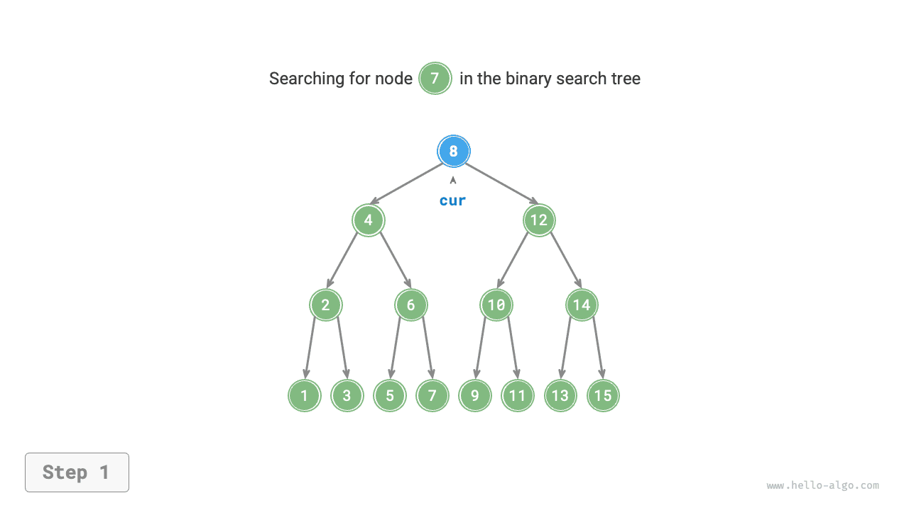
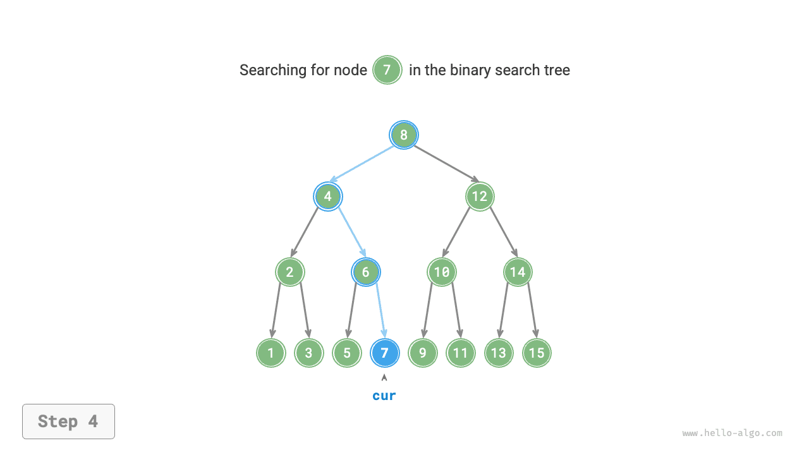
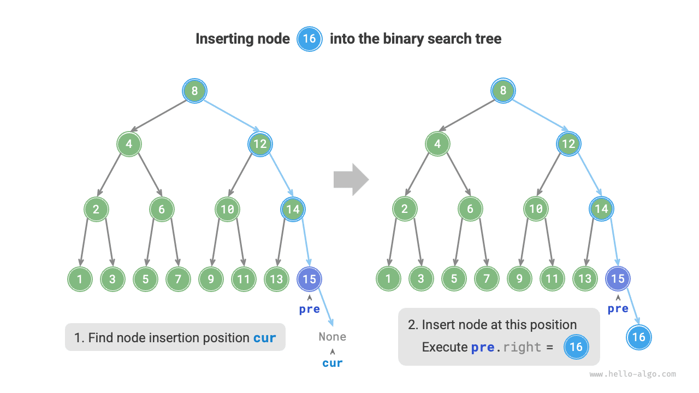
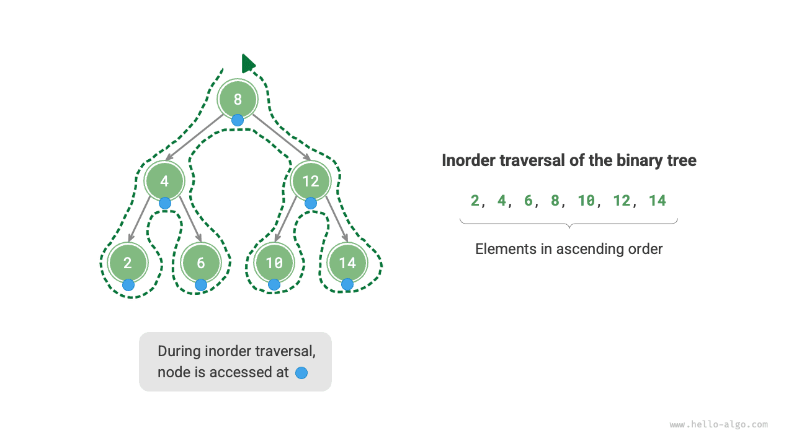

# 이진 탐색 트리

아래 그림의 <u>이진 탐색 트리(binary search tree)</u>는 다음 조건을 만족한다.

1. 루트에 대해 왼쪽 서브트리의 모든 노드 값 $<$ 루트 값 $<$ 오른쪽 서브트리의 모든 노드 값이다.
2. 임의의 노드의 왼쪽과 오른쪽 서브트리도 이진 탐색 트리로, 조건 `1.`을 만족한다.


## 이진 탐색 트리의 연산

이진 탐색 트리를 `BinarySearchTree` 클래스로 묶고, 루트 노드를 가리키는 멤버 변수 `root`를 정의한다.

### 노드 탐색

목표 노드의 값 `num`이 주어지면 이진 탐색 트리의 성질로 찾을 수 있다. 아래 그림과 같이 노드 `cur`를 두고 루트 `root`에서 출발하여 `cur.val`과 `num`의 대소 관계를 반복해서 비교한다.

- `cur.val < num`이면 목표 노드는 `cur`의 오른쪽 서브트리에 있으므로 `cur = cur.right`를 수행한다.
- `cur.val > num`이면 목표 노드는 `cur`의 왼쪽 서브트리에 있으므로 `cur = cur.left`를 수행한다.
- `cur.val = num`이면 목표 노드를 찾았으므로 반복문을 빠져나와 해당 노드를 반환한다.

=== "<1>"
    

=== "<2>"
    

=== "<3>"
    

=== "<4>"
    

이진 탐색 트리의 탐색 원리는 이진 탐색 알고리즘과 같으며, 매번 경우의 절반을 제외한다. 반복 횟수는 최대 트리 높이이므로 트리가 균형을 이루면 $O(\log n)$ 시간이 걸린다. 예시 코드는 다음과 같다.

```src
[file]{binary_search_tree}-[class]{binary_search_tree}-[func]{search}
```

### 노드 삽입

삽입할 원소 `num`이 주어졌을 때 '왼쪽 서브트리 < 루트 < 오른쪽 서브트리'라는 성질을 유지하려면 아래 그림과 같이 삽입한다.

1. **삽입 위치 찾기**: 탐색과 비슷하게 루트에서 출발하여 현재 노드 값과 `num`의 대소 관계에 따라 아래로 탐색한다. 리프를 지나 `None`에 도달하면 반복문을 종료한다.
2. **그 위치에 노드 삽입**: 값이 `num`인 노드를 초기화하여 `None` 자리에 놓는다.



구현 시 다음 두 가지에 주의하자.

- 중복 노드가 있으면 정의에 어긋나므로 이진 탐색 트리는 중복을 허용하지 않는다. 삽입할 노드가 이미 있으면 삽입하지 않고 바로 반환한다.
- 삽입을 위해 노드 `pre`에 직전 반복의 노드를 저장해야 한다. 그러면 `None`에 도달했을 때 그 부모를 얻어 삽입을 완료할 수 있다.

```src
[file]{binary_search_tree}-[class]{binary_search_tree}-[func]{insert}
```

노드 탐색과 마찬가지로 삽입에는 $O(\log n)$ 시간이 걸린다.

### 노드 삭제

먼저 트리에서 목표 노드를 찾은 뒤 삭제한다. 삽입과 마찬가지로 삭제 후에도 '왼쪽 서브트리 < 루트 < 오른쪽 서브트리'라는 성질을 유지해야 한다. 따라서 목표 노드의 자식 수가 0, 1, 2인 세 경우로 나누어 삭제한다.

아래 그림과 같이 삭제할 노드의 차수가 $0$이면 리프 노드이므로 바로 삭제할 수 있다.


아래 그림과 같이 차수가 $1$이면 삭제할 노드를 그 자식으로 바꾸면 된다.


차수가 $2$이면 바로 삭제할 수 없어 다른 노드로 대체해야 한다. '왼쪽 서브트리 $<$ 루트 $<$ 오른쪽 서브트리' 성질을 유지하려면 **오른쪽 서브트리의 최소 노드 또는 왼쪽 서브트리의 최대 노드로 대체할 수 있다**.

오른쪽 서브트리의 최소 노드(중위 순회에서 다음 노드)를 선택하면 삭제 과정은 아래 그림과 같다.

1. 삭제할 노드의 '중위 순회 순서'상 다음 노드를 찾아 `tmp`라고 한다.
2. 삭제할 노드의 값을 `tmp`의 값으로 덮어쓰고, 트리에서 노드 `tmp`를 재귀적으로 삭제한다.

=== "<1>"
    

=== "<2>"
    

=== "<3>"
    

=== "<4>"
    

노드 삭제에도 $O(\log n)$ 시간이 걸린다. 삭제할 노드를 찾는 데 $O(\log n)$, 중위 순회의 후속 노드를 구하는 데 $O(\log n)$ 시간이 든다. 예시 코드는 다음과 같다.

```src
[file]{binary_search_tree}-[class]{binary_search_tree}-[func]{remove}
```

### 중위 순회 결과의 정렬 성질

아래 그림과 같이 이진 트리의 중위 순회는 '왼쪽 $\rightarrow$ 루트 $\rightarrow$ 오른쪽' 순서이며, 이진 탐색 트리는 '왼쪽 자식 $<$ 루트 $<$ 오른쪽 자식'의 대소 관계를 만족한다.

따라서 중위 순회에서는 항상 다음으로 작은 노드를 먼저 방문한다. 여기서 **이진 탐색 트리의 중위 순회 결과는 오름차순이다**라는 중요한 성질을 얻는다.

이 성질을 이용하면 별도 정렬 없이 $O(n)$ 시간만으로 정렬된 데이터를 얻을 수 있어 매우 효율적이다.



## 이진 탐색 트리의 효율

데이터 집합을 배열이나 이진 탐색 트리에 저장한다고 하자. 아래 표를 보면 이진 탐색 트리의 각 연산은 로그 시간 복잡도로 안정적이고 효율적이다. 데이터 추가는 잦고 탐색과 삭제는 드문 상황에서만 배열이 더 효율적이다.

<p align="center"> 표 <id> &nbsp; 배열과 탐색 트리의 효율 비교 </p>

|          | 정렬되지 않은 배열 | 이진 탐색 트리 |
| -------- | -------- | ----------- |
| 원소 탐색 | $O(n)$   | $O(\log n)$ |
| 원소 삽입 | $O(1)$   | $O(\log n)$ |
| 원소 삭제 | $O(n)$   | $O(\log n)$ |

이상적인 경우 이진 탐색 트리는 '균형'을 이루므로 어떤 노드든 $\log n$ 회의 반복 안에 찾을 수 있다.

하지만 삽입과 삭제를 계속하다 보면 아래 그림의 연결 리스트로 퇴화할 수 있다. 이때 각 연산의 시간 복잡도도 $O(n)$으로 저하된다.


## 이진 탐색 트리의 주요 응용

- 시스템의 다단계 인덱스로 사용하여 효율적인 탐색, 삽입, 삭제를 구현한다.
- 일부 탐색 알고리즘의 기반 자료 구조로 사용한다.
- 데이터 스트림을 저장하면서 정렬 상태를 유지한다.
