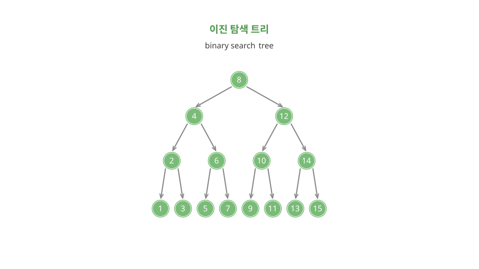
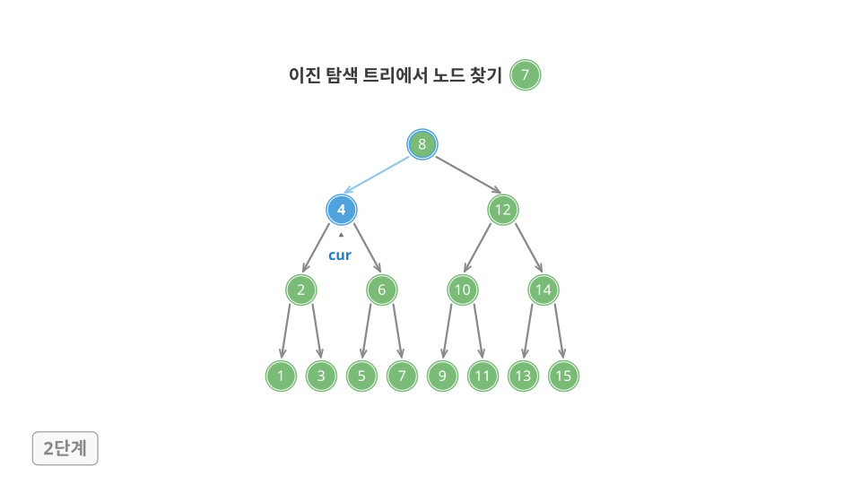
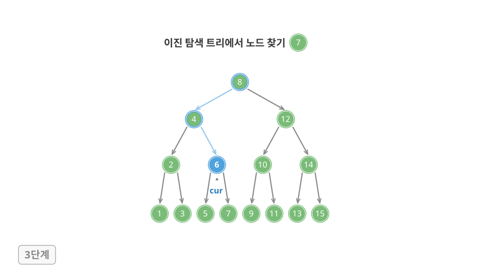
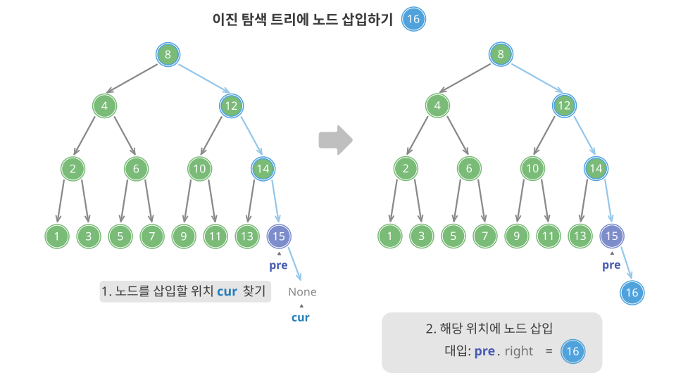
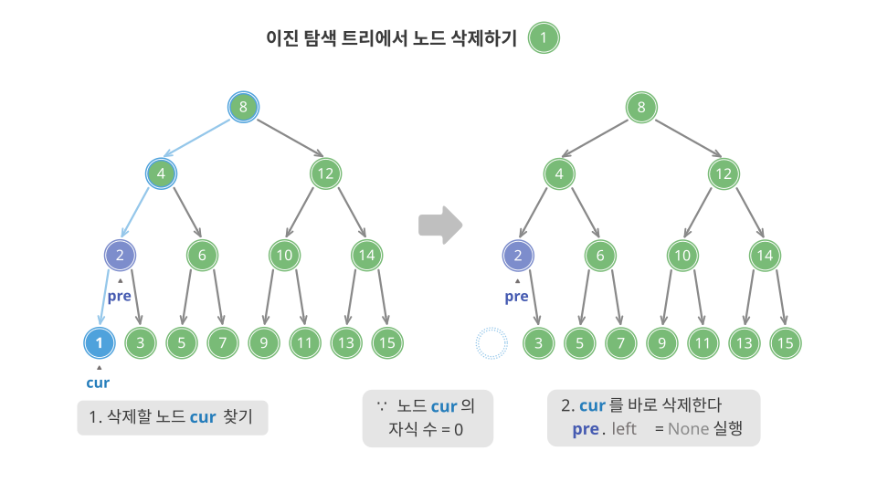
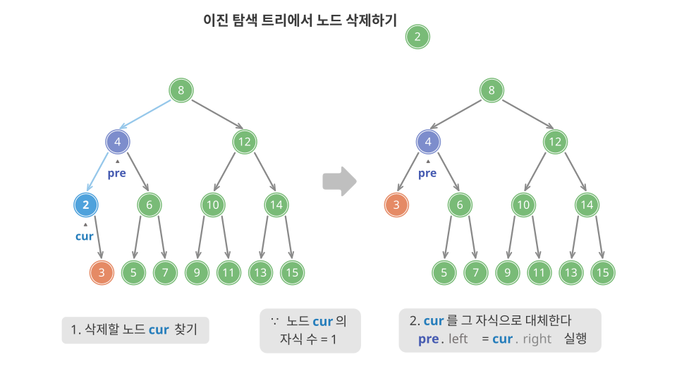
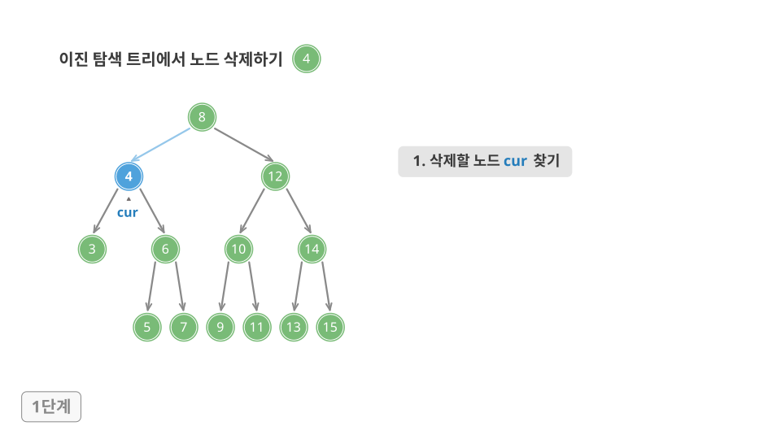
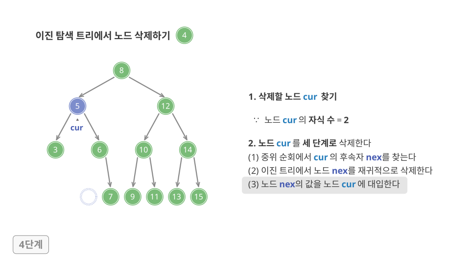

# 이진 탐색 트리

다음 그림과 같이 <u>이진 탐색 트리(binary search tree)</u>는 다음 조건을 만족한다.

1. 루트 노드를 기준으로 왼쪽 서브트리의 모든 노드 값 $<$ 루트 노드 값 $<$ 오른쪽 서브트리의 모든 노드 값이 성립한다.
2. 모든 노드의 왼쪽 및 오른쪽 서브트리도 이진 탐색 트리다. 즉, 조건 `1.`을 똑같이 만족한다.



## 이진 탐색 트리의 연산

이진 탐색 트리를 `BinarySearchTree` 클래스로 구현하고 트리의 루트를 가리키는 멤버 변수 `root`를 선언한다.

### 노드 탐색

목표 노드 값 `num`이 주어지면 이진 탐색 트리의 성질을 이용하여 찾을 수 있다. 다음 그림처럼 현재 노드 `cur`를 선언하고 루트 `root`에서 출발하여 노드 값 `cur.val`과 `num`의 크기를 반복해서 비교한다.

- `cur.val < num`이면 목표 노드는 `cur`의 오른쪽 서브트리에 있으므로 `cur = cur.right`를 수행한다.
- `cur.val > num`이면 목표 노드는 `cur`의 왼쪽 서브트리에 있으므로 `cur = cur.left`를 수행한다.
- `cur.val = num`이면 목표 노드를 찾았으므로 반복문을 종료하고 해당 노드를 반환한다.

=== "<1>"
    

=== "<2>"
    

=== "<3>"
    

=== "<4>"
    

이진 탐색 트리의 탐색은 이진 탐색 알고리즘과 원리가 같다. 매번 가능한 경우의 절반을 제외한다. 반복 횟수는 최대 트리의 높이이며 트리가 균형을 이루면 $O(\log n)$ 시간이 걸린다. 예시 코드는 다음과 같다.

```src
[file]{binary_search_tree}-[class]{binary_search_tree}-[func]{search}
```

### 노드 삽입

삽입할 원소 `num`이 주어지면 이진 탐색 트리의 ‘왼쪽 서브트리 < 루트 노드 < 오른쪽 서브트리’ 성질을 유지하도록 다음 그림의 순서로 삽입한다.

1. **삽입 위치 찾기**. 탐색할 때처럼 루트에서 출발하여 현재 노드 값과 `num`의 크기를 비교하며 아래로 내려간다. 리프를 지나 `None`에 도달하면 반복문을 종료한다.
2. **해당 위치에 노드 삽입하기**. 값이 `num`인 노드를 초기화하고 `None` 자리에 놓는다.



코드를 구현할 때는 다음 두 가지에 유의한다.

- 이진 탐색 트리의 정의상 중복 노드는 허용되지 않는다. 따라서 삽입하려는 노드가 이미 트리에 있으면 삽입하지 않고 바로 반환한다.
- 노드를 삽입하려면 `pre`에 직전 반복의 노드를 보관해야 한다. 그러면 `None`에 도달했을 때 부모 노드를 알 수 있어 삽입을 마칠 수 있다.

```src
[file]{binary_search_tree}-[class]{binary_search_tree}-[func]{insert}
```

탐색과 마찬가지로 노드 삽입에는 $O(\log n)$ 시간이 걸린다.

### 노드 삭제

먼저 트리에서 목표 노드를 찾은 뒤 삭제한다. 삽입할 때처럼 삭제 후에도 ‘왼쪽 서브트리 < 루트 노드 < 오른쪽 서브트리’ 성질이 유지되어야 한다. 따라서 대상의 자식 수가 0, 1, 2인 세 경우로 나누어 알맞은 삭제 연산을 수행한다.

다음 그림처럼 삭제할 노드의 차수가 $0$이면 리프 노드이므로 바로 삭제할 수 있다.



다음 그림처럼 삭제할 노드의 차수가 $1$이면 그 자식으로 대체하면 된다.



삭제할 노드의 차수가 $2$이면 바로 삭제할 수 없고 다른 노드로 대체해야 한다. ‘왼쪽 서브트리 $<$ 루트 노드 $<$ 오른쪽 서브트리’ 성질을 유지해야 하므로 **오른쪽 서브트리의 최솟값 노드나 왼쪽 서브트리의 최댓값 노드를 사용할 수 있다**.

오른쪽 서브트리의 최솟값 노드(중위 순회에서 다음에 오는 노드)를 선택하면 삭제 과정은 다음 그림과 같다.

1. ‘중위 순회 결과’에서 삭제할 노드의 바로 다음 노드를 찾아 `tmp`라 한다.
2. `tmp`의 값으로 삭제할 노드의 값을 덮어쓰고 트리에서 노드 `tmp`를 재귀적으로 삭제한다.

=== "<1>"
    

=== "<2>"
    

=== "<3>"
    

=== "<4>"
    

노드 삭제에도 $O(\log n)$ 시간이 걸린다. 삭제할 노드를 찾는 데 $O(\log n)$, 중위 후속자 노드를 구하는 데 $O(\log n)$ 시간이 걸린다. 예시 코드는 다음과 같다.

```src
[file]{binary_search_tree}-[class]{binary_search_tree}-[func]{remove}
```

### 중위 순회의 정렬 순서

다음 그림처럼 이진 트리의 중위 순회는 ‘왼쪽 $\rightarrow$ 루트 $\rightarrow$ 오른쪽’ 순서로 진행되며 이진 탐색 트리에서는 ‘왼쪽 자식 $<$ 루트 노드 $<$ 오른쪽 자식’의 대소 관계가 성립한다.

따라서 이진 탐색 트리를 중위 순회하면 아직 방문하지 않은 노드 중 가장 작은 노드를 항상 먼저 방문한다. 여기서 중요한 성질을 얻는다. **이진 탐색 트리의 중위 순회 결과는 오름차순이다**.

이 성질을 이용하면 별도로 정렬하지 않고도 이진 탐색 트리에서 $O(n)$ 시간 만에 정렬된 데이터를 얻을 수 있어 매우 효율적이다.


## 이진 탐색 트리의 효율

주어진 데이터를 배열 또는 이진 탐색 트리에 저장한다고 하자. 다음 표에서 이진 탐색 트리의 각 연산은 시간 복잡도가 로그 차수로 안정적이고 효율적이다. 추가가 잦고 탐색과 삭제가 드문 경우에만 배열의 효율이 이진 탐색 트리보다 높다.

<p align="center"> 표 <id> &nbsp; 배열과 탐색 트리의 효율 비교 </p>

|          | 정렬되지 않은 배열 | 이진 탐색 트리  |
| -------- | -------- | ----------- |
| 원소 탐색 | $O(n)$   | $O(\log n)$ |
| 원소 삽입 | $O(1)$   | $O(\log n)$ |
| 원소 삭제 | $O(n)$   | $O(\log n)$ |

이상적인 경우 이진 탐색 트리는 ‘균형’을 이루므로 $\log n$번의 반복 안에 어느 노드든 찾을 수 있다.

하지만 이진 탐색 트리에서 노드를 계속 삽입하고 삭제하면 다음 그림처럼 트리가 연결 리스트로 퇴화할 수 있다. 이때 각 연산의 시간 복잡도도 $O(n)$으로 나빠진다.


## 이진 탐색 트리의 주요 활용 사례

- 시스템의 다단계 인덱스로 활용하여 효율적인 탐색, 삽입, 삭제를 구현한다.
- 일부 탐색 알고리즘의 기반 자료 구조로 사용한다.
- 데이터 스트림을 정렬된 상태로 저장하는 데 사용한다.
