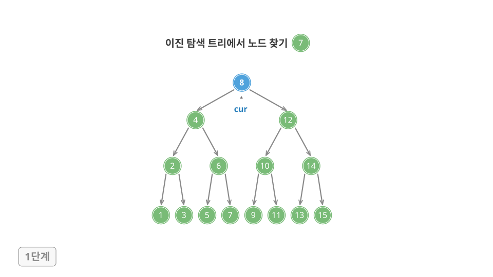
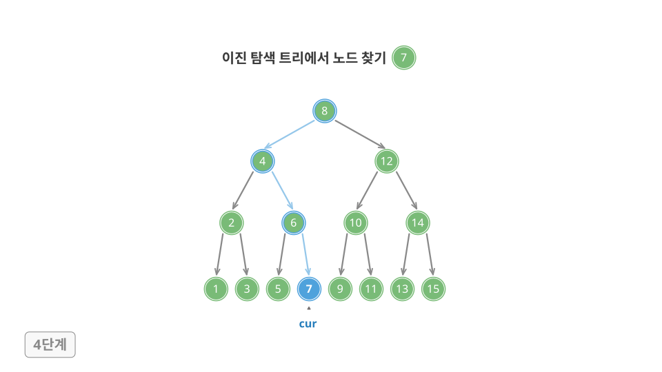
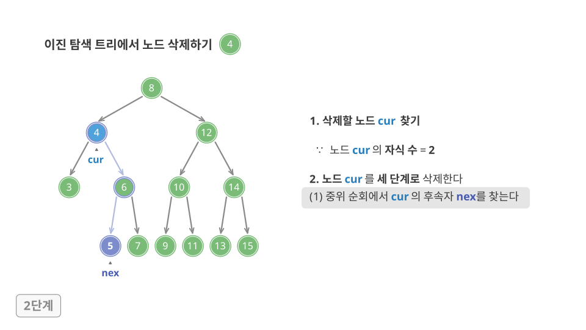
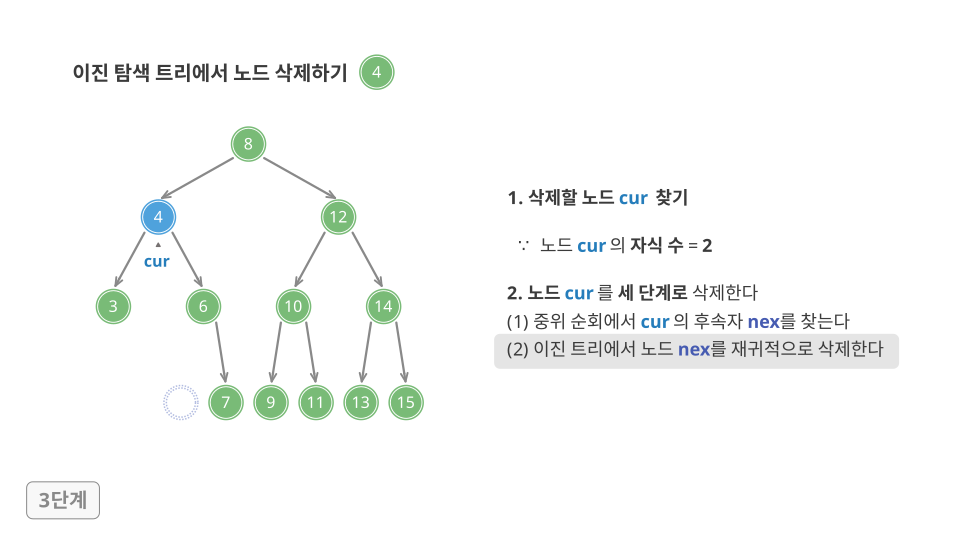
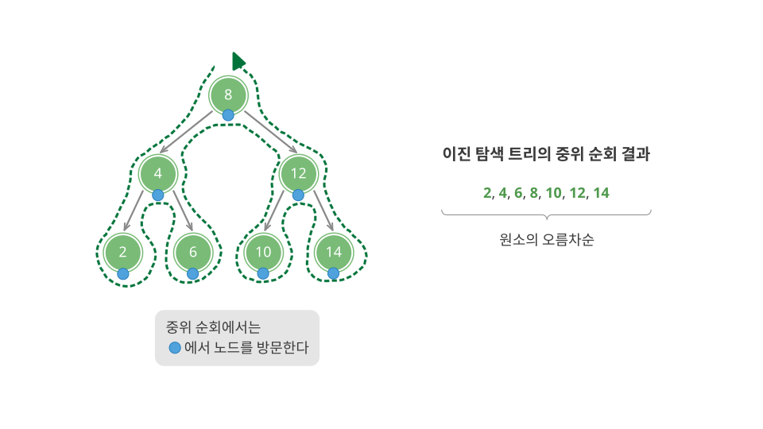
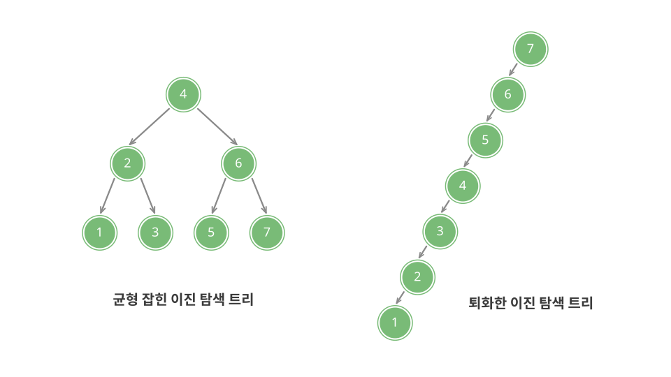

# 7.4 &nbsp; 이진 탐색 트리

다음 그림(7-16)과 같이 <u>이진 탐색 트리(binary search tree)</u>는 다음 조건을 만족한다.

1. 루트 노드를 기준으로 왼쪽 서브트리의 모든 노드 값 $<$ 루트 노드 값 $<$ 오른쪽 서브트리의 모든 노드 값이 성립한다.
2. 모든 노드의 왼쪽 및 오른쪽 서브트리도 이진 탐색 트리다. 즉, 조건 `1.`을 똑같이 만족한다.

{ class="animation-figure" }

<p align="center"> 그림 7-16 &nbsp; 이진 탐색 트리 </p>

## 7.4.1 &nbsp; 이진 탐색 트리의 연산

이진 탐색 트리를 `BinarySearchTree` 클래스로 구현하고 트리의 루트를 가리키는 멤버 변수 `root`를 선언한다.

### 1. &nbsp; 노드 탐색

목표 노드 값 `num`이 주어지면 이진 탐색 트리의 성질을 이용하여 찾을 수 있다. 다음 그림(7-17)처럼 현재 노드 `cur`를 선언하고 루트 `root`에서 출발하여 노드 값 `cur.val`과 `num`의 크기를 반복해서 비교한다.

- `cur.val < num`이면 목표 노드는 `cur`의 오른쪽 서브트리에 있으므로 `cur = cur.right`를 수행한다.
- `cur.val > num`이면 목표 노드는 `cur`의 왼쪽 서브트리에 있으므로 `cur = cur.left`를 수행한다.
- `cur.val = num`이면 목표 노드를 찾았으므로 반복문을 종료하고 해당 노드를 반환한다.

=== "<1>"
    { class="animation-figure" }

=== "<2>"
    { class="animation-figure" }

=== "<3>"
    { class="animation-figure" }

=== "<4>"
    { class="animation-figure" }

<p align="center"> 그림 7-17 &nbsp; 이진 탐색 트리에서 노드를 찾는 예 </p>

이진 탐색 트리의 탐색은 이진 탐색 알고리즘과 원리가 같다. 매번 가능한 경우의 절반을 제외한다. 반복 횟수는 최대 트리의 높이이며 트리가 균형을 이루면 $O(\log n)$ 시간이 걸린다. 예시 코드는 다음과 같다.

=== "Python"

    ```python title="binary_search_tree.py"
    def search(self, num: int) -> TreeNode | None:
        """노드 탐색"""
        cur = self._root
        # 반복해서 찾다가 리프 노드를 지나면 종료한다
        while cur is not None:
            # 찾는 노드는 cur의 오른쪽 서브트리에 있다
            if cur.val < num:
                cur = cur.right
            # 찾는 노드는 cur의 왼쪽 서브트리에 있다
            elif cur.val > num:
                cur = cur.left
            # 찾는 노드를 발견했으므로 반복문을 종료한다
            else:
                break
        return cur
    ```

=== "C++"

    ```cpp title="binary_search_tree.cpp"
    /* 노드 탐색 */
    TreeNode *search(int num) {
        TreeNode *cur = root;
        // 반복해서 찾다가 리프 노드를 지나면 종료한다
        while (cur != nullptr) {
            // 찾는 노드는 cur의 오른쪽 서브트리에 있다
            if (cur->val < num)
                cur = cur->right;
            // 찾는 노드는 cur의 왼쪽 서브트리에 있다
            else if (cur->val > num)
                cur = cur->left;
            // 찾는 노드를 발견했으므로 반복문을 종료한다
            else
                break;
        }
        // 찾은 노드를 반환한다
        return cur;
    }
    ```

=== "Java"

    ```java title="binary_search_tree.java"
    /* 노드 탐색 */
    TreeNode search(int num) {
        TreeNode cur = root;
        // 반복해서 찾다가 리프 노드를 지나면 종료한다
        while (cur != null) {
            // 찾는 노드는 cur의 오른쪽 서브트리에 있다
            if (cur.val < num)
                cur = cur.right;
            // 찾는 노드는 cur의 왼쪽 서브트리에 있다
            else if (cur.val > num)
                cur = cur.left;
            // 찾는 노드를 발견했으므로 반복문을 종료한다
            else
                break;
        }
        // 찾은 노드를 반환한다
        return cur;
    }
    ```

=== "C#"

    ```csharp title="binary_search_tree.cs"
    /* 노드 탐색 */
    TreeNode? Search(int num) {
        TreeNode? cur = root;
        // 반복해서 찾다가 리프 노드를 지나면 종료한다
        while (cur != null) {
            // 찾는 노드는 cur의 오른쪽 서브트리에 있다
            if (cur.val < num) cur =
                cur.right;
            // 찾는 노드는 cur의 왼쪽 서브트리에 있다
            else if (cur.val > num)
                cur = cur.left;
            // 찾는 노드를 발견했으므로 반복문을 종료한다
            else
                break;
        }
        // 찾은 노드를 반환한다
        return cur;
    }
    ```

=== "Go"

    ```go title="binary_search_tree.go"
    /* 노드 탐색 */
    func (bst *binarySearchTree) search(num int) *TreeNode {
        node := bst.root
        // 반복해서 찾다가 리프 노드를 지나면 종료한다
        for node != nil {
            if node.Val.(int) < num {
                // 찾는 노드는 cur의 오른쪽 서브트리에 있다
                node = node.Right
            } else if node.Val.(int) > num {
                // 찾는 노드는 cur의 왼쪽 서브트리에 있다
                node = node.Left
            } else {
                // 찾는 노드를 발견했으므로 반복문을 종료한다
                break
            }
        }
        // 찾은 노드를 반환한다
        return node
    }
    ```

=== "Swift"

    ```swift title="binary_search_tree.swift"
    /* 노드 탐색 */
    func search(num: Int) -> TreeNode? {
        var cur = root
        // 반복해서 찾다가 리프 노드를 지나면 종료한다
        while cur != nil {
            // 찾는 노드는 cur의 오른쪽 서브트리에 있다
            if cur!.val < num {
                cur = cur?.right
            }
            // 찾는 노드는 cur의 왼쪽 서브트리에 있다
            else if cur!.val > num {
                cur = cur?.left
            }
            // 찾는 노드를 발견했으므로 반복문을 종료한다
            else {
                break
            }
        }
        // 찾은 노드를 반환한다
        return cur
    }
    ```

=== "JS"

    ```javascript title="binary_search_tree.js"
    /* 노드 탐색 */
    search(num) {
        let cur = this.root;
        // 반복해서 찾다가 리프 노드를 지나면 종료한다
        while (cur !== null) {
            // 찾는 노드는 cur의 오른쪽 서브트리에 있다
            if (cur.val < num) cur = cur.right;
            // 찾는 노드는 cur의 왼쪽 서브트리에 있다
            else if (cur.val > num) cur = cur.left;
            // 찾는 노드를 발견했으므로 반복문을 종료한다
            else break;
        }
        // 찾은 노드를 반환한다
        return cur;
    }
    ```

=== "TS"

    ```typescript title="binary_search_tree.ts"
    /* 노드 탐색 */
    search(num: number): TreeNode | null {
        let cur = this.root;
        // 반복해서 찾다가 리프 노드를 지나면 종료한다
        while (cur !== null) {
            // 찾는 노드는 cur의 오른쪽 서브트리에 있다
            if (cur.val < num) cur = cur.right;
            // 찾는 노드는 cur의 왼쪽 서브트리에 있다
            else if (cur.val > num) cur = cur.left;
            // 찾는 노드를 발견했으므로 반복문을 종료한다
            else break;
        }
        // 찾은 노드를 반환한다
        return cur;
    }
    ```

=== "Dart"

    ```dart title="binary_search_tree.dart"
    /* 노드 탐색 */
    TreeNode? search(int _num) {
      TreeNode? cur = _root;
      // 반복해서 찾다가 리프 노드를 지나면 종료한다
      while (cur != null) {
        // 찾는 노드는 cur의 오른쪽 서브트리에 있다
        if (cur.val < _num)
          cur = cur.right;
        // 찾는 노드는 cur의 왼쪽 서브트리에 있다
        else if (cur.val > _num)
          cur = cur.left;
        // 찾는 노드를 발견했으므로 반복문을 종료한다
        else
          break;
      }
      // 찾은 노드를 반환한다
      return cur;
    }
    ```

=== "Rust"

    ```rust title="binary_search_tree.rs"
    /* 노드 탐색 */
    pub fn search(&self, num: i32) -> OptionTreeNodeRc {
        let mut cur = self.root.clone();
        // 반복해서 찾다가 리프 노드를 지나면 종료한다
        while let Some(node) = cur.clone() {
            match num.cmp(&node.borrow().val) {
                // 찾는 노드는 cur의 오른쪽 서브트리에 있다
                Ordering::Greater => cur = node.borrow().right.clone(),
                // 찾는 노드는 cur의 왼쪽 서브트리에 있다
                Ordering::Less => cur = node.borrow().left.clone(),
                // 찾는 노드를 발견했으므로 반복문을 종료한다
                Ordering::Equal => break,
            }
        }

        // 찾은 노드를 반환한다
        cur
    }
    ```

=== "C"

    ```c title="binary_search_tree.c"
    /* 노드 탐색 */
    TreeNode *search(BinarySearchTree *bst, int num) {
        TreeNode *cur = bst->root;
        // 반복해서 찾다가 리프 노드를 지나면 종료한다
        while (cur != NULL) {
            if (cur->val < num) {
                // 찾는 노드는 cur의 오른쪽 서브트리에 있다
                cur = cur->right;
            } else if (cur->val > num) {
                // 찾는 노드는 cur의 왼쪽 서브트리에 있다
                cur = cur->left;
            } else {
                // 찾는 노드를 발견했으므로 반복문을 종료한다
                break;
            }
        }
        // 찾은 노드를 반환한다
        return cur;
    }
    ```

=== "Kotlin"

    ```kotlin title="binary_search_tree.kt"
    /* 노드 탐색 */
    fun search(num: Int): TreeNode? {
        var cur = root
        // 반복해서 찾다가 리프 노드를 지나면 종료한다
        while (cur != null) {
            // 찾는 노드는 cur의 오른쪽 서브트리에 있다
            cur = if (cur._val < num)
                cur.right
            // 찾는 노드는 cur의 왼쪽 서브트리에 있다
            else if (cur._val > num)
                cur.left
            // 찾는 노드를 발견했으므로 반복문을 종료한다
            else
                break
        }
        // 찾은 노드를 반환한다
        return cur
    }
    ```

=== "Ruby"

    ```ruby title="binary_search_tree.rb"
    ### 노드 탐색 ###
    def search(num)
      cur = @root

      # 반복해서 찾다가 리프 노드를 지나면 종료한다
      while !cur.nil?
        # 찾는 노드는 cur의 오른쪽 서브트리에 있다
        if cur.val < num
          cur = cur.right
        # 찾는 노드는 cur의 왼쪽 서브트리에 있다
        elsif cur.val > num
          cur = cur.left
        # 찾는 노드를 발견했으므로 반복문을 종료한다
        else
          break
        end
      end

      cur
    end
    ```

??? pythontutor "실행 과정 시각화"

    <div style="height: 549px; width: 100%;"><iframe class="pythontutor-iframe" title="실행 과정 시각화" src="https://pythontutor.com/iframe-embed.html#code=class%20TreeNode%3A%0A%20%20%20%20%22%22%22%EC%9D%B4%EC%A7%84%20%ED%8A%B8%EB%A6%AC%20%EB%85%B8%EB%93%9C%20%ED%81%B4%EB%9E%98%EC%8A%A4%22%22%22%0A%20%20%20%20def%20__init__%28self,%20val%29%3A%0A%20%20%20%20%20%20%20%20self.val%20%3D%20val%0A%20%20%20%20%20%20%20%20self.left%20%3D%20None%0A%20%20%20%20%20%20%20%20self.right%20%3D%20None%0A%0A%0Aclass%20BinarySearchTree%3A%0A%20%20%20%20%22%22%22%EC%9D%B4%EC%A7%84%20%ED%83%90%EC%83%89%20%ED%8A%B8%EB%A6%AC%22%22%22%0A%0A%20%20%20%20def%20__init__%28self%29%3A%0A%20%20%20%20%20%20%20%20%22%22%22%EC%83%9D%EC%84%B1%EC%9E%90%22%22%22%0A%20%20%20%20%20%20%20%20%23%20%EB%B9%88%20%ED%8A%B8%EB%A6%AC%20%EC%B4%88%EA%B8%B0%ED%99%94%0A%20%20%20%20%20%20%20%20self._root%20%3D%20None%0A%0A%20%20%20%20def%20search%28self,%20num%3A%20int%29%20-%3E%20TreeNode%20%7C%20None%3A%0A%20%20%20%20%20%20%20%20%22%22%22%EB%85%B8%EB%93%9C%20%ED%83%90%EC%83%89%22%22%22%0A%20%20%20%20%20%20%20%20cur%20%3D%20self._root%0A%20%20%20%20%20%20%20%20%23%20%EB%B0%98%EB%B3%B5%ED%95%B4%EC%84%9C%20%EC%B0%BE%EB%8B%A4%EA%B0%80%20%EB%A6%AC%ED%94%84%20%EB%85%B8%EB%93%9C%EB%A5%BC%20%EC%A7%80%EB%82%98%EB%A9%B4%20%EC%A2%85%EB%A3%8C%ED%95%9C%EB%8B%A4%0A%20%20%20%20%20%20%20%20while%20cur%20is%20not%20None%3A%0A%20%20%20%20%20%20%20%20%20%20%20%20%23%20%EC%B0%BE%EB%8A%94%20%EB%85%B8%EB%93%9C%EB%8A%94%20cur%EC%9D%98%20%EC%98%A4%EB%A5%B8%EC%AA%BD%20%EC%84%9C%EB%B8%8C%ED%8A%B8%EB%A6%AC%EC%97%90%20%EC%9E%88%EB%8B%A4%0A%20%20%20%20%20%20%20%20%20%20%20%20if%20cur.val%20%3C%20num%3A%0A%20%20%20%20%20%20%20%20%20%20%20%20%20%20%20%20cur%20%3D%20cur.right%0A%20%20%20%20%20%20%20%20%20%20%20%20%23%20%EC%B0%BE%EB%8A%94%20%EB%85%B8%EB%93%9C%EB%8A%94%20cur%EC%9D%98%20%EC%99%BC%EC%AA%BD%20%EC%84%9C%EB%B8%8C%ED%8A%B8%EB%A6%AC%EC%97%90%20%EC%9E%88%EB%8B%A4%0A%20%20%20%20%20%20%20%20%20%20%20%20elif%20cur.val%20%3E%20num%3A%0A%20%20%20%20%20%20%20%20%20%20%20%20%20%20%20%20cur%20%3D%20cur.left%0A%20%20%20%20%20%20%20%20%20%20%20%20%23%20%EC%B0%BE%EB%8A%94%20%EB%85%B8%EB%93%9C%EB%A5%BC%20%EB%B0%9C%EA%B2%AC%ED%96%88%EC%9C%BC%EB%AF%80%EB%A1%9C%20%EB%B0%98%EB%B3%B5%EB%AC%B8%EC%9D%84%20%EC%A2%85%EB%A3%8C%ED%95%9C%EB%8B%A4%0A%20%20%20%20%20%20%20%20%20%20%20%20else%3A%0A%20%20%20%20%20%20%20%20%20%20%20%20%20%20%20%20break%0A%20%20%20%20%20%20%20%20return%20cur%0A%0A%20%20%20%20def%20insert%28self,%20num%3A%20int%29%3A%0A%20%20%20%20%20%20%20%20%22%22%22%EB%85%B8%EB%93%9C%20%EC%82%BD%EC%9E%85%22%22%22%0A%20%20%20%20%20%20%20%20%23%20%ED%8A%B8%EB%A6%AC%EA%B0%80%20%EB%B9%84%EC%96%B4%20%EC%9E%88%EC%9C%BC%EB%A9%B4%20%EB%A3%A8%ED%8A%B8%20%EB%85%B8%EB%93%9C%EB%A5%BC%20%EC%B4%88%EA%B8%B0%ED%99%94%ED%95%9C%EB%8B%A4%0A%20%20%20%20%20%20%20%20if%20self._root%20is%20None%3A%0A%20%20%20%20%20%20%20%20%20%20%20%20self._root%20%3D%20TreeNode%28num%29%0A%20%20%20%20%20%20%20%20%20%20%20%20return%0A%20%20%20%20%20%20%20%20%23%20%EB%B0%98%EB%B3%B5%ED%95%B4%EC%84%9C%20%EC%B0%BE%EB%8B%A4%EA%B0%80%20%EB%A6%AC%ED%94%84%20%EB%85%B8%EB%93%9C%EB%A5%BC%20%EC%A7%80%EB%82%98%EB%A9%B4%20%EC%A2%85%EB%A3%8C%ED%95%9C%EB%8B%A4%0A%20%20%20%20%20%20%20%20cur,%20pre%20%3D%20self._root,%20None%0A%20%20%20%20%20%20%20%20while%20cur%20is%20not%20None%3A%0A%20%20%20%20%20%20%20%20%20%20%20%20%23%20%EA%B0%99%EC%9D%80%20%EA%B0%92%EC%9D%98%20%EB%85%B8%EB%93%9C%EB%A5%BC%20%EC%B0%BE%EC%9C%BC%EB%A9%B4%20%EB%B0%94%EB%A1%9C%20%EB%B0%98%ED%99%98%ED%95%9C%EB%8B%A4%0A%20%20%20%20%20%20%20%20%20%20%20%20if%20cur.val%20%3D%3D%20num%3A%0A%20%20%20%20%20%20%20%20%20%20%20%20%20%20%20%20return%0A%20%20%20%20%20%20%20%20%20%20%20%20pre%20%3D%20cur%0A%20%20%20%20%20%20%20%20%20%20%20%20%23%20%EC%82%BD%EC%9E%85%20%EC%9C%84%EC%B9%98%EB%8A%94%20cur%EC%9D%98%20%EC%98%A4%EB%A5%B8%EC%AA%BD%20%EC%84%9C%EB%B8%8C%ED%8A%B8%EB%A6%AC%EC%97%90%20%EC%9E%88%EB%8B%A4%0A%20%20%20%20%20%20%20%20%20%20%20%20if%20cur.val%20%3C%20num%3A%0A%20%20%20%20%20%20%20%20%20%20%20%20%20%20%20%20cur%20%3D%20cur.right%0A%20%20%20%20%20%20%20%20%20%20%20%20%23%20%EC%82%BD%EC%9E%85%20%EC%9C%84%EC%B9%98%EB%8A%94%20cur%EC%9D%98%20%EC%99%BC%EC%AA%BD%20%EC%84%9C%EB%B8%8C%ED%8A%B8%EB%A6%AC%EC%97%90%20%EC%9E%88%EB%8B%A4%0A%20%20%20%20%20%20%20%20%20%20%20%20else%3A%0A%20%20%20%20%20%20%20%20%20%20%20%20%20%20%20%20cur%20%3D%20cur.left%0A%20%20%20%20%20%20%20%20%23%20%EB%85%B8%EB%93%9C%20%EC%82%BD%EC%9E%85%0A%20%20%20%20%20%20%20%20node%20%3D%20TreeNode%28num%29%0A%20%20%20%20%20%20%20%20if%20pre.val%20%3C%20num%3A%0A%20%20%20%20%20%20%20%20%20%20%20%20pre.right%20%3D%20node%0A%20%20%20%20%20%20%20%20else%3A%0A%20%20%20%20%20%20%20%20%20%20%20%20pre.left%20%3D%20node%0A%0A%0A%22%22%22Driver%20Code%22%22%22%0Aif%20__name__%20%3D%3D%20%22__main__%22%3A%0A%20%20%20%20%23%20%EC%9D%B4%EC%A7%84%20%ED%83%90%EC%83%89%20%ED%8A%B8%EB%A6%AC%20%EC%B4%88%EA%B8%B0%ED%99%94%0A%20%20%20%20bst%20%3D%20BinarySearchTree%28%29%0A%20%20%20%20nums%20%3D%20%5B4,%202,%206,%201,%203,%205,%207%5D%0A%20%20%20%20for%20num%20in%20nums%3A%0A%20%20%20%20%20%20%20%20bst.insert%28num%29%0A%0A%20%20%20%20%23%20%EB%85%B8%EB%93%9C%20%ED%83%90%EC%83%89%0A%20%20%20%20node%20%3D%20bst.search%287%29%0A%20%20%20%20print%28%22%5Cn%EC%B0%BE%EC%9D%80%20%EB%85%B8%EB%93%9C%20%EA%B0%9D%EC%B2%B4%3A%20%7B%7D,%20%EB%85%B8%EB%93%9C%20%EA%B0%92%20%3D%20%7B%7D%22.format%28node,%20node.val%29%29&codeDivHeight=472&codeDivWidth=350&cumulative=false&curInstr=162&heapPrimitives=nevernest&origin=opt-frontend.js&py=311&rawInputLstJSON=%5B%5D&textReferences=false"> </iframe></div>
    <div style="margin-top: 5px;"><a href="https://pythontutor.com/iframe-embed.html#code=class%20TreeNode%3A%0A%20%20%20%20%22%22%22%EC%9D%B4%EC%A7%84%20%ED%8A%B8%EB%A6%AC%20%EB%85%B8%EB%93%9C%20%ED%81%B4%EB%9E%98%EC%8A%A4%22%22%22%0A%20%20%20%20def%20__init__%28self,%20val%29%3A%0A%20%20%20%20%20%20%20%20self.val%20%3D%20val%0A%20%20%20%20%20%20%20%20self.left%20%3D%20None%0A%20%20%20%20%20%20%20%20self.right%20%3D%20None%0A%0A%0Aclass%20BinarySearchTree%3A%0A%20%20%20%20%22%22%22%EC%9D%B4%EC%A7%84%20%ED%83%90%EC%83%89%20%ED%8A%B8%EB%A6%AC%22%22%22%0A%0A%20%20%20%20def%20__init__%28self%29%3A%0A%20%20%20%20%20%20%20%20%22%22%22%EC%83%9D%EC%84%B1%EC%9E%90%22%22%22%0A%20%20%20%20%20%20%20%20%23%20%EB%B9%88%20%ED%8A%B8%EB%A6%AC%20%EC%B4%88%EA%B8%B0%ED%99%94%0A%20%20%20%20%20%20%20%20self._root%20%3D%20None%0A%0A%20%20%20%20def%20search%28self,%20num%3A%20int%29%20-%3E%20TreeNode%20%7C%20None%3A%0A%20%20%20%20%20%20%20%20%22%22%22%EB%85%B8%EB%93%9C%20%ED%83%90%EC%83%89%22%22%22%0A%20%20%20%20%20%20%20%20cur%20%3D%20self._root%0A%20%20%20%20%20%20%20%20%23%20%EB%B0%98%EB%B3%B5%ED%95%B4%EC%84%9C%20%EC%B0%BE%EB%8B%A4%EA%B0%80%20%EB%A6%AC%ED%94%84%20%EB%85%B8%EB%93%9C%EB%A5%BC%20%EC%A7%80%EB%82%98%EB%A9%B4%20%EC%A2%85%EB%A3%8C%ED%95%9C%EB%8B%A4%0A%20%20%20%20%20%20%20%20while%20cur%20is%20not%20None%3A%0A%20%20%20%20%20%20%20%20%20%20%20%20%23%20%EC%B0%BE%EB%8A%94%20%EB%85%B8%EB%93%9C%EB%8A%94%20cur%EC%9D%98%20%EC%98%A4%EB%A5%B8%EC%AA%BD%20%EC%84%9C%EB%B8%8C%ED%8A%B8%EB%A6%AC%EC%97%90%20%EC%9E%88%EB%8B%A4%0A%20%20%20%20%20%20%20%20%20%20%20%20if%20cur.val%20%3C%20num%3A%0A%20%20%20%20%20%20%20%20%20%20%20%20%20%20%20%20cur%20%3D%20cur.right%0A%20%20%20%20%20%20%20%20%20%20%20%20%23%20%EC%B0%BE%EB%8A%94%20%EB%85%B8%EB%93%9C%EB%8A%94%20cur%EC%9D%98%20%EC%99%BC%EC%AA%BD%20%EC%84%9C%EB%B8%8C%ED%8A%B8%EB%A6%AC%EC%97%90%20%EC%9E%88%EB%8B%A4%0A%20%20%20%20%20%20%20%20%20%20%20%20elif%20cur.val%20%3E%20num%3A%0A%20%20%20%20%20%20%20%20%20%20%20%20%20%20%20%20cur%20%3D%20cur.left%0A%20%20%20%20%20%20%20%20%20%20%20%20%23%20%EC%B0%BE%EB%8A%94%20%EB%85%B8%EB%93%9C%EB%A5%BC%20%EB%B0%9C%EA%B2%AC%ED%96%88%EC%9C%BC%EB%AF%80%EB%A1%9C%20%EB%B0%98%EB%B3%B5%EB%AC%B8%EC%9D%84%20%EC%A2%85%EB%A3%8C%ED%95%9C%EB%8B%A4%0A%20%20%20%20%20%20%20%20%20%20%20%20else%3A%0A%20%20%20%20%20%20%20%20%20%20%20%20%20%20%20%20break%0A%20%20%20%20%20%20%20%20return%20cur%0A%0A%20%20%20%20def%20insert%28self,%20num%3A%20int%29%3A%0A%20%20%20%20%20%20%20%20%22%22%22%EB%85%B8%EB%93%9C%20%EC%82%BD%EC%9E%85%22%22%22%0A%20%20%20%20%20%20%20%20%23%20%ED%8A%B8%EB%A6%AC%EA%B0%80%20%EB%B9%84%EC%96%B4%20%EC%9E%88%EC%9C%BC%EB%A9%B4%20%EB%A3%A8%ED%8A%B8%20%EB%85%B8%EB%93%9C%EB%A5%BC%20%EC%B4%88%EA%B8%B0%ED%99%94%ED%95%9C%EB%8B%A4%0A%20%20%20%20%20%20%20%20if%20self._root%20is%20None%3A%0A%20%20%20%20%20%20%20%20%20%20%20%20self._root%20%3D%20TreeNode%28num%29%0A%20%20%20%20%20%20%20%20%20%20%20%20return%0A%20%20%20%20%20%20%20%20%23%20%EB%B0%98%EB%B3%B5%ED%95%B4%EC%84%9C%20%EC%B0%BE%EB%8B%A4%EA%B0%80%20%EB%A6%AC%ED%94%84%20%EB%85%B8%EB%93%9C%EB%A5%BC%20%EC%A7%80%EB%82%98%EB%A9%B4%20%EC%A2%85%EB%A3%8C%ED%95%9C%EB%8B%A4%0A%20%20%20%20%20%20%20%20cur,%20pre%20%3D%20self._root,%20None%0A%20%20%20%20%20%20%20%20while%20cur%20is%20not%20None%3A%0A%20%20%20%20%20%20%20%20%20%20%20%20%23%20%EA%B0%99%EC%9D%80%20%EA%B0%92%EC%9D%98%20%EB%85%B8%EB%93%9C%EB%A5%BC%20%EC%B0%BE%EC%9C%BC%EB%A9%B4%20%EB%B0%94%EB%A1%9C%20%EB%B0%98%ED%99%98%ED%95%9C%EB%8B%A4%0A%20%20%20%20%20%20%20%20%20%20%20%20if%20cur.val%20%3D%3D%20num%3A%0A%20%20%20%20%20%20%20%20%20%20%20%20%20%20%20%20return%0A%20%20%20%20%20%20%20%20%20%20%20%20pre%20%3D%20cur%0A%20%20%20%20%20%20%20%20%20%20%20%20%23%20%EC%82%BD%EC%9E%85%20%EC%9C%84%EC%B9%98%EB%8A%94%20cur%EC%9D%98%20%EC%98%A4%EB%A5%B8%EC%AA%BD%20%EC%84%9C%EB%B8%8C%ED%8A%B8%EB%A6%AC%EC%97%90%20%EC%9E%88%EB%8B%A4%0A%20%20%20%20%20%20%20%20%20%20%20%20if%20cur.val%20%3C%20num%3A%0A%20%20%20%20%20%20%20%20%20%20%20%20%20%20%20%20cur%20%3D%20cur.right%0A%20%20%20%20%20%20%20%20%20%20%20%20%23%20%EC%82%BD%EC%9E%85%20%EC%9C%84%EC%B9%98%EB%8A%94%20cur%EC%9D%98%20%EC%99%BC%EC%AA%BD%20%EC%84%9C%EB%B8%8C%ED%8A%B8%EB%A6%AC%EC%97%90%20%EC%9E%88%EB%8B%A4%0A%20%20%20%20%20%20%20%20%20%20%20%20else%3A%0A%20%20%20%20%20%20%20%20%20%20%20%20%20%20%20%20cur%20%3D%20cur.left%0A%20%20%20%20%20%20%20%20%23%20%EB%85%B8%EB%93%9C%20%EC%82%BD%EC%9E%85%0A%20%20%20%20%20%20%20%20node%20%3D%20TreeNode%28num%29%0A%20%20%20%20%20%20%20%20if%20pre.val%20%3C%20num%3A%0A%20%20%20%20%20%20%20%20%20%20%20%20pre.right%20%3D%20node%0A%20%20%20%20%20%20%20%20else%3A%0A%20%20%20%20%20%20%20%20%20%20%20%20pre.left%20%3D%20node%0A%0A%0A%22%22%22Driver%20Code%22%22%22%0Aif%20__name__%20%3D%3D%20%22__main__%22%3A%0A%20%20%20%20%23%20%EC%9D%B4%EC%A7%84%20%ED%83%90%EC%83%89%20%ED%8A%B8%EB%A6%AC%20%EC%B4%88%EA%B8%B0%ED%99%94%0A%20%20%20%20bst%20%3D%20BinarySearchTree%28%29%0A%20%20%20%20nums%20%3D%20%5B4,%202,%206,%201,%203,%205,%207%5D%0A%20%20%20%20for%20num%20in%20nums%3A%0A%20%20%20%20%20%20%20%20bst.insert%28num%29%0A%0A%20%20%20%20%23%20%EB%85%B8%EB%93%9C%20%ED%83%90%EC%83%89%0A%20%20%20%20node%20%3D%20bst.search%287%29%0A%20%20%20%20print%28%22%5Cn%EC%B0%BE%EC%9D%80%20%EB%85%B8%EB%93%9C%20%EA%B0%9D%EC%B2%B4%3A%20%7B%7D,%20%EB%85%B8%EB%93%9C%20%EA%B0%92%20%3D%20%7B%7D%22.format%28node,%20node.val%29%29&codeDivHeight=800&codeDivWidth=600&cumulative=false&curInstr=162&heapPrimitives=nevernest&origin=opt-frontend.js&py=311&rawInputLstJSON=%5B%5D&textReferences=false" target="_blank" rel="noopener noreferrer">전체 화면으로 보기 ></a></div>

### 2. &nbsp; 노드 삽입

삽입할 원소 `num`이 주어지면 이진 탐색 트리의 ‘왼쪽 서브트리 < 루트 노드 < 오른쪽 서브트리’ 성질을 유지하도록 다음 그림(7-18)의 순서로 삽입한다.

1. **삽입 위치 찾기**. 탐색할 때처럼 루트에서 출발하여 현재 노드 값과 `num`의 크기를 비교하며 아래로 내려간다. 리프를 지나 `None`에 도달하면 반복문을 종료한다.
2. **해당 위치에 노드 삽입하기**. 값이 `num`인 노드를 초기화하고 `None` 자리에 놓는다.

{ class="animation-figure" }

<p align="center"> 그림 7-18 &nbsp; 이진 탐색 트리에 노드 삽입하기 </p>

코드를 구현할 때는 다음 두 가지에 유의한다.

- 이진 탐색 트리의 정의상 중복 노드는 허용되지 않는다. 따라서 삽입하려는 노드가 이미 트리에 있으면 삽입하지 않고 바로 반환한다.
- 노드를 삽입하려면 `pre`에 직전 반복의 노드를 보관해야 한다. 그러면 `None`에 도달했을 때 부모 노드를 알 수 있어 삽입을 마칠 수 있다.

=== "Python"

    ```python title="binary_search_tree.py"
    def insert(self, num: int):
        """노드 삽입"""
        # 트리가 비어 있으면 루트 노드를 초기화한다
        if self._root is None:
            self._root = TreeNode(num)
            return
        # 반복해서 찾다가 리프 노드를 지나면 종료한다
        cur, pre = self._root, None
        while cur is not None:
            # 같은 값의 노드를 찾으면 바로 반환한다
            if cur.val == num:
                return
            pre = cur
            # 삽입 위치는 cur의 오른쪽 서브트리에 있다
            if cur.val < num:
                cur = cur.right
            # 삽입 위치는 cur의 왼쪽 서브트리에 있다
            else:
                cur = cur.left
        # 노드 삽입
        node = TreeNode(num)
        if pre.val < num:
            pre.right = node
        else:
            pre.left = node
    ```

=== "C++"

    ```cpp title="binary_search_tree.cpp"
    /* 노드 삽입 */
    void insert(int num) {
        // 트리가 비어 있으면 루트 노드를 초기화한다
        if (root == nullptr) {
            root = new TreeNode(num);
            return;
        }
        TreeNode *cur = root, *pre = nullptr;
        // 반복해서 찾다가 리프 노드를 지나면 종료한다
        while (cur != nullptr) {
            // 같은 값의 노드를 찾으면 바로 반환한다
            if (cur->val == num)
                return;
            pre = cur;
            // 삽입 위치는 cur의 오른쪽 서브트리에 있다
            if (cur->val < num)
                cur = cur->right;
            // 삽입 위치는 cur의 왼쪽 서브트리에 있다
            else
                cur = cur->left;
        }
        // 노드 삽입
        TreeNode *node = new TreeNode(num);
        if (pre->val < num)
            pre->right = node;
        else
            pre->left = node;
    }
    ```

=== "Java"

    ```java title="binary_search_tree.java"
    /* 노드 삽입 */
    void insert(int num) {
        // 트리가 비어 있으면 루트 노드를 초기화한다
        if (root == null) {
            root = new TreeNode(num);
            return;
        }
        TreeNode cur = root, pre = null;
        // 반복해서 찾다가 리프 노드를 지나면 종료한다
        while (cur != null) {
            // 같은 값의 노드를 찾으면 바로 반환한다
            if (cur.val == num)
                return;
            pre = cur;
            // 삽입 위치는 cur의 오른쪽 서브트리에 있다
            if (cur.val < num)
                cur = cur.right;
            // 삽입 위치는 cur의 왼쪽 서브트리에 있다
            else
                cur = cur.left;
        }
        // 노드 삽입
        TreeNode node = new TreeNode(num);
        if (pre.val < num)
            pre.right = node;
        else
            pre.left = node;
    }
    ```

=== "C#"

    ```csharp title="binary_search_tree.cs"
    /* 노드 삽입 */
    void Insert(int num) {
        // 트리가 비어 있으면 루트 노드를 초기화한다
        if (root == null) {
            root = new TreeNode(num);
            return;
        }
        TreeNode? cur = root, pre = null;
        // 반복해서 찾다가 리프 노드를 지나면 종료한다
        while (cur != null) {
            // 같은 값의 노드를 찾으면 바로 반환한다
            if (cur.val == num)
                return;
            pre = cur;
            // 삽입 위치는 cur의 오른쪽 서브트리에 있다
            if (cur.val < num)
                cur = cur.right;
            // 삽입 위치는 cur의 왼쪽 서브트리에 있다
            else
                cur = cur.left;
        }

        // 노드 삽입
        TreeNode node = new(num);
        if (pre != null) {
            if (pre.val < num)
                pre.right = node;
            else
                pre.left = node;
        }
    }
    ```

=== "Go"

    ```go title="binary_search_tree.go"
    /* 노드 삽입 */
    func (bst *binarySearchTree) insert(num int) {
        cur := bst.root
        // 트리가 비어 있으면 루트 노드를 초기화한다
        if cur == nil {
            bst.root = NewTreeNode(num)
            return
        }
        // 삽입할 노드의 부모가 될 위치
        var pre *TreeNode = nil
        // 반복해서 찾다가 리프 노드를 지나면 종료한다
        for cur != nil {
            if cur.Val == num {
                return
            }
            pre = cur
            if cur.Val.(int) < num {
                cur = cur.Right
            } else {
                cur = cur.Left
            }
        }
        // 노드 삽입
        node := NewTreeNode(num)
        if pre.Val.(int) < num {
            pre.Right = node
        } else {
            pre.Left = node
        }
    }
    ```

=== "Swift"

    ```swift title="binary_search_tree.swift"
    /* 노드 삽입 */
    func insert(num: Int) {
        // 트리가 비어 있으면 루트 노드를 초기화한다
        if root == nil {
            root = TreeNode(x: num)
            return
        }
        var cur = root
        var pre: TreeNode?
        // 반복해서 찾다가 리프 노드를 지나면 종료한다
        while cur != nil {
            // 같은 값의 노드를 찾으면 바로 반환한다
            if cur!.val == num {
                return
            }
            pre = cur
            // 삽입 위치는 cur의 오른쪽 서브트리에 있다
            if cur!.val < num {
                cur = cur?.right
            }
            // 삽입 위치는 cur의 왼쪽 서브트리에 있다
            else {
                cur = cur?.left
            }
        }
        // 노드 삽입
        let node = TreeNode(x: num)
        if pre!.val < num {
            pre?.right = node
        } else {
            pre?.left = node
        }
    }
    ```

=== "JS"

    ```javascript title="binary_search_tree.js"
    /* 노드 삽입 */
    insert(num) {
        // 트리가 비어 있으면 루트 노드를 초기화한다
        if (this.root === null) {
            this.root = new TreeNode(num);
            return;
        }
        let cur = this.root,
            pre = null;
        // 반복해서 찾다가 리프 노드를 지나면 종료한다
        while (cur !== null) {
            // 같은 값의 노드를 찾으면 바로 반환한다
            if (cur.val === num) return;
            pre = cur;
            // 삽입 위치는 cur의 오른쪽 서브트리에 있다
            if (cur.val < num) cur = cur.right;
            // 삽입 위치는 cur의 왼쪽 서브트리에 있다
            else cur = cur.left;
        }
        // 노드 삽입
        const node = new TreeNode(num);
        if (pre.val < num) pre.right = node;
        else pre.left = node;
    }
    ```

=== "TS"

    ```typescript title="binary_search_tree.ts"
    /* 노드 삽입 */
    insert(num: number): void {
        // 트리가 비어 있으면 루트 노드를 초기화한다
        if (this.root === null) {
            this.root = new TreeNode(num);
            return;
        }
        let cur: TreeNode | null = this.root,
            pre: TreeNode | null = null;
        // 반복해서 찾다가 리프 노드를 지나면 종료한다
        while (cur !== null) {
            // 같은 값의 노드를 찾으면 바로 반환한다
            if (cur.val === num) return;
            pre = cur;
            // 삽입 위치는 cur의 오른쪽 서브트리에 있다
            if (cur.val < num) cur = cur.right;
            // 삽입 위치는 cur의 왼쪽 서브트리에 있다
            else cur = cur.left;
        }
        // 노드 삽입
        const node = new TreeNode(num);
        if (pre!.val < num) pre!.right = node;
        else pre!.left = node;
    }
    ```

=== "Dart"

    ```dart title="binary_search_tree.dart"
    /* 노드 삽입 */
    void insert(int _num) {
      // 트리가 비어 있으면 루트 노드를 초기화한다
      if (_root == null) {
        _root = TreeNode(_num);
        return;
      }
      TreeNode? cur = _root;
      TreeNode? pre = null;
      // 반복해서 찾다가 리프 노드를 지나면 종료한다
      while (cur != null) {
        // 같은 값의 노드를 찾으면 바로 반환한다
        if (cur.val == _num) return;
        pre = cur;
        // 삽입 위치는 cur의 오른쪽 서브트리에 있다
        if (cur.val < _num)
          cur = cur.right;
        // 삽입 위치는 cur의 왼쪽 서브트리에 있다
        else
          cur = cur.left;
      }
      // 노드 삽입
      TreeNode? node = TreeNode(_num);
      if (pre!.val < _num)
        pre.right = node;
      else
        pre.left = node;
    }
    ```

=== "Rust"

    ```rust title="binary_search_tree.rs"
    /* 노드 삽입 */
    pub fn insert(&mut self, num: i32) {
        // 트리가 비어 있으면 루트 노드를 초기화한다
        if self.root.is_none() {
            self.root = Some(TreeNode::new(num));
            return;
        }
        let mut cur = self.root.clone();
        let mut pre = None;
        // 반복해서 찾다가 리프 노드를 지나면 종료한다
        while let Some(node) = cur.clone() {
            match num.cmp(&node.borrow().val) {
                // 같은 값의 노드를 찾으면 바로 반환한다
                Ordering::Equal => return,
                // 삽입 위치는 cur의 오른쪽 서브트리에 있다
                Ordering::Greater => {
                    pre = cur.clone();
                    cur = node.borrow().right.clone();
                }
                // 삽입 위치는 cur의 왼쪽 서브트리에 있다
                Ordering::Less => {
                    pre = cur.clone();
                    cur = node.borrow().left.clone();
                }
            }
        }
        // 노드 삽입
        let pre = pre.unwrap();
        let node = Some(TreeNode::new(num));
        if num > pre.borrow().val {
            pre.borrow_mut().right = node;
        } else {
            pre.borrow_mut().left = node;
        }
    }
    ```

=== "C"

    ```c title="binary_search_tree.c"
    /* 노드 삽입 */
    void insert(BinarySearchTree *bst, int num) {
        // 트리가 비어 있으면 루트 노드를 초기화한다
        if (bst->root == NULL) {
            bst->root = newTreeNode(num);
            return;
        }
        TreeNode *cur = bst->root, *pre = NULL;
        // 반복해서 찾다가 리프 노드를 지나면 종료한다
        while (cur != NULL) {
            // 같은 값의 노드를 찾으면 바로 반환한다
            if (cur->val == num) {
                return;
            }
            pre = cur;
            if (cur->val < num) {
                // 삽입 위치는 cur의 오른쪽 서브트리에 있다
                cur = cur->right;
            } else {
                // 삽입 위치는 cur의 왼쪽 서브트리에 있다
                cur = cur->left;
            }
        }
        // 노드 삽입
        TreeNode *node = newTreeNode(num);
        if (pre->val < num) {
            pre->right = node;
        } else {
            pre->left = node;
        }
    }
    ```

=== "Kotlin"

    ```kotlin title="binary_search_tree.kt"
    /* 노드 삽입 */
    fun insert(num: Int) {
        // 트리가 비어 있으면 루트 노드를 초기화한다
        if (root == null) {
            root = TreeNode(num)
            return
        }
        var cur = root
        var pre: TreeNode? = null
        // 반복해서 찾다가 리프 노드를 지나면 종료한다
        while (cur != null) {
            // 같은 값의 노드를 찾으면 바로 반환한다
            if (cur._val == num)
                return
            pre = cur
            // 삽입 위치는 cur의 오른쪽 서브트리에 있다
            cur = if (cur._val < num)
                cur.right
            // 삽입 위치는 cur의 왼쪽 서브트리에 있다
            else
                cur.left
        }
        // 노드 삽입
        val node = TreeNode(num)
        if (pre?._val!! < num)
            pre.right = node
        else
            pre.left = node
    }
    ```

=== "Ruby"

    ```ruby title="binary_search_tree.rb"
    ### 노드 삽입 ###
    def insert(num)
      # 트리가 비어 있으면 루트 노드를 초기화한다
      if @root.nil?
        @root = TreeNode.new(num)
        return
      end

      # 반복해서 찾다가 리프 노드를 지나면 종료한다
      cur, pre = @root, nil
      while !cur.nil?
        # 같은 값의 노드를 찾으면 바로 반환한다
        return if cur.val == num

        pre = cur
        # 삽입 위치는 cur의 오른쪽 서브트리에 있다
        if cur.val < num
          cur = cur.right
        # 삽입 위치는 cur의 왼쪽 서브트리에 있다
        else
          cur = cur.left
        end
      end

      # 노드 삽입
      node = TreeNode.new(num)
      if pre.val < num
        pre.right = node
      else
        pre.left = node
      end
    end
    ```

??? pythontutor "실행 과정 시각화"

    <div style="height: 549px; width: 100%;"><iframe class="pythontutor-iframe" title="실행 과정 시각화" src="https://pythontutor.com/iframe-embed.html#code=class%20TreeNode%3A%0A%20%20%20%20%22%22%22%EC%9D%B4%EC%A7%84%20%ED%8A%B8%EB%A6%AC%20%EB%85%B8%EB%93%9C%20%ED%81%B4%EB%9E%98%EC%8A%A4%22%22%22%0A%20%20%20%20def%20__init__%28self,%20val%29%3A%0A%20%20%20%20%20%20%20%20self.val%20%3D%20val%0A%20%20%20%20%20%20%20%20self.left%20%3D%20None%0A%20%20%20%20%20%20%20%20self.right%20%3D%20None%0A%0A%0Aclass%20BinarySearchTree%3A%0A%20%20%20%20%22%22%22%EC%9D%B4%EC%A7%84%20%ED%83%90%EC%83%89%20%ED%8A%B8%EB%A6%AC%22%22%22%0A%0A%20%20%20%20def%20__init__%28self%29%3A%0A%20%20%20%20%20%20%20%20%22%22%22%EC%83%9D%EC%84%B1%EC%9E%90%22%22%22%0A%20%20%20%20%20%20%20%20%23%20%EB%B9%88%20%ED%8A%B8%EB%A6%AC%20%EC%B4%88%EA%B8%B0%ED%99%94%0A%20%20%20%20%20%20%20%20self._root%20%3D%20None%0A%0A%20%20%20%20def%20insert%28self,%20num%3A%20int%29%3A%0A%20%20%20%20%20%20%20%20%22%22%22%EB%85%B8%EB%93%9C%20%EC%82%BD%EC%9E%85%22%22%22%0A%20%20%20%20%20%20%20%20%23%20%ED%8A%B8%EB%A6%AC%EA%B0%80%20%EB%B9%84%EC%96%B4%20%EC%9E%88%EC%9C%BC%EB%A9%B4%20%EB%A3%A8%ED%8A%B8%20%EB%85%B8%EB%93%9C%EB%A5%BC%20%EC%B4%88%EA%B8%B0%ED%99%94%ED%95%9C%EB%8B%A4%0A%20%20%20%20%20%20%20%20if%20self._root%20is%20None%3A%0A%20%20%20%20%20%20%20%20%20%20%20%20self._root%20%3D%20TreeNode%28num%29%0A%20%20%20%20%20%20%20%20%20%20%20%20return%0A%20%20%20%20%20%20%20%20%23%20%EB%B0%98%EB%B3%B5%ED%95%B4%EC%84%9C%20%EC%B0%BE%EB%8B%A4%EA%B0%80%20%EB%A6%AC%ED%94%84%20%EB%85%B8%EB%93%9C%EB%A5%BC%20%EC%A7%80%EB%82%98%EB%A9%B4%20%EC%A2%85%EB%A3%8C%ED%95%9C%EB%8B%A4%0A%20%20%20%20%20%20%20%20cur,%20pre%20%3D%20self._root,%20None%0A%20%20%20%20%20%20%20%20while%20cur%20is%20not%20None%3A%0A%20%20%20%20%20%20%20%20%20%20%20%20%23%20%EA%B0%99%EC%9D%80%20%EA%B0%92%EC%9D%98%20%EB%85%B8%EB%93%9C%EB%A5%BC%20%EC%B0%BE%EC%9C%BC%EB%A9%B4%20%EB%B0%94%EB%A1%9C%20%EB%B0%98%ED%99%98%ED%95%9C%EB%8B%A4%0A%20%20%20%20%20%20%20%20%20%20%20%20if%20cur.val%20%3D%3D%20num%3A%0A%20%20%20%20%20%20%20%20%20%20%20%20%20%20%20%20return%0A%20%20%20%20%20%20%20%20%20%20%20%20pre%20%3D%20cur%0A%20%20%20%20%20%20%20%20%20%20%20%20%23%20%EC%82%BD%EC%9E%85%20%EC%9C%84%EC%B9%98%EB%8A%94%20cur%EC%9D%98%20%EC%98%A4%EB%A5%B8%EC%AA%BD%20%EC%84%9C%EB%B8%8C%ED%8A%B8%EB%A6%AC%EC%97%90%20%EC%9E%88%EB%8B%A4%0A%20%20%20%20%20%20%20%20%20%20%20%20if%20cur.val%20%3C%20num%3A%0A%20%20%20%20%20%20%20%20%20%20%20%20%20%20%20%20cur%20%3D%20cur.right%0A%20%20%20%20%20%20%20%20%20%20%20%20%23%20%EC%82%BD%EC%9E%85%20%EC%9C%84%EC%B9%98%EB%8A%94%20cur%EC%9D%98%20%EC%99%BC%EC%AA%BD%20%EC%84%9C%EB%B8%8C%ED%8A%B8%EB%A6%AC%EC%97%90%20%EC%9E%88%EB%8B%A4%0A%20%20%20%20%20%20%20%20%20%20%20%20else%3A%0A%20%20%20%20%20%20%20%20%20%20%20%20%20%20%20%20cur%20%3D%20cur.left%0A%20%20%20%20%20%20%20%20%23%20%EB%85%B8%EB%93%9C%20%EC%82%BD%EC%9E%85%0A%20%20%20%20%20%20%20%20node%20%3D%20TreeNode%28num%29%0A%20%20%20%20%20%20%20%20if%20pre.val%20%3C%20num%3A%0A%20%20%20%20%20%20%20%20%20%20%20%20pre.right%20%3D%20node%0A%20%20%20%20%20%20%20%20else%3A%0A%20%20%20%20%20%20%20%20%20%20%20%20pre.left%20%3D%20node%0A%0A%0A%22%22%22Driver%20Code%22%22%22%0Aif%20__name__%20%3D%3D%20%22__main__%22%3A%0A%20%20%20%20%23%20%EC%9D%B4%EC%A7%84%20%ED%83%90%EC%83%89%20%ED%8A%B8%EB%A6%AC%20%EC%B4%88%EA%B8%B0%ED%99%94%0A%20%20%20%20bst%20%3D%20BinarySearchTree%28%29%0A%20%20%20%20nums%20%3D%20%5B4,%202,%206,%201,%203,%205,%207%5D%0A%20%20%20%20for%20num%20in%20nums%3A%0A%20%20%20%20%20%20%20%20bst.insert%28num%29%0A%0A%20%20%20%20%23%20%EB%85%B8%EB%93%9C%20%EC%82%BD%EC%9E%85%0A%20%20%20%20bst.insert%2816%29&codeDivHeight=472&codeDivWidth=350&cumulative=false&curInstr=162&heapPrimitives=nevernest&origin=opt-frontend.js&py=311&rawInputLstJSON=%5B%5D&textReferences=false"> </iframe></div>
    <div style="margin-top: 5px;"><a href="https://pythontutor.com/iframe-embed.html#code=class%20TreeNode%3A%0A%20%20%20%20%22%22%22%EC%9D%B4%EC%A7%84%20%ED%8A%B8%EB%A6%AC%20%EB%85%B8%EB%93%9C%20%ED%81%B4%EB%9E%98%EC%8A%A4%22%22%22%0A%20%20%20%20def%20__init__%28self,%20val%29%3A%0A%20%20%20%20%20%20%20%20self.val%20%3D%20val%0A%20%20%20%20%20%20%20%20self.left%20%3D%20None%0A%20%20%20%20%20%20%20%20self.right%20%3D%20None%0A%0A%0Aclass%20BinarySearchTree%3A%0A%20%20%20%20%22%22%22%EC%9D%B4%EC%A7%84%20%ED%83%90%EC%83%89%20%ED%8A%B8%EB%A6%AC%22%22%22%0A%0A%20%20%20%20def%20__init__%28self%29%3A%0A%20%20%20%20%20%20%20%20%22%22%22%EC%83%9D%EC%84%B1%EC%9E%90%22%22%22%0A%20%20%20%20%20%20%20%20%23%20%EB%B9%88%20%ED%8A%B8%EB%A6%AC%20%EC%B4%88%EA%B8%B0%ED%99%94%0A%20%20%20%20%20%20%20%20self._root%20%3D%20None%0A%0A%20%20%20%20def%20insert%28self,%20num%3A%20int%29%3A%0A%20%20%20%20%20%20%20%20%22%22%22%EB%85%B8%EB%93%9C%20%EC%82%BD%EC%9E%85%22%22%22%0A%20%20%20%20%20%20%20%20%23%20%ED%8A%B8%EB%A6%AC%EA%B0%80%20%EB%B9%84%EC%96%B4%20%EC%9E%88%EC%9C%BC%EB%A9%B4%20%EB%A3%A8%ED%8A%B8%20%EB%85%B8%EB%93%9C%EB%A5%BC%20%EC%B4%88%EA%B8%B0%ED%99%94%ED%95%9C%EB%8B%A4%0A%20%20%20%20%20%20%20%20if%20self._root%20is%20None%3A%0A%20%20%20%20%20%20%20%20%20%20%20%20self._root%20%3D%20TreeNode%28num%29%0A%20%20%20%20%20%20%20%20%20%20%20%20return%0A%20%20%20%20%20%20%20%20%23%20%EB%B0%98%EB%B3%B5%ED%95%B4%EC%84%9C%20%EC%B0%BE%EB%8B%A4%EA%B0%80%20%EB%A6%AC%ED%94%84%20%EB%85%B8%EB%93%9C%EB%A5%BC%20%EC%A7%80%EB%82%98%EB%A9%B4%20%EC%A2%85%EB%A3%8C%ED%95%9C%EB%8B%A4%0A%20%20%20%20%20%20%20%20cur,%20pre%20%3D%20self._root,%20None%0A%20%20%20%20%20%20%20%20while%20cur%20is%20not%20None%3A%0A%20%20%20%20%20%20%20%20%20%20%20%20%23%20%EA%B0%99%EC%9D%80%20%EA%B0%92%EC%9D%98%20%EB%85%B8%EB%93%9C%EB%A5%BC%20%EC%B0%BE%EC%9C%BC%EB%A9%B4%20%EB%B0%94%EB%A1%9C%20%EB%B0%98%ED%99%98%ED%95%9C%EB%8B%A4%0A%20%20%20%20%20%20%20%20%20%20%20%20if%20cur.val%20%3D%3D%20num%3A%0A%20%20%20%20%20%20%20%20%20%20%20%20%20%20%20%20return%0A%20%20%20%20%20%20%20%20%20%20%20%20pre%20%3D%20cur%0A%20%20%20%20%20%20%20%20%20%20%20%20%23%20%EC%82%BD%EC%9E%85%20%EC%9C%84%EC%B9%98%EB%8A%94%20cur%EC%9D%98%20%EC%98%A4%EB%A5%B8%EC%AA%BD%20%EC%84%9C%EB%B8%8C%ED%8A%B8%EB%A6%AC%EC%97%90%20%EC%9E%88%EB%8B%A4%0A%20%20%20%20%20%20%20%20%20%20%20%20if%20cur.val%20%3C%20num%3A%0A%20%20%20%20%20%20%20%20%20%20%20%20%20%20%20%20cur%20%3D%20cur.right%0A%20%20%20%20%20%20%20%20%20%20%20%20%23%20%EC%82%BD%EC%9E%85%20%EC%9C%84%EC%B9%98%EB%8A%94%20cur%EC%9D%98%20%EC%99%BC%EC%AA%BD%20%EC%84%9C%EB%B8%8C%ED%8A%B8%EB%A6%AC%EC%97%90%20%EC%9E%88%EB%8B%A4%0A%20%20%20%20%20%20%20%20%20%20%20%20else%3A%0A%20%20%20%20%20%20%20%20%20%20%20%20%20%20%20%20cur%20%3D%20cur.left%0A%20%20%20%20%20%20%20%20%23%20%EB%85%B8%EB%93%9C%20%EC%82%BD%EC%9E%85%0A%20%20%20%20%20%20%20%20node%20%3D%20TreeNode%28num%29%0A%20%20%20%20%20%20%20%20if%20pre.val%20%3C%20num%3A%0A%20%20%20%20%20%20%20%20%20%20%20%20pre.right%20%3D%20node%0A%20%20%20%20%20%20%20%20else%3A%0A%20%20%20%20%20%20%20%20%20%20%20%20pre.left%20%3D%20node%0A%0A%0A%22%22%22Driver%20Code%22%22%22%0Aif%20__name__%20%3D%3D%20%22__main__%22%3A%0A%20%20%20%20%23%20%EC%9D%B4%EC%A7%84%20%ED%83%90%EC%83%89%20%ED%8A%B8%EB%A6%AC%20%EC%B4%88%EA%B8%B0%ED%99%94%0A%20%20%20%20bst%20%3D%20BinarySearchTree%28%29%0A%20%20%20%20nums%20%3D%20%5B4,%202,%206,%201,%203,%205,%207%5D%0A%20%20%20%20for%20num%20in%20nums%3A%0A%20%20%20%20%20%20%20%20bst.insert%28num%29%0A%0A%20%20%20%20%23%20%EB%85%B8%EB%93%9C%20%EC%82%BD%EC%9E%85%0A%20%20%20%20bst.insert%2816%29&codeDivHeight=800&codeDivWidth=600&cumulative=false&curInstr=162&heapPrimitives=nevernest&origin=opt-frontend.js&py=311&rawInputLstJSON=%5B%5D&textReferences=false" target="_blank" rel="noopener noreferrer">전체 화면으로 보기 ></a></div>

탐색과 마찬가지로 노드 삽입에는 $O(\log n)$ 시간이 걸린다.

### 3. &nbsp; 노드 삭제

먼저 트리에서 목표 노드를 찾은 뒤 삭제한다. 삽입할 때처럼 삭제 후에도 ‘왼쪽 서브트리 < 루트 노드 < 오른쪽 서브트리’ 성질이 유지되어야 한다. 따라서 대상의 자식 수가 0, 1, 2인 세 경우로 나누어 알맞은 삭제 연산을 수행한다.

다음 그림(7-19)처럼 삭제할 노드의 차수가 $0$이면 리프 노드이므로 바로 삭제할 수 있다.

{ class="animation-figure" }

<p align="center"> 그림 7-19 &nbsp; 이진 탐색 트리에서 노드 삭제하기(차수 0) </p>

다음 그림(7-20)처럼 삭제할 노드의 차수가 $1$이면 그 자식으로 대체하면 된다.

{ class="animation-figure" }

<p align="center"> 그림 7-20 &nbsp; 이진 탐색 트리에서 노드 삭제하기(차수 1) </p>

삭제할 노드의 차수가 $2$이면 바로 삭제할 수 없고 다른 노드로 대체해야 한다. ‘왼쪽 서브트리 $<$ 루트 노드 $<$ 오른쪽 서브트리’ 성질을 유지해야 하므로 **오른쪽 서브트리의 최솟값 노드나 왼쪽 서브트리의 최댓값 노드를 사용할 수 있다**.

오른쪽 서브트리의 최솟값 노드(중위 순회에서 다음에 오는 노드)를 선택하면 삭제 과정은 다음 그림(7-21)과 같다.

1. ‘중위 순회 결과’에서 삭제할 노드의 바로 다음 노드를 찾아 `tmp`라 한다.
2. `tmp`의 값으로 삭제할 노드의 값을 덮어쓰고 트리에서 노드 `tmp`를 재귀적으로 삭제한다.

=== "<1>"
    { class="animation-figure" }

=== "<2>"
    { class="animation-figure" }

=== "<3>"
    { class="animation-figure" }

=== "<4>"
    { class="animation-figure" }

<p align="center"> 그림 7-21 &nbsp; 이진 탐색 트리에서 노드 삭제하기(차수 2) </p>

노드 삭제에도 $O(\log n)$ 시간이 걸린다. 삭제할 노드를 찾는 데 $O(\log n)$, 중위 후속자 노드를 구하는 데 $O(\log n)$ 시간이 걸린다. 예시 코드는 다음과 같다.

=== "Python"

    ```python title="binary_search_tree.py"
    def remove(self, num: int):
        """노드 삭제"""
        # 트리가 비어 있으면 바로 반환한다
        if self._root is None:
            return
        # 반복해서 찾다가 리프 노드를 지나면 종료한다
        cur, pre = self._root, None
        while cur is not None:
            # 삭제할 노드를 찾았으므로 반복문을 종료한다
            if cur.val == num:
                break
            pre = cur
            # 삭제할 노드는 cur의 오른쪽 서브트리에 있다
            if cur.val < num:
                cur = cur.right
            # 삭제할 노드는 cur의 왼쪽 서브트리에 있다
            else:
                cur = cur.left
        # 삭제할 노드가 없으면 바로 반환한다
        if cur is None:
            return

        # 자식 수 = 0 또는 1
        if cur.left is None or cur.right is None:
            # 자식 수가 0이면 child는 null, 1이면 child는 그 자식 노드다
            child = cur.left or cur.right
            # 노드 cur 삭제
            if cur != self._root:
                if pre.left == cur:
                    pre.left = child
                else:
                    pre.right = child
            else:
                # 삭제할 노드가 루트라면 루트 노드를 다시 지정한다
                self._root = child
        # 자식 수 = 2
        else:
            # 중위 순회에서 cur 다음에 오는 노드를 구한다
            tmp: TreeNode = cur.right
            while tmp.left is not None:
                tmp = tmp.left
            # 노드 tmp를 재귀적으로 삭제한다
            self.remove(tmp.val)
            # cur의 값을 tmp의 값으로 덮어쓴다
            cur.val = tmp.val
    ```

=== "C++"

    ```cpp title="binary_search_tree.cpp"
    /* 노드 삭제 */
    void remove(int num) {
        // 트리가 비어 있으면 바로 반환한다
        if (root == nullptr)
            return;
        TreeNode *cur = root, *pre = nullptr;
        // 반복해서 찾다가 리프 노드를 지나면 종료한다
        while (cur != nullptr) {
            // 삭제할 노드를 찾았으므로 반복문을 종료한다
            if (cur->val == num)
                break;
            pre = cur;
            // 삭제할 노드는 cur의 오른쪽 서브트리에 있다
            if (cur->val < num)
                cur = cur->right;
            // 삭제할 노드는 cur의 왼쪽 서브트리에 있다
            else
                cur = cur->left;
        }
        // 삭제할 노드가 없으면 바로 반환한다
        if (cur == nullptr)
            return;
        // 자식 수 = 0 또는 1
        if (cur->left == nullptr || cur->right == nullptr) {
            // 자식 수가 0이면 child는 nullptr, 1이면 child는 그 자식 노드다
            TreeNode *child = cur->left != nullptr ? cur->left : cur->right;
            // 노드 cur 삭제
            if (cur != root) {
                if (pre->left == cur)
                    pre->left = child;
                else
                    pre->right = child;
            } else {
                // 삭제할 노드가 루트라면 루트 노드를 다시 지정한다
                root = child;
            }
            // 메모리 해제
            delete cur;
        }
        // 자식 수 = 2
        else {
            // 중위 순회에서 cur 다음에 오는 노드를 구한다
            TreeNode *tmp = cur->right;
            while (tmp->left != nullptr) {
                tmp = tmp->left;
            }
            int tmpVal = tmp->val;
            // 노드 tmp를 재귀적으로 삭제한다
            remove(tmp->val);
            // cur의 값을 tmp의 값으로 덮어쓴다
            cur->val = tmpVal;
        }
    }
    ```

=== "Java"

    ```java title="binary_search_tree.java"
    /* 노드 삭제 */
    void remove(int num) {
        // 트리가 비어 있으면 바로 반환한다
        if (root == null)
            return;
        TreeNode cur = root, pre = null;
        // 반복해서 찾다가 리프 노드를 지나면 종료한다
        while (cur != null) {
            // 삭제할 노드를 찾았으므로 반복문을 종료한다
            if (cur.val == num)
                break;
            pre = cur;
            // 삭제할 노드는 cur의 오른쪽 서브트리에 있다
            if (cur.val < num)
                cur = cur.right;
            // 삭제할 노드는 cur의 왼쪽 서브트리에 있다
            else
                cur = cur.left;
        }
        // 삭제할 노드가 없으면 바로 반환한다
        if (cur == null)
            return;
        // 자식 수 = 0 또는 1
        if (cur.left == null || cur.right == null) {
            // 자식 수가 0이면 child는 null, 1이면 child는 그 자식 노드다
            TreeNode child = cur.left != null ? cur.left : cur.right;
            // 노드 cur 삭제
            if (cur != root) {
                if (pre.left == cur)
                    pre.left = child;
                else
                    pre.right = child;
            } else {
                // 삭제할 노드가 루트라면 루트 노드를 다시 지정한다
                root = child;
            }
        }
        // 자식 수 = 2
        else {
            // 중위 순회에서 cur 다음에 오는 노드를 구한다
            TreeNode tmp = cur.right;
            while (tmp.left != null) {
                tmp = tmp.left;
            }
            // 노드 tmp를 재귀적으로 삭제한다
            remove(tmp.val);
            // cur의 값을 tmp의 값으로 덮어쓴다
            cur.val = tmp.val;
        }
    }
    ```

=== "C#"

    ```csharp title="binary_search_tree.cs"
    /* 노드 삭제 */
    void Remove(int num) {
        // 트리가 비어 있으면 바로 반환한다
        if (root == null)
            return;
        TreeNode? cur = root, pre = null;
        // 반복해서 찾다가 리프 노드를 지나면 종료한다
        while (cur != null) {
            // 삭제할 노드를 찾았으므로 반복문을 종료한다
            if (cur.val == num)
                break;
            pre = cur;
            // 삭제할 노드는 cur의 오른쪽 서브트리에 있다
            if (cur.val < num)
                cur = cur.right;
            // 삭제할 노드는 cur의 왼쪽 서브트리에 있다
            else
                cur = cur.left;
        }
        // 삭제할 노드가 없으면 바로 반환한다
        if (cur == null)
            return;
        // 자식 수 = 0 또는 1
        if (cur.left == null || cur.right == null) {
            // 자식 수가 0이면 child는 null, 1이면 child는 그 자식 노드다
            TreeNode? child = cur.left ?? cur.right;
            // 노드 cur 삭제
            if (cur != root) {
                if (pre!.left == cur)
                    pre.left = child;
                else
                    pre.right = child;
            } else {
                // 삭제할 노드가 루트라면 루트 노드를 다시 지정한다
                root = child;
            }
        }
        // 자식 수 = 2
        else {
            // 중위 순회에서 cur 다음에 오는 노드를 구한다
            TreeNode? tmp = cur.right;
            while (tmp.left != null) {
                tmp = tmp.left;
            }
            // 노드 tmp를 재귀적으로 삭제한다
            Remove(tmp.val!.Value);
            // cur의 값을 tmp의 값으로 덮어쓴다
            cur.val = tmp.val;
        }
    }
    ```

=== "Go"

    ```go title="binary_search_tree.go"
    /* 노드 삭제 */
    func (bst *binarySearchTree) remove(num int) {
        cur := bst.root
        // 트리가 비어 있으면 바로 반환한다
        if cur == nil {
            return
        }
        // 삭제할 노드의 부모 위치
        var pre *TreeNode = nil
        // 반복해서 찾다가 리프 노드를 지나면 종료한다
        for cur != nil {
            if cur.Val == num {
                break
            }
            pre = cur
            if cur.Val.(int) < num {
                // 삭제할 노드는 오른쪽 서브트리에 있다
                cur = cur.Right
            } else {
                // 삭제할 노드는 왼쪽 서브트리에 있다
                cur = cur.Left
            }
        }
        // 삭제할 노드가 없으면 바로 반환한다
        if cur == nil {
            return
        }
        // 자식 수가 0 또는 1이다
        if cur.Left == nil || cur.Right == nil {
            var child *TreeNode = nil
            // 삭제할 노드의 자식을 가져온다
            if cur.Left != nil {
                child = cur.Left
            } else {
                child = cur.Right
            }
            // 노드 cur 삭제
            if cur != bst.root {
                if pre.Left == cur {
                    pre.Left = child
                } else {
                    pre.Right = child
                }
            } else {
                // 삭제할 노드가 루트라면 루트 노드를 다시 지정한다
                bst.root = child
            }
            // 자식 수가 2다
        } else {
            // 중위 순회에서 삭제할 노드 cur 다음에 오는 노드를 구한다
            tmp := cur.Right
            for tmp.Left != nil {
                tmp = tmp.Left
            }
            // 노드 tmp를 재귀적으로 삭제한다
            bst.remove(tmp.Val.(int))
            // cur의 값을 tmp의 값으로 덮어쓴다
            cur.Val = tmp.Val
        }
    }
    ```

=== "Swift"

    ```swift title="binary_search_tree.swift"
    /* 노드 삭제 */
    func remove(num: Int) {
        // 트리가 비어 있으면 바로 반환한다
        if root == nil {
            return
        }
        var cur = root
        var pre: TreeNode?
        // 반복해서 찾다가 리프 노드를 지나면 종료한다
        while cur != nil {
            // 삭제할 노드를 찾았으므로 반복문을 종료한다
            if cur!.val == num {
                break
            }
            pre = cur
            // 삭제할 노드는 cur의 오른쪽 서브트리에 있다
            if cur!.val < num {
                cur = cur?.right
            }
            // 삭제할 노드는 cur의 왼쪽 서브트리에 있다
            else {
                cur = cur?.left
            }
        }
        // 삭제할 노드가 없으면 바로 반환한다
        if cur == nil {
            return
        }
        // 자식 수 = 0 또는 1
        if cur?.left == nil || cur?.right == nil {
            // 자식 수가 0이면 child는 null, 1이면 child는 그 자식 노드다
            let child = cur?.left ?? cur?.right
            // 노드 cur 삭제
            if cur !== root {
                if pre?.left === cur {
                    pre?.left = child
                } else {
                    pre?.right = child
                }
            } else {
                // 삭제할 노드가 루트라면 루트 노드를 다시 지정한다
                root = child
            }
        }
        // 자식 수 = 2
        else {
            // 중위 순회에서 cur 다음에 오는 노드를 구한다
            var tmp = cur?.right
            while tmp?.left != nil {
                tmp = tmp?.left
            }
            // 노드 tmp를 재귀적으로 삭제한다
            remove(num: tmp!.val)
            // cur의 값을 tmp의 값으로 덮어쓴다
            cur?.val = tmp!.val
        }
    }
    ```

=== "JS"

    ```javascript title="binary_search_tree.js"
    /* 노드 삭제 */
    remove(num) {
        // 트리가 비어 있으면 바로 반환한다
        if (this.root === null) return;
        let cur = this.root,
            pre = null;
        // 반복해서 찾다가 리프 노드를 지나면 종료한다
        while (cur !== null) {
            // 삭제할 노드를 찾았으므로 반복문을 종료한다
            if (cur.val === num) break;
            pre = cur;
            // 삭제할 노드는 cur의 오른쪽 서브트리에 있다
            if (cur.val < num) cur = cur.right;
            // 삭제할 노드는 cur의 왼쪽 서브트리에 있다
            else cur = cur.left;
        }
        // 삭제할 노드가 없으면 바로 반환한다
        if (cur === null) return;
        // 자식 수 = 0 또는 1
        if (cur.left === null || cur.right === null) {
            // 자식 수가 0이면 child는 null, 1이면 child는 그 자식 노드다
            const child = cur.left !== null ? cur.left : cur.right;
            // 노드 cur 삭제
            if (cur !== this.root) {
                if (pre.left === cur) pre.left = child;
                else pre.right = child;
            } else {
                // 삭제할 노드가 루트라면 루트 노드를 다시 지정한다
                this.root = child;
            }
        }
        // 자식 수 = 2
        else {
            // 중위 순회에서 cur 다음에 오는 노드를 구한다
            let tmp = cur.right;
            while (tmp.left !== null) {
                tmp = tmp.left;
            }
            // 노드 tmp를 재귀적으로 삭제한다
            this.remove(tmp.val);
            // cur의 값을 tmp의 값으로 덮어쓴다
            cur.val = tmp.val;
        }
    }
    ```

=== "TS"

    ```typescript title="binary_search_tree.ts"
    /* 노드 삭제 */
    remove(num: number): void {
        // 트리가 비어 있으면 바로 반환한다
        if (this.root === null) return;
        let cur: TreeNode | null = this.root,
            pre: TreeNode | null = null;
        // 반복해서 찾다가 리프 노드를 지나면 종료한다
        while (cur !== null) {
            // 삭제할 노드를 찾았으므로 반복문을 종료한다
            if (cur.val === num) break;
            pre = cur;
            // 삭제할 노드는 cur의 오른쪽 서브트리에 있다
            if (cur.val < num) cur = cur.right;
            // 삭제할 노드는 cur의 왼쪽 서브트리에 있다
            else cur = cur.left;
        }
        // 삭제할 노드가 없으면 바로 반환한다
        if (cur === null) return;
        // 자식 수 = 0 또는 1
        if (cur.left === null || cur.right === null) {
            // 자식 수가 0이면 child는 null, 1이면 child는 그 자식 노드다
            const child: TreeNode | null =
                cur.left !== null ? cur.left : cur.right;
            // 노드 cur 삭제
            if (cur !== this.root) {
                if (pre!.left === cur) pre!.left = child;
                else pre!.right = child;
            } else {
                // 삭제할 노드가 루트라면 루트 노드를 다시 지정한다
                this.root = child;
            }
        }
        // 자식 수 = 2
        else {
            // 중위 순회에서 cur 다음에 오는 노드를 구한다
            let tmp: TreeNode | null = cur.right;
            while (tmp!.left !== null) {
                tmp = tmp!.left;
            }
            // 노드 tmp를 재귀적으로 삭제한다
            this.remove(tmp!.val);
            // cur의 값을 tmp의 값으로 덮어쓴다
            cur.val = tmp!.val;
        }
    }
    ```

=== "Dart"

    ```dart title="binary_search_tree.dart"
    /* 노드 삭제 */
    void remove(int _num) {
      // 트리가 비어 있으면 바로 반환한다
      if (_root == null) return;
      TreeNode? cur = _root;
      TreeNode? pre = null;
      // 반복해서 찾다가 리프 노드를 지나면 종료한다
      while (cur != null) {
        // 삭제할 노드를 찾았으므로 반복문을 종료한다
        if (cur.val == _num) break;
        pre = cur;
        // 삭제할 노드는 cur의 오른쪽 서브트리에 있다
        if (cur.val < _num)
          cur = cur.right;
        // 삭제할 노드는 cur의 왼쪽 서브트리에 있다
        else
          cur = cur.left;
      }
      // 삭제할 노드가 없으면 바로 반환한다
      if (cur == null) return;
      // 자식 수 = 0 또는 1
      if (cur.left == null || cur.right == null) {
        // 자식 수가 0이면 child는 null, 1이면 child는 그 자식 노드다
        TreeNode? child = cur.left ?? cur.right;
        // 노드 cur 삭제
        if (cur != _root) {
          if (pre!.left == cur)
            pre.left = child;
          else
            pre.right = child;
        } else {
          // 삭제할 노드가 루트라면 루트 노드를 다시 지정한다
          _root = child;
        }
      } else {
        // 자식 수 = 2
        // 중위 순회에서 cur 다음에 오는 노드를 구한다
        TreeNode? tmp = cur.right;
        while (tmp!.left != null) {
          tmp = tmp.left;
        }
        // 노드 tmp를 재귀적으로 삭제한다
        remove(tmp.val);
        // cur의 값을 tmp의 값으로 덮어쓴다
        cur.val = tmp.val;
      }
    }
    ```

=== "Rust"

    ```rust title="binary_search_tree.rs"
    /* 노드 삭제 */
    pub fn remove(&mut self, num: i32) {
        // 트리가 비어 있으면 바로 반환한다
        if self.root.is_none() {
            return;
        }
        let mut cur = self.root.clone();
        let mut pre = None;
        // 반복해서 찾다가 리프 노드를 지나면 종료한다
        while let Some(node) = cur.clone() {
            match num.cmp(&node.borrow().val) {
                // 삭제할 노드를 찾았으므로 반복문을 종료한다
                Ordering::Equal => break,
                // 삭제할 노드는 cur의 오른쪽 서브트리에 있다
                Ordering::Greater => {
                    pre = cur.clone();
                    cur = node.borrow().right.clone();
                }
                // 삭제할 노드는 cur의 왼쪽 서브트리에 있다
                Ordering::Less => {
                    pre = cur.clone();
                    cur = node.borrow().left.clone();
                }
            }
        }
        // 삭제할 노드가 없으면 바로 반환한다
        if cur.is_none() {
            return;
        }
        let cur = cur.unwrap();
        let (left_child, right_child) = (cur.borrow().left.clone(), cur.borrow().right.clone());
        match (left_child.clone(), right_child.clone()) {
            // 자식 수 = 0 또는 1
            (None, None) | (Some(_), None) | (None, Some(_)) => {
                // 자식 수가 0이면 child는 nullptr, 1이면 child는 그 자식 노드다
                let child = left_child.or(right_child);
                // 노드 cur 삭제
                if !Rc::ptr_eq(&cur, self.root.as_ref().unwrap()) {
                    let pre = pre.unwrap();
                    let left = pre.borrow().left.clone();
                    if left.is_some() && Rc::ptr_eq(left.as_ref().unwrap(), &cur) {
                        pre.borrow_mut().left = child;
                    } else {
                        pre.borrow_mut().right = child;
                    }
                } else {
                    // 삭제할 노드가 루트라면 루트 노드를 다시 지정한다
                    self.root = child;
                }
            }
            // 자식 수 = 2
            (Some(_), Some(_)) => {
                // 중위 순회에서 cur 다음에 오는 노드를 구한다
                let mut tmp = cur.borrow().right.clone();
                while let Some(node) = tmp.clone() {
                    if node.borrow().left.is_some() {
                        tmp = node.borrow().left.clone();
                    } else {
                        break;
                    }
                }
                let tmp_val = tmp.unwrap().borrow().val;
                // 노드 tmp를 재귀적으로 삭제한다
                self.remove(tmp_val);
                // cur의 값을 tmp의 값으로 덮어쓴다
                cur.borrow_mut().val = tmp_val;
            }
        }
    }
    ```

=== "C"

    ```c title="binary_search_tree.c"
    /* 노드 삭제 */
    // stdio.h를 포함했으므로 여기서는 remove라는 이름을 쓸 수 없다
    void removeItem(BinarySearchTree *bst, int num) {
        // 트리가 비어 있으면 바로 반환한다
        if (bst->root == NULL)
            return;
        TreeNode *cur = bst->root, *pre = NULL;
        // 반복해서 찾다가 리프 노드를 지나면 종료한다
        while (cur != NULL) {
            // 삭제할 노드를 찾았으므로 반복문을 종료한다
            if (cur->val == num)
                break;
            pre = cur;
            if (cur->val < num) {
                // 삭제할 노드는 root의 오른쪽 서브트리에 있다
                cur = cur->right;
            } else {
                // 삭제할 노드는 root의 왼쪽 서브트리에 있다
                cur = cur->left;
            }
        }
        // 삭제할 노드가 없으면 바로 반환한다
        if (cur == NULL)
            return;
        // 삭제할 노드에 자식이 있는지 확인한다
        if (cur->left == NULL || cur->right == NULL) {
            /* 자식 수 = 0 또는 1 */
            // 자식 수가 0이면 child는 nullptr, 1이면 child는 그 자식 노드다
            TreeNode *child = cur->left != NULL ? cur->left : cur->right;
            // 노드 cur 삭제
            if (pre == NULL) {
                bst->root = child;
            } else if (pre->left == cur) {
                pre->left = child;
            } else {
                pre->right = child;
            }
            // 메모리 해제
            free(cur);
        } else {
            /* 자식 수 = 2 */
            // 중위 순회에서 cur 다음에 오는 노드를 구한다
            TreeNode *tmp = cur->right;
            while (tmp->left != NULL) {
                tmp = tmp->left;
            }
            int tmpVal = tmp->val;
            // 노드 tmp를 재귀적으로 삭제한다
            removeItem(bst, tmp->val);
            // cur의 값을 tmp의 값으로 덮어쓴다
            cur->val = tmpVal;
        }
    }
    ```

=== "Kotlin"

    ```kotlin title="binary_search_tree.kt"
    /* 노드 삭제 */
    fun remove(num: Int) {
        // 트리가 비어 있으면 바로 반환한다
        if (root == null)
            return
        var cur = root
        var pre: TreeNode? = null
        // 반복해서 찾다가 리프 노드를 지나면 종료한다
        while (cur != null) {
            // 삭제할 노드를 찾았으므로 반복문을 종료한다
            if (cur._val == num)
                break
            pre = cur
            // 삭제할 노드는 cur의 오른쪽 서브트리에 있다
            cur = if (cur._val < num)
                cur.right
            // 삭제할 노드는 cur의 왼쪽 서브트리에 있다
            else
                cur.left
        }
        // 삭제할 노드가 없으면 바로 반환한다
        if (cur == null)
            return
        // 자식 수 = 0 또는 1
        if (cur.left == null || cur.right == null) {
            // 자식 수가 0이면 child는 null, 1이면 child는 그 자식 노드다
            val child = if (cur.left != null)
                cur.left
            else
                cur.right
            // 노드 cur 삭제
            if (cur != root) {
                if (pre!!.left == cur)
                    pre.left = child
                else
                    pre.right = child
            } else {
                // 삭제할 노드가 루트라면 루트 노드를 다시 지정한다
                root = child
            }
            // 자식 수 = 2
        } else {
            // 중위 순회에서 cur 다음에 오는 노드를 구한다
            var tmp = cur.right
            while (tmp!!.left != null) {
                tmp = tmp.left
            }
            // 노드 tmp를 재귀적으로 삭제한다
            remove(tmp._val)
            // cur의 값을 tmp의 값으로 덮어쓴다
            cur._val = tmp._val
        }
    }
    ```

=== "Ruby"

    ```ruby title="binary_search_tree.rb"
    ### 노드 삭제 ###
    def remove(num)
      # 트리가 비어 있으면 바로 반환한다
      return if @root.nil?

      # 반복해서 찾다가 리프 노드를 지나면 종료한다
      cur, pre = @root, nil
      while !cur.nil?
        # 삭제할 노드를 찾았으므로 반복문을 종료한다
        break if cur.val == num

        pre = cur
        # 삭제할 노드는 cur의 오른쪽 서브트리에 있다
        if cur.val < num
          cur = cur.right
        # 삭제할 노드는 cur의 왼쪽 서브트리에 있다
        else
          cur = cur.left
        end
      end
      # 삭제할 노드가 없으면 바로 반환한다
      return if cur.nil?

      # 자식 수 = 0 또는 1
      if cur.left.nil? || cur.right.nil?
        # 자식 수가 0이면 child는 null, 1이면 child는 그 자식 노드다
        child = cur.left || cur.right
        # 노드 cur 삭제
        if cur != @root
          if pre.left == cur
            pre.left = child
          else
            pre.right = child
          end
        else
          # 삭제할 노드가 루트라면 루트 노드를 다시 지정한다
          @root = child
        end
      # 자식 수 = 2
      else
        # 중위 순회에서 cur 다음에 오는 노드를 구한다
        tmp = cur.right
        while !tmp.left.nil?
          tmp = tmp.left
        end
        # 노드 tmp를 재귀적으로 삭제한다
        remove(tmp.val)
        # cur의 값을 tmp의 값으로 덮어쓴다
        cur.val = tmp.val
      end
    end
    ```

??? pythontutor "실행 과정 시각화"

    <div style="height: 549px; width: 100%;"><iframe class="pythontutor-iframe" title="실행 과정 시각화" src="https://pythontutor.com/iframe-embed.html#code=class%20TreeNode%3A%0A%20%20%22%22%22%EC%9D%B4%EC%A7%84%20%ED%8A%B8%EB%A6%AC%20%EB%85%B8%EB%93%9C%20%ED%81%B4%EB%9E%98%EC%8A%A4%22%22%22%0A%20%20def%20__init__%28self,%20val%29%3A%0A%20%20%20%20self.val%20%3D%20val%0A%20%20%20%20self.left%20%3D%20None%0A%20%20%20%20self.right%20%3D%20None%0A%0Aclass%20BinarySearchTree%3A%0A%20%20%22%22%22%EC%9D%B4%EC%A7%84%20%ED%83%90%EC%83%89%20%ED%8A%B8%EB%A6%AC%22%22%22%0A%0A%20%20def%20__init__%28self%29%3A%0A%20%20%20%20%22%22%22%EC%83%9D%EC%84%B1%EC%9E%90%22%22%22%0A%20%20%20%20self._root%20%3D%20None%0A%0A%20%20def%20insert%28self,%20num%3A%20int%29%3A%0A%20%20%20%20%22%22%22%EB%85%B8%EB%93%9C%20%EC%82%BD%EC%9E%85%22%22%22%0A%20%20%20%20if%20self._root%20is%20None%3A%0A%20%20%20%20%20%20self._root%20%3D%20TreeNode%28num%29%0A%20%20%20%20%20%20return%0A%20%20%20%20cur,%20pre%20%3D%20self._root,%20None%0A%20%20%20%20while%20cur%20is%20not%20None%3A%0A%20%20%20%20%20%20if%20cur.val%20%3D%3D%20num%3A%0A%20%20%20%20%20%20%20%20return%0A%20%20%20%20%20%20pre%20%3D%20cur%0A%20%20%20%20%20%20if%20cur.val%20%3C%20num%3A%0A%20%20%20%20%20%20%20%20cur%20%3D%20cur.right%0A%20%20%20%20%20%20else%3A%0A%20%20%20%20%20%20%20%20cur%20%3D%20cur.left%0A%20%20%20%20node%20%3D%20TreeNode%28num%29%0A%20%20%20%20if%20pre.val%20%3C%20num%3A%0A%20%20%20%20%20%20pre.right%20%3D%20node%0A%20%20%20%20else%3A%0A%20%20%20%20%20%20pre.left%20%3D%20node%0A%0A%20%20def%20remove%28self,%20num%3A%20int%29%3A%0A%20%20%20%20%22%22%22%EB%85%B8%EB%93%9C%20%EC%82%AD%EC%A0%9C%22%22%22%0A%20%20%20%20if%20self._root%20is%20None%3A%0A%20%20%20%20%20%20return%0A%20%20%20%20%23%20%EB%85%B8%EB%93%9C%20%ED%83%90%EC%83%89%0A%20%20%20%20cur,%20pre%20%3D%20self._root,%20None%0A%20%20%20%20while%20cur%20is%20not%20None%3A%0A%20%20%20%20%20%20if%20cur.val%20%3D%3D%20num%3A%0A%20%20%20%20%20%20%20%20break%0A%20%20%20%20%20%20pre%20%3D%20cur%0A%20%20%20%20%20%20if%20cur.val%20%3C%20num%3A%0A%20%20%20%20%20%20%20%20cur%20%3D%20cur.right%0A%20%20%20%20%20%20else%3A%0A%20%20%20%20%20%20%20%20cur%20%3D%20cur.left%0A%20%20%20%20if%20cur%20is%20None%3A%0A%20%20%20%20%20%20return%0A%0A%20%20%20%20%23%20%EC%9E%90%EC%8B%9D%20%EC%88%98%20%3D%200%20%EB%98%90%EB%8A%94%201%0A%20%20%20%20if%20cur.left%20is%20None%20or%20cur.right%20is%20None%3A%0A%20%20%20%20%20%20%23%20%EC%9E%90%EC%8B%9D%20%EC%88%98%EA%B0%80%200%EC%9D%B4%EB%A9%B4%20child%EB%8A%94%20null,%201%EC%9D%B4%EB%A9%B4%20child%EB%8A%94%20%EA%B7%B8%20%EC%9E%90%EC%8B%9D%20%EB%85%B8%EB%93%9C%EB%8B%A4%0A%20%20%20%20%20%20child%20%3D%20cur.left%20or%20cur.right%0A%20%20%20%20%20%20%23%20%EB%85%B8%EB%93%9C%20cur%20%EC%82%AD%EC%A0%9C%0A%20%20%20%20%20%20if%20cur%20%21%3D%20self._root%3A%0A%20%20%20%20%20%20%20%20if%20pre.left%20%3D%3D%20cur%3A%0A%20%20%20%20%20%20%20%20%20%20pre.left%20%3D%20child%0A%20%20%20%20%20%20%20%20else%3A%0A%20%20%20%20%20%20%20%20%20%20pre.right%20%3D%20child%0A%20%20%20%20%20%20else%3A%0A%20%20%20%20%20%20%20%20self._root%20%3D%20child%0A%20%20%20%20%23%20%EC%9E%90%EC%8B%9D%20%EC%88%98%20%3D%202%0A%20%20%20%20else%3A%0A%20%20%20%20%20%20%23%20%EC%A4%91%EC%9C%84%20%EC%88%9C%ED%9A%8C%EC%97%90%EC%84%9C%20cur%20%EB%8B%A4%EC%9D%8C%EC%97%90%20%EC%98%A4%EB%8A%94%20%EB%85%B8%EB%93%9C%EB%A5%BC%20%EA%B5%AC%ED%95%9C%EB%8B%A4%0A%20%20%20%20%20%20tmp%3A%20TreeNode%20%3D%20cur.right%0A%20%20%20%20%20%20while%20tmp.left%20is%20not%20None%3A%0A%20%20%20%20%20%20%20%20tmp%20%3D%20tmp.left%0A%20%20%20%20%20%20%23%20%EB%85%B8%EB%93%9C%20tmp%EB%A5%BC%20%EC%9E%AC%EA%B7%80%EC%A0%81%EC%9C%BC%EB%A1%9C%20%EC%82%AD%EC%A0%9C%ED%95%9C%EB%8B%A4%0A%20%20%20%20%20%20self.remove%28tmp.val%29%0A%20%20%20%20%20%20%23%20cur%EC%9D%98%20%EA%B0%92%EC%9D%84%20tmp%EC%9D%98%20%EA%B0%92%EC%9C%BC%EB%A1%9C%20%EB%8D%AE%EC%96%B4%EC%93%B4%EB%8B%A4%0A%20%20%20%20%20%20cur.val%20%3D%20tmp.val%0A%0A%22%22%22Driver%20Code%22%22%22%0Aif%20__name__%20%3D%3D%20%22__main__%22%3A%0A%20%20%23%20%EC%9D%B4%EC%A7%84%20%ED%83%90%EC%83%89%20%ED%8A%B8%EB%A6%AC%20%EC%B4%88%EA%B8%B0%ED%99%94%0A%20%20bst%20%3D%20BinarySearchTree%28%29%0A%20%20nums%20%3D%20%5B4,%202,%206,%201,%203,%205,%207%5D%0A%20%20for%20num%20in%20nums%3A%0A%20%20%20%20bst.insert%28num%29%0A%0A%20%20%23%20%EB%85%B8%EB%93%9C%20%EC%82%AD%EC%A0%9C%0A%20%20bst.remove%281%29%20%23%20%EC%B0%A8%EC%88%98%EA%B0%80%200%EC%9D%B8%20%EA%B2%BD%EC%9A%B0%0A%20%20bst.remove%282%29%20%23%20%EC%B0%A8%EC%88%98%EA%B0%80%201%EC%9D%B8%20%EA%B2%BD%EC%9A%B0%0A%20%20bst.remove%284%29%20%23%20%EC%B0%A8%EC%88%98%EA%B0%80%202%EC%9D%B8%20%EA%B2%BD%EC%9A%B0&codeDivHeight=472&codeDivWidth=350&cumulative=false&curInstr=162&heapPrimitives=nevernest&origin=opt-frontend.js&py=311&rawInputLstJSON=%5B%5D&textReferences=false"> </iframe></div>
    <div style="margin-top: 5px;"><a href="https://pythontutor.com/iframe-embed.html#code=class%20TreeNode%3A%0A%20%20%22%22%22%EC%9D%B4%EC%A7%84%20%ED%8A%B8%EB%A6%AC%20%EB%85%B8%EB%93%9C%20%ED%81%B4%EB%9E%98%EC%8A%A4%22%22%22%0A%20%20def%20__init__%28self,%20val%29%3A%0A%20%20%20%20self.val%20%3D%20val%0A%20%20%20%20self.left%20%3D%20None%0A%20%20%20%20self.right%20%3D%20None%0A%0Aclass%20BinarySearchTree%3A%0A%20%20%22%22%22%EC%9D%B4%EC%A7%84%20%ED%83%90%EC%83%89%20%ED%8A%B8%EB%A6%AC%22%22%22%0A%0A%20%20def%20__init__%28self%29%3A%0A%20%20%20%20%22%22%22%EC%83%9D%EC%84%B1%EC%9E%90%22%22%22%0A%20%20%20%20self._root%20%3D%20None%0A%0A%20%20def%20insert%28self,%20num%3A%20int%29%3A%0A%20%20%20%20%22%22%22%EB%85%B8%EB%93%9C%20%EC%82%BD%EC%9E%85%22%22%22%0A%20%20%20%20if%20self._root%20is%20None%3A%0A%20%20%20%20%20%20self._root%20%3D%20TreeNode%28num%29%0A%20%20%20%20%20%20return%0A%20%20%20%20cur,%20pre%20%3D%20self._root,%20None%0A%20%20%20%20while%20cur%20is%20not%20None%3A%0A%20%20%20%20%20%20if%20cur.val%20%3D%3D%20num%3A%0A%20%20%20%20%20%20%20%20return%0A%20%20%20%20%20%20pre%20%3D%20cur%0A%20%20%20%20%20%20if%20cur.val%20%3C%20num%3A%0A%20%20%20%20%20%20%20%20cur%20%3D%20cur.right%0A%20%20%20%20%20%20else%3A%0A%20%20%20%20%20%20%20%20cur%20%3D%20cur.left%0A%20%20%20%20node%20%3D%20TreeNode%28num%29%0A%20%20%20%20if%20pre.val%20%3C%20num%3A%0A%20%20%20%20%20%20pre.right%20%3D%20node%0A%20%20%20%20else%3A%0A%20%20%20%20%20%20pre.left%20%3D%20node%0A%0A%20%20def%20remove%28self,%20num%3A%20int%29%3A%0A%20%20%20%20%22%22%22%EB%85%B8%EB%93%9C%20%EC%82%AD%EC%A0%9C%22%22%22%0A%20%20%20%20if%20self._root%20is%20None%3A%0A%20%20%20%20%20%20return%0A%20%20%20%20%23%20%EB%85%B8%EB%93%9C%20%ED%83%90%EC%83%89%0A%20%20%20%20cur,%20pre%20%3D%20self._root,%20None%0A%20%20%20%20while%20cur%20is%20not%20None%3A%0A%20%20%20%20%20%20if%20cur.val%20%3D%3D%20num%3A%0A%20%20%20%20%20%20%20%20break%0A%20%20%20%20%20%20pre%20%3D%20cur%0A%20%20%20%20%20%20if%20cur.val%20%3C%20num%3A%0A%20%20%20%20%20%20%20%20cur%20%3D%20cur.right%0A%20%20%20%20%20%20else%3A%0A%20%20%20%20%20%20%20%20cur%20%3D%20cur.left%0A%20%20%20%20if%20cur%20is%20None%3A%0A%20%20%20%20%20%20return%0A%0A%20%20%20%20%23%20%EC%9E%90%EC%8B%9D%20%EC%88%98%20%3D%200%20%EB%98%90%EB%8A%94%201%0A%20%20%20%20if%20cur.left%20is%20None%20or%20cur.right%20is%20None%3A%0A%20%20%20%20%20%20%23%20%EC%9E%90%EC%8B%9D%20%EC%88%98%EA%B0%80%200%EC%9D%B4%EB%A9%B4%20child%EB%8A%94%20null,%201%EC%9D%B4%EB%A9%B4%20child%EB%8A%94%20%EA%B7%B8%20%EC%9E%90%EC%8B%9D%20%EB%85%B8%EB%93%9C%EB%8B%A4%0A%20%20%20%20%20%20child%20%3D%20cur.left%20or%20cur.right%0A%20%20%20%20%20%20%23%20%EB%85%B8%EB%93%9C%20cur%20%EC%82%AD%EC%A0%9C%0A%20%20%20%20%20%20if%20cur%20%21%3D%20self._root%3A%0A%20%20%20%20%20%20%20%20if%20pre.left%20%3D%3D%20cur%3A%0A%20%20%20%20%20%20%20%20%20%20pre.left%20%3D%20child%0A%20%20%20%20%20%20%20%20else%3A%0A%20%20%20%20%20%20%20%20%20%20pre.right%20%3D%20child%0A%20%20%20%20%20%20else%3A%0A%20%20%20%20%20%20%20%20self._root%20%3D%20child%0A%20%20%20%20%23%20%EC%9E%90%EC%8B%9D%20%EC%88%98%20%3D%202%0A%20%20%20%20else%3A%0A%20%20%20%20%20%20%23%20%EC%A4%91%EC%9C%84%20%EC%88%9C%ED%9A%8C%EC%97%90%EC%84%9C%20cur%20%EB%8B%A4%EC%9D%8C%EC%97%90%20%EC%98%A4%EB%8A%94%20%EB%85%B8%EB%93%9C%EB%A5%BC%20%EA%B5%AC%ED%95%9C%EB%8B%A4%0A%20%20%20%20%20%20tmp%3A%20TreeNode%20%3D%20cur.right%0A%20%20%20%20%20%20while%20tmp.left%20is%20not%20None%3A%0A%20%20%20%20%20%20%20%20tmp%20%3D%20tmp.left%0A%20%20%20%20%20%20%23%20%EB%85%B8%EB%93%9C%20tmp%EB%A5%BC%20%EC%9E%AC%EA%B7%80%EC%A0%81%EC%9C%BC%EB%A1%9C%20%EC%82%AD%EC%A0%9C%ED%95%9C%EB%8B%A4%0A%20%20%20%20%20%20self.remove%28tmp.val%29%0A%20%20%20%20%20%20%23%20cur%EC%9D%98%20%EA%B0%92%EC%9D%84%20tmp%EC%9D%98%20%EA%B0%92%EC%9C%BC%EB%A1%9C%20%EB%8D%AE%EC%96%B4%EC%93%B4%EB%8B%A4%0A%20%20%20%20%20%20cur.val%20%3D%20tmp.val%0A%0A%22%22%22Driver%20Code%22%22%22%0Aif%20__name__%20%3D%3D%20%22__main__%22%3A%0A%20%20%23%20%EC%9D%B4%EC%A7%84%20%ED%83%90%EC%83%89%20%ED%8A%B8%EB%A6%AC%20%EC%B4%88%EA%B8%B0%ED%99%94%0A%20%20bst%20%3D%20BinarySearchTree%28%29%0A%20%20nums%20%3D%20%5B4,%202,%206,%201,%203,%205,%207%5D%0A%20%20for%20num%20in%20nums%3A%0A%20%20%20%20bst.insert%28num%29%0A%0A%20%20%23%20%EB%85%B8%EB%93%9C%20%EC%82%AD%EC%A0%9C%0A%20%20bst.remove%281%29%20%23%20%EC%B0%A8%EC%88%98%EA%B0%80%200%EC%9D%B8%20%EA%B2%BD%EC%9A%B0%0A%20%20bst.remove%282%29%20%23%20%EC%B0%A8%EC%88%98%EA%B0%80%201%EC%9D%B8%20%EA%B2%BD%EC%9A%B0%0A%20%20bst.remove%284%29%20%23%20%EC%B0%A8%EC%88%98%EA%B0%80%202%EC%9D%B8%20%EA%B2%BD%EC%9A%B0&codeDivHeight=800&codeDivWidth=600&cumulative=false&curInstr=162&heapPrimitives=nevernest&origin=opt-frontend.js&py=311&rawInputLstJSON=%5B%5D&textReferences=false" target="_blank" rel="noopener noreferrer">전체 화면으로 보기 ></a></div>

### 4. &nbsp; 중위 순회의 정렬 순서

다음 그림(7-22)처럼 이진 트리의 중위 순회는 ‘왼쪽 $\rightarrow$ 루트 $\rightarrow$ 오른쪽’ 순서로 진행되며 이진 탐색 트리에서는 ‘왼쪽 자식 $<$ 루트 노드 $<$ 오른쪽 자식’의 대소 관계가 성립한다.

따라서 이진 탐색 트리를 중위 순회하면 아직 방문하지 않은 노드 중 가장 작은 노드를 항상 먼저 방문한다. 여기서 중요한 성질을 얻는다. **이진 탐색 트리의 중위 순회 결과는 오름차순이다**.

이 성질을 이용하면 별도로 정렬하지 않고도 이진 탐색 트리에서 $O(n)$ 시간 만에 정렬된 데이터를 얻을 수 있어 매우 효율적이다.

{ class="animation-figure" }

<p align="center"> 그림 7-22 &nbsp; 이진 탐색 트리의 중위 순회 결과 </p>

## 7.4.2 &nbsp; 이진 탐색 트리의 효율

주어진 데이터를 배열 또는 이진 탐색 트리에 저장한다고 하자. 다음 표(7-2)에서 이진 탐색 트리의 각 연산은 시간 복잡도가 로그 차수로 안정적이고 효율적이다. 추가가 잦고 탐색과 삭제가 드문 경우에만 배열의 효율이 이진 탐색 트리보다 높다.

<p align="center"> 표 7-2 &nbsp; 배열과 탐색 트리의 효율 비교 </p>

<div class="center-table" markdown>

|          | 정렬되지 않은 배열 | 이진 탐색 트리  |
| -------- | -------- | ----------- |
| 원소 탐색 | $O(n)$   | $O(\log n)$ |
| 원소 삽입 | $O(1)$   | $O(\log n)$ |
| 원소 삭제 | $O(n)$   | $O(\log n)$ |

</div>

이상적인 경우 이진 탐색 트리는 ‘균형’을 이루므로 $\log n$번의 반복 안에 어느 노드든 찾을 수 있다.

하지만 이진 탐색 트리에서 노드를 계속 삽입하고 삭제하면 다음 그림(7-23)처럼 트리가 연결 리스트로 퇴화할 수 있다. 이때 각 연산의 시간 복잡도도 $O(n)$으로 나빠진다.

{ class="animation-figure" }

<p align="center"> 그림 7-23 &nbsp; 이진 탐색 트리의 퇴화 </p>

## 7.4.3 &nbsp; 이진 탐색 트리의 주요 활용 사례

- 시스템의 다단계 인덱스로 활용하여 효율적인 탐색, 삽입, 삭제를 구현한다.
- 일부 탐색 알고리즘의 기반 자료 구조로 사용한다.
- 데이터 스트림을 정렬된 상태로 저장하는 데 사용한다.
