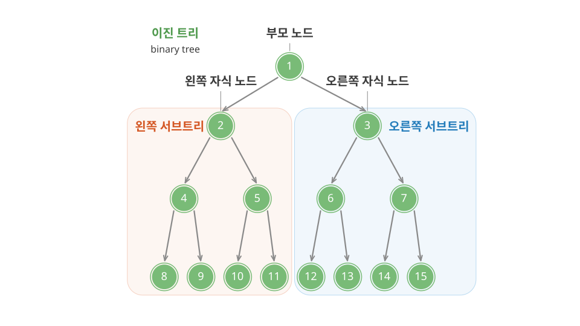
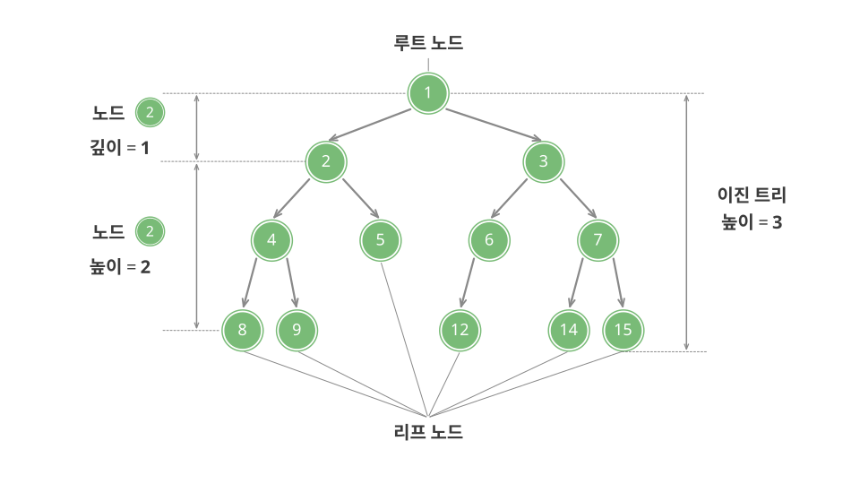
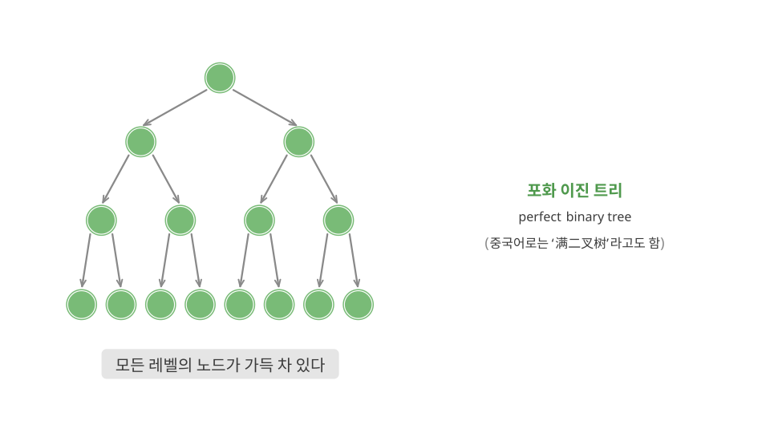
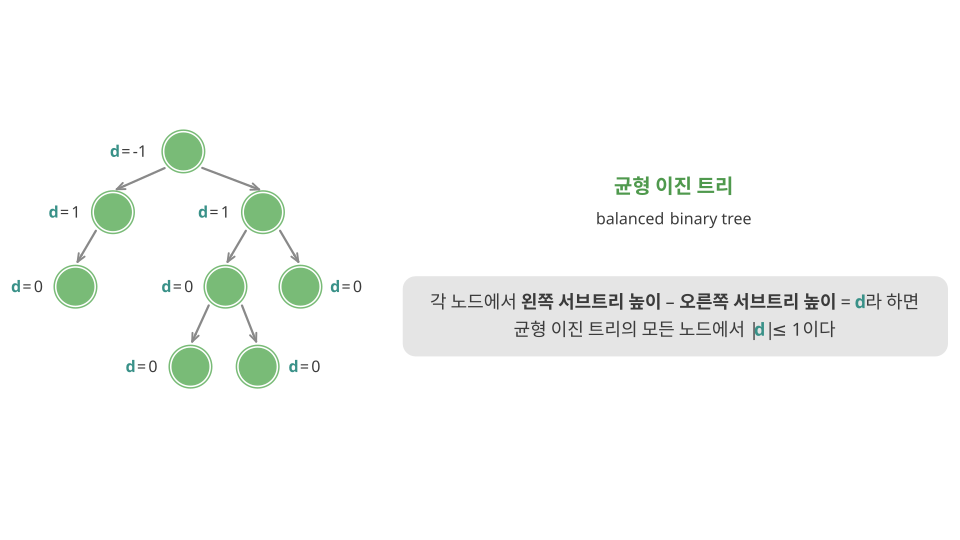

# 7.1 &nbsp; 이진 트리

<u>이진 트리(binary tree)</u>는 ‘조상’에서 ‘자손’으로 이어지는 관계를 나타내는 비선형 자료 구조로, ‘하나를 둘로 나누는’ 분할 정복의 원리가 드러난다. 연결 리스트와 마찬가지로 기본 단위는 노드이며 각 노드에는 값과 왼쪽 및 오른쪽 자식에 대한 참조가 있다.

=== "Python"

    ```python title=""
    class TreeNode:
        """이진 트리 노드 클래스"""
        def __init__(self, val: int):
            self.val: int = val                # 노드 값
            self.left: TreeNode | None = None  # 왼쪽 자식 참조
            self.right: TreeNode | None = None # 오른쪽 자식 참조
    ```

=== "C++"

    ```cpp title=""
    /* 이진 트리 노드 구조체 */
    struct TreeNode {
        int val;          // 노드 값
        TreeNode *left;   // 왼쪽 자식 포인터
        TreeNode *right;  // 오른쪽 자식 포인터
        TreeNode(int x) : val(x), left(nullptr), right(nullptr) {}
    };
    ```

=== "Java"

    ```java title=""
    /* 이진 트리 노드 클래스 */
    class TreeNode {
        int val;         // 노드 값
        TreeNode left;   // 왼쪽 자식 참조
        TreeNode right;  // 오른쪽 자식 참조
        TreeNode(int x) { val = x; }
    }
    ```

=== "C#"

    ```csharp title=""
    /* 이진 트리 노드 클래스 */
    class TreeNode(int? x) {
        public int? val = x;    // 노드 값
        public TreeNode? left;  // 왼쪽 자식 참조
        public TreeNode? right; // 오른쪽 자식 참조
    }
    ```

=== "Go"

    ```go title=""
    /* 이진 트리 노드 구조체 */
    type TreeNode struct {
        Val   int
        Left  *TreeNode
        Right *TreeNode
    }
    /* 생성자 */
    func NewTreeNode(v int) *TreeNode {
        return &TreeNode{
            Left:  nil, // 왼쪽 자식 포인터
            Right: nil, // 오른쪽 자식 포인터
            Val:   v,   // 노드 값
        }
    }
    ```

=== "Swift"

    ```swift title=""
    /* 이진 트리 노드 클래스 */
    class TreeNode {
        var val: Int // 노드 값
        var left: TreeNode? // 왼쪽 자식 참조
        var right: TreeNode? // 오른쪽 자식 참조

        init(x: Int) {
            val = x
        }
    }
    ```

=== "JS"

    ```javascript title=""
    /* 이진 트리 노드 클래스 */
    class TreeNode {
        val; // 노드 값
        left; // 왼쪽 자식 포인터
        right; // 오른쪽 자식 포인터
        constructor(val, left, right) {
            this.val = val === undefined ? 0 : val;
            this.left = left === undefined ? null : left;
            this.right = right === undefined ? null : right;
        }
    }
    ```

=== "TS"

    ```typescript title=""
    /* 이진 트리 노드 클래스 */
    class TreeNode {
        val: number;
        left: TreeNode | null;
        right: TreeNode | null;

        constructor(val?: number, left?: TreeNode | null, right?: TreeNode | null) {
            this.val = val === undefined ? 0 : val; // 노드 값
            this.left = left === undefined ? null : left; // 왼쪽 자식 참조
            this.right = right === undefined ? null : right; // 오른쪽 자식 참조
        }
    }
    ```

=== "Dart"

    ```dart title=""
    /* 이진 트리 노드 클래스 */
    class TreeNode {
      int val;         // 노드 값
      TreeNode? left;  // 왼쪽 자식 참조
      TreeNode? right; // 오른쪽 자식 참조
      TreeNode(this.val, [this.left, this.right]);
    }
    ```

=== "Rust"

    ```rust title=""
    use std::rc::Rc;
    use std::cell::RefCell;

    /* 이진 트리 노드 구조체 */
    struct TreeNode {
        val: i32,                               // 노드 값
        left: Option<Rc<RefCell<TreeNode>>>,    // 왼쪽 자식 참조
        right: Option<Rc<RefCell<TreeNode>>>,   // 오른쪽 자식 참조
    }

    impl TreeNode {
        /* 생성자 */
        fn new(val: i32) -> Rc<RefCell<Self>> {
            Rc::new(RefCell::new(Self {
                val,
                left: None,
                right: None
            }))
        }
    }
    ```

=== "C"

    ```c title=""
    /* 이진 트리 노드 구조체 */
    typedef struct TreeNode {
        int val;                // 노드 값
        struct TreeNode *left;  // 왼쪽 자식 포인터
        struct TreeNode *right; // 오른쪽 자식 포인터
    } TreeNode;

    /* 생성자 */
    TreeNode *newTreeNode(int val) {
        TreeNode *node;

        node = (TreeNode *)malloc(sizeof(TreeNode));
        node->val = val;
        node->left = NULL;
        node->right = NULL;
        return node;
    }
    ```

=== "Kotlin"

    ```kotlin title=""
    /* 이진 트리 노드 클래스 */
    class TreeNode(val _val: Int) {  // 노드 값
        var left: TreeNode? = null   // 왼쪽 자식 참조
        var right: TreeNode? = null  // 오른쪽 자식 참조
    }
    ```

=== "Ruby"

    ```ruby title=""
    ### 이진 트리 노드 클래스 ###
    class TreeNode
      attr_accessor :val    # 노드 값
      attr_accessor :left   # 왼쪽 자식 참조
      attr_accessor :right  # 오른쪽 자식 참조

      def initialize(val)
        @val = val
      end
    end
    ```

각 노드에는 <u>왼쪽 자식 노드(left-child node)</u>와 <u>오른쪽 자식 노드(right-child node)</u>를 각각 가리키는 두 참조(포인터)가 있다. 이 노드는 두 자식의 <u>부모 노드(parent node)</u>다. 어떤 노드의 왼쪽 자식과 그 아래 모든 노드로 이루어진 트리를 그 노드의 <u>왼쪽 서브트리(left subtree)</u>라 한다. <u>오른쪽 서브트리(right subtree)</u>도 같은 방식으로 정의한다.

**이진 트리에서 리프를 제외한 모든 노드에는 자식과 비어 있지 않은 서브트리가 있다**. 다음 그림(7-1)에서 노드 2를 부모로 보면 왼쪽과 오른쪽 자식은 각각 4와 5다. 왼쪽 서브트리는 4와 그 아래 노드로 이루어진 트리이고, 오른쪽 서브트리는 5와 그 아래 노드로 이루어진 트리다.

{ class="animation-figure" }

<p align="center"> 그림 7-1 &nbsp; 부모 노드, 자식 노드, 서브트리 </p>

## 7.1.1 &nbsp; 이진 트리의 주요 용어

이진 트리에서 자주 쓰는 용어는 다음 그림(7-2)과 같다.

- <u>루트 노드(root node)</u>는 이진 트리 맨 위에 있는 노드로 부모가 없다.
- <u>리프 노드(leaf node)</u>는 자식이 없는 노드로 두 포인터가 모두 `None`을 가리킨다.
- <u>간선(edge)</u>은 두 노드를 연결하는 선분으로 노드 참조(포인터)를 나타낸다.
- 노드의 <u>레벨(level)</u>은 위에서 아래로 갈수록 커지며 루트의 레벨은 1이다.
- 노드의 <u>차수(degree)</u>는 그 노드의 자식 수다. 이진 트리에서는 0, 1, 2 중 하나다.
- 이진 트리의 <u>높이(height)</u>는 루트에서 가장 먼 리프까지 거치는 간선 수다.
- 노드의 <u>깊이(depth)</u>는 루트에서 해당 노드까지 거치는 간선 수다.
- 노드의 <u>높이(height)</u>는 해당 노드와 그 아래 가장 먼 리프 사이의 간선 수다.

{ class="animation-figure" }

<p align="center"> 그림 7-2 &nbsp; 이진 트리의 주요 용어 </p>

!!! tip

    보통 ‘높이’와 ‘깊이’는 ‘경로의 간선 수’로 정의하지만 문제나 교재에 따라 ‘경로의 노드 수’로 정의하기도 한다. 그때는 간선 수로 센 높이와 깊이에 각각 1을 더해야 한다.

## 7.1.2 &nbsp; 이진 트리의 기본 연산

### 1. &nbsp; 이진 트리 초기화

연결 리스트처럼 먼저 노드를 초기화하고 참조(포인터)를 연결한다.

=== "Python"

    ```python title="binary_tree.py"
    # 이진 트리 초기화
    # 노드 초기화
    n1 = TreeNode(val=1)
    n2 = TreeNode(val=2)
    n3 = TreeNode(val=3)
    n4 = TreeNode(val=4)
    n5 = TreeNode(val=5)
    # 노드 사이의 참조(포인터)를 연결한다
    n1.left = n2
    n1.right = n3
    n2.left = n4
    n2.right = n5
    ```

=== "C++"

    ```cpp title="binary_tree.cpp"
    /* 이진 트리 초기화 */
    // 노드 초기화
    TreeNode *n1 = new TreeNode(1);
    TreeNode *n2 = new TreeNode(2);
    TreeNode *n3 = new TreeNode(3);
    TreeNode *n4 = new TreeNode(4);
    TreeNode *n5 = new TreeNode(5);
    // 노드 사이의 참조(포인터)를 연결한다
    n1->left = n2;
    n1->right = n3;
    n2->left = n4;
    n2->right = n5;
    ```

=== "Java"

    ```java title="binary_tree.java"
    /* 이진 트리 초기화 */
    // 노드 초기화
    TreeNode n1 = new TreeNode(1);
    TreeNode n2 = new TreeNode(2);
    TreeNode n3 = new TreeNode(3);
    TreeNode n4 = new TreeNode(4);
    TreeNode n5 = new TreeNode(5);
    // 노드 사이의 참조(포인터)를 연결한다
    n1.left = n2;
    n1.right = n3;
    n2.left = n4;
    n2.right = n5;
    ```

=== "C#"

    ```csharp title="binary_tree.cs"
    /* 이진 트리 초기화 */
    // 노드 초기화
    TreeNode n1 = new(1);
    TreeNode n2 = new(2);
    TreeNode n3 = new(3);
    TreeNode n4 = new(4);
    TreeNode n5 = new(5);
    // 노드 사이의 참조(포인터)를 연결한다
    n1.left = n2;
    n1.right = n3;
    n2.left = n4;
    n2.right = n5;
    ```

=== "Go"

    ```go title="binary_tree.go"
    /* 이진 트리 초기화 */
    // 노드 초기화
    n1 := NewTreeNode(1)
    n2 := NewTreeNode(2)
    n3 := NewTreeNode(3)
    n4 := NewTreeNode(4)
    n5 := NewTreeNode(5)
    // 노드 사이의 참조(포인터)를 연결한다
    n1.Left = n2
    n1.Right = n3
    n2.Left = n4
    n2.Right = n5
    ```

=== "Swift"

    ```swift title="binary_tree.swift"
    /* 이진 트리 초기화 */
    // 노드 초기화
    let n1 = TreeNode(x: 1)
    let n2 = TreeNode(x: 2)
    let n3 = TreeNode(x: 3)
    let n4 = TreeNode(x: 4)
    let n5 = TreeNode(x: 5)
    // 노드 사이의 참조(포인터)를 연결한다
    n1.left = n2
    n1.right = n3
    n2.left = n4
    n2.right = n5
    ```

=== "JS"

    ```javascript title="binary_tree.js"
    /* 이진 트리 초기화 */
    // 노드 초기화
    let n1 = new TreeNode(1),
        n2 = new TreeNode(2),
        n3 = new TreeNode(3),
        n4 = new TreeNode(4),
        n5 = new TreeNode(5);
    // 노드 사이의 참조(포인터)를 연결한다
    n1.left = n2;
    n1.right = n3;
    n2.left = n4;
    n2.right = n5;
    ```

=== "TS"

    ```typescript title="binary_tree.ts"
    /* 이진 트리 초기화 */
    // 노드 초기화
    let n1 = new TreeNode(1),
        n2 = new TreeNode(2),
        n3 = new TreeNode(3),
        n4 = new TreeNode(4),
        n5 = new TreeNode(5);
    // 노드 사이의 참조(포인터)를 연결한다
    n1.left = n2;
    n1.right = n3;
    n2.left = n4;
    n2.right = n5;
    ```

=== "Dart"

    ```dart title="binary_tree.dart"
    /* 이진 트리 초기화 */
    // 노드 초기화
    TreeNode n1 = TreeNode(1);
    TreeNode n2 = TreeNode(2);
    TreeNode n3 = TreeNode(3);
    TreeNode n4 = TreeNode(4);
    TreeNode n5 = TreeNode(5);
    // 노드 사이의 참조(포인터)를 연결한다
    n1.left = n2;
    n1.right = n3;
    n2.left = n4;
    n2.right = n5;
    ```

=== "Rust"

    ```rust title="binary_tree.rs"
    /* 이진 트리 초기화 */
    // 노드 초기화
    let n1 = TreeNode::new(1);
    let n2 = TreeNode::new(2);
    let n3 = TreeNode::new(3);
    let n4 = TreeNode::new(4);
    let n5 = TreeNode::new(5);
    // 노드 사이의 참조(포인터)를 연결한다
    n1.borrow_mut().left = Some(Rc::clone(&n2));
    n1.borrow_mut().right = Some(Rc::clone(&n3));
    n2.borrow_mut().left = Some(Rc::clone(&n4));
    n2.borrow_mut().right = Some(Rc::clone(&n5));
    ```

=== "C"

    ```c title="binary_tree.c"
    /* 이진 트리 초기화 */
    // 노드 초기화
    TreeNode *n1 = newTreeNode(1);
    TreeNode *n2 = newTreeNode(2);
    TreeNode *n3 = newTreeNode(3);
    TreeNode *n4 = newTreeNode(4);
    TreeNode *n5 = newTreeNode(5);
    // 노드 사이의 참조(포인터)를 연결한다
    n1->left = n2;
    n1->right = n3;
    n2->left = n4;
    n2->right = n5;
    ```

=== "Kotlin"

    ```kotlin title="binary_tree.kt"
    /* 이진 트리 초기화 */
    // 노드 초기화
    val n1 = TreeNode(1)
    val n2 = TreeNode(2)
    val n3 = TreeNode(3)
    val n4 = TreeNode(4)
    val n5 = TreeNode(5)
    // 노드 사이의 참조(포인터)를 연결한다
    n1.left = n2
    n1.right = n3
    n2.left = n4
    n2.right = n5
    ```

=== "Ruby"

    ```ruby title="binary_tree.rb"
    # 이진 트리 초기화
    # 노드 초기화
    n1 = TreeNode.new(1)
    n2 = TreeNode.new(2)
    n3 = TreeNode.new(3)
    n4 = TreeNode.new(4)
    n5 = TreeNode.new(5)
    # 노드 사이의 참조(포인터)를 연결한다
    n1.left = n2
    n1.right = n3
    n2.left = n4
    n2.right = n5
    ```

??? pythontutor "실행 과정 시각화"

    <div style="height: 549px; width: 100%;"><iframe class="pythontutor-iframe" title="실행 과정 시각화" src="https://pythontutor.com/iframe-embed.html#code=class%20TreeNode%3A%0A%20%20%20%20%22%22%22%EC%9D%B4%EC%A7%84%20%ED%8A%B8%EB%A6%AC%EC%9D%98%20%EB%85%B8%EB%93%9C%20%ED%81%B4%EB%9E%98%EC%8A%A4%22%22%22%0A%20%20%20%20def%20__init__%28self,%20val%3A%20int%29%3A%0A%20%20%20%20%20%20%20%20self.val%3A%20int%20%3D%20val%20%20%20%20%20%20%20%20%20%20%20%20%20%20%20%20%23%20%EB%85%B8%EB%93%9C%20%EA%B0%92%0A%20%20%20%20%20%20%20%20self.left%3A%20TreeNode%20%7C%20None%20%3D%20None%20%20%23%20%EC%99%BC%EC%AA%BD%20%EC%9E%90%EC%8B%9D%20%EB%85%B8%EB%93%9C%EC%97%90%20%EB%8C%80%ED%95%9C%20%EC%B0%B8%EC%A1%B0%0A%20%20%20%20%20%20%20%20self.right%3A%20TreeNode%20%7C%20None%20%3D%20None%20%23%20%EC%98%A4%EB%A5%B8%EC%AA%BD%20%EC%9E%90%EC%8B%9D%20%EB%85%B8%EB%93%9C%EC%97%90%20%EB%8C%80%ED%95%9C%20%EC%B0%B8%EC%A1%B0%0A%0A%22%22%22Driver%20Code%22%22%22%0Aif%20__name__%20%3D%3D%20%22__main__%22%3A%0A%20%20%20%20%23%20%EC%9D%B4%EC%A7%84%20%ED%8A%B8%EB%A6%AC%20%EC%B4%88%EA%B8%B0%ED%99%94%0A%20%20%20%20%23%20%EB%85%B8%EB%93%9C%20%EC%B4%88%EA%B8%B0%ED%99%94%0A%20%20%20%20n1%20%3D%20TreeNode%28val%3D1%29%0A%20%20%20%20n2%20%3D%20TreeNode%28val%3D2%29%0A%20%20%20%20n3%20%3D%20TreeNode%28val%3D3%29%0A%20%20%20%20n4%20%3D%20TreeNode%28val%3D4%29%0A%20%20%20%20n5%20%3D%20TreeNode%28val%3D5%29%0A%20%20%20%20%23%20%EC%B0%B8%EC%A1%B0%28%ED%8F%AC%EC%9D%B8%ED%84%B0%29%EB%A1%9C%20%EB%85%B8%EB%93%9C%20%EC%97%B0%EA%B2%B0%0A%20%20%20%20n1.left%20%3D%20n2%0A%20%20%20%20n1.right%20%3D%20n3%0A%20%20%20%20n2.left%20%3D%20n4%0A%20%20%20%20n2.right%20%3D%20n5&codeDivHeight=472&codeDivWidth=350&cumulative=false&curInstr=3&heapPrimitives=nevernest&origin=opt-frontend.js&py=311&rawInputLstJSON=%5B%5D&textReferences=false"> </iframe></div>
    <div style="margin-top: 5px;"><a href="https://pythontutor.com/iframe-embed.html#code=class%20TreeNode%3A%0A%20%20%20%20%22%22%22%EC%9D%B4%EC%A7%84%20%ED%8A%B8%EB%A6%AC%EC%9D%98%20%EB%85%B8%EB%93%9C%20%ED%81%B4%EB%9E%98%EC%8A%A4%22%22%22%0A%20%20%20%20def%20__init__%28self,%20val%3A%20int%29%3A%0A%20%20%20%20%20%20%20%20self.val%3A%20int%20%3D%20val%20%20%20%20%20%20%20%20%20%20%20%20%20%20%20%20%23%20%EB%85%B8%EB%93%9C%20%EA%B0%92%0A%20%20%20%20%20%20%20%20self.left%3A%20TreeNode%20%7C%20None%20%3D%20None%20%20%23%20%EC%99%BC%EC%AA%BD%20%EC%9E%90%EC%8B%9D%20%EB%85%B8%EB%93%9C%EC%97%90%20%EB%8C%80%ED%95%9C%20%EC%B0%B8%EC%A1%B0%0A%20%20%20%20%20%20%20%20self.right%3A%20TreeNode%20%7C%20None%20%3D%20None%20%23%20%EC%98%A4%EB%A5%B8%EC%AA%BD%20%EC%9E%90%EC%8B%9D%20%EB%85%B8%EB%93%9C%EC%97%90%20%EB%8C%80%ED%95%9C%20%EC%B0%B8%EC%A1%B0%0A%0A%22%22%22Driver%20Code%22%22%22%0Aif%20__name__%20%3D%3D%20%22__main__%22%3A%0A%20%20%20%20%23%20%EC%9D%B4%EC%A7%84%20%ED%8A%B8%EB%A6%AC%20%EC%B4%88%EA%B8%B0%ED%99%94%0A%20%20%20%20%23%20%EB%85%B8%EB%93%9C%20%EC%B4%88%EA%B8%B0%ED%99%94%0A%20%20%20%20n1%20%3D%20TreeNode%28val%3D1%29%0A%20%20%20%20n2%20%3D%20TreeNode%28val%3D2%29%0A%20%20%20%20n3%20%3D%20TreeNode%28val%3D3%29%0A%20%20%20%20n4%20%3D%20TreeNode%28val%3D4%29%0A%20%20%20%20n5%20%3D%20TreeNode%28val%3D5%29%0A%20%20%20%20%23%20%EC%B0%B8%EC%A1%B0%28%ED%8F%AC%EC%9D%B8%ED%84%B0%29%EB%A1%9C%20%EB%85%B8%EB%93%9C%20%EC%97%B0%EA%B2%B0%0A%20%20%20%20n1.left%20%3D%20n2%0A%20%20%20%20n1.right%20%3D%20n3%0A%20%20%20%20n2.left%20%3D%20n4%0A%20%20%20%20n2.right%20%3D%20n5&codeDivHeight=800&codeDivWidth=600&cumulative=false&curInstr=3&heapPrimitives=nevernest&origin=opt-frontend.js&py=311&rawInputLstJSON=%5B%5D&textReferences=false" target="_blank" rel="noopener noreferrer">전체 화면으로 보기 ></a></div>

### 2. &nbsp; 노드 삽입과 삭제

연결 리스트와 마찬가지로 이진 트리에서도 포인터를 바꾸어 노드를 삽입하거나 삭제할 수 있다. 다음 그림(7-3)은 그 예다.

{ class="animation-figure" }

<p align="center"> 그림 7-3 &nbsp; 이진 트리에서 노드 삽입과 삭제 </p>

=== "Python"

    ```python title="binary_tree.py"
    # 노드 삽입과 삭제
    P = TreeNode(0)
    # n1 -> n2 사이에 노드 P를 삽입한다
    n1.left = P
    P.left = n2
    # 노드 P 삭제
    n1.left = n2
    ```

=== "C++"

    ```cpp title="binary_tree.cpp"
    /* 노드 삽입과 삭제 */
    TreeNode *P = new TreeNode(0);
    // n1 -> n2 사이에 노드 P를 삽입한다
    n1->left = P;
    P->left = n2;
    // 노드 P 삭제
    n1->left = n2;
    delete P; // 메모리 해제
    ```

=== "Java"

    ```java title="binary_tree.java"
    /* 노드 삽입과 삭제 */
    TreeNode P = new TreeNode(0);
    // n1 -> n2 사이에 노드 P를 삽입한다
    n1.left = P;
    P.left = n2;
    // 노드 P 삭제
    n1.left = n2;
    ```

=== "C#"

    ```csharp title="binary_tree.cs"
    /* 노드 삽입과 삭제 */
    TreeNode P = new(0);
    // n1 -> n2 사이에 노드 P를 삽입한다
    n1.left = P;
    P.left = n2;
    // 노드 P 삭제
    n1.left = n2;
    ```

=== "Go"

    ```go title="binary_tree.go"
    /* 노드 삽입과 삭제 */
    // n1 -> n2 사이에 노드 P를 삽입한다
    p := NewTreeNode(0)
    n1.Left = p
    p.Left = n2
    // 노드 P 삭제
    n1.Left = n2
    ```

=== "Swift"

    ```swift title="binary_tree.swift"
    /* 노드 삽입과 삭제 */
    let P = TreeNode(x: 0)
    // n1 -> n2 사이에 노드 P를 삽입한다
    n1.left = P
    P.left = n2
    // 노드 P 삭제
    n1.left = n2
    ```

=== "JS"

    ```javascript title="binary_tree.js"
    /* 노드 삽입과 삭제 */
    const P = new TreeNode(0);
    // n1 -> n2 사이에 노드 P를 삽입한다
    n1.left = P;
    P.left = n2;
    // 노드 P 삭제
    n1.left = n2;
    ```

=== "TS"

    ```typescript title="binary_tree.ts"
    /* 노드 삽입과 삭제 */
    const P = new TreeNode(0);
    // n1 -> n2 사이에 노드 P를 삽입한다
    n1.left = P;
    P.left = n2;
    // 노드 P 삭제
    n1.left = n2;
    ```

=== "Dart"

    ```dart title="binary_tree.dart"
    /* 노드 삽입과 삭제 */
    TreeNode p = TreeNode(0);
    // n1 -> n2 사이에 노드 P를 삽입한다
    n1.left = p;
    p.left = n2;
    // 노드 P 삭제
    n1.left = n2;
    ```

=== "Rust"

    ```rust title="binary_tree.rs"
    /* 노드 삽입과 삭제 */
    let p = TreeNode::new(0);
    // n1 -> n2 사이에 노드 P를 삽입한다
    p.borrow_mut().left = Some(Rc::clone(&n2));
    n1.borrow_mut().left = Some(Rc::clone(&p));
    // 노드 P 삭제
    drop(p);
    n1.borrow_mut().left = Some(Rc::clone(&n2));
    ```

=== "C"

    ```c title="binary_tree.c"
    /* 노드 삽입과 삭제 */
    TreeNode *P = newTreeNode(0);
    // n1 -> n2 사이에 노드 P를 삽입한다
    n1->left = P;
    P->left = n2;
    // 노드 P 삭제
    n1->left = n2;
    // 메모리 해제
    free(P);
    ```

=== "Kotlin"

    ```kotlin title="binary_tree.kt"
    /* 노드 삽입과 삭제 */
    val P = TreeNode(0)
    // n1 -> n2 사이에 노드 P를 삽입한다
    n1.left = P
    P.left = n2
    // 노드 P 삭제
    n1.left = n2
    ```

=== "Ruby"

    ```ruby title="binary_tree.rb"
    # 노드 삽입과 삭제
    _p = TreeNode.new(0)
    # n1 -> n2 사이에 노드 _p를 삽입한다
    n1.left = _p
    _p.left = n2
    # 노드 삭제
    n1.left = n2
    ```

??? pythontutor "실행 과정 시각화"

    <div style="height: 549px; width: 100%;"><iframe class="pythontutor-iframe" title="실행 과정 시각화" src="https://pythontutor.com/iframe-embed.html#code=class%20TreeNode%3A%0A%20%20%20%20%22%22%22%EC%9D%B4%EC%A7%84%20%ED%8A%B8%EB%A6%AC%EC%9D%98%20%EB%85%B8%EB%93%9C%20%ED%81%B4%EB%9E%98%EC%8A%A4%22%22%22%0A%20%20%20%20def%20__init__%28self,%20val%3A%20int%29%3A%0A%20%20%20%20%20%20%20%20self.val%3A%20int%20%3D%20val%20%20%20%20%20%20%20%20%20%20%20%20%20%20%20%20%23%20%EB%85%B8%EB%93%9C%20%EA%B0%92%0A%20%20%20%20%20%20%20%20self.left%3A%20TreeNode%20%7C%20None%20%3D%20None%20%20%23%20%EC%99%BC%EC%AA%BD%20%EC%9E%90%EC%8B%9D%20%EB%85%B8%EB%93%9C%EC%97%90%20%EB%8C%80%ED%95%9C%20%EC%B0%B8%EC%A1%B0%0A%20%20%20%20%20%20%20%20self.right%3A%20TreeNode%20%7C%20None%20%3D%20None%20%23%20%EC%98%A4%EB%A5%B8%EC%AA%BD%20%EC%9E%90%EC%8B%9D%20%EB%85%B8%EB%93%9C%EC%97%90%20%EB%8C%80%ED%95%9C%20%EC%B0%B8%EC%A1%B0%0A%0A%22%22%22Driver%20Code%22%22%22%0Aif%20__name__%20%3D%3D%20%22__main__%22%3A%0A%20%20%20%20%23%20%EC%9D%B4%EC%A7%84%20%ED%8A%B8%EB%A6%AC%20%EC%B4%88%EA%B8%B0%ED%99%94%0A%20%20%20%20%23%20%EB%85%B8%EB%93%9C%20%EC%B4%88%EA%B8%B0%ED%99%94%0A%20%20%20%20n1%20%3D%20TreeNode%28val%3D1%29%0A%20%20%20%20n2%20%3D%20TreeNode%28val%3D2%29%0A%20%20%20%20n3%20%3D%20TreeNode%28val%3D3%29%0A%20%20%20%20n4%20%3D%20TreeNode%28val%3D4%29%0A%20%20%20%20n5%20%3D%20TreeNode%28val%3D5%29%0A%20%20%20%20%23%20%EC%B0%B8%EC%A1%B0%28%ED%8F%AC%EC%9D%B8%ED%84%B0%29%EB%A1%9C%20%EB%85%B8%EB%93%9C%20%EC%97%B0%EA%B2%B0%0A%20%20%20%20n1.left%20%3D%20n2%0A%20%20%20%20n1.right%20%3D%20n3%0A%20%20%20%20n2.left%20%3D%20n4%0A%20%20%20%20n2.right%20%3D%20n5%0A%0A%20%20%20%20%23%20%EB%85%B8%EB%93%9C%20%EC%82%BD%EC%9E%85%EA%B3%BC%20%EC%82%AD%EC%A0%9C%0A%20%20%20%20P%20%3D%20TreeNode%280%29%0A%20%20%20%20%23%20n1%20-%3E%20n2%EC%97%90%EC%84%9C%20%EB%91%90%20%EB%85%B8%EB%93%9C%20%EC%82%AC%EC%9D%B4%EC%97%90%20%EB%85%B8%EB%93%9C%20P%20%EC%82%BD%EC%9E%85%0A%20%20%20%20n1.left%20%3D%20P%0A%20%20%20%20P.left%20%3D%20n2%0A%20%20%20%20%23%20%EB%85%B8%EB%93%9C%20P%20%EC%82%AD%EC%A0%9C%0A%20%20%20%20n1.left%20%3D%20n2&codeDivHeight=472&codeDivWidth=350&cumulative=false&curInstr=37&heapPrimitives=nevernest&origin=opt-frontend.js&py=311&rawInputLstJSON=%5B%5D&textReferences=false"> </iframe></div>
    <div style="margin-top: 5px;"><a href="https://pythontutor.com/iframe-embed.html#code=class%20TreeNode%3A%0A%20%20%20%20%22%22%22%EC%9D%B4%EC%A7%84%20%ED%8A%B8%EB%A6%AC%EC%9D%98%20%EB%85%B8%EB%93%9C%20%ED%81%B4%EB%9E%98%EC%8A%A4%22%22%22%0A%20%20%20%20def%20__init__%28self,%20val%3A%20int%29%3A%0A%20%20%20%20%20%20%20%20self.val%3A%20int%20%3D%20val%20%20%20%20%20%20%20%20%20%20%20%20%20%20%20%20%23%20%EB%85%B8%EB%93%9C%20%EA%B0%92%0A%20%20%20%20%20%20%20%20self.left%3A%20TreeNode%20%7C%20None%20%3D%20None%20%20%23%20%EC%99%BC%EC%AA%BD%20%EC%9E%90%EC%8B%9D%20%EB%85%B8%EB%93%9C%EC%97%90%20%EB%8C%80%ED%95%9C%20%EC%B0%B8%EC%A1%B0%0A%20%20%20%20%20%20%20%20self.right%3A%20TreeNode%20%7C%20None%20%3D%20None%20%23%20%EC%98%A4%EB%A5%B8%EC%AA%BD%20%EC%9E%90%EC%8B%9D%20%EB%85%B8%EB%93%9C%EC%97%90%20%EB%8C%80%ED%95%9C%20%EC%B0%B8%EC%A1%B0%0A%0A%22%22%22Driver%20Code%22%22%22%0Aif%20__name__%20%3D%3D%20%22__main__%22%3A%0A%20%20%20%20%23%20%EC%9D%B4%EC%A7%84%20%ED%8A%B8%EB%A6%AC%20%EC%B4%88%EA%B8%B0%ED%99%94%0A%20%20%20%20%23%20%EB%85%B8%EB%93%9C%20%EC%B4%88%EA%B8%B0%ED%99%94%0A%20%20%20%20n1%20%3D%20TreeNode%28val%3D1%29%0A%20%20%20%20n2%20%3D%20TreeNode%28val%3D2%29%0A%20%20%20%20n3%20%3D%20TreeNode%28val%3D3%29%0A%20%20%20%20n4%20%3D%20TreeNode%28val%3D4%29%0A%20%20%20%20n5%20%3D%20TreeNode%28val%3D5%29%0A%20%20%20%20%23%20%EC%B0%B8%EC%A1%B0%28%ED%8F%AC%EC%9D%B8%ED%84%B0%29%EB%A1%9C%20%EB%85%B8%EB%93%9C%20%EC%97%B0%EA%B2%B0%0A%20%20%20%20n1.left%20%3D%20n2%0A%20%20%20%20n1.right%20%3D%20n3%0A%20%20%20%20n2.left%20%3D%20n4%0A%20%20%20%20n2.right%20%3D%20n5%0A%0A%20%20%20%20%23%20%EB%85%B8%EB%93%9C%20%EC%82%BD%EC%9E%85%EA%B3%BC%20%EC%82%AD%EC%A0%9C%0A%20%20%20%20P%20%3D%20TreeNode%280%29%0A%20%20%20%20%23%20n1%20-%3E%20n2%EC%97%90%EC%84%9C%20%EB%91%90%20%EB%85%B8%EB%93%9C%20%EC%82%AC%EC%9D%B4%EC%97%90%20%EB%85%B8%EB%93%9C%20P%20%EC%82%BD%EC%9E%85%0A%20%20%20%20n1.left%20%3D%20P%0A%20%20%20%20P.left%20%3D%20n2%0A%20%20%20%20%23%20%EB%85%B8%EB%93%9C%20P%20%EC%82%AD%EC%A0%9C%0A%20%20%20%20n1.left%20%3D%20n2&codeDivHeight=800&codeDivWidth=600&cumulative=false&curInstr=37&heapPrimitives=nevernest&origin=opt-frontend.js&py=311&rawInputLstJSON=%5B%5D&textReferences=false" target="_blank" rel="noopener noreferrer">전체 화면으로 보기 ></a></div>

!!! tip

    노드를 삽입하면 이진 트리의 기존 논리 구조가 달라질 수 있다. 또한 노드를 삭제한다는 것은 대개 그 노드와 그 아래의 모든 서브트리를 함께 삭제한다는 뜻이다. 따라서 실제로 의미 있는 작업을 하려면 보통 여러 연산을 조합해 삽입과 삭제를 구현한다.

## 7.1.3 &nbsp; 대표적인 이진 트리 유형

### 1. &nbsp; 포화 이진 트리

다음 그림(7-4)처럼 <u>포화 이진 트리(perfect binary tree)</u>는 모든 레벨이 가득 차 있다. 리프의 차수는 $0$이고 나머지 노드의 차수는 모두 $2$다. 트리 높이가 $h$이면 전체 노드 수는 $2^{h+1} - 1$다. 이는 전형적인 지수 관계로 자연에서 흔히 보는 세포 분열과 닮았다.

!!! tip

    중국어권에서는 포화 이진 트리를 흔히 <u>‘满二叉树’</u>라고 부른다.

{ class="animation-figure" }

<p align="center"> 그림 7-4 &nbsp; 포화 이진 트리 </p>

### 2. &nbsp; 완전 이진 트리

다음 그림(7-5)처럼 <u>완전 이진 트리(complete binary tree)</u>에서는 맨 아래 레벨만 덜 채워질 수 있고 그 노드들은 왼쪽부터 차례로 빈틈없이 채워져야 한다. 포화 이진 트리도 완전 이진 트리다.

{ class="animation-figure" }

<p align="center"> 그림 7-5 &nbsp; 완전 이진 트리 </p>

### 3. &nbsp; 정 이진 트리

다음 그림(7-6)처럼 <u>정 이진 트리(full binary tree)</u>에서는 리프를 제외한 모든 노드에 자식이 둘씩 있다.

{ class="animation-figure" }

<p align="center"> 그림 7-6 &nbsp; 정 이진 트리 </p>

### 4. &nbsp; 균형 이진 트리

다음 그림(7-7)처럼 <u>균형 이진 트리(balanced binary tree)</u>에서는 어느 노드에서나 왼쪽과 오른쪽 서브트리의 높이 차의 절댓값이 1 이하이다.

{ class="animation-figure" }

<p align="center"> 그림 7-7 &nbsp; 균형 이진 트리 </p>

## 7.1.4 &nbsp; 이진 트리의 퇴화

다음 그림(7-8)은 이진 트리의 이상적인 구조와 퇴화한 구조를 보여 준다. 모든 레벨의 노드가 가득 차면 ‘포화 이진 트리’가 되고 모든 노드가 한쪽으로 치우치면 ‘연결 리스트’로 퇴화한다.

- 포화 이진 트리는 이진 트리의 ‘분할 정복’ 이점을 충분히 살릴 수 있는 이상적인 경우다.
- 다른 극단은 연결 리스트다. 모든 연산이 선형 연산이 되어 시간 복잡도가 $O(n)$으로 나빠진다.

{ class="animation-figure" }

<p align="center"> 그림 7-8 &nbsp; 이진 트리의 최선 구조와 최악 구조 </p>

다음 표(7-1)처럼 최선 구조와 최악 구조에서는 이진 트리의 리프 수, 전체 노드 수, 높이 등이 최댓값이나 최솟값에 이른다.

<p align="center"> 표 7-1 &nbsp; 이진 트리의 최선 구조와 최악 구조 </p>

<div class="center-table" markdown>

|                             | 포화 이진 트리         | 연결 리스트    |
| --------------------------- | ------------------ | ------- |
| $i$번째 레벨의 노드 수         | $2^{i-1}$          | $1$     |
| 높이가 $h$인 트리의 리프 수 | $2^h$              | $1$     |
| 높이가 $h$인 트리의 전체 노드 수   | $2^{h+1} - 1$      | $h + 1$ |
| 전체 노드 수가 $n$인 트리의 높이   | $\log_2 (n+1) - 1$ | $n - 1$ |

</div>
