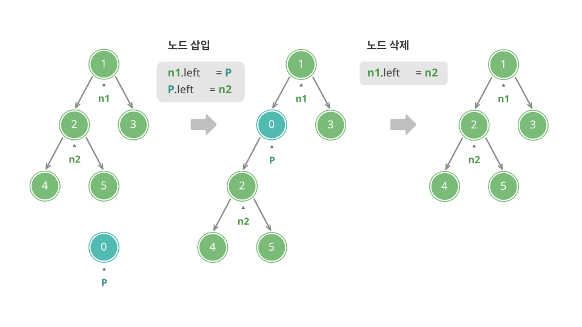
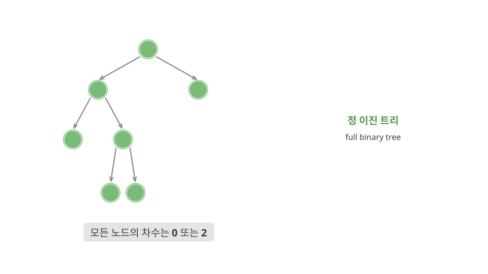
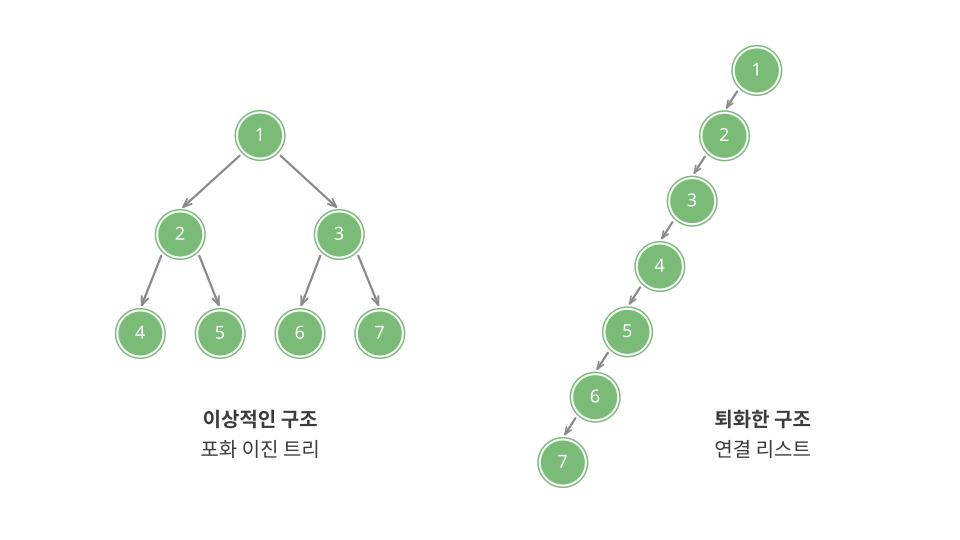

# 이진 트리

<u>이진 트리(binary tree)</u>는 ‘조상’에서 ‘자손’으로 이어지는 관계를 나타내는 비선형 자료 구조로, ‘하나를 둘로 나누는’ 분할 정복의 원리가 드러난다. 연결 리스트와 마찬가지로 기본 단위는 노드이며 각 노드에는 값과 왼쪽 및 오른쪽 자식에 대한 참조가 있다.

```snippet
tree_node_class
```

각 노드에는 <u>왼쪽 자식 노드(left-child node)</u>와 <u>오른쪽 자식 노드(right-child node)</u>를 각각 가리키는 두 참조(포인터)가 있다. 이 노드는 두 자식의 <u>부모 노드(parent node)</u>다. 어떤 노드의 왼쪽 자식과 그 아래 모든 노드로 이루어진 트리를 그 노드의 <u>왼쪽 서브트리(left subtree)</u>라 한다. <u>오른쪽 서브트리(right subtree)</u>도 같은 방식으로 정의한다.

**이진 트리에서 리프를 제외한 모든 노드에는 자식과 비어 있지 않은 서브트리가 있다**. 다음 그림에서 노드 2를 부모로 보면 왼쪽과 오른쪽 자식은 각각 4와 5다. 왼쪽 서브트리는 4와 그 아래 노드로 이루어진 트리이고, 오른쪽 서브트리는 5와 그 아래 노드로 이루어진 트리다.


## 이진 트리의 주요 용어

이진 트리에서 자주 쓰는 용어는 다음 그림과 같다.

- <u>루트 노드(root node)</u>는 이진 트리 맨 위에 있는 노드로 부모가 없다.
- <u>리프 노드(leaf node)</u>는 자식이 없는 노드로 두 포인터가 모두 `None`을 가리킨다.
- <u>간선(edge)</u>은 두 노드를 연결하는 선분으로 노드 참조(포인터)를 나타낸다.
- 노드의 <u>레벨(level)</u>은 위에서 아래로 갈수록 커지며 루트의 레벨은 1이다.
- 노드의 <u>차수(degree)</u>는 그 노드의 자식 수다. 이진 트리에서는 0, 1, 2 중 하나다.
- 이진 트리의 <u>높이(height)</u>는 루트에서 가장 먼 리프까지 거치는 간선 수다.
- 노드의 <u>깊이(depth)</u>는 루트에서 해당 노드까지 거치는 간선 수다.
- 노드의 <u>높이(height)</u>는 해당 노드와 그 아래 가장 먼 리프 사이의 간선 수다.


!!! tip

    보통 ‘높이’와 ‘깊이’는 ‘경로의 간선 수’로 정의하지만 문제나 교재에 따라 ‘경로의 노드 수’로 정의하기도 한다. 그때는 간선 수로 센 높이와 깊이에 각각 1을 더해야 한다.

## 이진 트리의 기본 연산

### 이진 트리 초기화

연결 리스트처럼 먼저 노드를 초기화하고 참조(포인터)를 연결한다.

```snippet
init_binary_tree
```

??? pythontutor "실행 시각화"

    @tutor init_binary_tree_tutor

### 노드 삽입과 삭제

연결 리스트와 마찬가지로 이진 트리에서도 포인터를 바꾸어 노드를 삽입하거나 삭제할 수 있다. 다음 그림은 그 예다.



```snippet
insert_remove_node
```

??? pythontutor "실행 시각화"

    @tutor insert_remove_node_tutor

!!! tip

    노드를 삽입하면 이진 트리의 기존 논리 구조가 달라질 수 있다. 또한 노드를 삭제한다는 것은 대개 그 노드와 그 아래의 모든 서브트리를 함께 삭제한다는 뜻이다. 따라서 실제로 의미 있는 작업을 하려면 보통 여러 연산을 조합해 삽입과 삭제를 구현한다.

## 대표적인 이진 트리 유형

### 포화 이진 트리

다음 그림처럼 <u>포화 이진 트리(perfect binary tree)</u>는 모든 레벨이 가득 차 있다. 리프의 차수는 $0$이고 나머지 노드의 차수는 모두 $2$다. 트리 높이가 $h$이면 전체 노드 수는 $2^{h+1} - 1$다. 이는 전형적인 지수 관계로 자연에서 흔히 보는 세포 분열과 닮았다.

!!! tip

    중국어권에서는 포화 이진 트리를 흔히 <u>‘满二叉树’</u>라고 부른다.


### 완전 이진 트리

다음 그림처럼 <u>완전 이진 트리(complete binary tree)</u>에서는 맨 아래 레벨만 덜 채워질 수 있고 그 노드들은 왼쪽부터 차례로 빈틈없이 채워져야 한다. 포화 이진 트리도 완전 이진 트리다.


### 정 이진 트리

다음 그림처럼 <u>정 이진 트리(full binary tree)</u>에서는 리프를 제외한 모든 노드에 자식이 둘씩 있다.



### 균형 이진 트리

다음 그림처럼 <u>균형 이진 트리(balanced binary tree)</u>에서는 어느 노드에서나 왼쪽과 오른쪽 서브트리의 높이 차의 절댓값이 1 이하이다.


## 이진 트리의 퇴화

다음 그림은 이진 트리의 이상적인 구조와 퇴화한 구조를 보여 준다. 모든 레벨의 노드가 가득 차면 ‘포화 이진 트리’가 되고 모든 노드가 한쪽으로 치우치면 ‘연결 리스트’로 퇴화한다.

- 포화 이진 트리는 이진 트리의 ‘분할 정복’ 이점을 충분히 살릴 수 있는 이상적인 경우다.
- 다른 극단은 연결 리스트다. 모든 연산이 선형 연산이 되어 시간 복잡도가 $O(n)$으로 나빠진다.



다음 표처럼 최선 구조와 최악 구조에서는 이진 트리의 리프 수, 전체 노드 수, 높이 등이 최댓값이나 최솟값에 이른다.

<p align="center"> 표 <id> &nbsp; 이진 트리의 최선 구조와 최악 구조 </p>

|                             | 포화 이진 트리         | 연결 리스트    |
| --------------------------- | ------------------ | ------- |
| $i$번째 레벨의 노드 수         | $2^{i-1}$          | $1$     |
| 높이가 $h$인 트리의 리프 수 | $2^h$              | $1$     |
| 높이가 $h$인 트리의 전체 노드 수   | $2^{h+1} - 1$      | $h + 1$ |
| 전체 노드 수가 $n$인 트리의 높이   | $\log_2 (n+1) - 1$ | $n - 1$ |
