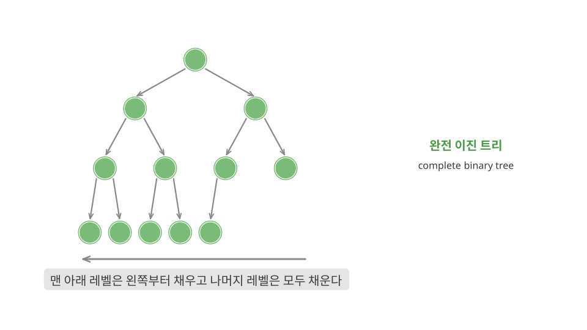

# 이진 트리

<u>이진 트리(binary tree)</u>는 '조상'과 '후손' 사이의 파생 관계를 나타내는 비선형 자료 구조로, '하나를 둘로 나누는' 분할 정복의 논리를 보여 준다. 연결 리스트처럼 기본 단위는 노드이며, 각 노드는 값과 왼쪽 자식 참조, 오른쪽 자식 참조를 포함한다.

```snippet
tree_node_class
```

각 노드는 두 참조(포인터)를 가지며, 각각 <u>왼쪽 자식 노드(left-child node)</u>와 <u>오른쪽 자식 노드(right-child node)</u>를 가리킨다. 해당 노드는 두 자식의 <u>부모 노드(parent node)</u>라고 한다. 어떤 노드의 왼쪽 자식과 그 아래 노드들이 이루는 트리를 그 노드의 <u>왼쪽 서브트리(left subtree)</u>라고 하며, 같은 방식으로 <u>오른쪽 서브트리(right subtree)</u>를 정의한다.

**이진 트리에서 리프 노드를 제외한 모든 노드에는 자식 노드와 비어 있지 않은 서브트리가 있다**. 아래 그림에서 '노드 2'를 부모로 보면 왼쪽과 오른쪽 자식은 각각 '노드 4', '노드 5'다. 왼쪽 서브트리는 '노드 4와 그 아래 노드들이 이루는 트리', 오른쪽 서브트리는 '노드 5와 그 아래 노드들이 이루는 트리'다.


## 이진 트리의 주요 용어

이진 트리에서 자주 쓰는 용어는 아래 그림과 같다.

- <u>루트 노드(root node)</u>: 이진 트리의 최상위 노드로, 부모가 없다.
- <u>리프 노드(leaf node)</u>: 자식이 없는 노드로, 두 포인터가 모두 `None`을 가리킨다.
- <u>간선(edge)</u>: 두 노드를 잇는 선으로, 노드 참조(포인터)에 해당한다.
- 노드의 <u>레벨(level)</u>: 위에서 아래로 증가하며 루트의 레벨은 1이다.
- 노드의 <u>차수(degree)</u>: 자식 노드의 수다. 이진 트리에서는 0, 1, 2 중 하나다.
- 이진 트리의 <u>높이(height)</u>: 루트에서 가장 먼 리프까지 거치는 간선 수다.
- 노드의 <u>깊이(depth)</u>: 루트에서 해당 노드까지 거치는 간선 수다.
- 노드의 <u>높이(height)</u>: 해당 노드에서 가장 먼 리프와 해당 노드 사이에 있는 간선 수다.


!!! tip "참고"

    보통 '높이'와 '깊이'를 '거치는 간선 수'로 정의하지만, 일부 문제나 교재는 '거치는 노드 수'로 정의하기도 한다. 그런 경우에는 높이와 깊이에 각각 1을 더해야 한다.

## 이진 트리의 기본 연산

### 이진 트리 초기화

연결 리스트처럼 먼저 노드를 초기화하고 참조(포인터)를 연결한다.

```snippet
init_binary_tree
```

??? pythontutor "실행 시각화"

    @tutor init_binary_tree_tutor

### 노드 삽입과 삭제

연결 리스트와 마찬가지로 이진 트리에서도 포인터를 수정하여 노드를 삽입하고 삭제할 수 있다. 아래 그림은 그 예다.


```snippet
insert_remove_node
```

??? pythontutor "실행 시각화"

    @tutor insert_remove_node_tutor

!!! tip "참고"

    노드 삽입은 이진 트리의 기존 논리 구조를 바꿀 수 있으며, 노드 삭제는 보통 해당 노드와 그 모든 서브트리를 삭제한다는 뜻이다. 따라서 의미 있는 작업을 수행하려면 이진 트리의 삽입과 삭제는 보통 여러 연산을 조합하여 이루어진다.

## 주요 이진 트리 종류

### 포화 이진 트리

아래 그림의 <u>포화 이진 트리(perfect binary tree)</u>는 모든 레벨에 노드가 가득 차 있다. 리프 노드의 차수는 $0$, 나머지 노드의 차수는 모두 $2$다. 높이가 $h$이면 전체 노드 수는 $2^{h+1} - 1$로 전형적인 지수 관계를 보이며, 자연에서 흔히 볼 수 있는 세포 분열 현상을 반영한다.

!!! tip "참고"

    중국어권에서는 포화 이진 트리를 흔히 <u>满二叉树</u>라고 부른다.


### 완전 이진 트리

아래 그림의 <u>완전 이진 트리(complete binary tree)</u>는 맨 아래 레벨만 가득 차 있지 않아도 되며, 그 레벨의 노드는 왼쪽부터 오른쪽으로 빈틈없이 채워져야 한다. 포화 이진 트리도 완전 이진 트리다.



### 정 이진 트리

아래 그림의 <u>정 이진 트리(full binary tree)</u>는 리프를 제외한 모든 노드가 자식 노드를 두 개씩 가진다.


### 균형 이진 트리

아래 그림의 <u>균형 이진 트리(balanced binary tree)</u>는 모든 노드에서 왼쪽과 오른쪽 서브트리의 높이 차의 절댓값이 1을 넘지 않는다.


## 이진 트리의 퇴화

아래 그림은 이진 트리의 이상적인 구조와 퇴화한 구조를 보여 준다. 모든 레벨이 가득 차면 '포화 이진 트리'가 되고, 모든 노드가 한쪽으로 치우치면 '연결 리스트'로 퇴화한다.

- 포화 이진 트리는 이상적인 경우로, 이진 트리의 '분할 정복' 이점을 충분히 발휘할 수 있다.
- 연결 리스트는 다른 극단으로, 모든 연산이 선형 연산이 되어 시간 복잡도가 $O(n)$으로 저하된다.


아래 표와 같이 최선 및 최악 구조에서 이진 트리의 리프 수, 전체 노드 수, 높이 등이 최댓값이나 최솟값에 도달한다.

<p align="center"> 표 <id> &nbsp; 이진 트리의 최선 구조와 최악 구조 </p>

|                             | 포화 이진 트리 | 연결 리스트 |
| --------------------------- | ------------------ | ------- |
| $i$ 번째 레벨의 노드 수 | $2^{i-1}$          | $1$     |
| 높이 $h$인 트리의 리프 수 | $2^h$              | $1$     |
| 높이 $h$인 트리의 전체 노드 수 | $2^{h+1} - 1$      | $h + 1$ |
| 전체 노드 수가 $n$인 트리의 높이 | $\log_2 (n+1) - 1$ | $n - 1$ |
