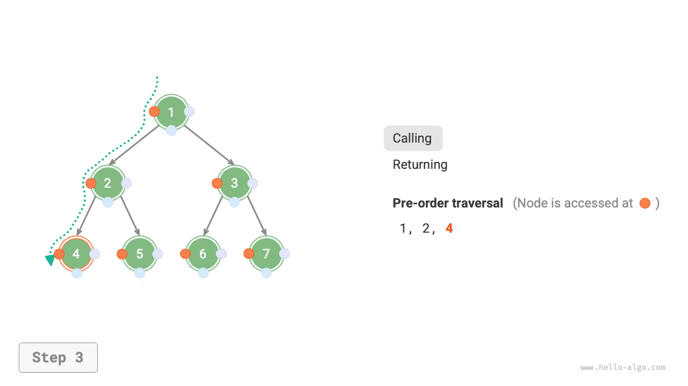
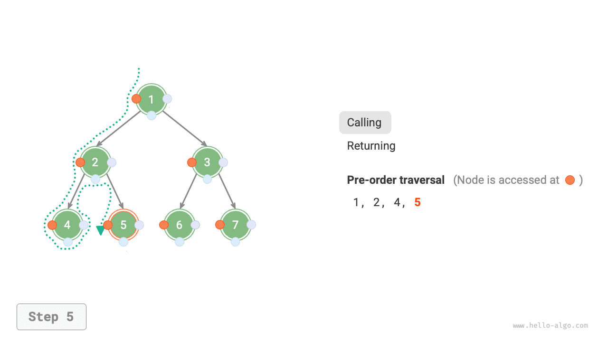

# 7.2 &nbsp; 이진 트리 순회

물리적 구조의 관점에서 트리는 연결 리스트 기반 자료 구조이므로, 포인터로 노드를 하나씩 방문하여 순회한다. 하지만 비선형 자료 구조여서 연결 리스트보다 순회가 복잡하며 탐색 알고리즘이 필요하다.

이진 트리의 주요 순회 방식은 레벨 순서 순회, 전위 순회, 중위 순회, 후위 순회 등이다.

## 7.2.1 &nbsp; 레벨 순서 순회

아래 그림(7-9)과 같이 <u>레벨 순서 순회(level-order traversal)</u>는 위에서 아래로 한 레벨씩 순회하며, 각 레벨에서는 왼쪽부터 오른쪽 순서로 노드를 방문한다.

레벨 순서 순회는 본질적으로 <u>너비 우선 순회(breadth-first traversal)</u>, 즉 <u>너비 우선 탐색(breadth-first search, BFS)</u>에 속한다. '한 겹씩 바깥으로 확장'하는 층별 순회 방식이다.

{ class="animation-figure" }

<p align="center"> 그림 7-9 &nbsp; 이진 트리의 레벨 순서 순회 </p>

### 1. &nbsp; 코드 구현

너비 우선 순회는 보통 '큐'로 구현한다. 큐는 '선입선출' 규칙을, 너비 우선 순회는 '한 레벨씩 진행'하는 규칙을 따르며, 바탕에 깔린 생각은 같다. 구현 코드는 다음과 같다.

=== "Python"

    ```python title="binary_tree_bfs.py"
    def level_order(root: TreeNode | None) -> list[int]:
        """레벨 순서 순회"""
        # 큐를 초기화하고 루트 노드를 넣는다
        queue: deque[TreeNode] = deque()
        queue.append(root)
        # 순회 순서를 저장할 리스트를 초기화한다
        res = []
        while queue:
            node: TreeNode = queue.popleft()  # 큐에서 꺼낸다
            res.append(node.val)  # 노드 값을 저장한다
            if node.left is not None:
                queue.append(node.left)  # 왼쪽 자식 노드를 큐에 삽입한다
            if node.right is not None:
                queue.append(node.right)  # 오른쪽 자식 노드를 큐에 삽입한다
        return res
    ```

=== "C++"

    ```cpp title="binary_tree_bfs.cpp"
    /* 레벨 순서 순회 */
    vector<int> levelOrder(TreeNode *root) {
        // 큐를 초기화하고 루트 노드를 넣는다
        queue<TreeNode *> queue;
        queue.push(root);
        // 순회 순서를 저장할 리스트를 초기화한다
        vector<int> vec;
        while (!queue.empty()) {
            TreeNode *node = queue.front();
            queue.pop();              // 큐에서 꺼낸다
            vec.push_back(node->val); // 노드 값을 저장한다
            if (node->left != nullptr)
                queue.push(node->left); // 왼쪽 자식 노드를 큐에 삽입한다
            if (node->right != nullptr)
                queue.push(node->right); // 오른쪽 자식 노드를 큐에 삽입한다
        }
        return vec;
    }
    ```

=== "Java"

    ```java title="binary_tree_bfs.java"
    /* 레벨 순서 순회 */
    List<Integer> levelOrder(TreeNode root) {
        // 큐를 초기화하고 루트 노드를 넣는다
        Queue<TreeNode> queue = new LinkedList<>();
        queue.add(root);
        // 순회 순서를 저장할 리스트를 초기화한다
        List<Integer> list = new ArrayList<>();
        while (!queue.isEmpty()) {
            TreeNode node = queue.poll(); // 큐에서 꺼낸다
            list.add(node.val);           // 노드 값을 저장한다
            if (node.left != null)
                queue.offer(node.left);   // 왼쪽 자식 노드를 큐에 삽입한다
            if (node.right != null)
                queue.offer(node.right);  // 오른쪽 자식 노드를 큐에 삽입한다
        }
        return list;
    }
    ```

=== "C#"

    ```csharp title="binary_tree_bfs.cs"
    /* 레벨 순서 순회 */
    List<int> LevelOrder(TreeNode root) {
        // 큐를 초기화하고 루트 노드를 넣는다
        Queue<TreeNode> queue = new();
        queue.Enqueue(root);
        // 순회 순서를 저장할 리스트를 초기화한다
        List<int> list = [];
        while (queue.Count != 0) {
            TreeNode node = queue.Dequeue(); // 큐에서 꺼낸다
            list.Add(node.val!.Value);       // 노드 값을 저장한다
            if (node.left != null)
                queue.Enqueue(node.left);    // 왼쪽 자식 노드를 큐에 삽입한다
            if (node.right != null)
                queue.Enqueue(node.right);   // 오른쪽 자식 노드를 큐에 삽입한다
        }
        return list;
    }
    ```

=== "Go"

    ```go title="binary_tree_bfs.go"
    /* 레벨 순서 순회 */
    func levelOrder(root *TreeNode) []any {
        // 큐를 초기화하고 루트 노드를 넣는다
        queue := list.New()
        queue.PushBack(root)
        // 순회 순서를 저장할 슬라이스를 초기화한다
        nums := make([]any, 0)
        for queue.Len() > 0 {
            // 큐에서 꺼낸다
            node := queue.Remove(queue.Front()).(*TreeNode)
            // 노드 값을 저장한다
            nums = append(nums, node.Val)
            if node.Left != nil {
                // 왼쪽 자식 노드를 큐에 삽입한다
                queue.PushBack(node.Left)
            }
            if node.Right != nil {
                // 오른쪽 자식 노드를 큐에 삽입한다
                queue.PushBack(node.Right)
            }
        }
        return nums
    }
    ```

=== "Swift"

    ```swift title="binary_tree_bfs.swift"
    /* 레벨 순서 순회 */
    func levelOrder(root: TreeNode) -> [Int] {
        // 큐를 초기화하고 루트 노드를 넣는다
        var queue: [TreeNode] = [root]
        // 순회 순서를 저장할 리스트를 초기화한다
        var list: [Int] = []
        while !queue.isEmpty {
            let node = queue.removeFirst() // 큐에서 꺼낸다
            list.append(node.val) // 노드 값을 저장한다
            if let left = node.left {
                queue.append(left) // 왼쪽 자식 노드를 큐에 삽입한다
            }
            if let right = node.right {
                queue.append(right) // 오른쪽 자식 노드를 큐에 삽입한다
            }
        }
        return list
    }
    ```

=== "JS"

    ```javascript title="binary_tree_bfs.js"
    /* 레벨 순서 순회 */
    function levelOrder(root) {
        // 큐를 초기화하고 루트 노드를 넣는다
        const queue = [root];
        // 순회 순서를 저장할 리스트를 초기화한다
        const list = [];
        while (queue.length) {
            let node = queue.shift(); // 큐에서 꺼낸다
            list.push(node.val); // 노드 값을 저장한다
            if (node.left) queue.push(node.left); // 왼쪽 자식 노드를 큐에 삽입한다
            if (node.right) queue.push(node.right); // 오른쪽 자식 노드를 큐에 삽입한다
        }
        return list;
    }
    ```

=== "TS"

    ```typescript title="binary_tree_bfs.ts"
    /* 레벨 순서 순회 */
    function levelOrder(root: TreeNode | null): number[] {
        // 큐를 초기화하고 루트 노드를 넣는다
        const queue = [root];
        // 순회 순서를 저장할 리스트를 초기화한다
        const list: number[] = [];
        while (queue.length) {
            let node = queue.shift() as TreeNode; // 큐에서 꺼낸다
            list.push(node.val); // 노드 값을 저장한다
            if (node.left) {
                queue.push(node.left); // 왼쪽 자식 노드를 큐에 삽입한다
            }
            if (node.right) {
                queue.push(node.right); // 오른쪽 자식 노드를 큐에 삽입한다
            }
        }
        return list;
    }
    ```

=== "Dart"

    ```dart title="binary_tree_bfs.dart"
    /* 레벨 순서 순회 */
    List<int> levelOrder(TreeNode? root) {
      // 큐를 초기화하고 루트 노드를 넣는다
      Queue<TreeNode?> queue = Queue();
      queue.add(root);
      // 순회 순서를 저장할 리스트를 초기화한다
      List<int> res = [];
      while (queue.isNotEmpty) {
        TreeNode? node = queue.removeFirst(); // 큐에서 꺼낸다
        res.add(node!.val); // 노드 값을 저장한다
        if (node.left != null) queue.add(node.left); // 왼쪽 자식 노드를 큐에 삽입한다
        if (node.right != null) queue.add(node.right); // 오른쪽 자식 노드를 큐에 삽입한다
      }
      return res;
    }
    ```

=== "Rust"

    ```rust title="binary_tree_bfs.rs"
    /* 레벨 순서 순회 */
    fn level_order(root: &Rc<RefCell<TreeNode>>) -> Vec<i32> {
        // 큐를 초기화하고 루트 노드를 넣는다
        let mut que = VecDeque::new();
        que.push_back(root.clone());
        // 순회 순서를 저장할 리스트를 초기화한다
        let mut vec = Vec::new();

        while let Some(node) = que.pop_front() {
            // 큐에서 꺼낸다
            vec.push(node.borrow().val); // 노드 값을 저장한다
            if let Some(left) = node.borrow().left.as_ref() {
                que.push_back(left.clone()); // 왼쪽 자식 노드를 큐에 삽입한다
            }
            if let Some(right) = node.borrow().right.as_ref() {
                que.push_back(right.clone()); // 오른쪽 자식 노드를 큐에 삽입한다
            };
        }
        vec
    }
    ```

=== "C"

    ```c title="binary_tree_bfs.c"
    /* 레벨 순서 순회 */
    int *levelOrder(TreeNode *root, int *size) {
        /* 보조 큐 */
        int front, rear;
        int index, *arr;
        TreeNode *node;
        TreeNode **queue;

        /* 보조 큐 */
        queue = (TreeNode **)malloc(sizeof(TreeNode *) * MAX_SIZE);
        // 큐 포인터
        front = 0, rear = 0;
        // 루트 노드를 넣는다
        queue[rear++] = root;
        // 순회 순서를 저장할 리스트를 초기화한다
        /* 보조 배열 */
        arr = (int *)malloc(sizeof(int) * MAX_SIZE);
        // 배열 포인터
        index = 0;
        while (front < rear) {
            // 큐에서 꺼낸다
            node = queue[front++];
            // 노드 값을 저장한다
            arr[index++] = node->val;
            if (node->left != NULL) {
                // 왼쪽 자식 노드를 큐에 삽입한다
                queue[rear++] = node->left;
            }
            if (node->right != NULL) {
                // 오른쪽 자식 노드를 큐에 삽입한다
                queue[rear++] = node->right;
            }
        }
        // 배열 길이 값을 갱신한다
        *size = index;
        arr = realloc(arr, sizeof(int) * (*size));

        // 보조 배열의 메모리 공간을 해제한다
        free(queue);
        return arr;
    }
    ```

=== "Kotlin"

    ```kotlin title="binary_tree_bfs.kt"
    /* 레벨 순서 순회 */
    fun levelOrder(root: TreeNode?): MutableList<Int> {
        // 큐를 초기화하고 루트 노드를 넣는다
        val queue = LinkedList<TreeNode?>()
        queue.add(root)
        // 순회 순서를 저장할 리스트를 초기화한다
        val list = mutableListOf<Int>()
        while (queue.isNotEmpty()) {
            val node = queue.poll()      // 큐에서 꺼낸다
            list.add(node?._val!!)       // 노드 값을 저장한다
            if (node.left != null)
                queue.offer(node.left)   // 왼쪽 자식 노드를 큐에 삽입한다
            if (node.right != null)
                queue.offer(node.right)  // 오른쪽 자식 노드를 큐에 삽입한다
        }
        return list
    }
    ```

=== "Ruby"

    ```ruby title="binary_tree_bfs.rb"
    ### 레벨 순서 순회 ###
    def level_order(root)
      # 큐를 초기화하고 루트 노드를 넣는다
      queue = [root]
      # 순회 순서를 저장할 리스트를 초기화한다
      res = []
      while !queue.empty?
        node = queue.shift # 큐에서 꺼낸다
        res << node.val # 노드 값을 저장한다
        queue << node.left unless node.left.nil? # 왼쪽 자식 노드를 큐에 삽입한다
        queue << node.right unless node.right.nil? # 오른쪽 자식 노드를 큐에 삽입한다
      end
      res
    end
    ```

??? pythontutor "코드 시각화"

    <div style="height: 549px; width: 100%;"><iframe class="pythontutor-iframe" title="코드 시각화" src="https://pythontutor.com/iframe-embed.html#code=from%20collections%20import%20deque%0A%0Aclass%20TreeNode%3A%0A%20%20%20%20%22%22%22%EC%9D%B4%EC%A7%84%20%ED%8A%B8%EB%A6%AC%20%EB%85%B8%EB%93%9C%20%ED%81%B4%EB%9E%98%EC%8A%A4%22%22%22%0A%20%20%20%20def%20__init__%28self,%20val%3A%20int%29%3A%0A%20%20%20%20%20%20%20%20self.val%3A%20int%20%3D%20val%20%20%20%20%20%20%20%20%20%20%20%20%20%20%20%20%23%20%EB%85%B8%EB%93%9C%20%EA%B0%92%0A%20%20%20%20%20%20%20%20self.left%3A%20TreeNode%20%7C%20None%20%3D%20None%20%20%23%20%EC%99%BC%EC%AA%BD%20%EC%9E%90%EC%8B%9D%20%EB%85%B8%EB%93%9C%20%EC%B0%B8%EC%A1%B0%0A%20%20%20%20%20%20%20%20self.right%3A%20TreeNode%20%7C%20None%20%3D%20None%20%23%20%EC%98%A4%EB%A5%B8%EC%AA%BD%20%EC%9E%90%EC%8B%9D%20%EB%85%B8%EB%93%9C%20%EC%B0%B8%EC%A1%B0%0A%0Adef%20list_to_tree_dfs%28arr%3A%20list%5Bint%5D,%20i%3A%20int%29%20-%3E%20TreeNode%20%7C%20None%3A%0A%20%20%20%20%22%22%22%EB%A6%AC%EC%8A%A4%ED%8A%B8%EB%A5%BC%20%EC%9D%B4%EC%A7%84%20%ED%8A%B8%EB%A6%AC%EB%A1%9C%20%EC%97%AD%EC%A7%81%EB%A0%AC%ED%99%94%3A%20%EC%9E%AC%EA%B7%80%22%22%22%0A%20%20%20%20%23%20%EC%9D%B8%EB%8D%B1%EC%8A%A4%EA%B0%80%20%EB%B0%B0%EC%97%B4%20%EA%B8%B8%EC%9D%B4%EB%A5%BC%20%EB%B2%97%EC%96%B4%EB%82%98%EA%B1%B0%EB%82%98%20%ED%95%B4%EB%8B%B9%20%EC%9B%90%EC%86%8C%EA%B0%80%20None%EC%9D%B4%EB%A9%B4%20None%EC%9D%84%20%EB%B0%98%ED%99%98%ED%95%9C%EB%8B%A4%0A%20%20%20%20if%20i%20%3C%200%20or%20i%20%3E%3D%20len%28arr%29%20or%20arr%5Bi%5D%20is%20None%3A%0A%20%20%20%20%20%20%20%20return%20None%0A%20%20%20%20%23%20%ED%98%84%EC%9E%AC%20%EB%85%B8%EB%93%9C%EB%A5%BC%20%EC%83%9D%EC%84%B1%ED%95%9C%EB%8B%A4%0A%20%20%20%20root%20%3D%20TreeNode%28arr%5Bi%5D%29%0A%20%20%20%20%23%20%EC%99%BC%EC%AA%BD%EA%B3%BC%20%EC%98%A4%EB%A5%B8%EC%AA%BD%20%EC%84%9C%EB%B8%8C%ED%8A%B8%EB%A6%AC%EB%A5%BC%20%EC%9E%AC%EA%B7%80%EC%A0%81%EC%9C%BC%EB%A1%9C%20%EA%B5%AC%EC%84%B1%ED%95%9C%EB%8B%A4%0A%20%20%20%20root.left%20%3D%20list_to_tree_dfs%28arr,%202%20%2A%20i%20%2B%201%29%0A%20%20%20%20root.right%20%3D%20list_to_tree_dfs%28arr,%202%20%2A%20i%20%2B%202%29%0A%20%20%20%20return%20root%0A%0Adef%20list_to_tree%28arr%3A%20list%5Bint%5D%29%20-%3E%20TreeNode%20%7C%20None%3A%0A%20%20%20%20%22%22%22%EB%A6%AC%EC%8A%A4%ED%8A%B8%EB%A5%BC%20%EC%9D%B4%EC%A7%84%20%ED%8A%B8%EB%A6%AC%EB%A1%9C%20%EC%97%AD%EC%A7%81%EB%A0%AC%ED%99%94%22%22%22%0A%20%20%20%20return%20list_to_tree_dfs%28arr,%200%29%0A%0A%0Adef%20level_order%28root%3A%20TreeNode%20%7C%20None%29%20-%3E%20list%5Bint%5D%3A%0A%20%20%20%20%22%22%22%EB%A0%88%EB%B2%A8%20%EC%88%9C%EC%84%9C%20%EC%88%9C%ED%9A%8C%22%22%22%0A%20%20%20%20%23%20%ED%81%90%EB%A5%BC%20%EC%B4%88%EA%B8%B0%ED%99%94%ED%95%98%EA%B3%A0%20%EB%A3%A8%ED%8A%B8%20%EB%85%B8%EB%93%9C%EB%A5%BC%20%EB%84%A3%EB%8A%94%EB%8B%A4%0A%20%20%20%20queue%3A%20deque%5BTreeNode%5D%20%3D%20deque%28%29%0A%20%20%20%20queue.append%28root%29%0A%20%20%20%20%23%20%EC%88%9C%ED%9A%8C%20%EC%88%9C%EC%84%9C%EB%A5%BC%20%EC%A0%80%EC%9E%A5%ED%95%A0%20%EB%A6%AC%EC%8A%A4%ED%8A%B8%EB%A5%BC%20%EC%B4%88%EA%B8%B0%ED%99%94%ED%95%9C%EB%8B%A4%0A%20%20%20%20res%20%3D%20%5B%5D%0A%20%20%20%20while%20queue%3A%0A%20%20%20%20%20%20%20%20node%3A%20TreeNode%20%3D%20queue.popleft%28%29%20%20%23%20%ED%81%90%EC%97%90%EC%84%9C%20%EA%BA%BC%EB%82%B8%EB%8B%A4%0A%20%20%20%20%20%20%20%20res.append%28node.val%29%20%20%23%20%EB%85%B8%EB%93%9C%20%EA%B0%92%EC%9D%84%20%EC%A0%80%EC%9E%A5%ED%95%9C%EB%8B%A4%0A%20%20%20%20%20%20%20%20if%20node.left%20is%20not%20None%3A%0A%20%20%20%20%20%20%20%20%20%20%20%20queue.append%28node.left%29%20%20%23%20%EC%99%BC%EC%AA%BD%20%EC%9E%90%EC%8B%9D%20%EB%85%B8%EB%93%9C%EB%A5%BC%20%ED%81%90%EC%97%90%20%EC%82%BD%EC%9E%85%ED%95%9C%EB%8B%A4%0A%20%20%20%20%20%20%20%20if%20node.right%20is%20not%20None%3A%0A%20%20%20%20%20%20%20%20%20%20%20%20queue.append%28node.right%29%20%20%23%20%EC%98%A4%EB%A5%B8%EC%AA%BD%20%EC%9E%90%EC%8B%9D%20%EB%85%B8%EB%93%9C%EB%A5%BC%20%ED%81%90%EC%97%90%20%EC%82%BD%EC%9E%85%ED%95%9C%EB%8B%A4%0A%20%20%20%20return%20res%0A%0A%22%22%22%EC%8B%A4%ED%96%89%20%EC%BD%94%EB%93%9C%22%22%22%0Aif%20__name__%20%3D%3D%20%22__main__%22%3A%0A%20%20%20%20%23%20%EC%9D%B4%EC%A7%84%20%ED%8A%B8%EB%A6%AC%20%EC%B4%88%EA%B8%B0%ED%99%94%0A%20%20%20%20%23%20%EC%97%AC%EA%B8%B0%EC%84%9C%EB%8A%94%20%EB%B0%B0%EC%97%B4%EB%A1%9C%EB%B6%80%ED%84%B0%20%EC%9D%B4%EC%A7%84%20%ED%8A%B8%EB%A6%AC%EB%A5%BC%20%EB%B0%94%EB%A1%9C%20%EC%83%9D%EC%84%B1%ED%95%98%EB%8A%94%20%ED%95%A8%EC%88%98%EB%A5%BC%20%EC%82%AC%EC%9A%A9%ED%95%9C%EB%8B%A4%0A%20%20%20%20root%20%3D%20list_to_tree%28arr%3D%5B1,%202,%203,%204,%205,%206,%207%5D%29%0A%0A%20%20%20%20%23%20%EB%A0%88%EB%B2%A8%20%EC%88%9C%EC%84%9C%20%EC%88%9C%ED%9A%8C%0A%20%20%20%20res%20%3D%20level_order%28root%29%0A%20%20%20%20print%28%22%5Cn%EB%A0%88%EB%B2%A8%20%EC%88%9C%EC%84%9C%20%EC%88%9C%ED%9A%8C%EC%9D%98%20%EB%85%B8%EB%93%9C%20%EC%B6%9C%EB%A0%A5%20%EC%88%9C%EC%84%9C%20%3D%20%22,%20res%29&codeDivHeight=472&codeDivWidth=350&cumulative=false&curInstr=127&heapPrimitives=nevernest&origin=opt-frontend.js&py=311&rawInputLstJSON=%5B%5D&textReferences=false"> </iframe></div>
    <div style="margin-top: 5px;"><a href="https://pythontutor.com/iframe-embed.html#code=from%20collections%20import%20deque%0A%0Aclass%20TreeNode%3A%0A%20%20%20%20%22%22%22%EC%9D%B4%EC%A7%84%20%ED%8A%B8%EB%A6%AC%20%EB%85%B8%EB%93%9C%20%ED%81%B4%EB%9E%98%EC%8A%A4%22%22%22%0A%20%20%20%20def%20__init__%28self,%20val%3A%20int%29%3A%0A%20%20%20%20%20%20%20%20self.val%3A%20int%20%3D%20val%20%20%20%20%20%20%20%20%20%20%20%20%20%20%20%20%23%20%EB%85%B8%EB%93%9C%20%EA%B0%92%0A%20%20%20%20%20%20%20%20self.left%3A%20TreeNode%20%7C%20None%20%3D%20None%20%20%23%20%EC%99%BC%EC%AA%BD%20%EC%9E%90%EC%8B%9D%20%EB%85%B8%EB%93%9C%20%EC%B0%B8%EC%A1%B0%0A%20%20%20%20%20%20%20%20self.right%3A%20TreeNode%20%7C%20None%20%3D%20None%20%23%20%EC%98%A4%EB%A5%B8%EC%AA%BD%20%EC%9E%90%EC%8B%9D%20%EB%85%B8%EB%93%9C%20%EC%B0%B8%EC%A1%B0%0A%0Adef%20list_to_tree_dfs%28arr%3A%20list%5Bint%5D,%20i%3A%20int%29%20-%3E%20TreeNode%20%7C%20None%3A%0A%20%20%20%20%22%22%22%EB%A6%AC%EC%8A%A4%ED%8A%B8%EB%A5%BC%20%EC%9D%B4%EC%A7%84%20%ED%8A%B8%EB%A6%AC%EB%A1%9C%20%EC%97%AD%EC%A7%81%EB%A0%AC%ED%99%94%3A%20%EC%9E%AC%EA%B7%80%22%22%22%0A%20%20%20%20%23%20%EC%9D%B8%EB%8D%B1%EC%8A%A4%EA%B0%80%20%EB%B0%B0%EC%97%B4%20%EA%B8%B8%EC%9D%B4%EB%A5%BC%20%EB%B2%97%EC%96%B4%EB%82%98%EA%B1%B0%EB%82%98%20%ED%95%B4%EB%8B%B9%20%EC%9B%90%EC%86%8C%EA%B0%80%20None%EC%9D%B4%EB%A9%B4%20None%EC%9D%84%20%EB%B0%98%ED%99%98%ED%95%9C%EB%8B%A4%0A%20%20%20%20if%20i%20%3C%200%20or%20i%20%3E%3D%20len%28arr%29%20or%20arr%5Bi%5D%20is%20None%3A%0A%20%20%20%20%20%20%20%20return%20None%0A%20%20%20%20%23%20%ED%98%84%EC%9E%AC%20%EB%85%B8%EB%93%9C%EB%A5%BC%20%EC%83%9D%EC%84%B1%ED%95%9C%EB%8B%A4%0A%20%20%20%20root%20%3D%20TreeNode%28arr%5Bi%5D%29%0A%20%20%20%20%23%20%EC%99%BC%EC%AA%BD%EA%B3%BC%20%EC%98%A4%EB%A5%B8%EC%AA%BD%20%EC%84%9C%EB%B8%8C%ED%8A%B8%EB%A6%AC%EB%A5%BC%20%EC%9E%AC%EA%B7%80%EC%A0%81%EC%9C%BC%EB%A1%9C%20%EA%B5%AC%EC%84%B1%ED%95%9C%EB%8B%A4%0A%20%20%20%20root.left%20%3D%20list_to_tree_dfs%28arr,%202%20%2A%20i%20%2B%201%29%0A%20%20%20%20root.right%20%3D%20list_to_tree_dfs%28arr,%202%20%2A%20i%20%2B%202%29%0A%20%20%20%20return%20root%0A%0Adef%20list_to_tree%28arr%3A%20list%5Bint%5D%29%20-%3E%20TreeNode%20%7C%20None%3A%0A%20%20%20%20%22%22%22%EB%A6%AC%EC%8A%A4%ED%8A%B8%EB%A5%BC%20%EC%9D%B4%EC%A7%84%20%ED%8A%B8%EB%A6%AC%EB%A1%9C%20%EC%97%AD%EC%A7%81%EB%A0%AC%ED%99%94%22%22%22%0A%20%20%20%20return%20list_to_tree_dfs%28arr,%200%29%0A%0A%0Adef%20level_order%28root%3A%20TreeNode%20%7C%20None%29%20-%3E%20list%5Bint%5D%3A%0A%20%20%20%20%22%22%22%EB%A0%88%EB%B2%A8%20%EC%88%9C%EC%84%9C%20%EC%88%9C%ED%9A%8C%22%22%22%0A%20%20%20%20%23%20%ED%81%90%EB%A5%BC%20%EC%B4%88%EA%B8%B0%ED%99%94%ED%95%98%EA%B3%A0%20%EB%A3%A8%ED%8A%B8%20%EB%85%B8%EB%93%9C%EB%A5%BC%20%EB%84%A3%EB%8A%94%EB%8B%A4%0A%20%20%20%20queue%3A%20deque%5BTreeNode%5D%20%3D%20deque%28%29%0A%20%20%20%20queue.append%28root%29%0A%20%20%20%20%23%20%EC%88%9C%ED%9A%8C%20%EC%88%9C%EC%84%9C%EB%A5%BC%20%EC%A0%80%EC%9E%A5%ED%95%A0%20%EB%A6%AC%EC%8A%A4%ED%8A%B8%EB%A5%BC%20%EC%B4%88%EA%B8%B0%ED%99%94%ED%95%9C%EB%8B%A4%0A%20%20%20%20res%20%3D%20%5B%5D%0A%20%20%20%20while%20queue%3A%0A%20%20%20%20%20%20%20%20node%3A%20TreeNode%20%3D%20queue.popleft%28%29%20%20%23%20%ED%81%90%EC%97%90%EC%84%9C%20%EA%BA%BC%EB%82%B8%EB%8B%A4%0A%20%20%20%20%20%20%20%20res.append%28node.val%29%20%20%23%20%EB%85%B8%EB%93%9C%20%EA%B0%92%EC%9D%84%20%EC%A0%80%EC%9E%A5%ED%95%9C%EB%8B%A4%0A%20%20%20%20%20%20%20%20if%20node.left%20is%20not%20None%3A%0A%20%20%20%20%20%20%20%20%20%20%20%20queue.append%28node.left%29%20%20%23%20%EC%99%BC%EC%AA%BD%20%EC%9E%90%EC%8B%9D%20%EB%85%B8%EB%93%9C%EB%A5%BC%20%ED%81%90%EC%97%90%20%EC%82%BD%EC%9E%85%ED%95%9C%EB%8B%A4%0A%20%20%20%20%20%20%20%20if%20node.right%20is%20not%20None%3A%0A%20%20%20%20%20%20%20%20%20%20%20%20queue.append%28node.right%29%20%20%23%20%EC%98%A4%EB%A5%B8%EC%AA%BD%20%EC%9E%90%EC%8B%9D%20%EB%85%B8%EB%93%9C%EB%A5%BC%20%ED%81%90%EC%97%90%20%EC%82%BD%EC%9E%85%ED%95%9C%EB%8B%A4%0A%20%20%20%20return%20res%0A%0A%22%22%22%EC%8B%A4%ED%96%89%20%EC%BD%94%EB%93%9C%22%22%22%0Aif%20__name__%20%3D%3D%20%22__main__%22%3A%0A%20%20%20%20%23%20%EC%9D%B4%EC%A7%84%20%ED%8A%B8%EB%A6%AC%20%EC%B4%88%EA%B8%B0%ED%99%94%0A%20%20%20%20%23%20%EC%97%AC%EA%B8%B0%EC%84%9C%EB%8A%94%20%EB%B0%B0%EC%97%B4%EB%A1%9C%EB%B6%80%ED%84%B0%20%EC%9D%B4%EC%A7%84%20%ED%8A%B8%EB%A6%AC%EB%A5%BC%20%EB%B0%94%EB%A1%9C%20%EC%83%9D%EC%84%B1%ED%95%98%EB%8A%94%20%ED%95%A8%EC%88%98%EB%A5%BC%20%EC%82%AC%EC%9A%A9%ED%95%9C%EB%8B%A4%0A%20%20%20%20root%20%3D%20list_to_tree%28arr%3D%5B1,%202,%203,%204,%205,%206,%207%5D%29%0A%0A%20%20%20%20%23%20%EB%A0%88%EB%B2%A8%20%EC%88%9C%EC%84%9C%20%EC%88%9C%ED%9A%8C%0A%20%20%20%20res%20%3D%20level_order%28root%29%0A%20%20%20%20print%28%22%5Cn%EB%A0%88%EB%B2%A8%20%EC%88%9C%EC%84%9C%20%EC%88%9C%ED%9A%8C%EC%9D%98%20%EB%85%B8%EB%93%9C%20%EC%B6%9C%EB%A0%A5%20%EC%88%9C%EC%84%9C%20%3D%20%22,%20res%29&codeDivHeight=800&codeDivWidth=600&cumulative=false&curInstr=127&heapPrimitives=nevernest&origin=opt-frontend.js&py=311&rawInputLstJSON=%5B%5D&textReferences=false" target="_blank" rel="noopener noreferrer">전체 화면 ></a></div>

### 2. &nbsp; 복잡도 분석

- **시간 복잡도 $O(n)$**: 모든 노드를 한 번씩 방문하므로 $O(n)$ 시간이 걸린다. $n$은 노드 수다.
- **공간 복잡도 $O(n)$**: 최악의 경우인 포화 이진 트리에서는 맨 아래 레벨을 순회하기 직전에 큐에 최대 $(n + 1) / 2$ 개 노드가 동시에 들어 있어 $O(n)$ 공간을 차지한다.

## 7.2.2 &nbsp; 전위, 중위, 후위 순회

전위, 중위, 후위 순회는 모두 <u>깊이 우선 순회(depth-first traversal)</u>, 즉 <u>깊이 우선 탐색(depth-first search, DFS)</u>에 속한다. '먼저 끝까지 간 뒤 돌아와 계속하는' 순회 방식이다.

아래 그림(7-10)은 이진 트리의 깊이 우선 순회 원리를 보여 준다. **깊이 우선 순회는 트리 전체의 바깥을 한 바퀴 '도는' 것과 같다**. 각 노드에서 세 위치를 만나며, 각각 전위, 중위, 후위 순회에 대응한다.

{ class="animation-figure" }

<p align="center"> 그림 7-10 &nbsp; 이진 탐색 트리의 전위, 중위, 후위 순회 </p>

### 1. &nbsp; 코드 구현

깊이 우선 탐색은 보통 재귀로 구현한다.

=== "Python"

    ```python title="binary_tree_dfs.py"
    def pre_order(root: TreeNode | None):
        """전위 순회"""
        if root is None:
            return
        # 방문 우선순위: 루트 노드 -> 왼쪽 서브트리 -> 오른쪽 서브트리
        res.append(root.val)
        pre_order(root=root.left)
        pre_order(root=root.right)

    def in_order(root: TreeNode | None):
        """중위 순회"""
        if root is None:
            return
        # 방문 우선순위: 왼쪽 서브트리 -> 루트 노드 -> 오른쪽 서브트리
        in_order(root=root.left)
        res.append(root.val)
        in_order(root=root.right)

    def post_order(root: TreeNode | None):
        """후위 순회"""
        if root is None:
            return
        # 방문 우선순위: 왼쪽 서브트리 -> 오른쪽 서브트리 -> 루트 노드
        post_order(root=root.left)
        post_order(root=root.right)
        res.append(root.val)
    ```

=== "C++"

    ```cpp title="binary_tree_dfs.cpp"
    /* 전위 순회 */
    void preOrder(TreeNode *root) {
        if (root == nullptr)
            return;
        // 방문 우선순위: 루트 노드 -> 왼쪽 서브트리 -> 오른쪽 서브트리
        vec.push_back(root->val);
        preOrder(root->left);
        preOrder(root->right);
    }

    /* 중위 순회 */
    void inOrder(TreeNode *root) {
        if (root == nullptr)
            return;
        // 방문 우선순위: 왼쪽 서브트리 -> 루트 노드 -> 오른쪽 서브트리
        inOrder(root->left);
        vec.push_back(root->val);
        inOrder(root->right);
    }

    /* 후위 순회 */
    void postOrder(TreeNode *root) {
        if (root == nullptr)
            return;
        // 방문 우선순위: 왼쪽 서브트리 -> 오른쪽 서브트리 -> 루트 노드
        postOrder(root->left);
        postOrder(root->right);
        vec.push_back(root->val);
    }
    ```

=== "Java"

    ```java title="binary_tree_dfs.java"
    /* 전위 순회 */
    void preOrder(TreeNode root) {
        if (root == null)
            return;
        // 방문 우선순위: 루트 노드 -> 왼쪽 서브트리 -> 오른쪽 서브트리
        list.add(root.val);
        preOrder(root.left);
        preOrder(root.right);
    }

    /* 중위 순회 */
    void inOrder(TreeNode root) {
        if (root == null)
            return;
        // 방문 우선순위: 왼쪽 서브트리 -> 루트 노드 -> 오른쪽 서브트리
        inOrder(root.left);
        list.add(root.val);
        inOrder(root.right);
    }

    /* 후위 순회 */
    void postOrder(TreeNode root) {
        if (root == null)
            return;
        // 방문 우선순위: 왼쪽 서브트리 -> 오른쪽 서브트리 -> 루트 노드
        postOrder(root.left);
        postOrder(root.right);
        list.add(root.val);
    }
    ```

=== "C#"

    ```csharp title="binary_tree_dfs.cs"
    /* 전위 순회 */
    void PreOrder(TreeNode? root) {
        if (root == null) return;
        // 방문 우선순위: 루트 노드 -> 왼쪽 서브트리 -> 오른쪽 서브트리
        list.Add(root.val!.Value);
        PreOrder(root.left);
        PreOrder(root.right);
    }

    /* 중위 순회 */
    void InOrder(TreeNode? root) {
        if (root == null) return;
        // 방문 우선순위: 왼쪽 서브트리 -> 루트 노드 -> 오른쪽 서브트리
        InOrder(root.left);
        list.Add(root.val!.Value);
        InOrder(root.right);
    }

    /* 후위 순회 */
    void PostOrder(TreeNode? root) {
        if (root == null) return;
        // 방문 우선순위: 왼쪽 서브트리 -> 오른쪽 서브트리 -> 루트 노드
        PostOrder(root.left);
        PostOrder(root.right);
        list.Add(root.val!.Value);
    }
    ```

=== "Go"

    ```go title="binary_tree_dfs.go"
    /* 전위 순회 */
    func preOrder(node *TreeNode) {
        if node == nil {
            return
        }
        // 방문 우선순위: 루트 노드 -> 왼쪽 서브트리 -> 오른쪽 서브트리
        nums = append(nums, node.Val)
        preOrder(node.Left)
        preOrder(node.Right)
    }

    /* 중위 순회 */
    func inOrder(node *TreeNode) {
        if node == nil {
            return
        }
        // 방문 우선순위: 왼쪽 서브트리 -> 루트 노드 -> 오른쪽 서브트리
        inOrder(node.Left)
        nums = append(nums, node.Val)
        inOrder(node.Right)
    }

    /* 후위 순회 */
    func postOrder(node *TreeNode) {
        if node == nil {
            return
        }
        // 방문 우선순위: 왼쪽 서브트리 -> 오른쪽 서브트리 -> 루트 노드
        postOrder(node.Left)
        postOrder(node.Right)
        nums = append(nums, node.Val)
    }
    ```

=== "Swift"

    ```swift title="binary_tree_dfs.swift"
    /* 전위 순회 */
    func preOrder(root: TreeNode?) {
        guard let root = root else {
            return
        }
        // 방문 우선순위: 루트 노드 -> 왼쪽 서브트리 -> 오른쪽 서브트리
        list.append(root.val)
        preOrder(root: root.left)
        preOrder(root: root.right)
    }

    /* 중위 순회 */
    func inOrder(root: TreeNode?) {
        guard let root = root else {
            return
        }
        // 방문 우선순위: 왼쪽 서브트리 -> 루트 노드 -> 오른쪽 서브트리
        inOrder(root: root.left)
        list.append(root.val)
        inOrder(root: root.right)
    }

    /* 후위 순회 */
    func postOrder(root: TreeNode?) {
        guard let root = root else {
            return
        }
        // 방문 우선순위: 왼쪽 서브트리 -> 오른쪽 서브트리 -> 루트 노드
        postOrder(root: root.left)
        postOrder(root: root.right)
        list.append(root.val)
    }
    ```

=== "JS"

    ```javascript title="binary_tree_dfs.js"
    /* 전위 순회 */
    function preOrder(root) {
        if (root === null) return;
        // 방문 우선순위: 루트 노드 -> 왼쪽 서브트리 -> 오른쪽 서브트리
        list.push(root.val);
        preOrder(root.left);
        preOrder(root.right);
    }

    /* 중위 순회 */
    function inOrder(root) {
        if (root === null) return;
        // 방문 우선순위: 왼쪽 서브트리 -> 루트 노드 -> 오른쪽 서브트리
        inOrder(root.left);
        list.push(root.val);
        inOrder(root.right);
    }

    /* 후위 순회 */
    function postOrder(root) {
        if (root === null) return;
        // 방문 우선순위: 왼쪽 서브트리 -> 오른쪽 서브트리 -> 루트 노드
        postOrder(root.left);
        postOrder(root.right);
        list.push(root.val);
    }
    ```

=== "TS"

    ```typescript title="binary_tree_dfs.ts"
    /* 전위 순회 */
    function preOrder(root: TreeNode | null): void {
        if (root === null) {
            return;
        }
        // 방문 우선순위: 루트 노드 -> 왼쪽 서브트리 -> 오른쪽 서브트리
        list.push(root.val);
        preOrder(root.left);
        preOrder(root.right);
    }

    /* 중위 순회 */
    function inOrder(root: TreeNode | null): void {
        if (root === null) {
            return;
        }
        // 방문 우선순위: 왼쪽 서브트리 -> 루트 노드 -> 오른쪽 서브트리
        inOrder(root.left);
        list.push(root.val);
        inOrder(root.right);
    }

    /* 후위 순회 */
    function postOrder(root: TreeNode | null): void {
        if (root === null) {
            return;
        }
        // 방문 우선순위: 왼쪽 서브트리 -> 오른쪽 서브트리 -> 루트 노드
        postOrder(root.left);
        postOrder(root.right);
        list.push(root.val);
    }
    ```

=== "Dart"

    ```dart title="binary_tree_dfs.dart"
    /* 전위 순회 */
    void preOrder(TreeNode? node) {
      if (node == null) return;
      // 방문 우선순위: 루트 노드 -> 왼쪽 서브트리 -> 오른쪽 서브트리
      list.add(node.val);
      preOrder(node.left);
      preOrder(node.right);
    }

    /* 중위 순회 */
    void inOrder(TreeNode? node) {
      if (node == null) return;
      // 방문 우선순위: 왼쪽 서브트리 -> 루트 노드 -> 오른쪽 서브트리
      inOrder(node.left);
      list.add(node.val);
      inOrder(node.right);
    }

    /* 후위 순회 */
    void postOrder(TreeNode? node) {
      if (node == null) return;
      // 방문 우선순위: 왼쪽 서브트리 -> 오른쪽 서브트리 -> 루트 노드
      postOrder(node.left);
      postOrder(node.right);
      list.add(node.val);
    }
    ```

=== "Rust"

    ```rust title="binary_tree_dfs.rs"
    /* 전위 순회 */
    fn pre_order(root: Option<&Rc<RefCell<TreeNode>>>) -> Vec<i32> {
        let mut result = vec![];

        fn dfs(root: Option<&Rc<RefCell<TreeNode>>>, res: &mut Vec<i32>) {
            if let Some(node) = root {
                // 방문 우선순위: 루트 노드 -> 왼쪽 서브트리 -> 오른쪽 서브트리
                let node = node.borrow();
                res.push(node.val);
                dfs(node.left.as_ref(), res);
                dfs(node.right.as_ref(), res);
            }
        }
        dfs(root, &mut result);

        result
    }

    /* 중위 순회 */
    fn in_order(root: Option<&Rc<RefCell<TreeNode>>>) -> Vec<i32> {
        let mut result = vec![];

        fn dfs(root: Option<&Rc<RefCell<TreeNode>>>, res: &mut Vec<i32>) {
            if let Some(node) = root {
                // 방문 우선순위: 왼쪽 서브트리 -> 루트 노드 -> 오른쪽 서브트리
                let node = node.borrow();
                dfs(node.left.as_ref(), res);
                res.push(node.val);
                dfs(node.right.as_ref(), res);
            }
        }
        dfs(root, &mut result);

        result
    }

    /* 후위 순회 */
    fn post_order(root: Option<&Rc<RefCell<TreeNode>>>) -> Vec<i32> {
        let mut result = vec![];

        fn dfs(root: Option<&Rc<RefCell<TreeNode>>>, res: &mut Vec<i32>) {
            if let Some(node) = root {
                // 방문 우선순위: 왼쪽 서브트리 -> 오른쪽 서브트리 -> 루트 노드
                let node = node.borrow();
                dfs(node.left.as_ref(), res);
                dfs(node.right.as_ref(), res);
                res.push(node.val);
            }
        }

        dfs(root, &mut result);

        result
    }
    ```

=== "C"

    ```c title="binary_tree_dfs.c"
    /* 전위 순회 */
    void preOrder(TreeNode *root, int *size) {
        if (root == NULL)
            return;
        // 방문 우선순위: 루트 노드 -> 왼쪽 서브트리 -> 오른쪽 서브트리
        arr[(*size)++] = root->val;
        preOrder(root->left, size);
        preOrder(root->right, size);
    }

    /* 중위 순회 */
    void inOrder(TreeNode *root, int *size) {
        if (root == NULL)
            return;
        // 방문 우선순위: 왼쪽 서브트리 -> 루트 노드 -> 오른쪽 서브트리
        inOrder(root->left, size);
        arr[(*size)++] = root->val;
        inOrder(root->right, size);
    }

    /* 후위 순회 */
    void postOrder(TreeNode *root, int *size) {
        if (root == NULL)
            return;
        // 방문 우선순위: 왼쪽 서브트리 -> 오른쪽 서브트리 -> 루트 노드
        postOrder(root->left, size);
        postOrder(root->right, size);
        arr[(*size)++] = root->val;
    }
    ```

=== "Kotlin"

    ```kotlin title="binary_tree_dfs.kt"
    /* 전위 순회 */
    fun preOrder(root: TreeNode?) {
        if (root == null) return
        // 방문 우선순위: 루트 노드 -> 왼쪽 서브트리 -> 오른쪽 서브트리
        list.add(root._val)
        preOrder(root.left)
        preOrder(root.right)
    }

    /* 중위 순회 */
    fun inOrder(root: TreeNode?) {
        if (root == null) return
        // 방문 우선순위: 왼쪽 서브트리 -> 루트 노드 -> 오른쪽 서브트리
        inOrder(root.left)
        list.add(root._val)
        inOrder(root.right)
    }

    /* 후위 순회 */
    fun postOrder(root: TreeNode?) {
        if (root == null) return
        // 방문 우선순위: 왼쪽 서브트리 -> 오른쪽 서브트리 -> 루트 노드
        postOrder(root.left)
        postOrder(root.right)
        list.add(root._val)
    }
    ```

=== "Ruby"

    ```ruby title="binary_tree_dfs.rb"
    ### 전위 순회 ###
    def pre_order(root)
      return if root.nil?

      # 방문 우선순위: 루트 노드 -> 왼쪽 서브트리 -> 오른쪽 서브트리
      $res << root.val
      pre_order(root.left)
      pre_order(root.right)
    end

    ### 중위 순회 ###
    def in_order(root)
      return if root.nil?

      # 방문 우선순위: 왼쪽 서브트리 -> 루트 노드 -> 오른쪽 서브트리
      in_order(root.left)
      $res << root.val
      in_order(root.right)
    end

    ### 후위 순회 ###
    def post_order(root)
      return if root.nil?

      # 방문 우선순위: 왼쪽 서브트리 -> 오른쪽 서브트리 -> 루트 노드
      post_order(root.left)
      post_order(root.right)
      $res << root.val
    end
    ```

??? pythontutor "코드 시각화"

    <div style="height: 549px; width: 100%;"><iframe class="pythontutor-iframe" title="코드 시각화" src="https://pythontutor.com/iframe-embed.html#code=class%20TreeNode%3A%0A%20%20%22%22%22%EC%9D%B4%EC%A7%84%20%ED%8A%B8%EB%A6%AC%20%EB%85%B8%EB%93%9C%20%ED%81%B4%EB%9E%98%EC%8A%A4%22%22%22%0A%20%20def%20__init__%28self,%20val%3A%20int%29%3A%0A%20%20%20%20self.val%3A%20int%20%3D%20val%20%20%20%20%20%20%20%20%20%20%20%20%20%20%20%20%23%20%EB%85%B8%EB%93%9C%20%EA%B0%92%0A%20%20%20%20self.left%3A%20TreeNode%20%7C%20None%20%3D%20None%20%20%23%20%EC%99%BC%EC%AA%BD%20%EC%9E%90%EC%8B%9D%20%EB%85%B8%EB%93%9C%20%EC%B0%B8%EC%A1%B0%0A%20%20%20%20self.right%3A%20TreeNode%20%7C%20None%20%3D%20None%20%23%20%EC%98%A4%EB%A5%B8%EC%AA%BD%20%EC%9E%90%EC%8B%9D%20%EB%85%B8%EB%93%9C%20%EC%B0%B8%EC%A1%B0%0A%0Adef%20list_to_tree_dfs%28arr%3A%20list%5Bint%5D,%20i%3A%20int%29%20-%3E%20TreeNode%20%7C%20None%3A%0A%20%20%22%22%22%EB%A6%AC%EC%8A%A4%ED%8A%B8%EB%A5%BC%20%EC%9D%B4%EC%A7%84%20%ED%8A%B8%EB%A6%AC%EB%A1%9C%20%EC%97%AD%EC%A7%81%EB%A0%AC%ED%99%94%3A%20%EC%9E%AC%EA%B7%80%22%22%22%0A%20%20%23%20%EC%9D%B8%EB%8D%B1%EC%8A%A4%EA%B0%80%20%EB%B0%B0%EC%97%B4%20%EA%B8%B8%EC%9D%B4%EB%A5%BC%20%EB%B2%97%EC%96%B4%EB%82%98%EA%B1%B0%EB%82%98%20%ED%95%B4%EB%8B%B9%20%EC%9B%90%EC%86%8C%EA%B0%80%20None%EC%9D%B4%EB%A9%B4%20None%EC%9D%84%20%EB%B0%98%ED%99%98%ED%95%9C%EB%8B%A4%0A%20%20if%20i%20%3C%200%20or%20i%20%3E%3D%20len%28arr%29%20or%20arr%5Bi%5D%20is%20None%3A%0A%20%20%20%20return%20None%0A%20%20%23%20%ED%98%84%EC%9E%AC%20%EB%85%B8%EB%93%9C%EB%A5%BC%20%EC%83%9D%EC%84%B1%ED%95%9C%EB%8B%A4%0A%20%20root%20%3D%20TreeNode%28arr%5Bi%5D%29%0A%20%20%23%20%EC%99%BC%EC%AA%BD%EA%B3%BC%20%EC%98%A4%EB%A5%B8%EC%AA%BD%20%EC%84%9C%EB%B8%8C%ED%8A%B8%EB%A6%AC%EB%A5%BC%20%EC%9E%AC%EA%B7%80%EC%A0%81%EC%9C%BC%EB%A1%9C%20%EA%B5%AC%EC%84%B1%ED%95%9C%EB%8B%A4%0A%20%20root.left%20%3D%20list_to_tree_dfs%28arr,%202%20%2A%20i%20%2B%201%29%0A%20%20root.right%20%3D%20list_to_tree_dfs%28arr,%202%20%2A%20i%20%2B%202%29%0A%20%20return%20root%0A%0Adef%20list_to_tree%28arr%3A%20list%5Bint%5D%29%20-%3E%20TreeNode%20%7C%20None%3A%0A%20%20%22%22%22%EB%A6%AC%EC%8A%A4%ED%8A%B8%EB%A5%BC%20%EC%9D%B4%EC%A7%84%20%ED%8A%B8%EB%A6%AC%EB%A1%9C%20%EC%97%AD%EC%A7%81%EB%A0%AC%ED%99%94%22%22%22%0A%20%20return%20list_to_tree_dfs%28arr,%200%29%0A%0A%0Adef%20pre_order%28root%3A%20TreeNode%20%7C%20None%29%3A%0A%20%20%22%22%22%EC%A0%84%EC%9C%84%20%EC%88%9C%ED%9A%8C%22%22%22%0A%20%20if%20root%20is%20None%3A%0A%20%20%20%20return%0A%20%20%23%20%EB%B0%A9%EB%AC%B8%20%EC%9A%B0%EC%84%A0%EC%88%9C%EC%9C%84%3A%20%EB%A3%A8%ED%8A%B8%20%EB%85%B8%EB%93%9C%20-%3E%20%EC%99%BC%EC%AA%BD%20%EC%84%9C%EB%B8%8C%ED%8A%B8%EB%A6%AC%20-%3E%20%EC%98%A4%EB%A5%B8%EC%AA%BD%20%EC%84%9C%EB%B8%8C%ED%8A%B8%EB%A6%AC%0A%20%20res.append%28root.val%29%0A%20%20pre_order%28root%3Droot.left%29%0A%20%20pre_order%28root%3Droot.right%29%0A%0Adef%20in_order%28root%3A%20TreeNode%20%7C%20None%29%3A%0A%20%20%22%22%22%EC%A4%91%EC%9C%84%20%EC%88%9C%ED%9A%8C%22%22%22%0A%20%20if%20root%20is%20None%3A%0A%20%20%20%20return%0A%20%20%23%20%EB%B0%A9%EB%AC%B8%20%EC%9A%B0%EC%84%A0%EC%88%9C%EC%9C%84%3A%20%EC%99%BC%EC%AA%BD%20%EC%84%9C%EB%B8%8C%ED%8A%B8%EB%A6%AC%20-%3E%20%EB%A3%A8%ED%8A%B8%20%EB%85%B8%EB%93%9C%20-%3E%20%EC%98%A4%EB%A5%B8%EC%AA%BD%20%EC%84%9C%EB%B8%8C%ED%8A%B8%EB%A6%AC%0A%20%20in_order%28root%3Droot.left%29%0A%20%20res.append%28root.val%29%0A%20%20in_order%28root%3Droot.right%29%0A%0Adef%20post_order%28root%3A%20TreeNode%20%7C%20None%29%3A%0A%20%20%22%22%22%ED%9B%84%EC%9C%84%20%EC%88%9C%ED%9A%8C%22%22%22%0A%20%20if%20root%20is%20None%3A%0A%20%20%20%20return%0A%20%20%23%20%EB%B0%A9%EB%AC%B8%20%EC%9A%B0%EC%84%A0%EC%88%9C%EC%9C%84%3A%20%EC%99%BC%EC%AA%BD%20%EC%84%9C%EB%B8%8C%ED%8A%B8%EB%A6%AC%20-%3E%20%EC%98%A4%EB%A5%B8%EC%AA%BD%20%EC%84%9C%EB%B8%8C%ED%8A%B8%EB%A6%AC%20-%3E%20%EB%A3%A8%ED%8A%B8%20%EB%85%B8%EB%93%9C%0A%20%20post_order%28root%3Droot.left%29%0A%20%20post_order%28root%3Droot.right%29%0A%20%20res.append%28root.val%29%0A%0A%22%22%22%EC%8B%A4%ED%96%89%20%EC%BD%94%EB%93%9C%22%22%22%0Aif%20__name__%20%3D%3D%20%22__main__%22%3A%0A%20%20%23%20%EC%9D%B4%EC%A7%84%20%ED%8A%B8%EB%A6%AC%20%EC%B4%88%EA%B8%B0%ED%99%94%0A%20%20%23%20%EC%97%AC%EA%B8%B0%EC%84%9C%EB%8A%94%20%EB%B0%B0%EC%97%B4%EB%A1%9C%EB%B6%80%ED%84%B0%20%EC%9D%B4%EC%A7%84%20%ED%8A%B8%EB%A6%AC%EB%A5%BC%20%EB%B0%94%EB%A1%9C%20%EC%83%9D%EC%84%B1%ED%95%98%EB%8A%94%20%ED%95%A8%EC%88%98%EB%A5%BC%20%EC%82%AC%EC%9A%A9%ED%95%9C%EB%8B%A4%0A%20%20root%20%3D%20list_to_tree%28arr%3D%5B1,%202,%203,%204,%205,%206,%207%5D%29%0A%0A%20%20%23%20%EC%A0%84%EC%9C%84%20%EC%88%9C%ED%9A%8C%0A%20%20res%20%3D%20%5B%5D%0A%20%20pre_order%28root%29%0A%20%20print%28%22%5Cn%EC%A0%84%EC%9C%84%20%EC%88%9C%ED%9A%8C%EC%9D%98%20%EB%85%B8%EB%93%9C%20%EC%B6%9C%EB%A0%A5%20%EC%88%9C%EC%84%9C%20%3D%20%22,%20res%29%0A%0A%20%20%23%20%EC%A4%91%EC%9C%84%20%EC%88%9C%ED%9A%8C%0A%20%20res.clear%28%29%0A%20%20in_order%28root%29%0A%20%20print%28%22%5Cn%EC%A4%91%EC%9C%84%20%EC%88%9C%ED%9A%8C%EC%9D%98%20%EB%85%B8%EB%93%9C%20%EC%B6%9C%EB%A0%A5%20%EC%88%9C%EC%84%9C%20%3D%20%22,%20res%29%0A%0A%20%20%23%20%ED%9B%84%EC%9C%84%20%EC%88%9C%ED%9A%8C%0A%20%20res.clear%28%29%0A%20%20post_order%28root%29%0A%20%20print%28%22%5Cn%ED%9B%84%EC%9C%84%20%EC%88%9C%ED%9A%8C%EC%9D%98%20%EB%85%B8%EB%93%9C%20%EC%B6%9C%EB%A0%A5%20%EC%88%9C%EC%84%9C%20%3D%20%22,%20res%29&codeDivHeight=472&codeDivWidth=350&cumulative=false&curInstr=129&heapPrimitives=nevernest&origin=opt-frontend.js&py=311&rawInputLstJSON=%5B%5D&textReferences=false"> </iframe></div>
    <div style="margin-top: 5px;"><a href="https://pythontutor.com/iframe-embed.html#code=class%20TreeNode%3A%0A%20%20%22%22%22%EC%9D%B4%EC%A7%84%20%ED%8A%B8%EB%A6%AC%20%EB%85%B8%EB%93%9C%20%ED%81%B4%EB%9E%98%EC%8A%A4%22%22%22%0A%20%20def%20__init__%28self,%20val%3A%20int%29%3A%0A%20%20%20%20self.val%3A%20int%20%3D%20val%20%20%20%20%20%20%20%20%20%20%20%20%20%20%20%20%23%20%EB%85%B8%EB%93%9C%20%EA%B0%92%0A%20%20%20%20self.left%3A%20TreeNode%20%7C%20None%20%3D%20None%20%20%23%20%EC%99%BC%EC%AA%BD%20%EC%9E%90%EC%8B%9D%20%EB%85%B8%EB%93%9C%20%EC%B0%B8%EC%A1%B0%0A%20%20%20%20self.right%3A%20TreeNode%20%7C%20None%20%3D%20None%20%23%20%EC%98%A4%EB%A5%B8%EC%AA%BD%20%EC%9E%90%EC%8B%9D%20%EB%85%B8%EB%93%9C%20%EC%B0%B8%EC%A1%B0%0A%0Adef%20list_to_tree_dfs%28arr%3A%20list%5Bint%5D,%20i%3A%20int%29%20-%3E%20TreeNode%20%7C%20None%3A%0A%20%20%22%22%22%EB%A6%AC%EC%8A%A4%ED%8A%B8%EB%A5%BC%20%EC%9D%B4%EC%A7%84%20%ED%8A%B8%EB%A6%AC%EB%A1%9C%20%EC%97%AD%EC%A7%81%EB%A0%AC%ED%99%94%3A%20%EC%9E%AC%EA%B7%80%22%22%22%0A%20%20%23%20%EC%9D%B8%EB%8D%B1%EC%8A%A4%EA%B0%80%20%EB%B0%B0%EC%97%B4%20%EA%B8%B8%EC%9D%B4%EB%A5%BC%20%EB%B2%97%EC%96%B4%EB%82%98%EA%B1%B0%EB%82%98%20%ED%95%B4%EB%8B%B9%20%EC%9B%90%EC%86%8C%EA%B0%80%20None%EC%9D%B4%EB%A9%B4%20None%EC%9D%84%20%EB%B0%98%ED%99%98%ED%95%9C%EB%8B%A4%0A%20%20if%20i%20%3C%200%20or%20i%20%3E%3D%20len%28arr%29%20or%20arr%5Bi%5D%20is%20None%3A%0A%20%20%20%20return%20None%0A%20%20%23%20%ED%98%84%EC%9E%AC%20%EB%85%B8%EB%93%9C%EB%A5%BC%20%EC%83%9D%EC%84%B1%ED%95%9C%EB%8B%A4%0A%20%20root%20%3D%20TreeNode%28arr%5Bi%5D%29%0A%20%20%23%20%EC%99%BC%EC%AA%BD%EA%B3%BC%20%EC%98%A4%EB%A5%B8%EC%AA%BD%20%EC%84%9C%EB%B8%8C%ED%8A%B8%EB%A6%AC%EB%A5%BC%20%EC%9E%AC%EA%B7%80%EC%A0%81%EC%9C%BC%EB%A1%9C%20%EA%B5%AC%EC%84%B1%ED%95%9C%EB%8B%A4%0A%20%20root.left%20%3D%20list_to_tree_dfs%28arr,%202%20%2A%20i%20%2B%201%29%0A%20%20root.right%20%3D%20list_to_tree_dfs%28arr,%202%20%2A%20i%20%2B%202%29%0A%20%20return%20root%0A%0Adef%20list_to_tree%28arr%3A%20list%5Bint%5D%29%20-%3E%20TreeNode%20%7C%20None%3A%0A%20%20%22%22%22%EB%A6%AC%EC%8A%A4%ED%8A%B8%EB%A5%BC%20%EC%9D%B4%EC%A7%84%20%ED%8A%B8%EB%A6%AC%EB%A1%9C%20%EC%97%AD%EC%A7%81%EB%A0%AC%ED%99%94%22%22%22%0A%20%20return%20list_to_tree_dfs%28arr,%200%29%0A%0A%0Adef%20pre_order%28root%3A%20TreeNode%20%7C%20None%29%3A%0A%20%20%22%22%22%EC%A0%84%EC%9C%84%20%EC%88%9C%ED%9A%8C%22%22%22%0A%20%20if%20root%20is%20None%3A%0A%20%20%20%20return%0A%20%20%23%20%EB%B0%A9%EB%AC%B8%20%EC%9A%B0%EC%84%A0%EC%88%9C%EC%9C%84%3A%20%EB%A3%A8%ED%8A%B8%20%EB%85%B8%EB%93%9C%20-%3E%20%EC%99%BC%EC%AA%BD%20%EC%84%9C%EB%B8%8C%ED%8A%B8%EB%A6%AC%20-%3E%20%EC%98%A4%EB%A5%B8%EC%AA%BD%20%EC%84%9C%EB%B8%8C%ED%8A%B8%EB%A6%AC%0A%20%20res.append%28root.val%29%0A%20%20pre_order%28root%3Droot.left%29%0A%20%20pre_order%28root%3Droot.right%29%0A%0Adef%20in_order%28root%3A%20TreeNode%20%7C%20None%29%3A%0A%20%20%22%22%22%EC%A4%91%EC%9C%84%20%EC%88%9C%ED%9A%8C%22%22%22%0A%20%20if%20root%20is%20None%3A%0A%20%20%20%20return%0A%20%20%23%20%EB%B0%A9%EB%AC%B8%20%EC%9A%B0%EC%84%A0%EC%88%9C%EC%9C%84%3A%20%EC%99%BC%EC%AA%BD%20%EC%84%9C%EB%B8%8C%ED%8A%B8%EB%A6%AC%20-%3E%20%EB%A3%A8%ED%8A%B8%20%EB%85%B8%EB%93%9C%20-%3E%20%EC%98%A4%EB%A5%B8%EC%AA%BD%20%EC%84%9C%EB%B8%8C%ED%8A%B8%EB%A6%AC%0A%20%20in_order%28root%3Droot.left%29%0A%20%20res.append%28root.val%29%0A%20%20in_order%28root%3Droot.right%29%0A%0Adef%20post_order%28root%3A%20TreeNode%20%7C%20None%29%3A%0A%20%20%22%22%22%ED%9B%84%EC%9C%84%20%EC%88%9C%ED%9A%8C%22%22%22%0A%20%20if%20root%20is%20None%3A%0A%20%20%20%20return%0A%20%20%23%20%EB%B0%A9%EB%AC%B8%20%EC%9A%B0%EC%84%A0%EC%88%9C%EC%9C%84%3A%20%EC%99%BC%EC%AA%BD%20%EC%84%9C%EB%B8%8C%ED%8A%B8%EB%A6%AC%20-%3E%20%EC%98%A4%EB%A5%B8%EC%AA%BD%20%EC%84%9C%EB%B8%8C%ED%8A%B8%EB%A6%AC%20-%3E%20%EB%A3%A8%ED%8A%B8%20%EB%85%B8%EB%93%9C%0A%20%20post_order%28root%3Droot.left%29%0A%20%20post_order%28root%3Droot.right%29%0A%20%20res.append%28root.val%29%0A%0A%22%22%22%EC%8B%A4%ED%96%89%20%EC%BD%94%EB%93%9C%22%22%22%0Aif%20__name__%20%3D%3D%20%22__main__%22%3A%0A%20%20%23%20%EC%9D%B4%EC%A7%84%20%ED%8A%B8%EB%A6%AC%20%EC%B4%88%EA%B8%B0%ED%99%94%0A%20%20%23%20%EC%97%AC%EA%B8%B0%EC%84%9C%EB%8A%94%20%EB%B0%B0%EC%97%B4%EB%A1%9C%EB%B6%80%ED%84%B0%20%EC%9D%B4%EC%A7%84%20%ED%8A%B8%EB%A6%AC%EB%A5%BC%20%EB%B0%94%EB%A1%9C%20%EC%83%9D%EC%84%B1%ED%95%98%EB%8A%94%20%ED%95%A8%EC%88%98%EB%A5%BC%20%EC%82%AC%EC%9A%A9%ED%95%9C%EB%8B%A4%0A%20%20root%20%3D%20list_to_tree%28arr%3D%5B1,%202,%203,%204,%205,%206,%207%5D%29%0A%0A%20%20%23%20%EC%A0%84%EC%9C%84%20%EC%88%9C%ED%9A%8C%0A%20%20res%20%3D%20%5B%5D%0A%20%20pre_order%28root%29%0A%20%20print%28%22%5Cn%EC%A0%84%EC%9C%84%20%EC%88%9C%ED%9A%8C%EC%9D%98%20%EB%85%B8%EB%93%9C%20%EC%B6%9C%EB%A0%A5%20%EC%88%9C%EC%84%9C%20%3D%20%22,%20res%29%0A%0A%20%20%23%20%EC%A4%91%EC%9C%84%20%EC%88%9C%ED%9A%8C%0A%20%20res.clear%28%29%0A%20%20in_order%28root%29%0A%20%20print%28%22%5Cn%EC%A4%91%EC%9C%84%20%EC%88%9C%ED%9A%8C%EC%9D%98%20%EB%85%B8%EB%93%9C%20%EC%B6%9C%EB%A0%A5%20%EC%88%9C%EC%84%9C%20%3D%20%22,%20res%29%0A%0A%20%20%23%20%ED%9B%84%EC%9C%84%20%EC%88%9C%ED%9A%8C%0A%20%20res.clear%28%29%0A%20%20post_order%28root%29%0A%20%20print%28%22%5Cn%ED%9B%84%EC%9C%84%20%EC%88%9C%ED%9A%8C%EC%9D%98%20%EB%85%B8%EB%93%9C%20%EC%B6%9C%EB%A0%A5%20%EC%88%9C%EC%84%9C%20%3D%20%22,%20res%29&codeDivHeight=800&codeDivWidth=600&cumulative=false&curInstr=129&heapPrimitives=nevernest&origin=opt-frontend.js&py=311&rawInputLstJSON=%5B%5D&textReferences=false" target="_blank" rel="noopener noreferrer">전체 화면 ></a></div>

!!! tip "참고"

    깊이 우선 탐색은 반복으로도 구현할 수 있다. 관심 있는 독자는 직접 알아보자.

아래 그림(7-11)은 이진 트리 전위 순회의 재귀 과정을 보여 준다. 서로 반대 방향인 '호출'과 '반환'으로 나뉜다.

1. '호출'은 새 메서드를 시작하는 것으로, 프로그램은 이 과정에서 다음 노드를 방문한다.
2. '반환'은 함수가 돌아오는 것으로, 현재 노드의 방문이 끝났음을 뜻한다.

=== "<1>"
    { class="animation-figure" }

=== "<2>"
    { class="animation-figure" }

=== "<3>"
    { class="animation-figure" }

=== "<4>"
    { class="animation-figure" }

=== "<5>"
    { class="animation-figure" }

=== "<6>"
    { class="animation-figure" }

=== "<7>"
    { class="animation-figure" }

=== "<8>"
    { class="animation-figure" }

=== "<9>"
    { class="animation-figure" }

=== "<10>"
    { class="animation-figure" }

=== "<11>"
    { class="animation-figure" }

<p align="center"> 그림 7-11 &nbsp; 전위 순회의 재귀 과정 </p>

### 2. &nbsp; 복잡도 분석

- **시간 복잡도 $O(n)$**: 모든 노드를 한 번씩 방문하므로 $O(n)$ 시간이 걸린다.
- **공간 복잡도 $O(n)$**: 최악의 경우 트리가 연결 리스트로 퇴화하면 재귀 깊이가 $n$에 이르러 시스템이 $O(n)$의 스택 프레임 공간을 사용한다.
