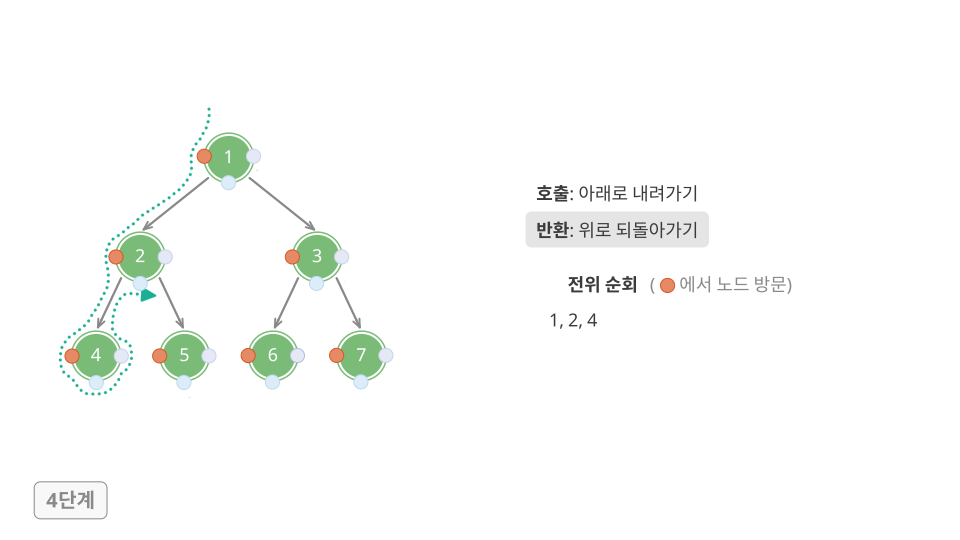
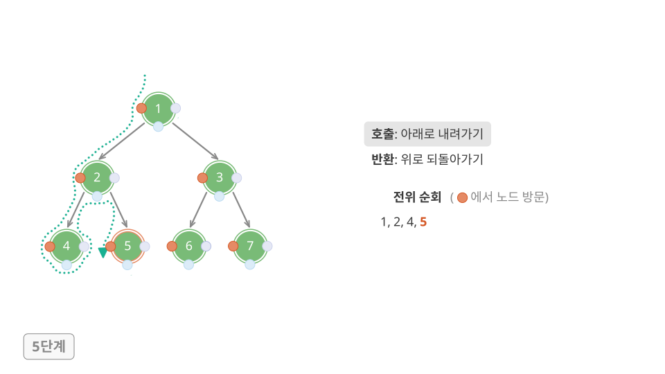
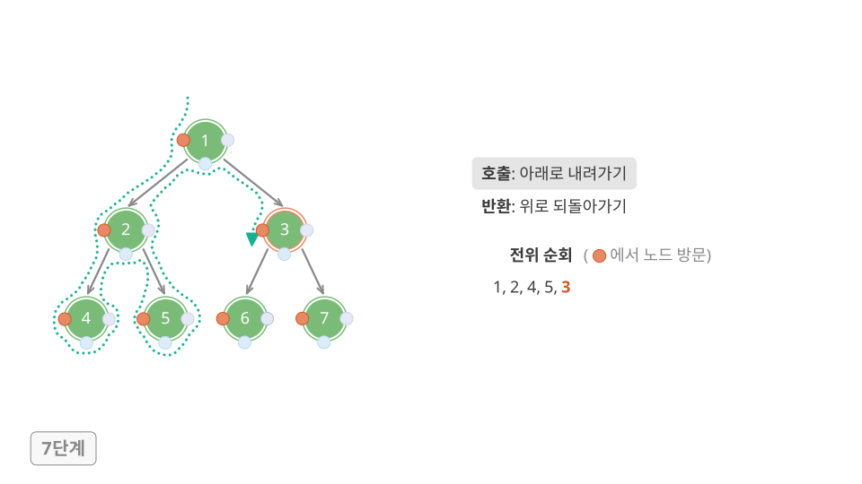

# 이진 트리 순회

물리 구조의 관점에서 트리는 연결 리스트에 기반한 자료 구조이므로 포인터를 따라 노드를 하나씩 방문한다. 다만 트리는 비선형 자료 구조여서 연결 리스트보다 순회가 복잡하고 탐색 알고리즘이 필요하다.

이진 트리의 대표적인 순회 방법에는 레벨 순회, 전위 순회, 중위 순회, 후위 순회가 있다.

## 레벨 순회

다음 그림처럼 <u>레벨 순회(level-order traversal)</u>는 이진 트리를 위에서 아래로 한 레벨씩 순회하고 각 레벨에서는 왼쪽부터 오른쪽으로 노드를 방문한다.

레벨 순회는 본질적으로 <u>너비 우선 순회(breadth-first traversal)</u>이며 <u>너비 우선 탐색(breadth-first search, BFS)</u>이라고도 한다. 한 겹씩 바깥으로 넓혀 가듯 레벨별로 방문하는 방식이다.


### 코드 구현

너비 우선 순회는 보통 큐로 구현한다. 큐는 ‘먼저 들어온 것이 먼저 나가는’ 규칙을 따르고 너비 우선 순회는 ‘한 레벨씩 나아가는’ 규칙을 따른다. 두 규칙의 원리는 같다. 구현 코드는 다음과 같다.

```src
[file]{binary_tree_bfs}-[class]{}-[func]{level_order}
```

### 복잡도 분석

- **시간 복잡도는 $O(n)$이다**. 모든 노드를 한 번씩 방문하므로 $O(n)$ 시간이 걸린다. 여기서 $n$은 노드 수다.
- **공간 복잡도는 $O(n)$이다**. 최악의 경우인 포화 이진 트리에서는 맨 아래 레벨을 방문하기 직전에 큐에 최대 $(n + 1) / 2$개의 노드가 동시에 들어 있어 $O(n)$ 공간을 차지한다.

## 전위, 중위, 후위 순회

전위, 중위, 후위 순회는 모두 <u>깊이 우선 순회(depth-first traversal)</u>에 속하며 <u>깊이 우선 탐색(depth-first search, DFS)</u>이라고도 한다. 한 경로를 끝까지 따라간 뒤 되돌아와 탐색을 이어 가는 방식이다.

다음 그림은 이진 트리에서 깊이 우선 순회가 어떻게 진행되는지 보여 준다. **깊이 우선 순회는 트리 전체의 둘레를 한 바퀴 도는 것과 비슷하다**. 각 노드에서 세 위치를 지나게 되며 이들은 각각 전위, 중위, 후위 순회에 대응한다.


### 코드 구현

깊이 우선 탐색은 보통 재귀로 구현한다.

```src
[file]{binary_tree_dfs}-[class]{}-[func]{post_order}
```

!!! tip

    깊이 우선 탐색은 반복으로도 구현할 수 있다. 관심 있는 독자는 직접 살펴보자.

다음 그림은 이진 트리 전위 순회의 재귀 과정을 보여 준다. 이 과정은 서로 반대 방향으로 진행되는 ‘호출’과 ‘반환’으로 나눌 수 있다.

1. ‘호출’은 새 메서드 호출을 시작하는 것으로, 이때 프로그램은 다음 노드를 방문한다.
2. ‘반환’은 함수에서 돌아오는 것으로, 현재 노드의 처리를 마쳤음을 뜻한다.

=== "<1>"
    

=== "<2>"
    

=== "<3>"
    

=== "<4>"
    

=== "<5>"
    

=== "<6>"
    

=== "<7>"
    

=== "<8>"
    

=== "<9>"
    

=== "<10>"
    

=== "<11>"
    

### 복잡도 분석

- **시간 복잡도는 $O(n)$이다**. 모든 노드를 한 번씩 방문하므로 $O(n)$ 시간이 걸린다.
- **공간 복잡도는 $O(n)$이다**. 최악의 경우 트리가 연결 리스트로 퇴화하면 재귀 깊이가 $n$에 이르고 시스템이 스택 프레임에 $O(n)$ 공간을 사용한다.
