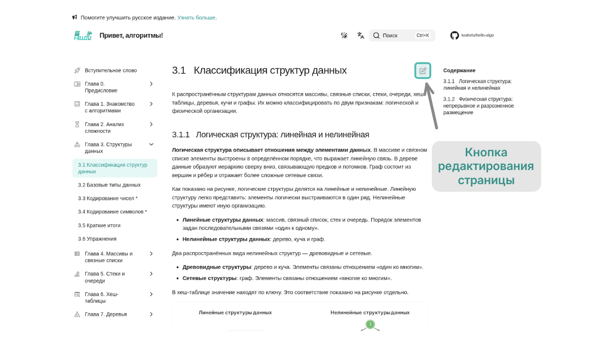

# Как принять участие в работе над книгой

При работе над книгой автор мог что-то упустить или допустить ошибку. Просим отнестись к этому с пониманием. Если вы заметили опечатку или неработающую ссылку, обнаружили пропуск, двусмысленную фразу, неясное объяснение или неудачную последовательность изложения, помогите нам это исправить. Так читателям будет легче учиться по книге.

На главных страницах репозитория, веб-версии и PDF-версии книги мы укажем, под какими именами зарегистрированы на GitHub все [участники проекта](https://github.com/krahets/hello-algo/graphs/contributors). Так мы благодарим их за бескорыстный вклад в сообщество открытого ПО.

!!! success "Преимущество открытого проекта"

    Между тиражами печатной книги обычно проходит много времени, поэтому обновлять её содержание сложно.
    
    В нашей открытой книге обновление может занять всего несколько дней или даже часов.

### Небольшие правки

На рисунке ниже показан значок редактирования, который находится в правом верхнем углу каждой страницы. Чтобы исправить текст или код, выполните следующие шаги.

1. Нажмите на значок редактирования. Если GitHub предложит создать форк репозитория, подтвердите действие.
2. Внесите изменения в исходный файл Markdown. Проверьте, всё ли верно, и постарайтесь сохранить единообразие оформления.
3. Внизу страницы опишите свои изменения и нажмите «Propose file change». На открывшейся странице нажмите «Create pull request», чтобы отправить запрос на включение изменений.

Изображения нельзя редактировать напрямую. Опишите проблему в [новом обращении (issue)](https://github.com/krahets/hello-algo/issues) или в комментарии. Мы постараемся как можно скорее перерисовать изображение и заменить его.

### Работа над материалами книги

Если вы хотите принять участие в проекте, например перевести примеры кода на другой язык программирования или дополнить текст, выполните следующие шаги, чтобы отправить запрос на включение изменений (pull request).

1. Войдите в GitHub и создайте в своей учётной записи форк [репозитория книги](https://github.com/krahets/hello-algo).
2. Откройте страницу своего форка и с помощью команды `git clone` клонируйте его на свой компьютер.
3. Подготовьте новые материалы на своём компьютере и проведите полное тестирование, чтобы проверить правильность кода.
4. Зафиксируйте изменения в локальном репозитории (commit) и отправьте их в удалённый репозиторий (push).
5. Обновите страницу репозитория и нажмите «Create pull request», чтобы отправить запрос на включение изменений.
