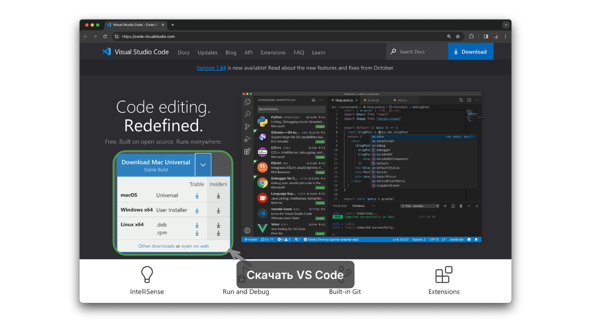
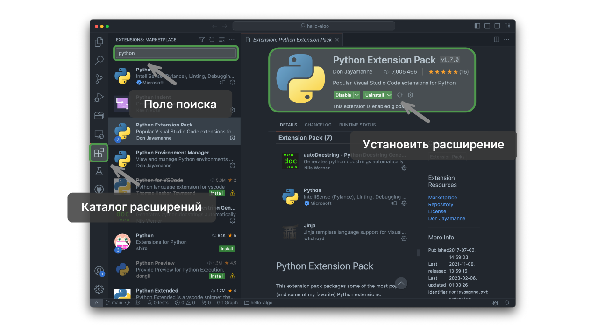

# 16.1 &nbsp; Установка среды программирования

## 16.1.1 &nbsp; Установка IDE

Для работы на своём компьютере мы рекомендуем VS Code — легковесную интегрированную среду разработки (IDE) с открытым исходным кодом. Перейдите на [официальный сайт VS Code](https://code.visualstudio.com/), выберите версию для своей операционной системы, скачайте и установите её.

{ class="animation-figure" }

 Рисунок 16-1 &nbsp; Загрузка VS Code с официального сайта 

Благодаря большому выбору расширений в VS Code можно запускать и отлаживать программы на большинстве языков программирования. Например, чтобы отлаживать код на Python, достаточно установить набор расширений Python Extension Pack. На рисунке 16-2 показано, как это сделать.

{ class="animation-figure" }

 Рисунок 16-2 &nbsp; Установка набора расширений в VS Code 

## 16.1.2 &nbsp; Установка инструментов для разных языков

### 1. &nbsp; Среда для Python

1. Скачайте и установите [Miniconda3](https://docs.conda.io/en/latest/miniconda.html). Требуется Python версии 3.10 или новее.
2. Введите `python` в строке поиска каталога расширений VS Code и установите Python Extension Pack.
3. При желании установите инструмент для форматирования кода, выполнив в командной строке `pip install black`.

### 2. &nbsp; Среда для C/C++

1. В Windows необходимо установить [MinGW](https://sourceforge.net/projects/mingw-w64/files/) (см. [руководство по настройке на китайском языке](https://blog.csdn.net/qq_33698226/article/details/129031241)). В macOS уже есть Clang, устанавливать его отдельно не требуется.
2. Введите `c++` в строке поиска каталога расширений VS Code и установите C/C++ Extension Pack.
3. При желании откройте страницу настроек (Settings), найдите параметр форматирования кода `Clang_format_fallback Style` и задайте для него значение `{ BasedOnStyle: Microsoft, BreakBeforeBraces: Attach }`.

### 3. &nbsp; Среда для Java

1. Скачайте и установите [OpenJDK](https://jdk.java.net/18/). Версия JDK должна быть выше 9.
2. Введите `java` в строке поиска каталога расширений VS Code и установите Extension Pack for Java.

### 4. &nbsp; Среда для C#

1. Скачайте и установите [.NET 8.0](https://dotnet.microsoft.com/en-us/download).
2. Введите `C# Dev Kit` в строке поиска каталога расширений VS Code и установите C# Dev Kit (см. [руководство по настройке](https://code.visualstudio.com/docs/csharp/get-started)).
3. Можно также воспользоваться Visual Studio (см. [руководство по установке](https://learn.microsoft.com/ru-ru/visualstudio/install/install-visual-studio?view=vs-2022)).

### 5. &nbsp; Среда для Go

1. Скачайте и установите [Go](https://go.dev/dl/).
2. Введите `go` в строке поиска каталога расширений VS Code и установите расширение Go.
3. Нажмите `Ctrl + Shift + P`, чтобы открыть палитру команд. Введите go, выберите `Go: Install/Update Tools`, отметьте все инструменты и установите их.

### 6. &nbsp; Среда для Swift

1. Скачайте и установите [Swift](https://www.swift.org/download/).
2. Введите `swift` в строке поиска каталога расширений VS Code и установите расширение [Swift for Visual Studio Code](https://marketplace.visualstudio.com/items?itemName=sswg.swift-lang).

### 7. &nbsp; Среда для JavaScript

1. Скачайте и установите [Node.js](https://nodejs.org/en/).
2. При желании установите инструмент для форматирования кода. Для этого введите `Prettier` в строке поиска каталога расширений VS Code и установите найденное расширение.

### 8. &nbsp; Среда для TypeScript

1. Выполните те же шаги, что и при установке среды для JavaScript.
2. Установите [TypeScript Execute (tsx)](https://github.com/privatenumber/tsx?tab=readme-ov-file#global-installation).
3. Введите `typescript` в строке поиска каталога расширений VS Code и установите расширение [Pretty TypeScript Errors](https://marketplace.visualstudio.com/items?itemName=yoavbls.pretty-ts-errors).

### 9. &nbsp; Среда для Dart

1. Скачайте и установите [Dart](https://dart.dev/get-dart).
2. Введите `dart` в строке поиска каталога расширений VS Code и установите расширение [Dart](https://marketplace.visualstudio.com/items?itemName=Dart-Code.dart-code).

### 10. &nbsp; Среда для Rust

1. Скачайте и установите [Rust](https://www.rust-lang.org/tools/install).
2. Введите `rust` в строке поиска каталога расширений VS Code и установите расширение [rust-analyzer](https://marketplace.visualstudio.com/items?itemName=rust-lang.rust-analyzer).
