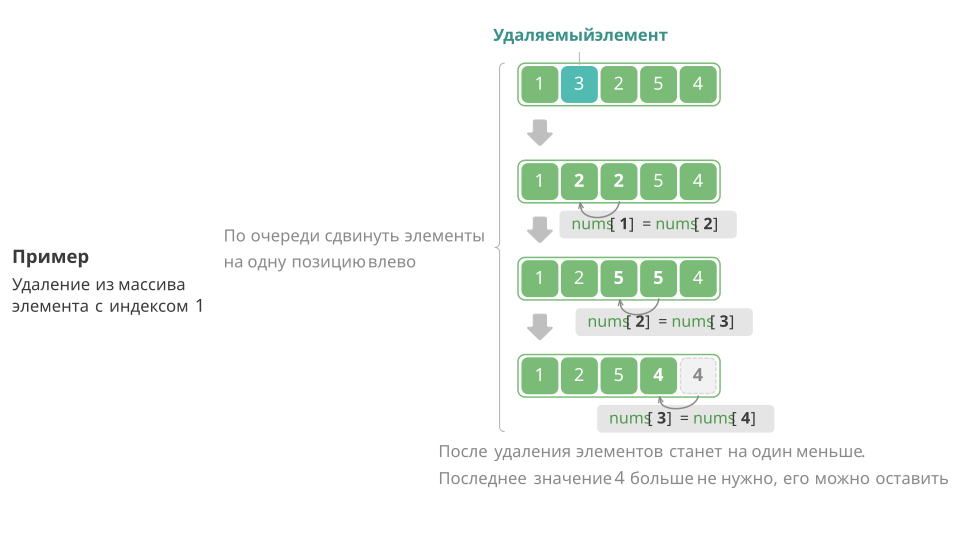

# Массив

<u>Массив (array)</u> — линейная структура данных, в которой элементы одного типа хранятся в непрерывной области памяти. Позицию элемента в массиве называют его <u>индексом (index)</u>. На рисунке показано, как устроен массив и как он хранится в памяти.


## Основные операции с массивом

### Инициализация массива

Массив можно инициализировать двумя способами: явно задать начальные значения или обойтись без них. Если начальные значения не указаны, в большинстве языков программирования элементы массива получают значение $0$:

```snippet
init_array
```

??? pythontutor "Визуализация выполнения"

    @tutor init_array_tutor

### Доступ к элементу

Элементы массива располагаются в памяти подряд, поэтому их адреса легко вычислить. Зная адрес начала массива (адрес первого элемента) и индекс нужного элемента, можно вычислить его адрес по формуле на рисунке и сразу к нему обратиться.


На рисунке индекс первого элемента равен $0$. Это может удивить: нам привычнее считать с $1$. Но формула адреса показывает, что **индекс задаёт смещение от начала массива в единицах размера элемента**. Смещение первого элемента равно $0$, поэтому его индекс закономерно равен $0$.

Доступ к элементам массива очень эффективен: к любому из них можно обратиться по индексу за время $O(1)$.

```src
[file]{array}-[class]{}-[func]{random_access}
```

### Вставка элемента

В памяти элементы массива «прижаты» друг к другу. Между ними нет свободного места для других данных. Как показано на рисунке, для вставки в середину массива нужно сдвинуть все элементы начиная с позиции вставки на одну позицию вправо, а затем записать по нужному индексу новое значение.


Поскольку длина массива фиксирована, при такой вставке прежнее содержимое последней ячейки неизбежно «теряется». В разделе «Список» мы обсудим, как решить эту проблему.

```src
[file]{array}-[class]{}-[func]{insert}
```

### Удаление элемента

Аналогично, чтобы удалить элемент по индексу $i$, нужно сдвинуть все элементы после $i$ на одну позицию влево, как показано на рисунке.



После удаления прежнее значение в последней ячейке уже не имеет значения, поэтому специально менять его не требуется.

```src
[file]{array}-[class]{}-[func]{remove}
```

У вставки и удаления элементов массива есть несколько недостатков.

- **Высокая временная сложность**. И вставка, и удаление в среднем занимают время $O(n)$, где $n$ — длина массива.
- **Потеря элементов**. Длина массива фиксирована, поэтому при вставке элемент, выходящий за пределы массива, теряется.
- **Неиспользуемая память**. Можно создать массив большего размера и использовать только его начальную часть. Тогда при вставке будут «теряться» лишь незначащие значения в конце, но часть памяти останется невостребованной.

### Обход массива

В большинстве языков программирования можно обходить массив как по индексам, так и перебирая непосредственно его элементы:

```src
[file]{array}-[class]{}-[func]{traverse}
```

### Поиск элемента

Чтобы найти заданный элемент в массиве, перебирают элементы и на каждом шаге сравнивают очередное значение с искомым. При совпадении выдают соответствующий индекс.

Поскольку массив представляет собой линейную структуру данных, описанную операцию называют линейным поиском.

```src
[file]{array}-[class]{}-[func]{find}
```

### Увеличение ёмкости массива

В сложной системной среде программа не может рассчитывать, что память сразу за массивом свободна и массив можно безопасно расширить на месте. Поэтому в большинстве языков программирования **длина массива неизменна**.

Чтобы увеличить ёмкость, нужно создать массив большего размера и по порядку скопировать в него элементы исходного. Эта операция занимает время $O(n)$ и для больших массивов может быть весьма долгой. Вот её реализация:

```src
[file]{array}-[class]{}-[func]{extend}
```

## Преимущества и ограничения массивов

Элементы массива имеют одинаковый тип и хранятся в непрерывной области памяти. Системе, таким образом, заранее известны важные свойства данных, и она может использовать их для ускорения операций.

- **Экономное использование памяти**. Для данных массива выделяется непрерывный блок памяти, и дополнительное место для связей между элементами не требуется.
- **Произвольный доступ**. К любому элементу массива можно обратиться за время $O(1)$.
- **Локальность обращений к памяти**. При обращении к элементу массива компьютер загружает и помещает в кеш также соседние данные. Быстрый доступ к кешу ускоряет последующие операции.

У непрерывного размещения есть и обратная сторона.

- **Дорогие вставка и удаление**. Если массив велик, при вставке и удалении приходится перемещать много элементов.
- **Неизменная длина**. Длина массива фиксируется при создании. Чтобы расширить его, приходится копировать все данные в новый массив, а это дорого.
- **Потери памяти**. Если выделить под массив больше места, чем требуется, часть памяти останется неиспользованной.

## Применение массивов

Массив — одна из самых распространённых базовых структур данных. Массивы используются во множестве алгоритмов и служат основой для более сложных структур.

- **Произвольный доступ**. Для случайной выборки можно сохранить данные в массиве, сгенерировать последовательность случайных индексов и выбрать по ним элементы.
- **Сортировка и поиск**. Массив — наиболее распространённая структура данных для алгоритмов сортировки и поиска. Быструю сортировку, сортировку слиянием и двоичный поиск обычно выполняют на массивах.
- **Таблицы поиска**. Когда требуется быстро найти элемент или соответствующее ему значение, массив может служить таблицей поиска. Например, для сопоставления символов и кодов ASCII можно использовать код символа как индекс и хранить соответствующий элемент в этой позиции массива.
- **Машинное обучение**. В нейронных сетях широко используются операции линейной алгебры над векторами, матрицами и тензорами. Все они представляются массивами. Массив — самая распространённая структура данных при программировании нейронных сетей.
- **Реализация структур данных**. На основе массивов можно реализовать стеки, очереди, хеш-таблицы, кучи, графы и другие структуры. Например, матрица смежности графа представляет собой двумерный массив.
