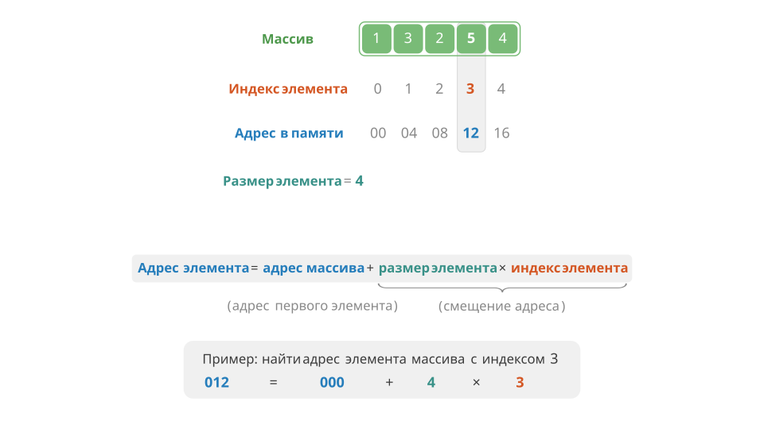
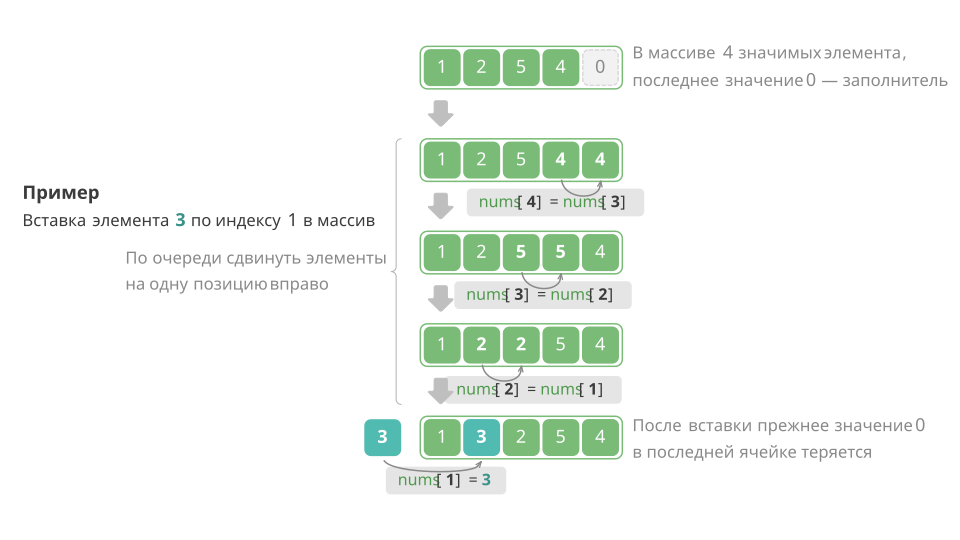

# 4.1 &nbsp; Массив

<u>Массив (array)</u> — линейная структура данных, в которой элементы одного типа хранятся в непрерывной области памяти. Позицию элемента в массиве называют его <u>индексом (index)</u>. На рисунке показано, как устроен массив и как он хранится в памяти.

{ class="animation-figure" }

<p align="center"> Рисунок 4-1 &nbsp; Определение массива и его размещение в памяти </p>

## 4.1.1 &nbsp; Основные операции с массивом

### 1. &nbsp; Инициализация массива

Массив можно инициализировать двумя способами: явно задать начальные значения или обойтись без них. Если начальные значения не указаны, в большинстве языков программирования элементы массива получают значение $0$:

=== "Python"

    ```python title="array.py"
    # Инициализация массива
    arr: list[int] = [0] * 5  # [ 0, 0, 0, 0, 0 ]
    nums: list[int] = [1, 3, 2, 5, 4]
    ```

=== "C++"

    ```cpp title="array.cpp"
    /* Инициализация массива */
    // Хранится в стеке
    int arr[5] = {};
    int nums[5] = {1, 3, 2, 5, 4};
    // Хранится в куче (память нужно освободить вручную)
    int *arr1 = new int[5]{};
    int *nums1 = new int[5]{1, 3, 2, 5, 4};
    ```

=== "Java"

    ```java title="array.java"
    /* Инициализация массива */
    int[] arr = new int[5]; // { 0, 0, 0, 0, 0 }
    int[] nums = { 1, 3, 2, 5, 4 };
    ```

=== "C#"

    ```csharp title="array.cs"
    // Инициализация массива
    int[] arr = new int[5]; // [ 0, 0, 0, 0, 0 ]
    int[] nums = [1, 3, 2, 5, 4];
    ```

=== "Go"

    ```go title="array.go"
    /* Инициализация массива */
    var arr [5]int
    // В Go тип с указанной длиной ([5]int) — массив, а без длины ([]int) — срез
    // Длина массива в Go определяется при компиляции, поэтому задать её можно только константой
    // Для удобства реализации функции расширения extend() далее рассматриваем срез (slice) как массив (array)
    nums := []int{1, 3, 2, 5, 4}
    ```

=== "Swift"

    ```swift title="array.swift"
    /* Инициализация массива */
    let arr = Array(repeating: 0, count: 5) // [0, 0, 0, 0, 0]
    var nums = [1, 3, 2, 5, 4]
    ```

=== "JS"

    ```javascript title="array.js"
    /* Инициализация массива */
    const arr = new Array(5).fill(0);
    let nums = [1, 3, 2, 5, 4];
    ```

=== "TS"

    ```typescript title="array.ts"
    /* Инициализация массива */
    const arr: number[] = new Array(5).fill(0);
    let nums: number[] = [1, 3, 2, 5, 4];
    ```

=== "Dart"

    ```dart title="array.dart"
    /* Инициализация массива */
    var arr = List.filled(5, 0); // [0, 0, 0, 0, 0]
    List<int> nums = [1, 3, 2, 5, 4];
    ```

=== "Rust"

    ```rust title="array.rs"
    /* Инициализация массива */
    let arr: [i32; 5] = [0; 5]; // [0, 0, 0, 0, 0]
    // В Rust тип с указанной длиной ([i32; 5]) — массив, а без длины (&[i32]) — ссылка на срез
    // Длина массива в Rust определяется при компиляции, поэтому задать её можно только константой
    // В Rust в качестве динамического массива обычно используют вектор
    // Для удобства реализации метода расширения extend() далее рассматриваем вектор как массив
    let nums: Vec<i32> = vec![1, 3, 2, 5, 4];
    ```

=== "C"

    ```c title="array.c"
    /* Инициализация массива */
    int arr[5] = {0}; // { 0, 0, 0, 0, 0 }
    int nums[] = {1, 3, 2, 5, 4};
    ```

=== "Kotlin"

    ```kotlin title="array.kt"
    /* Инициализация массива */
    val arr = IntArray(5) // { 0, 0, 0, 0, 0 }
    var nums = intArrayOf(1, 3, 2, 5, 4)
    ```

=== "Ruby"

    ```ruby title="array.rb"
    # Инициализация массива
    arr = Array.new(5, 0)
    nums = [1, 3, 2, 5, 4]
    ```

??? pythontutor "Визуализация выполнения"

    <div style="height: 243px; width: 100%;"><iframe class="pythontutor-iframe" title="Визуализация выполнения" src="https://pythontutor.com/iframe-embed.html#code=%23%20%D0%98%D0%BD%D0%B8%D1%86%D0%B8%D0%B0%D0%BB%D0%B8%D0%B7%D0%B8%D1%80%D1%83%D0%B5%D0%BC%20%D0%BC%D0%B0%D1%81%D1%81%D0%B8%D0%B2%0Aarr%20%3D%20%5B0%5D%20%2A%205%20%20%23%20%5B%200,%200,%200,%200,%200%20%5D%0Anums%20%3D%20%5B1,%203,%202,%205,%204%5D&codeDivHeight=472&codeDivWidth=350&cumulative=false&curInstr=0&heapPrimitives=nevernest&origin=opt-frontend.js&py=311&rawInputLstJSON=%5B%5D&textReferences=false"> </iframe></div>
    <div style="margin-top: 5px;"><a href="https://pythontutor.com/iframe-embed.html#code=%23%20%D0%98%D0%BD%D0%B8%D1%86%D0%B8%D0%B0%D0%BB%D0%B8%D0%B7%D0%B8%D1%80%D1%83%D0%B5%D0%BC%20%D0%BC%D0%B0%D1%81%D1%81%D0%B8%D0%B2%0Aarr%20%3D%20%5B0%5D%20%2A%205%20%20%23%20%5B%200,%200,%200,%200,%200%20%5D%0Anums%20%3D%20%5B1,%203,%202,%205,%204%5D&codeDivHeight=800&codeDivWidth=600&cumulative=false&curInstr=0&heapPrimitives=nevernest&origin=opt-frontend.js&py=311&rawInputLstJSON=%5B%5D&textReferences=false" target="_blank" rel="noopener noreferrer">Во весь экран ></a></div>

### 2. &nbsp; Доступ к элементу

Элементы массива располагаются в памяти подряд, поэтому их адреса легко вычислить. Зная адрес начала массива (адрес первого элемента) и индекс нужного элемента, можно вычислить его адрес по формуле на рисунке и сразу к нему обратиться.

{ class="animation-figure" }

<p align="center"> Рисунок 4-2 &nbsp; Вычисление адреса элемента массива </p>

На рисунке индекс первого элемента равен $0$. Это может удивить: нам привычнее считать с $1$. Но формула адреса показывает, что **индекс задаёт смещение от начала массива в единицах размера элемента**. Смещение первого элемента равно $0$, поэтому его индекс закономерно равен $0$.

Доступ к элементам массива очень эффективен: к любому из них можно обратиться по индексу за время $O(1)$.

=== "Python"

    ```python title="array.py"
    def random_access(nums: list[int]) -> int:
        """Чтение случайного элемента"""
        # Выбрать случайное число из интервала [0, len(nums)-1]
        random_index = random.randint(0, len(nums) - 1)
        # Получить и вернуть случайный элемент
        random_num = nums[random_index]
        return random_num
    ```

=== "C++"

    ```cpp title="array.cpp"
    /* Чтение случайного элемента */
    int randomAccess(int *nums, int size) {
        // Выбрать случайное число из интервала [0, size)
        int randomIndex = rand() % size;
        // Получить и вернуть случайный элемент
        int randomNum = nums[randomIndex];
        return randomNum;
    }
    ```

=== "Java"

    ```java title="array.java"
    /* Чтение случайного элемента */
    int randomAccess(int[] nums) {
        // Выбрать случайное число из интервала [0, nums.length)
        int randomIndex = ThreadLocalRandom.current().nextInt(0, nums.length);
        // Получить и вернуть случайный элемент
        int randomNum = nums[randomIndex];
        return randomNum;
    }
    ```

=== "C#"

    ```csharp title="array.cs"
    /* Чтение случайного элемента */
    int RandomAccess(int[] nums) {
        Random random = new();
        // Выбрать случайное число из интервала [0, nums.Length)
        int randomIndex = random.Next(nums.Length);
        // Получить и вернуть случайный элемент
        int randomNum = nums[randomIndex];
        return randomNum;
    }
    ```

=== "Go"

    ```go title="array.go"
    /* Чтение случайного элемента */
    func randomAccess(nums []int) (randomNum int) {
        // Выбрать случайное число из интервала [0, nums.length)
        randomIndex := rand.Intn(len(nums))
        // Получить и вернуть случайный элемент
        randomNum = nums[randomIndex]
        return
    }
    ```

=== "Swift"

    ```swift title="array.swift"
    /* Чтение случайного элемента */
    func randomAccess(nums: [Int]) -> Int {
        // Выбрать случайное число из интервала [0, nums.count)
        let randomIndex = nums.indices.randomElement()!
        // Получить и вернуть случайный элемент
        let randomNum = nums[randomIndex]
        return randomNum
    }
    ```

=== "JS"

    ```javascript title="array.js"
    /* Чтение случайного элемента */
    function randomAccess(nums) {
        // Выбрать случайное число из интервала [0, nums.length)
        const random_index = Math.floor(Math.random() * nums.length);
        // Получить и вернуть случайный элемент
        const random_num = nums[random_index];
        return random_num;
    }
    ```

=== "TS"

    ```typescript title="array.ts"
    /* Чтение случайного элемента */
    function randomAccess(nums: number[]): number {
        // Выбрать случайное число из интервала [0, nums.length)
        const random_index = Math.floor(Math.random() * nums.length);
        // Получить и вернуть случайный элемент
        const random_num = nums[random_index];
        return random_num;
    }
    ```

=== "Dart"

    ```dart title="array.dart"
    /* Чтение случайного элемента */
    int randomAccess(List<int> nums) {
      // Выбрать случайное число из интервала [0, nums.length)
      int randomIndex = Random().nextInt(nums.length);
      // Получить и вернуть случайный элемент
      int randomNum = nums[randomIndex];
      return randomNum;
    }
    ```

=== "Rust"

    ```rust title="array.rs"
    /* Чтение случайного элемента */
    fn random_access(nums: &[i32]) -> i32 {
        // Выбрать случайное число из интервала [0, nums.len())
        let random_index = rand::thread_rng().gen_range(0..nums.len());
        // Получить и вернуть случайный элемент
        let random_num = nums[random_index];
        random_num
    }
    ```

=== "C"

    ```c title="array.c"
    /* Чтение случайного элемента */
    int randomAccess(int *nums, int size) {
        // Выбрать случайное число из интервала [0, size)
        int randomIndex = rand() % size;
        // Получить и вернуть случайный элемент
        int randomNum = nums[randomIndex];
        return randomNum;
    }
    ```

=== "Kotlin"

    ```kotlin title="array.kt"
    /* Чтение случайного элемента */
    fun randomAccess(nums: IntArray): Int {
        // Выбрать случайное число из интервала [0, nums.size)
        val randomIndex = ThreadLocalRandom.current().nextInt(0, nums.size)
        // Получить и вернуть случайный элемент
        val randomNum = nums[randomIndex]
        return randomNum
    }
    ```

=== "Ruby"

    ```ruby title="array.rb"
    ### Чтение случайного элемента ###
    def random_access(nums)
      # Выбрать случайное число из интервала [0, nums.length)
      random_index = Random.rand(0...nums.length)

      # Получить и вернуть случайный элемент
      nums[random_index]
    end
    ```

??? pythontutor "Визуализация выполнения"

    <div style="height: 531px; width: 100%;"><iframe class="pythontutor-iframe" title="Визуализация выполнения" src="https://pythontutor.com/iframe-embed.html#code=import%20random%0A%0Adef%20random_access%28nums%3A%20list%5Bint%5D%29%20-%3E%20int%3A%0A%20%20%20%20%22%22%22%D0%A7%D1%82%D0%B5%D0%BD%D0%B8%D0%B5%20%D1%81%D0%BB%D1%83%D1%87%D0%B0%D0%B9%D0%BD%D0%BE%D0%B3%D0%BE%20%D1%8D%D0%BB%D0%B5%D0%BC%D0%B5%D0%BD%D1%82%D0%B0%22%22%22%0A%20%20%20%20%23%20%D0%92%D1%8B%D0%B1%D1%80%D0%B0%D1%82%D1%8C%20%D1%81%D0%BB%D1%83%D1%87%D0%B0%D0%B9%D0%BD%D0%BE%D0%B5%20%D1%87%D0%B8%D1%81%D0%BB%D0%BE%20%D0%B8%D0%B7%20%D0%B8%D0%BD%D1%82%D0%B5%D1%80%D0%B2%D0%B0%D0%BB%D0%B0%20%5B0,%20len%28nums%29-1%5D%0A%20%20%20%20random_index%20%3D%20random.randint%280,%20len%28nums%29%20-%201%29%0A%20%20%20%20%23%20%D0%9F%D0%BE%D0%BB%D1%83%D1%87%D0%B8%D1%82%D1%8C%20%D0%B8%20%D0%B2%D0%B5%D1%80%D0%BD%D1%83%D1%82%D1%8C%20%D1%81%D0%BB%D1%83%D1%87%D0%B0%D0%B9%D0%BD%D1%8B%D0%B9%20%D1%8D%D0%BB%D0%B5%D0%BC%D0%B5%D0%BD%D1%82%0A%20%20%20%20random_num%20%3D%20nums%5Brandom_index%5D%0A%20%20%20%20return%20random_num%0A%0A%22%22%22Driver%20Code%22%22%22%0Aif%20__name__%20%3D%3D%20%22__main__%22%3A%0A%20%20%20%20%23%20%D0%98%D0%BD%D0%B8%D1%86%D0%B8%D0%B0%D0%BB%D0%B8%D0%B7%D0%B0%D1%86%D0%B8%D1%8F%20%D0%BC%D0%B0%D1%81%D1%81%D0%B8%D0%B2%D0%B0%0A%20%20%20%20nums%20%3D%20%5B1,%203,%202,%205,%204%5D%0A%20%20%20%20print%28%22%D0%9C%D0%B0%D1%81%D1%81%D0%B8%D0%B2%20nums%20%3D%22,%20nums%29%0A%0A%20%20%20%20%23%20%D0%A7%D1%82%D0%B5%D0%BD%D0%B8%D0%B5%20%D1%81%D0%BB%D1%83%D1%87%D0%B0%D0%B9%D0%BD%D0%BE%D0%B3%D0%BE%20%D1%8D%D0%BB%D0%B5%D0%BC%D0%B5%D0%BD%D1%82%D0%B0%0A%20%20%20%20random_num%3A%20int%20%3D%20random_access%28nums%29%0A%20%20%20%20print%28%22%D0%A1%D0%BB%D1%83%D1%87%D0%B0%D0%B9%D0%BD%D1%8B%D0%B9%20%D1%8D%D0%BB%D0%B5%D0%BC%D0%B5%D0%BD%D1%82%20nums%3A%22,%20random_num%29%0A&codeDivHeight=472&codeDivWidth=350&cumulative=false&curInstr=7&heapPrimitives=nevernest&origin=opt-frontend.js&py=311&rawInputLstJSON=%5B%5D&textReferences=false"> </iframe></div>
    <div style="margin-top: 5px;"><a href="https://pythontutor.com/iframe-embed.html#code=import%20random%0A%0Adef%20random_access%28nums%3A%20list%5Bint%5D%29%20-%3E%20int%3A%0A%20%20%20%20%22%22%22%D0%A7%D1%82%D0%B5%D0%BD%D0%B8%D0%B5%20%D1%81%D0%BB%D1%83%D1%87%D0%B0%D0%B9%D0%BD%D0%BE%D0%B3%D0%BE%20%D1%8D%D0%BB%D0%B5%D0%BC%D0%B5%D0%BD%D1%82%D0%B0%22%22%22%0A%20%20%20%20%23%20%D0%92%D1%8B%D0%B1%D1%80%D0%B0%D1%82%D1%8C%20%D1%81%D0%BB%D1%83%D1%87%D0%B0%D0%B9%D0%BD%D0%BE%D0%B5%20%D1%87%D0%B8%D1%81%D0%BB%D0%BE%20%D0%B8%D0%B7%20%D0%B8%D0%BD%D1%82%D0%B5%D1%80%D0%B2%D0%B0%D0%BB%D0%B0%20%5B0,%20len%28nums%29-1%5D%0A%20%20%20%20random_index%20%3D%20random.randint%280,%20len%28nums%29%20-%201%29%0A%20%20%20%20%23%20%D0%9F%D0%BE%D0%BB%D1%83%D1%87%D0%B8%D1%82%D1%8C%20%D0%B8%20%D0%B2%D0%B5%D1%80%D0%BD%D1%83%D1%82%D1%8C%20%D1%81%D0%BB%D1%83%D1%87%D0%B0%D0%B9%D0%BD%D1%8B%D0%B9%20%D1%8D%D0%BB%D0%B5%D0%BC%D0%B5%D0%BD%D1%82%0A%20%20%20%20random_num%20%3D%20nums%5Brandom_index%5D%0A%20%20%20%20return%20random_num%0A%0A%22%22%22Driver%20Code%22%22%22%0Aif%20__name__%20%3D%3D%20%22__main__%22%3A%0A%20%20%20%20%23%20%D0%98%D0%BD%D0%B8%D1%86%D0%B8%D0%B0%D0%BB%D0%B8%D0%B7%D0%B0%D1%86%D0%B8%D1%8F%20%D0%BC%D0%B0%D1%81%D1%81%D0%B8%D0%B2%D0%B0%0A%20%20%20%20nums%20%3D%20%5B1,%203,%202,%205,%204%5D%0A%20%20%20%20print%28%22%D0%9C%D0%B0%D1%81%D1%81%D0%B8%D0%B2%20nums%20%3D%22,%20nums%29%0A%0A%20%20%20%20%23%20%D0%A7%D1%82%D0%B5%D0%BD%D0%B8%D0%B5%20%D1%81%D0%BB%D1%83%D1%87%D0%B0%D0%B9%D0%BD%D0%BE%D0%B3%D0%BE%20%D1%8D%D0%BB%D0%B5%D0%BC%D0%B5%D0%BD%D1%82%D0%B0%0A%20%20%20%20random_num%3A%20int%20%3D%20random_access%28nums%29%0A%20%20%20%20print%28%22%D0%A1%D0%BB%D1%83%D1%87%D0%B0%D0%B9%D0%BD%D1%8B%D0%B9%20%D1%8D%D0%BB%D0%B5%D0%BC%D0%B5%D0%BD%D1%82%20nums%3A%22,%20random_num%29%0A&codeDivHeight=800&codeDivWidth=600&cumulative=false&curInstr=7&heapPrimitives=nevernest&origin=opt-frontend.js&py=311&rawInputLstJSON=%5B%5D&textReferences=false" target="_blank" rel="noopener noreferrer">Во весь экран ></a></div>

### 3. &nbsp; Вставка элемента

В памяти элементы массива «прижаты» друг к другу. Между ними нет свободного места для других данных. Как показано на рисунке, для вставки в середину массива нужно сдвинуть все элементы начиная с позиции вставки на одну позицию вправо, а затем записать по нужному индексу новое значение.

{ class="animation-figure" }

<p align="center"> Рисунок 4-3 &nbsp; Пример вставки элемента в массив </p>

Поскольку длина массива фиксирована, при такой вставке прежнее содержимое последней ячейки неизбежно «теряется». В разделе «Список» мы обсудим, как решить эту проблему.

=== "Python"

    ```python title="array.py"
    def insert(nums: list[int], num: int, index: int):
        """Вставить num в массив по индексу index"""
        # Сдвинуть на одну позицию вправо все элементы начиная с index
        for i in range(len(nums) - 1, index, -1):
            nums[i] = nums[i - 1]
        # Записать num по индексу index
        nums[index] = num
    ```

=== "C++"

    ```cpp title="array.cpp"
    /* Вставить num в массив по индексу index */
    void insert(int *nums, int size, int num, int index) {
        // Сдвинуть на одну позицию вправо все элементы начиная с index
        for (int i = size - 1; i > index; i--) {
            nums[i] = nums[i - 1];
        }
        // Записать num по индексу index
        nums[index] = num;
    }
    ```

=== "Java"

    ```java title="array.java"
    /* Вставить num в массив по индексу index */
    void insert(int[] nums, int num, int index) {
        // Сдвинуть на одну позицию вправо все элементы начиная с index
        for (int i = nums.length - 1; i > index; i--) {
            nums[i] = nums[i - 1];
        }
        // Записать num по индексу index
        nums[index] = num;
    }
    ```

=== "C#"

    ```csharp title="array.cs"
    /* Вставить num в массив по индексу index */
    void Insert(int[] nums, int num, int index) {
        // Сдвинуть на одну позицию вправо все элементы начиная с index
        for (int i = nums.Length - 1; i > index; i--) {
            nums[i] = nums[i - 1];
        }
        // Записать num по индексу index
        nums[index] = num;
    }
    ```

=== "Go"

    ```go title="array.go"
    /* Вставить num в массив по индексу index */
    func insert(nums []int, num int, index int) {
        // Сдвинуть на одну позицию вправо все элементы начиная с index
        for i := len(nums) - 1; i > index; i-- {
            nums[i] = nums[i-1]
        }
        // Записать num по индексу index
        nums[index] = num
    }
    ```

=== "Swift"

    ```swift title="array.swift"
    /* Вставить num в массив по индексу index */
    func insert(nums: inout [Int], num: Int, index: Int) {
        // Сдвинуть на одну позицию вправо все элементы начиная с index
        for i in stride(from: nums.count - 1, to: index, by: -1) {
            nums[i] = nums[i - 1]
        }
        // Записать num по индексу index
        nums[index] = num
    }
    ```

=== "JS"

    ```javascript title="array.js"
    /* Вставить num в массив по индексу index */
    function insert(nums, num, index) {
        // Сдвинуть на одну позицию вправо все элементы начиная с index
        for (let i = nums.length - 1; i > index; i--) {
            nums[i] = nums[i - 1];
        }
        // Записать num по индексу index
        nums[index] = num;
    }
    ```

=== "TS"

    ```typescript title="array.ts"
    /* Вставить num в массив по индексу index */
    function insert(nums: number[], num: number, index: number): void {
        // Сдвинуть на одну позицию вправо все элементы начиная с index
        for (let i = nums.length - 1; i > index; i--) {
            nums[i] = nums[i - 1];
        }
        // Записать num по индексу index
        nums[index] = num;
    }
    ```

=== "Dart"

    ```dart title="array.dart"
    /* Вставить _num в массив по индексу index */
    void insert(List<int> nums, int _num, int index) {
      // Сдвинуть на одну позицию вправо все элементы начиная с index
      for (var i = nums.length - 1; i > index; i--) {
        nums[i] = nums[i - 1];
      }
      // Записать _num по индексу index
      nums[index] = _num;
    }
    ```

=== "Rust"

    ```rust title="array.rs"
    /* Вставить num в массив по индексу index */
    fn insert(nums: &mut [i32], num: i32, index: usize) {
        // Сдвинуть на одну позицию вправо все элементы начиная с index
        for i in (index + 1..nums.len()).rev() {
            nums[i] = nums[i - 1];
        }
        // Записать num по индексу index
        nums[index] = num;
    }
    ```

=== "C"

    ```c title="array.c"
    /* Вставить num в массив по индексу index */
    void insert(int *nums, int size, int num, int index) {
        // Сдвинуть на одну позицию вправо все элементы начиная с index
        for (int i = size - 1; i > index; i--) {
            nums[i] = nums[i - 1];
        }
        // Записать num по индексу index
        nums[index] = num;
    }
    ```

=== "Kotlin"

    ```kotlin title="array.kt"
    /* Вставить num в массив по индексу index */
    fun insert(nums: IntArray, num: Int, index: Int) {
        // Сдвинуть на одну позицию вправо все элементы начиная с index
        for (i in nums.size - 1 downTo index + 1) {
            nums[i] = nums[i - 1]
        }
        // Записать num по индексу index
        nums[index] = num
    }
    ```

=== "Ruby"

    ```ruby title="array.rb"
    ### Вставить num в массив по индексу index ###
    def insert(nums, num, index)
      # Сдвинуть на одну позицию вправо все элементы начиная с index
      for i in (nums.length - 1).downto(index + 1)
        nums[i] = nums[i - 1]
      end

      # Записать num по индексу index
      nums[index] = num
    end
    ```

??? pythontutor "Визуализация выполнения"

    <div style="height: 495px; width: 100%;"><iframe class="pythontutor-iframe" title="Визуализация выполнения" src="https://pythontutor.com/iframe-embed.html#code=def%20insert%28nums%3A%20list%5Bint%5D,%20num%3A%20int,%20index%3A%20int%29%3A%0A%20%20%20%20%22%22%22%D0%92%D1%81%D1%82%D0%B0%D0%B2%D0%B8%D1%82%D1%8C%20num%20%D0%B2%20%D0%BC%D0%B0%D1%81%D1%81%D0%B8%D0%B2%20%D0%BF%D0%BE%20%D0%B8%D0%BD%D0%B4%D0%B5%D0%BA%D1%81%D1%83%20index%22%22%22%0A%20%20%20%20%23%20%D0%A1%D0%B4%D0%B2%D0%B8%D0%BD%D1%83%D1%82%D1%8C%20%D0%BD%D0%B0%20%D0%BE%D0%B4%D0%BD%D1%83%20%D0%BF%D0%BE%D0%B7%D0%B8%D1%86%D0%B8%D1%8E%20%D0%B2%D0%BF%D1%80%D0%B0%D0%B2%D0%BE%20%D0%B2%D1%81%D0%B5%20%D1%8D%D0%BB%D0%B5%D0%BC%D0%B5%D0%BD%D1%82%D1%8B%20%D0%BD%D0%B0%D1%87%D0%B8%D0%BD%D0%B0%D1%8F%20%D1%81%20index%0A%20%20%20%20for%20i%20in%20range%28len%28nums%29%20-%201,%20index,%20-1%29%3A%0A%20%20%20%20%20%20%20%20nums%5Bi%5D%20%3D%20nums%5Bi%20-%201%5D%0A%20%20%20%20%23%20%D0%97%D0%B0%D0%BF%D0%B8%D1%81%D0%B0%D1%82%D1%8C%20num%20%D0%BF%D0%BE%20%D0%B8%D0%BD%D0%B4%D0%B5%D0%BA%D1%81%D1%83%20index%0A%20%20%20%20nums%5Bindex%5D%20%3D%20num%0A%0A%22%22%22Driver%20Code%22%22%22%0Aif%20__name__%20%3D%3D%20%22__main__%22%3A%0A%20%20%20%20%23%20%D0%98%D0%BD%D0%B8%D1%86%D0%B8%D0%B0%D0%BB%D0%B8%D0%B7%D0%B0%D1%86%D0%B8%D1%8F%20%D0%BC%D0%B0%D1%81%D1%81%D0%B8%D0%B2%D0%B0%0A%20%20%20%20nums%20%3D%20%5B1,%203,%202,%205,%204%5D%0A%20%20%20%20print%28%22%D0%9C%D0%B0%D1%81%D1%81%D0%B8%D0%B2%20nums%20%3D%22,%20nums%29%0A%0A%20%20%20%20%23%20%D0%92%D1%81%D1%82%D0%B0%D0%B2%D0%BA%D0%B0%20%D1%8D%D0%BB%D0%B5%D0%BC%D0%B5%D0%BD%D1%82%D0%B0%0A%20%20%20%20insert%28nums,%206,%203%29%0A%20%20%20%20print%28%22%D0%9F%D0%BE%D1%81%D0%BB%D0%B5%20%D0%B2%D1%81%D1%82%D0%B0%D0%B2%D0%BA%D0%B8%20%D1%87%D0%B8%D1%81%D0%BB%D0%B0%206%20%D0%BF%D0%BE%20%D0%B8%D0%BD%D0%B4%D0%B5%D0%BA%D1%81%D1%83%203%20nums%20%3D%22,%20nums%29&codeDivHeight=472&codeDivWidth=350&cumulative=false&curInstr=6&heapPrimitives=nevernest&origin=opt-frontend.js&py=311&rawInputLstJSON=%5B%5D&textReferences=false"> </iframe></div>
    <div style="margin-top: 5px;"><a href="https://pythontutor.com/iframe-embed.html#code=def%20insert%28nums%3A%20list%5Bint%5D,%20num%3A%20int,%20index%3A%20int%29%3A%0A%20%20%20%20%22%22%22%D0%92%D1%81%D1%82%D0%B0%D0%B2%D0%B8%D1%82%D1%8C%20num%20%D0%B2%20%D0%BC%D0%B0%D1%81%D1%81%D0%B8%D0%B2%20%D0%BF%D0%BE%20%D0%B8%D0%BD%D0%B4%D0%B5%D0%BA%D1%81%D1%83%20index%22%22%22%0A%20%20%20%20%23%20%D0%A1%D0%B4%D0%B2%D0%B8%D0%BD%D1%83%D1%82%D1%8C%20%D0%BD%D0%B0%20%D0%BE%D0%B4%D0%BD%D1%83%20%D0%BF%D0%BE%D0%B7%D0%B8%D1%86%D0%B8%D1%8E%20%D0%B2%D0%BF%D1%80%D0%B0%D0%B2%D0%BE%20%D0%B2%D1%81%D0%B5%20%D1%8D%D0%BB%D0%B5%D0%BC%D0%B5%D0%BD%D1%82%D1%8B%20%D0%BD%D0%B0%D1%87%D0%B8%D0%BD%D0%B0%D1%8F%20%D1%81%20index%0A%20%20%20%20for%20i%20in%20range%28len%28nums%29%20-%201,%20index,%20-1%29%3A%0A%20%20%20%20%20%20%20%20nums%5Bi%5D%20%3D%20nums%5Bi%20-%201%5D%0A%20%20%20%20%23%20%D0%97%D0%B0%D0%BF%D0%B8%D1%81%D0%B0%D1%82%D1%8C%20num%20%D0%BF%D0%BE%20%D0%B8%D0%BD%D0%B4%D0%B5%D0%BA%D1%81%D1%83%20index%0A%20%20%20%20nums%5Bindex%5D%20%3D%20num%0A%0A%22%22%22Driver%20Code%22%22%22%0Aif%20__name__%20%3D%3D%20%22__main__%22%3A%0A%20%20%20%20%23%20%D0%98%D0%BD%D0%B8%D1%86%D0%B8%D0%B0%D0%BB%D0%B8%D0%B7%D0%B0%D1%86%D0%B8%D1%8F%20%D0%BC%D0%B0%D1%81%D1%81%D0%B8%D0%B2%D0%B0%0A%20%20%20%20nums%20%3D%20%5B1,%203,%202,%205,%204%5D%0A%20%20%20%20print%28%22%D0%9C%D0%B0%D1%81%D1%81%D0%B8%D0%B2%20nums%20%3D%22,%20nums%29%0A%0A%20%20%20%20%23%20%D0%92%D1%81%D1%82%D0%B0%D0%B2%D0%BA%D0%B0%20%D1%8D%D0%BB%D0%B5%D0%BC%D0%B5%D0%BD%D1%82%D0%B0%0A%20%20%20%20insert%28nums,%206,%203%29%0A%20%20%20%20print%28%22%D0%9F%D0%BE%D1%81%D0%BB%D0%B5%20%D0%B2%D1%81%D1%82%D0%B0%D0%B2%D0%BA%D0%B8%20%D1%87%D0%B8%D1%81%D0%BB%D0%B0%206%20%D0%BF%D0%BE%20%D0%B8%D0%BD%D0%B4%D0%B5%D0%BA%D1%81%D1%83%203%20nums%20%3D%22,%20nums%29&codeDivHeight=800&codeDivWidth=600&cumulative=false&curInstr=6&heapPrimitives=nevernest&origin=opt-frontend.js&py=311&rawInputLstJSON=%5B%5D&textReferences=false" target="_blank" rel="noopener noreferrer">Во весь экран ></a></div>

### 4. &nbsp; Удаление элемента

Аналогично, чтобы удалить элемент по индексу $i$, нужно сдвинуть все элементы после $i$ на одну позицию влево, как показано на рисунке.

{ class="animation-figure" }

<p align="center"> Рисунок 4-4 &nbsp; Пример удаления элемента из массива </p>

После удаления прежнее значение в последней ячейке уже не имеет значения, поэтому специально менять его не требуется.

=== "Python"

    ```python title="array.py"
    def remove(nums: list[int], index: int):
        """Удалить элемент по индексу index"""
        # Сдвинуть все элементы после index на одну позицию влево
        for i in range(index, len(nums) - 1):
            nums[i] = nums[i + 1]
    ```

=== "C++"

    ```cpp title="array.cpp"
    /* Удалить элемент по индексу index */
    void remove(int *nums, int size, int index) {
        // Сдвинуть все элементы после index на одну позицию влево
        for (int i = index; i < size - 1; i++) {
            nums[i] = nums[i + 1];
        }
    }
    ```

=== "Java"

    ```java title="array.java"
    /* Удалить элемент по индексу index */
    void remove(int[] nums, int index) {
        // Сдвинуть все элементы после index на одну позицию влево
        for (int i = index; i < nums.length - 1; i++) {
            nums[i] = nums[i + 1];
        }
    }
    ```

=== "C#"

    ```csharp title="array.cs"
    /* Удалить элемент по индексу index */
    void Remove(int[] nums, int index) {
        // Сдвинуть все элементы после index на одну позицию влево
        for (int i = index; i < nums.Length - 1; i++) {
            nums[i] = nums[i + 1];
        }
    }
    ```

=== "Go"

    ```go title="array.go"
    /* Удалить элемент по индексу index */
    func remove(nums []int, index int) {
        // Сдвинуть все элементы после index на одну позицию влево
        for i := index; i < len(nums)-1; i++ {
            nums[i] = nums[i+1]
        }
    }
    ```

=== "Swift"

    ```swift title="array.swift"
    /* Удалить элемент по индексу index */
    func remove(nums: inout [Int], index: Int) {
        // Сдвинуть все элементы после index на одну позицию влево
        for i in nums.indices.dropFirst(index).dropLast() {
            nums[i] = nums[i + 1]
        }
    }
    ```

=== "JS"

    ```javascript title="array.js"
    /* Удалить элемент по индексу index */
    function remove(nums, index) {
        // Сдвинуть все элементы после index на одну позицию влево
        for (let i = index; i < nums.length - 1; i++) {
            nums[i] = nums[i + 1];
        }
    }
    ```

=== "TS"

    ```typescript title="array.ts"
    /* Удалить элемент по индексу index */
    function remove(nums: number[], index: number): void {
        // Сдвинуть все элементы после index на одну позицию влево
        for (let i = index; i < nums.length - 1; i++) {
            nums[i] = nums[i + 1];
        }
    }
    ```

=== "Dart"

    ```dart title="array.dart"
    /* Удалить элемент по индексу index */
    void remove(List<int> nums, int index) {
      // Сдвинуть все элементы после index на одну позицию влево
      for (var i = index; i < nums.length - 1; i++) {
        nums[i] = nums[i + 1];
      }
    }
    ```

=== "Rust"

    ```rust title="array.rs"
    /* Удалить элемент по индексу index */
    fn remove(nums: &mut [i32], index: usize) {
        // Сдвинуть все элементы после index на одну позицию влево
        for i in index..nums.len() - 1 {
            nums[i] = nums[i + 1];
        }
    }
    ```

=== "C"

    ```c title="array.c"
    /* Удалить элемент по индексу index */
    // Имя remove уже используется в stdio.h
    void removeItem(int *nums, int size, int index) {
        // Сдвинуть все элементы после index на одну позицию влево
        for (int i = index; i < size - 1; i++) {
            nums[i] = nums[i + 1];
        }
    }
    ```

=== "Kotlin"

    ```kotlin title="array.kt"
    /* Удалить элемент по индексу index */
    fun remove(nums: IntArray, index: Int) {
        // Сдвинуть все элементы после index на одну позицию влево
        for (i in index..<nums.size - 1) {
            nums[i] = nums[i + 1]
        }
    }
    ```

=== "Ruby"

    ```ruby title="array.rb"
    ### Удалить элемент по индексу index ###
    def remove(nums, index)
      # Сдвинуть все элементы после index на одну позицию влево
      for i in index...(nums.length - 1)
        nums[i] = nums[i + 1]
      end
    end
    ```

??? pythontutor "Визуализация выполнения"

    <div style="height: 459px; width: 100%;"><iframe class="pythontutor-iframe" title="Визуализация выполнения" src="https://pythontutor.com/iframe-embed.html#code=def%20remove%28nums%3A%20list%5Bint%5D,%20index%3A%20int%29%3A%0A%20%20%20%20%22%22%22%D0%A3%D0%B4%D0%B0%D0%BB%D0%B8%D1%82%D1%8C%20%D1%8D%D0%BB%D0%B5%D0%BC%D0%B5%D0%BD%D1%82%20%D0%BF%D0%BE%20%D0%B8%D0%BD%D0%B4%D0%B5%D0%BA%D1%81%D1%83%20index%22%22%22%0A%20%20%20%20%23%20%D0%A1%D0%B4%D0%B2%D0%B8%D0%BD%D1%83%D1%82%D1%8C%20%D0%B2%D1%81%D0%B5%20%D1%8D%D0%BB%D0%B5%D0%BC%D0%B5%D0%BD%D1%82%D1%8B%20%D0%BF%D0%BE%D1%81%D0%BB%D0%B5%20index%20%D0%BD%D0%B0%20%D0%BE%D0%B4%D0%BD%D1%83%20%D0%BF%D0%BE%D0%B7%D0%B8%D1%86%D0%B8%D1%8E%20%D0%B2%D0%BB%D0%B5%D0%B2%D0%BE%0A%20%20%20%20for%20i%20in%20range%28index,%20len%28nums%29%20-%201%29%3A%0A%20%20%20%20%20%20%20%20nums%5Bi%5D%20%3D%20nums%5Bi%20%2B%201%5D%0A%0A%22%22%22Driver%20Code%22%22%22%0Aif%20__name__%20%3D%3D%20%22__main__%22%3A%0A%20%20%20%20%23%20%D0%98%D0%BD%D0%B8%D1%86%D0%B8%D0%B0%D0%BB%D0%B8%D0%B7%D0%B0%D1%86%D0%B8%D1%8F%20%D0%BC%D0%B0%D1%81%D1%81%D0%B8%D0%B2%D0%B0%0A%20%20%20%20nums%20%3D%20%5B1,%203,%202,%205,%204%5D%0A%20%20%20%20print%28%22%D0%9C%D0%B0%D1%81%D1%81%D0%B8%D0%B2%20nums%20%3D%22,%20nums%29%0A%0A%20%20%20%20%23%20%D0%A3%D0%B4%D0%B0%D0%BB%D0%B5%D0%BD%D0%B8%D0%B5%20%D1%8D%D0%BB%D0%B5%D0%BC%D0%B5%D0%BD%D1%82%D0%B0%0A%20%20%20%20remove%28nums,%202%29%0A%20%20%20%20print%28%22%D0%9F%D0%BE%D1%81%D0%BB%D0%B5%20%D1%83%D0%B4%D0%B0%D0%BB%D0%B5%D0%BD%D0%B8%D1%8F%20%D1%8D%D0%BB%D0%B5%D0%BC%D0%B5%D0%BD%D1%82%D0%B0%20%D0%BF%D0%BE%20%D0%B8%D0%BD%D0%B4%D0%B5%D0%BA%D1%81%D1%83%202%20nums%20%3D%22,%20nums%29&codeDivHeight=472&codeDivWidth=350&cumulative=false&curInstr=6&heapPrimitives=nevernest&origin=opt-frontend.js&py=311&rawInputLstJSON=%5B%5D&textReferences=false"> </iframe></div>
    <div style="margin-top: 5px;"><a href="https://pythontutor.com/iframe-embed.html#code=def%20remove%28nums%3A%20list%5Bint%5D,%20index%3A%20int%29%3A%0A%20%20%20%20%22%22%22%D0%A3%D0%B4%D0%B0%D0%BB%D0%B8%D1%82%D1%8C%20%D1%8D%D0%BB%D0%B5%D0%BC%D0%B5%D0%BD%D1%82%20%D0%BF%D0%BE%20%D0%B8%D0%BD%D0%B4%D0%B5%D0%BA%D1%81%D1%83%20index%22%22%22%0A%20%20%20%20%23%20%D0%A1%D0%B4%D0%B2%D0%B8%D0%BD%D1%83%D1%82%D1%8C%20%D0%B2%D1%81%D0%B5%20%D1%8D%D0%BB%D0%B5%D0%BC%D0%B5%D0%BD%D1%82%D1%8B%20%D0%BF%D0%BE%D1%81%D0%BB%D0%B5%20index%20%D0%BD%D0%B0%20%D0%BE%D0%B4%D0%BD%D1%83%20%D0%BF%D0%BE%D0%B7%D0%B8%D1%86%D0%B8%D1%8E%20%D0%B2%D0%BB%D0%B5%D0%B2%D0%BE%0A%20%20%20%20for%20i%20in%20range%28index,%20len%28nums%29%20-%201%29%3A%0A%20%20%20%20%20%20%20%20nums%5Bi%5D%20%3D%20nums%5Bi%20%2B%201%5D%0A%0A%22%22%22Driver%20Code%22%22%22%0Aif%20__name__%20%3D%3D%20%22__main__%22%3A%0A%20%20%20%20%23%20%D0%98%D0%BD%D0%B8%D1%86%D0%B8%D0%B0%D0%BB%D0%B8%D0%B7%D0%B0%D1%86%D0%B8%D1%8F%20%D0%BC%D0%B0%D1%81%D1%81%D0%B8%D0%B2%D0%B0%0A%20%20%20%20nums%20%3D%20%5B1,%203,%202,%205,%204%5D%0A%20%20%20%20print%28%22%D0%9C%D0%B0%D1%81%D1%81%D0%B8%D0%B2%20nums%20%3D%22,%20nums%29%0A%0A%20%20%20%20%23%20%D0%A3%D0%B4%D0%B0%D0%BB%D0%B5%D0%BD%D0%B8%D0%B5%20%D1%8D%D0%BB%D0%B5%D0%BC%D0%B5%D0%BD%D1%82%D0%B0%0A%20%20%20%20remove%28nums,%202%29%0A%20%20%20%20print%28%22%D0%9F%D0%BE%D1%81%D0%BB%D0%B5%20%D1%83%D0%B4%D0%B0%D0%BB%D0%B5%D0%BD%D0%B8%D1%8F%20%D1%8D%D0%BB%D0%B5%D0%BC%D0%B5%D0%BD%D1%82%D0%B0%20%D0%BF%D0%BE%20%D0%B8%D0%BD%D0%B4%D0%B5%D0%BA%D1%81%D1%83%202%20nums%20%3D%22,%20nums%29&codeDivHeight=800&codeDivWidth=600&cumulative=false&curInstr=6&heapPrimitives=nevernest&origin=opt-frontend.js&py=311&rawInputLstJSON=%5B%5D&textReferences=false" target="_blank" rel="noopener noreferrer">Во весь экран ></a></div>

У вставки и удаления элементов массива есть несколько недостатков.

- **Высокая временная сложность**. И вставка, и удаление в среднем занимают время $O(n)$, где $n$ — длина массива.
- **Потеря элементов**. Длина массива фиксирована, поэтому при вставке элемент, выходящий за пределы массива, теряется.
- **Неиспользуемая память**. Можно создать массив большего размера и использовать только его начальную часть. Тогда при вставке будут «теряться» лишь незначащие значения в конце, но часть памяти останется невостребованной.

### 5. &nbsp; Обход массива

В большинстве языков программирования можно обходить массив как по индексам, так и перебирая непосредственно его элементы:

=== "Python"

    ```python title="array.py"
    def traverse(nums: list[int]):
        """Обход массива"""
        count = 0
        # Обойти массив по индексам
        for i in range(len(nums)):
            count += nums[i]
        # Перебрать элементы массива напрямую
        for num in nums:
            count += num
        # Одновременно перебирать индексы и элементы
        for i, num in enumerate(nums):
            count += nums[i]
            count += num
    ```

=== "C++"

    ```cpp title="array.cpp"
    /* Обход массива */
    void traverse(int *nums, int size) {
        int count = 0;
        // Обойти массив по индексам
        for (int i = 0; i < size; i++) {
            count += nums[i];
        }
    }
    ```

=== "Java"

    ```java title="array.java"
    /* Обход массива */
    void traverse(int[] nums) {
        int count = 0;
        // Обойти массив по индексам
        for (int i = 0; i < nums.length; i++) {
            count += nums[i];
        }
        // Перебрать элементы массива напрямую
        for (int num : nums) {
            count += num;
        }
    }
    ```

=== "C#"

    ```csharp title="array.cs"
    /* Обход массива */
    void Traverse(int[] nums) {
        int count = 0;
        // Обойти массив по индексам
        for (int i = 0; i < nums.Length; i++) {
            count += nums[i];
        }
        // Перебрать элементы массива напрямую
        foreach (int num in nums) {
            count += num;
        }
    }
    ```

=== "Go"

    ```go title="array.go"
    /* Обход массива */
    func traverse(nums []int) {
        count := 0
        // Обойти массив по индексам
        for i := 0; i < len(nums); i++ {
            count += nums[i]
        }
        count = 0
        // Перебрать элементы массива напрямую
        for _, num := range nums {
            count += num
        }
        // Одновременно перебирать индексы и элементы
        for i, num := range nums {
            count += nums[i]
            count += num
        }
    }
    ```

=== "Swift"

    ```swift title="array.swift"
    /* Обход массива */
    func traverse(nums: [Int]) {
        var count = 0
        // Обойти массив по индексам
        for i in nums.indices {
            count += nums[i]
        }
        // Перебрать элементы массива напрямую
        for num in nums {
            count += num
        }
        // Одновременно перебирать индексы и элементы
        for (i, num) in nums.enumerated() {
            count += nums[i]
            count += num
        }
    }
    ```

=== "JS"

    ```javascript title="array.js"
    /* Обход массива */
    function traverse(nums) {
        let count = 0;
        // Обойти массив по индексам
        for (let i = 0; i < nums.length; i++) {
            count += nums[i];
        }
        // Перебрать элементы массива напрямую
        for (const num of nums) {
            count += num;
        }
    }
    ```

=== "TS"

    ```typescript title="array.ts"
    /* Обход массива */
    function traverse(nums: number[]): void {
        let count = 0;
        // Обойти массив по индексам
        for (let i = 0; i < nums.length; i++) {
            count += nums[i];
        }
        // Перебрать элементы массива напрямую
        for (const num of nums) {
            count += num;
        }
    }
    ```

=== "Dart"

    ```dart title="array.dart"
    /* Обход элементов массива */
    void traverse(List<int> nums) {
      int count = 0;
      // Обойти массив по индексам
      for (var i = 0; i < nums.length; i++) {
        count += nums[i];
      }
      // Перебрать элементы массива напрямую
      for (int _num in nums) {
        count += _num;
      }
      // Обойти массив методом forEach
      nums.forEach((_num) {
        count += _num;
      });
    }
    ```

=== "Rust"

    ```rust title="array.rs"
    /* Обход массива */
    fn traverse(nums: &[i32]) {
        let mut _count = 0;
        // Обойти массив по индексам
        for i in 0..nums.len() {
            _count += nums[i];
        }
        // Перебрать элементы массива напрямую
        _count = 0;
        for &num in nums {
            _count += num;
        }
    }
    ```

=== "C"

    ```c title="array.c"
    /* Обход массива */
    void traverse(int *nums, int size) {
        int count = 0;
        // Обойти массив по индексам
        for (int i = 0; i < size; i++) {
            count += nums[i];
        }
    }
    ```

=== "Kotlin"

    ```kotlin title="array.kt"
    /* Обход массива */
    fun traverse(nums: IntArray) {
        var count = 0
        // Обойти массив по индексам
        for (i in nums.indices) {
            count += nums[i]
        }
        // Перебрать элементы массива напрямую
        for (j in nums) {
            count += j
        }
    }
    ```

=== "Ruby"

    ```ruby title="array.rb"
    ### Обход массива ###
    def traverse(nums)
      count = 0

      # Обойти массив по индексам
      for i in 0...nums.length
        count += nums[i]
      end

      # Перебрать элементы массива напрямую
      for num in nums
        count += num
      end
    end
    ```

??? pythontutor "Визуализация выполнения"

    <div style="height: 549px; width: 100%;"><iframe class="pythontutor-iframe" title="Визуализация выполнения" src="https://pythontutor.com/iframe-embed.html#code=def%20traverse%28nums%3A%20list%5Bint%5D%29%3A%0A%20%20%20%20%22%22%22%D0%9E%D0%B1%D1%85%D0%BE%D0%B4%20%D0%BC%D0%B0%D1%81%D1%81%D0%B8%D0%B2%D0%B0%22%22%22%0A%20%20%20%20count%20%3D%200%0A%20%20%20%20%23%20%D0%9E%D0%B1%D0%BE%D0%B9%D1%82%D0%B8%20%D0%BC%D0%B0%D1%81%D1%81%D0%B8%D0%B2%20%D0%BF%D0%BE%20%D0%B8%D0%BD%D0%B4%D0%B5%D0%BA%D1%81%D0%B0%D0%BC%0A%20%20%20%20for%20i%20in%20range%28len%28nums%29%29%3A%0A%20%20%20%20%20%20%20%20count%20%2B%3D%20nums%5Bi%5D%0A%20%20%20%20%23%20%D0%9F%D0%B5%D1%80%D0%B5%D0%B1%D1%80%D0%B0%D1%82%D1%8C%20%D1%8D%D0%BB%D0%B5%D0%BC%D0%B5%D0%BD%D1%82%D1%8B%20%D0%BC%D0%B0%D1%81%D1%81%D0%B8%D0%B2%D0%B0%20%D0%BD%D0%B0%D0%BF%D1%80%D1%8F%D0%BC%D1%83%D1%8E%0A%20%20%20%20for%20num%20in%20nums%3A%0A%20%20%20%20%20%20%20%20count%20%2B%3D%20num%0A%20%20%20%20%23%20%D0%9E%D0%B4%D0%BD%D0%BE%D0%B2%D1%80%D0%B5%D0%BC%D0%B5%D0%BD%D0%BD%D0%BE%20%D0%BF%D0%B5%D1%80%D0%B5%D0%B1%D0%B8%D1%80%D0%B0%D1%82%D1%8C%20%D0%B8%D0%BD%D0%B4%D0%B5%D0%BA%D1%81%D1%8B%20%D0%B8%20%D1%8D%D0%BB%D0%B5%D0%BC%D0%B5%D0%BD%D1%82%D1%8B%0A%20%20%20%20for%20i,%20num%20in%20enumerate%28nums%29%3A%0A%20%20%20%20%20%20%20%20count%20%2B%3D%20nums%5Bi%5D%0A%20%20%20%20%20%20%20%20count%20%2B%3D%20num%0A%0A%22%22%22Driver%20Code%22%22%22%0Aif%20__name__%20%3D%3D%20%22__main__%22%3A%0A%20%20%20%20%23%20%D0%98%D0%BD%D0%B8%D1%86%D0%B8%D0%B0%D0%BB%D0%B8%D0%B7%D0%B0%D1%86%D0%B8%D1%8F%20%D0%BC%D0%B0%D1%81%D1%81%D0%B8%D0%B2%D0%B0%0A%20%20%20%20nums%20%3D%20%5B1,%203,%202,%205,%204%5D%0A%20%20%20%20print%28%22%D0%9C%D0%B0%D1%81%D1%81%D0%B8%D0%B2%20nums%20%3D%22,%20nums%29%0A%0A%20%20%20%20%23%20%D0%9E%D0%B1%D1%85%D0%BE%D0%B4%20%D0%BC%D0%B0%D1%81%D1%81%D0%B8%D0%B2%D0%B0%0A%20%20%20%20traverse%28nums%29&codeDivHeight=472&codeDivWidth=350&cumulative=false&curInstr=6&heapPrimitives=nevernest&origin=opt-frontend.js&py=311&rawInputLstJSON=%5B%5D&textReferences=false"> </iframe></div>
    <div style="margin-top: 5px;"><a href="https://pythontutor.com/iframe-embed.html#code=def%20traverse%28nums%3A%20list%5Bint%5D%29%3A%0A%20%20%20%20%22%22%22%D0%9E%D0%B1%D1%85%D0%BE%D0%B4%20%D0%BC%D0%B0%D1%81%D1%81%D0%B8%D0%B2%D0%B0%22%22%22%0A%20%20%20%20count%20%3D%200%0A%20%20%20%20%23%20%D0%9E%D0%B1%D0%BE%D0%B9%D1%82%D0%B8%20%D0%BC%D0%B0%D1%81%D1%81%D0%B8%D0%B2%20%D0%BF%D0%BE%20%D0%B8%D0%BD%D0%B4%D0%B5%D0%BA%D1%81%D0%B0%D0%BC%0A%20%20%20%20for%20i%20in%20range%28len%28nums%29%29%3A%0A%20%20%20%20%20%20%20%20count%20%2B%3D%20nums%5Bi%5D%0A%20%20%20%20%23%20%D0%9F%D0%B5%D1%80%D0%B5%D0%B1%D1%80%D0%B0%D1%82%D1%8C%20%D1%8D%D0%BB%D0%B5%D0%BC%D0%B5%D0%BD%D1%82%D1%8B%20%D0%BC%D0%B0%D1%81%D1%81%D0%B8%D0%B2%D0%B0%20%D0%BD%D0%B0%D0%BF%D1%80%D1%8F%D0%BC%D1%83%D1%8E%0A%20%20%20%20for%20num%20in%20nums%3A%0A%20%20%20%20%20%20%20%20count%20%2B%3D%20num%0A%20%20%20%20%23%20%D0%9E%D0%B4%D0%BD%D0%BE%D0%B2%D1%80%D0%B5%D0%BC%D0%B5%D0%BD%D0%BD%D0%BE%20%D0%BF%D0%B5%D1%80%D0%B5%D0%B1%D0%B8%D1%80%D0%B0%D1%82%D1%8C%20%D0%B8%D0%BD%D0%B4%D0%B5%D0%BA%D1%81%D1%8B%20%D0%B8%20%D1%8D%D0%BB%D0%B5%D0%BC%D0%B5%D0%BD%D1%82%D1%8B%0A%20%20%20%20for%20i,%20num%20in%20enumerate%28nums%29%3A%0A%20%20%20%20%20%20%20%20count%20%2B%3D%20nums%5Bi%5D%0A%20%20%20%20%20%20%20%20count%20%2B%3D%20num%0A%0A%22%22%22Driver%20Code%22%22%22%0Aif%20__name__%20%3D%3D%20%22__main__%22%3A%0A%20%20%20%20%23%20%D0%98%D0%BD%D0%B8%D1%86%D0%B8%D0%B0%D0%BB%D0%B8%D0%B7%D0%B0%D1%86%D0%B8%D1%8F%20%D0%BC%D0%B0%D1%81%D1%81%D0%B8%D0%B2%D0%B0%0A%20%20%20%20nums%20%3D%20%5B1,%203,%202,%205,%204%5D%0A%20%20%20%20print%28%22%D0%9C%D0%B0%D1%81%D1%81%D0%B8%D0%B2%20nums%20%3D%22,%20nums%29%0A%0A%20%20%20%20%23%20%D0%9E%D0%B1%D1%85%D0%BE%D0%B4%20%D0%BC%D0%B0%D1%81%D1%81%D0%B8%D0%B2%D0%B0%0A%20%20%20%20traverse%28nums%29&codeDivHeight=800&codeDivWidth=600&cumulative=false&curInstr=6&heapPrimitives=nevernest&origin=opt-frontend.js&py=311&rawInputLstJSON=%5B%5D&textReferences=false" target="_blank" rel="noopener noreferrer">Во весь экран ></a></div>

### 6. &nbsp; Поиск элемента

Чтобы найти заданный элемент в массиве, перебирают элементы и на каждом шаге сравнивают очередное значение с искомым. При совпадении выдают соответствующий индекс.

Поскольку массив представляет собой линейную структуру данных, описанную операцию называют линейным поиском.

=== "Python"

    ```python title="array.py"
    def find(nums: list[int], target: int) -> int:
        """Поиск заданного элемента в массиве"""
        for i in range(len(nums)):
            if nums[i] == target:
                return i
        return -1
    ```

=== "C++"

    ```cpp title="array.cpp"
    /* Поиск заданного элемента в массиве */
    int find(int *nums, int size, int target) {
        for (int i = 0; i < size; i++) {
            if (nums[i] == target)
                return i;
        }
        return -1;
    }
    ```

=== "Java"

    ```java title="array.java"
    /* Поиск заданного элемента в массиве */
    int find(int[] nums, int target) {
        for (int i = 0; i < nums.length; i++) {
            if (nums[i] == target)
                return i;
        }
        return -1;
    }
    ```

=== "C#"

    ```csharp title="array.cs"
    /* Поиск заданного элемента в массиве */
    int Find(int[] nums, int target) {
        for (int i = 0; i < nums.Length; i++) {
            if (nums[i] == target)
                return i;
        }
        return -1;
    }
    ```

=== "Go"

    ```go title="array.go"
    /* Поиск заданного элемента в массиве */
    func find(nums []int, target int) (index int) {
        index = -1
        for i := 0; i < len(nums); i++ {
            if nums[i] == target {
                index = i
                break
            }
        }
        return
    }
    ```

=== "Swift"

    ```swift title="array.swift"
    /* Поиск заданного элемента в массиве */
    func find(nums: [Int], target: Int) -> Int {
        for i in nums.indices {
            if nums[i] == target {
                return i
            }
        }
        return -1
    }
    ```

=== "JS"

    ```javascript title="array.js"
    /* Поиск заданного элемента в массиве */
    function find(nums, target) {
        for (let i = 0; i < nums.length; i++) {
            if (nums[i] === target) return i;
        }
        return -1;
    }
    ```

=== "TS"

    ```typescript title="array.ts"
    /* Поиск заданного элемента в массиве */
    function find(nums: number[], target: number): number {
        for (let i = 0; i < nums.length; i++) {
            if (nums[i] === target) {
                return i;
            }
        }
        return -1;
    }
    ```

=== "Dart"

    ```dart title="array.dart"
    /* Поиск заданного элемента в массиве */
    int find(List<int> nums, int target) {
      for (var i = 0; i < nums.length; i++) {
        if (nums[i] == target) return i;
      }
      return -1;
    }
    ```

=== "Rust"

    ```rust title="array.rs"
    /* Поиск заданного элемента в массиве */
    fn find(nums: &[i32], target: i32) -> Option<usize> {
        for i in 0..nums.len() {
            if nums[i] == target {
                return Some(i);
            }
        }
        None
    }
    ```

=== "C"

    ```c title="array.c"
    /* Поиск заданного элемента в массиве */
    int find(int *nums, int size, int target) {
        for (int i = 0; i < size; i++) {
            if (nums[i] == target)
                return i;
        }
        return -1;
    }
    ```

=== "Kotlin"

    ```kotlin title="array.kt"
    /* Поиск заданного элемента в массиве */
    fun find(nums: IntArray, target: Int): Int {
        for (i in nums.indices) {
            if (nums[i] == target)
                return i
        }
        return -1
    }
    ```

=== "Ruby"

    ```ruby title="array.rb"
    ### Поиск заданного элемента в массиве ###
    def find(nums, target)
      for i in 0...nums.length
        return i if nums[i] == target
      end

      -1
    end
    ```

??? pythontutor "Визуализация выполнения"

    <div style="height: 477px; width: 100%;"><iframe class="pythontutor-iframe" title="Визуализация выполнения" src="https://pythontutor.com/iframe-embed.html#code=def%20find%28nums%3A%20list%5Bint%5D,%20target%3A%20int%29%20-%3E%20int%3A%0A%20%20%20%20%22%22%22%D0%9F%D0%BE%D0%B8%D1%81%D0%BA%20%D0%B7%D0%B0%D0%B4%D0%B0%D0%BD%D0%BD%D0%BE%D0%B3%D0%BE%20%D1%8D%D0%BB%D0%B5%D0%BC%D0%B5%D0%BD%D1%82%D0%B0%20%D0%B2%20%D0%BC%D0%B0%D1%81%D1%81%D0%B8%D0%B2%D0%B5%22%22%22%0A%20%20%20%20for%20i%20in%20range%28len%28nums%29%29%3A%0A%20%20%20%20%20%20%20%20if%20nums%5Bi%5D%20%3D%3D%20target%3A%0A%20%20%20%20%20%20%20%20%20%20%20%20return%20i%0A%20%20%20%20return%20-1%0A%0A%22%22%22Driver%20Code%22%22%22%0Aif%20__name__%20%3D%3D%20%22__main__%22%3A%0A%20%20%20%20%23%20%D0%98%D0%BD%D0%B8%D1%86%D0%B8%D0%B0%D0%BB%D0%B8%D0%B7%D0%B0%D1%86%D0%B8%D1%8F%20%D0%BC%D0%B0%D1%81%D1%81%D0%B8%D0%B2%D0%B0%0A%20%20%20%20nums%20%3D%20%5B1,%203,%202,%205,%204%5D%0A%20%20%20%20print%28%22%D0%9C%D0%B0%D1%81%D1%81%D0%B8%D0%B2%20nums%20%3D%22,%20nums%29%0A%0A%20%20%20%20%23%20%D0%9F%D0%BE%D0%B8%D1%81%D0%BA%20%D1%8D%D0%BB%D0%B5%D0%BC%D0%B5%D0%BD%D1%82%D0%B0%0A%20%20%20%20index%3A%20int%20%3D%20find%28nums,%203%29%0A%20%20%20%20print%28%22%D0%98%D0%BD%D0%B4%D0%B5%D0%BA%D1%81%20%D1%8D%D0%BB%D0%B5%D0%BC%D0%B5%D0%BD%D1%82%D0%B0%203%20%D0%B2%20nums%20%3D%22,%20index%29&codeDivHeight=472&codeDivWidth=350&cumulative=false&curInstr=6&heapPrimitives=nevernest&origin=opt-frontend.js&py=311&rawInputLstJSON=%5B%5D&textReferences=false"> </iframe></div>
    <div style="margin-top: 5px;"><a href="https://pythontutor.com/iframe-embed.html#code=def%20find%28nums%3A%20list%5Bint%5D,%20target%3A%20int%29%20-%3E%20int%3A%0A%20%20%20%20%22%22%22%D0%9F%D0%BE%D0%B8%D1%81%D0%BA%20%D0%B7%D0%B0%D0%B4%D0%B0%D0%BD%D0%BD%D0%BE%D0%B3%D0%BE%20%D1%8D%D0%BB%D0%B5%D0%BC%D0%B5%D0%BD%D1%82%D0%B0%20%D0%B2%20%D0%BC%D0%B0%D1%81%D1%81%D0%B8%D0%B2%D0%B5%22%22%22%0A%20%20%20%20for%20i%20in%20range%28len%28nums%29%29%3A%0A%20%20%20%20%20%20%20%20if%20nums%5Bi%5D%20%3D%3D%20target%3A%0A%20%20%20%20%20%20%20%20%20%20%20%20return%20i%0A%20%20%20%20return%20-1%0A%0A%22%22%22Driver%20Code%22%22%22%0Aif%20__name__%20%3D%3D%20%22__main__%22%3A%0A%20%20%20%20%23%20%D0%98%D0%BD%D0%B8%D1%86%D0%B8%D0%B0%D0%BB%D0%B8%D0%B7%D0%B0%D1%86%D0%B8%D1%8F%20%D0%BC%D0%B0%D1%81%D1%81%D0%B8%D0%B2%D0%B0%0A%20%20%20%20nums%20%3D%20%5B1,%203,%202,%205,%204%5D%0A%20%20%20%20print%28%22%D0%9C%D0%B0%D1%81%D1%81%D0%B8%D0%B2%20nums%20%3D%22,%20nums%29%0A%0A%20%20%20%20%23%20%D0%9F%D0%BE%D0%B8%D1%81%D0%BA%20%D1%8D%D0%BB%D0%B5%D0%BC%D0%B5%D0%BD%D1%82%D0%B0%0A%20%20%20%20index%3A%20int%20%3D%20find%28nums,%203%29%0A%20%20%20%20print%28%22%D0%98%D0%BD%D0%B4%D0%B5%D0%BA%D1%81%20%D1%8D%D0%BB%D0%B5%D0%BC%D0%B5%D0%BD%D1%82%D0%B0%203%20%D0%B2%20nums%20%3D%22,%20index%29&codeDivHeight=800&codeDivWidth=600&cumulative=false&curInstr=6&heapPrimitives=nevernest&origin=opt-frontend.js&py=311&rawInputLstJSON=%5B%5D&textReferences=false" target="_blank" rel="noopener noreferrer">Во весь экран ></a></div>

### 7. &nbsp; Увеличение ёмкости массива

В сложной системной среде программа не может рассчитывать, что память сразу за массивом свободна и массив можно безопасно расширить на месте. Поэтому в большинстве языков программирования **длина массива неизменна**.

Чтобы увеличить ёмкость, нужно создать массив большего размера и по порядку скопировать в него элементы исходного. Эта операция занимает время $O(n)$ и для больших массивов может быть весьма долгой. Вот её реализация:

=== "Python"

    ```python title="array.py"
    def extend(nums: list[int], enlarge: int) -> list[int]:
        """Увеличение длины массива"""
        # Создать массив увеличенной длины
        res = [0] * (len(nums) + enlarge)
        # Скопировать все элементы исходного массива в новый
        for i in range(len(nums)):
            res[i] = nums[i]
        # Вернуть новый массив увеличенной длины
        return res
    ```

=== "C++"

    ```cpp title="array.cpp"
    /* Увеличение длины массива */
    int *extend(int *nums, int size, int enlarge) {
        // Создать массив увеличенной длины
        int *res = new int[size + enlarge]{};
        // Скопировать все элементы исходного массива в новый
        for (int i = 0; i < size; i++) {
            res[i] = nums[i];
        }
        // Освободить память
        delete[] nums;
        // Вернуть новый массив увеличенной длины
        return res;
    }
    ```

=== "Java"

    ```java title="array.java"
    /* Увеличение длины массива */
    int[] extend(int[] nums, int enlarge) {
        // Создать массив увеличенной длины
        int[] res = new int[nums.length + enlarge];
        // Скопировать все элементы исходного массива в новый
        for (int i = 0; i < nums.length; i++) {
            res[i] = nums[i];
        }
        // Вернуть новый массив увеличенной длины
        return res;
    }
    ```

=== "C#"

    ```csharp title="array.cs"
    /* Увеличение длины массива */
    int[] Extend(int[] nums, int enlarge) {
        // Создать массив увеличенной длины
        int[] res = new int[nums.Length + enlarge];
        // Скопировать все элементы исходного массива в новый
        for (int i = 0; i < nums.Length; i++) {
            res[i] = nums[i];
        }
        // Вернуть новый массив увеличенной длины
        return res;
    }
    ```

=== "Go"

    ```go title="array.go"
    /* Увеличение длины массива */
    func extend(nums []int, enlarge int) []int {
        // Создать массив увеличенной длины
        res := make([]int, len(nums)+enlarge)
        // Скопировать все элементы исходного массива в новый
        for i, num := range nums {
            res[i] = num
        }
        // Вернуть новый массив увеличенной длины
        return res
    }
    ```

=== "Swift"

    ```swift title="array.swift"
    /* Увеличение длины массива */
    func extend(nums: [Int], enlarge: Int) -> [Int] {
        // Создать массив увеличенной длины
        var res = Array(repeating: 0, count: nums.count + enlarge)
        // Скопировать все элементы исходного массива в новый
        for i in nums.indices {
            res[i] = nums[i]
        }
        // Вернуть новый массив увеличенной длины
        return res
    }
    ```

=== "JS"

    ```javascript title="array.js"
    /* Увеличение длины массива */
    // В JavaScript Array — динамический массив, который можно расширять напрямую
    // В этом учебном примере функция рассматривает Array как массив фиксированной длины
    function extend(nums, enlarge) {
        // Создать массив увеличенной длины
        const res = new Array(nums.length + enlarge).fill(0);
        // Скопировать все элементы исходного массива в новый
        for (let i = 0; i < nums.length; i++) {
            res[i] = nums[i];
        }
        // Вернуть новый массив увеличенной длины
        return res;
    }
    ```

=== "TS"

    ```typescript title="array.ts"
    /* Увеличение длины массива */
    // В TypeScript Array — динамический массив, который можно расширять напрямую
    // В этом учебном примере функция рассматривает Array как массив фиксированной длины
    function extend(nums: number[], enlarge: number): number[] {
        // Создать массив увеличенной длины
        const res = new Array(nums.length + enlarge).fill(0);
        // Скопировать все элементы исходного массива в новый
        for (let i = 0; i < nums.length; i++) {
            res[i] = nums[i];
        }
        // Вернуть новый массив увеличенной длины
        return res;
    }
    ```

=== "Dart"

    ```dart title="array.dart"
    /* Увеличение длины массива */
    List<int> extend(List<int> nums, int enlarge) {
      // Создать массив увеличенной длины
      List<int> res = List.filled(nums.length + enlarge, 0);
      // Скопировать все элементы исходного массива в новый
      for (var i = 0; i < nums.length; i++) {
        res[i] = nums[i];
      }
      // Вернуть новый массив увеличенной длины
      return res;
    }
    ```

=== "Rust"

    ```rust title="array.rs"
    /* Увеличение длины массива */
    fn extend(nums: &[i32], enlarge: usize) -> Vec<i32> {
        // Создать массив увеличенной длины
        let mut res: Vec<i32> = vec![0; nums.len() + enlarge];
        // Скопировать все элементы исходного массива в новый
        res[0..nums.len()].copy_from_slice(nums);

        // Вернуть новый массив увеличенной длины
        res
    }
    ```

=== "C"

    ```c title="array.c"
    /* Увеличение длины массива */
    int *extend(int *nums, int size, int enlarge) {
        // Создать массив увеличенной длины
        int *res = (int *)malloc(sizeof(int) * (size + enlarge));
        // Скопировать все элементы исходного массива в новый
        for (int i = 0; i < size; i++) {
            res[i] = nums[i];
        }
        // Инициализировать добавленные ячейки
        for (int i = size; i < size + enlarge; i++) {
            res[i] = 0;
        }
        // Вернуть новый массив увеличенной длины
        return res;
    }
    ```

=== "Kotlin"

    ```kotlin title="array.kt"
    /* Увеличение длины массива */
    fun extend(nums: IntArray, enlarge: Int): IntArray {
        // Создать массив увеличенной длины
        val res = IntArray(nums.size + enlarge)
        // Скопировать все элементы исходного массива в новый
        for (i in nums.indices) {
            res[i] = nums[i]
        }
        // Вернуть новый массив увеличенной длины
        return res
    }
    ```

=== "Ruby"

    ```ruby title="array.rb"
    ### Увеличение длины массива ###
    # В Ruby Array — динамический массив, который можно расширять напрямую
    # В этом учебном примере функция рассматривает Array как массив фиксированной длины
    def extend(nums, enlarge)
      # Создать массив увеличенной длины
      res = Array.new(nums.length + enlarge, 0)

      # Скопировать все элементы исходного массива в новый
      for i in 0...nums.length
        res[i] = nums[i]
      end

      # Вернуть новый массив увеличенной длины
      res
    end
    ```

??? pythontutor "Визуализация выполнения"

    <div style="height: 549px; width: 100%;"><iframe class="pythontutor-iframe" title="Визуализация выполнения" src="https://pythontutor.com/iframe-embed.html#code=%23%20%D0%92%20Python%20list%20%E2%80%94%20%D0%B4%D0%B8%D0%BD%D0%B0%D0%BC%D0%B8%D1%87%D0%B5%D1%81%D0%BA%D0%B8%D0%B9%20%D0%BC%D0%B0%D1%81%D1%81%D0%B8%D0%B2,%20%D0%BA%D0%BE%D1%82%D0%BE%D1%80%D1%8B%D0%B9%20%D0%BC%D0%BE%D0%B6%D0%BD%D0%BE%20%D1%80%D0%B0%D1%81%D1%88%D0%B8%D1%80%D1%8F%D1%82%D1%8C%20%D0%BD%D0%B0%D0%BF%D1%80%D1%8F%D0%BC%D1%83%D1%8E%0A%23%20%D0%92%20%D1%8D%D1%82%D0%BE%D0%BC%20%D1%83%D1%87%D0%B5%D0%B1%D0%BD%D0%BE%D0%BC%20%D0%BF%D1%80%D0%B8%D0%BC%D0%B5%D1%80%D0%B5%20%D1%84%D1%83%D0%BD%D0%BA%D1%86%D0%B8%D1%8F%20%D1%80%D0%B0%D1%81%D1%81%D0%BC%D0%B0%D1%82%D1%80%D0%B8%D0%B2%D0%B0%D0%B5%D1%82%20list%20%D0%BA%D0%B0%D0%BA%20%D0%BC%D0%B0%D1%81%D1%81%D0%B8%D0%B2%20%D1%84%D0%B8%D0%BA%D1%81%D0%B8%D1%80%D0%BE%D0%B2%D0%B0%D0%BD%D0%BD%D0%BE%D0%B9%20%D0%B4%D0%BB%D0%B8%D0%BD%D1%8B%0Adef%20extend%28nums%3A%20list%5Bint%5D,%20enlarge%3A%20int%29%20-%3E%20list%5Bint%5D%3A%0A%20%20%20%20%22%22%22%D0%A3%D0%B2%D0%B5%D0%BB%D0%B8%D1%87%D0%B5%D0%BD%D0%B8%D0%B5%20%D0%B4%D0%BB%D0%B8%D0%BD%D1%8B%20%D0%BC%D0%B0%D1%81%D1%81%D0%B8%D0%B2%D0%B0%22%22%22%0A%20%20%20%20%23%20%D0%A1%D0%BE%D0%B7%D0%B4%D0%B0%D1%82%D1%8C%20%D0%BC%D0%B0%D1%81%D1%81%D0%B8%D0%B2%20%D1%83%D0%B2%D0%B5%D0%BB%D0%B8%D1%87%D0%B5%D0%BD%D0%BD%D0%BE%D0%B9%20%D0%B4%D0%BB%D0%B8%D0%BD%D1%8B%0A%20%20%20%20res%20%3D%20%5B0%5D%20%2A%20%28len%28nums%29%20%2B%20enlarge%29%0A%20%20%20%20%23%20%D0%A1%D0%BA%D0%BE%D0%BF%D0%B8%D1%80%D0%BE%D0%B2%D0%B0%D1%82%D1%8C%20%D0%B2%D1%81%D0%B5%20%D1%8D%D0%BB%D0%B5%D0%BC%D0%B5%D0%BD%D1%82%D1%8B%20%D0%B8%D1%81%D1%85%D0%BE%D0%B4%D0%BD%D0%BE%D0%B3%D0%BE%20%D0%BC%D0%B0%D1%81%D1%81%D0%B8%D0%B2%D0%B0%20%D0%B2%20%D0%BD%D0%BE%D0%B2%D1%8B%D0%B9%0A%20%20%20%20for%20i%20in%20range%28len%28nums%29%29%3A%0A%20%20%20%20%20%20%20%20res%5Bi%5D%20%3D%20nums%5Bi%5D%0A%20%20%20%20%23%20%D0%92%D0%B5%D1%80%D0%BD%D1%83%D1%82%D1%8C%20%D0%BD%D0%BE%D0%B2%D1%8B%D0%B9%20%D0%BC%D0%B0%D1%81%D1%81%D0%B8%D0%B2%20%D1%83%D0%B2%D0%B5%D0%BB%D0%B8%D1%87%D0%B5%D0%BD%D0%BD%D0%BE%D0%B9%20%D0%B4%D0%BB%D0%B8%D0%BD%D1%8B%0A%20%20%20%20return%20res%0A%0A%22%22%22Driver%20Code%22%22%22%0Aif%20__name__%20%3D%3D%20%22__main__%22%3A%0A%20%20%20%20%23%20%D0%98%D0%BD%D0%B8%D1%86%D0%B8%D0%B0%D0%BB%D0%B8%D0%B7%D0%B0%D1%86%D0%B8%D1%8F%20%D0%BC%D0%B0%D1%81%D1%81%D0%B8%D0%B2%D0%B0%0A%20%20%20%20nums%20%3D%20%5B1,%203,%202,%205,%204%5D%0A%20%20%20%20print%28%22%D0%9C%D0%B0%D1%81%D1%81%D0%B8%D0%B2%20nums%20%3D%22,%20nums%29%0A%0A%20%20%20%20%23%20%D0%A3%D0%B2%D0%B5%D0%BB%D0%B8%D1%87%D0%B5%D0%BD%D0%B8%D0%B5%20%D0%B4%D0%BB%D0%B8%D0%BD%D1%8B%0A%20%20%20%20nums%20%3D%20extend%28nums,%203%29%0A%20%20%20%20print%28%22%D0%9F%D0%BE%D1%81%D0%BB%D0%B5%20%D1%83%D0%B2%D0%B5%D0%BB%D0%B8%D1%87%D0%B5%D0%BD%D0%B8%D1%8F%20%D0%B4%D0%BB%D0%B8%D0%BD%D1%8B%20%D0%BC%D0%B0%D1%81%D1%81%D0%B8%D0%B2%D0%B0%20%D0%B4%D0%BE%208%20nums%20%3D%22,%20nums%29&codeDivHeight=472&codeDivWidth=350&cumulative=false&curInstr=6&heapPrimitives=nevernest&origin=opt-frontend.js&py=311&rawInputLstJSON=%5B%5D&textReferences=false"> </iframe></div>
    <div style="margin-top: 5px;"><a href="https://pythontutor.com/iframe-embed.html#code=%23%20%D0%92%20Python%20list%20%E2%80%94%20%D0%B4%D0%B8%D0%BD%D0%B0%D0%BC%D0%B8%D1%87%D0%B5%D1%81%D0%BA%D0%B8%D0%B9%20%D0%BC%D0%B0%D1%81%D1%81%D0%B8%D0%B2,%20%D0%BA%D0%BE%D1%82%D0%BE%D1%80%D1%8B%D0%B9%20%D0%BC%D0%BE%D0%B6%D0%BD%D0%BE%20%D1%80%D0%B0%D1%81%D1%88%D0%B8%D1%80%D1%8F%D1%82%D1%8C%20%D0%BD%D0%B0%D0%BF%D1%80%D1%8F%D0%BC%D1%83%D1%8E%0A%23%20%D0%92%20%D1%8D%D1%82%D0%BE%D0%BC%20%D1%83%D1%87%D0%B5%D0%B1%D0%BD%D0%BE%D0%BC%20%D0%BF%D1%80%D0%B8%D0%BC%D0%B5%D1%80%D0%B5%20%D1%84%D1%83%D0%BD%D0%BA%D1%86%D0%B8%D1%8F%20%D1%80%D0%B0%D1%81%D1%81%D0%BC%D0%B0%D1%82%D1%80%D0%B8%D0%B2%D0%B0%D0%B5%D1%82%20list%20%D0%BA%D0%B0%D0%BA%20%D0%BC%D0%B0%D1%81%D1%81%D0%B8%D0%B2%20%D1%84%D0%B8%D0%BA%D1%81%D0%B8%D1%80%D0%BE%D0%B2%D0%B0%D0%BD%D0%BD%D0%BE%D0%B9%20%D0%B4%D0%BB%D0%B8%D0%BD%D1%8B%0Adef%20extend%28nums%3A%20list%5Bint%5D,%20enlarge%3A%20int%29%20-%3E%20list%5Bint%5D%3A%0A%20%20%20%20%22%22%22%D0%A3%D0%B2%D0%B5%D0%BB%D0%B8%D1%87%D0%B5%D0%BD%D0%B8%D0%B5%20%D0%B4%D0%BB%D0%B8%D0%BD%D1%8B%20%D0%BC%D0%B0%D1%81%D1%81%D0%B8%D0%B2%D0%B0%22%22%22%0A%20%20%20%20%23%20%D0%A1%D0%BE%D0%B7%D0%B4%D0%B0%D1%82%D1%8C%20%D0%BC%D0%B0%D1%81%D1%81%D0%B8%D0%B2%20%D1%83%D0%B2%D0%B5%D0%BB%D0%B8%D1%87%D0%B5%D0%BD%D0%BD%D0%BE%D0%B9%20%D0%B4%D0%BB%D0%B8%D0%BD%D1%8B%0A%20%20%20%20res%20%3D%20%5B0%5D%20%2A%20%28len%28nums%29%20%2B%20enlarge%29%0A%20%20%20%20%23%20%D0%A1%D0%BA%D0%BE%D0%BF%D0%B8%D1%80%D0%BE%D0%B2%D0%B0%D1%82%D1%8C%20%D0%B2%D1%81%D0%B5%20%D1%8D%D0%BB%D0%B5%D0%BC%D0%B5%D0%BD%D1%82%D1%8B%20%D0%B8%D1%81%D1%85%D0%BE%D0%B4%D0%BD%D0%BE%D0%B3%D0%BE%20%D0%BC%D0%B0%D1%81%D1%81%D0%B8%D0%B2%D0%B0%20%D0%B2%20%D0%BD%D0%BE%D0%B2%D1%8B%D0%B9%0A%20%20%20%20for%20i%20in%20range%28len%28nums%29%29%3A%0A%20%20%20%20%20%20%20%20res%5Bi%5D%20%3D%20nums%5Bi%5D%0A%20%20%20%20%23%20%D0%92%D0%B5%D1%80%D0%BD%D1%83%D1%82%D1%8C%20%D0%BD%D0%BE%D0%B2%D1%8B%D0%B9%20%D0%BC%D0%B0%D1%81%D1%81%D0%B8%D0%B2%20%D1%83%D0%B2%D0%B5%D0%BB%D0%B8%D1%87%D0%B5%D0%BD%D0%BD%D0%BE%D0%B9%20%D0%B4%D0%BB%D0%B8%D0%BD%D1%8B%0A%20%20%20%20return%20res%0A%0A%22%22%22Driver%20Code%22%22%22%0Aif%20__name__%20%3D%3D%20%22__main__%22%3A%0A%20%20%20%20%23%20%D0%98%D0%BD%D0%B8%D1%86%D0%B8%D0%B0%D0%BB%D0%B8%D0%B7%D0%B0%D1%86%D0%B8%D1%8F%20%D0%BC%D0%B0%D1%81%D1%81%D0%B8%D0%B2%D0%B0%0A%20%20%20%20nums%20%3D%20%5B1,%203,%202,%205,%204%5D%0A%20%20%20%20print%28%22%D0%9C%D0%B0%D1%81%D1%81%D0%B8%D0%B2%20nums%20%3D%22,%20nums%29%0A%0A%20%20%20%20%23%20%D0%A3%D0%B2%D0%B5%D0%BB%D0%B8%D1%87%D0%B5%D0%BD%D0%B8%D0%B5%20%D0%B4%D0%BB%D0%B8%D0%BD%D1%8B%0A%20%20%20%20nums%20%3D%20extend%28nums,%203%29%0A%20%20%20%20print%28%22%D0%9F%D0%BE%D1%81%D0%BB%D0%B5%20%D1%83%D0%B2%D0%B5%D0%BB%D0%B8%D1%87%D0%B5%D0%BD%D0%B8%D1%8F%20%D0%B4%D0%BB%D0%B8%D0%BD%D1%8B%20%D0%BC%D0%B0%D1%81%D1%81%D0%B8%D0%B2%D0%B0%20%D0%B4%D0%BE%208%20nums%20%3D%22,%20nums%29&codeDivHeight=800&codeDivWidth=600&cumulative=false&curInstr=6&heapPrimitives=nevernest&origin=opt-frontend.js&py=311&rawInputLstJSON=%5B%5D&textReferences=false" target="_blank" rel="noopener noreferrer">Во весь экран ></a></div>

## 4.1.2 &nbsp; Преимущества и ограничения массивов

Элементы массива имеют одинаковый тип и хранятся в непрерывной области памяти. Системе, таким образом, заранее известны важные свойства данных, и она может использовать их для ускорения операций.

- **Экономное использование памяти**. Для данных массива выделяется непрерывный блок памяти, и дополнительное место для связей между элементами не требуется.
- **Произвольный доступ**. К любому элементу массива можно обратиться за время $O(1)$.
- **Локальность обращений к памяти**. При обращении к элементу массива компьютер загружает и помещает в кеш также соседние данные. Быстрый доступ к кешу ускоряет последующие операции.

У непрерывного размещения есть и обратная сторона.

- **Дорогие вставка и удаление**. Если массив велик, при вставке и удалении приходится перемещать много элементов.
- **Неизменная длина**. Длина массива фиксируется при создании. Чтобы расширить его, приходится копировать все данные в новый массив, а это дорого.
- **Потери памяти**. Если выделить под массив больше места, чем требуется, часть памяти останется неиспользованной.

## 4.1.3 &nbsp; Применение массивов

Массив — одна из самых распространённых базовых структур данных. Массивы используются во множестве алгоритмов и служат основой для более сложных структур.

- **Произвольный доступ**. Для случайной выборки можно сохранить данные в массиве, сгенерировать последовательность случайных индексов и выбрать по ним элементы.
- **Сортировка и поиск**. Массив — наиболее распространённая структура данных для алгоритмов сортировки и поиска. Быструю сортировку, сортировку слиянием и двоичный поиск обычно выполняют на массивах.
- **Таблицы поиска**. Когда требуется быстро найти элемент или соответствующее ему значение, массив может служить таблицей поиска. Например, для сопоставления символов и кодов ASCII можно использовать код символа как индекс и хранить соответствующий элемент в этой позиции массива.
- **Машинное обучение**. В нейронных сетях широко используются операции линейной алгебры над векторами, матрицами и тензорами. Все они представляются массивами. Массив — самая распространённая структура данных при программировании нейронных сетей.
- **Реализация структур данных**. На основе массивов можно реализовать стеки, очереди, хеш-таблицы, кучи, графы и другие структуры. Например, матрица смежности графа представляет собой двумерный массив.
