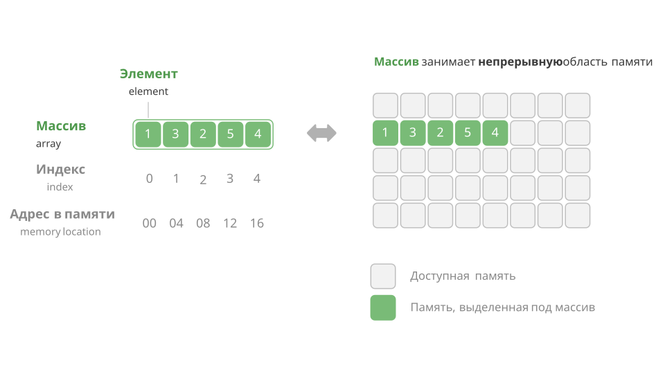

# Массив

<u>Массив (array)</u> представляет собой линейную структуру данных, в которой элементы одного типа хранятся в непрерывной области памяти. Положение элемента в массиве называется его <u>индексом (index)</u>. На рисунке ниже изображены основные понятия и способ хранения массивов.



## Основные операции с массивом

### Инициализация массива

Существует два способа инициализации массива: без начальных значений и с заданными начальными значениями. Если начальные значения не указаны, большинство языков программирования инициализируют элементы массива нулями:

```snippet
init_array
```

??? pythontutor "Визуализация выполнения"

    @tutor init_array_tutor

### Доступ к элементам

Элементы массива хранятся в непрерывной области памяти, что упрощает вычисление их адресов. Зная адрес массива (адрес первого элемента) и индекс элемента, можно вычислить адрес этого элемента по формуле, показанной на рисунке ниже, и получить к нему доступ.


Как видно из рисунка выше, индекс первого элемента массива равен $0$ , что может показаться неочевидным, так как отсчет с $1$ кажется более естественным. Однако с точки зрения формулы вычисления адреса **индекс является смещением адреса в памяти**. Смещение адреса первого элемента равно $0$ , поэтому и его индекс равен $0$.

Доступ к элементам массива осуществляется очень эффективно, так как позволяет за время $O(1)$ произвольно обращаться к любому элементу.

```src
[file]{array}-[class]{}-[func]{random_access}
```

### Вставка элемента

Элементы массива в памяти расположены вплотную, между ними нет места для хранения других данных. Для вставки элемента в середину массива необходимо сдвинуть все последующие элементы на одну позицию вправо, а затем присвоить значение элементу по заданному индексу, как показано на рисунке ниже.


Стоит отметить, что длина массива фиксирована, поэтому вставка элемента неизбежно приведет к потере элемента на конце массива. Решение этой проблемы будет рассмотрено в разделе «Список».

```src
[file]{array}-[class]{}-[func]{insert}
```

### Удаление элемента

Аналогично для удаления элемента по индексу $i$ необходимо сдвинуть все элементы после индекса $i$ на одну позицию влево, как показано на рисунке ниже.


Обратите внимание, что после удаления элемента последний элемент становится бессмысленным, поэтому его можно не изменять.

```src
[file]{array}-[class]{}-[func]{remove}
```

В целом операции вставки и удаления в массиве имеют следующие недостатки.

- **Высокая временная сложность**: средняя временная сложность операций вставки и удаления в массиве составляет $O(n)$ , где $n$ - длина массива.
- **Потеря элементов**: так как длина массива фиксирована, при вставке элемента элементы, выходящие за пределы длины массива, теряются.
- **Потери памяти**: можно заранее инициализировать более длинный массив и использовать только его переднюю часть. Тогда теряемые при вставке элементы на конце не будут нести смысла, но такой подход приводит к лишнему расходу памяти.

### Обход массива

В большинстве языков программирования массив можно обходить как по индексам, так и непосредственно по элементам.

```src
[file]{array}-[class]{}-[func]{traverse}
```

### Поиск элемента

Для поиска заданного элемента в массиве необходимо обойти массив и на каждой итерации проверить, совпадает ли значение элемента с искомым. Если совпадает, вернуть соответствующий индекс.

Поскольку массив является линейной структурой данных, этот процесс называется линейным поиском.

```src
[file]{array}-[class]{}-[func]{find}
```

### Расширение массива

В сложных системных средах нельзя гарантировать, что ячейки памяти, расположенные после массива, являются свободными. Это делает невозможным безопасное расширение его размера. Поэтому в большинстве языков программирования **длина массива фиксирована**.

Если необходимо увеличить массив, нужно создать новый, больший массив и последовательно скопировать в него элементы исходного массива. Эта операция имеет сложность $O(n)$ и при больших массивах занимает много времени. Пример кода представлен ниже.

```src
[file]{array}-[class]{}-[func]{extend}
```

## Преимущества и ограничения массива

Массивы хранятся в непрерывном пространстве памяти, а их элементы имеют одинаковый тип. Этот подход содержит богатую априорную информацию, которую система может использовать для оптимизации эффективности операций с данной структурой данных.

- **Высокая эффективность использования пространства**: массивы выделяют непрерывные блоки памяти для данных без дополнительных структурных затрат.
- **Поддержка произвольного доступа**: массивы позволяют получить доступ к любому элементу за время $O(1)$.
- **Локальность кэша**: при обращении к элементу массива компьютер загружает не только сам элемент, но и соседние данные, что позволяет использовать кэш для ускорения последующих операций.

Непрерывное хранение в памяти – это палка о двух концах, имеющая следующие ограничения.

- **Низкая эффективность вставки и удаления**: при большом количестве элементов в массиве операции вставки и удаления требуют перемещения множества элементов.
- **Неизменная длина**: после инициализации длина массива фиксируется, а увеличение массива требует копирования всех данных в новый массив, что влечет за собой значительные затраты.
- **Потери памяти**: если размер выделенного массива превышает фактические потребности, избыточное пространство оказывается потраченным впустую.

## Типичные применения массива

Массивы – это базовая и распространенная структура данных, часто используемая в различных алгоритмах и для реализации сложных структур данных.

- **Произвольный доступ**: если мы хотим случайным образом выбирать некоторые образцы, можно сохранить их в массиве и сгенерировать случайную последовательность индексов для выборки.
- **Сортировка и поиск**: массивы являются наиболее часто используемой структурой данных для алгоритмов сортировки и поиска. Быстрая сортировка, сортировка слиянием, двоичный поиск и другие алгоритмы в основном работают с массивами.
- **Таблица поиска**: когда необходимо быстро найти элемент или его соответствие, можно использовать массив в качестве таблицы поиска. Например, для реализации отображения символов в ASCII-коды можно использовать значение ASCII-кода символа в качестве индекса, а соответствующий элемент хранить в соответствующем месте массива.
- **Машинное обучение**: в нейронных сетях широко используются операции линейной алгебры между векторами, матрицами и тензорами, которые реализуются в виде массивов. Массивы являются наиболее часто используемой структурой данных в программировании нейронных сетей.
- **Реализация структур данных**: массивы могут использоваться для реализации стека, очереди, хеш-таблицы, кучи, графа и других структур данных. Например, представление графа в виде матрицы смежности фактически является двумерным массивом.
