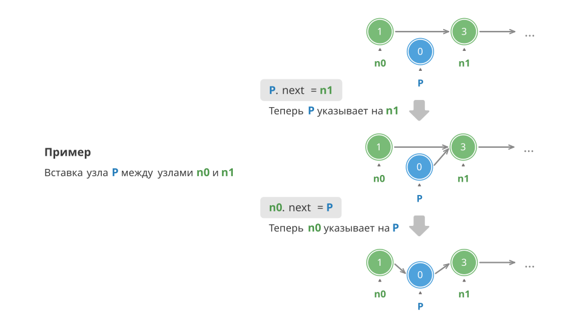
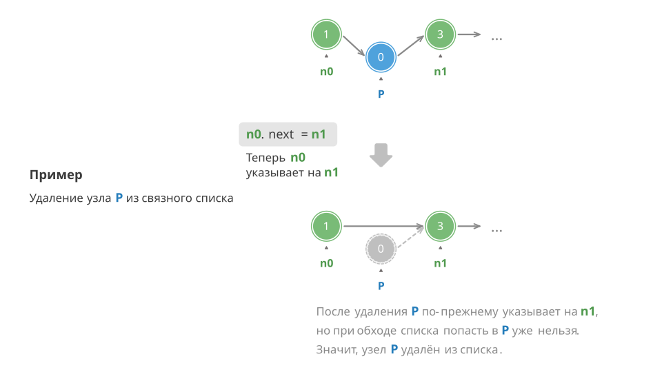
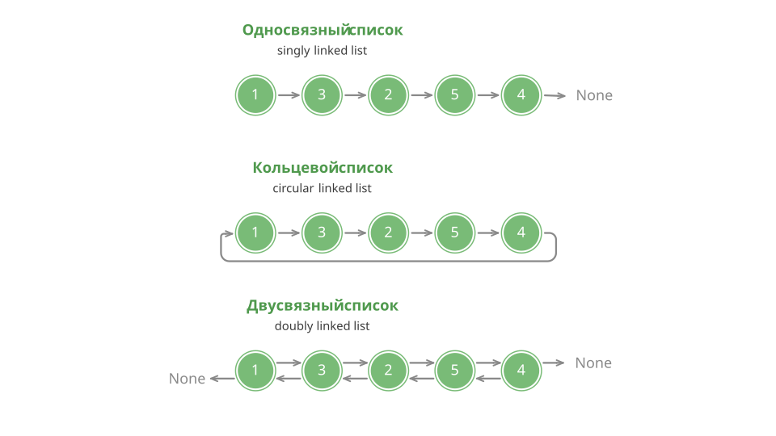

# Связный список

Память - общий ресурс для всех программ, и в сложной среде выполнения свободные участки памяти могут быть разбросаны по всему адресному пространству. Мы знаем, что память для хранения массива должна быть непрерывной, а если массив очень велик, в памяти может не оказаться столь большого непрерывного блока. Именно здесь и проявляется преимущество гибкости связного списка.

<u>Связный список (linked list)</u> - это линейная структура данных, в которой каждый элемент представляет собой объект-узел, а сами узлы соединены между собой с помощью ссылок. Ссылка хранит адрес памяти следующего узла, благодаря чему из текущего узла можно перейти к следующему.

Конструкция связного списка позволяет хранить отдельные узлы в разных местах памяти, и их адреса вовсе не обязаны быть последовательными.


Как видно на рисунке выше, базовой единицей связного списка является объект <u>узел (node)</u>. Каждый узел содержит две части данных: значение узла и ссылку на следующий узел.

- Первый узел связного списка называется головным узлом, а последний - хвостовым узлом.
- Хвостовой узел указывает на пустое значение, которое в Java, C++ и Python обозначается как `null` , `nullptr` и `None` соответственно.
- В языках, поддерживающих указатели, таких как C, C++, Go и Rust, упомянутую выше ссылку следует заменить на указатель.

Как показано в коде ниже, узел связного списка `ListNode` хранит не только значение, но и дополнительную ссылку (указатель). Поэтому **при одинаковом объеме данных связный список занимает больше памяти, чем массив**.

```snippet
list_node_class
```

## Основные операции со связным списком

### Инициализация связного списка

Построение связного списка состоит из двух шагов: сначала нужно инициализировать объекты всех узлов, затем установить ссылочные связи между ними. После завершения инициализации мы можем, начиная с головы списка, последовательно проходить все узлы по ссылке `next`.

```snippet
init_linked_list
```

??? pythontutor "Визуализация выполнения"

    @tutor init_linked_list_tutor

Массив в целом - это одна переменная: например, массив `nums` содержит элементы `nums[0]` , `nums[1]` и т.д. Связный список же состоит из множества независимых объектов-узлов. **Обычно в качестве обозначения всего связного списка используют головной узел**. Например, в приведенном выше коде связный список можно обозначить как `n0` .

### Вставка узла

Вставить узел в связный список очень легко. Как показано на рисунке ниже, предположим, что мы хотим вставить новый узел `P` между двумя соседними узлами `n0` и `n1`. **Для этого нужно изменить всего две ссылки (указателя)**, а временная сложность будет равна $O(1)$ .

Для сравнения: временная сложность вставки элемента в массив составляет $O(n)$ , и при большом объеме данных это менее эффективно.



```src
[file]{linked_list}-[class]{}-[func]{insert}
```

### Удаление узла

Как показано на рисунке ниже, удалить узел из связного списка тоже очень просто: **нужно изменить всего одну ссылку (указатель)**.

Стоит отметить, что хотя после завершения операции удаления узел `P` все еще указывает на `n1` , при обходе связного списка до `P` уже нельзя добраться. Это означает, что `P` фактически больше не принадлежит данному списку.



```src
[file]{linked_list}-[class]{}-[func]{remove}
```

### Доступ к узлу

**Доступ к узлам в связном списке менее эффективен**. Как уже обсуждалось в предыдущем разделе, к любому элементу массива можно обратиться за $O(1)$ времени. Со связным списком это не так: программе нужно начать с головного узла и последовательно двигаться дальше, пока не будет найден целевой узел. То есть для доступа к $i$ -му узлу списка нужно выполнить $i - 1$ итераций, а временная сложность составляет $O(n)$ .

```src
[file]{linked_list}-[class]{}-[func]{access}
```

### Поиск узла

Поиск узла заключается в обходе связного списка, нахождении узла со значением `target` и возврате его индекса в списке. Этот процесс тоже относится к линейному поиску. Код выглядит следующим образом:

```src
[file]{linked_list}-[class]{}-[func]{find}
```

## Сравнение массива и связного списка

В таблице ниже обобщаются свойства массива и связного списка, а также сравнивается эффективность соответствующих операций. Поскольку они используют противоположные стратегии хранения, их свойства и эффективность операций тоже во многом противоположны.

<p align="center"> Таблица <id> &nbsp; Сравнение эффективности массива и связного списка </p>

|               | Массив                                         | Связный список          |
| ------------- | ---------------------------------------------- | ----------------------- |
| Способ хранения | Непрерывная область памяти                   | Разрозненная область памяти |
| Расширение емкости | Длина фиксирована                        | Возможность гибкого расширения       |
| Эффективность памяти | Элементы занимают меньше памяти, но могут расходовать пространство впустую | Элементы занимают больше памяти |
| Доступ к элементу | $O(1)$                                      | $O(n)$                  |
| Добавление элемента | $O(n)$                                    | $O(1)$                  |
| Удаление элемента | $O(n)$                                     | $O(1)$                  |

## Распространенные типы связных списков

Как показано на рисунке ниже, существует три распространенных типа связных списков.

- **Односвязный список**: это обычный связный список, рассмотренный выше. Узел односвязного списка содержит значение и ссылку на следующий узел. Первый узел называется головным, последний - хвостовым, и хвост указывает на `None` .
- **Кольцевой (циклический) список**: если заставить хвостовой узел односвязного списка указывать на головной, то есть соединить хвост с головой, получится циклический список. В циклическом списке любой узел можно рассматривать как головной.
- **Двусвязный список**: по сравнению с односвязным списком двусвязный хранит ссылки в двух направлениях. Определение узла двусвязного списка включает как ссылку на следующий узел, так и ссылку на предыдущий узел. По сравнению с односвязным списком двусвязный более гибок и позволяет обходить список в обе стороны, но за это приходится платить дополнительной памятью.

```snippet
doubly_list_node_class
```



## Типичные применения связных списков

Односвязные списки обычно используются для реализации стеков, очередей, хеш-таблиц и графов.

- **Стек и очередь**: если операции вставки и удаления выполняются на одном конце связного списка, он проявляет свойства LIFO, соответствующие стеку. Если вставка происходит на одном конце, а удаление на другом, он проявляет свойства FIFO, соответствующие очереди.
- **Хеш-таблица**: метод цепочек - один из основных способов разрешения коллизий в хеш-таблицах. В этом подходе все конфликтующие элементы помещаются в связный список.
- **Граф**: список смежности - это распространенный способ представления графа, при котором каждой вершине графа соответствует связный список, а каждый элемент этого списка представляет другую вершину, соединенную с данной.

Двусвязные списки обычно используются там, где нужен быстрый доступ как к предыдущему, так и к следующему элементу.

- **Продвинутые структуры данных**: например, в красно-черных деревьях и B-деревьях нам нужен доступ к родительскому узлу. Этого можно добиться, сохранив в узле ссылку на родителя, по аналогии с двусвязным списком.
- **История браузера**: когда пользователь в браузере нажимает кнопки «вперед» или «назад», браузеру нужно знать предыдущую и следующую посещенные страницы. Свойства двусвязного списка делают такую операцию простой.
- **Алгоритм LRU**: в алгоритмах вытеснения из кэша (LRU) нужно быстро находить наименее недавно использованные данные, а также быстро добавлять и удалять узлы. Для этого двусвязный список подходит очень хорошо.

Циклические списки часто применяются в сценариях, требующих циклических операций, например при планировании ресурсов в операционной системе.

- **Алгоритм циклического планирования**: в операционных системах алгоритм циклического планирования - это распространенный алгоритм планирования CPU, который циклически обходит набор процессов. Каждому процессу выделяется квант времени, и когда он исчерпан, CPU переключается на следующий процесс. Такую циклическую операцию удобно реализовать с помощью кольцевого списка.
- **Буфер данных**: в некоторых реализациях буферов данных также могут использоваться циклические списки. Например, в аудио- и видеоплеерах поток данных может делиться на несколько буферных блоков и помещаться в кольцевой список для обеспечения непрерывного воспроизведения.
