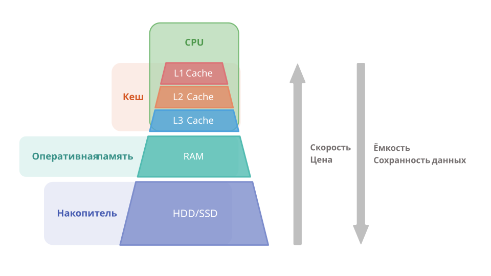
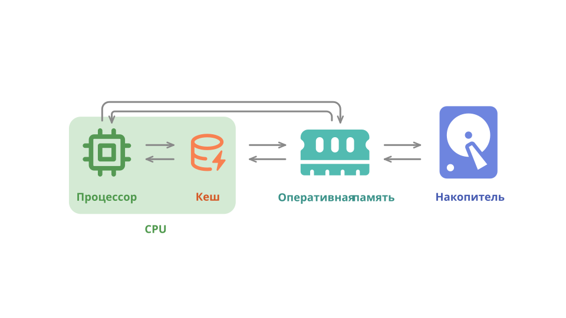

# Оперативная память и кеш *

В первых двух разделах этой главы мы рассмотрели две важные базовые структуры данных: массив и связный список. Они представляют два способа физического размещения данных: непрерывное и разрозненное хранение.

**Физическая организация данных во многом определяет, насколько эффективно программа использует оперативную память и кеш**. От этого, в свою очередь, зависит общая производительность реализации алгоритма.

## Устройства хранения данных

В компьютере используются три вида устройств хранения данных: <u>накопитель (hard disk)</u>, <u>оперативная память (random-access memory, RAM)</u> и <u>кеш-память (cache memory)</u>. В таблице показаны их роли и характеристики.

 Таблица <id> &nbsp; Устройства хранения данных в компьютере 

|                | Накопитель                                     | Оперативная память                                   | Кеш                                              |
| -------------- | ---------------------------------------- | -------------------------------------- | ------------------------------------------------- |
| Назначение           | Длительное хранение данных, включая операционную систему, программы и файлы | Временное хранение выполняемых программ и обрабатываемых данных | Хранение часто используемых данных и инструкций для сокращения числа обращений CPU к оперативной памяти |
| Энергозависимость         | Данные сохраняются при отключении питания                       | Данные теряются при отключении питания                       | Данные теряются при отключении питания                                  |
| Ёмкость           | Большая, порядка терабайтов                            | Меньше, порядка гигабайтов                          | Очень малая, порядка мегабайтов                                   |
| Скорость           | Относительно низкая, от сотен до нескольких тысяч МБ/с                    | Высокая, десятки ГБ/с                        | Очень высокая, от десятков до сотен ГБ/с                           |
| Цена (в юанях) | Низкая, от долей юаня до нескольких юаней за ГБ                  | Высокая, от десятков до сотен юаней за ГБ                | Очень высокая, входит в стоимость процессора                           |

Систему памяти компьютера можно представить в виде пирамиды, как на рисунке ниже. Чем ближе устройство к вершине, тем выше скорость, меньше ёмкость и дороже единица хранимых данных. Такая иерархия возникла не случайно: её тщательно продумали исследователи и инженеры.

- **Оперативной памяти трудно заменить накопитель**. Во-первых, без питания она теряет данные и поэтому не подходит для длительного хранения. Во-вторых, единица её ёмкости обходится в десятки раз дороже дисковой, что затрудняет массовое применение такой замены.
- **В кеше трудно совместить большую ёмкость с высокой скоростью**. По мере роста ёмкости от L1 к L2 и L3 увеличиваются физические размеры кеша и расстояние до ядра процессора. Передача данных занимает больше времени, а задержка доступа растёт. При современных технологиях многоуровневый кеш обеспечивает наилучший баланс ёмкости, скорости и цены.

!!! tip

    Иерархия памяти компьютера отражает тонкий баланс скорости, ёмкости и стоимости. Подобные компромиссы встречаются во всех отраслях техники: приходится искать наилучшее сочетание преимуществ с учётом ограничений.

Итак, **накопитель долго хранит большие объёмы данных, оперативная память временно хранит данные, обрабатываемые программой, а кеш — часто используемые данные и инструкции**, что ускоряет выполнение программы. Вместе эти три компонента обеспечивают эффективную работу компьютера.

Как показано на рисунке, при выполнении программы данные считываются с накопителя в оперативную память для вычислений на CPU. Кеш можно считать частью процессора. **Он заблаговременно подбирает и загружает данные из оперативной памяти**, обеспечивая процессору быстрое чтение. Это заметно ускоряет выполнение программы и уменьшает зависимость от более медленной оперативной памяти.

## Эффективность использования памяти структурами данных

У массива и связного списка есть свои преимущества и ограничения с точки зрения использования памяти.

С одной стороны, **объём памяти ограничен, и один и тот же участок нельзя отвести в исключительное пользование нескольким программам одновременно**. Поэтому желательно, чтобы структура данных занимала как можно меньше места. Элементы массива располагаются плотно, и им не нужны дополнительные поля для ссылок (указателей), соединяющих узлы списка. Массив экономнее расходует память на элемент. Однако для него нужно сразу выделить достаточно большой непрерывный участок, часть которого может остаться пустой. Расширение массива также требует дополнительного времени и памяти. Связный список гибче: память можно выделять и освобождать отдельно для каждого узла.

С другой стороны, во время работы программы **многократное выделение и освобождение памяти всё сильнее дробит свободное пространство**, снижая эффективность его использования. Непрерывное размещение массива сравнительно редко приводит к фрагментации. Узлы связного списка располагаются в разных местах, поэтому при частых вставках и удалениях фрагментация более вероятна.

## Эффективность использования кеша структурами данных

По ёмкости кеш гораздо меньше оперативной памяти, зато намного быстрее и играет важную роль в быстродействии программы. В кеше помещается лишь небольшая часть часто используемых данных. Когда процессор обращается к данным, которых там нет, происходит <u>промах кеша (cache miss)</u>. Тогда процессору приходится загружать данные из более медленной оперативной памяти.

Очевидно, что **чем меньше промахов кеша, тем эффективнее процессор читает и записывает данные** и тем быстрее работает программа. Долю обращений, при которых процессор находит нужные данные в кеше, называют <u>долей попаданий в кеш (cache hit rate)</u>. Это распространённая мера эффективности кеша.

Чтобы повысить эффективность, при загрузке данных в кеш используются следующие механизмы и свойства обращений.

- **Строки кеша**. Данные хранятся в кеше и загружаются в него целыми строками. Передача строки эффективнее, чем передача по одному байту.
- **Предвыборка**. Процессор пытается предсказать порядок обращений к данным, например последовательный или с постоянным шагом. Следуя обнаруженной закономерности, он заранее загружает данные в кеш, повышая долю попаданий.
- **Пространственная локальность**. После обращения к некоторым данным вскоре могут понадобиться и соседние. Поэтому вместе с нужными данными в кеш загружаются соседние, что повышает долю попаданий.
- **Временная локальность**. Если к данным только что обращались, в ближайшее время они могут понадобиться снова. Сохраняя недавно использованные данные, кеш повышает долю попаданий.

**Массивы и связные списки используют кеш с разной эффективностью**. Рассмотрим основные причины.

- **Занимаемое место**. Элемент связного списка занимает больше памяти, чем элемент массива, поэтому в кеше помещается меньше полезных данных.
- **Строки кеша**. Элементы связного списка разбросаны по памяти, а кеш загружает данные целыми строками. Поэтому доля ненужных данных среди загруженных выше.
- **Предвыборка**. Порядок обращений к массиву предсказуемее, чем к связному списку. Системе легче угадать, какие данные понадобятся следующими.
- **Пространственная локальность**. Элементы массива расположены подряд, поэтому данные рядом с уже загруженными с большей вероятностью скоро понадобятся.

В целом **массивы дают более высокую долю попаданий в кеш, и операции с ними обычно выполняются эффективнее, чем со связными списками**. Поэтому при решении алгоритмических задач часто предпочитают структуры на основе массивов.

Однако **эффективное использование кеша не делает массив лучшим выбором во всех ситуациях**. На практике выбор определяется задачей. Например, и массив, и связный список подходят для реализации стека (подробнее о нём в следующей главе), но удобны в разных условиях.

- В алгоритмических задачах часто выбирают стек на основе массива: операции с ним эффективнее, а к элементам можно обращаться по индексу. За это приходится лишь заранее выделить под массив некоторое количество памяти.
- Если объём данных очень велик, быстро меняется и ожидаемый размер стека трудно оценить, лучше подойдёт стек на основе связного списка. Он позволяет распределить большой объём данных по разным участкам памяти и избежать затрат на расширение массива.
