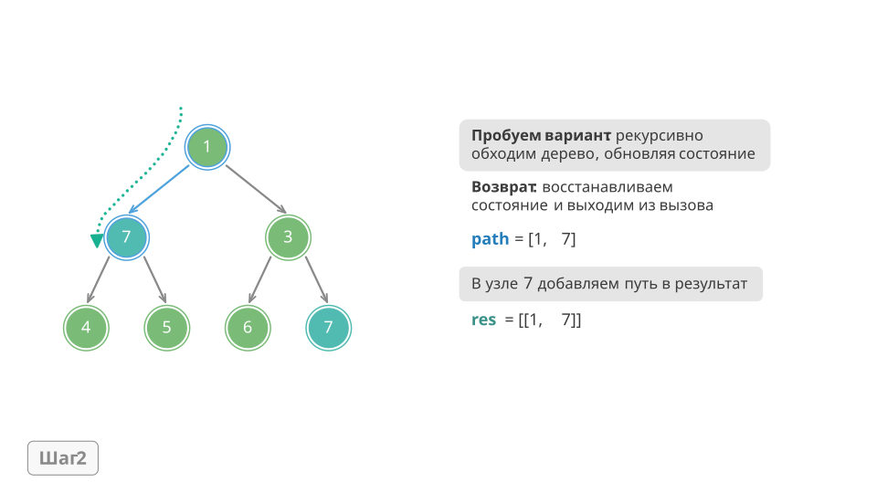
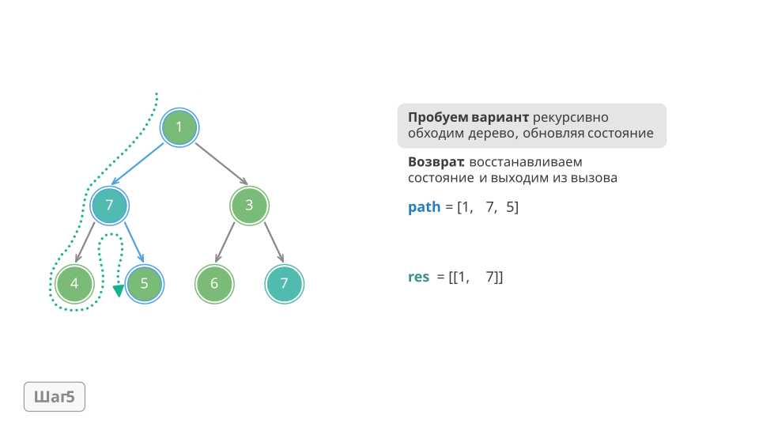
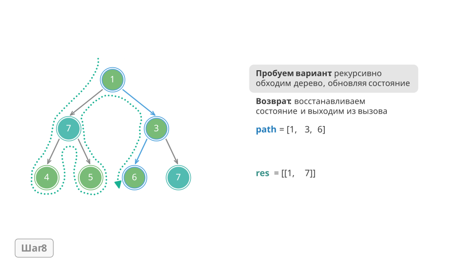
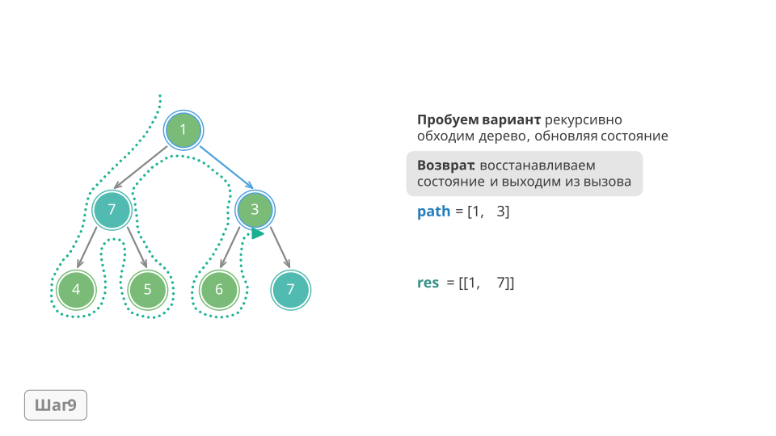
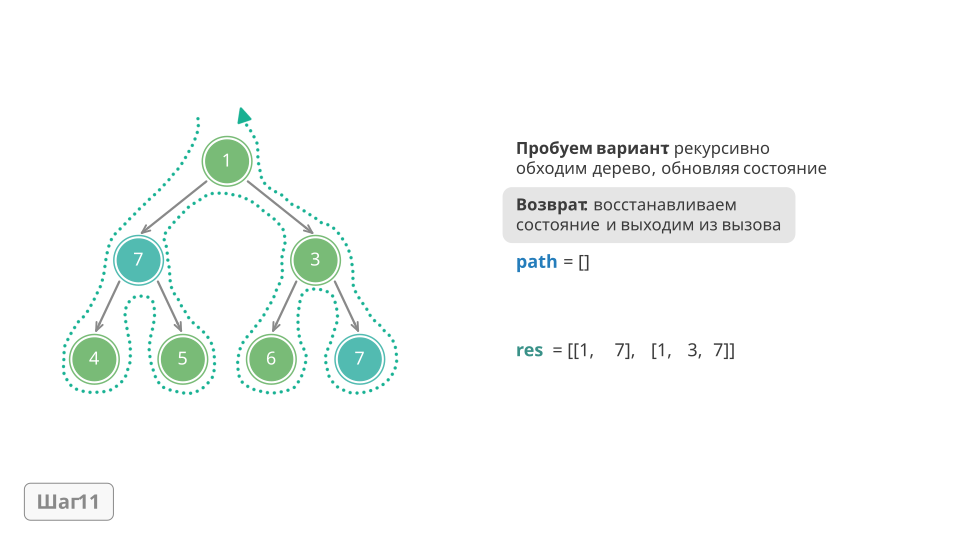
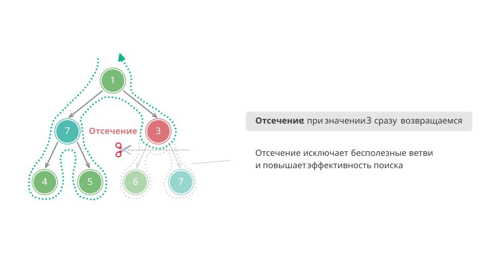
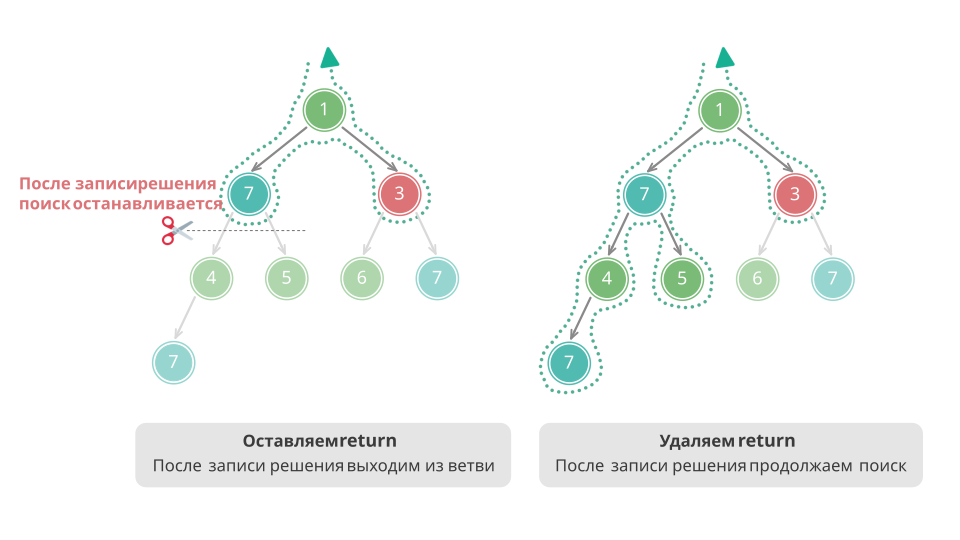

# 13.1 &nbsp; Поиск с возвратом

<u>Поиск с возвратом (backtracking algorithm)</u> — метод решения задач перебором. Начав с исходного состояния, алгоритм перебирает возможные варианты и записывает подходящие решения. Поиск ведётся, пока решение не найдено или пока не исчерпаны все варианты.

Для обхода пространства решений обычно применяют поиск в глубину. В главе «Двоичное дерево» мы уже встречали три его разновидности: прямой, симметричный и обратный обходы. На примере прямого обхода разберём по шагам, как работает поиск с возвратом.

!!! question "Пример 1"

    Дано двоичное дерево. Найдите все узлы со значением $7$ и верните их в виде списка.

Обойдём дерево в прямом порядке и для каждого узла проверим, равно ли его значение $7$. Если да, добавим значение узла в список результатов `res`. Ход поиска показан на рисунке и в коде ниже.

=== "Python"

    ```python title="preorder_traversal_i_compact.py"
    def pre_order(root: TreeNode):
        """Прямой обход: пример 1"""
        if root is None:
            return
        if root.val == 7:
            # Сохраняем решение
            res.append(root)
        pre_order(root.left)
        pre_order(root.right)
    ```

=== "C++"

    ```cpp title="preorder_traversal_i_compact.cpp"
    /* Прямой обход: пример 1 */
    void preOrder(TreeNode *root) {
        if (root == nullptr) {
            return;
        }
        if (root->val == 7) {
            // Сохраняем решение
            res.push_back(root);
        }
        preOrder(root->left);
        preOrder(root->right);
    }
    ```

=== "Java"

    ```java title="preorder_traversal_i_compact.java"
    /* Прямой обход: пример 1 */
    void preOrder(TreeNode root) {
        if (root == null) {
            return;
        }
        if (root.val == 7) {
            // Сохраняем решение
            res.add(root);
        }
        preOrder(root.left);
        preOrder(root.right);
    }
    ```

=== "C#"

    ```csharp title="preorder_traversal_i_compact.cs"
    /* Прямой обход: пример 1 */
    void PreOrder(TreeNode? root) {
        if (root == null) {
            return;
        }
        if (root.val == 7) {
            // Сохраняем решение
            res.Add(root);
        }
        PreOrder(root.left);
        PreOrder(root.right);
    }
    ```

=== "Go"

    ```go title="preorder_traversal_i_compact.go"
    /* Прямой обход: пример 1 */
    func preOrderI(root *TreeNode, res *[]*TreeNode) {
        if root == nil {
            return
        }
        if (root.Val).(int) == 7 {
            // Сохраняем решение
            *res = append(*res, root)
        }
        preOrderI(root.Left, res)
        preOrderI(root.Right, res)
    }
    ```

=== "Swift"

    ```swift title="preorder_traversal_i_compact.swift"
    /* Прямой обход: пример 1 */
    func preOrder(root: TreeNode?) {
        guard let root = root else {
            return
        }
        if root.val == 7 {
            // Сохраняем решение
            res.append(root)
        }
        preOrder(root: root.left)
        preOrder(root: root.right)
    }
    ```

=== "JS"

    ```javascript title="preorder_traversal_i_compact.js"
    /* Прямой обход: пример 1 */
    function preOrder(root, res) {
        if (root === null) {
            return;
        }
        if (root.val === 7) {
            // Сохраняем решение
            res.push(root);
        }
        preOrder(root.left, res);
        preOrder(root.right, res);
    }
    ```

=== "TS"

    ```typescript title="preorder_traversal_i_compact.ts"
    /* Прямой обход: пример 1 */
    function preOrder(root: TreeNode | null, res: TreeNode[]): void {
        if (root === null) {
            return;
        }
        if (root.val === 7) {
            // Сохраняем решение
            res.push(root);
        }
        preOrder(root.left, res);
        preOrder(root.right, res);
    }
    ```

=== "Dart"

    ```dart title="preorder_traversal_i_compact.dart"
    /* Прямой обход: пример 1 */
    void preOrder(TreeNode? root, List<TreeNode> res) {
      if (root == null) {
        return;
      }
      if (root.val == 7) {
        // Сохраняем решение
        res.add(root);
      }
      preOrder(root.left, res);
      preOrder(root.right, res);
    }
    ```

=== "Rust"

    ```rust title="preorder_traversal_i_compact.rs"
    /* Прямой обход: пример 1 */
    fn pre_order(res: &mut Vec<Rc<RefCell<TreeNode>>>, root: Option<&Rc<RefCell<TreeNode>>>) {
        if root.is_none() {
            return;
        }
        if let Some(node) = root {
            if node.borrow().val == 7 {
                // Сохраняем решение
                res.push(node.clone());
            }
            pre_order(res, node.borrow().left.as_ref());
            pre_order(res, node.borrow().right.as_ref());
        }
    }
    ```

=== "C"

    ```c title="preorder_traversal_i_compact.c"
    /* Прямой обход: пример 1 */
    void preOrder(TreeNode *root) {
        if (root == NULL) {
            return;
        }
        if (root->val == 7) {
            // Сохраняем решение
            res[resSize++] = root;
        }
        preOrder(root->left);
        preOrder(root->right);
    }
    ```

=== "Kotlin"

    ```kotlin title="preorder_traversal_i_compact.kt"
    /* Прямой обход: пример 1 */
    fun preOrder(root: TreeNode?) {
        if (root == null) {
            return
        }
        if (root._val == 7) {
            // Сохраняем решение
            res!!.add(root)
        }
        preOrder(root.left)
        preOrder(root.right)
    }
    ```

=== "Ruby"

    ```ruby title="preorder_traversal_i_compact.rb"
    ### Прямой обход: пример 1 ###
    def pre_order(root)
      return unless root

      # Сохраняем решение
      $res << root if root.val == 7

      pre_order(root.left)
      pre_order(root.right)
    end
    ```

??? pythontutor "Визуализация выполнения"

    <div style="height: 549px; width: 100%;"><iframe class="pythontutor-iframe" title="Визуализация выполнения" src="https://pythontutor.com/iframe-embed.html#code=class%20TreeNode%3A%0A%20%20%20%20%22%22%22%D0%9A%D0%BB%D0%B0%D1%81%D1%81%20%D1%83%D0%B7%D0%BB%D0%B0%20%D0%B4%D0%B5%D1%80%D0%B5%D0%B2%D0%B0%22%22%22%0A%0A%20%20%20%20def%20__init__%28self,%20val%3A%20int%20%3D%200%29%3A%0A%20%20%20%20%20%20%20%20self.val%3A%20int%20%3D%20val%20%20%23%20%D0%97%D0%BD%D0%B0%D1%87%D0%B5%D0%BD%D0%B8%D0%B5%20%D1%83%D0%B7%D0%BB%D0%B0%0A%20%20%20%20%20%20%20%20self.left%3A%20TreeNode%20%7C%20None%20%3D%20None%20%20%23%20%D0%A1%D1%81%D1%8B%D0%BB%D0%BA%D0%B0%20%D0%BD%D0%B0%20%D0%BB%D0%B5%D0%B2%D0%BE%D0%B3%D0%BE%20%D0%BF%D0%BE%D1%82%D0%BE%D0%BC%D0%BA%D0%B0%0A%20%20%20%20%20%20%20%20self.right%3A%20TreeNode%20%7C%20None%20%3D%20None%20%20%23%20%D0%A1%D1%81%D1%8B%D0%BB%D0%BA%D0%B0%20%D0%BD%D0%B0%20%D0%BF%D1%80%D0%B0%D0%B2%D0%BE%D0%B3%D0%BE%20%D0%BF%D0%BE%D1%82%D0%BE%D0%BC%D0%BA%D0%B0%0A%0Adef%20list_to_tree_dfs%28arr%3A%20list%5Bint%5D,%20i%3A%20int%29%20-%3E%20TreeNode%20%7C%20None%3A%0A%20%20%20%20%22%22%22%D0%A1%D0%BF%D0%B8%D1%81%D0%BE%D0%BA%20%D0%B2%20%D0%B4%D0%B5%D1%80%D0%B5%D0%B2%D0%BE%3A%20%D1%80%D0%B5%D0%BA%D1%83%D1%80%D1%81%D0%B8%D1%8F%22%22%22%0A%20%20%20%20%23%20%D0%92%D0%BD%D0%B5%20%D0%BC%D0%B0%D1%81%D1%81%D0%B8%D0%B2%D0%B0%20%D0%B8%D0%BB%D0%B8%20%D0%BF%D1%80%D0%B8%20None%20%D0%B2%D0%BE%D0%B7%D0%B2%D1%80%D0%B0%D1%89%D0%B0%D0%B5%D0%BC%20None%0A%20%20%20%20if%20i%20%3C%200%20or%20i%20%3E%3D%20len%28arr%29%20or%20arr%5Bi%5D%20is%20None%3A%0A%20%20%20%20%20%20%20%20return%20None%0A%20%20%20%20%23%20%D0%A1%D0%BE%D0%B7%D0%B4%D0%B0%D1%91%D0%BC%20%D1%83%D0%B7%D0%B5%D0%BB%0A%20%20%20%20root%20%3D%20TreeNode%28arr%5Bi%5D%29%0A%20%20%20%20%23%20%D0%A0%D0%B5%D0%BA%D1%83%D1%80%D1%81%D0%B8%D0%B2%D0%BD%D0%BE%20%D1%81%D1%82%D1%80%D0%BE%D0%B8%D0%BC%20%D0%BF%D0%BE%D0%B4%D0%B4%D0%B5%D1%80%D0%B5%D0%B2%D1%8C%D1%8F%0A%20%20%20%20root.left%20%3D%20list_to_tree_dfs%28arr,%202%20%2A%20i%20%2B%201%29%0A%20%20%20%20root.right%20%3D%20list_to_tree_dfs%28arr,%202%20%2A%20i%20%2B%202%29%0A%20%20%20%20return%20root%0A%0Adef%20list_to_tree%28arr%3A%20list%5Bint%5D%29%20-%3E%20TreeNode%20%7C%20None%3A%0A%20%20%20%20%22%22%22%D0%98%D0%B7%20%D1%81%D0%BF%D0%B8%D1%81%D0%BA%D0%B0%20%D0%B2%20%D0%B4%D0%B2%D0%BE%D0%B8%D1%87%D0%BD%D0%BE%D0%B5%20%D0%B4%D0%B5%D1%80%D0%B5%D0%B2%D0%BE%22%22%22%0A%20%20%20%20return%20list_to_tree_dfs%28arr,%200%29%0A%0A%0Adef%20pre_order%28root%3A%20TreeNode%29%3A%0A%20%20%20%20%22%22%22%D0%9F%D1%80%D1%8F%D0%BC%D0%BE%D0%B9%20%D0%BE%D0%B1%D1%85%D0%BE%D0%B4%3A%20%D0%BF%D1%80%D0%B8%D0%BC%D0%B5%D1%80%201%22%22%22%0A%20%20%20%20if%20root%20is%20None%3A%0A%20%20%20%20%20%20%20%20return%0A%20%20%20%20if%20root.val%20%3D%3D%207%3A%0A%20%20%20%20%20%20%20%20%23%20%D0%97%D0%B0%D0%BF%D0%B8%D1%81%D1%8C%20%D1%80%D0%B5%D1%88%D0%B5%D0%BD%D0%B8%D1%8F%0A%20%20%20%20%20%20%20%20res.append%28root%29%0A%20%20%20%20pre_order%28root.left%29%0A%20%20%20%20pre_order%28root.right%29%0A%0A%0A%22%22%22Driver%20Code%22%22%22%0Aif%20__name__%20%3D%3D%20%22__main__%22%3A%0A%20%20%20%20root%20%3D%20list_to_tree%28%5B1,%207,%203,%204,%205,%206,%207%5D%29%0A%0A%20%20%20%20%23%20%D0%9F%D1%80%D1%8F%D0%BC%D0%BE%D0%B9%20%D0%BE%D0%B1%D1%85%D0%BE%D0%B4%0A%20%20%20%20res%20%3D%20list%5BTreeNode%5D%28%29%0A%20%20%20%20pre_order%28root%29%0A%0A%20%20%20%20print%28%22%5Cn%D0%92%D1%8B%D0%B2%D0%BE%D0%B4%D0%B8%D0%BC%20%D0%B2%D1%81%D0%B5%20%D1%83%D0%B7%D0%BB%D1%8B%20%D1%81%D0%BE%20%D0%B7%D0%BD%D0%B0%D1%87%D0%B5%D0%BD%D0%B8%D0%B5%D0%BC%207%22%29%0A%20%20%20%20print%28%5Bnode.val%20for%20node%20in%20res%5D%29&codeDivHeight=472&codeDivWidth=350&cumulative=false&curInstr=126&heapPrimitives=nevernest&origin=opt-frontend.js&py=311&rawInputLstJSON=%5B%5D&textReferences=false"> </iframe></div>
    <div style="margin-top: 5px;"><a href="https://pythontutor.com/iframe-embed.html#code=class%20TreeNode%3A%0A%20%20%20%20%22%22%22%D0%9A%D0%BB%D0%B0%D1%81%D1%81%20%D1%83%D0%B7%D0%BB%D0%B0%20%D0%B4%D0%B5%D1%80%D0%B5%D0%B2%D0%B0%22%22%22%0A%0A%20%20%20%20def%20__init__%28self,%20val%3A%20int%20%3D%200%29%3A%0A%20%20%20%20%20%20%20%20self.val%3A%20int%20%3D%20val%20%20%23%20%D0%97%D0%BD%D0%B0%D1%87%D0%B5%D0%BD%D0%B8%D0%B5%20%D1%83%D0%B7%D0%BB%D0%B0%0A%20%20%20%20%20%20%20%20self.left%3A%20TreeNode%20%7C%20None%20%3D%20None%20%20%23%20%D0%A1%D1%81%D1%8B%D0%BB%D0%BA%D0%B0%20%D0%BD%D0%B0%20%D0%BB%D0%B5%D0%B2%D0%BE%D0%B3%D0%BE%20%D0%BF%D0%BE%D1%82%D0%BE%D0%BC%D0%BA%D0%B0%0A%20%20%20%20%20%20%20%20self.right%3A%20TreeNode%20%7C%20None%20%3D%20None%20%20%23%20%D0%A1%D1%81%D1%8B%D0%BB%D0%BA%D0%B0%20%D0%BD%D0%B0%20%D0%BF%D1%80%D0%B0%D0%B2%D0%BE%D0%B3%D0%BE%20%D0%BF%D0%BE%D1%82%D0%BE%D0%BC%D0%BA%D0%B0%0A%0Adef%20list_to_tree_dfs%28arr%3A%20list%5Bint%5D,%20i%3A%20int%29%20-%3E%20TreeNode%20%7C%20None%3A%0A%20%20%20%20%22%22%22%D0%A1%D0%BF%D0%B8%D1%81%D0%BE%D0%BA%20%D0%B2%20%D0%B4%D0%B5%D1%80%D0%B5%D0%B2%D0%BE%3A%20%D1%80%D0%B5%D0%BA%D1%83%D1%80%D1%81%D0%B8%D1%8F%22%22%22%0A%20%20%20%20%23%20%D0%92%D0%BD%D0%B5%20%D0%BC%D0%B0%D1%81%D1%81%D0%B8%D0%B2%D0%B0%20%D0%B8%D0%BB%D0%B8%20%D0%BF%D1%80%D0%B8%20None%20%D0%B2%D0%BE%D0%B7%D0%B2%D1%80%D0%B0%D1%89%D0%B0%D0%B5%D0%BC%20None%0A%20%20%20%20if%20i%20%3C%200%20or%20i%20%3E%3D%20len%28arr%29%20or%20arr%5Bi%5D%20is%20None%3A%0A%20%20%20%20%20%20%20%20return%20None%0A%20%20%20%20%23%20%D0%A1%D0%BE%D0%B7%D0%B4%D0%B0%D1%91%D0%BC%20%D1%83%D0%B7%D0%B5%D0%BB%0A%20%20%20%20root%20%3D%20TreeNode%28arr%5Bi%5D%29%0A%20%20%20%20%23%20%D0%A0%D0%B5%D0%BA%D1%83%D1%80%D1%81%D0%B8%D0%B2%D0%BD%D0%BE%20%D1%81%D1%82%D1%80%D0%BE%D0%B8%D0%BC%20%D0%BF%D0%BE%D0%B4%D0%B4%D0%B5%D1%80%D0%B5%D0%B2%D1%8C%D1%8F%0A%20%20%20%20root.left%20%3D%20list_to_tree_dfs%28arr,%202%20%2A%20i%20%2B%201%29%0A%20%20%20%20root.right%20%3D%20list_to_tree_dfs%28arr,%202%20%2A%20i%20%2B%202%29%0A%20%20%20%20return%20root%0A%0Adef%20list_to_tree%28arr%3A%20list%5Bint%5D%29%20-%3E%20TreeNode%20%7C%20None%3A%0A%20%20%20%20%22%22%22%D0%98%D0%B7%20%D1%81%D0%BF%D0%B8%D1%81%D0%BA%D0%B0%20%D0%B2%20%D0%B4%D0%B2%D0%BE%D0%B8%D1%87%D0%BD%D0%BE%D0%B5%20%D0%B4%D0%B5%D1%80%D0%B5%D0%B2%D0%BE%22%22%22%0A%20%20%20%20return%20list_to_tree_dfs%28arr,%200%29%0A%0A%0Adef%20pre_order%28root%3A%20TreeNode%29%3A%0A%20%20%20%20%22%22%22%D0%9F%D1%80%D1%8F%D0%BC%D0%BE%D0%B9%20%D0%BE%D0%B1%D1%85%D0%BE%D0%B4%3A%20%D0%BF%D1%80%D0%B8%D0%BC%D0%B5%D1%80%201%22%22%22%0A%20%20%20%20if%20root%20is%20None%3A%0A%20%20%20%20%20%20%20%20return%0A%20%20%20%20if%20root.val%20%3D%3D%207%3A%0A%20%20%20%20%20%20%20%20%23%20%D0%97%D0%B0%D0%BF%D0%B8%D1%81%D1%8C%20%D1%80%D0%B5%D1%88%D0%B5%D0%BD%D0%B8%D1%8F%0A%20%20%20%20%20%20%20%20res.append%28root%29%0A%20%20%20%20pre_order%28root.left%29%0A%20%20%20%20pre_order%28root.right%29%0A%0A%0A%22%22%22Driver%20Code%22%22%22%0Aif%20__name__%20%3D%3D%20%22__main__%22%3A%0A%20%20%20%20root%20%3D%20list_to_tree%28%5B1,%207,%203,%204,%205,%206,%207%5D%29%0A%0A%20%20%20%20%23%20%D0%9F%D1%80%D1%8F%D0%BC%D0%BE%D0%B9%20%D0%BE%D0%B1%D1%85%D0%BE%D0%B4%0A%20%20%20%20res%20%3D%20list%5BTreeNode%5D%28%29%0A%20%20%20%20pre_order%28root%29%0A%0A%20%20%20%20print%28%22%5Cn%D0%92%D1%8B%D0%B2%D0%BE%D0%B4%D0%B8%D0%BC%20%D0%B2%D1%81%D0%B5%20%D1%83%D0%B7%D0%BB%D1%8B%20%D1%81%D0%BE%20%D0%B7%D0%BD%D0%B0%D1%87%D0%B5%D0%BD%D0%B8%D0%B5%D0%BC%207%22%29%0A%20%20%20%20print%28%5Bnode.val%20for%20node%20in%20res%5D%29&codeDivHeight=800&codeDivWidth=600&cumulative=false&curInstr=126&heapPrimitives=nevernest&origin=opt-frontend.js&py=311&rawInputLstJSON=%5B%5D&textReferences=false" target="_blank" rel="noopener noreferrer">Во весь экран ></a></div>

{ class="animation-figure" }

<p align="center"> Рисунок 13-1 &nbsp; Поиск узлов при прямом обходе </p>

## 13.1.1 &nbsp; Проба варианта и возврат

**Метод называют поиском с возвратом, поскольку при переборе решений он чередует пробы вариантов и возвраты**. Если из текущего состояния нельзя продвинуться дальше или получить допустимое решение, алгоритм отменяет последний выбор, возвращается к предыдущему состоянию и пробует другие варианты.

В первом примере посещение каждого узла — это проба варианта, а `return` при выходе за лист или при переходе обратно к родителю — возврат.

При этом **возврат не сводится к выходу из функции**. Чтобы увидеть разницу, немного расширим первый пример.

!!! question "Пример 2"

    Найдите в двоичном дереве все узлы со значением $7$ и **верните пути от корня до этих узлов**.

Дополним код первого примера списком `path`, в котором будем хранить путь из посещённых узлов. Дойдя до узла со значением $7$, добавим копию `path` в список результатов `res`. После обхода в `res` окажутся все решения. Вот соответствующий код:

=== "Python"

    ```python title="preorder_traversal_ii_compact.py"
    def pre_order(root: TreeNode):
        """Прямой обход: пример 2"""
        if root is None:
            return
        # Пробуем вариант
        path.append(root)
        if root.val == 7:
            # Сохраняем решение
            res.append(list(path))
        pre_order(root.left)
        pre_order(root.right)
        # Возврат
        path.pop()
    ```

=== "C++"

    ```cpp title="preorder_traversal_ii_compact.cpp"
    /* Прямой обход: пример 2 */
    void preOrder(TreeNode *root) {
        if (root == nullptr) {
            return;
        }
        // Пробуем вариант
        path.push_back(root);
        if (root->val == 7) {
            // Сохраняем решение
            res.push_back(path);
        }
        preOrder(root->left);
        preOrder(root->right);
        // Возврат
        path.pop_back();
    }
    ```

=== "Java"

    ```java title="preorder_traversal_ii_compact.java"
    /* Прямой обход: пример 2 */
    void preOrder(TreeNode root) {
        if (root == null) {
            return;
        }
        // Пробуем вариант
        path.add(root);
        if (root.val == 7) {
            // Сохраняем решение
            res.add(new ArrayList<>(path));
        }
        preOrder(root.left);
        preOrder(root.right);
        // Возврат
        path.remove(path.size() - 1);
    }
    ```

=== "C#"

    ```csharp title="preorder_traversal_ii_compact.cs"
    /* Прямой обход: пример 2 */
    void PreOrder(TreeNode? root) {
        if (root == null) {
            return;
        }
        // Пробуем вариант
        path.Add(root);
        if (root.val == 7) {
            // Сохраняем решение
            res.Add(new List<TreeNode>(path));
        }
        PreOrder(root.left);
        PreOrder(root.right);
        // Возврат
        path.RemoveAt(path.Count - 1);
    }
    ```

=== "Go"

    ```go title="preorder_traversal_ii_compact.go"
    /* Прямой обход: пример 2 */
    func preOrderII(root *TreeNode, res *[][]*TreeNode, path *[]*TreeNode) {
        if root == nil {
            return
        }
        // Пробуем вариант
        *path = append(*path, root)
        if root.Val.(int) == 7 {
            // Сохраняем решение
            *res = append(*res, append([]*TreeNode{}, *path...))
        }
        preOrderII(root.Left, res, path)
        preOrderII(root.Right, res, path)
        // Возврат
        *path = (*path)[:len(*path)-1]
    }
    ```

=== "Swift"

    ```swift title="preorder_traversal_ii_compact.swift"
    /* Прямой обход: пример 2 */
    func preOrder(root: TreeNode?) {
        guard let root = root else {
            return
        }
        // Пробуем вариант
        path.append(root)
        if root.val == 7 {
            // Сохраняем решение
            res.append(path)
        }
        preOrder(root: root.left)
        preOrder(root: root.right)
        // Возврат
        path.removeLast()
    }
    ```

=== "JS"

    ```javascript title="preorder_traversal_ii_compact.js"
    /* Прямой обход: пример 2 */
    function preOrder(root, path, res) {
        if (root === null) {
            return;
        }
        // Пробуем вариант
        path.push(root);
        if (root.val === 7) {
            // Сохраняем решение
            res.push([...path]);
        }
        preOrder(root.left, path, res);
        preOrder(root.right, path, res);
        // Возврат
        path.pop();
    }
    ```

=== "TS"

    ```typescript title="preorder_traversal_ii_compact.ts"
    /* Прямой обход: пример 2 */
    function preOrder(
        root: TreeNode | null,
        path: TreeNode[],
        res: TreeNode[][]
    ): void {
        if (root === null) {
            return;
        }
        // Пробуем вариант
        path.push(root);
        if (root.val === 7) {
            // Сохраняем решение
            res.push([...path]);
        }
        preOrder(root.left, path, res);
        preOrder(root.right, path, res);
        // Возврат
        path.pop();
    }
    ```

=== "Dart"

    ```dart title="preorder_traversal_ii_compact.dart"
    /* Прямой обход: пример 2 */
    void preOrder(
      TreeNode? root,
      List<TreeNode> path,
      List<List<TreeNode>> res,
    ) {
      if (root == null) {
        return;
      }

      // Пробуем вариант
      path.add(root);
      if (root.val == 7) {
        // Сохраняем решение
        res.add(List.from(path));
      }
      preOrder(root.left, path, res);
      preOrder(root.right, path, res);
      // Возврат
      path.removeLast();
    }
    ```

=== "Rust"

    ```rust title="preorder_traversal_ii_compact.rs"
    /* Прямой обход: пример 2 */
    fn pre_order(
        res: &mut Vec<Vec<Rc<RefCell<TreeNode>>>>,
        path: &mut Vec<Rc<RefCell<TreeNode>>>,
        root: Option<&Rc<RefCell<TreeNode>>>,
    ) {
        if root.is_none() {
            return;
        }
        if let Some(node) = root {
            // Пробуем вариант
            path.push(node.clone());
            if node.borrow().val == 7 {
                // Сохраняем решение
                res.push(path.clone());
            }
            pre_order(res, path, node.borrow().left.as_ref());
            pre_order(res, path, node.borrow().right.as_ref());
            // Возврат
            path.pop();
        }
    }
    ```

=== "C"

    ```c title="preorder_traversal_ii_compact.c"
    /* Прямой обход: пример 2 */
    void preOrder(TreeNode *root) {
        if (root == NULL) {
            return;
        }
        // Пробуем вариант
        path[pathSize++] = root;
        if (root->val == 7) {
            // Сохраняем решение
            for (int i = 0; i < pathSize; ++i) {
                res[resSize][i] = path[i];
            }
            resSize++;
        }
        preOrder(root->left);
        preOrder(root->right);
        // Возврат
        pathSize--;
    }
    ```

=== "Kotlin"

    ```kotlin title="preorder_traversal_ii_compact.kt"
    /* Прямой обход: пример 2 */
    fun preOrder(root: TreeNode?) {
        if (root == null) {
            return
        }
        // Пробуем вариант
        path!!.add(root)
        if (root._val == 7) {
            // Сохраняем решение
            res!!.add(path!!.toMutableList())
        }
        preOrder(root.left)
        preOrder(root.right)
        // Возврат
        path!!.removeAt(path!!.size - 1)
    }
    ```

=== "Ruby"

    ```ruby title="preorder_traversal_ii_compact.rb"
    ### Прямой обход: пример 2 ###
    def pre_order(root)
      return unless root

      # Пробуем вариант
      $path << root

      # Сохраняем решение
      $res << $path.dup if root.val == 7

      pre_order(root.left)
      pre_order(root.right)

      # Возврат
      $path.pop
    end
    ```

??? pythontutor "Визуализация выполнения"

    <div style="height: 549px; width: 100%;"><iframe class="pythontutor-iframe" title="Визуализация выполнения" src="https://pythontutor.com/iframe-embed.html#code=class%20TreeNode%3A%0A%20%20%20%20%22%22%22%D0%9A%D0%BB%D0%B0%D1%81%D1%81%20%D1%83%D0%B7%D0%BB%D0%B0%20%D0%B4%D0%B5%D1%80%D0%B5%D0%B2%D0%B0%22%22%22%0A%0A%20%20%20%20def%20__init__%28self,%20val%3A%20int%20%3D%200%29%3A%0A%20%20%20%20%20%20%20%20self.val%3A%20int%20%3D%20val%20%20%23%20%D0%97%D0%BD%D0%B0%D1%87%D0%B5%D0%BD%D0%B8%D0%B5%20%D1%83%D0%B7%D0%BB%D0%B0%0A%20%20%20%20%20%20%20%20self.left%3A%20TreeNode%20%7C%20None%20%3D%20None%20%20%23%20%D0%A1%D1%81%D1%8B%D0%BB%D0%BA%D0%B0%20%D0%BD%D0%B0%20%D0%BB%D0%B5%D0%B2%D0%BE%D0%B3%D0%BE%20%D0%BF%D0%BE%D1%82%D0%BE%D0%BC%D0%BA%D0%B0%0A%20%20%20%20%20%20%20%20self.right%3A%20TreeNode%20%7C%20None%20%3D%20None%20%20%23%20%D0%A1%D1%81%D1%8B%D0%BB%D0%BA%D0%B0%20%D0%BD%D0%B0%20%D0%BF%D1%80%D0%B0%D0%B2%D0%BE%D0%B3%D0%BE%20%D0%BF%D0%BE%D1%82%D0%BE%D0%BC%D0%BA%D0%B0%0A%0Adef%20list_to_tree_dfs%28arr%3A%20list%5Bint%5D,%20i%3A%20int%29%20-%3E%20TreeNode%20%7C%20None%3A%0A%20%20%20%20%22%22%22%D0%A1%D0%BF%D0%B8%D1%81%D0%BE%D0%BA%20%D0%B2%20%D0%B4%D0%B5%D1%80%D0%B5%D0%B2%D0%BE%3A%20%D1%80%D0%B5%D0%BA%D1%83%D1%80%D1%81%D0%B8%D1%8F%22%22%22%0A%20%20%20%20%23%20%D0%92%D0%BD%D0%B5%20%D0%BC%D0%B0%D1%81%D1%81%D0%B8%D0%B2%D0%B0%20%D0%B8%D0%BB%D0%B8%20%D0%BF%D1%80%D0%B8%20None%20%D0%B2%D0%BE%D0%B7%D0%B2%D1%80%D0%B0%D1%89%D0%B0%D0%B5%D0%BC%20None%0A%20%20%20%20if%20i%20%3C%200%20or%20i%20%3E%3D%20len%28arr%29%20or%20arr%5Bi%5D%20is%20None%3A%0A%20%20%20%20%20%20%20%20return%20None%0A%20%20%20%20%23%20%D0%A1%D0%BE%D0%B7%D0%B4%D0%B0%D1%91%D0%BC%20%D1%83%D0%B7%D0%B5%D0%BB%0A%20%20%20%20root%20%3D%20TreeNode%28arr%5Bi%5D%29%0A%20%20%20%20%23%20%D0%A0%D0%B5%D0%BA%D1%83%D1%80%D1%81%D0%B8%D0%B2%D0%BD%D0%BE%20%D1%81%D1%82%D1%80%D0%BE%D0%B8%D0%BC%20%D0%BF%D0%BE%D0%B4%D0%B4%D0%B5%D1%80%D0%B5%D0%B2%D1%8C%D1%8F%0A%20%20%20%20root.left%20%3D%20list_to_tree_dfs%28arr,%202%20%2A%20i%20%2B%201%29%0A%20%20%20%20root.right%20%3D%20list_to_tree_dfs%28arr,%202%20%2A%20i%20%2B%202%29%0A%20%20%20%20return%20root%0A%0Adef%20list_to_tree%28arr%3A%20list%5Bint%5D%29%20-%3E%20TreeNode%20%7C%20None%3A%0A%20%20%20%20%22%22%22%D0%98%D0%B7%20%D1%81%D0%BF%D0%B8%D1%81%D0%BA%D0%B0%20%D0%B2%20%D0%B4%D0%B2%D0%BE%D0%B8%D1%87%D0%BD%D0%BE%D0%B5%20%D0%B4%D0%B5%D1%80%D0%B5%D0%B2%D0%BE%22%22%22%0A%20%20%20%20return%20list_to_tree_dfs%28arr,%200%29%0A%0A%0Adef%20pre_order%28root%3A%20TreeNode%29%3A%0A%20%20%20%20%22%22%22%D0%9F%D1%80%D1%8F%D0%BC%D0%BE%D0%B9%20%D0%BE%D0%B1%D1%85%D0%BE%D0%B4%3A%20%D0%BF%D1%80%D0%B8%D0%BC%D0%B5%D1%80%202%22%22%22%0A%20%20%20%20if%20root%20is%20None%3A%0A%20%20%20%20%20%20%20%20return%0A%20%20%20%20%23%20%D0%9F%D1%80%D0%BE%D0%B1%D1%83%D0%B5%D0%BC%20%D0%B2%D0%B0%D1%80%D0%B8%D0%B0%D0%BD%D1%82%0A%20%20%20%20path.append%28root%29%0A%20%20%20%20if%20root.val%20%3D%3D%207%3A%0A%20%20%20%20%20%20%20%20%23%20%D0%97%D0%B0%D0%BF%D0%B8%D1%81%D1%8C%20%D1%80%D0%B5%D1%88%D0%B5%D0%BD%D0%B8%D1%8F%0A%20%20%20%20%20%20%20%20res.append%28list%28path%29%29%0A%20%20%20%20pre_order%28root.left%29%0A%20%20%20%20pre_order%28root.right%29%0A%20%20%20%20%23%20%D0%92%D0%BE%D0%B7%D0%B2%D1%80%D0%B0%D1%82%0A%20%20%20%20path.pop%28%29%0A%0A%0A%22%22%22Driver%20Code%22%22%22%0Aif%20__name__%20%3D%3D%20%22__main__%22%3A%0A%20%20%20%20root%20%3D%20list_to_tree%28%5B1,%207,%203,%204,%205,%206,%207%5D%29%0A%0A%20%20%20%20%23%20%D0%9F%D1%80%D1%8F%D0%BC%D0%BE%D0%B9%20%D0%BE%D0%B1%D1%85%D0%BE%D0%B4%0A%20%20%20%20path%20%3D%20list%5BTreeNode%5D%28%29%0A%20%20%20%20res%20%3D%20list%5Blist%5BTreeNode%5D%5D%28%29%0A%20%20%20%20pre_order%28root%29%0A%0A%20%20%20%20print%28%22%5Cn%D0%92%D1%8B%D0%B2%D0%BE%D0%B4%D0%B8%D0%BC%20%D0%B2%D1%81%D0%B5%20%D0%BF%D1%83%D1%82%D0%B8%20%D0%BE%D1%82%20%D0%BA%D0%BE%D1%80%D0%BD%D1%8F%20%D0%B4%D0%BE%20%D1%83%D0%B7%D0%BB%D0%BE%D0%B2%20%D1%81%D0%BE%20%D0%B7%D0%BD%D0%B0%D1%87%D0%B5%D0%BD%D0%B8%D0%B5%D0%BC%207%22%29%0A%20%20%20%20for%20path%20in%20res%3A%0A%20%20%20%20%20%20%20%20print%28%5Bnode.val%20for%20node%20in%20path%5D%29&codeDivHeight=472&codeDivWidth=350&cumulative=false&curInstr=126&heapPrimitives=nevernest&origin=opt-frontend.js&py=311&rawInputLstJSON=%5B%5D&textReferences=false"> </iframe></div>
    <div style="margin-top: 5px;"><a href="https://pythontutor.com/iframe-embed.html#code=class%20TreeNode%3A%0A%20%20%20%20%22%22%22%D0%9A%D0%BB%D0%B0%D1%81%D1%81%20%D1%83%D0%B7%D0%BB%D0%B0%20%D0%B4%D0%B5%D1%80%D0%B5%D0%B2%D0%B0%22%22%22%0A%0A%20%20%20%20def%20__init__%28self,%20val%3A%20int%20%3D%200%29%3A%0A%20%20%20%20%20%20%20%20self.val%3A%20int%20%3D%20val%20%20%23%20%D0%97%D0%BD%D0%B0%D1%87%D0%B5%D0%BD%D0%B8%D0%B5%20%D1%83%D0%B7%D0%BB%D0%B0%0A%20%20%20%20%20%20%20%20self.left%3A%20TreeNode%20%7C%20None%20%3D%20None%20%20%23%20%D0%A1%D1%81%D1%8B%D0%BB%D0%BA%D0%B0%20%D0%BD%D0%B0%20%D0%BB%D0%B5%D0%B2%D0%BE%D0%B3%D0%BE%20%D0%BF%D0%BE%D1%82%D0%BE%D0%BC%D0%BA%D0%B0%0A%20%20%20%20%20%20%20%20self.right%3A%20TreeNode%20%7C%20None%20%3D%20None%20%20%23%20%D0%A1%D1%81%D1%8B%D0%BB%D0%BA%D0%B0%20%D0%BD%D0%B0%20%D0%BF%D1%80%D0%B0%D0%B2%D0%BE%D0%B3%D0%BE%20%D0%BF%D0%BE%D1%82%D0%BE%D0%BC%D0%BA%D0%B0%0A%0Adef%20list_to_tree_dfs%28arr%3A%20list%5Bint%5D,%20i%3A%20int%29%20-%3E%20TreeNode%20%7C%20None%3A%0A%20%20%20%20%22%22%22%D0%A1%D0%BF%D0%B8%D1%81%D0%BE%D0%BA%20%D0%B2%20%D0%B4%D0%B5%D1%80%D0%B5%D0%B2%D0%BE%3A%20%D1%80%D0%B5%D0%BA%D1%83%D1%80%D1%81%D0%B8%D1%8F%22%22%22%0A%20%20%20%20%23%20%D0%92%D0%BD%D0%B5%20%D0%BC%D0%B0%D1%81%D1%81%D0%B8%D0%B2%D0%B0%20%D0%B8%D0%BB%D0%B8%20%D0%BF%D1%80%D0%B8%20None%20%D0%B2%D0%BE%D0%B7%D0%B2%D1%80%D0%B0%D1%89%D0%B0%D0%B5%D0%BC%20None%0A%20%20%20%20if%20i%20%3C%200%20or%20i%20%3E%3D%20len%28arr%29%20or%20arr%5Bi%5D%20is%20None%3A%0A%20%20%20%20%20%20%20%20return%20None%0A%20%20%20%20%23%20%D0%A1%D0%BE%D0%B7%D0%B4%D0%B0%D1%91%D0%BC%20%D1%83%D0%B7%D0%B5%D0%BB%0A%20%20%20%20root%20%3D%20TreeNode%28arr%5Bi%5D%29%0A%20%20%20%20%23%20%D0%A0%D0%B5%D0%BA%D1%83%D1%80%D1%81%D0%B8%D0%B2%D0%BD%D0%BE%20%D1%81%D1%82%D1%80%D0%BE%D0%B8%D0%BC%20%D0%BF%D0%BE%D0%B4%D0%B4%D0%B5%D1%80%D0%B5%D0%B2%D1%8C%D1%8F%0A%20%20%20%20root.left%20%3D%20list_to_tree_dfs%28arr,%202%20%2A%20i%20%2B%201%29%0A%20%20%20%20root.right%20%3D%20list_to_tree_dfs%28arr,%202%20%2A%20i%20%2B%202%29%0A%20%20%20%20return%20root%0A%0Adef%20list_to_tree%28arr%3A%20list%5Bint%5D%29%20-%3E%20TreeNode%20%7C%20None%3A%0A%20%20%20%20%22%22%22%D0%98%D0%B7%20%D1%81%D0%BF%D0%B8%D1%81%D0%BA%D0%B0%20%D0%B2%20%D0%B4%D0%B2%D0%BE%D0%B8%D1%87%D0%BD%D0%BE%D0%B5%20%D0%B4%D0%B5%D1%80%D0%B5%D0%B2%D0%BE%22%22%22%0A%20%20%20%20return%20list_to_tree_dfs%28arr,%200%29%0A%0A%0Adef%20pre_order%28root%3A%20TreeNode%29%3A%0A%20%20%20%20%22%22%22%D0%9F%D1%80%D1%8F%D0%BC%D0%BE%D0%B9%20%D0%BE%D0%B1%D1%85%D0%BE%D0%B4%3A%20%D0%BF%D1%80%D0%B8%D0%BC%D0%B5%D1%80%202%22%22%22%0A%20%20%20%20if%20root%20is%20None%3A%0A%20%20%20%20%20%20%20%20return%0A%20%20%20%20%23%20%D0%9F%D1%80%D0%BE%D0%B1%D1%83%D0%B5%D0%BC%20%D0%B2%D0%B0%D1%80%D0%B8%D0%B0%D0%BD%D1%82%0A%20%20%20%20path.append%28root%29%0A%20%20%20%20if%20root.val%20%3D%3D%207%3A%0A%20%20%20%20%20%20%20%20%23%20%D0%97%D0%B0%D0%BF%D0%B8%D1%81%D1%8C%20%D1%80%D0%B5%D1%88%D0%B5%D0%BD%D0%B8%D1%8F%0A%20%20%20%20%20%20%20%20res.append%28list%28path%29%29%0A%20%20%20%20pre_order%28root.left%29%0A%20%20%20%20pre_order%28root.right%29%0A%20%20%20%20%23%20%D0%92%D0%BE%D0%B7%D0%B2%D1%80%D0%B0%D1%82%0A%20%20%20%20path.pop%28%29%0A%0A%0A%22%22%22Driver%20Code%22%22%22%0Aif%20__name__%20%3D%3D%20%22__main__%22%3A%0A%20%20%20%20root%20%3D%20list_to_tree%28%5B1,%207,%203,%204,%205,%206,%207%5D%29%0A%0A%20%20%20%20%23%20%D0%9F%D1%80%D1%8F%D0%BC%D0%BE%D0%B9%20%D0%BE%D0%B1%D1%85%D0%BE%D0%B4%0A%20%20%20%20path%20%3D%20list%5BTreeNode%5D%28%29%0A%20%20%20%20res%20%3D%20list%5Blist%5BTreeNode%5D%5D%28%29%0A%20%20%20%20pre_order%28root%29%0A%0A%20%20%20%20print%28%22%5Cn%D0%92%D1%8B%D0%B2%D0%BE%D0%B4%D0%B8%D0%BC%20%D0%B2%D1%81%D0%B5%20%D0%BF%D1%83%D1%82%D0%B8%20%D0%BE%D1%82%20%D0%BA%D0%BE%D1%80%D0%BD%D1%8F%20%D0%B4%D0%BE%20%D1%83%D0%B7%D0%BB%D0%BE%D0%B2%20%D1%81%D0%BE%20%D0%B7%D0%BD%D0%B0%D1%87%D0%B5%D0%BD%D0%B8%D0%B5%D0%BC%207%22%29%0A%20%20%20%20for%20path%20in%20res%3A%0A%20%20%20%20%20%20%20%20print%28%5Bnode.val%20for%20node%20in%20path%5D%29&codeDivHeight=800&codeDivWidth=600&cumulative=false&curInstr=126&heapPrimitives=nevernest&origin=opt-frontend.js&py=311&rawInputLstJSON=%5B%5D&textReferences=false" target="_blank" rel="noopener noreferrer">Во весь экран ></a></div>

При каждой пробе мы добавляем текущий узел в `path`, тем самым удлиняя путь. Перед возвратом нужно извлечь этот узел из `path`, **чтобы восстановить состояние до пробы**.

На рисунке видно, что **пробу и возврат можно представить как шаг вперёд и его отмену**. Это две взаимно обратные операции.

=== "<1>"
    { class="animation-figure" }

=== "<2>"
    { class="animation-figure" }

=== "<3>"
    { class="animation-figure" }

=== "<4>"
    { class="animation-figure" }

=== "<5>"
    { class="animation-figure" }

=== "<6>"
    { class="animation-figure" }

=== "<7>"
    { class="animation-figure" }

=== "<8>"
    { class="animation-figure" }

=== "<9>"
    { class="animation-figure" }

=== "<10>"
    { class="animation-figure" }

=== "<11>"
    { class="animation-figure" }

<p align="center"> Рисунок 13-2 &nbsp; Проба варианта и возврат </p>

## 13.1.2 &nbsp; Отсечение

В более сложных задачах обычно есть одно или несколько ограничений. **Ограничения часто позволяют отсекать ветви поиска**.

!!! question "Пример 3"

    Найдите в двоичном дереве все узлы со значением $7$ и верните пути от корня до этих узлов. **В пути не должно быть узлов со значением $3$**.

Чтобы соблюсти ограничение, **добавим отсечение**. Встретив узел со значением $3$, сразу вернёмся из вызова, прекратив поиск в этой ветви. Реализация приведена ниже.

=== "Python"

    ```python title="preorder_traversal_iii_compact.py"
    def pre_order(root: TreeNode):
        """Прямой обход: пример 3"""
        # Отсечение
        if root is None or root.val == 3:
            return
        # Пробуем вариант
        path.append(root)
        if root.val == 7:
            # Сохраняем решение
            res.append(list(path))
        pre_order(root.left)
        pre_order(root.right)
        # Возврат
        path.pop()
    ```

=== "C++"

    ```cpp title="preorder_traversal_iii_compact.cpp"
    /* Прямой обход: пример 3 */
    void preOrder(TreeNode *root) {
        // Отсечение
        if (root == nullptr || root->val == 3) {
            return;
        }
        // Пробуем вариант
        path.push_back(root);
        if (root->val == 7) {
            // Сохраняем решение
            res.push_back(path);
        }
        preOrder(root->left);
        preOrder(root->right);
        // Возврат
        path.pop_back();
    }
    ```

=== "Java"

    ```java title="preorder_traversal_iii_compact.java"
    /* Прямой обход: пример 3 */
    void preOrder(TreeNode root) {
        // Отсечение
        if (root == null || root.val == 3) {
            return;
        }
        // Пробуем вариант
        path.add(root);
        if (root.val == 7) {
            // Сохраняем решение
            res.add(new ArrayList<>(path));
        }
        preOrder(root.left);
        preOrder(root.right);
        // Возврат
        path.remove(path.size() - 1);
    }
    ```

=== "C#"

    ```csharp title="preorder_traversal_iii_compact.cs"
    /* Прямой обход: пример 3 */
    void PreOrder(TreeNode? root) {
        // Отсечение
        if (root == null || root.val == 3) {
            return;
        }
        // Пробуем вариант
        path.Add(root);
        if (root.val == 7) {
            // Сохраняем решение
            res.Add(new List<TreeNode>(path));
        }
        PreOrder(root.left);
        PreOrder(root.right);
        // Возврат
        path.RemoveAt(path.Count - 1);
    }
    ```

=== "Go"

    ```go title="preorder_traversal_iii_compact.go"
    /* Прямой обход: пример 3 */
    func preOrderIII(root *TreeNode, res *[][]*TreeNode, path *[]*TreeNode) {
        // Отсечение
        if root == nil || root.Val == 3 {
            return
        }
        // Пробуем вариант
        *path = append(*path, root)
        if root.Val.(int) == 7 {
            // Сохраняем решение
            *res = append(*res, append([]*TreeNode{}, *path...))
        }
        preOrderIII(root.Left, res, path)
        preOrderIII(root.Right, res, path)
        // Возврат
        *path = (*path)[:len(*path)-1]
    }
    ```

=== "Swift"

    ```swift title="preorder_traversal_iii_compact.swift"
    /* Прямой обход: пример 3 */
    func preOrder(root: TreeNode?) {
        // Отсечение
        guard let root = root, root.val != 3 else {
            return
        }
        // Пробуем вариант
        path.append(root)
        if root.val == 7 {
            // Сохраняем решение
            res.append(path)
        }
        preOrder(root: root.left)
        preOrder(root: root.right)
        // Возврат
        path.removeLast()
    }
    ```

=== "JS"

    ```javascript title="preorder_traversal_iii_compact.js"
    /* Прямой обход: пример 3 */
    function preOrder(root, path, res) {
        // Отсечение
        if (root === null || root.val === 3) {
            return;
        }
        // Пробуем вариант
        path.push(root);
        if (root.val === 7) {
            // Сохраняем решение
            res.push([...path]);
        }
        preOrder(root.left, path, res);
        preOrder(root.right, path, res);
        // Возврат
        path.pop();
    }
    ```

=== "TS"

    ```typescript title="preorder_traversal_iii_compact.ts"
    /* Прямой обход: пример 3 */
    function preOrder(
        root: TreeNode | null,
        path: TreeNode[],
        res: TreeNode[][]
    ): void {
        // Отсечение
        if (root === null || root.val === 3) {
            return;
        }
        // Пробуем вариант
        path.push(root);
        if (root.val === 7) {
            // Сохраняем решение
            res.push([...path]);
        }
        preOrder(root.left, path, res);
        preOrder(root.right, path, res);
        // Возврат
        path.pop();
    }
    ```

=== "Dart"

    ```dart title="preorder_traversal_iii_compact.dart"
    /* Прямой обход: пример 3 */
    void preOrder(
      TreeNode? root,
      List<TreeNode> path,
      List<List<TreeNode>> res,
    ) {
      if (root == null || root.val == 3) {
        return;
      }

      // Пробуем вариант
      path.add(root);
      if (root.val == 7) {
        // Сохраняем решение
        res.add(List.from(path));
      }
      preOrder(root.left, path, res);
      preOrder(root.right, path, res);
      // Возврат
      path.removeLast();
    }
    ```

=== "Rust"

    ```rust title="preorder_traversal_iii_compact.rs"
    /* Прямой обход: пример 3 */
    fn pre_order(
        res: &mut Vec<Vec<Rc<RefCell<TreeNode>>>>,
        path: &mut Vec<Rc<RefCell<TreeNode>>>,
        root: Option<&Rc<RefCell<TreeNode>>>,
    ) {
        // Отсечение
        if root.is_none() || root.as_ref().unwrap().borrow().val == 3 {
            return;
        }
        if let Some(node) = root {
            // Пробуем вариант
            path.push(node.clone());
            if node.borrow().val == 7 {
                // Сохраняем решение
                res.push(path.clone());
            }
            pre_order(res, path, node.borrow().left.as_ref());
            pre_order(res, path, node.borrow().right.as_ref());
            // Возврат
            path.pop();
        }
    }
    ```

=== "C"

    ```c title="preorder_traversal_iii_compact.c"
    /* Прямой обход: пример 3 */
    void preOrder(TreeNode *root) {
        // Отсечение
        if (root == NULL || root->val == 3) {
            return;
        }
        // Пробуем вариант
        path[pathSize++] = root;
        if (root->val == 7) {
            // Сохраняем решение
            for (int i = 0; i < pathSize; i++) {
                res[resSize][i] = path[i];
            }
            resSize++;
        }
        preOrder(root->left);
        preOrder(root->right);
        // Возврат
        pathSize--;
    }
    ```

=== "Kotlin"

    ```kotlin title="preorder_traversal_iii_compact.kt"
    /* Прямой обход: пример 3 */
    fun preOrder(root: TreeNode?) {
        // Отсечение
        if (root == null || root._val == 3) {
            return
        }
        // Пробуем вариант
        path!!.add(root)
        if (root._val == 7) {
            // Сохраняем решение
            res!!.add(path!!.toMutableList())
        }
        preOrder(root.left)
        preOrder(root.right)
        // Возврат
        path!!.removeAt(path!!.size - 1)
    }
    ```

=== "Ruby"

    ```ruby title="preorder_traversal_iii_compact.rb"
    ### Прямой обход: пример 3 ###
    def pre_order(root)
      # Отсечение
      return if !root || root.val == 3

      # Пробуем вариант
      $path.append(root)

      # Сохраняем решение
      $res << $path.dup if root.val == 7

      pre_order(root.left)
      pre_order(root.right)

      # Возврат
      $path.pop
    end
    ```

??? pythontutor "Визуализация выполнения"

    <div style="height: 549px; width: 100%;"><iframe class="pythontutor-iframe" title="Визуализация выполнения" src="https://pythontutor.com/iframe-embed.html#code=class%20TreeNode%3A%0A%20%20%20%20%22%22%22%D0%9A%D0%BB%D0%B0%D1%81%D1%81%20%D1%83%D0%B7%D0%BB%D0%B0%20%D0%B4%D0%B5%D1%80%D0%B5%D0%B2%D0%B0%22%22%22%0A%0A%20%20%20%20def%20__init__%28self,%20val%3A%20int%20%3D%200%29%3A%0A%20%20%20%20%20%20%20%20self.val%3A%20int%20%3D%20val%20%20%23%20%D0%97%D0%BD%D0%B0%D1%87%D0%B5%D0%BD%D0%B8%D0%B5%20%D1%83%D0%B7%D0%BB%D0%B0%0A%20%20%20%20%20%20%20%20self.left%3A%20TreeNode%20%7C%20None%20%3D%20None%20%20%23%20%D0%A1%D1%81%D1%8B%D0%BB%D0%BA%D0%B0%20%D0%BD%D0%B0%20%D0%BB%D0%B5%D0%B2%D0%BE%D0%B3%D0%BE%20%D0%BF%D0%BE%D1%82%D0%BE%D0%BC%D0%BA%D0%B0%0A%20%20%20%20%20%20%20%20self.right%3A%20TreeNode%20%7C%20None%20%3D%20None%20%20%23%20%D0%A1%D1%81%D1%8B%D0%BB%D0%BA%D0%B0%20%D0%BD%D0%B0%20%D0%BF%D1%80%D0%B0%D0%B2%D0%BE%D0%B3%D0%BE%20%D0%BF%D0%BE%D1%82%D0%BE%D0%BC%D0%BA%D0%B0%0A%0Adef%20list_to_tree_dfs%28arr%3A%20list%5Bint%5D,%20i%3A%20int%29%20-%3E%20TreeNode%20%7C%20None%3A%0A%20%20%20%20%22%22%22%D0%A1%D0%BF%D0%B8%D1%81%D0%BE%D0%BA%20%D0%B2%20%D0%B4%D0%B5%D1%80%D0%B5%D0%B2%D0%BE%3A%20%D1%80%D0%B5%D0%BA%D1%83%D1%80%D1%81%D0%B8%D1%8F%22%22%22%0A%20%20%20%20%23%20%D0%92%D0%BD%D0%B5%20%D0%BC%D0%B0%D1%81%D1%81%D0%B8%D0%B2%D0%B0%20%D0%B8%D0%BB%D0%B8%20%D0%BF%D1%80%D0%B8%20None%20%D0%B2%D0%BE%D0%B7%D0%B2%D1%80%D0%B0%D1%89%D0%B0%D0%B5%D0%BC%20None%0A%20%20%20%20if%20i%20%3C%200%20or%20i%20%3E%3D%20len%28arr%29%20or%20arr%5Bi%5D%20is%20None%3A%0A%20%20%20%20%20%20%20%20return%20None%0A%20%20%20%20%23%20%D0%A1%D0%BE%D0%B7%D0%B4%D0%B0%D1%91%D0%BC%20%D1%83%D0%B7%D0%B5%D0%BB%0A%20%20%20%20root%20%3D%20TreeNode%28arr%5Bi%5D%29%0A%20%20%20%20%23%20%D0%A0%D0%B5%D0%BA%D1%83%D1%80%D1%81%D0%B8%D0%B2%D0%BD%D0%BE%20%D1%81%D1%82%D1%80%D0%BE%D0%B8%D0%BC%20%D0%BF%D0%BE%D0%B4%D0%B4%D0%B5%D1%80%D0%B5%D0%B2%D1%8C%D1%8F%0A%20%20%20%20root.left%20%3D%20list_to_tree_dfs%28arr,%202%20%2A%20i%20%2B%201%29%0A%20%20%20%20root.right%20%3D%20list_to_tree_dfs%28arr,%202%20%2A%20i%20%2B%202%29%0A%20%20%20%20return%20root%0A%0Adef%20list_to_tree%28arr%3A%20list%5Bint%5D%29%20-%3E%20TreeNode%20%7C%20None%3A%0A%20%20%20%20%22%22%22%D0%98%D0%B7%20%D1%81%D0%BF%D0%B8%D1%81%D0%BA%D0%B0%20%D0%B2%20%D0%B4%D0%B2%D0%BE%D0%B8%D1%87%D0%BD%D0%BE%D0%B5%20%D0%B4%D0%B5%D1%80%D0%B5%D0%B2%D0%BE%22%22%22%0A%20%20%20%20return%20list_to_tree_dfs%28arr,%200%29%0A%0A%0Adef%20pre_order%28root%3A%20TreeNode%29%3A%0A%20%20%20%20%22%22%22%D0%9F%D1%80%D1%8F%D0%BC%D0%BE%D0%B9%20%D0%BE%D0%B1%D1%85%D0%BE%D0%B4%3A%20%D0%BF%D1%80%D0%B8%D0%BC%D0%B5%D1%80%203%22%22%22%0A%20%20%20%20%23%20%D0%9E%D1%82%D1%81%D0%B5%D1%87%D0%B5%D0%BD%D0%B8%D0%B5%0A%20%20%20%20if%20root%20is%20None%20or%20root.val%20%3D%3D%203%3A%0A%20%20%20%20%20%20%20%20return%0A%20%20%20%20%23%20%D0%9F%D1%80%D0%BE%D0%B1%D1%83%D0%B5%D0%BC%20%D0%B2%D0%B0%D1%80%D0%B8%D0%B0%D0%BD%D1%82%0A%20%20%20%20path.append%28root%29%0A%20%20%20%20if%20root.val%20%3D%3D%207%3A%0A%20%20%20%20%20%20%20%20%23%20%D0%97%D0%B0%D0%BF%D0%B8%D1%81%D1%8C%20%D1%80%D0%B5%D1%88%D0%B5%D0%BD%D0%B8%D1%8F%0A%20%20%20%20%20%20%20%20res.append%28list%28path%29%29%0A%20%20%20%20pre_order%28root.left%29%0A%20%20%20%20pre_order%28root.right%29%0A%20%20%20%20%23%20%D0%92%D0%BE%D0%B7%D0%B2%D1%80%D0%B0%D1%82%0A%20%20%20%20path.pop%28%29%0A%0A%0A%22%22%22Driver%20Code%22%22%22%0Aif%20__name__%20%3D%3D%20%22__main__%22%3A%0A%20%20%20%20root%20%3D%20list_to_tree%28%5B1,%207,%203,%204,%205,%206,%207%5D%29%0A%0A%20%20%20%20%23%20%D0%9F%D1%80%D1%8F%D0%BC%D0%BE%D0%B9%20%D0%BE%D0%B1%D1%85%D0%BE%D0%B4%0A%20%20%20%20path%20%3D%20list%5BTreeNode%5D%28%29%0A%20%20%20%20res%20%3D%20list%5Blist%5BTreeNode%5D%5D%28%29%0A%20%20%20%20pre_order%28root%29%0A%0A%20%20%20%20print%28%22%5Cn%D0%92%D1%8B%D0%B2%D0%BE%D0%B4%D0%B8%D0%BC%20%D0%B2%D1%81%D0%B5%20%D0%BF%D1%83%D1%82%D0%B8%20%D0%BE%D1%82%20%D0%BA%D0%BE%D1%80%D0%BD%D1%8F%20%D0%B4%D0%BE%20%D1%83%D0%B7%D0%BB%D0%BE%D0%B2%20%D1%81%D0%BE%20%D0%B7%D0%BD%D0%B0%D1%87%D0%B5%D0%BD%D0%B8%D0%B5%D0%BC%207%20%D0%B1%D0%B5%D0%B7%20%D1%83%D0%B7%D0%BB%D0%BE%D0%B2%20%D1%81%D0%BE%20%D0%B7%D0%BD%D0%B0%D1%87%D0%B5%D0%BD%D0%B8%D0%B5%D0%BC%203%22%29%0A%20%20%20%20for%20path%20in%20res%3A%0A%20%20%20%20%20%20%20%20print%28%5Bnode.val%20for%20node%20in%20path%5D%29&codeDivHeight=472&codeDivWidth=350&cumulative=false&curInstr=126&heapPrimitives=nevernest&origin=opt-frontend.js&py=311&rawInputLstJSON=%5B%5D&textReferences=false"> </iframe></div>
    <div style="margin-top: 5px;"><a href="https://pythontutor.com/iframe-embed.html#code=class%20TreeNode%3A%0A%20%20%20%20%22%22%22%D0%9A%D0%BB%D0%B0%D1%81%D1%81%20%D1%83%D0%B7%D0%BB%D0%B0%20%D0%B4%D0%B5%D1%80%D0%B5%D0%B2%D0%B0%22%22%22%0A%0A%20%20%20%20def%20__init__%28self,%20val%3A%20int%20%3D%200%29%3A%0A%20%20%20%20%20%20%20%20self.val%3A%20int%20%3D%20val%20%20%23%20%D0%97%D0%BD%D0%B0%D1%87%D0%B5%D0%BD%D0%B8%D0%B5%20%D1%83%D0%B7%D0%BB%D0%B0%0A%20%20%20%20%20%20%20%20self.left%3A%20TreeNode%20%7C%20None%20%3D%20None%20%20%23%20%D0%A1%D1%81%D1%8B%D0%BB%D0%BA%D0%B0%20%D0%BD%D0%B0%20%D0%BB%D0%B5%D0%B2%D0%BE%D0%B3%D0%BE%20%D0%BF%D0%BE%D1%82%D0%BE%D0%BC%D0%BA%D0%B0%0A%20%20%20%20%20%20%20%20self.right%3A%20TreeNode%20%7C%20None%20%3D%20None%20%20%23%20%D0%A1%D1%81%D1%8B%D0%BB%D0%BA%D0%B0%20%D0%BD%D0%B0%20%D0%BF%D1%80%D0%B0%D0%B2%D0%BE%D0%B3%D0%BE%20%D0%BF%D0%BE%D1%82%D0%BE%D0%BC%D0%BA%D0%B0%0A%0Adef%20list_to_tree_dfs%28arr%3A%20list%5Bint%5D,%20i%3A%20int%29%20-%3E%20TreeNode%20%7C%20None%3A%0A%20%20%20%20%22%22%22%D0%A1%D0%BF%D0%B8%D1%81%D0%BE%D0%BA%20%D0%B2%20%D0%B4%D0%B5%D1%80%D0%B5%D0%B2%D0%BE%3A%20%D1%80%D0%B5%D0%BA%D1%83%D1%80%D1%81%D0%B8%D1%8F%22%22%22%0A%20%20%20%20%23%20%D0%92%D0%BD%D0%B5%20%D0%BC%D0%B0%D1%81%D1%81%D0%B8%D0%B2%D0%B0%20%D0%B8%D0%BB%D0%B8%20%D0%BF%D1%80%D0%B8%20None%20%D0%B2%D0%BE%D0%B7%D0%B2%D1%80%D0%B0%D1%89%D0%B0%D0%B5%D0%BC%20None%0A%20%20%20%20if%20i%20%3C%200%20or%20i%20%3E%3D%20len%28arr%29%20or%20arr%5Bi%5D%20is%20None%3A%0A%20%20%20%20%20%20%20%20return%20None%0A%20%20%20%20%23%20%D0%A1%D0%BE%D0%B7%D0%B4%D0%B0%D1%91%D0%BC%20%D1%83%D0%B7%D0%B5%D0%BB%0A%20%20%20%20root%20%3D%20TreeNode%28arr%5Bi%5D%29%0A%20%20%20%20%23%20%D0%A0%D0%B5%D0%BA%D1%83%D1%80%D1%81%D0%B8%D0%B2%D0%BD%D0%BE%20%D1%81%D1%82%D1%80%D0%BE%D0%B8%D0%BC%20%D0%BF%D0%BE%D0%B4%D0%B4%D0%B5%D1%80%D0%B5%D0%B2%D1%8C%D1%8F%0A%20%20%20%20root.left%20%3D%20list_to_tree_dfs%28arr,%202%20%2A%20i%20%2B%201%29%0A%20%20%20%20root.right%20%3D%20list_to_tree_dfs%28arr,%202%20%2A%20i%20%2B%202%29%0A%20%20%20%20return%20root%0A%0Adef%20list_to_tree%28arr%3A%20list%5Bint%5D%29%20-%3E%20TreeNode%20%7C%20None%3A%0A%20%20%20%20%22%22%22%D0%98%D0%B7%20%D1%81%D0%BF%D0%B8%D1%81%D0%BA%D0%B0%20%D0%B2%20%D0%B4%D0%B2%D0%BE%D0%B8%D1%87%D0%BD%D0%BE%D0%B5%20%D0%B4%D0%B5%D1%80%D0%B5%D0%B2%D0%BE%22%22%22%0A%20%20%20%20return%20list_to_tree_dfs%28arr,%200%29%0A%0A%0Adef%20pre_order%28root%3A%20TreeNode%29%3A%0A%20%20%20%20%22%22%22%D0%9F%D1%80%D1%8F%D0%BC%D0%BE%D0%B9%20%D0%BE%D0%B1%D1%85%D0%BE%D0%B4%3A%20%D0%BF%D1%80%D0%B8%D0%BC%D0%B5%D1%80%203%22%22%22%0A%20%20%20%20%23%20%D0%9E%D1%82%D1%81%D0%B5%D1%87%D0%B5%D0%BD%D0%B8%D0%B5%0A%20%20%20%20if%20root%20is%20None%20or%20root.val%20%3D%3D%203%3A%0A%20%20%20%20%20%20%20%20return%0A%20%20%20%20%23%20%D0%9F%D1%80%D0%BE%D0%B1%D1%83%D0%B5%D0%BC%20%D0%B2%D0%B0%D1%80%D0%B8%D0%B0%D0%BD%D1%82%0A%20%20%20%20path.append%28root%29%0A%20%20%20%20if%20root.val%20%3D%3D%207%3A%0A%20%20%20%20%20%20%20%20%23%20%D0%97%D0%B0%D0%BF%D0%B8%D1%81%D1%8C%20%D1%80%D0%B5%D1%88%D0%B5%D0%BD%D0%B8%D1%8F%0A%20%20%20%20%20%20%20%20res.append%28list%28path%29%29%0A%20%20%20%20pre_order%28root.left%29%0A%20%20%20%20pre_order%28root.right%29%0A%20%20%20%20%23%20%D0%92%D0%BE%D0%B7%D0%B2%D1%80%D0%B0%D1%82%0A%20%20%20%20path.pop%28%29%0A%0A%0A%22%22%22Driver%20Code%22%22%22%0Aif%20__name__%20%3D%3D%20%22__main__%22%3A%0A%20%20%20%20root%20%3D%20list_to_tree%28%5B1,%207,%203,%204,%205,%206,%207%5D%29%0A%0A%20%20%20%20%23%20%D0%9F%D1%80%D1%8F%D0%BC%D0%BE%D0%B9%20%D0%BE%D0%B1%D1%85%D0%BE%D0%B4%0A%20%20%20%20path%20%3D%20list%5BTreeNode%5D%28%29%0A%20%20%20%20res%20%3D%20list%5Blist%5BTreeNode%5D%5D%28%29%0A%20%20%20%20pre_order%28root%29%0A%0A%20%20%20%20print%28%22%5Cn%D0%92%D1%8B%D0%B2%D0%BE%D0%B4%D0%B8%D0%BC%20%D0%B2%D1%81%D0%B5%20%D0%BF%D1%83%D1%82%D0%B8%20%D0%BE%D1%82%20%D0%BA%D0%BE%D1%80%D0%BD%D1%8F%20%D0%B4%D0%BE%20%D1%83%D0%B7%D0%BB%D0%BE%D0%B2%20%D1%81%D0%BE%20%D0%B7%D0%BD%D0%B0%D1%87%D0%B5%D0%BD%D0%B8%D0%B5%D0%BC%207%20%D0%B1%D0%B5%D0%B7%20%D1%83%D0%B7%D0%BB%D0%BE%D0%B2%20%D1%81%D0%BE%20%D0%B7%D0%BD%D0%B0%D1%87%D0%B5%D0%BD%D0%B8%D0%B5%D0%BC%203%22%29%0A%20%20%20%20for%20path%20in%20res%3A%0A%20%20%20%20%20%20%20%20print%28%5Bnode.val%20for%20node%20in%20path%5D%29&codeDivHeight=800&codeDivWidth=600&cumulative=false&curInstr=126&heapPrimitives=nevernest&origin=opt-frontend.js&py=311&rawInputLstJSON=%5B%5D&textReferences=false" target="_blank" rel="noopener noreferrer">Во весь экран ></a></div>

Название «отсечение» хорошо передаёт смысл операции. Как видно на рисунке, **мы отсекаем ветви поиска, нарушающие ограничения**. Это избавляет от многих бесполезных проб и повышает эффективность поиска.

{ class="animation-figure" }

<p align="center"> Рисунок 13-3 &nbsp; Отсечение по ограничениям задачи </p>

## 13.1.3 &nbsp; Общая схема алгоритма

Выделим общую схему поиска с возвратом — пробу, возврат и отсечение. Тогда один и тот же код можно будет использовать в разных задачах.

В следующей схеме `state` обозначает текущее состояние задачи, а `choices` — варианты выбора в этом состоянии:

=== "Python"

    ```python title=""
    def backtrack(state: State, choices: list[Choice], res: list[State]):
        """Общая схема поиска с возвратом"""
        # Проверяем, найдено ли решение
        if is_solution(state):
            # Сохраняем решение
            record_solution(state, res)
            # Завершаем поиск в этой ветви
            return
        # Перебираем все варианты
        for choice in choices:
            # Отсечение: проверяем допустимость выбора
            if is_valid(state, choice):
                # Пробуем вариант и обновляем состояние
                make_choice(state, choice)
                backtrack(state, choices, res)
                # Возврат: отменяем выбор и восстанавливаем прежнее состояние
                undo_choice(state, choice)
    ```

=== "C++"

    ```cpp title=""
    /* Общая схема поиска с возвратом */
    void backtrack(State *state, vector<Choice *> &choices, vector<State *> &res) {
        // Проверяем, найдено ли решение
        if (isSolution(state)) {
            // Сохраняем решение
            recordSolution(state, res);
            // Завершаем поиск в этой ветви
            return;
        }
        // Перебираем все варианты
        for (Choice *choice : choices) {
            // Отсечение: проверяем допустимость выбора
            if (isValid(state, choice)) {
                // Пробуем вариант и обновляем состояние
                makeChoice(state, choice);
                backtrack(state, choices, res);
                // Возврат: отменяем выбор и восстанавливаем прежнее состояние
                undoChoice(state, choice);
            }
        }
    }
    ```

=== "Java"

    ```java title=""
    /* Общая схема поиска с возвратом */
    void backtrack(State state, List<Choice> choices, List<State> res) {
        // Проверяем, найдено ли решение
        if (isSolution(state)) {
            // Сохраняем решение
            recordSolution(state, res);
            // Завершаем поиск в этой ветви
            return;
        }
        // Перебираем все варианты
        for (Choice choice : choices) {
            // Отсечение: проверяем допустимость выбора
            if (isValid(state, choice)) {
                // Пробуем вариант и обновляем состояние
                makeChoice(state, choice);
                backtrack(state, choices, res);
                // Возврат: отменяем выбор и восстанавливаем прежнее состояние
                undoChoice(state, choice);
            }
        }
    }
    ```

=== "C#"

    ```csharp title=""
    /* Общая схема поиска с возвратом */
    void Backtrack(State state, List<Choice> choices, List<State> res) {
        // Проверяем, найдено ли решение
        if (IsSolution(state)) {
            // Сохраняем решение
            RecordSolution(state, res);
            // Завершаем поиск в этой ветви
            return;
        }
        // Перебираем все варианты
        foreach (Choice choice in choices) {
            // Отсечение: проверяем допустимость выбора
            if (IsValid(state, choice)) {
                // Пробуем вариант и обновляем состояние
                MakeChoice(state, choice);
                Backtrack(state, choices, res);
                // Возврат: отменяем выбор и восстанавливаем прежнее состояние
                UndoChoice(state, choice);
            }
        }
    }
    ```

=== "Go"

    ```go title=""
    /* Общая схема поиска с возвратом */
    func backtrack(state *State, choices []Choice, res *[]State) {
        // Проверяем, найдено ли решение
        if isSolution(state) {
            // Сохраняем решение
            recordSolution(state, res)
            // Завершаем поиск в этой ветви
            return
        }
        // Перебираем все варианты
        for _, choice := range choices {
            // Отсечение: проверяем допустимость выбора
            if isValid(state, choice) {
                // Пробуем вариант и обновляем состояние
                makeChoice(state, choice)
                backtrack(state, choices, res)
                // Возврат: отменяем выбор и восстанавливаем прежнее состояние
                undoChoice(state, choice)
            }
        }
    }
    ```

=== "Swift"

    ```swift title=""
    /* Общая схема поиска с возвратом */
    func backtrack(state: inout State, choices: [Choice], res: inout [State]) {
        // Проверяем, найдено ли решение
        if isSolution(state: state) {
            // Сохраняем решение
            recordSolution(state: state, res: &res)
            // Завершаем поиск в этой ветви
            return
        }
        // Перебираем все варианты
        for choice in choices {
            // Отсечение: проверяем допустимость выбора
            if isValid(state: state, choice: choice) {
                // Пробуем вариант и обновляем состояние
                makeChoice(state: &state, choice: choice)
                backtrack(state: &state, choices: choices, res: &res)
                // Возврат: отменяем выбор и восстанавливаем прежнее состояние
                undoChoice(state: &state, choice: choice)
            }
        }
    }
    ```

=== "JS"

    ```javascript title=""
    /* Общая схема поиска с возвратом */
    function backtrack(state, choices, res) {
        // Проверяем, найдено ли решение
        if (isSolution(state)) {
            // Сохраняем решение
            recordSolution(state, res);
            // Завершаем поиск в этой ветви
            return;
        }
        // Перебираем все варианты
        for (let choice of choices) {
            // Отсечение: проверяем допустимость выбора
            if (isValid(state, choice)) {
                // Пробуем вариант и обновляем состояние
                makeChoice(state, choice);
                backtrack(state, choices, res);
                // Возврат: отменяем выбор и восстанавливаем прежнее состояние
                undoChoice(state, choice);
            }
        }
    }
    ```

=== "TS"

    ```typescript title=""
    /* Общая схема поиска с возвратом */
    function backtrack(state: State, choices: Choice[], res: State[]): void {
        // Проверяем, найдено ли решение
        if (isSolution(state)) {
            // Сохраняем решение
            recordSolution(state, res);
            // Завершаем поиск в этой ветви
            return;
        }
        // Перебираем все варианты
        for (let choice of choices) {
            // Отсечение: проверяем допустимость выбора
            if (isValid(state, choice)) {
                // Пробуем вариант и обновляем состояние
                makeChoice(state, choice);
                backtrack(state, choices, res);
                // Возврат: отменяем выбор и восстанавливаем прежнее состояние
                undoChoice(state, choice);
            }
        }
    }
    ```

=== "Dart"

    ```dart title=""
    /* Общая схема поиска с возвратом */
    void backtrack(State state, List<Choice> choices, List<State> res) {
      // Проверяем, найдено ли решение
      if (isSolution(state)) {
        // Сохраняем решение
        recordSolution(state, res);
        // Завершаем поиск в этой ветви
        return;
      }
      // Перебираем все варианты
      for (Choice choice in choices) {
        // Отсечение: проверяем допустимость выбора
        if (isValid(state, choice)) {
          // Пробуем вариант и обновляем состояние
          makeChoice(state, choice);
          backtrack(state, choices, res);
          // Возврат: отменяем выбор и восстанавливаем прежнее состояние
          undoChoice(state, choice);
        }
      }
    }
    ```

=== "Rust"

    ```rust title=""
    /* Общая схема поиска с возвратом */
    fn backtrack(state: &mut State, choices: &Vec<Choice>, res: &mut Vec<State>) {
        // Проверяем, найдено ли решение
        if is_solution(state) {
            // Сохраняем решение
            record_solution(state, res);
            // Завершаем поиск в этой ветви
            return;
        }
        // Перебираем все варианты
        for choice in choices {
            // Отсечение: проверяем допустимость выбора
            if is_valid(state, choice) {
                // Пробуем вариант и обновляем состояние
                make_choice(state, choice);
                backtrack(state, choices, res);
                // Возврат: отменяем выбор и восстанавливаем прежнее состояние
                undo_choice(state, choice);
            }
        }
    }
    ```

=== "C"

    ```c title=""
    /* Общая схема поиска с возвратом */
    void backtrack(State *state, Choice *choices, int numChoices, State *res, int numRes) {
        // Проверяем, найдено ли решение
        if (isSolution(state)) {
            // Сохраняем решение
            recordSolution(state, res, numRes);
            // Завершаем поиск в этой ветви
            return;
        }
        // Перебираем все варианты
        for (int i = 0; i < numChoices; i++) {
            // Отсечение: проверяем допустимость выбора
            if (isValid(state, &choices[i])) {
                // Пробуем вариант и обновляем состояние
                makeChoice(state, &choices[i]);
                backtrack(state, choices, numChoices, res, numRes);
                // Возврат: отменяем выбор и восстанавливаем прежнее состояние
                undoChoice(state, &choices[i]);
            }
        }
    }
    ```

=== "Kotlin"

    ```kotlin title=""
    /* Общая схема поиска с возвратом */
    fun backtrack(state: State?, choices: List<Choice?>, res: List<State?>?) {
        // Проверяем, найдено ли решение
        if (isSolution(state)) {
            // Сохраняем решение
            recordSolution(state, res)
            // Завершаем поиск в этой ветви
            return
        }
        // Перебираем все варианты
        for (choice in choices) {
            // Отсечение: проверяем допустимость выбора
            if (isValid(state, choice)) {
                // Пробуем вариант и обновляем состояние
                makeChoice(state, choice)
                backtrack(state, choices, res)
                // Возврат: отменяем выбор и восстанавливаем прежнее состояние
                undoChoice(state, choice)
            }
        }
    }
    ```

=== "Ruby"

    ```ruby title=""
    ### Общая схема поиска с возвратом ###
    def backtrack(state, choices, res)
        # Проверяем, найдено ли решение
        if is_solution?(state)
            # Сохраняем решение
            record_solution(state, res)
            return
        end

        # Перебираем все варианты
        for choice in choices
            # Отсечение: проверяем допустимость выбора
            if is_valid?(state, choice)
                # Пробуем вариант и обновляем состояние
                make_choice(state, choice)
                backtrack(state, choices, res)
                # Возврат: отменяем выбор и восстанавливаем прежнее состояние
                undo_choice(state, choice)
            end
        end
    end
    ```

Применим схему к примеру 3. Состояние `state` — текущий путь по узлам дерева, варианты `choices` — левый и правый потомки текущего узла, а результат `res` — список путей:

=== "Python"

    ```python title="preorder_traversal_iii_template.py"
    def is_solution(state: list[TreeNode]) -> bool:
        """Проверяем, является ли текущее состояние решением"""
        return state and state[-1].val == 7

    def record_solution(state: list[TreeNode], res: list[list[TreeNode]]):
        """Сохраняем решение"""
        res.append(list(state))

    def is_valid(state: list[TreeNode], choice: TreeNode) -> bool:
        """Проверяем, допустим ли выбор в текущем состоянии"""
        return choice is not None and choice.val != 3

    def make_choice(state: list[TreeNode], choice: TreeNode):
        """Обновляем состояние"""
        state.append(choice)

    def undo_choice(state: list[TreeNode], choice: TreeNode):
        """Восстанавливаем состояние"""
        state.pop()

    def backtrack(
        state: list[TreeNode], choices: list[TreeNode], res: list[list[TreeNode]]
    ):
        """Поиск с возвратом: пример 3"""
        # Проверяем, найдено ли решение
        if is_solution(state):
            # Сохраняем решение
            record_solution(state, res)
        # Перебираем все варианты
        for choice in choices:
            # Отсечение: проверяем допустимость выбора
            if is_valid(state, choice):
                # Пробуем вариант и обновляем состояние
                make_choice(state, choice)
                # Переходим к следующему выбору
                backtrack(state, [choice.left, choice.right], res)
                # Возврат: отменяем выбор и восстанавливаем прежнее состояние
                undo_choice(state, choice)
    ```

=== "C++"

    ```cpp title="preorder_traversal_iii_template.cpp"
    /* Проверяем, является ли текущее состояние решением */
    bool isSolution(vector<TreeNode *> &state) {
        return !state.empty() && state.back()->val == 7;
    }

    /* Сохраняем решение */
    void recordSolution(vector<TreeNode *> &state, vector<vector<TreeNode *>> &res) {
        res.push_back(state);
    }

    /* Проверяем, допустим ли выбор в текущем состоянии */
    bool isValid(vector<TreeNode *> &state, TreeNode *choice) {
        return choice != nullptr && choice->val != 3;
    }

    /* Обновляем состояние */
    void makeChoice(vector<TreeNode *> &state, TreeNode *choice) {
        state.push_back(choice);
    }

    /* Восстанавливаем состояние */
    void undoChoice(vector<TreeNode *> &state, TreeNode *choice) {
        state.pop_back();
    }

    /* Поиск с возвратом: пример 3 */
    void backtrack(vector<TreeNode *> &state, vector<TreeNode *> &choices, vector<vector<TreeNode *>> &res) {
        // Проверяем, найдено ли решение
        if (isSolution(state)) {
            // Сохраняем решение
            recordSolution(state, res);
        }
        // Перебираем все варианты
        for (TreeNode *choice : choices) {
            // Отсечение: проверяем допустимость выбора
            if (isValid(state, choice)) {
                // Пробуем вариант и обновляем состояние
                makeChoice(state, choice);
                // Переходим к следующему выбору
                vector<TreeNode *> nextChoices{choice->left, choice->right};
                backtrack(state, nextChoices, res);
                // Возврат: отменяем выбор и восстанавливаем прежнее состояние
                undoChoice(state, choice);
            }
        }
    }
    ```

=== "Java"

    ```java title="preorder_traversal_iii_template.java"
    /* Проверяем, является ли текущее состояние решением */
    boolean isSolution(List<TreeNode> state) {
        return !state.isEmpty() && state.get(state.size() - 1).val == 7;
    }

    /* Сохраняем решение */
    void recordSolution(List<TreeNode> state, List<List<TreeNode>> res) {
        res.add(new ArrayList<>(state));
    }

    /* Проверяем, допустим ли выбор в текущем состоянии */
    boolean isValid(List<TreeNode> state, TreeNode choice) {
        return choice != null && choice.val != 3;
    }

    /* Обновляем состояние */
    void makeChoice(List<TreeNode> state, TreeNode choice) {
        state.add(choice);
    }

    /* Восстанавливаем состояние */
    void undoChoice(List<TreeNode> state, TreeNode choice) {
        state.remove(state.size() - 1);
    }

    /* Поиск с возвратом: пример 3 */
    void backtrack(List<TreeNode> state, List<TreeNode> choices, List<List<TreeNode>> res) {
        // Проверяем, найдено ли решение
        if (isSolution(state)) {
            // Сохраняем решение
            recordSolution(state, res);
        }
        // Перебираем все варианты
        for (TreeNode choice : choices) {
            // Отсечение: проверяем допустимость выбора
            if (isValid(state, choice)) {
                // Пробуем вариант и обновляем состояние
                makeChoice(state, choice);
                // Переходим к следующему выбору
                backtrack(state, Arrays.asList(choice.left, choice.right), res);
                // Возврат: отменяем выбор и восстанавливаем прежнее состояние
                undoChoice(state, choice);
            }
        }
    }
    ```

=== "C#"

    ```csharp title="preorder_traversal_iii_template.cs"
    /* Проверяем, является ли текущее состояние решением */
    bool IsSolution(List<TreeNode> state) {
        return state.Count != 0 && state[^1].val == 7;
    }

    /* Сохраняем решение */
    void RecordSolution(List<TreeNode> state, List<List<TreeNode>> res) {
        res.Add(new List<TreeNode>(state));
    }

    /* Проверяем, допустим ли выбор в текущем состоянии */
    bool IsValid(List<TreeNode> state, TreeNode choice) {
        return choice != null && choice.val != 3;
    }

    /* Обновляем состояние */
    void MakeChoice(List<TreeNode> state, TreeNode choice) {
        state.Add(choice);
    }

    /* Восстанавливаем состояние */
    void UndoChoice(List<TreeNode> state, TreeNode choice) {
        state.RemoveAt(state.Count - 1);
    }

    /* Поиск с возвратом: пример 3 */
    void Backtrack(List<TreeNode> state, List<TreeNode> choices, List<List<TreeNode>> res) {
        // Проверяем, найдено ли решение
        if (IsSolution(state)) {
            // Сохраняем решение
            RecordSolution(state, res);
        }
        // Перебираем все варианты
        foreach (TreeNode choice in choices) {
            // Отсечение: проверяем допустимость выбора
            if (IsValid(state, choice)) {
                // Пробуем вариант и обновляем состояние
                MakeChoice(state, choice);
                // Переходим к следующему выбору
                Backtrack(state, [choice.left!, choice.right!], res);
                // Возврат: отменяем выбор и восстанавливаем прежнее состояние
                UndoChoice(state, choice);
            }
        }
    }
    ```

=== "Go"

    ```go title="preorder_traversal_iii_template.go"
    /* Проверяем, является ли текущее состояние решением */
    func isSolution(state *[]*TreeNode) bool {
        return len(*state) != 0 && (*state)[len(*state)-1].Val == 7
    }

    /* Сохраняем решение */
    func recordSolution(state *[]*TreeNode, res *[][]*TreeNode) {
        *res = append(*res, append([]*TreeNode{}, *state...))
    }

    /* Проверяем, допустим ли выбор в текущем состоянии */
    func isValid(state *[]*TreeNode, choice *TreeNode) bool {
        return choice != nil && choice.Val != 3
    }

    /* Обновляем состояние */
    func makeChoice(state *[]*TreeNode, choice *TreeNode) {
        *state = append(*state, choice)
    }

    /* Восстанавливаем состояние */
    func undoChoice(state *[]*TreeNode, choice *TreeNode) {
        *state = (*state)[:len(*state)-1]
    }

    /* Поиск с возвратом: пример 3 */
    func backtrackIII(state *[]*TreeNode, choices *[]*TreeNode, res *[][]*TreeNode) {
        // Проверяем, найдено ли решение
        if isSolution(state) {
            // Сохраняем решение
            recordSolution(state, res)
        }
        // Перебираем все варианты
        for _, choice := range *choices {
            // Отсечение: проверяем допустимость выбора
            if isValid(state, choice) {
                // Пробуем вариант и обновляем состояние
                makeChoice(state, choice)
                // Переходим к следующему выбору
                temp := make([]*TreeNode, 0)
                temp = append(temp, choice.Left, choice.Right)
                backtrackIII(state, &temp, res)
                // Возврат: отменяем выбор и восстанавливаем прежнее состояние
                undoChoice(state, choice)
            }
        }
    }
    ```

=== "Swift"

    ```swift title="preorder_traversal_iii_template.swift"
    /* Проверяем, является ли текущее состояние решением */
    func isSolution(state: [TreeNode]) -> Bool {
        !state.isEmpty && state.last!.val == 7
    }

    /* Сохраняем решение */
    func recordSolution(state: [TreeNode], res: inout [[TreeNode]]) {
        res.append(state)
    }

    /* Проверяем, допустим ли выбор в текущем состоянии */
    func isValid(state: [TreeNode], choice: TreeNode?) -> Bool {
        choice != nil && choice!.val != 3
    }

    /* Обновляем состояние */
    func makeChoice(state: inout [TreeNode], choice: TreeNode) {
        state.append(choice)
    }

    /* Восстанавливаем состояние */
    func undoChoice(state: inout [TreeNode], choice: TreeNode) {
        state.removeLast()
    }

    /* Поиск с возвратом: пример 3 */
    func backtrack(state: inout [TreeNode], choices: [TreeNode], res: inout [[TreeNode]]) {
        // Проверяем, найдено ли решение
        if isSolution(state: state) {
            recordSolution(state: state, res: &res)
        }
        // Перебираем все варианты
        for choice in choices {
            // Отсечение: проверяем допустимость выбора
            if isValid(state: state, choice: choice) {
                // Пробуем вариант и обновляем состояние
                makeChoice(state: &state, choice: choice)
                // Переходим к следующему выбору
                backtrack(state: &state, choices: [choice.left, choice.right].compactMap { $0 }, res: &res)
                // Возврат: отменяем выбор и восстанавливаем прежнее состояние
                undoChoice(state: &state, choice: choice)
            }
        }
    }
    ```

=== "JS"

    ```javascript title="preorder_traversal_iii_template.js"
    /* Проверяем, является ли текущее состояние решением */
    function isSolution(state) {
        return state && state[state.length - 1]?.val === 7;
    }

    /* Сохраняем решение */
    function recordSolution(state, res) {
        res.push([...state]);
    }

    /* Проверяем, допустим ли выбор в текущем состоянии */
    function isValid(state, choice) {
        return choice !== null && choice.val !== 3;
    }

    /* Обновляем состояние */
    function makeChoice(state, choice) {
        state.push(choice);
    }

    /* Восстанавливаем состояние */
    function undoChoice(state) {
        state.pop();
    }

    /* Поиск с возвратом: пример 3 */
    function backtrack(state, choices, res) {
        // Проверяем, найдено ли решение
        if (isSolution(state)) {
            // Сохраняем решение
            recordSolution(state, res);
        }
        // Перебираем все варианты
        for (const choice of choices) {
            // Отсечение: проверяем допустимость выбора
            if (isValid(state, choice)) {
                // Пробуем вариант и обновляем состояние
                makeChoice(state, choice);
                // Переходим к следующему выбору
                backtrack(state, [choice.left, choice.right], res);
                // Возврат: отменяем выбор и восстанавливаем прежнее состояние
                undoChoice(state);
            }
        }
    }
    ```

=== "TS"

    ```typescript title="preorder_traversal_iii_template.ts"
    /* Проверяем, является ли текущее состояние решением */
    function isSolution(state: TreeNode[]): boolean {
        return state && state[state.length - 1]?.val === 7;
    }

    /* Сохраняем решение */
    function recordSolution(state: TreeNode[], res: TreeNode[][]): void {
        res.push([...state]);
    }

    /* Проверяем, допустим ли выбор в текущем состоянии */
    function isValid(state: TreeNode[], choice: TreeNode): boolean {
        return choice !== null && choice.val !== 3;
    }

    /* Обновляем состояние */
    function makeChoice(state: TreeNode[], choice: TreeNode): void {
        state.push(choice);
    }

    /* Восстанавливаем состояние */
    function undoChoice(state: TreeNode[]): void {
        state.pop();
    }

    /* Поиск с возвратом: пример 3 */
    function backtrack(
        state: TreeNode[],
        choices: TreeNode[],
        res: TreeNode[][]
    ): void {
        // Проверяем, найдено ли решение
        if (isSolution(state)) {
            // Сохраняем решение
            recordSolution(state, res);
        }
        // Перебираем все варианты
        for (const choice of choices) {
            // Отсечение: проверяем допустимость выбора
            if (isValid(state, choice)) {
                // Пробуем вариант и обновляем состояние
                makeChoice(state, choice);
                // Переходим к следующему выбору
                backtrack(state, [choice.left, choice.right], res);
                // Возврат: отменяем выбор и восстанавливаем прежнее состояние
                undoChoice(state);
            }
        }
    }
    ```

=== "Dart"

    ```dart title="preorder_traversal_iii_template.dart"
    /* Проверяем, является ли текущее состояние решением */
    bool isSolution(List<TreeNode> state) {
      return state.isNotEmpty && state.last.val == 7;
    }

    /* Сохраняем решение */
    void recordSolution(List<TreeNode> state, List<List<TreeNode>> res) {
      res.add(List.from(state));
    }

    /* Проверяем, допустим ли выбор в текущем состоянии */
    bool isValid(List<TreeNode> state, TreeNode? choice) {
      return choice != null && choice.val != 3;
    }

    /* Обновляем состояние */
    void makeChoice(List<TreeNode> state, TreeNode? choice) {
      state.add(choice!);
    }

    /* Восстанавливаем состояние */
    void undoChoice(List<TreeNode> state, TreeNode? choice) {
      state.removeLast();
    }

    /* Поиск с возвратом: пример 3 */
    void backtrack(
      List<TreeNode> state,
      List<TreeNode?> choices,
      List<List<TreeNode>> res,
    ) {
      // Проверяем, найдено ли решение
      if (isSolution(state)) {
        // Сохраняем решение
        recordSolution(state, res);
      }
      // Перебираем все варианты
      for (TreeNode? choice in choices) {
        // Отсечение: проверяем допустимость выбора
        if (isValid(state, choice)) {
          // Пробуем вариант и обновляем состояние
          makeChoice(state, choice);
          // Переходим к следующему выбору
          backtrack(state, [choice!.left, choice.right], res);
          // Возврат: отменяем выбор и восстанавливаем прежнее состояние
          undoChoice(state, choice);
        }
      }
    }
    ```

=== "Rust"

    ```rust title="preorder_traversal_iii_template.rs"
    /* Проверяем, является ли текущее состояние решением */
    fn is_solution(state: &mut Vec<Rc<RefCell<TreeNode>>>) -> bool {
        return !state.is_empty() && state.last().unwrap().borrow().val == 7;
    }

    /* Сохраняем решение */
    fn record_solution(
        state: &mut Vec<Rc<RefCell<TreeNode>>>,
        res: &mut Vec<Vec<Rc<RefCell<TreeNode>>>>,
    ) {
        res.push(state.clone());
    }

    /* Проверяем, допустим ли выбор в текущем состоянии */
    fn is_valid(_: &mut Vec<Rc<RefCell<TreeNode>>>, choice: Option<&Rc<RefCell<TreeNode>>>) -> bool {
        return choice.is_some() && choice.unwrap().borrow().val != 3;
    }

    /* Обновляем состояние */
    fn make_choice(state: &mut Vec<Rc<RefCell<TreeNode>>>, choice: Rc<RefCell<TreeNode>>) {
        state.push(choice);
    }

    /* Восстанавливаем состояние */
    fn undo_choice(state: &mut Vec<Rc<RefCell<TreeNode>>>, _: Rc<RefCell<TreeNode>>) {
        state.pop();
    }

    /* Поиск с возвратом: пример 3 */
    fn backtrack(
        state: &mut Vec<Rc<RefCell<TreeNode>>>,
        choices: &Vec<Option<&Rc<RefCell<TreeNode>>>>,
        res: &mut Vec<Vec<Rc<RefCell<TreeNode>>>>,
    ) {
        // Проверяем, найдено ли решение
        if is_solution(state) {
            // Сохраняем решение
            record_solution(state, res);
        }
        // Перебираем все варианты
        for &choice in choices.iter() {
            // Отсечение: проверяем допустимость выбора
            if is_valid(state, choice) {
                // Пробуем вариант и обновляем состояние
                make_choice(state, choice.unwrap().clone());
                // Переходим к следующему выбору
                backtrack(
                    state,
                    &vec![
                        choice.unwrap().borrow().left.as_ref(),
                        choice.unwrap().borrow().right.as_ref(),
                    ],
                    res,
                );
                // Возврат: отменяем выбор и восстанавливаем прежнее состояние
                undo_choice(state, choice.unwrap().clone());
            }
        }
    }
    ```

=== "C"

    ```c title="preorder_traversal_iii_template.c"
    /* Проверяем, является ли текущее состояние решением */
    bool isSolution(void) {
        return pathSize > 0 && path[pathSize - 1]->val == 7;
    }

    /* Сохраняем решение */
    void recordSolution(void) {
        for (int i = 0; i < pathSize; i++) {
            res[resSize][i] = path[i];
        }
        resSize++;
    }

    /* Проверяем, допустим ли выбор в текущем состоянии */
    bool isValid(TreeNode *choice) {
        return choice != NULL && choice->val != 3;
    }

    /* Обновляем состояние */
    void makeChoice(TreeNode *choice) {
        path[pathSize++] = choice;
    }

    /* Восстанавливаем состояние */
    void undoChoice(void) {
        pathSize--;
    }

    /* Поиск с возвратом: пример 3 */
    void backtrack(TreeNode *choices[2]) {
        // Проверяем, найдено ли решение
        if (isSolution()) {
            // Сохраняем решение
            recordSolution();
        }
        // Перебираем все варианты
        for (int i = 0; i < 2; i++) {
            TreeNode *choice = choices[i];
            // Отсечение: проверяем допустимость выбора
            if (isValid(choice)) {
                // Пробуем вариант и обновляем состояние
                makeChoice(choice);
                // Переходим к следующему выбору
                TreeNode *nextChoices[2] = {choice->left, choice->right};
                backtrack(nextChoices);
                // Возврат: отменяем выбор и восстанавливаем прежнее состояние
                undoChoice();
            }
        }
    }
    ```

=== "Kotlin"

    ```kotlin title="preorder_traversal_iii_template.kt"
    /* Проверяем, является ли текущее состояние решением */
    fun isSolution(state: MutableList<TreeNode?>): Boolean {
        return state.isNotEmpty() && state[state.size - 1]?._val == 7
    }

    /* Сохраняем решение */
    fun recordSolution(state: MutableList<TreeNode?>?, res: MutableList<MutableList<TreeNode?>?>) {
        res.add(state!!.toMutableList())
    }

    /* Проверяем, допустим ли выбор в текущем состоянии */
    fun isValid(state: MutableList<TreeNode?>?, choice: TreeNode?): Boolean {
        return choice != null && choice._val != 3
    }

    /* Обновляем состояние */
    fun makeChoice(state: MutableList<TreeNode?>, choice: TreeNode?) {
        state.add(choice)
    }

    /* Восстанавливаем состояние */
    fun undoChoice(state: MutableList<TreeNode?>, choice: TreeNode?) {
        state.removeLast()
    }

    /* Поиск с возвратом: пример 3 */
    fun backtrack(
        state: MutableList<TreeNode?>,
        choices: MutableList<TreeNode?>,
        res: MutableList<MutableList<TreeNode?>?>
    ) {
        // Проверяем, найдено ли решение
        if (isSolution(state)) {
            // Сохраняем решение
            recordSolution(state, res)
        }
        // Перебираем все варианты
        for (choice in choices) {
            // Отсечение: проверяем допустимость выбора
            if (isValid(state, choice)) {
                // Пробуем вариант и обновляем состояние
                makeChoice(state, choice)
                // Переходим к следующему выбору
                backtrack(state, mutableListOf(choice!!.left, choice.right), res)
                // Возврат: отменяем выбор и восстанавливаем прежнее состояние
                undoChoice(state, choice)
            }
        }
    }
    ```

=== "Ruby"

    ```ruby title="preorder_traversal_iii_template.rb"
    ### Проверяем, является ли текущее состояние решением ###
    def is_solution?(state)
      !state.empty? && state.last.val == 7
    end

    ### Сохраняем решение ###
    def record_solution(state, res)
      res << state.dup
    end

    ### Проверяем, допустим ли выбор в текущем состоянии ###
    def is_valid?(state, choice)
      choice && choice.val != 3
    end

    ### Обновляем состояние ###
    def make_choice(state, choice)
      state << choice
    end

    ### Восстанавливаем состояние ###
    def undo_choice(state, choice)
      state.pop
    end

    ### Поиск с возвратом: пример 3 ###
    def backtrack(state, choices, res)
      # Проверяем, найдено ли решение
      record_solution(state, res) if is_solution?(state)

      # Перебираем все варианты
      for choice in choices
        # Отсечение: проверяем допустимость выбора
        if is_valid?(state, choice)
          # Пробуем вариант и обновляем состояние
          make_choice(state, choice)
          # Переходим к следующему выбору
          backtrack(state, [choice.left, choice.right], res)
          # Возврат: отменяем выбор и восстанавливаем прежнее состояние
          undo_choice(state, choice)
        end
      end
    end
    ```

??? pythontutor "Визуализация выполнения"

    <div style="height: 549px; width: 100%;"><iframe class="pythontutor-iframe" title="Визуализация выполнения" src="https://pythontutor.com/iframe-embed.html#code=class%20TreeNode%3A%0A%20%22%22%22%D0%9A%D0%BB%D0%B0%D1%81%D1%81%20%D1%83%D0%B7%D0%BB%D0%B0%20%D0%B4%D0%B2%D0%BE%D0%B8%D1%87%D0%BD%D0%BE%D0%B3%D0%BE%20%D0%B4%D0%B5%D1%80%D0%B5%D0%B2%D0%B0%22%22%22%0A%0A%20def%20__init__%28self,%20val%3A%20int%20%3D%200%29%3A%0A%20%20self.val%3A%20int%20%3D%20val%20%20%23%20%D0%97%D0%BD%D0%B0%D1%87%D0%B5%D0%BD%D0%B8%D0%B5%0A%20%20self.left%3A%20TreeNode%20%7C%20None%20%3D%20None%20%20%23%20%D0%A1%D1%81%D1%8B%D0%BB%D0%BA%D0%B0%20%D0%B2%D0%BB%D0%B5%D0%B2%D0%BE%0A%20%20self.right%3A%20TreeNode%20%7C%20None%20%3D%20None%20%20%23%20%D0%A1%D1%81%D1%8B%D0%BB%D0%BA%D0%B0%20%D0%B2%D0%BF%D1%80%D0%B0%D0%B2%D0%BE%0A%0Adef%20list_to_tree_dfs%28arr%3A%20list%5Bint%5D,%20i%3A%20int%29%20-%3E%20TreeNode%20%7C%20None%3A%0A%20%22%22%22%D0%A1%D0%BF%D0%B8%D1%81%D0%BE%D0%BA%20%D0%B2%20%D0%B4%D0%B5%D1%80%D0%B5%D0%B2%D0%BE%3A%20%D1%80%D0%B5%D0%BA%D1%83%D1%80%D1%81%D0%B8%D1%8F%22%22%22%0A%20%23%20%D0%97%D0%B0%20%D0%B3%D1%80%D0%B0%D0%BD%D0%B8%D1%86%D0%B5%D0%B9%20%D0%B8%D0%BB%D0%B8%20%D0%BF%D1%80%D0%B8%20None%20%D0%B2%D0%B5%D1%80%D0%BD%D1%83%D1%82%D1%8C%20None%0A%20if%20i%20%3C%200%20or%20i%20%3E%3D%20len%28arr%29%20or%20arr%5Bi%5D%20is%20None%3A%0A%20%20return%20None%0A%20%23%20%D0%A1%D0%BE%D0%B7%D0%B4%D0%B0%D1%91%D0%BC%20%D1%83%D0%B7%D0%B5%D0%BB%0A%20root%20%3D%20TreeNode%28arr%5Bi%5D%29%0A%20%23%20%D0%A0%D0%B5%D0%BA%D1%83%D1%80%D1%81%D0%B8%D1%8F%20%D0%B4%D0%BB%D1%8F%20%D0%BE%D0%B1%D0%BE%D0%B8%D1%85%20%D0%BF%D0%BE%D0%B4%D0%B4%D0%B5%D1%80%D0%B5%D0%B2%D1%8C%D0%B5%D0%B2%0A%20root.left%20%3D%20list_to_tree_dfs%28arr,%202%20%2A%20i%20%2B%201%29%0A%20root.right%20%3D%20list_to_tree_dfs%28arr,%202%20%2A%20i%20%2B%202%29%0A%20return%20root%0A%0Adef%20list_to_tree%28arr%3A%20list%5Bint%5D%29%20-%3E%20TreeNode%20%7C%20None%3A%0A%20%22%22%22%D0%98%D0%B7%20%D1%81%D0%BF%D0%B8%D1%81%D0%BA%D0%B0%20%D0%B2%20%D0%B4%D0%B2%D0%BE%D0%B8%D1%87%D0%BD%D0%BE%D0%B5%20%D0%B4%D0%B5%D1%80%D0%B5%D0%B2%D0%BE%22%22%22%0A%20return%20list_to_tree_dfs%28arr,%200%29%0A%0A%0Adef%20is_solution%28state%3A%20list%5BTreeNode%5D%29%20-%3E%20bool%3A%0A%20%22%22%22state%20%E2%80%94%20%D1%80%D0%B5%D1%88%D0%B5%D0%BD%D0%B8%D0%B5%3F%22%22%22%0A%20return%20state%20and%20state%5B-1%5D.val%20%3D%3D%207%0A%0Adef%20record_solution%28state%3A%20list%5BTreeNode%5D,%20res%3A%20list%5Blist%5BTreeNode%5D%5D%29%3A%0A%20%22%22%22%D0%97%D0%B0%D0%BF%D0%B8%D1%81%D1%8C%20%D1%80%D0%B5%D1%88%D0%B5%D0%BD%D0%B8%D1%8F%22%22%22%0A%20res.append%28list%28state%29%29%0A%0Adef%20is_valid%28state%3A%20list%5BTreeNode%5D,%20choice%3A%20TreeNode%29%20-%3E%20bool%3A%0A%20%22%22%22%D0%92%D1%8B%D0%B1%D0%BE%D1%80%20%D0%B4%D0%BE%D0%BF%D1%83%D1%81%D1%82%D0%B8%D0%BC%20%D0%B2%20state%3F%22%22%22%0A%20return%20choice%20is%20not%20None%20and%20choice.val%20%21%3D%203%0A%0Adef%20make_choice%28state%3A%20list%5BTreeNode%5D,%20choice%3A%20TreeNode%29%3A%0A%20%22%22%22%D0%9E%D0%B1%D0%BD%D0%BE%D0%B2%D0%B8%D1%82%D1%8C%20state%22%22%22%0A%20state.append%28choice%29%0A%0Adef%20undo_choice%28state%3A%20list%5BTreeNode%5D,%20choice%3A%20TreeNode%29%3A%0A%20%22%22%22%D0%92%D0%BE%D1%81%D1%81%D1%82%D0%B0%D0%BD%D0%BE%D0%B2%D0%B8%D1%82%D1%8C%20state%22%22%22%0A%20state.pop%28%29%0A%0Adef%20backtrack%28%0A%20state%3A%20list%5BTreeNode%5D,%20choices%3A%20list%5BTreeNode%5D,%20res%3A%20list%5Blist%5BTreeNode%5D%5D%0A%29%3A%0A%20%22%22%22%D0%9F%D0%BE%D0%B8%D1%81%D0%BA%20%D1%81%20%D0%B2%D0%BE%D0%B7%D0%B2%D1%80%D0%B0%D1%82%D0%BE%D0%BC%3A%20%D0%BF%D1%80%D0%B8%D0%BC%D0%B5%D1%80%203%22%22%22%0A%20%23%20%D0%95%D1%81%D1%82%D1%8C%20%D1%80%D0%B5%D1%88%D0%B5%D0%BD%D0%B8%D0%B5%3F%0A%20if%20is_solution%28state%29%3A%0A%20%20%23%20%D0%97%D0%B0%D0%BF%D0%B8%D1%81%D1%8C%20%D1%80%D0%B5%D1%88%D0%B5%D0%BD%D0%B8%D1%8F%0A%20%20record_solution%28state,%20res%29%0A%20%23%20%D0%9F%D0%B5%D1%80%D0%B5%D0%B1%D0%BE%D1%80%20%D0%B2%D0%B0%D1%80%D0%B8%D0%B0%D0%BD%D1%82%D0%BE%D0%B2%0A%20for%20choice%20in%20choices%3A%0A%20%20%23%20%D0%9E%D1%82%D1%81%D0%B5%D1%87%D0%B5%D0%BD%D0%B8%D0%B5%3A%20%D0%B2%D1%8B%D0%B1%D0%BE%D1%80%20%D0%B4%D0%BE%D0%BF%D1%83%D1%81%D1%82%D0%B8%D0%BC%3F%0A%20%20if%20is_valid%28state,%20choice%29%3A%0A%20%20%20%23%20%D0%92%D1%8B%D0%B1%D1%80%D0%B0%D1%82%D1%8C,%20%D0%BE%D0%B1%D0%BD%D0%BE%D0%B2%D0%B8%D1%82%D1%8C%20state%0A%20%20%20make_choice%28state,%20choice%29%0A%20%20%20%23%20%D0%A1%D0%BB%D0%B5%D0%B4%D1%83%D1%8E%D1%89%D0%B8%D0%B9%20%D0%B2%D1%8B%D0%B1%D0%BE%D1%80%0A%20%20%20backtrack%28state,%20%5Bchoice.left,%20choice.right%5D,%20res%29%0A%20%20%20%23%20%D0%9E%D1%82%D0%BC%D0%B5%D0%BD%D0%B8%D1%82%D1%8C%20%D0%B2%D1%8B%D0%B1%D0%BE%D1%80,%20%D0%B2%D0%B5%D1%80%D0%BD%D1%83%D1%82%D1%8C%20state%0A%20%20%20undo_choice%28state,%20choice%29%0A%0A%22%22%22Driver%20Code%22%22%22%0Aif%20__name__%20%3D%3D%20%22__main__%22%3A%0A%20root%20%3D%20list_to_tree%28%5B1,%207,%203,%204,%205,%206,%207%5D%29%0A%0A%20%23%20%D0%9F%D0%BE%D0%B8%D1%81%D0%BA%20%D1%81%20%D0%B2%D0%BE%D0%B7%D0%B2%D1%80%D0%B0%D1%82%D0%BE%D0%BC%0A%20res%20%3D%20%5B%5D%0A%20backtrack%28state%3D%5B%5D,%20choices%3D%5Broot%5D,%20res%3Dres%29%0A%20print%28%22%5Cn%D0%92%D1%81%D0%B5%20%D0%BF%D1%83%D1%82%D0%B8%3A%22%29%0A%20for%20path%20in%20res%3A%0A%20%20print%28%5Bnode.val%20for%20node%20in%20path%5D%29&codeDivHeight=472&codeDivWidth=350&cumulative=false&curInstr=138&heapPrimitives=nevernest&origin=opt-frontend.js&py=311&rawInputLstJSON=%5B%5D&textReferences=false"> </iframe></div>
    <div style="margin-top: 5px;"><a href="https://pythontutor.com/iframe-embed.html#code=class%20TreeNode%3A%0A%20%22%22%22%D0%9A%D0%BB%D0%B0%D1%81%D1%81%20%D1%83%D0%B7%D0%BB%D0%B0%20%D0%B4%D0%B2%D0%BE%D0%B8%D1%87%D0%BD%D0%BE%D0%B3%D0%BE%20%D0%B4%D0%B5%D1%80%D0%B5%D0%B2%D0%B0%22%22%22%0A%0A%20def%20__init__%28self,%20val%3A%20int%20%3D%200%29%3A%0A%20%20self.val%3A%20int%20%3D%20val%20%20%23%20%D0%97%D0%BD%D0%B0%D1%87%D0%B5%D0%BD%D0%B8%D0%B5%0A%20%20self.left%3A%20TreeNode%20%7C%20None%20%3D%20None%20%20%23%20%D0%A1%D1%81%D1%8B%D0%BB%D0%BA%D0%B0%20%D0%B2%D0%BB%D0%B5%D0%B2%D0%BE%0A%20%20self.right%3A%20TreeNode%20%7C%20None%20%3D%20None%20%20%23%20%D0%A1%D1%81%D1%8B%D0%BB%D0%BA%D0%B0%20%D0%B2%D0%BF%D1%80%D0%B0%D0%B2%D0%BE%0A%0Adef%20list_to_tree_dfs%28arr%3A%20list%5Bint%5D,%20i%3A%20int%29%20-%3E%20TreeNode%20%7C%20None%3A%0A%20%22%22%22%D0%A1%D0%BF%D0%B8%D1%81%D0%BE%D0%BA%20%D0%B2%20%D0%B4%D0%B5%D1%80%D0%B5%D0%B2%D0%BE%3A%20%D1%80%D0%B5%D0%BA%D1%83%D1%80%D1%81%D0%B8%D1%8F%22%22%22%0A%20%23%20%D0%97%D0%B0%20%D0%B3%D1%80%D0%B0%D0%BD%D0%B8%D1%86%D0%B5%D0%B9%20%D0%B8%D0%BB%D0%B8%20%D0%BF%D1%80%D0%B8%20None%20%D0%B2%D0%B5%D1%80%D0%BD%D1%83%D1%82%D1%8C%20None%0A%20if%20i%20%3C%200%20or%20i%20%3E%3D%20len%28arr%29%20or%20arr%5Bi%5D%20is%20None%3A%0A%20%20return%20None%0A%20%23%20%D0%A1%D0%BE%D0%B7%D0%B4%D0%B0%D1%91%D0%BC%20%D1%83%D0%B7%D0%B5%D0%BB%0A%20root%20%3D%20TreeNode%28arr%5Bi%5D%29%0A%20%23%20%D0%A0%D0%B5%D0%BA%D1%83%D1%80%D1%81%D0%B8%D1%8F%20%D0%B4%D0%BB%D1%8F%20%D0%BE%D0%B1%D0%BE%D0%B8%D1%85%20%D0%BF%D0%BE%D0%B4%D0%B4%D0%B5%D1%80%D0%B5%D0%B2%D1%8C%D0%B5%D0%B2%0A%20root.left%20%3D%20list_to_tree_dfs%28arr,%202%20%2A%20i%20%2B%201%29%0A%20root.right%20%3D%20list_to_tree_dfs%28arr,%202%20%2A%20i%20%2B%202%29%0A%20return%20root%0A%0Adef%20list_to_tree%28arr%3A%20list%5Bint%5D%29%20-%3E%20TreeNode%20%7C%20None%3A%0A%20%22%22%22%D0%98%D0%B7%20%D1%81%D0%BF%D0%B8%D1%81%D0%BA%D0%B0%20%D0%B2%20%D0%B4%D0%B2%D0%BE%D0%B8%D1%87%D0%BD%D0%BE%D0%B5%20%D0%B4%D0%B5%D1%80%D0%B5%D0%B2%D0%BE%22%22%22%0A%20return%20list_to_tree_dfs%28arr,%200%29%0A%0A%0Adef%20is_solution%28state%3A%20list%5BTreeNode%5D%29%20-%3E%20bool%3A%0A%20%22%22%22state%20%E2%80%94%20%D1%80%D0%B5%D1%88%D0%B5%D0%BD%D0%B8%D0%B5%3F%22%22%22%0A%20return%20state%20and%20state%5B-1%5D.val%20%3D%3D%207%0A%0Adef%20record_solution%28state%3A%20list%5BTreeNode%5D,%20res%3A%20list%5Blist%5BTreeNode%5D%5D%29%3A%0A%20%22%22%22%D0%97%D0%B0%D0%BF%D0%B8%D1%81%D1%8C%20%D1%80%D0%B5%D1%88%D0%B5%D0%BD%D0%B8%D1%8F%22%22%22%0A%20res.append%28list%28state%29%29%0A%0Adef%20is_valid%28state%3A%20list%5BTreeNode%5D,%20choice%3A%20TreeNode%29%20-%3E%20bool%3A%0A%20%22%22%22%D0%92%D1%8B%D0%B1%D0%BE%D1%80%20%D0%B4%D0%BE%D0%BF%D1%83%D1%81%D1%82%D0%B8%D0%BC%20%D0%B2%20state%3F%22%22%22%0A%20return%20choice%20is%20not%20None%20and%20choice.val%20%21%3D%203%0A%0Adef%20make_choice%28state%3A%20list%5BTreeNode%5D,%20choice%3A%20TreeNode%29%3A%0A%20%22%22%22%D0%9E%D0%B1%D0%BD%D0%BE%D0%B2%D0%B8%D1%82%D1%8C%20state%22%22%22%0A%20state.append%28choice%29%0A%0Adef%20undo_choice%28state%3A%20list%5BTreeNode%5D,%20choice%3A%20TreeNode%29%3A%0A%20%22%22%22%D0%92%D0%BE%D1%81%D1%81%D1%82%D0%B0%D0%BD%D0%BE%D0%B2%D0%B8%D1%82%D1%8C%20state%22%22%22%0A%20state.pop%28%29%0A%0Adef%20backtrack%28%0A%20state%3A%20list%5BTreeNode%5D,%20choices%3A%20list%5BTreeNode%5D,%20res%3A%20list%5Blist%5BTreeNode%5D%5D%0A%29%3A%0A%20%22%22%22%D0%9F%D0%BE%D0%B8%D1%81%D0%BA%20%D1%81%20%D0%B2%D0%BE%D0%B7%D0%B2%D1%80%D0%B0%D1%82%D0%BE%D0%BC%3A%20%D0%BF%D1%80%D0%B8%D0%BC%D0%B5%D1%80%203%22%22%22%0A%20%23%20%D0%95%D1%81%D1%82%D1%8C%20%D1%80%D0%B5%D1%88%D0%B5%D0%BD%D0%B8%D0%B5%3F%0A%20if%20is_solution%28state%29%3A%0A%20%20%23%20%D0%97%D0%B0%D0%BF%D0%B8%D1%81%D1%8C%20%D1%80%D0%B5%D1%88%D0%B5%D0%BD%D0%B8%D1%8F%0A%20%20record_solution%28state,%20res%29%0A%20%23%20%D0%9F%D0%B5%D1%80%D0%B5%D0%B1%D0%BE%D1%80%20%D0%B2%D0%B0%D1%80%D0%B8%D0%B0%D0%BD%D1%82%D0%BE%D0%B2%0A%20for%20choice%20in%20choices%3A%0A%20%20%23%20%D0%9E%D1%82%D1%81%D0%B5%D1%87%D0%B5%D0%BD%D0%B8%D0%B5%3A%20%D0%B2%D1%8B%D0%B1%D0%BE%D1%80%20%D0%B4%D0%BE%D0%BF%D1%83%D1%81%D1%82%D0%B8%D0%BC%3F%0A%20%20if%20is_valid%28state,%20choice%29%3A%0A%20%20%20%23%20%D0%92%D1%8B%D0%B1%D1%80%D0%B0%D1%82%D1%8C,%20%D0%BE%D0%B1%D0%BD%D0%BE%D0%B2%D0%B8%D1%82%D1%8C%20state%0A%20%20%20make_choice%28state,%20choice%29%0A%20%20%20%23%20%D0%A1%D0%BB%D0%B5%D0%B4%D1%83%D1%8E%D1%89%D0%B8%D0%B9%20%D0%B2%D1%8B%D0%B1%D0%BE%D1%80%0A%20%20%20backtrack%28state,%20%5Bchoice.left,%20choice.right%5D,%20res%29%0A%20%20%20%23%20%D0%9E%D1%82%D0%BC%D0%B5%D0%BD%D0%B8%D1%82%D1%8C%20%D0%B2%D1%8B%D0%B1%D0%BE%D1%80,%20%D0%B2%D0%B5%D1%80%D0%BD%D1%83%D1%82%D1%8C%20state%0A%20%20%20undo_choice%28state,%20choice%29%0A%0A%22%22%22Driver%20Code%22%22%22%0Aif%20__name__%20%3D%3D%20%22__main__%22%3A%0A%20root%20%3D%20list_to_tree%28%5B1,%207,%203,%204,%205,%206,%207%5D%29%0A%0A%20%23%20%D0%9F%D0%BE%D0%B8%D1%81%D0%BA%20%D1%81%20%D0%B2%D0%BE%D0%B7%D0%B2%D1%80%D0%B0%D1%82%D0%BE%D0%BC%0A%20res%20%3D%20%5B%5D%0A%20backtrack%28state%3D%5B%5D,%20choices%3D%5Broot%5D,%20res%3Dres%29%0A%20print%28%22%5Cn%D0%92%D1%81%D0%B5%20%D0%BF%D1%83%D1%82%D0%B8%3A%22%29%0A%20for%20path%20in%20res%3A%0A%20%20print%28%5Bnode.val%20for%20node%20in%20path%5D%29&codeDivHeight=800&codeDivWidth=600&cumulative=false&curInstr=138&heapPrimitives=nevernest&origin=opt-frontend.js&py=311&rawInputLstJSON=%5B%5D&textReferences=false" target="_blank" rel="noopener noreferrer">Во весь экран ></a></div>

По условию после обнаружения узла со значением $7$ поиск должен продолжаться, **поэтому удалим инструкцию `return` после записи решения**. Рисунок показывает, как проходит поиск с инструкцией `return` и без неё.

{ class="animation-figure" }

<p align="center"> Рисунок 13-4 &nbsp; Сравнение поиска с инструкцией return и без неё </p>

Реализация по общей схеме выглядит длиннее кода прямого обхода, зато область её применения шире. **Эта схема подходит для многих задач поиска с возвратом**. Достаточно определить `state` и `choices` для конкретной задачи и реализовать методы схемы.

## 13.1.4 &nbsp; Основные термины

Чтобы упростить разбор задач, соберём в таблице термины поиска с возвратом и проиллюстрируем каждый из них на примере 3.

<p align="center"> Таблица 13-1 &nbsp; Основные термины поиска с возвратом </p>

<div class="center-table" markdown>

| Термин                   | Определение                                                                       | Пример 3                                                               |
| ---------------------- | -------------------------------------------------------------------------- | -------------------------------------------------------------------- |
| Решение (solution)         | Ответ, удовлетворяющий условиям задачи. Решение может быть одно, а может быть несколько                               | Все пути от корня до узлов со значением $7$, удовлетворяющие ограничениям                            |
| Ограничение (constraint) | Условие задачи, определяющее допустимость решения. Часто используется для отсечения                         | На пути нет узла со значением $3$                                                 |
| Состояние (state)          | Положение дел в данный момент, включая уже сделанный выбор                           | Текущий путь по посещённым узлам — список `path`                             |
| Проба (attempt)        | Шаг исследования пространства решений: выбрать доступный вариант, обновить состояние и проверить, получено ли решение | Рекурсивно посетить левого или правого потомка, добавить узел в `path` и проверить, равно ли его значение $7$ |
| Возврат (backtracking)   | Отмена предыдущего выбора и переход к прежнему состоянию при обнаружении состояния, нарушающего ограничения       | Функция завершает поиск в ветви и возвращает управление при выходе за лист, по окончании посещения узла или при встрече узла со значением $3$  |
| Отсечение (pruning)        | Исключение бесперспективных путей на основании свойств и ограничений задачи. Повышает эффективность поиска     | При встрече узла со значением $3$ поиск в этой ветви прекращается                              |

</div>

!!! tip

    Понятия задачи, решения и состояния встречаются и в других методах: «разделяй и властвуй», поиске с возвратом, динамическом программировании и жадных алгоритмах.

## 13.1.5 &nbsp; Преимущества и ограничения

Поиск с возвратом по сути представляет собой поиск в глубину: он перебирает варианты, пока не найдёт решение, удовлетворяющее условиям. Преимущество метода в том, что он позволяет найти все решения, а при удачном отсечении ветвей может работать весьма эффективно.

Однако на больших или сложных задачах **поиск с возвратом может оказаться неприемлемо медленным**.

- **Время**. Часто приходится перебирать все варианты в пространстве состояний. Временная сложность может быть экспоненциальной или даже факториальной.
- **Память**. Рекурсивным вызовам нужно хранить текущее состояние, например путь и вспомогательные переменные для отсечения. При большой глубине может понадобиться много памяти.

И всё же **для некоторых задач поиска и удовлетворения ограничений поиск с возвратом остаётся лучшим методом**. Заранее неизвестно, какой выбор приведёт к решению, поэтому приходится перебирать возможные варианты. Тогда **важно повысить эффективность поиска**. Для этого часто используют два приёма.

- **Отсечение**. Исключаем пути, которые заведомо не приведут к решению. Это экономит время и память.
- **Эвристический поиск**. Используем правила или оценки, чтобы в первую очередь исследовать пути, наиболее вероятно ведущие к решению.

## 13.1.6 &nbsp; Типичные задачи поиска с возвратом

Поиск с возвратом применим ко многим задачам поиска, удовлетворения ограничений и комбинаторной оптимизации.

**Задачи поиска**. Требуется найти решения, удовлетворяющие заданным условиям.

- Перестановки. Для заданного множества найти все способы упорядочить его элементы.
- Сумма подмножества. Для заданного множества и целевой суммы найти все подмножества с такой суммой элементов.
- Ханойские башни. Даны три стержня и диски разного размера. Нужно перенести все диски с одного стержня на другой, перемещая по одному диску и не кладя больший диск на меньший.

**Задачи удовлетворения ограничений**. Нужно найти решение, которое удовлетворяет всем ограничениям.

- Задача о $n$ ферзях. На доске $n \times n$ нужно расставить $n$ ферзей так, чтобы они не били друг друга.
- Судоку. Впишите в сетку $9 \times 9$ цифры от $1$ до $9$ так, чтобы они не повторялись ни в одной строке, ни в одном столбце и ни в одном квадрате $3 \times 3$.
- Раскраска графа. Раскрасить вершины неориентированного графа минимальным числом цветов так, чтобы соседние вершины различались по цвету.

**Задачи комбинаторной оптимизации**. Среди комбинаций, удовлетворяющих заданным условиям, требуется найти оптимальную.

- Задача о рюкзаке 0–1. Даны рюкзак и набор предметов с известными ценностью и весом. Нужно выбрать предметы максимальной суммарной ценности, не превысив вместимость рюкзака.
- Задача коммивояжёра. Найти в графе кратчайший маршрут, который начинается в заданной вершине, посещает все остальные ровно по одному разу и возвращается в исходную вершину.
- Задача о максимальной клике. Найти в неориентированном графе наибольший полный подграф — такой, в котором любые две вершины соединены ребром.

Для многих задач комбинаторной оптимизации поиск с возвратом не является лучшим методом.

- Задачу о рюкзаке 0–1 обычно решают с помощью динамического программирования: это сокращает время вычислений.
- Задача коммивояжёра — известная NP-трудная задача. Для неё часто применяют генетические и муравьиные алгоритмы.
- Задача о максимальной клике — классическая задача теории графов. Для её решения применяют, в частности, жадные и другие эвристические алгоритмы.
