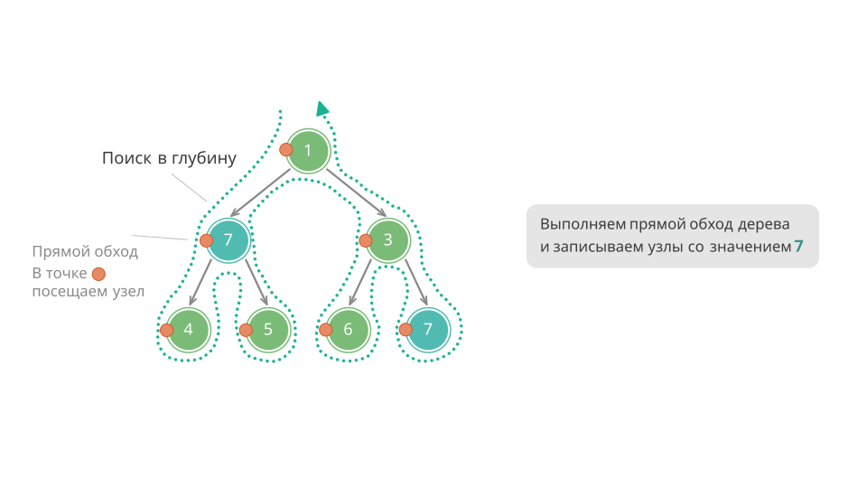
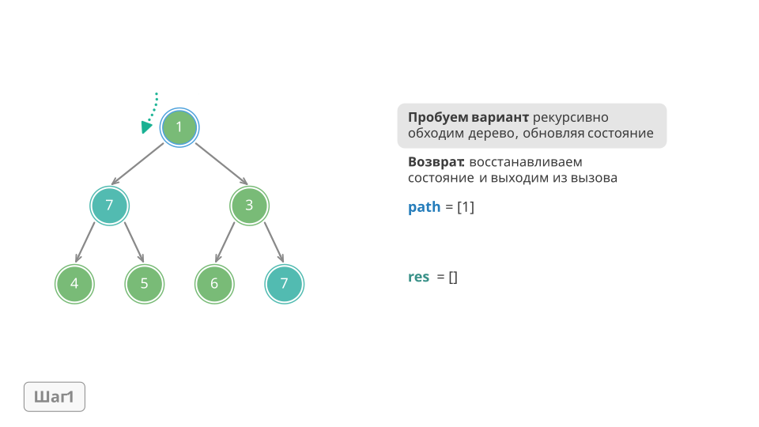
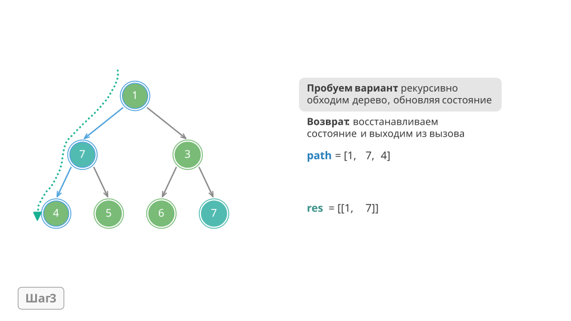
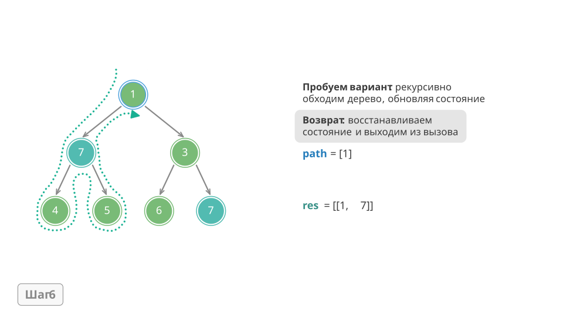
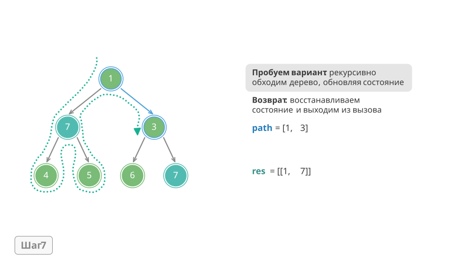
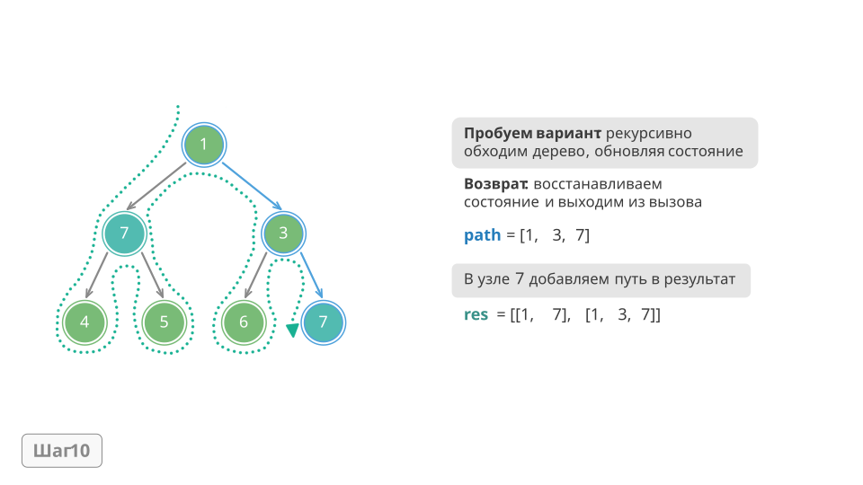

# Поиск с возвратом

<u>Поиск с возвратом (backtracking algorithm)</u> — метод решения задач перебором. Начав с исходного состояния, алгоритм перебирает возможные варианты и записывает подходящие решения. Поиск ведётся, пока решение не найдено или пока не исчерпаны все варианты.

Для обхода пространства решений обычно применяют поиск в глубину. В главе «Двоичное дерево» мы уже встречали три его разновидности: прямой, симметричный и обратный обходы. На примере прямого обхода разберём по шагам, как работает поиск с возвратом.

!!! question "Пример 1"

    Дано двоичное дерево. Найдите все узлы со значением $7$ и верните их в виде списка.

Обойдём дерево в прямом порядке и для каждого узла проверим, равно ли его значение $7$. Если да, добавим значение узла в список результатов `res`. Ход поиска показан на рисунке и в коде ниже.

```src
[file]{preorder_traversal_i_compact}-[class]{}-[func]{pre_order}
```



## Проба варианта и возврат

**Метод называют поиском с возвратом, поскольку при переборе решений он чередует пробы вариантов и возвраты**. Если из текущего состояния нельзя продвинуться дальше или получить допустимое решение, алгоритм отменяет последний выбор, возвращается к предыдущему состоянию и пробует другие варианты.

В первом примере посещение каждого узла — это проба варианта, а `return` при выходе за лист или при переходе обратно к родителю — возврат.

При этом **возврат не сводится к выходу из функции**. Чтобы увидеть разницу, немного расширим первый пример.

!!! question "Пример 2"

    Найдите в двоичном дереве все узлы со значением $7$ и **верните пути от корня до этих узлов**.

Дополним код первого примера списком `path`, в котором будем хранить путь из посещённых узлов. Дойдя до узла со значением $7$, добавим копию `path` в список результатов `res`. После обхода в `res` окажутся все решения. Вот соответствующий код:

```src
[file]{preorder_traversal_ii_compact}-[class]{}-[func]{pre_order}
```

При каждой пробе мы добавляем текущий узел в `path`, тем самым удлиняя путь. Перед возвратом нужно извлечь этот узел из `path`, **чтобы восстановить состояние до пробы**.

На рисунке видно, что **пробу и возврат можно представить как шаг вперёд и его отмену**. Это две взаимно обратные операции.

=== "<1>"
    

=== "<2>"
    

=== "<3>"
    

=== "<4>"
    

=== "<5>"
    

=== "<6>"
    

=== "<7>"
    

=== "<8>"
    

=== "<9>"
    

=== "<10>"
    

=== "<11>"
    

## Отсечение

В более сложных задачах обычно есть одно или несколько ограничений. **Ограничения часто позволяют отсекать ветви поиска**.

!!! question "Пример 3"

    Найдите в двоичном дереве все узлы со значением $7$ и верните пути от корня до этих узлов. **В пути не должно быть узлов со значением $3$**.

Чтобы соблюсти ограничение, **добавим отсечение**. Встретив узел со значением $3$, сразу вернёмся из вызова, прекратив поиск в этой ветви. Реализация приведена ниже.

```src
[file]{preorder_traversal_iii_compact}-[class]{}-[func]{pre_order}
```

Название «отсечение» хорошо передаёт смысл операции. Как видно на рисунке, **мы отсекаем ветви поиска, нарушающие ограничения**. Это избавляет от многих бесполезных проб и повышает эффективность поиска.


## Общая схема алгоритма

Выделим общую схему поиска с возвратом — пробу, возврат и отсечение. Тогда один и тот же код можно будет использовать в разных задачах.

В следующей схеме `state` обозначает текущее состояние задачи, а `choices` — варианты выбора в этом состоянии:

```snippet
backtrack_framework
```

Применим схему к примеру 3. Состояние `state` — текущий путь по узлам дерева, варианты `choices` — левый и правый потомки текущего узла, а результат `res` — список путей:

```src
[file]{preorder_traversal_iii_template}-[class]{}-[func]{backtrack}
```

По условию после обнаружения узла со значением $7$ поиск должен продолжаться, **поэтому удалим инструкцию `return` после записи решения**. Рисунок показывает, как проходит поиск с инструкцией `return` и без неё.


Реализация по общей схеме выглядит длиннее кода прямого обхода, зато область её применения шире. **Эта схема подходит для многих задач поиска с возвратом**. Достаточно определить `state` и `choices` для конкретной задачи и реализовать методы схемы.

## Основные термины

Чтобы упростить разбор задач, соберём в таблице термины поиска с возвратом и проиллюстрируем каждый из них на примере 3.

<p align="center"> Таблица <id> &nbsp; Основные термины поиска с возвратом </p>

| Термин                   | Определение                                                                       | Пример 3                                                               |
| ---------------------- | -------------------------------------------------------------------------- | -------------------------------------------------------------------- |
| Решение (solution)         | Ответ, удовлетворяющий условиям задачи. Решение может быть одно, а может быть несколько                               | Все пути от корня до узлов со значением $7$, удовлетворяющие ограничениям                            |
| Ограничение (constraint) | Условие задачи, определяющее допустимость решения. Часто используется для отсечения                         | На пути нет узла со значением $3$                                                 |
| Состояние (state)          | Положение дел в данный момент, включая уже сделанный выбор                           | Текущий путь по посещённым узлам — список `path`                             |
| Проба (attempt)        | Шаг исследования пространства решений: выбрать доступный вариант, обновить состояние и проверить, получено ли решение | Рекурсивно посетить левого или правого потомка, добавить узел в `path` и проверить, равно ли его значение $7$ |
| Возврат (backtracking)   | Отмена предыдущего выбора и переход к прежнему состоянию при обнаружении состояния, нарушающего ограничения       | Функция завершает поиск в ветви и возвращает управление при выходе за лист, по окончании посещения узла или при встрече узла со значением $3$  |
| Отсечение (pruning)        | Исключение бесперспективных путей на основании свойств и ограничений задачи. Повышает эффективность поиска     | При встрече узла со значением $3$ поиск в этой ветви прекращается                              |

!!! tip

    Понятия задачи, решения и состояния встречаются и в других методах: «разделяй и властвуй», поиске с возвратом, динамическом программировании и жадных алгоритмах.

## Преимущества и ограничения

Поиск с возвратом по сути представляет собой поиск в глубину: он перебирает варианты, пока не найдёт решение, удовлетворяющее условиям. Преимущество метода в том, что он позволяет найти все решения, а при удачном отсечении ветвей может работать весьма эффективно.

Однако на больших или сложных задачах **поиск с возвратом может оказаться неприемлемо медленным**.

- **Время**. Часто приходится перебирать все варианты в пространстве состояний. Временная сложность может быть экспоненциальной или даже факториальной.
- **Память**. Рекурсивным вызовам нужно хранить текущее состояние, например путь и вспомогательные переменные для отсечения. При большой глубине может понадобиться много памяти.

И всё же **для некоторых задач поиска и удовлетворения ограничений поиск с возвратом остаётся лучшим методом**. Заранее неизвестно, какой выбор приведёт к решению, поэтому приходится перебирать возможные варианты. Тогда **важно повысить эффективность поиска**. Для этого часто используют два приёма.

- **Отсечение**. Исключаем пути, которые заведомо не приведут к решению. Это экономит время и память.
- **Эвристический поиск**. Используем правила или оценки, чтобы в первую очередь исследовать пути, наиболее вероятно ведущие к решению.

## Типичные задачи поиска с возвратом

Поиск с возвратом применим ко многим задачам поиска, удовлетворения ограничений и комбинаторной оптимизации.

**Задачи поиска**. Требуется найти решения, удовлетворяющие заданным условиям.

- Перестановки. Для заданного множества найти все способы упорядочить его элементы.
- Сумма подмножества. Для заданного множества и целевой суммы найти все подмножества с такой суммой элементов.
- Ханойские башни. Даны три стержня и диски разного размера. Нужно перенести все диски с одного стержня на другой, перемещая по одному диску и не кладя больший диск на меньший.

**Задачи удовлетворения ограничений**. Нужно найти решение, которое удовлетворяет всем ограничениям.

- Задача о $n$ ферзях. На доске $n \times n$ нужно расставить $n$ ферзей так, чтобы они не били друг друга.
- Судоку. Впишите в сетку $9 \times 9$ цифры от $1$ до $9$ так, чтобы они не повторялись ни в одной строке, ни в одном столбце и ни в одном квадрате $3 \times 3$.
- Раскраска графа. Раскрасить вершины неориентированного графа минимальным числом цветов так, чтобы соседние вершины различались по цвету.

**Задачи комбинаторной оптимизации**. Среди комбинаций, удовлетворяющих заданным условиям, требуется найти оптимальную.

- Задача о рюкзаке 0–1. Даны рюкзак и набор предметов с известными ценностью и весом. Нужно выбрать предметы максимальной суммарной ценности, не превысив вместимость рюкзака.
- Задача коммивояжёра. Найти в графе кратчайший маршрут, который начинается в заданной вершине, посещает все остальные ровно по одному разу и возвращается в исходную вершину.
- Задача о максимальной клике. Найти в неориентированном графе наибольший полный подграф — такой, в котором любые две вершины соединены ребром.

Для многих задач комбинаторной оптимизации поиск с возвратом не является лучшим методом.

- Задачу о рюкзаке 0–1 обычно решают с помощью динамического программирования: это сокращает время вычислений.
- Задача коммивояжёра — известная NP-трудная задача. Для неё часто применяют генетические и муравьиные алгоритмы.
- Задача о максимальной клике — классическая задача теории графов. Для её решения применяют, в частности, жадные и другие эвристические алгоритмы.
