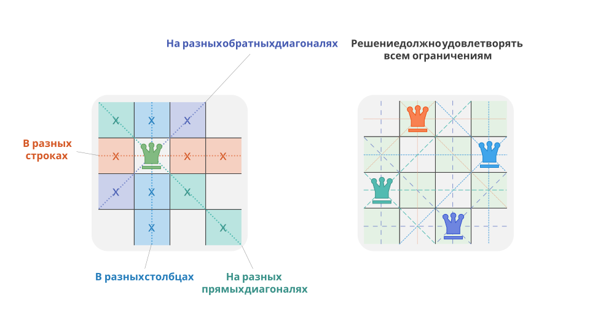
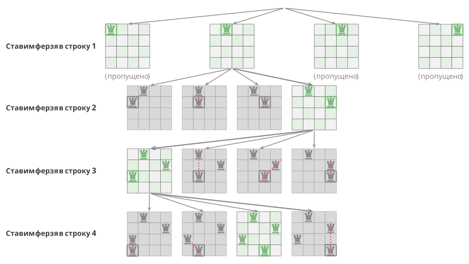
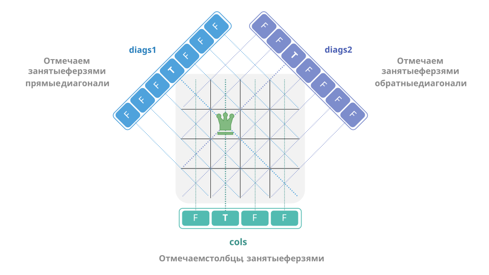

# Задача о n ферзях

!!! question

    По правилам шахмат ферзь бьёт фигуры в своей строке, столбце и на обеих диагоналях. Даны $n$ ферзей и доска размером $n \times n$. Найдите все способы расставить ферзей так, чтобы они не били друг друга.

Как показано на рисунке, при $n = 4$ имеются два решения. Для поиска с возвратом все $n^2$ клеток доски размером $n \times n$ образуют множество вариантов `choices`. С каждым новым ферзём расстановка меняется. В каждый момент она задаёт состояние `state`.


На рисунке показаны три ограничения: **никакие два ферзя не могут стоять в одной строке, в одном столбце или на одной диагонали**. Будем различать прямые диагонали `\` и обратные диагонали `/`.



### Расстановка ферзей по строкам

Число ферзей и число строк доски одинаковы и равны $n$. Следовательно, **в каждой строке должен стоять ровно один ферзь**.

Поэтому можно заполнять доску по строкам: начнём с первой строки и поставим по одному ферзю в каждую строку до последней включительно.

На рисунке показана расстановка четырёх ферзей по строкам. Для экономии места из вариантов для первой строки развёрнута только одна ветвь. Варианты, нарушающие ограничения по столбцам или диагоналям, отсечены.



По сути, **расстановка по строкам уже выполняет отсечение**: исключаются все ветви, в которых несколько ферзей стоят в одной строке.

### Отсечение по столбцам и диагоналям

Для учёта занятых столбцов заведём булев массив `cols` длины $n$. Перед каждой попыткой поставить ферзя по отметкам в `cols` исключим занятые столбцы, а в ходе поиска с возвратом будем обновлять `cols`.

!!! tip

    Начало координат матрицы находится в левом верхнем углу. Индексы строк растут сверху вниз, а индексы столбцов — слева направо.

Как учесть ограничения по диагоналям? Обозначим строку и столбец клетки парой $(row, col)$. На любой прямой диагонали разность индексов строки и столбца одинакова: **для всех её клеток величина $row - col$ постоянна**.

Значит, если для двух клеток выполняется $row_1 - col_1 = row_2 - col_2$, они лежат на одной прямой диагонали. Это позволяет отмечать занятые прямые диагонали в массиве `diags1`, показанном на рисунке.

Аналогично, **на каждой обратной диагонали величина $row + col$ постоянна**. Для учёта занятых обратных диагоналей воспользуемся массивом `diags2`.



### Реализация

В квадратной матрице порядка $n$ величина $row - col$ принимает значения из $[-n + 1, n - 1]$, а $row + col$ — из $[0, 2n - 2]$. Поэтому диагоналей каждого направления по $2n - 1$, а массивы `diags1` и `diags2` имеют длину $2n - 1$ каждый.

```src
[file]{n_queens}-[class]{}-[func]{n_queens}
```

Расставляем ферзей за $n$ шагов. С учётом занятых столбцов от первой строки до последней остаётся соответственно $n$, $n-1$, $\dots$, $2$, $1$ вариантов. На перебор уходит $O(n!)$ времени. Чтобы записать решение в `res`, нужно скопировать матрицу `state`, что занимает $O(n^2)$ времени. Таким образом, **общая временная сложность составляет $O(n! \cdot n^2)$**. На практике отсечение по диагоналям значительно сужает пространство поиска, и алгоритм часто работает быстрее этой оценки.

Массив `state` занимает $O(n^2)$ памяти, а массивы `cols`, `diags1` и `diags2` — по $O(n)$. Максимальная глубина рекурсии равна $n$, поэтому кадры стека занимают $O(n)$ памяти. Итак, **пространственная сложность равна $O(n^2)$**.
