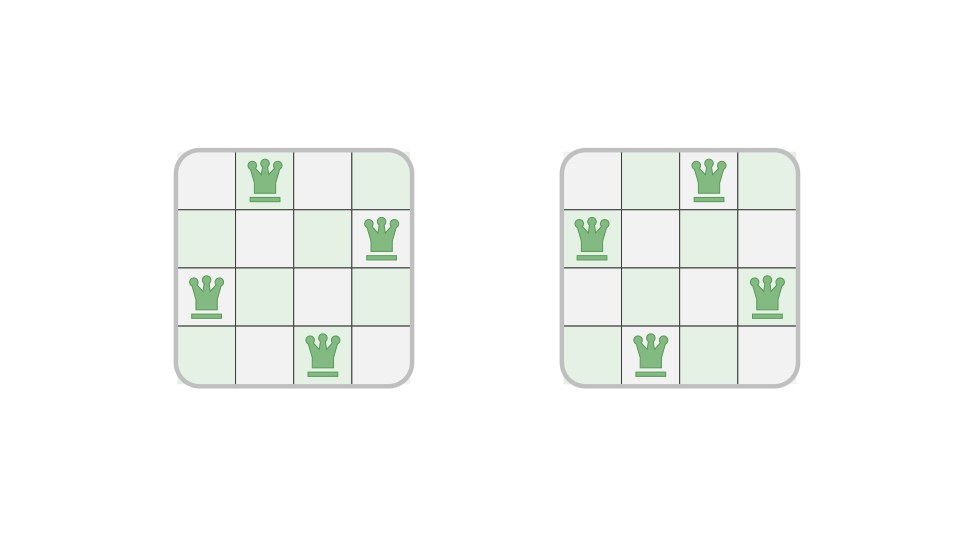

# 13.4 &nbsp; Задача о n ферзях

!!! question

    По правилам шахмат ферзь бьёт фигуры в своей строке, столбце и на обеих диагоналях. Даны $n$ ферзей и доска размером $n \times n$. Найдите все способы расставить ферзей так, чтобы они не били друг друга.

Как показано на рисунке, при $n = 4$ имеются два решения. Для поиска с возвратом все $n^2$ клеток доски размером $n \times n$ образуют множество вариантов `choices`. С каждым новым ферзём расстановка меняется. В каждый момент она задаёт состояние `state`.

{ class="animation-figure" }

<p align="center"> Рисунок 13-15 &nbsp; Решения задачи о четырёх ферзях </p>

На рисунке показаны три ограничения: **никакие два ферзя не могут стоять в одной строке, в одном столбце или на одной диагонали**. Будем различать прямые диагонали `\` и обратные диагонали `/`.

{ class="animation-figure" }

<p align="center"> Рисунок 13-16 &nbsp; Ограничения в задаче о n ферзях </p>

### 1. &nbsp; Расстановка ферзей по строкам

Число ферзей и число строк доски одинаковы и равны $n$. Следовательно, **в каждой строке должен стоять ровно один ферзь**.

Поэтому можно заполнять доску по строкам: начнём с первой строки и поставим по одному ферзю в каждую строку до последней включительно.

На рисунке показана расстановка четырёх ферзей по строкам. Для экономии места из вариантов для первой строки развёрнута только одна ветвь. Варианты, нарушающие ограничения по столбцам или диагоналям, отсечены.

{ class="animation-figure" }

<p align="center"> Рисунок 13-17 &nbsp; Расстановка ферзей по строкам </p>

По сути, **расстановка по строкам уже выполняет отсечение**: исключаются все ветви, в которых несколько ферзей стоят в одной строке.

### 2. &nbsp; Отсечение по столбцам и диагоналям

Для учёта занятых столбцов заведём булев массив `cols` длины $n$. Перед каждой попыткой поставить ферзя по отметкам в `cols` исключим занятые столбцы, а в ходе поиска с возвратом будем обновлять `cols`.

!!! tip

    Начало координат матрицы находится в левом верхнем углу. Индексы строк растут сверху вниз, а индексы столбцов — слева направо.

Как учесть ограничения по диагоналям? Обозначим строку и столбец клетки парой $(row, col)$. На любой прямой диагонали разность индексов строки и столбца одинакова: **для всех её клеток величина $row - col$ постоянна**.

Значит, если для двух клеток выполняется $row_1 - col_1 = row_2 - col_2$, они лежат на одной прямой диагонали. Это позволяет отмечать занятые прямые диагонали в массиве `diags1`, показанном на рисунке.

Аналогично, **на каждой обратной диагонали величина $row + col$ постоянна**. Для учёта занятых обратных диагоналей воспользуемся массивом `diags2`.

{ class="animation-figure" }

<p align="center"> Рисунок 13-18 &nbsp; Учёт ограничений по столбцам и диагоналям </p>

### 3. &nbsp; Реализация

В квадратной матрице порядка $n$ величина $row - col$ принимает значения из $[-n + 1, n - 1]$, а $row + col$ — из $[0, 2n - 2]$. Поэтому диагоналей каждого направления по $2n - 1$, а массивы `diags1` и `diags2` имеют длину $2n - 1$ каждый.

=== "Python"

    ```python title="n_queens.py"
    def backtrack(
        row: int,
        n: int,
        state: list[list[str]],
        res: list[list[list[str]]],
        cols: list[bool],
        diags1: list[bool],
        diags2: list[bool],
    ):
        """Поиск с возвратом: задача о n ферзях"""
        # Когда ферзи расставлены во всех строках, сохраняем решение
        if row == n:
            res.append([list(row) for row in state])
            return
        # Перебираем все столбцы
        for col in range(n):
            # Вычисляем индексы прямой и обратной диагоналей клетки
            diag1 = row - col + n - 1
            diag2 = row + col
            # Отсечение: в столбце и на обеих диагоналях клетки не должно быть ферзей
            if not cols[col] and not diags1[diag1] and not diags2[diag2]:
                # Пробуем поставить ферзя на эту клетку
                state[row][col] = "Q"
                cols[col] = diags1[diag1] = diags2[diag2] = True
                # Переходим к следующей строке
                backtrack(row + 1, n, state, res, cols, diags1, diags2)
                # Возврат: освобождаем клетку
                state[row][col] = "#"
                cols[col] = diags1[diag1] = diags2[diag2] = False

    def n_queens(n: int) -> list[list[list[str]]]:
        """Решение задачи о n ферзях"""
        # Создаём доску n*n, где 'Q' обозначает ферзя, а '#' — пустую клетку
        state = [["#" for _ in range(n)] for _ in range(n)]
        cols = [False] * n  # Отмечаем столбцы, занятые ферзями
        diags1 = [False] * (2 * n - 1)  # Отмечаем прямые диагонали, занятые ферзями
        diags2 = [False] * (2 * n - 1)  # Отмечаем обратные диагонали, занятые ферзями
        res = []
        backtrack(0, n, state, res, cols, diags1, diags2)

        return res
    ```

=== "C++"

    ```cpp title="n_queens.cpp"
    /* Поиск с возвратом: задача о n ферзях */
    void backtrack(int row, int n, vector<vector<string>> &state, vector<vector<vector<string>>> &res, vector<bool> &cols,
                   vector<bool> &diags1, vector<bool> &diags2) {
        // Когда ферзи расставлены во всех строках, сохраняем решение
        if (row == n) {
            res.push_back(state);
            return;
        }
        // Перебираем все столбцы
        for (int col = 0; col < n; col++) {
            // Вычисляем индексы прямой и обратной диагоналей клетки
            int diag1 = row - col + n - 1;
            int diag2 = row + col;
            // Отсечение: в столбце и на обеих диагоналях клетки не должно быть ферзей
            if (!cols[col] && !diags1[diag1] && !diags2[diag2]) {
                // Пробуем поставить ферзя на эту клетку
                state[row][col] = "Q";
                cols[col] = diags1[diag1] = diags2[diag2] = true;
                // Переходим к следующей строке
                backtrack(row + 1, n, state, res, cols, diags1, diags2);
                // Возврат: освобождаем клетку
                state[row][col] = "#";
                cols[col] = diags1[diag1] = diags2[diag2] = false;
            }
        }
    }

    /* Решение задачи о n ферзях */
    vector<vector<vector<string>>> nQueens(int n) {
        // Создаём доску n*n, где 'Q' обозначает ферзя, а '#' — пустую клетку
        vector<vector<string>> state(n, vector<string>(n, "#"));
        vector<bool> cols(n, false);           // Отмечаем столбцы, занятые ферзями
        vector<bool> diags1(2 * n - 1, false); // Отмечаем прямые диагонали, занятые ферзями
        vector<bool> diags2(2 * n - 1, false); // Отмечаем обратные диагонали, занятые ферзями
        vector<vector<vector<string>>> res;

        backtrack(0, n, state, res, cols, diags1, diags2);

        return res;
    }
    ```

=== "Java"

    ```java title="n_queens.java"
    /* Поиск с возвратом: задача о n ферзях */
    void backtrack(int row, int n, List<List<String>> state, List<List<List<String>>> res,
            boolean[] cols, boolean[] diags1, boolean[] diags2) {
        // Когда ферзи расставлены во всех строках, сохраняем решение
        if (row == n) {
            List<List<String>> copyState = new ArrayList<>();
            for (List<String> sRow : state) {
                copyState.add(new ArrayList<>(sRow));
            }
            res.add(copyState);
            return;
        }
        // Перебираем все столбцы
        for (int col = 0; col < n; col++) {
            // Вычисляем индексы прямой и обратной диагоналей клетки
            int diag1 = row - col + n - 1;
            int diag2 = row + col;
            // Отсечение: в столбце и на обеих диагоналях клетки не должно быть ферзей
            if (!cols[col] && !diags1[diag1] && !diags2[diag2]) {
                // Пробуем поставить ферзя на эту клетку
                state.get(row).set(col, "Q");
                cols[col] = diags1[diag1] = diags2[diag2] = true;
                // Переходим к следующей строке
                backtrack(row + 1, n, state, res, cols, diags1, diags2);
                // Возврат: освобождаем клетку
                state.get(row).set(col, "#");
                cols[col] = diags1[diag1] = diags2[diag2] = false;
            }
        }
    }

    /* Решение задачи о n ферзях */
    List<List<List<String>>> nQueens(int n) {
        // Создаём доску n*n, где 'Q' обозначает ферзя, а '#' — пустую клетку
        List<List<String>> state = new ArrayList<>();
        for (int i = 0; i < n; i++) {
            List<String> row = new ArrayList<>();
            for (int j = 0; j < n; j++) {
                row.add("#");
            }
            state.add(row);
        }
        boolean[] cols = new boolean[n]; // Отмечаем столбцы, занятые ферзями
        boolean[] diags1 = new boolean[2 * n - 1]; // Отмечаем прямые диагонали, занятые ферзями
        boolean[] diags2 = new boolean[2 * n - 1]; // Отмечаем обратные диагонали, занятые ферзями
        List<List<List<String>>> res = new ArrayList<>();

        backtrack(0, n, state, res, cols, diags1, diags2);

        return res;
    }
    ```

=== "C#"

    ```csharp title="n_queens.cs"
    /* Поиск с возвратом: задача о n ферзях */
    void Backtrack(int row, int n, List<List<string>> state, List<List<List<string>>> res,
            bool[] cols, bool[] diags1, bool[] diags2) {
        // Когда ферзи расставлены во всех строках, сохраняем решение
        if (row == n) {
            List<List<string>> copyState = [];
            foreach (List<string> sRow in state) {
                copyState.Add(new List<string>(sRow));
            }
            res.Add(copyState);
            return;
        }
        // Перебираем все столбцы
        for (int col = 0; col < n; col++) {
            // Вычисляем индексы прямой и обратной диагоналей клетки
            int diag1 = row - col + n - 1;
            int diag2 = row + col;
            // Отсечение: в столбце и на обеих диагоналях клетки не должно быть ферзей
            if (!cols[col] && !diags1[diag1] && !diags2[diag2]) {
                // Пробуем поставить ферзя на эту клетку
                state[row][col] = "Q";
                cols[col] = diags1[diag1] = diags2[diag2] = true;
                // Переходим к следующей строке
                Backtrack(row + 1, n, state, res, cols, diags1, diags2);
                // Возврат: освобождаем клетку
                state[row][col] = "#";
                cols[col] = diags1[diag1] = diags2[diag2] = false;
            }
        }
    }

    /* Решение задачи о n ферзях */
    List<List<List<string>>> NQueens(int n) {
        // Создаём доску n*n, где 'Q' обозначает ферзя, а '#' — пустую клетку
        List<List<string>> state = [];
        for (int i = 0; i < n; i++) {
            List<string> row = [];
            for (int j = 0; j < n; j++) {
                row.Add("#");
            }
            state.Add(row);
        }
        bool[] cols = new bool[n]; // Отмечаем столбцы, занятые ферзями
        bool[] diags1 = new bool[2 * n - 1]; // Отмечаем прямые диагонали, занятые ферзями
        bool[] diags2 = new bool[2 * n - 1]; // Отмечаем обратные диагонали, занятые ферзями
        List<List<List<string>>> res = [];

        Backtrack(0, n, state, res, cols, diags1, diags2);

        return res;
    }
    ```

=== "Go"

    ```go title="n_queens.go"
    /* Поиск с возвратом: задача о n ферзях */
    func backtrack(row, n int, state *[][]string, res *[][][]string, cols, diags1, diags2 *[]bool) {
        // Когда ферзи расставлены во всех строках, сохраняем решение
        if row == n {
            newState := make([][]string, len(*state))
            for i, _ := range newState {
                newState[i] = make([]string, len((*state)[0]))
                copy(newState[i], (*state)[i])

            }
            *res = append(*res, newState)
            return
        }
        // Перебираем все столбцы
        for col := 0; col < n; col++ {
            // Вычисляем индексы прямой и обратной диагоналей клетки
            diag1 := row - col + n - 1
            diag2 := row + col
            // Отсечение: в столбце и на обеих диагоналях клетки не должно быть ферзей
            if !(*cols)[col] && !(*diags1)[diag1] && !(*diags2)[diag2] {
                // Пробуем поставить ферзя на эту клетку
                (*state)[row][col] = "Q"
                (*cols)[col], (*diags1)[diag1], (*diags2)[diag2] = true, true, true
                // Переходим к следующей строке
                backtrack(row+1, n, state, res, cols, diags1, diags2)
                // Возврат: освобождаем клетку
                (*state)[row][col] = "#"
                (*cols)[col], (*diags1)[diag1], (*diags2)[diag2] = false, false, false
            }
        }
    }

    /* Решение задачи о n ферзях */
    func nQueens(n int) [][][]string {
        // Создаём доску n*n, где 'Q' обозначает ферзя, а '#' — пустую клетку
        state := make([][]string, n)
        for i := 0; i < n; i++ {
            row := make([]string, n)
            for i := 0; i < n; i++ {
                row[i] = "#"
            }
            state[i] = row
        }
        // Отмечаем столбцы, занятые ферзями
        cols := make([]bool, n)
        diags1 := make([]bool, 2*n-1)
        diags2 := make([]bool, 2*n-1)
        res := make([][][]string, 0)
        backtrack(0, n, &state, &res, &cols, &diags1, &diags2)
        return res
    }
    ```

=== "Swift"

    ```swift title="n_queens.swift"
    /* Поиск с возвратом: задача о n ферзях */
    func backtrack(row: Int, n: Int, state: inout [[String]], res: inout [[[String]]], cols: inout [Bool], diags1: inout [Bool], diags2: inout [Bool]) {
        // Когда ферзи расставлены во всех строках, сохраняем решение
        if row == n {
            res.append(state)
            return
        }
        // Перебираем все столбцы
        for col in 0 ..< n {
            // Вычисляем индексы прямой и обратной диагоналей клетки
            let diag1 = row - col + n - 1
            let diag2 = row + col
            // Отсечение: в столбце и на обеих диагоналях клетки не должно быть ферзей
            if !cols[col] && !diags1[diag1] && !diags2[diag2] {
                // Пробуем поставить ферзя на эту клетку
                state[row][col] = "Q"
                cols[col] = true
                diags1[diag1] = true
                diags2[diag2] = true
                // Переходим к следующей строке
                backtrack(row: row + 1, n: n, state: &state, res: &res, cols: &cols, diags1: &diags1, diags2: &diags2)
                // Возврат: освобождаем клетку
                state[row][col] = "#"
                cols[col] = false
                diags1[diag1] = false
                diags2[diag2] = false
            }
        }
    }

    /* Решение задачи о n ферзях */
    func nQueens(n: Int) -> [[[String]]] {
        // Создаём доску n*n, где 'Q' обозначает ферзя, а '#' — пустую клетку
        var state = Array(repeating: Array(repeating: "#", count: n), count: n)
        var cols = Array(repeating: false, count: n) // Отмечаем столбцы, занятые ферзями
        var diags1 = Array(repeating: false, count: 2 * n - 1) // Отмечаем прямые диагонали, занятые ферзями
        var diags2 = Array(repeating: false, count: 2 * n - 1) // Отмечаем обратные диагонали, занятые ферзями
        var res: [[[String]]] = []

        backtrack(row: 0, n: n, state: &state, res: &res, cols: &cols, diags1: &diags1, diags2: &diags2)

        return res
    }
    ```

=== "JS"

    ```javascript title="n_queens.js"
    /* Поиск с возвратом: задача о n ферзях */
    function backtrack(row, n, state, res, cols, diags1, diags2) {
        // Когда ферзи расставлены во всех строках, сохраняем решение
        if (row === n) {
            res.push(state.map((row) => row.slice()));
            return;
        }
        // Перебираем все столбцы
        for (let col = 0; col < n; col++) {
            // Вычисляем индексы прямой и обратной диагоналей клетки
            const diag1 = row - col + n - 1;
            const diag2 = row + col;
            // Отсечение: в столбце и на обеих диагоналях клетки не должно быть ферзей
            if (!cols[col] && !diags1[diag1] && !diags2[diag2]) {
                // Пробуем поставить ферзя на эту клетку
                state[row][col] = 'Q';
                cols[col] = diags1[diag1] = diags2[diag2] = true;
                // Переходим к следующей строке
                backtrack(row + 1, n, state, res, cols, diags1, diags2);
                // Возврат: освобождаем клетку
                state[row][col] = '#';
                cols[col] = diags1[diag1] = diags2[diag2] = false;
            }
        }
    }

    /* Решение задачи о n ферзях */
    function nQueens(n) {
        // Создаём доску n*n, где 'Q' обозначает ферзя, а '#' — пустую клетку
        const state = Array.from({ length: n }, () => Array(n).fill('#'));
        const cols = Array(n).fill(false); // Отмечаем столбцы, занятые ферзями
        const diags1 = Array(2 * n - 1).fill(false); // Отмечаем прямые диагонали, занятые ферзями
        const diags2 = Array(2 * n - 1).fill(false); // Отмечаем обратные диагонали, занятые ферзями
        const res = [];

        backtrack(0, n, state, res, cols, diags1, diags2);
        return res;
    }
    ```

=== "TS"

    ```typescript title="n_queens.ts"
    /* Поиск с возвратом: задача о n ферзях */
    function backtrack(
        row: number,
        n: number,
        state: string[][],
        res: string[][][],
        cols: boolean[],
        diags1: boolean[],
        diags2: boolean[]
    ): void {
        // Когда ферзи расставлены во всех строках, сохраняем решение
        if (row === n) {
            res.push(state.map((row) => row.slice()));
            return;
        }
        // Перебираем все столбцы
        for (let col = 0; col < n; col++) {
            // Вычисляем индексы прямой и обратной диагоналей клетки
            const diag1 = row - col + n - 1;
            const diag2 = row + col;
            // Отсечение: в столбце и на обеих диагоналях клетки не должно быть ферзей
            if (!cols[col] && !diags1[diag1] && !diags2[diag2]) {
                // Пробуем поставить ферзя на эту клетку
                state[row][col] = 'Q';
                cols[col] = diags1[diag1] = diags2[diag2] = true;
                // Переходим к следующей строке
                backtrack(row + 1, n, state, res, cols, diags1, diags2);
                // Возврат: освобождаем клетку
                state[row][col] = '#';
                cols[col] = diags1[diag1] = diags2[diag2] = false;
            }
        }
    }

    /* Решение задачи о n ферзях */
    function nQueens(n: number): string[][][] {
        // Создаём доску n*n, где 'Q' обозначает ферзя, а '#' — пустую клетку
        const state = Array.from({ length: n }, () => Array(n).fill('#'));
        const cols = Array(n).fill(false); // Отмечаем столбцы, занятые ферзями
        const diags1 = Array(2 * n - 1).fill(false); // Отмечаем прямые диагонали, занятые ферзями
        const diags2 = Array(2 * n - 1).fill(false); // Отмечаем обратные диагонали, занятые ферзями
        const res: string[][][] = [];

        backtrack(0, n, state, res, cols, diags1, diags2);
        return res;
    }
    ```

=== "Dart"

    ```dart title="n_queens.dart"
    /* Поиск с возвратом: задача о n ферзях */
    void backtrack(
      int row,
      int n,
      List<List<String>> state,
      List<List<List<String>>> res,
      List<bool> cols,
      List<bool> diags1,
      List<bool> diags2,
    ) {
      // Когда ферзи расставлены во всех строках, сохраняем решение
      if (row == n) {
        List<List<String>> copyState = [];
        for (List<String> sRow in state) {
          copyState.add(List.from(sRow));
        }
        res.add(copyState);
        return;
      }
      // Перебираем все столбцы
      for (int col = 0; col < n; col++) {
        // Вычисляем индексы прямой и обратной диагоналей клетки
        int diag1 = row - col + n - 1;
        int diag2 = row + col;
        // Отсечение: в столбце и на обеих диагоналях клетки не должно быть ферзей
        if (!cols[col] && !diags1[diag1] && !diags2[diag2]) {
          // Пробуем поставить ферзя на эту клетку
          state[row][col] = "Q";
          cols[col] = true;
          diags1[diag1] = true;
          diags2[diag2] = true;
          // Переходим к следующей строке
          backtrack(row + 1, n, state, res, cols, diags1, diags2);
          // Возврат: освобождаем клетку
          state[row][col] = "#";
          cols[col] = false;
          diags1[diag1] = false;
          diags2[diag2] = false;
        }
      }
    }

    /* Решение задачи о n ферзях */
    List<List<List<String>>> nQueens(int n) {
      // Создаём доску n*n, где 'Q' обозначает ферзя, а '#' — пустую клетку
      List<List<String>> state = List.generate(n, (index) => List.filled(n, "#"));
      List<bool> cols = List.filled(n, false); // Отмечаем столбцы, занятые ферзями
      List<bool> diags1 = List.filled(2 * n - 1, false); // Отмечаем прямые диагонали, занятые ферзями
      List<bool> diags2 = List.filled(2 * n - 1, false); // Отмечаем обратные диагонали, занятые ферзями
      List<List<List<String>>> res = [];

      backtrack(0, n, state, res, cols, diags1, diags2);

      return res;
    }
    ```

=== "Rust"

    ```rust title="n_queens.rs"
    /* Поиск с возвратом: задача о n ферзях */
    fn backtrack(
        row: usize,
        n: usize,
        state: &mut Vec<Vec<String>>,
        res: &mut Vec<Vec<Vec<String>>>,
        cols: &mut [bool],
        diags1: &mut [bool],
        diags2: &mut [bool],
    ) {
        // Когда ферзи расставлены во всех строках, сохраняем решение
        if row == n {
            res.push(state.clone());
            return;
        }
        // Перебираем все столбцы
        for col in 0..n {
            // Вычисляем индексы прямой и обратной диагоналей клетки
            let diag1 = row + n - 1 - col;
            let diag2 = row + col;
            // Отсечение: в столбце и на обеих диагоналях клетки не должно быть ферзей
            if !cols[col] && !diags1[diag1] && !diags2[diag2] {
                // Пробуем поставить ферзя на эту клетку
                state[row][col] = "Q".into();
                (cols[col], diags1[diag1], diags2[diag2]) = (true, true, true);
                // Переходим к следующей строке
                backtrack(row + 1, n, state, res, cols, diags1, diags2);
                // Возврат: освобождаем клетку
                state[row][col] = "#".into();
                (cols[col], diags1[diag1], diags2[diag2]) = (false, false, false);
            }
        }
    }

    /* Решение задачи о n ферзях */
    fn n_queens(n: usize) -> Vec<Vec<Vec<String>>> {
        // Создаём доску n*n, где 'Q' обозначает ферзя, а '#' — пустую клетку
        let mut state: Vec<Vec<String>> = vec![vec!["#".to_string(); n]; n];
        let mut cols = vec![false; n]; // Отмечаем столбцы, занятые ферзями
        let mut diags1 = vec![false; 2 * n - 1]; // Отмечаем прямые диагонали, занятые ферзями
        let mut diags2 = vec![false; 2 * n - 1]; // Отмечаем обратные диагонали, занятые ферзями
        let mut res: Vec<Vec<Vec<String>>> = Vec::new();

        backtrack(
            0,
            n,
            &mut state,
            &mut res,
            &mut cols,
            &mut diags1,
            &mut diags2,
        );

        res
    }
    ```

=== "C"

    ```c title="n_queens.c"
    /* Поиск с возвратом: задача о n ферзях */
    void backtrack(int row, int n, char state[MAX_SIZE][MAX_SIZE], char ***res, int *resSize, bool cols[MAX_SIZE],
                   bool diags1[2 * MAX_SIZE - 1], bool diags2[2 * MAX_SIZE - 1]) {
        // Когда ферзи расставлены во всех строках, сохраняем решение
        if (row == n) {
            res[*resSize] = (char **)malloc(sizeof(char *) * n);
            for (int i = 0; i < n; ++i) {
                res[*resSize][i] = (char *)malloc(sizeof(char) * (n + 1));
                strcpy(res[*resSize][i], state[i]);
            }
            (*resSize)++;
            return;
        }
        // Перебираем все столбцы
        for (int col = 0; col < n; col++) {
            // Вычисляем индексы прямой и обратной диагоналей клетки
            int diag1 = row - col + n - 1;
            int diag2 = row + col;
            // Отсечение: в столбце и на обеих диагоналях клетки не должно быть ферзей
            if (!cols[col] && !diags1[diag1] && !diags2[diag2]) {
                // Пробуем поставить ферзя на эту клетку
                state[row][col] = 'Q';
                cols[col] = diags1[diag1] = diags2[diag2] = true;
                // Переходим к следующей строке
                backtrack(row + 1, n, state, res, resSize, cols, diags1, diags2);
                // Возврат: освобождаем клетку
                state[row][col] = '#';
                cols[col] = diags1[diag1] = diags2[diag2] = false;
            }
        }
    }

    /* Решение задачи о n ферзях */
    char ***nQueens(int n, int *returnSize) {
        char state[MAX_SIZE][MAX_SIZE];
        // Создаём доску n*n, где 'Q' обозначает ферзя, а '#' — пустую клетку
        for (int i = 0; i < n; ++i) {
            for (int j = 0; j < n; ++j) {
                state[i][j] = '#';
            }
            state[i][n] = '\0';
        }
        bool cols[MAX_SIZE] = {false};           // Отмечаем столбцы, занятые ферзями
        bool diags1[2 * MAX_SIZE - 1] = {false}; // Отмечаем прямые диагонали, занятые ферзями
        bool diags2[2 * MAX_SIZE - 1] = {false}; // Отмечаем обратные диагонали, занятые ферзями

        char ***res = (char ***)malloc(sizeof(char **) * MAX_SIZE);
        *returnSize = 0;
        backtrack(0, n, state, res, returnSize, cols, diags1, diags2);
        return res;
    }
    ```

=== "Kotlin"

    ```kotlin title="n_queens.kt"
    /* Поиск с возвратом: задача о n ферзях */
    fun backtrack(
        row: Int,
        n: Int,
        state: MutableList<MutableList<String>>,
        res: MutableList<MutableList<MutableList<String>>?>,
        cols: BooleanArray,
        diags1: BooleanArray,
        diags2: BooleanArray
    ) {
        // Когда ферзи расставлены во всех строках, сохраняем решение
        if (row == n) {
            val copyState = mutableListOf<MutableList<String>>()
            for (sRow in state) {
                copyState.add(sRow.toMutableList())
            }
            res.add(copyState)
            return
        }
        // Перебираем все столбцы
        for (col in 0..<n) {
            // Вычисляем индексы прямой и обратной диагоналей клетки
            val diag1 = row - col + n - 1
            val diag2 = row + col
            // Отсечение: в столбце и на обеих диагоналях клетки не должно быть ферзей
            if (!cols[col] && !diags1[diag1] && !diags2[diag2]) {
                // Пробуем поставить ферзя на эту клетку
                state[row][col] = "Q"
                diags2[diag2] = true
                diags1[diag1] = diags2[diag2]
                cols[col] = diags1[diag1]
                // Переходим к следующей строке
                backtrack(row + 1, n, state, res, cols, diags1, diags2)
                // Возврат: освобождаем клетку
                state[row][col] = "#"
                diags2[diag2] = false
                diags1[diag1] = diags2[diag2]
                cols[col] = diags1[diag1]
            }
        }
    }

    /* Решение задачи о n ферзях */
    fun nQueens(n: Int): MutableList<MutableList<MutableList<String>>?> {
        // Создаём доску n*n, где 'Q' обозначает ферзя, а '#' — пустую клетку
        val state = mutableListOf<MutableList<String>>()
        for (i in 0..<n) {
            val row = mutableListOf<String>()
            for (j in 0..<n) {
                row.add("#")
            }
            state.add(row)
        }
        val cols = BooleanArray(n) // Отмечаем столбцы, занятые ферзями
        val diags1 = BooleanArray(2 * n - 1) // Отмечаем прямые диагонали, занятые ферзями
        val diags2 = BooleanArray(2 * n - 1) // Отмечаем обратные диагонали, занятые ферзями
        val res = mutableListOf<MutableList<MutableList<String>>?>()

        backtrack(0, n, state, res, cols, diags1, diags2)

        return res
    }
    ```

=== "Ruby"

    ```ruby title="n_queens.rb"
    ### Поиск с возвратом: задача о n ферзях ###
    def backtrack(row, n, state, res, cols, diags1, diags2)
      # Когда ферзи расставлены во всех строках, сохраняем решение
      if row == n
        res << state.map { |row| row.dup }
        return
      end

      # Перебираем все столбцы
      for col in 0...n
        # Вычисляем индексы прямой и обратной диагоналей клетки
        diag1 = row - col + n - 1
        diag2 = row + col
        # Отсечение: в столбце и на обеих диагоналях клетки не должно быть ферзей
        if !cols[col] && !diags1[diag1] && !diags2[diag2]
          # Пробуем поставить ферзя на эту клетку
          state[row][col] = "Q"
          cols[col] = diags1[diag1] = diags2[diag2] = true
          # Переходим к следующей строке
          backtrack(row + 1, n, state, res, cols, diags1, diags2)
          # Возврат: освобождаем клетку
          state[row][col] = "#"
          cols[col] = diags1[diag1] = diags2[diag2] = false
        end
      end
    end

    ### Решение задачи о n ферзях ###
    def n_queens(n)
      # Создаём доску n*n, где 'Q' обозначает ферзя, а '#' — пустую клетку
      state = Array.new(n) { Array.new(n, "#") }
      cols = Array.new(n, false) # Отмечаем столбцы, занятые ферзями
      diags1 = Array.new(2 * n - 1, false) # Отмечаем прямые диагонали, занятые ферзями
      diags2 = Array.new(2 * n - 1, false) # Отмечаем обратные диагонали, занятые ферзями
      res = []
      backtrack(0, n, state, res, cols, diags1, diags2)

      res
    end
    ```

??? pythontutor "Визуализация выполнения"

    <div style="height: 549px; width: 100%;"><iframe class="pythontutor-iframe" title="Визуализация выполнения" src="https://pythontutor.com/iframe-embed.html#code=def%20backtrack%28%0A%20row%3A%20int,%0A%20n%3A%20int,%0A%20state%3A%20list%5Blist%5Bstr%5D%5D,%0A%20res%3A%20list%5Blist%5Blist%5Bstr%5D%5D%5D,%0A%20cols%3A%20list%5Bbool%5D,%0A%20diags1%3A%20list%5Bbool%5D,%0A%20diags2%3A%20list%5Bbool%5D,%0A%29%3A%0A%20%22%22%22%D0%9F%D0%BE%D0%B8%D1%81%D0%BA%20%D1%81%20%D0%B2%D0%BE%D0%B7%D0%B2%D1%80%D0%B0%D1%82%D0%BE%D0%BC%3A%20%D0%B7%D0%B0%D0%B4%D0%B0%D1%87%D0%B0%20%D0%BE%20N%20%D1%84%D0%B5%D1%80%D0%B7%D1%8F%D1%85%22%22%22%0A%20%23%20%D0%9A%D0%BE%D0%B3%D0%B4%D0%B0%20%D1%84%D0%B5%D1%80%D0%B7%D0%B8%20%D1%80%D0%B0%D1%81%D1%81%D1%82%D0%B0%D0%B2%D0%BB%D0%B5%D0%BD%D1%8B%20%D0%B2%D0%BE%20%D0%B2%D1%81%D0%B5%D1%85%20%D1%81%D1%82%D1%80%D0%BE%D0%BA%D0%B0%D1%85,%20%D1%81%D0%BE%D1%85%D1%80%D0%B0%D0%BD%D1%8F%D0%B5%D0%BC%20%D1%80%D0%B5%D1%88%D0%B5%D0%BD%D0%B8%D0%B5%0A%20if%20row%20%3D%3D%20n%3A%0A%20%20res.append%28%5Blist%28row%29%20for%20row%20in%20state%5D%29%0A%20%20return%0A%20%23%20%D0%9F%D0%B5%D1%80%D0%B5%D0%B1%D0%B8%D1%80%D0%B0%D0%B5%D0%BC%20%D0%B2%D1%81%D0%B5%20%D1%81%D1%82%D0%BE%D0%BB%D0%B1%D1%86%D1%8B%0A%20for%20col%20in%20range%28n%29%3A%0A%20%20%23%20%D0%92%D1%8B%D1%87%D0%B8%D1%81%D0%BB%D1%8F%D0%B5%D0%BC%20%D0%B8%D0%BD%D0%B4%D0%B5%D0%BA%D1%81%D1%8B%20%D0%BF%D1%80%D1%8F%D0%BC%D0%BE%D0%B9%20%D0%B8%20%D0%BE%D0%B1%D1%80%D0%B0%D1%82%D0%BD%D0%BE%D0%B9%20%D0%B4%D0%B8%D0%B0%D0%B3%D0%BE%D0%BD%D0%B0%D0%BB%D0%B5%D0%B9%20%D0%BA%D0%BB%D0%B5%D1%82%D0%BA%D0%B8%0A%20%20diag1%20%3D%20row%20-%20col%20%2B%20n%20-%201%0A%20%20diag2%20%3D%20row%20%2B%20col%0A%20%20%23%20%D0%9E%D1%82%D1%81%D0%B5%D1%87%D0%B5%D0%BD%D0%B8%D0%B5%3A%20%D0%B2%20%D1%81%D1%82%D0%BE%D0%BB%D0%B1%D1%86%D0%B5%20%D0%B8%20%D0%BD%D0%B0%20%D0%BE%D0%B1%D0%B5%D0%B8%D1%85%20%D0%B4%D0%B8%D0%B0%D0%B3%D0%BE%D0%BD%D0%B0%D0%BB%D1%8F%D1%85%20%D0%BA%D0%BB%D0%B5%D1%82%D0%BA%D0%B8%20%D0%BD%D0%B5%20%D0%B4%D0%BE%D0%BB%D0%B6%D0%BD%D0%BE%20%D0%B1%D1%8B%D1%82%D1%8C%20%D1%84%D0%B5%D1%80%D0%B7%D0%B5%D0%B9%0A%20%20if%20not%20cols%5Bcol%5D%20and%20not%20diags1%5Bdiag1%5D%20and%20not%20diags2%5Bdiag2%5D%3A%0A%20%20%20%23%20%D0%9F%D1%80%D0%BE%D0%B1%D1%83%D0%B5%D0%BC%20%D0%BF%D0%BE%D1%81%D1%82%D0%B0%D0%B2%D0%B8%D1%82%D1%8C%20%D1%84%D0%B5%D1%80%D0%B7%D1%8F%20%D0%BD%D0%B0%20%D1%8D%D1%82%D1%83%20%D0%BA%D0%BB%D0%B5%D1%82%D0%BA%D1%83%0A%20%20%20state%5Brow%5D%5Bcol%5D%20%3D%20%22Q%22%0A%20%20%20cols%5Bcol%5D%20%3D%20diags1%5Bdiag1%5D%20%3D%20diags2%5Bdiag2%5D%20%3D%20True%0A%20%20%20%23%20%D0%9F%D0%B5%D1%80%D0%B5%D1%85%D0%BE%D0%B4%D0%B8%D0%BC%20%D0%BA%20%D1%81%D0%BB%D0%B5%D0%B4%D1%83%D1%8E%D1%89%D0%B5%D0%B9%20%D1%81%D1%82%D1%80%D0%BE%D0%BA%D0%B5%0A%20%20%20backtrack%28row%20%2B%201,%20n,%20state,%20res,%20cols,%20diags1,%20diags2%29%0A%20%20%20%23%20%D0%92%D0%BE%D0%B7%D0%B2%D1%80%D0%B0%D1%82%3A%20%D0%BE%D1%81%D0%B2%D0%BE%D0%B1%D0%BE%D0%B6%D0%B4%D0%B0%D0%B5%D0%BC%20%D0%BA%D0%BB%D0%B5%D1%82%D0%BA%D1%83%0A%20%20%20state%5Brow%5D%5Bcol%5D%20%3D%20%22%23%22%0A%20%20%20cols%5Bcol%5D%20%3D%20diags1%5Bdiag1%5D%20%3D%20diags2%5Bdiag2%5D%20%3D%20False%0A%0A%0Adef%20n_queens%28n%3A%20int%29%20-%3E%20list%5Blist%5Blist%5Bstr%5D%5D%5D%3A%0A%20%22%22%22%D0%A0%D0%B5%D1%88%D0%B5%D0%BD%D0%B8%D0%B5%20%D0%B7%D0%B0%D0%B4%D0%B0%D1%87%D0%B8%20%D0%BE%20N%20%D1%84%D0%B5%D1%80%D0%B7%D1%8F%D1%85%22%22%22%0A%20%23%20%D0%A1%D0%BE%D0%B7%D0%B4%D0%B0%D1%91%D0%BC%20%D0%B4%D0%BE%D1%81%D0%BA%D1%83%20n%2An,%20%D0%B3%D0%B4%D0%B5%20%27Q%27%20%D0%BE%D0%B1%D0%BE%D0%B7%D0%BD%D0%B0%D1%87%D0%B0%D0%B5%D1%82%20%D1%84%D0%B5%D1%80%D0%B7%D1%8F,%20%D0%B0%20%27%23%27%20%E2%80%94%20%D0%BF%D1%83%D1%81%D1%82%D1%83%D1%8E%20%D0%BA%D0%BB%D0%B5%D1%82%D0%BA%D1%83%0A%20state%20%3D%20%5B%5B%22%23%22%20for%20_%20in%20range%28n%29%5D%20for%20_%20in%20range%28n%29%5D%0A%20cols%20%3D%20%5BFalse%5D%20%2A%20n%20%20%23%20%D0%9E%D1%82%D0%BC%D0%B5%D1%87%D0%B0%D0%B5%D0%BC%20%D1%81%D1%82%D0%BE%D0%BB%D0%B1%D1%86%D1%8B,%20%D0%B7%D0%B0%D0%BD%D1%8F%D1%82%D1%8B%D0%B5%20%D1%84%D0%B5%D1%80%D0%B7%D1%8F%D0%BC%D0%B8%0A%20diags1%20%3D%20%5BFalse%5D%20%2A%20%282%20%2A%20n%20-%201%29%20%20%23%20%D0%9E%D1%82%D0%BC%D0%B5%D1%87%D0%B0%D0%B5%D0%BC%20%D0%BF%D1%80%D1%8F%D0%BC%D1%8B%D0%B5%20%D0%B4%D0%B8%D0%B0%D0%B3%D0%BE%D0%BD%D0%B0%D0%BB%D0%B8,%20%D0%B7%D0%B0%D0%BD%D1%8F%D1%82%D1%8B%D0%B5%20%D1%84%D0%B5%D1%80%D0%B7%D1%8F%D0%BC%D0%B8%0A%20diags2%20%3D%20%5BFalse%5D%20%2A%20%282%20%2A%20n%20-%201%29%20%20%23%20%D0%9E%D1%82%D0%BC%D0%B5%D1%87%D0%B0%D0%B5%D0%BC%20%D0%BE%D0%B1%D1%80%D0%B0%D1%82%D0%BD%D1%8B%D0%B5%20%D0%B4%D0%B8%D0%B0%D0%B3%D0%BE%D0%BD%D0%B0%D0%BB%D0%B8,%20%D0%B7%D0%B0%D0%BD%D1%8F%D1%82%D1%8B%D0%B5%20%D1%84%D0%B5%D1%80%D0%B7%D1%8F%D0%BC%D0%B8%0A%20res%20%3D%20%5B%5D%0A%20backtrack%280,%20n,%20state,%20res,%20cols,%20diags1,%20diags2%29%0A%0A%20return%20res%0A%0A%0A%22%22%22Driver%20Code%22%22%22%0Aif%20__name__%20%3D%3D%20%22__main__%22%3A%0A%20n%20%3D%204%0A%20res%20%3D%20n_queens%28n%29%0A%0A%20print%28f%22%D0%94%D0%BB%D0%B8%D0%BD%D0%B0%20%D1%81%D1%82%D0%BE%D1%80%D0%BE%D0%BD%D1%8B%20%D0%B4%D0%BE%D1%81%D0%BA%D0%B8%3A%20%7Bn%7D%22%29%0A%20print%28f%22%D0%A7%D0%B8%D1%81%D0%BB%D0%BE%20%D1%80%D0%B0%D1%81%D1%81%D1%82%D0%B0%D0%BD%D0%BE%D0%B2%D0%BE%D0%BA%20%D1%84%D0%B5%D1%80%D0%B7%D0%B5%D0%B9%3A%20%7Blen%28res%29%7D.%22%29%0A%20for%20state%20in%20res%3A%0A%20%20print%28%22--------------------%22%29%0A%20%20for%20row%20in%20state%3A%0A%20%20%20print%28row%29&codeDivHeight=472&codeDivWidth=350&cumulative=false&curInstr=61&heapPrimitives=nevernest&origin=opt-frontend.js&py=311&rawInputLstJSON=%5B%5D&textReferences=false"> </iframe></div>
    <div style="margin-top: 5px;"><a href="https://pythontutor.com/iframe-embed.html#code=def%20backtrack%28%0A%20row%3A%20int,%0A%20n%3A%20int,%0A%20state%3A%20list%5Blist%5Bstr%5D%5D,%0A%20res%3A%20list%5Blist%5Blist%5Bstr%5D%5D%5D,%0A%20cols%3A%20list%5Bbool%5D,%0A%20diags1%3A%20list%5Bbool%5D,%0A%20diags2%3A%20list%5Bbool%5D,%0A%29%3A%0A%20%22%22%22%D0%9F%D0%BE%D0%B8%D1%81%D0%BA%20%D1%81%20%D0%B2%D0%BE%D0%B7%D0%B2%D1%80%D0%B0%D1%82%D0%BE%D0%BC%3A%20%D0%B7%D0%B0%D0%B4%D0%B0%D1%87%D0%B0%20%D0%BE%20N%20%D1%84%D0%B5%D1%80%D0%B7%D1%8F%D1%85%22%22%22%0A%20%23%20%D0%9A%D0%BE%D0%B3%D0%B4%D0%B0%20%D1%84%D0%B5%D1%80%D0%B7%D0%B8%20%D1%80%D0%B0%D1%81%D1%81%D1%82%D0%B0%D0%B2%D0%BB%D0%B5%D0%BD%D1%8B%20%D0%B2%D0%BE%20%D0%B2%D1%81%D0%B5%D1%85%20%D1%81%D1%82%D1%80%D0%BE%D0%BA%D0%B0%D1%85,%20%D1%81%D0%BE%D1%85%D1%80%D0%B0%D0%BD%D1%8F%D0%B5%D0%BC%20%D1%80%D0%B5%D1%88%D0%B5%D0%BD%D0%B8%D0%B5%0A%20if%20row%20%3D%3D%20n%3A%0A%20%20res.append%28%5Blist%28row%29%20for%20row%20in%20state%5D%29%0A%20%20return%0A%20%23%20%D0%9F%D0%B5%D1%80%D0%B5%D0%B1%D0%B8%D1%80%D0%B0%D0%B5%D0%BC%20%D0%B2%D1%81%D0%B5%20%D1%81%D1%82%D0%BE%D0%BB%D0%B1%D1%86%D1%8B%0A%20for%20col%20in%20range%28n%29%3A%0A%20%20%23%20%D0%92%D1%8B%D1%87%D0%B8%D1%81%D0%BB%D1%8F%D0%B5%D0%BC%20%D0%B8%D0%BD%D0%B4%D0%B5%D0%BA%D1%81%D1%8B%20%D0%BF%D1%80%D1%8F%D0%BC%D0%BE%D0%B9%20%D0%B8%20%D0%BE%D0%B1%D1%80%D0%B0%D1%82%D0%BD%D0%BE%D0%B9%20%D0%B4%D0%B8%D0%B0%D0%B3%D0%BE%D0%BD%D0%B0%D0%BB%D0%B5%D0%B9%20%D0%BA%D0%BB%D0%B5%D1%82%D0%BA%D0%B8%0A%20%20diag1%20%3D%20row%20-%20col%20%2B%20n%20-%201%0A%20%20diag2%20%3D%20row%20%2B%20col%0A%20%20%23%20%D0%9E%D1%82%D1%81%D0%B5%D1%87%D0%B5%D0%BD%D0%B8%D0%B5%3A%20%D0%B2%20%D1%81%D1%82%D0%BE%D0%BB%D0%B1%D1%86%D0%B5%20%D0%B8%20%D0%BD%D0%B0%20%D0%BE%D0%B1%D0%B5%D0%B8%D1%85%20%D0%B4%D0%B8%D0%B0%D0%B3%D0%BE%D0%BD%D0%B0%D0%BB%D1%8F%D1%85%20%D0%BA%D0%BB%D0%B5%D1%82%D0%BA%D0%B8%20%D0%BD%D0%B5%20%D0%B4%D0%BE%D0%BB%D0%B6%D0%BD%D0%BE%20%D0%B1%D1%8B%D1%82%D1%8C%20%D1%84%D0%B5%D1%80%D0%B7%D0%B5%D0%B9%0A%20%20if%20not%20cols%5Bcol%5D%20and%20not%20diags1%5Bdiag1%5D%20and%20not%20diags2%5Bdiag2%5D%3A%0A%20%20%20%23%20%D0%9F%D1%80%D0%BE%D0%B1%D1%83%D0%B5%D0%BC%20%D0%BF%D0%BE%D1%81%D1%82%D0%B0%D0%B2%D0%B8%D1%82%D1%8C%20%D1%84%D0%B5%D1%80%D0%B7%D1%8F%20%D0%BD%D0%B0%20%D1%8D%D1%82%D1%83%20%D0%BA%D0%BB%D0%B5%D1%82%D0%BA%D1%83%0A%20%20%20state%5Brow%5D%5Bcol%5D%20%3D%20%22Q%22%0A%20%20%20cols%5Bcol%5D%20%3D%20diags1%5Bdiag1%5D%20%3D%20diags2%5Bdiag2%5D%20%3D%20True%0A%20%20%20%23%20%D0%9F%D0%B5%D1%80%D0%B5%D1%85%D0%BE%D0%B4%D0%B8%D0%BC%20%D0%BA%20%D1%81%D0%BB%D0%B5%D0%B4%D1%83%D1%8E%D1%89%D0%B5%D0%B9%20%D1%81%D1%82%D1%80%D0%BE%D0%BA%D0%B5%0A%20%20%20backtrack%28row%20%2B%201,%20n,%20state,%20res,%20cols,%20diags1,%20diags2%29%0A%20%20%20%23%20%D0%92%D0%BE%D0%B7%D0%B2%D1%80%D0%B0%D1%82%3A%20%D0%BE%D1%81%D0%B2%D0%BE%D0%B1%D0%BE%D0%B6%D0%B4%D0%B0%D0%B5%D0%BC%20%D0%BA%D0%BB%D0%B5%D1%82%D0%BA%D1%83%0A%20%20%20state%5Brow%5D%5Bcol%5D%20%3D%20%22%23%22%0A%20%20%20cols%5Bcol%5D%20%3D%20diags1%5Bdiag1%5D%20%3D%20diags2%5Bdiag2%5D%20%3D%20False%0A%0A%0Adef%20n_queens%28n%3A%20int%29%20-%3E%20list%5Blist%5Blist%5Bstr%5D%5D%5D%3A%0A%20%22%22%22%D0%A0%D0%B5%D1%88%D0%B5%D0%BD%D0%B8%D0%B5%20%D0%B7%D0%B0%D0%B4%D0%B0%D1%87%D0%B8%20%D0%BE%20N%20%D1%84%D0%B5%D1%80%D0%B7%D1%8F%D1%85%22%22%22%0A%20%23%20%D0%A1%D0%BE%D0%B7%D0%B4%D0%B0%D1%91%D0%BC%20%D0%B4%D0%BE%D1%81%D0%BA%D1%83%20n%2An,%20%D0%B3%D0%B4%D0%B5%20%27Q%27%20%D0%BE%D0%B1%D0%BE%D0%B7%D0%BD%D0%B0%D1%87%D0%B0%D0%B5%D1%82%20%D1%84%D0%B5%D1%80%D0%B7%D1%8F,%20%D0%B0%20%27%23%27%20%E2%80%94%20%D0%BF%D1%83%D1%81%D1%82%D1%83%D1%8E%20%D0%BA%D0%BB%D0%B5%D1%82%D0%BA%D1%83%0A%20state%20%3D%20%5B%5B%22%23%22%20for%20_%20in%20range%28n%29%5D%20for%20_%20in%20range%28n%29%5D%0A%20cols%20%3D%20%5BFalse%5D%20%2A%20n%20%20%23%20%D0%9E%D1%82%D0%BC%D0%B5%D1%87%D0%B0%D0%B5%D0%BC%20%D1%81%D1%82%D0%BE%D0%BB%D0%B1%D1%86%D1%8B,%20%D0%B7%D0%B0%D0%BD%D1%8F%D1%82%D1%8B%D0%B5%20%D1%84%D0%B5%D1%80%D0%B7%D1%8F%D0%BC%D0%B8%0A%20diags1%20%3D%20%5BFalse%5D%20%2A%20%282%20%2A%20n%20-%201%29%20%20%23%20%D0%9E%D1%82%D0%BC%D0%B5%D1%87%D0%B0%D0%B5%D0%BC%20%D0%BF%D1%80%D1%8F%D0%BC%D1%8B%D0%B5%20%D0%B4%D0%B8%D0%B0%D0%B3%D0%BE%D0%BD%D0%B0%D0%BB%D0%B8,%20%D0%B7%D0%B0%D0%BD%D1%8F%D1%82%D1%8B%D0%B5%20%D1%84%D0%B5%D1%80%D0%B7%D1%8F%D0%BC%D0%B8%0A%20diags2%20%3D%20%5BFalse%5D%20%2A%20%282%20%2A%20n%20-%201%29%20%20%23%20%D0%9E%D1%82%D0%BC%D0%B5%D1%87%D0%B0%D0%B5%D0%BC%20%D0%BE%D0%B1%D1%80%D0%B0%D1%82%D0%BD%D1%8B%D0%B5%20%D0%B4%D0%B8%D0%B0%D0%B3%D0%BE%D0%BD%D0%B0%D0%BB%D0%B8,%20%D0%B7%D0%B0%D0%BD%D1%8F%D1%82%D1%8B%D0%B5%20%D1%84%D0%B5%D1%80%D0%B7%D1%8F%D0%BC%D0%B8%0A%20res%20%3D%20%5B%5D%0A%20backtrack%280,%20n,%20state,%20res,%20cols,%20diags1,%20diags2%29%0A%0A%20return%20res%0A%0A%0A%22%22%22Driver%20Code%22%22%22%0Aif%20__name__%20%3D%3D%20%22__main__%22%3A%0A%20n%20%3D%204%0A%20res%20%3D%20n_queens%28n%29%0A%0A%20print%28f%22%D0%94%D0%BB%D0%B8%D0%BD%D0%B0%20%D1%81%D1%82%D0%BE%D1%80%D0%BE%D0%BD%D1%8B%20%D0%B4%D0%BE%D1%81%D0%BA%D0%B8%3A%20%7Bn%7D%22%29%0A%20print%28f%22%D0%A7%D0%B8%D1%81%D0%BB%D0%BE%20%D1%80%D0%B0%D1%81%D1%81%D1%82%D0%B0%D0%BD%D0%BE%D0%B2%D0%BE%D0%BA%20%D1%84%D0%B5%D1%80%D0%B7%D0%B5%D0%B9%3A%20%7Blen%28res%29%7D.%22%29%0A%20for%20state%20in%20res%3A%0A%20%20print%28%22--------------------%22%29%0A%20%20for%20row%20in%20state%3A%0A%20%20%20print%28row%29&codeDivHeight=800&codeDivWidth=600&cumulative=false&curInstr=61&heapPrimitives=nevernest&origin=opt-frontend.js&py=311&rawInputLstJSON=%5B%5D&textReferences=false" target="_blank" rel="noopener noreferrer">Во весь экран ></a></div>

Расставляем ферзей за $n$ шагов. С учётом занятых столбцов от первой строки до последней остаётся соответственно $n$, $n-1$, $\dots$, $2$, $1$ вариантов. На перебор уходит $O(n!)$ времени. Чтобы записать решение в `res`, нужно скопировать матрицу `state`, что занимает $O(n^2)$ времени. Таким образом, **общая временная сложность составляет $O(n! \cdot n^2)$**. На практике отсечение по диагоналям значительно сужает пространство поиска, и алгоритм часто работает быстрее этой оценки.

Массив `state` занимает $O(n^2)$ памяти, а массивы `cols`, `diags1` и `diags2` — по $O(n)$. Максимальная глубина рекурсии равна $n$, поэтому кадры стека занимают $O(n)$ памяти. Итак, **пространственная сложность равна $O(n^2)$**.
