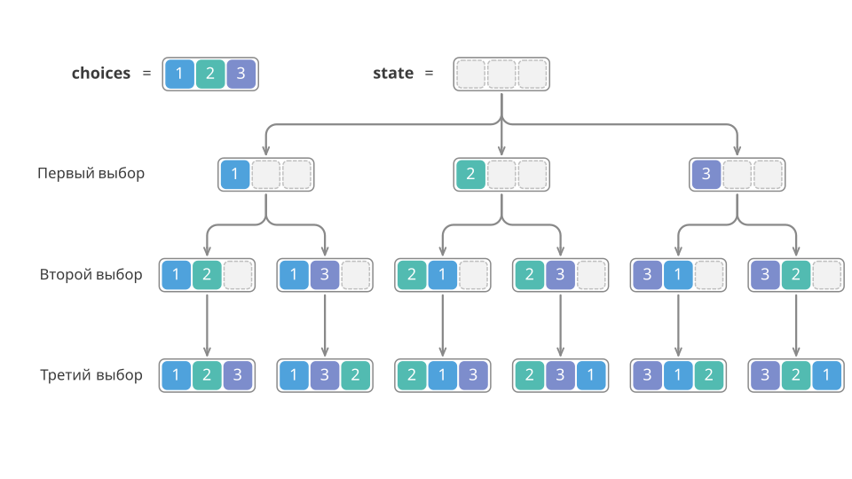
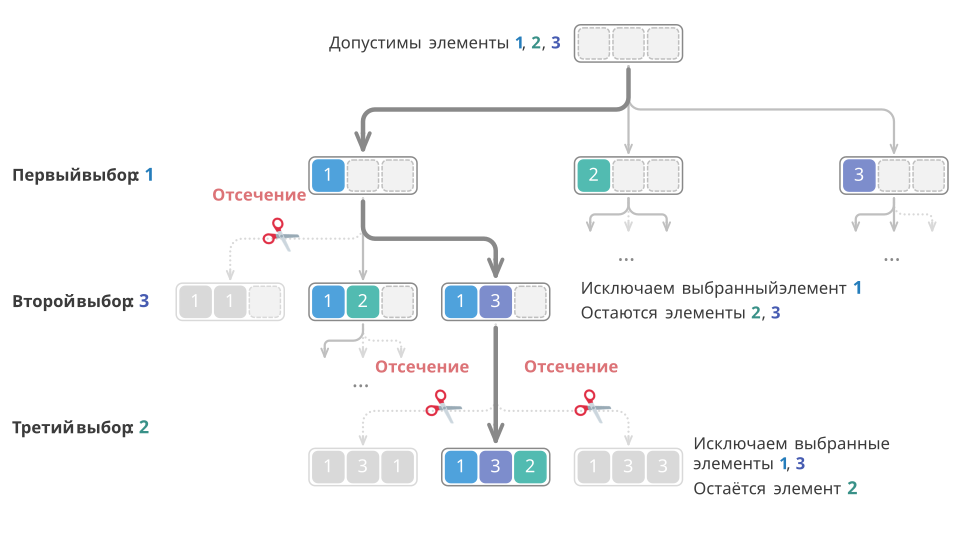
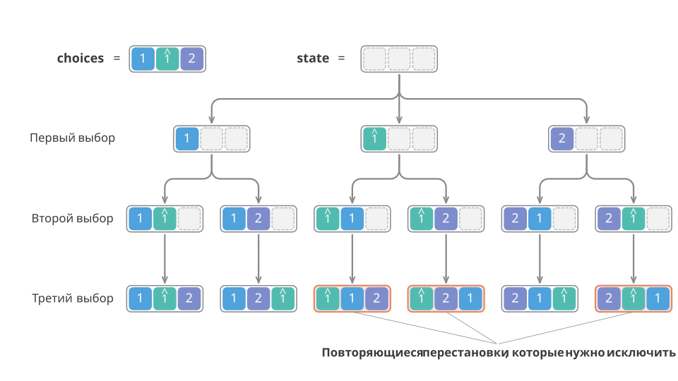
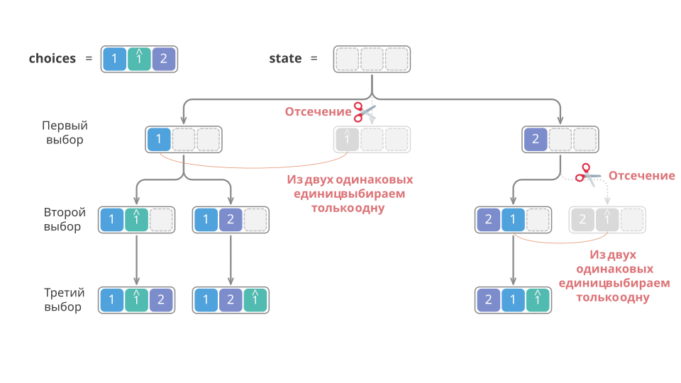
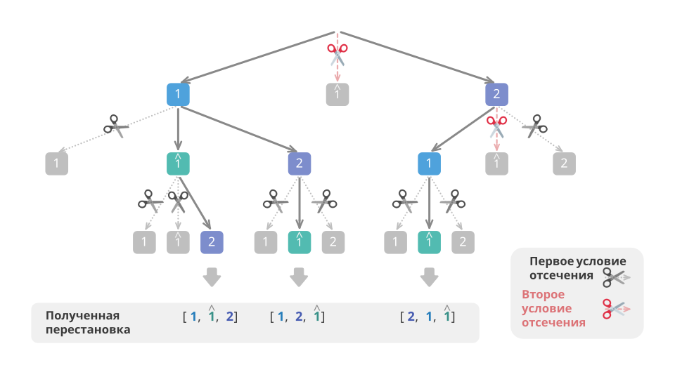

# Задача о перестановках

Генерация перестановок — типичная задача поиска с возвратом. Дан набор элементов, например массив или строка. Нужно найти все возможные способы расположить его элементы по порядку.

В таблице приведены примеры исходных массивов и всех их перестановок.

<p align="center"> Таблица <id> &nbsp; Примеры перестановок </p>

| Исходный массив    | Все перестановки                                                           |
| :---------- | :----------------------------------------------------------------- |
| $[1]$       | $[1]$                                                              |
| $[1, 2]$    | $[1, 2], [2, 1]$                                                   |
| $[1, 2, 3]$ | $[1, 2, 3], [1, 3, 2], [2, 1, 3], [2, 3, 1], [3, 1, 2], [3, 2, 1]$ |

## Случай различных элементов

!!! question

    Дан массив целых чисел без повторений. Верните все возможные перестановки.

При поиске с возвратом **построение перестановки удобно представить как последовательность выборов**. Пусть дан массив $[1, 2, 3]$. Выбрав сначала $1$, затем $3$ и наконец $2$, получим перестановку $[1, 3, 2]$. При возврате мы отменяем последний выбор и пробуем другие варианты.

В коде поиска с возвратом набор кандидатов `choices` включает все элементы исходного массива, а состояние `state` содержит уже выбранные элементы. Каждый элемент разрешено выбирать лишь раз, **поэтому все элементы в `state` должны быть различны**.

Поиск можно развернуть в дерево рекурсии, как на рисунке. Каждый узел представляет текущее состояние `state`. От корня за три шага мы доходим до листа, и каждому листу соответствует одна перестановка.



### Отсечение повторного выбора

Чтобы не выбирать один элемент дважды, введём булев массив `selected`. Значение `selected[i]` показывает, выбран ли элемент `choices[i]`. С помощью этого массива выполним отсечение.

- Выбрав `choices[i]`, присваиваем `selected[i]` значение $\text{True}$, то есть отмечаем элемент как выбранный.
- При переборе вариантов `choices` пропускаем все уже выбранные узлы, тем самым отсекая их ветви.

Допустим, как на рисунке, на первом шаге мы выбираем 1, на втором — 3, а на третьем — 2. Тогда на втором шаге нужно отсечь ветвь элемента 1, а на третьем — ветви элементов 1 и 3.



Как видно из рисунка, такое отсечение сокращает пространство поиска с $O(n^n)$ до $O(n!)$.

### Реализация

Теперь можно заполнить общую схему алгоритма. Для краткости мы не будем выделять каждую операцию в отдельную функцию, а запишем их прямо в `backtrack()`:

```src
[file]{permutations_i}-[class]{}-[func]{permutations_i}
```

## Случай равных элементов

!!! question

    Дан массив целых чисел. **В массиве могут встречаться одинаковые элементы**. Верните все различные перестановки.

Пусть дан массив $[1, 1, 2]$. Чтобы различать две одинаковые $1$, вторую $1$ обозначим через $\hat{1}$.

На рисунке видно, что половина перестановок, построенных прежним методом, повторяется.



Как избавиться от повторов? Можно собрать готовые перестановки в хеш-множество, оставив только различные. Однако **ветви, порождающие повторы, вообще не нужны: лучше распознать и отсечь их заранее**. Тогда алгоритм будет работать быстрее.

### Отсечение равных элементов

На рисунке выбор $1$ и выбор $\hat{1}$ на первом шаге равнозначны. Обе ветви дают одни и те же перестановки, поэтому ветвь $\hat{1}$ следует отсечь.

Аналогично, если сначала выбрать $2$, то варианты $1$ и $\hat{1}$ на втором шаге дадут одинаковые ветви. Ветвь $\hat{1}$ на втором шаге тоже следует отсечь.

Итак, **на каждом отдельном шаге перебора из нескольких равных элементов достаточно попробовать один**.



### Реализация

Дополним предыдущий код: на каждом шаге перебора будем создавать хеш-множество `duplicated`, записывать туда уже испробованные на этом шаге значения и отсекать повторы:

```src
[file]{permutations_ii}-[class]{}-[func]{permutations_ii}
```

Если все элементы различны, то для $n$ элементов существует $n!$ перестановок (факториал). При записи каждой перестановки нужно скопировать список длины $n$, что занимает $O(n)$ времени. **Следовательно, временная сложность равна $O(n!n)$**.

Максимальная глубина рекурсии равна $n$, поэтому кадры стека занимают $O(n)$ памяти. Для `selected` требуется $O(n)$ памяти. Одновременно существует не более $n$ множеств `duplicated`, которые в сумме занимают $O(n^2)$ памяти. **Следовательно, пространственная сложность равна $O(n^2)$**.

### Сравнение двух способов отсечения

И `selected`, и `duplicated` используются для отсечения, но решают разные задачи.

- **Отсечение повторного выбора**. Массив `selected` один на весь поиск. Он отмечает элементы, вошедшие в текущее состояние, и не даёт одному элементу дважды попасть в `state`.
- **Отсечение равных элементов**. На каждом шаге перебора (в каждом вызове `backtrack`) есть своё множество `duplicated`. Оно хранит значения, уже испробованные в текущем цикле `for`, и позволяет выбирать равные элементы лишь один раз за цикл.

На рисунке показано, где действует каждое условие отсечения. Каждый узел дерева обозначает один выбор, а последовательность узлов на пути от корня до листа задаёт перестановку.


