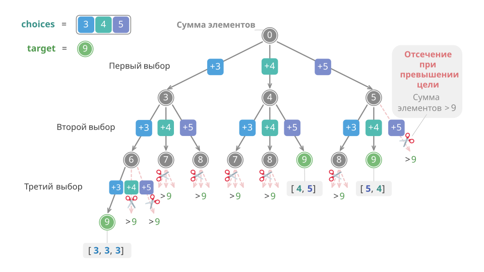
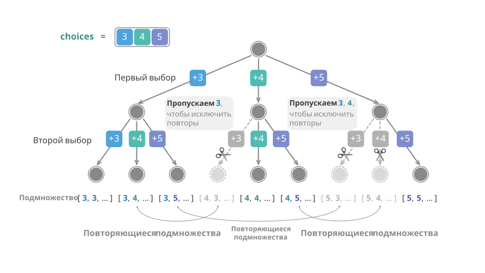

# Задача о сумме подмножества

## Случай без повторяющихся элементов

!!! question

    Даны массив положительных целых чисел `nums` и положительное целое число `target`. Найдите все комбинации элементов с суммой `target`. В массиве нет повторений, но каждый элемент можно выбирать несколько раз. Верните список комбинаций без повторов.

Например, для множества $\{3, 4, 5\}$ и целевого числа $9$ получаем решения $\{3, 3, 3\}, \{4, 5\}$. Обратите внимание на два свойства.

- Каждый элемент исходного множества можно выбирать сколько угодно раз.
- Порядок элементов в подмножестве не учитывается: например, $\{4, 5\}$ и $\{5, 4\}$ — одно и то же подмножество.

### Решение по аналогии с перестановками

Как и перестановку, подмножество можно строить последовательным выбором элементов. После каждого выбора обновляем сумму. Когда она равна `target`, записываем подмножество в список результатов.

В отличие от задачи о перестановках, **здесь каждый элемент множества можно выбирать сколько угодно раз**, поэтому булев список `selected` для отметки использованных элементов не нужен. Небольшие изменения в коде для перестановок дают первый вариант решения:

```src
[file]{subset_sum_i_naive}-[class]{}-[func]{subset_sum_i_naive}
```

Для входного массива $[3, 4, 5]$ и целевой суммы $9$ код выводит $[3, 3, 3], [4, 5], [5, 4]$. **Все подмножества с суммой $9$ найдены, но $[4, 5]$ и $[5, 4]$ дублируют друг друга**.

Причина в том, что поиск различает порядок выбора, а для подмножества порядок не важен. Как видно на рисунке, выбор $4$, а затем $5$ и выбор $5$, а затем $4$ дают разные ветви, но одно подмножество.



**Самый прямой способ избавиться от повторов — удалить их из списка результатов**. Однако этот метод неэффективен по двум причинам.

- Если массив содержит много элементов, особенно при большом `target`, поиск порождает множество повторяющихся подмножеств.
- Сравнение подмножеств, представленных массивами, требует времени: сначала нужно отсортировать массивы, затем попарно сравнить их элементы.

### Отсечение повторяющихся подмножеств

**Устраним повторы с помощью отсечения во время поиска**. Как видно на рисунке, повторяющиеся подмножества возникают, когда элементы массива выбирают в разном порядке. Рассмотрим пример.

1. Если на первом и втором шагах выбрать соответственно $3$ и $4$, получим все подмножества, включающие эти два элемента. Обозначим их $[3, 4, \dots]$.
2. Если затем на первом шаге выбрать $4$, **на втором шаге следует пропустить $3$**. Ведь такой выбор дал бы подмножества $[4, 3, \dots]$, полностью повторяющие полученные на шаге `1.`

На каждом уровне поиск перебирает варианты слева направо, поэтому чем правее ветвь, тем больше в ней отсечений.

1. Выбор $3$ и $5$ на первых двух шагах порождает подмножества $[3, 5, \dots]$.
2. Выбор $4$ и $5$ на первых двух шагах порождает подмножества $[4, 5, \dots]$.
3. Если сначала выбрать $5$, **то на втором шаге нужно пропустить $3$ и $4$**. Подмножества $[5, 3, \dots]$ и $[5, 4, \dots]$ полностью повторяют подмножества, описанные на шагах `1.` и `2.`



Итак, для исходного массива $[x_1, x_2, \dots, x_n]$ последовательность выбранных элементов $[x_{i_1}, x_{i_2}, \dots, x_{i_m}]$ должна удовлетворять условию $i_1 \leq i_2 \leq \dots \leq i_m$. **Если это условие нарушается, выбор ведёт к повтору и ветвь следует отсечь**.

### Реализация

Для этого введём переменную `start` — индекс начала перебора. **После выбора $x_{i}$ начинаем следующий перебор с индекса $i$**. Тогда индексы удовлетворяют условию $i_1 \leq i_2 \leq \dots \leq i_m$ и подмножества не повторяются.

Внесём в код ещё два улучшения.

- До начала поиска отсортируем массив `nums`. При переборе вариантов **завершим цикл, как только сумма подмножества превысит `target`**. Следующие элементы больше, и с ними сумма тоже превысит `target`.
- Откажемся от переменной `total` для суммы элементов. **Будем учитывать выбранные значения, вычитая их из `target`**. Когда `target` станет равным $0$, запишем решение.

```src
[file]{subset_sum_i}-[class]{}-[func]{subset_sum_i}
```

Рисунок показывает весь ход поиска с возвратом для массива $[3, 4, 5]$ и целевой суммы $9$.


## Случай повторяющихся элементов

!!! question

    Даны массив положительных целых чисел `nums` и положительное целое число `target`. Найдите все комбинации элементов с суммой `target`. **В массиве могут быть одинаковые значения, а каждый элемент можно выбрать только один раз**. Верните список комбинаций без повторов.

В отличие от предыдущей задачи, **во входном массиве могут повторяться значения**, что создаёт новую трудность. Например, для массива $[4, \hat{4}, 5]$ и целевой суммы $9$ прежний код выводит $[4, 5], [\hat{4}, 5]$, то есть одно подмножество повторяется.

**Причина в том, что на одном шаге перебора несколько раз выбирается одно и то же значение**. На рисунке из трёх вариантов первого шага два равны $4$. Они порождают одинаковые ветви и дают одинаковые подмножества. Точно так же два элемента $4$ на втором шаге приводят к повторам.


### Отсечение равных элементов

Чтобы устранить повторы, **на каждом шаге перебора будем выбирать каждое значение не более одного раза**. Для этого воспользуемся тем, что в отсортированном массиве равные элементы стоят рядом. Если при переборе на этом шаге текущий элемент равен уже рассмотренному соседу слева, такое значение мы уже пробовали. Текущий элемент можно пропустить.

Кроме того, **по условию каждый элемент массива разрешено выбирать только один раз**. Для этого снова подойдёт переменная `start`: после выбора $x_{i}$ на следующем шаге начнём перебор с индекса $i + 1$. Это исключает и повторяющиеся подмножества, и повторный выбор одного элемента.

### Реализация

```src
[file]{subset_sum_ii}-[class]{}-[func]{subset_sum_ii}
```

На рисунке показан поиск для массива $[4, 4, 5]$ и целевой суммы $9$. Здесь используются четыре вида отсечения. Сопоставьте рисунок с комментариями в коде и проследите, как идёт поиск и где срабатывает каждое отсечение.


