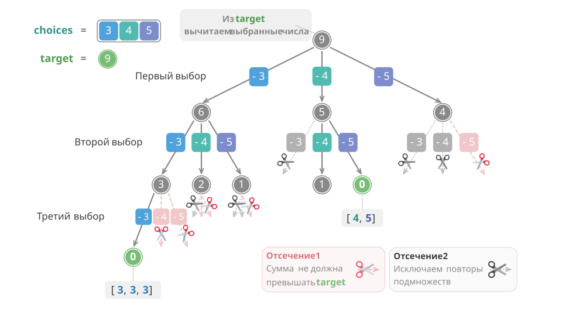
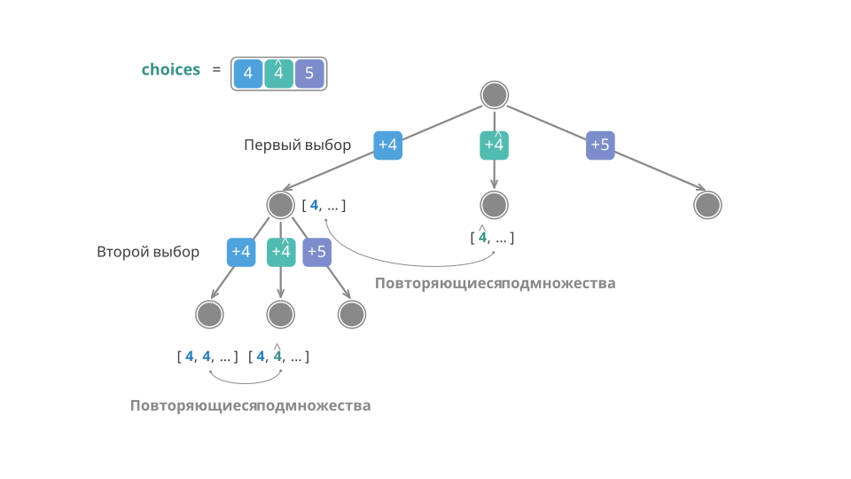
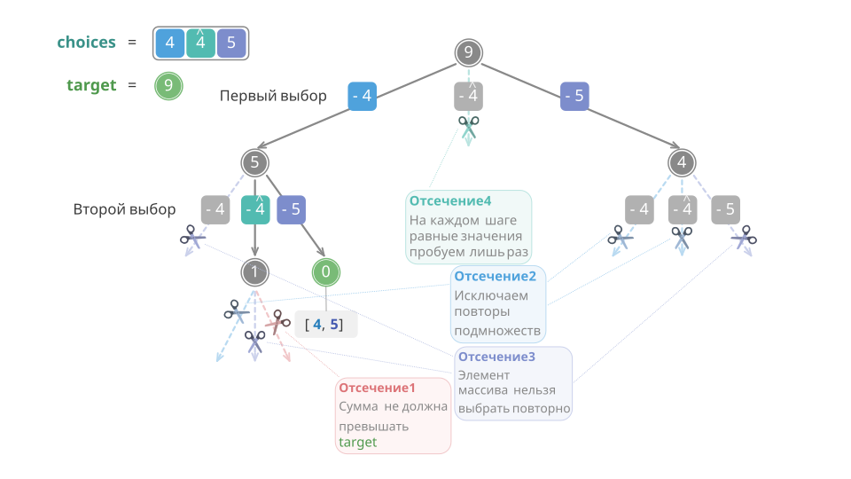

# 13.3 &nbsp; Задача о сумме подмножества

## 13.3.1 &nbsp; Случай без повторяющихся элементов

!!! question

    Даны массив положительных целых чисел `nums` и положительное целое число `target`. Найдите все комбинации элементов с суммой `target`. В массиве нет повторений, но каждый элемент можно выбирать несколько раз. Верните список комбинаций без повторов.

Например, для множества $\{3, 4, 5\}$ и целевого числа $9$ получаем решения $\{3, 3, 3\}, \{4, 5\}$. Обратите внимание на два свойства.

- Каждый элемент исходного множества можно выбирать сколько угодно раз.
- Порядок элементов в подмножестве не учитывается: например, $\{4, 5\}$ и $\{5, 4\}$ — одно и то же подмножество.

### 1. &nbsp; Решение по аналогии с перестановками

Как и перестановку, подмножество можно строить последовательным выбором элементов. После каждого выбора обновляем сумму. Когда она равна `target`, записываем подмножество в список результатов.

В отличие от задачи о перестановках, **здесь каждый элемент множества можно выбирать сколько угодно раз**, поэтому булев список `selected` для отметки использованных элементов не нужен. Небольшие изменения в коде для перестановок дают первый вариант решения:

=== "Python"

    ```python title="subset_sum_i_naive.py"
    def backtrack(
        state: list[int],
        target: int,
        total: int,
        choices: list[int],
        res: list[list[int]],
    ):
        """Поиск с возвратом: сумма подмножества I"""
        # Если сумма подмножества равна target, сохраняем решение
        if total == target:
            res.append(list(state))
            return
        # Перебираем все варианты
        for i in range(len(choices)):
            # Отсечение: если сумма подмножества превысит target, пропускаем этот вариант
            if total + choices[i] > target:
                continue
            # Пробуем вариант и обновляем сумму элементов total
            state.append(choices[i])
            # Переходим к следующему выбору
            backtrack(state, target, total + choices[i], choices, res)
            # Возврат: отменяем выбор и восстанавливаем прежнее состояние
            state.pop()

    def subset_sum_i_naive(nums: list[int], target: int) -> list[list[int]]:
        """Задача о сумме подмножества I (с повторяющимися подмножествами)"""
        state = []  # Состояние (подмножество)
        total = 0  # Сумма подмножества
        res = []  # Список результатов (список подмножеств)
        backtrack(state, target, total, nums, res)
        return res
    ```

=== "C++"

    ```cpp title="subset_sum_i_naive.cpp"
    /* Поиск с возвратом: сумма подмножества I */
    void backtrack(vector<int> &state, int target, int total, vector<int> &choices, vector<vector<int>> &res) {
        // Если сумма подмножества равна target, сохраняем решение
        if (total == target) {
            res.push_back(state);
            return;
        }
        // Перебираем все варианты
        for (size_t i = 0; i < choices.size(); i++) {
            // Отсечение: если сумма подмножества превысит target, пропускаем этот вариант
            if (total + choices[i] > target) {
                continue;
            }
            // Пробуем вариант и обновляем сумму элементов total
            state.push_back(choices[i]);
            // Переходим к следующему выбору
            backtrack(state, target, total + choices[i], choices, res);
            // Возврат: отменяем выбор и восстанавливаем прежнее состояние
            state.pop_back();
        }
    }

    /* Задача о сумме подмножества I (с повторяющимися подмножествами) */
    vector<vector<int>> subsetSumINaive(vector<int> &nums, int target) {
        vector<int> state;       // Состояние (подмножество)
        int total = 0;           // Сумма подмножества
        vector<vector<int>> res; // Список результатов (список подмножеств)
        backtrack(state, target, total, nums, res);
        return res;
    }
    ```

=== "Java"

    ```java title="subset_sum_i_naive.java"
    /* Поиск с возвратом: сумма подмножества I */
    void backtrack(List<Integer> state, int target, int total, int[] choices, List<List<Integer>> res) {
        // Если сумма подмножества равна target, сохраняем решение
        if (total == target) {
            res.add(new ArrayList<>(state));
            return;
        }
        // Перебираем все варианты
        for (int i = 0; i < choices.length; i++) {
            // Отсечение: если сумма подмножества превысит target, пропускаем этот вариант
            if (total + choices[i] > target) {
                continue;
            }
            // Пробуем вариант и обновляем сумму элементов total
            state.add(choices[i]);
            // Переходим к следующему выбору
            backtrack(state, target, total + choices[i], choices, res);
            // Возврат: отменяем выбор и восстанавливаем прежнее состояние
            state.remove(state.size() - 1);
        }
    }

    /* Задача о сумме подмножества I (с повторяющимися подмножествами) */
    List<List<Integer>> subsetSumINaive(int[] nums, int target) {
        List<Integer> state = new ArrayList<>(); // Состояние (подмножество)
        int total = 0; // Сумма подмножества
        List<List<Integer>> res = new ArrayList<>(); // Список результатов (список подмножеств)
        backtrack(state, target, total, nums, res);
        return res;
    }
    ```

=== "C#"

    ```csharp title="subset_sum_i_naive.cs"
    /* Поиск с возвратом: сумма подмножества I */
    void Backtrack(List<int> state, int target, int total, int[] choices, List<List<int>> res) {
        // Если сумма подмножества равна target, сохраняем решение
        if (total == target) {
            res.Add(new List<int>(state));
            return;
        }
        // Перебираем все варианты
        for (int i = 0; i < choices.Length; i++) {
            // Отсечение: если сумма подмножества превысит target, пропускаем этот вариант
            if (total + choices[i] > target) {
                continue;
            }
            // Пробуем вариант и обновляем сумму элементов total
            state.Add(choices[i]);
            // Переходим к следующему выбору
            Backtrack(state, target, total + choices[i], choices, res);
            // Возврат: отменяем выбор и восстанавливаем прежнее состояние
            state.RemoveAt(state.Count - 1);
        }
    }

    /* Задача о сумме подмножества I (с повторяющимися подмножествами) */
    List<List<int>> SubsetSumINaive(int[] nums, int target) {
        List<int> state = []; // Состояние (подмножество)
        int total = 0; // Сумма подмножества
        List<List<int>> res = []; // Список результатов (список подмножеств)
        Backtrack(state, target, total, nums, res);
        return res;
    }
    ```

=== "Go"

    ```go title="subset_sum_i_naive.go"
    /* Поиск с возвратом: сумма подмножества I */
    func backtrackSubsetSumINaive(total, target int, state, choices *[]int, res *[][]int) {
        // Если сумма подмножества равна target, сохраняем решение
        if target == total {
            newState := append([]int{}, *state...)
            *res = append(*res, newState)
            return
        }
        // Перебираем все варианты
        for i := 0; i < len(*choices); i++ {
            // Отсечение: если сумма подмножества превысит target, пропускаем этот вариант
            if total+(*choices)[i] > target {
                continue
            }
            // Пробуем вариант и обновляем сумму элементов total
            *state = append(*state, (*choices)[i])
            // Переходим к следующему выбору
            backtrackSubsetSumINaive(total+(*choices)[i], target, state, choices, res)
            // Возврат: отменяем выбор и восстанавливаем прежнее состояние
            *state = (*state)[:len(*state)-1]
        }
    }

    /* Задача о сумме подмножества I (с повторяющимися подмножествами) */
    func subsetSumINaive(nums []int, target int) [][]int {
        state := make([]int, 0) // Состояние (подмножество)
        total := 0              // Сумма подмножества
        res := make([][]int, 0) // Список результатов (список подмножеств)
        backtrackSubsetSumINaive(total, target, &state, &nums, &res)
        return res
    }
    ```

=== "Swift"

    ```swift title="subset_sum_i_naive.swift"
    /* Поиск с возвратом: сумма подмножества I */
    func backtrack(state: inout [Int], target: Int, total: Int, choices: [Int], res: inout [[Int]]) {
        // Если сумма подмножества равна target, сохраняем решение
        if total == target {
            res.append(state)
            return
        }
        // Перебираем все варианты
        for i in choices.indices {
            // Отсечение: если сумма подмножества превысит target, пропускаем этот вариант
            if total + choices[i] > target {
                continue
            }
            // Пробуем вариант и обновляем сумму элементов total
            state.append(choices[i])
            // Переходим к следующему выбору
            backtrack(state: &state, target: target, total: total + choices[i], choices: choices, res: &res)
            // Возврат: отменяем выбор и восстанавливаем прежнее состояние
            state.removeLast()
        }
    }

    /* Задача о сумме подмножества I (с повторяющимися подмножествами) */
    func subsetSumINaive(nums: [Int], target: Int) -> [[Int]] {
        var state: [Int] = [] // Состояние (подмножество)
        let total = 0 // Сумма подмножества
        var res: [[Int]] = [] // Список результатов (список подмножеств)
        backtrack(state: &state, target: target, total: total, choices: nums, res: &res)
        return res
    }
    ```

=== "JS"

    ```javascript title="subset_sum_i_naive.js"
    /* Поиск с возвратом: сумма подмножества I */
    function backtrack(state, target, total, choices, res) {
        // Если сумма подмножества равна target, сохраняем решение
        if (total === target) {
            res.push([...state]);
            return;
        }
        // Перебираем все варианты
        for (let i = 0; i < choices.length; i++) {
            // Отсечение: если сумма подмножества превысит target, пропускаем этот вариант
            if (total + choices[i] > target) {
                continue;
            }
            // Пробуем вариант и обновляем сумму элементов total
            state.push(choices[i]);
            // Переходим к следующему выбору
            backtrack(state, target, total + choices[i], choices, res);
            // Возврат: отменяем выбор и восстанавливаем прежнее состояние
            state.pop();
        }
    }

    /* Задача о сумме подмножества I (с повторяющимися подмножествами) */
    function subsetSumINaive(nums, target) {
        const state = []; // Состояние (подмножество)
        const total = 0; // Сумма подмножества
        const res = []; // Список результатов (список подмножеств)
        backtrack(state, target, total, nums, res);
        return res;
    }
    ```

=== "TS"

    ```typescript title="subset_sum_i_naive.ts"
    /* Поиск с возвратом: сумма подмножества I */
    function backtrack(
        state: number[],
        target: number,
        total: number,
        choices: number[],
        res: number[][]
    ): void {
        // Если сумма подмножества равна target, сохраняем решение
        if (total === target) {
            res.push([...state]);
            return;
        }
        // Перебираем все варианты
        for (let i = 0; i < choices.length; i++) {
            // Отсечение: если сумма подмножества превысит target, пропускаем этот вариант
            if (total + choices[i] > target) {
                continue;
            }
            // Пробуем вариант и обновляем сумму элементов total
            state.push(choices[i]);
            // Переходим к следующему выбору
            backtrack(state, target, total + choices[i], choices, res);
            // Возврат: отменяем выбор и восстанавливаем прежнее состояние
            state.pop();
        }
    }

    /* Задача о сумме подмножества I (с повторяющимися подмножествами) */
    function subsetSumINaive(nums: number[], target: number): number[][] {
        const state = []; // Состояние (подмножество)
        const total = 0; // Сумма подмножества
        const res = []; // Список результатов (список подмножеств)
        backtrack(state, target, total, nums, res);
        return res;
    }
    ```

=== "Dart"

    ```dart title="subset_sum_i_naive.dart"
    /* Поиск с возвратом: сумма подмножества I */
    void backtrack(
      List<int> state,
      int target,
      int total,
      List<int> choices,
      List<List<int>> res,
    ) {
      // Если сумма подмножества равна target, сохраняем решение
      if (total == target) {
        res.add(List.from(state));
        return;
      }
      // Перебираем все варианты
      for (int i = 0; i < choices.length; i++) {
        // Отсечение: если сумма подмножества превысит target, пропускаем этот вариант
        if (total + choices[i] > target) {
          continue;
        }
        // Пробуем вариант и обновляем сумму элементов total
        state.add(choices[i]);
        // Переходим к следующему выбору
        backtrack(state, target, total + choices[i], choices, res);
        // Возврат: отменяем выбор и восстанавливаем прежнее состояние
        state.removeLast();
      }
    }

    /* Задача о сумме подмножества I (с повторяющимися подмножествами) */
    List<List<int>> subsetSumINaive(List<int> nums, int target) {
      List<int> state = []; // Состояние (подмножество)
      int total = 0; // Сумма элементов
      List<List<int>> res = []; // Список результатов (список подмножеств)
      backtrack(state, target, total, nums, res);
      return res;
    }
    ```

=== "Rust"

    ```rust title="subset_sum_i_naive.rs"
    /* Поиск с возвратом: сумма подмножества I */
    fn backtrack(
        state: &mut Vec<i32>,
        target: i32,
        total: i32,
        choices: &[i32],
        res: &mut Vec<Vec<i32>>,
    ) {
        // Если сумма подмножества равна target, сохраняем решение
        if total == target {
            res.push(state.clone());
            return;
        }
        // Перебираем все варианты
        for i in 0..choices.len() {
            // Отсечение: если сумма подмножества превысит target, пропускаем этот вариант
            if total + choices[i] > target {
                continue;
            }
            // Пробуем вариант и обновляем сумму элементов total
            state.push(choices[i]);
            // Переходим к следующему выбору
            backtrack(state, target, total + choices[i], choices, res);
            // Возврат: отменяем выбор и восстанавливаем прежнее состояние
            state.pop();
        }
    }

    /* Задача о сумме подмножества I (с повторяющимися подмножествами) */
    fn subset_sum_i_naive(nums: &[i32], target: i32) -> Vec<Vec<i32>> {
        let mut state = Vec::new(); // Состояние (подмножество)
        let total = 0; // Сумма подмножества
        let mut res = Vec::new(); // Список результатов (список подмножеств)
        backtrack(&mut state, target, total, nums, &mut res);
        res
    }
    ```

=== "C"

    ```c title="subset_sum_i_naive.c"
    /* Поиск с возвратом: сумма подмножества I */
    void backtrack(int target, int total, int *choices, int choicesSize) {
        // Если сумма подмножества равна target, сохраняем решение
        if (total == target) {
            for (int i = 0; i < stateSize; i++) {
                res[resSize][i] = state[i];
            }
            resColSizes[resSize++] = stateSize;
            return;
        }
        // Перебираем все варианты
        for (int i = 0; i < choicesSize; i++) {
            // Отсечение: если сумма подмножества превысит target, пропускаем этот вариант
            if (total + choices[i] > target) {
                continue;
            }
            // Пробуем вариант и обновляем сумму элементов total
            state[stateSize++] = choices[i];
            // Переходим к следующему выбору
            backtrack(target, total + choices[i], choices, choicesSize);
            // Возврат: отменяем выбор и восстанавливаем прежнее состояние
            stateSize--;
        }
    }

    /* Задача о сумме подмножества I (с повторяющимися подмножествами) */
    void subsetSumINaive(int *nums, int numsSize, int target) {
        resSize = 0; // Начальное число решений равно 0
        backtrack(target, 0, nums, numsSize);
    }
    ```

=== "Kotlin"

    ```kotlin title="subset_sum_i_naive.kt"
    /* Поиск с возвратом: сумма подмножества I */
    fun backtrack(
        state: MutableList<Int>,
        target: Int,
        total: Int,
        choices: IntArray,
        res: MutableList<MutableList<Int>?>
    ) {
        // Если сумма подмножества равна target, сохраняем решение
        if (total == target) {
            res.add(state.toMutableList())
            return
        }
        // Перебираем все варианты
        for (i in choices.indices) {
            // Отсечение: если сумма подмножества превысит target, пропускаем этот вариант
            if (total + choices[i] > target) {
                continue
            }
            // Пробуем вариант и обновляем сумму элементов total
            state.add(choices[i])
            // Переходим к следующему выбору
            backtrack(state, target, total + choices[i], choices, res)
            // Возврат: отменяем выбор и восстанавливаем прежнее состояние
            state.removeAt(state.size - 1)
        }
    }

    /* Задача о сумме подмножества I (с повторяющимися подмножествами) */
    fun subsetSumINaive(nums: IntArray, target: Int): MutableList<MutableList<Int>?> {
        val state = mutableListOf<Int>() // Состояние (подмножество)
        val total = 0 // Сумма подмножества
        val res = mutableListOf<MutableList<Int>?>() // Список результатов (список подмножеств)
        backtrack(state, target, total, nums, res)
        return res
    }
    ```

=== "Ruby"

    ```ruby title="subset_sum_i_naive.rb"
    ### Поиск с возвратом: сумма подмножества I ###
    def backtrack(state, target, total, choices, res)
      # Если сумма подмножества равна target, сохраняем решение
      if total == target
        res << state.dup
        return
      end

      # Перебираем все варианты
      for i in 0...choices.length
        # Отсечение: если сумма подмножества превысит target, пропускаем этот вариант
        next if total + choices[i] > target
        # Пробуем вариант и обновляем сумму элементов total
        state << choices[i]
        # Переходим к следующему выбору
        backtrack(state, target, total + choices[i], choices, res)
        # Возврат: отменяем выбор и восстанавливаем прежнее состояние
        state.pop
      end
    end

    ### Задача о сумме подмножества I (с повторяющимися подмножествами)###
    def subset_sum_i_naive(nums, target)
      state = [] # Состояние (подмножество)
      total = 0 # Сумма подмножества
      res = [] # Список результатов (список подмножеств)
      backtrack(state, target, total, nums, res)
      res
    end
    ```

??? pythontutor "Визуализация выполнения"

    <div style="height: 549px; width: 100%;"><iframe class="pythontutor-iframe" title="Визуализация выполнения" src="https://pythontutor.com/iframe-embed.html#code=def%20backtrack%28%0A%20%20%20%20state%3A%20list%5Bint%5D,%0A%20%20%20%20target%3A%20int,%0A%20%20%20%20total%3A%20int,%0A%20%20%20%20choices%3A%20list%5Bint%5D,%0A%20%20%20%20res%3A%20list%5Blist%5Bint%5D%5D,%0A%29%3A%0A%20%20%20%20%22%22%22%D0%9F%D0%BE%D0%B8%D1%81%D0%BA%20%D1%81%20%D0%B2%D0%BE%D0%B7%D0%B2%D1%80%D0%B0%D1%82%D0%BE%D0%BC%3A%20%D1%81%D1%83%D0%BC%D0%BC%D0%B0%20%D0%BF%D0%BE%D0%B4%D0%BC%D0%BD%D0%BE%D0%B6%D0%B5%D1%81%D1%82%D0%B2%D0%B0%20I%22%22%22%0A%20%20%20%20%23%20%D0%A1%D1%83%D0%BC%D0%BC%D0%B0%20%D1%80%D0%B0%D0%B2%D0%BD%D0%B0%20target%3A%20%D0%BF%D0%B8%D1%88%D0%B5%D0%BC%20%D1%80%D0%B5%D1%88%D0%B5%D0%BD%D0%B8%D0%B5%0A%20%20%20%20if%20total%20%3D%3D%20target%3A%0A%20%20%20%20%20%20%20%20res.append%28list%28state%29%29%0A%20%20%20%20%20%20%20%20return%0A%20%20%20%20%23%20%D0%9F%D0%B5%D1%80%D0%B5%D0%B1%D0%BE%D1%80%20%D0%B2%D0%B0%D1%80%D0%B8%D0%B0%D0%BD%D1%82%D0%BE%D0%B2%0A%20%20%20%20for%20i%20in%20range%28len%28choices%29%29%3A%0A%20%20%20%20%20%20%20%20%23%20%D0%9E%D1%82%D1%81%D0%B5%D1%87%D0%B5%D0%BD%D0%B8%D0%B5%3A%20%D0%B5%D1%81%D0%BB%D0%B8%20%D1%81%D1%83%D0%BC%D0%BC%D0%B0%20%D0%BF%D0%BE%D0%B4%D0%BC%D0%BD%D0%BE%D0%B6%D0%B5%D1%81%D1%82%D0%B2%D0%B0%20%D0%BF%D1%80%D0%B5%D0%B2%D1%8B%D1%81%D0%B8%D1%82%20target,%20%D0%BF%D1%80%D0%BE%D0%BF%D1%83%D1%81%D0%BA%D0%B0%D0%B5%D0%BC%20%D1%8D%D1%82%D0%BE%D1%82%20%D0%B2%D0%B0%D1%80%D0%B8%D0%B0%D0%BD%D1%82%0A%20%20%20%20%20%20%20%20if%20total%20%2B%20choices%5Bi%5D%20%3E%20target%3A%0A%20%20%20%20%20%20%20%20%20%20%20%20continue%0A%20%20%20%20%20%20%20%20%23%20%D0%9F%D1%80%D0%BE%D0%B1%D1%83%D0%B5%D0%BC%20%D0%B2%D0%B0%D1%80%D0%B8%D0%B0%D0%BD%D1%82%20%D0%B8%20%D0%BE%D0%B1%D0%BD%D0%BE%D0%B2%D0%BB%D1%8F%D0%B5%D0%BC%20%D1%81%D1%83%D0%BC%D0%BC%D1%83%20%D1%8D%D0%BB%D0%B5%D0%BC%D0%B5%D0%BD%D1%82%D0%BE%D0%B2%20total%0A%20%20%20%20%20%20%20%20state.append%28choices%5Bi%5D%29%0A%20%20%20%20%20%20%20%20%23%20%D0%A1%D0%BB%D0%B5%D0%B4%D1%83%D1%8E%D1%89%D0%B8%D0%B9%20%D0%B2%D1%8B%D0%B1%D0%BE%D1%80%0A%20%20%20%20%20%20%20%20backtrack%28state,%20target,%20total%20%2B%20choices%5Bi%5D,%20choices,%20res%29%0A%20%20%20%20%20%20%20%20%23%20%D0%9E%D1%82%D0%BC%D0%B5%D0%BD%D0%B0%20%D0%B2%D1%8B%D0%B1%D0%BE%D1%80%D0%B0,%20%D0%B2%D0%BE%D0%B7%D0%B2%D1%80%D0%B0%D1%82%20%D1%81%D0%BE%D1%81%D1%82%D0%BE%D1%8F%D0%BD%D0%B8%D1%8F%0A%20%20%20%20%20%20%20%20state.pop%28%29%0A%0A%0Adef%20subset_sum_i_naive%28nums%3A%20list%5Bint%5D,%20target%3A%20int%29%20-%3E%20list%5Blist%5Bint%5D%5D%3A%0A%20%20%20%20%22%22%22%D0%97%D0%B0%D0%B4%D0%B0%D1%87%D0%B0%20%D0%BE%20%D1%81%D1%83%D0%BC%D0%BC%D0%B5%20%D0%BF%D0%BE%D0%B4%D0%BC%D0%BD%D0%BE%D0%B6%D0%B5%D1%81%D1%82%D0%B2%D0%B0%20I%20%28%D1%81%20%D0%BF%D0%BE%D0%B2%D1%82%D0%BE%D1%80%D1%8F%D1%8E%D1%89%D0%B8%D0%BC%D0%B8%D1%81%D1%8F%20%D0%BF%D0%BE%D0%B4%D0%BC%D0%BD%D0%BE%D0%B6%D0%B5%D1%81%D1%82%D0%B2%D0%B0%D0%BC%D0%B8%29%22%22%22%0A%20%20%20%20state%20%3D%20%5B%5D%20%20%23%20%D0%A1%D0%BE%D1%81%D1%82%D0%BE%D1%8F%D0%BD%D0%B8%D0%B5%20%28%D0%BF%D0%BE%D0%B4%D0%BC%D0%BD%D0%BE%D0%B6%D0%B5%D1%81%D1%82%D0%B2%D0%BE%29%0A%20%20%20%20total%20%3D%200%20%20%23%20%D0%A1%D1%83%D0%BC%D0%BC%D0%B0%20%D0%BF%D0%BE%D0%B4%D0%BC%D0%BD%D0%BE%D0%B6%D0%B5%D1%81%D1%82%D0%B2%D0%B0%0A%20%20%20%20res%20%3D%20%5B%5D%20%20%23%20%D0%A0%D0%B5%D0%B7%D1%83%D0%BB%D1%8C%D1%82%D0%B0%D1%82%20%28%D1%81%D0%BF%D0%B8%D1%81%D0%BE%D0%BA%20%D0%BF%D0%BE%D0%B4%D0%BC%D0%BD%D0%BE%D0%B6%D0%B5%D1%81%D1%82%D0%B2%29%0A%20%20%20%20backtrack%28state,%20target,%20total,%20nums,%20res%29%0A%20%20%20%20return%20res%0A%0A%0A%22%22%22Driver%20Code%22%22%22%0Aif%20__name__%20%3D%3D%20%22__main__%22%3A%0A%20%20%20%20nums%20%3D%20%5B3,%204,%205%5D%0A%20%20%20%20target%20%3D%209%0A%20%20%20%20res%20%3D%20subset_sum_i_naive%28nums,%20target%29%0A%0A%20%20%20%20print%28f%22%D0%98%D1%81%D1%85%D0%BE%D0%B4%D0%BD%D1%8B%D0%B9%20%D0%BC%D0%B0%D1%81%D1%81%D0%B8%D0%B2%20nums%20%3D%20%7Bnums%7D,%20target%20%3D%20%7Btarget%7D%22%29%0A%20%20%20%20print%28f%22%D0%92%D1%81%D0%B5%20%D0%BF%D0%BE%D0%B4%D0%BC%D0%BD%D0%BE%D0%B6%D0%B5%D1%81%D1%82%D0%B2%D0%B0%20%D1%81%20%D1%81%D1%83%D0%BC%D0%BC%D0%BE%D0%B9%20%7Btarget%7D%3A%20res%20%3D%20%7Bres%7D%22%29%0A%20%20%20%20print%28f%22%D0%9E%D0%B1%D1%80%D0%B0%D1%82%D0%B8%D1%82%D0%B5%20%D0%B2%D0%BD%D0%B8%D0%BC%D0%B0%D0%BD%D0%B8%D0%B5%3A%20%D1%80%D0%B5%D0%B7%D1%83%D0%BB%D1%8C%D1%82%D0%B0%D1%82%20%D1%8D%D1%82%D0%BE%D0%B3%D0%BE%20%D0%BC%D0%B5%D1%82%D0%BE%D0%B4%D0%B0%20%D1%81%D0%BE%D0%B4%D0%B5%D1%80%D0%B6%D0%B8%D1%82%20%D0%BF%D0%BE%D0%B2%D1%82%D0%BE%D1%80%D1%8F%D1%8E%D1%89%D0%B8%D0%B5%D1%81%D1%8F%20%D0%BC%D0%BD%D0%BE%D0%B6%D0%B5%D1%81%D1%82%D0%B2%D0%B0%22%29&codeDivHeight=472&codeDivWidth=350&cumulative=false&curInstr=16&heapPrimitives=nevernest&origin=opt-frontend.js&py=311&rawInputLstJSON=%5B%5D&textReferences=false"> </iframe></div>
    <div style="margin-top: 5px;"><a href="https://pythontutor.com/iframe-embed.html#code=def%20backtrack%28%0A%20%20%20%20state%3A%20list%5Bint%5D,%0A%20%20%20%20target%3A%20int,%0A%20%20%20%20total%3A%20int,%0A%20%20%20%20choices%3A%20list%5Bint%5D,%0A%20%20%20%20res%3A%20list%5Blist%5Bint%5D%5D,%0A%29%3A%0A%20%20%20%20%22%22%22%D0%9F%D0%BE%D0%B8%D1%81%D0%BA%20%D1%81%20%D0%B2%D0%BE%D0%B7%D0%B2%D1%80%D0%B0%D1%82%D0%BE%D0%BC%3A%20%D1%81%D1%83%D0%BC%D0%BC%D0%B0%20%D0%BF%D0%BE%D0%B4%D0%BC%D0%BD%D0%BE%D0%B6%D0%B5%D1%81%D1%82%D0%B2%D0%B0%20I%22%22%22%0A%20%20%20%20%23%20%D0%A1%D1%83%D0%BC%D0%BC%D0%B0%20%D1%80%D0%B0%D0%B2%D0%BD%D0%B0%20target%3A%20%D0%BF%D0%B8%D1%88%D0%B5%D0%BC%20%D1%80%D0%B5%D1%88%D0%B5%D0%BD%D0%B8%D0%B5%0A%20%20%20%20if%20total%20%3D%3D%20target%3A%0A%20%20%20%20%20%20%20%20res.append%28list%28state%29%29%0A%20%20%20%20%20%20%20%20return%0A%20%20%20%20%23%20%D0%9F%D0%B5%D1%80%D0%B5%D0%B1%D0%BE%D1%80%20%D0%B2%D0%B0%D1%80%D0%B8%D0%B0%D0%BD%D1%82%D0%BE%D0%B2%0A%20%20%20%20for%20i%20in%20range%28len%28choices%29%29%3A%0A%20%20%20%20%20%20%20%20%23%20%D0%9E%D1%82%D1%81%D0%B5%D1%87%D0%B5%D0%BD%D0%B8%D0%B5%3A%20%D0%B5%D1%81%D0%BB%D0%B8%20%D1%81%D1%83%D0%BC%D0%BC%D0%B0%20%D0%BF%D0%BE%D0%B4%D0%BC%D0%BD%D0%BE%D0%B6%D0%B5%D1%81%D1%82%D0%B2%D0%B0%20%D0%BF%D1%80%D0%B5%D0%B2%D1%8B%D1%81%D0%B8%D1%82%20target,%20%D0%BF%D1%80%D0%BE%D0%BF%D1%83%D1%81%D0%BA%D0%B0%D0%B5%D0%BC%20%D1%8D%D1%82%D0%BE%D1%82%20%D0%B2%D0%B0%D1%80%D0%B8%D0%B0%D0%BD%D1%82%0A%20%20%20%20%20%20%20%20if%20total%20%2B%20choices%5Bi%5D%20%3E%20target%3A%0A%20%20%20%20%20%20%20%20%20%20%20%20continue%0A%20%20%20%20%20%20%20%20%23%20%D0%9F%D1%80%D0%BE%D0%B1%D1%83%D0%B5%D0%BC%20%D0%B2%D0%B0%D1%80%D0%B8%D0%B0%D0%BD%D1%82%20%D0%B8%20%D0%BE%D0%B1%D0%BD%D0%BE%D0%B2%D0%BB%D1%8F%D0%B5%D0%BC%20%D1%81%D1%83%D0%BC%D0%BC%D1%83%20%D1%8D%D0%BB%D0%B5%D0%BC%D0%B5%D0%BD%D1%82%D0%BE%D0%B2%20total%0A%20%20%20%20%20%20%20%20state.append%28choices%5Bi%5D%29%0A%20%20%20%20%20%20%20%20%23%20%D0%A1%D0%BB%D0%B5%D0%B4%D1%83%D1%8E%D1%89%D0%B8%D0%B9%20%D0%B2%D1%8B%D0%B1%D0%BE%D1%80%0A%20%20%20%20%20%20%20%20backtrack%28state,%20target,%20total%20%2B%20choices%5Bi%5D,%20choices,%20res%29%0A%20%20%20%20%20%20%20%20%23%20%D0%9E%D1%82%D0%BC%D0%B5%D0%BD%D0%B0%20%D0%B2%D1%8B%D0%B1%D0%BE%D1%80%D0%B0,%20%D0%B2%D0%BE%D0%B7%D0%B2%D1%80%D0%B0%D1%82%20%D1%81%D0%BE%D1%81%D1%82%D0%BE%D1%8F%D0%BD%D0%B8%D1%8F%0A%20%20%20%20%20%20%20%20state.pop%28%29%0A%0A%0Adef%20subset_sum_i_naive%28nums%3A%20list%5Bint%5D,%20target%3A%20int%29%20-%3E%20list%5Blist%5Bint%5D%5D%3A%0A%20%20%20%20%22%22%22%D0%97%D0%B0%D0%B4%D0%B0%D1%87%D0%B0%20%D0%BE%20%D1%81%D1%83%D0%BC%D0%BC%D0%B5%20%D0%BF%D0%BE%D0%B4%D0%BC%D0%BD%D0%BE%D0%B6%D0%B5%D1%81%D1%82%D0%B2%D0%B0%20I%20%28%D1%81%20%D0%BF%D0%BE%D0%B2%D1%82%D0%BE%D1%80%D1%8F%D1%8E%D1%89%D0%B8%D0%BC%D0%B8%D1%81%D1%8F%20%D0%BF%D0%BE%D0%B4%D0%BC%D0%BD%D0%BE%D0%B6%D0%B5%D1%81%D1%82%D0%B2%D0%B0%D0%BC%D0%B8%29%22%22%22%0A%20%20%20%20state%20%3D%20%5B%5D%20%20%23%20%D0%A1%D0%BE%D1%81%D1%82%D0%BE%D1%8F%D0%BD%D0%B8%D0%B5%20%28%D0%BF%D0%BE%D0%B4%D0%BC%D0%BD%D0%BE%D0%B6%D0%B5%D1%81%D1%82%D0%B2%D0%BE%29%0A%20%20%20%20total%20%3D%200%20%20%23%20%D0%A1%D1%83%D0%BC%D0%BC%D0%B0%20%D0%BF%D0%BE%D0%B4%D0%BC%D0%BD%D0%BE%D0%B6%D0%B5%D1%81%D1%82%D0%B2%D0%B0%0A%20%20%20%20res%20%3D%20%5B%5D%20%20%23%20%D0%A0%D0%B5%D0%B7%D1%83%D0%BB%D1%8C%D1%82%D0%B0%D1%82%20%28%D1%81%D0%BF%D0%B8%D1%81%D0%BE%D0%BA%20%D0%BF%D0%BE%D0%B4%D0%BC%D0%BD%D0%BE%D0%B6%D0%B5%D1%81%D1%82%D0%B2%29%0A%20%20%20%20backtrack%28state,%20target,%20total,%20nums,%20res%29%0A%20%20%20%20return%20res%0A%0A%0A%22%22%22Driver%20Code%22%22%22%0Aif%20__name__%20%3D%3D%20%22__main__%22%3A%0A%20%20%20%20nums%20%3D%20%5B3,%204,%205%5D%0A%20%20%20%20target%20%3D%209%0A%20%20%20%20res%20%3D%20subset_sum_i_naive%28nums,%20target%29%0A%0A%20%20%20%20print%28f%22%D0%98%D1%81%D1%85%D0%BE%D0%B4%D0%BD%D1%8B%D0%B9%20%D0%BC%D0%B0%D1%81%D1%81%D0%B8%D0%B2%20nums%20%3D%20%7Bnums%7D,%20target%20%3D%20%7Btarget%7D%22%29%0A%20%20%20%20print%28f%22%D0%92%D1%81%D0%B5%20%D0%BF%D0%BE%D0%B4%D0%BC%D0%BD%D0%BE%D0%B6%D0%B5%D1%81%D1%82%D0%B2%D0%B0%20%D1%81%20%D1%81%D1%83%D0%BC%D0%BC%D0%BE%D0%B9%20%7Btarget%7D%3A%20res%20%3D%20%7Bres%7D%22%29%0A%20%20%20%20print%28f%22%D0%9E%D0%B1%D1%80%D0%B0%D1%82%D0%B8%D1%82%D0%B5%20%D0%B2%D0%BD%D0%B8%D0%BC%D0%B0%D0%BD%D0%B8%D0%B5%3A%20%D1%80%D0%B5%D0%B7%D1%83%D0%BB%D1%8C%D1%82%D0%B0%D1%82%20%D1%8D%D1%82%D0%BE%D0%B3%D0%BE%20%D0%BC%D0%B5%D1%82%D0%BE%D0%B4%D0%B0%20%D1%81%D0%BE%D0%B4%D0%B5%D1%80%D0%B6%D0%B8%D1%82%20%D0%BF%D0%BE%D0%B2%D1%82%D0%BE%D1%80%D1%8F%D1%8E%D1%89%D0%B8%D0%B5%D1%81%D1%8F%20%D0%BC%D0%BD%D0%BE%D0%B6%D0%B5%D1%81%D1%82%D0%B2%D0%B0%22%29&codeDivHeight=800&codeDivWidth=600&cumulative=false&curInstr=16&heapPrimitives=nevernest&origin=opt-frontend.js&py=311&rawInputLstJSON=%5B%5D&textReferences=false" target="_blank" rel="noopener noreferrer">Во весь экран ></a></div>

Для входного массива $[3, 4, 5]$ и целевой суммы $9$ код выводит $[3, 3, 3], [4, 5], [5, 4]$. **Все подмножества с суммой $9$ найдены, но $[4, 5]$ и $[5, 4]$ дублируют друг друга**.

Причина в том, что поиск различает порядок выбора, а для подмножества порядок не важен. Как видно на рисунке, выбор $4$, а затем $5$ и выбор $5$, а затем $4$ дают разные ветви, но одно подмножество.

{ class="animation-figure" }

<p align="center"> Рисунок 13-10 &nbsp; Поиск подмножеств и отсечение при превышении цели </p>

**Самый прямой способ избавиться от повторов — удалить их из списка результатов**. Однако этот метод неэффективен по двум причинам.

- Если массив содержит много элементов, особенно при большом `target`, поиск порождает множество повторяющихся подмножеств.
- Сравнение подмножеств, представленных массивами, требует времени: сначала нужно отсортировать массивы, затем попарно сравнить их элементы.

### 2. &nbsp; Отсечение повторяющихся подмножеств

**Устраним повторы с помощью отсечения во время поиска**. Как видно на рисунке, повторяющиеся подмножества возникают, когда элементы массива выбирают в разном порядке. Рассмотрим пример.

1. Если на первом и втором шагах выбрать соответственно $3$ и $4$, получим все подмножества, включающие эти два элемента. Обозначим их $[3, 4, \dots]$.
2. Если затем на первом шаге выбрать $4$, **на втором шаге следует пропустить $3$**. Ведь такой выбор дал бы подмножества $[4, 3, \dots]$, полностью повторяющие полученные на шаге `1.`

На каждом уровне поиск перебирает варианты слева направо, поэтому чем правее ветвь, тем больше в ней отсечений.

1. Выбор $3$ и $5$ на первых двух шагах порождает подмножества $[3, 5, \dots]$.
2. Выбор $4$ и $5$ на первых двух шагах порождает подмножества $[4, 5, \dots]$.
3. Если сначала выбрать $5$, **то на втором шаге нужно пропустить $3$ и $4$**. Подмножества $[5, 3, \dots]$ и $[5, 4, \dots]$ полностью повторяют подмножества, описанные на шагах `1.` и `2.`

{ class="animation-figure" }

<p align="center"> Рисунок 13-11 &nbsp; Повторяющиеся подмножества при разном порядке выбора </p>

Итак, для исходного массива $[x_1, x_2, \dots, x_n]$ последовательность выбранных элементов $[x_{i_1}, x_{i_2}, \dots, x_{i_m}]$ должна удовлетворять условию $i_1 \leq i_2 \leq \dots \leq i_m$. **Если это условие нарушается, выбор ведёт к повтору и ветвь следует отсечь**.

### 3. &nbsp; Реализация

Для этого введём переменную `start` — индекс начала перебора. **После выбора $x_{i}$ начинаем следующий перебор с индекса $i$**. Тогда индексы удовлетворяют условию $i_1 \leq i_2 \leq \dots \leq i_m$ и подмножества не повторяются.

Внесём в код ещё два улучшения.

- До начала поиска отсортируем массив `nums`. При переборе вариантов **завершим цикл, как только сумма подмножества превысит `target`**. Следующие элементы больше, и с ними сумма тоже превысит `target`.
- Откажемся от переменной `total` для суммы элементов. **Будем учитывать выбранные значения, вычитая их из `target`**. Когда `target` станет равным $0$, запишем решение.

=== "Python"

    ```python title="subset_sum_i.py"
    def backtrack(
        state: list[int], target: int, choices: list[int], start: int, res: list[list[int]]
    ):
        """Поиск с возвратом: сумма подмножества I"""
        # Если сумма подмножества равна target, сохраняем решение
        if target == 0:
            res.append(list(state))
            return
        # Перебираем все варианты
        # Отсечение 2: начинаем перебор с start, чтобы не получать одинаковые подмножества
        for i in range(start, len(choices)):
            # Отсечение 1: если сумма подмножества превышает target, выходим из цикла
            # Массив отсортирован: следующие элементы не меньше текущего, поэтому сумма тоже превысит target
            if target - choices[i] < 0:
                break
            # Пробуем вариант и обновляем target и start
            state.append(choices[i])
            # Переходим к следующему выбору
            backtrack(state, target - choices[i], choices, i, res)
            # Возврат: отменяем выбор и восстанавливаем прежнее состояние
            state.pop()

    def subset_sum_i(nums: list[int], target: int) -> list[list[int]]:
        """Задача о сумме подмножества I"""
        state = []  # Состояние (подмножество)
        nums.sort()  # Сортируем nums
        start = 0  # Начальная позиция перебора
        res = []  # Список результатов (список подмножеств)
        backtrack(state, target, nums, start, res)
        return res
    ```

=== "C++"

    ```cpp title="subset_sum_i.cpp"
    /* Поиск с возвратом: сумма подмножества I */
    void backtrack(vector<int> &state, int target, vector<int> &choices, int start, vector<vector<int>> &res) {
        // Если сумма подмножества равна target, сохраняем решение
        if (target == 0) {
            res.push_back(state);
            return;
        }
        // Перебираем все варианты
        // Отсечение 2: начинаем перебор с start, чтобы не получать одинаковые подмножества
        for (int i = start; i < choices.size(); i++) {
            // Отсечение 1: если сумма подмножества превышает target, выходим из цикла
            // Массив отсортирован: следующие элементы не меньше текущего, поэтому сумма тоже превысит target
            if (target - choices[i] < 0) {
                break;
            }
            // Пробуем вариант и обновляем target и start
            state.push_back(choices[i]);
            // Переходим к следующему выбору
            backtrack(state, target - choices[i], choices, i, res);
            // Возврат: отменяем выбор и восстанавливаем прежнее состояние
            state.pop_back();
        }
    }

    /* Задача о сумме подмножества I */
    vector<vector<int>> subsetSumI(vector<int> &nums, int target) {
        vector<int> state;              // Состояние (подмножество)
        sort(nums.begin(), nums.end()); // Сортируем nums
        int start = 0;                  // Начальная позиция перебора
        vector<vector<int>> res;        // Список результатов (список подмножеств)
        backtrack(state, target, nums, start, res);
        return res;
    }
    ```

=== "Java"

    ```java title="subset_sum_i.java"
    /* Поиск с возвратом: сумма подмножества I */
    void backtrack(List<Integer> state, int target, int[] choices, int start, List<List<Integer>> res) {
        // Если сумма подмножества равна target, сохраняем решение
        if (target == 0) {
            res.add(new ArrayList<>(state));
            return;
        }
        // Перебираем все варианты
        // Отсечение 2: начинаем перебор с start, чтобы не получать одинаковые подмножества
        for (int i = start; i < choices.length; i++) {
            // Отсечение 1: если сумма подмножества превышает target, выходим из цикла
            // Массив отсортирован: следующие элементы не меньше текущего, поэтому сумма тоже превысит target
            if (target - choices[i] < 0) {
                break;
            }
            // Пробуем вариант и обновляем target и start
            state.add(choices[i]);
            // Переходим к следующему выбору
            backtrack(state, target - choices[i], choices, i, res);
            // Возврат: отменяем выбор и восстанавливаем прежнее состояние
            state.remove(state.size() - 1);
        }
    }

    /* Задача о сумме подмножества I */
    List<List<Integer>> subsetSumI(int[] nums, int target) {
        List<Integer> state = new ArrayList<>(); // Состояние (подмножество)
        Arrays.sort(nums); // Сортируем nums
        int start = 0; // Начальная позиция перебора
        List<List<Integer>> res = new ArrayList<>(); // Список результатов (список подмножеств)
        backtrack(state, target, nums, start, res);
        return res;
    }
    ```

=== "C#"

    ```csharp title="subset_sum_i.cs"
    /* Поиск с возвратом: сумма подмножества I */
    void Backtrack(List<int> state, int target, int[] choices, int start, List<List<int>> res) {
        // Если сумма подмножества равна target, сохраняем решение
        if (target == 0) {
            res.Add(new List<int>(state));
            return;
        }
        // Перебираем все варианты
        // Отсечение 2: начинаем перебор с start, чтобы не получать одинаковые подмножества
        for (int i = start; i < choices.Length; i++) {
            // Отсечение 1: если сумма подмножества превышает target, выходим из цикла
            // Массив отсортирован: следующие элементы не меньше текущего, поэтому сумма тоже превысит target
            if (target - choices[i] < 0) {
                break;
            }
            // Пробуем вариант и обновляем target и start
            state.Add(choices[i]);
            // Переходим к следующему выбору
            Backtrack(state, target - choices[i], choices, i, res);
            // Возврат: отменяем выбор и восстанавливаем прежнее состояние
            state.RemoveAt(state.Count - 1);
        }
    }

    /* Задача о сумме подмножества I */
    List<List<int>> SubsetSumI(int[] nums, int target) {
        List<int> state = []; // Состояние (подмножество)
        Array.Sort(nums); // Сортируем nums
        int start = 0; // Начальная позиция перебора
        List<List<int>> res = []; // Список результатов (список подмножеств)
        Backtrack(state, target, nums, start, res);
        return res;
    }
    ```

=== "Go"

    ```go title="subset_sum_i.go"
    /* Поиск с возвратом: сумма подмножества I */
    func backtrackSubsetSumI(start, target int, state, choices *[]int, res *[][]int) {
        // Если сумма подмножества равна target, сохраняем решение
        if target == 0 {
            newState := append([]int{}, *state...)
            *res = append(*res, newState)
            return
        }
        // Перебираем все варианты
        // Отсечение 2: начинаем перебор с start, чтобы не получать одинаковые подмножества
        for i := start; i < len(*choices); i++ {
            // Отсечение 1: если сумма подмножества превышает target, выходим из цикла
            // Массив отсортирован: следующие элементы не меньше текущего, поэтому сумма тоже превысит target
            if target-(*choices)[i] < 0 {
                break
            }
            // Пробуем вариант и обновляем target и start
            *state = append(*state, (*choices)[i])
            // Переходим к следующему выбору
            backtrackSubsetSumI(i, target-(*choices)[i], state, choices, res)
            // Возврат: отменяем выбор и восстанавливаем прежнее состояние
            *state = (*state)[:len(*state)-1]
        }
    }

    /* Задача о сумме подмножества I */
    func subsetSumI(nums []int, target int) [][]int {
        state := make([]int, 0) // Состояние (подмножество)
        sort.Ints(nums)         // Сортируем nums
        start := 0              // Начальная позиция перебора
        res := make([][]int, 0) // Список результатов (список подмножеств)
        backtrackSubsetSumI(start, target, &state, &nums, &res)
        return res
    }
    ```

=== "Swift"

    ```swift title="subset_sum_i.swift"
    /* Поиск с возвратом: сумма подмножества I */
    func backtrack(state: inout [Int], target: Int, choices: [Int], start: Int, res: inout [[Int]]) {
        // Если сумма подмножества равна target, сохраняем решение
        if target == 0 {
            res.append(state)
            return
        }
        // Перебираем все варианты
        // Отсечение 2: начинаем перебор с start, чтобы не получать одинаковые подмножества
        for i in choices.indices.dropFirst(start) {
            // Отсечение 1: если сумма подмножества превышает target, выходим из цикла
            // Массив отсортирован: следующие элементы не меньше текущего, поэтому сумма тоже превысит target
            if target - choices[i] < 0 {
                break
            }
            // Пробуем вариант и обновляем target и start
            state.append(choices[i])
            // Переходим к следующему выбору
            backtrack(state: &state, target: target - choices[i], choices: choices, start: i, res: &res)
            // Возврат: отменяем выбор и восстанавливаем прежнее состояние
            state.removeLast()
        }
    }

    /* Задача о сумме подмножества I */
    func subsetSumI(nums: [Int], target: Int) -> [[Int]] {
        var state: [Int] = [] // Состояние (подмножество)
        let nums = nums.sorted() // Сортируем nums
        let start = 0 // Начальная позиция перебора
        var res: [[Int]] = [] // Список результатов (список подмножеств)
        backtrack(state: &state, target: target, choices: nums, start: start, res: &res)
        return res
    }
    ```

=== "JS"

    ```javascript title="subset_sum_i.js"
    /* Поиск с возвратом: сумма подмножества I */
    function backtrack(state, target, choices, start, res) {
        // Если сумма подмножества равна target, сохраняем решение
        if (target === 0) {
            res.push([...state]);
            return;
        }
        // Перебираем все варианты
        // Отсечение 2: начинаем перебор с start, чтобы не получать одинаковые подмножества
        for (let i = start; i < choices.length; i++) {
            // Отсечение 1: если сумма подмножества превышает target, выходим из цикла
            // Массив отсортирован: следующие элементы не меньше текущего, поэтому сумма тоже превысит target
            if (target - choices[i] < 0) {
                break;
            }
            // Пробуем вариант и обновляем target и start
            state.push(choices[i]);
            // Переходим к следующему выбору
            backtrack(state, target - choices[i], choices, i, res);
            // Возврат: отменяем выбор и восстанавливаем прежнее состояние
            state.pop();
        }
    }

    /* Задача о сумме подмножества I */
    function subsetSumI(nums, target) {
        const state = []; // Состояние (подмножество)
        nums.sort((a, b) => a - b); // Сортируем nums
        const start = 0; // Начальная позиция перебора
        const res = []; // Список результатов (список подмножеств)
        backtrack(state, target, nums, start, res);
        return res;
    }
    ```

=== "TS"

    ```typescript title="subset_sum_i.ts"
    /* Поиск с возвратом: сумма подмножества I */
    function backtrack(
        state: number[],
        target: number,
        choices: number[],
        start: number,
        res: number[][]
    ): void {
        // Если сумма подмножества равна target, сохраняем решение
        if (target === 0) {
            res.push([...state]);
            return;
        }
        // Перебираем все варианты
        // Отсечение 2: начинаем перебор с start, чтобы не получать одинаковые подмножества
        for (let i = start; i < choices.length; i++) {
            // Отсечение 1: если сумма подмножества превышает target, выходим из цикла
            // Массив отсортирован: следующие элементы не меньше текущего, поэтому сумма тоже превысит target
            if (target - choices[i] < 0) {
                break;
            }
            // Пробуем вариант и обновляем target и start
            state.push(choices[i]);
            // Переходим к следующему выбору
            backtrack(state, target - choices[i], choices, i, res);
            // Возврат: отменяем выбор и восстанавливаем прежнее состояние
            state.pop();
        }
    }

    /* Задача о сумме подмножества I */
    function subsetSumI(nums: number[], target: number): number[][] {
        const state = []; // Состояние (подмножество)
        nums.sort((a, b) => a - b); // Сортируем nums
        const start = 0; // Начальная позиция перебора
        const res = []; // Список результатов (список подмножеств)
        backtrack(state, target, nums, start, res);
        return res;
    }
    ```

=== "Dart"

    ```dart title="subset_sum_i.dart"
    /* Поиск с возвратом: сумма подмножества I */
    void backtrack(
      List<int> state,
      int target,
      List<int> choices,
      int start,
      List<List<int>> res,
    ) {
      // Если сумма подмножества равна target, сохраняем решение
      if (target == 0) {
        res.add(List.from(state));
        return;
      }
      // Перебираем все варианты
      // Отсечение 2: начинаем перебор с start, чтобы не получать одинаковые подмножества
      for (int i = start; i < choices.length; i++) {
        // Отсечение 1: если сумма подмножества превышает target, выходим из цикла
        // Массив отсортирован: следующие элементы не меньше текущего, поэтому сумма тоже превысит target
        if (target - choices[i] < 0) {
          break;
        }
        // Пробуем вариант и обновляем target и start
        state.add(choices[i]);
        // Переходим к следующему выбору
        backtrack(state, target - choices[i], choices, i, res);
        // Возврат: отменяем выбор и восстанавливаем прежнее состояние
        state.removeLast();
      }
    }

    /* Задача о сумме подмножества I */
    List<List<int>> subsetSumI(List<int> nums, int target) {
      List<int> state = []; // Состояние (подмножество)
      nums.sort(); // Сортируем nums
      int start = 0; // Начальная позиция перебора
      List<List<int>> res = []; // Список результатов (список подмножеств)
      backtrack(state, target, nums, start, res);
      return res;
    }
    ```

=== "Rust"

    ```rust title="subset_sum_i.rs"
    /* Поиск с возвратом: сумма подмножества I */
    fn backtrack(
        state: &mut Vec<i32>,
        target: i32,
        choices: &[i32],
        start: usize,
        res: &mut Vec<Vec<i32>>,
    ) {
        // Если сумма подмножества равна target, сохраняем решение
        if target == 0 {
            res.push(state.clone());
            return;
        }
        // Перебираем все варианты
        // Отсечение 2: начинаем перебор с start, чтобы не получать одинаковые подмножества
        for i in start..choices.len() {
            // Отсечение 1: если сумма подмножества превышает target, выходим из цикла
            // Массив отсортирован: следующие элементы не меньше текущего, поэтому сумма тоже превысит target
            if target - choices[i] < 0 {
                break;
            }
            // Пробуем вариант и обновляем target и start
            state.push(choices[i]);
            // Переходим к следующему выбору
            backtrack(state, target - choices[i], choices, i, res);
            // Возврат: отменяем выбор и восстанавливаем прежнее состояние
            state.pop();
        }
    }

    /* Задача о сумме подмножества I */
    fn subset_sum_i(nums: &mut [i32], target: i32) -> Vec<Vec<i32>> {
        let mut state = Vec::new(); // Состояние (подмножество)
        nums.sort(); // Сортируем nums
        let start = 0; // Начальная позиция перебора
        let mut res = Vec::new(); // Список результатов (список подмножеств)
        backtrack(&mut state, target, nums, start, &mut res);
        res
    }
    ```

=== "C"

    ```c title="subset_sum_i.c"
    /* Поиск с возвратом: сумма подмножества I */
    void backtrack(int target, int *choices, int choicesSize, int start) {
        // Если сумма подмножества равна target, сохраняем решение
        if (target == 0) {
            for (int i = 0; i < stateSize; ++i) {
                res[resSize][i] = state[i];
            }
            resColSizes[resSize++] = stateSize;
            return;
        }
        // Перебираем все варианты
        // Отсечение 2: начинаем перебор с start, чтобы не получать одинаковые подмножества
        for (int i = start; i < choicesSize; i++) {
            // Отсечение 1: если сумма подмножества превышает target, выходим из цикла
            // Массив отсортирован: следующие элементы не меньше текущего, поэтому сумма тоже превысит target
            if (target - choices[i] < 0) {
                break;
            }
            // Пробуем вариант и обновляем target и start
            state[stateSize] = choices[i];
            stateSize++;
            // Переходим к следующему выбору
            backtrack(target - choices[i], choices, choicesSize, i);
            // Возврат: отменяем выбор и восстанавливаем прежнее состояние
            stateSize--;
        }
    }

    /* Задача о сумме подмножества I */
    void subsetSumI(int *nums, int numsSize, int target) {
        qsort(nums, numsSize, sizeof(int), cmp); // Сортируем nums
        int start = 0;                           // Начальная позиция перебора
        backtrack(target, nums, numsSize, start);
    }
    ```

=== "Kotlin"

    ```kotlin title="subset_sum_i.kt"
    /* Поиск с возвратом: сумма подмножества I */
    fun backtrack(
        state: MutableList<Int>,
        target: Int,
        choices: IntArray,
        start: Int,
        res: MutableList<MutableList<Int>?>
    ) {
        // Если сумма подмножества равна target, сохраняем решение
        if (target == 0) {
            res.add(state.toMutableList())
            return
        }
        // Перебираем все варианты
        // Отсечение 2: начинаем перебор с start, чтобы не получать одинаковые подмножества
        for (i in start..<choices.size) {
            // Отсечение 1: если сумма подмножества превышает target, выходим из цикла
            // Массив отсортирован: следующие элементы не меньше текущего, поэтому сумма тоже превысит target
            if (target - choices[i] < 0) {
                break
            }
            // Пробуем вариант и обновляем target и start
            state.add(choices[i])
            // Переходим к следующему выбору
            backtrack(state, target - choices[i], choices, i, res)
            // Возврат: отменяем выбор и восстанавливаем прежнее состояние
            state.removeAt(state.size - 1)
        }
    }

    /* Задача о сумме подмножества I */
    fun subsetSumI(nums: IntArray, target: Int): MutableList<MutableList<Int>?> {
        val state = mutableListOf<Int>() // Состояние (подмножество)
        nums.sort() // Сортируем nums
        val start = 0 // Начальная позиция перебора
        val res = mutableListOf<MutableList<Int>?>() // Список результатов (список подмножеств)
        backtrack(state, target, nums, start, res)
        return res
    }
    ```

=== "Ruby"

    ```ruby title="subset_sum_i.rb"
    ### Поиск с возвратом: сумма подмножества I ###
    def backtrack(state, target, choices, start, res)
      # Если сумма подмножества равна target, сохраняем решение
      if target.zero?
        res << state.dup
        return
      end
      # Перебираем все варианты
      # Отсечение 2: начинаем перебор с start, чтобы не получать одинаковые подмножества
      for i in start...choices.length
        # Отсечение 1: если сумма подмножества превышает target, выходим из цикла
        # Массив отсортирован: следующие элементы не меньше текущего, поэтому сумма тоже превысит target
        break if target - choices[i] < 0
        # Пробуем вариант и обновляем target и start
        state << choices[i]
        # Переходим к следующему выбору
        backtrack(state, target - choices[i], choices, i, res)
        # Возврат: отменяем выбор и восстанавливаем прежнее состояние
        state.pop
      end
    end

    ### Задача о сумме подмножества I ###
    def subset_sum_i(nums, target)
      state = [] # Состояние (подмножество)
      nums.sort! # Сортируем nums
      start = 0 # Начальная позиция перебора
      res = [] # Список результатов (список подмножеств)
      backtrack(state, target, nums, start, res)
      res
    end
    ```

??? pythontutor "Визуализация выполнения"

    <div style="height: 549px; width: 100%;"><iframe class="pythontutor-iframe" title="Визуализация выполнения" src="https://pythontutor.com/iframe-embed.html#code=def%20backtrack%28%0A%20%20%20%20state%3A%20list%5Bint%5D,%20target%3A%20int,%20choices%3A%20list%5Bint%5D,%20start%3A%20int,%20res%3A%20list%5Blist%5Bint%5D%5D%0A%29%3A%0A%20%20%20%20%22%22%22%D0%9F%D0%BE%D0%B8%D1%81%D0%BA%20%D1%81%20%D0%B2%D0%BE%D0%B7%D0%B2%D1%80%D0%B0%D1%82%D0%BE%D0%BC%3A%20%D1%81%D1%83%D0%BC%D0%BC%D0%B0%20%D0%BF%D0%BE%D0%B4%D0%BC%D0%BD%D0%BE%D0%B6%D0%B5%D1%81%D1%82%D0%B2%D0%B0%20I%22%22%22%0A%20%20%20%20%23%20%D0%A1%D1%83%D0%BC%D0%BC%D0%B0%20%D1%80%D0%B0%D0%B2%D0%BD%D0%B0%20target%3A%20%D0%BF%D0%B8%D1%88%D0%B5%D0%BC%20%D1%80%D0%B5%D1%88%D0%B5%D0%BD%D0%B8%D0%B5%0A%20%20%20%20if%20target%20%3D%3D%200%3A%0A%20%20%20%20%20%20%20%20res.append%28list%28state%29%29%0A%20%20%20%20%20%20%20%20return%0A%20%20%20%20%23%20%D0%9F%D0%B5%D1%80%D0%B5%D0%B1%D0%BE%D1%80%20%D0%B2%D0%B0%D1%80%D0%B8%D0%B0%D0%BD%D1%82%D0%BE%D0%B2%0A%20%20%20%20%23%20%D0%9E%D1%82%D1%81%D0%B5%D1%87%D0%B5%D0%BD%D0%B8%D0%B5%202%3A%20%D1%81%D1%82%D0%B0%D1%80%D1%82%20%D1%81%20start%20%D0%B8%D1%81%D0%BA%D0%BB%D1%8E%D1%87%D0%B0%D0%B5%D1%82%20%D0%BF%D0%BE%D0%B2%D1%82%D0%BE%D1%80%D1%8B%20%D0%BF%D0%BE%D0%B4%D0%BC%D0%BD%D0%BE%D0%B6%D0%B5%D1%81%D1%82%D0%B2%0A%20%20%20%20for%20i%20in%20range%28start,%20len%28choices%29%29%3A%0A%20%20%20%20%20%20%20%20%23%20%D0%9E%D1%82%D1%81%D0%B5%D1%87%D0%B5%D0%BD%D0%B8%D0%B5%201%3A%20%D1%81%D1%83%D0%BC%D0%BC%D0%B0%20%D0%B1%D0%BE%D0%BB%D1%8C%D1%88%D0%B5%20target%20%E2%80%94%20%D0%B2%D1%8B%D1%85%D0%BE%D0%B4%20%D0%B8%D0%B7%20%D1%86%D0%B8%D0%BA%D0%BB%D0%B0%0A%20%20%20%20%20%20%20%20%23%20%D0%9C%D0%B0%D1%81%D1%81%D0%B8%D0%B2%20%D1%83%D0%BF%D0%BE%D1%80%D1%8F%D0%B4%D0%BE%D1%87%D0%B5%D0%BD%3A%20%D0%B4%D0%B0%D0%BB%D1%8C%D1%88%D0%B5%20%D1%87%D0%B8%D1%81%D0%BB%D0%B0%20%D0%BD%D0%B5%20%D0%BC%D0%B5%D0%BD%D1%8C%D1%88%D0%B5,%20%D1%81%D1%83%D0%BC%D0%BC%D0%B0%20%D1%82%D0%BE%D0%B6%D0%B5%20%D0%BF%D1%80%D0%B5%D0%B2%D1%8B%D1%81%D0%B8%D1%82%20target%0A%20%20%20%20%20%20%20%20if%20target%20-%20choices%5Bi%5D%20%3C%200%3A%0A%20%20%20%20%20%20%20%20%20%20%20%20break%0A%20%20%20%20%20%20%20%20%23%20%D0%94%D0%B5%D0%BB%D0%B0%D0%B5%D0%BC%20%D0%B2%D1%8B%D0%B1%D0%BE%D1%80,%20%D0%BC%D0%B5%D0%BD%D1%8F%D0%B5%D0%BC%20target%20%D0%B8%20start%0A%20%20%20%20%20%20%20%20state.append%28choices%5Bi%5D%29%0A%20%20%20%20%20%20%20%20%23%20%D0%A1%D0%BB%D0%B5%D0%B4%D1%83%D1%8E%D1%89%D0%B8%D0%B9%20%D0%B2%D1%8B%D0%B1%D0%BE%D1%80%0A%20%20%20%20%20%20%20%20backtrack%28state,%20target%20-%20choices%5Bi%5D,%20choices,%20i,%20res%29%0A%20%20%20%20%20%20%20%20%23%20%D0%9E%D1%82%D0%BC%D0%B5%D0%BD%D0%B0%20%D0%B2%D1%8B%D0%B1%D0%BE%D1%80%D0%B0,%20%D0%B2%D0%BE%D0%B7%D0%B2%D1%80%D0%B0%D1%82%20%D1%81%D0%BE%D1%81%D1%82%D0%BE%D1%8F%D0%BD%D0%B8%D1%8F%0A%20%20%20%20%20%20%20%20state.pop%28%29%0A%0A%0Adef%20subset_sum_i%28nums%3A%20list%5Bint%5D,%20target%3A%20int%29%20-%3E%20list%5Blist%5Bint%5D%5D%3A%0A%20%20%20%20%22%22%22%D0%97%D0%B0%D0%B4%D0%B0%D1%87%D0%B0%20%D0%BE%20%D1%81%D1%83%D0%BC%D0%BC%D0%B5%20%D0%BF%D0%BE%D0%B4%D0%BC%D0%BD%D0%BE%D0%B6%D0%B5%D1%81%D1%82%D0%B2%D0%B0%20I%22%22%22%0A%20%20%20%20state%20%3D%20%5B%5D%20%20%23%20%D0%A1%D0%BE%D1%81%D1%82%D0%BE%D1%8F%D0%BD%D0%B8%D0%B5%20%28%D0%BF%D0%BE%D0%B4%D0%BC%D0%BD%D0%BE%D0%B6%D0%B5%D1%81%D1%82%D0%B2%D0%BE%29%0A%20%20%20%20nums.sort%28%29%20%20%23%20%D0%A1%D0%BE%D1%80%D1%82%D0%B8%D1%80%D1%83%D0%B5%D0%BC%20nums%0A%20%20%20%20start%20%3D%200%20%20%23%20%D0%9D%D0%B0%D1%87%D0%B0%D0%BB%D0%BE%20%D0%BF%D0%B5%D1%80%D0%B5%D0%B1%D0%BE%D1%80%D0%B0%0A%20%20%20%20res%20%3D%20%5B%5D%20%20%23%20%D0%A0%D0%B5%D0%B7%D1%83%D0%BB%D1%8C%D1%82%D0%B0%D1%82%20%28%D1%81%D0%BF%D0%B8%D1%81%D0%BE%D0%BA%20%D0%BF%D0%BE%D0%B4%D0%BC%D0%BD%D0%BE%D0%B6%D0%B5%D1%81%D1%82%D0%B2%29%0A%20%20%20%20backtrack%28state,%20target,%20nums,%20start,%20res%29%0A%20%20%20%20return%20res%0A%0A%0A%22%22%22Driver%20Code%22%22%22%0Aif%20__name__%20%3D%3D%20%22__main__%22%3A%0A%20%20%20%20nums%20%3D%20%5B3,%204,%205%5D%0A%20%20%20%20target%20%3D%209%0A%20%20%20%20res%20%3D%20subset_sum_i%28nums,%20target%29%0A%0A%20%20%20%20print%28f%22%D0%98%D1%81%D1%85%D0%BE%D0%B4%D0%BD%D1%8B%D0%B9%20%D0%BC%D0%B0%D1%81%D1%81%D0%B8%D0%B2%20nums%20%3D%20%7Bnums%7D,%20target%20%3D%20%7Btarget%7D%22%29%0A%20%20%20%20print%28f%22%D0%92%D1%81%D0%B5%20%D0%BF%D0%BE%D0%B4%D0%BC%D0%BD%D0%BE%D0%B6%D0%B5%D1%81%D1%82%D0%B2%D0%B0%20%D1%81%20%D1%81%D1%83%D0%BC%D0%BC%D0%BE%D0%B9%20%7Btarget%7D%3A%20res%20%3D%20%7Bres%7D%22%29&codeDivHeight=472&codeDivWidth=350&cumulative=false&curInstr=16&heapPrimitives=nevernest&origin=opt-frontend.js&py=311&rawInputLstJSON=%5B%5D&textReferences=false"> </iframe></div>
    <div style="margin-top: 5px;"><a href="https://pythontutor.com/iframe-embed.html#code=def%20backtrack%28%0A%20%20%20%20state%3A%20list%5Bint%5D,%20target%3A%20int,%20choices%3A%20list%5Bint%5D,%20start%3A%20int,%20res%3A%20list%5Blist%5Bint%5D%5D%0A%29%3A%0A%20%20%20%20%22%22%22%D0%9F%D0%BE%D0%B8%D1%81%D0%BA%20%D1%81%20%D0%B2%D0%BE%D0%B7%D0%B2%D1%80%D0%B0%D1%82%D0%BE%D0%BC%3A%20%D1%81%D1%83%D0%BC%D0%BC%D0%B0%20%D0%BF%D0%BE%D0%B4%D0%BC%D0%BD%D0%BE%D0%B6%D0%B5%D1%81%D1%82%D0%B2%D0%B0%20I%22%22%22%0A%20%20%20%20%23%20%D0%A1%D1%83%D0%BC%D0%BC%D0%B0%20%D1%80%D0%B0%D0%B2%D0%BD%D0%B0%20target%3A%20%D0%BF%D0%B8%D1%88%D0%B5%D0%BC%20%D1%80%D0%B5%D1%88%D0%B5%D0%BD%D0%B8%D0%B5%0A%20%20%20%20if%20target%20%3D%3D%200%3A%0A%20%20%20%20%20%20%20%20res.append%28list%28state%29%29%0A%20%20%20%20%20%20%20%20return%0A%20%20%20%20%23%20%D0%9F%D0%B5%D1%80%D0%B5%D0%B1%D0%BE%D1%80%20%D0%B2%D0%B0%D1%80%D0%B8%D0%B0%D0%BD%D1%82%D0%BE%D0%B2%0A%20%20%20%20%23%20%D0%9E%D1%82%D1%81%D0%B5%D1%87%D0%B5%D0%BD%D0%B8%D0%B5%202%3A%20%D1%81%D1%82%D0%B0%D1%80%D1%82%20%D1%81%20start%20%D0%B8%D1%81%D0%BA%D0%BB%D1%8E%D1%87%D0%B0%D0%B5%D1%82%20%D0%BF%D0%BE%D0%B2%D1%82%D0%BE%D1%80%D1%8B%20%D0%BF%D0%BE%D0%B4%D0%BC%D0%BD%D0%BE%D0%B6%D0%B5%D1%81%D1%82%D0%B2%0A%20%20%20%20for%20i%20in%20range%28start,%20len%28choices%29%29%3A%0A%20%20%20%20%20%20%20%20%23%20%D0%9E%D1%82%D1%81%D0%B5%D1%87%D0%B5%D0%BD%D0%B8%D0%B5%201%3A%20%D1%81%D1%83%D0%BC%D0%BC%D0%B0%20%D0%B1%D0%BE%D0%BB%D1%8C%D1%88%D0%B5%20target%20%E2%80%94%20%D0%B2%D1%8B%D1%85%D0%BE%D0%B4%20%D0%B8%D0%B7%20%D1%86%D0%B8%D0%BA%D0%BB%D0%B0%0A%20%20%20%20%20%20%20%20%23%20%D0%9C%D0%B0%D1%81%D1%81%D0%B8%D0%B2%20%D1%83%D0%BF%D0%BE%D1%80%D1%8F%D0%B4%D0%BE%D1%87%D0%B5%D0%BD%3A%20%D0%B4%D0%B0%D0%BB%D1%8C%D1%88%D0%B5%20%D1%87%D0%B8%D1%81%D0%BB%D0%B0%20%D0%BD%D0%B5%20%D0%BC%D0%B5%D0%BD%D1%8C%D1%88%D0%B5,%20%D1%81%D1%83%D0%BC%D0%BC%D0%B0%20%D1%82%D0%BE%D0%B6%D0%B5%20%D0%BF%D1%80%D0%B5%D0%B2%D1%8B%D1%81%D0%B8%D1%82%20target%0A%20%20%20%20%20%20%20%20if%20target%20-%20choices%5Bi%5D%20%3C%200%3A%0A%20%20%20%20%20%20%20%20%20%20%20%20break%0A%20%20%20%20%20%20%20%20%23%20%D0%94%D0%B5%D0%BB%D0%B0%D0%B5%D0%BC%20%D0%B2%D1%8B%D0%B1%D0%BE%D1%80,%20%D0%BC%D0%B5%D0%BD%D1%8F%D0%B5%D0%BC%20target%20%D0%B8%20start%0A%20%20%20%20%20%20%20%20state.append%28choices%5Bi%5D%29%0A%20%20%20%20%20%20%20%20%23%20%D0%A1%D0%BB%D0%B5%D0%B4%D1%83%D1%8E%D1%89%D0%B8%D0%B9%20%D0%B2%D1%8B%D0%B1%D0%BE%D1%80%0A%20%20%20%20%20%20%20%20backtrack%28state,%20target%20-%20choices%5Bi%5D,%20choices,%20i,%20res%29%0A%20%20%20%20%20%20%20%20%23%20%D0%9E%D1%82%D0%BC%D0%B5%D0%BD%D0%B0%20%D0%B2%D1%8B%D0%B1%D0%BE%D1%80%D0%B0,%20%D0%B2%D0%BE%D0%B7%D0%B2%D1%80%D0%B0%D1%82%20%D1%81%D0%BE%D1%81%D1%82%D0%BE%D1%8F%D0%BD%D0%B8%D1%8F%0A%20%20%20%20%20%20%20%20state.pop%28%29%0A%0A%0Adef%20subset_sum_i%28nums%3A%20list%5Bint%5D,%20target%3A%20int%29%20-%3E%20list%5Blist%5Bint%5D%5D%3A%0A%20%20%20%20%22%22%22%D0%97%D0%B0%D0%B4%D0%B0%D1%87%D0%B0%20%D0%BE%20%D1%81%D1%83%D0%BC%D0%BC%D0%B5%20%D0%BF%D0%BE%D0%B4%D0%BC%D0%BD%D0%BE%D0%B6%D0%B5%D1%81%D1%82%D0%B2%D0%B0%20I%22%22%22%0A%20%20%20%20state%20%3D%20%5B%5D%20%20%23%20%D0%A1%D0%BE%D1%81%D1%82%D0%BE%D1%8F%D0%BD%D0%B8%D0%B5%20%28%D0%BF%D0%BE%D0%B4%D0%BC%D0%BD%D0%BE%D0%B6%D0%B5%D1%81%D1%82%D0%B2%D0%BE%29%0A%20%20%20%20nums.sort%28%29%20%20%23%20%D0%A1%D0%BE%D1%80%D1%82%D0%B8%D1%80%D1%83%D0%B5%D0%BC%20nums%0A%20%20%20%20start%20%3D%200%20%20%23%20%D0%9D%D0%B0%D1%87%D0%B0%D0%BB%D0%BE%20%D0%BF%D0%B5%D1%80%D0%B5%D0%B1%D0%BE%D1%80%D0%B0%0A%20%20%20%20res%20%3D%20%5B%5D%20%20%23%20%D0%A0%D0%B5%D0%B7%D1%83%D0%BB%D1%8C%D1%82%D0%B0%D1%82%20%28%D1%81%D0%BF%D0%B8%D1%81%D0%BE%D0%BA%20%D0%BF%D0%BE%D0%B4%D0%BC%D0%BD%D0%BE%D0%B6%D0%B5%D1%81%D1%82%D0%B2%29%0A%20%20%20%20backtrack%28state,%20target,%20nums,%20start,%20res%29%0A%20%20%20%20return%20res%0A%0A%0A%22%22%22Driver%20Code%22%22%22%0Aif%20__name__%20%3D%3D%20%22__main__%22%3A%0A%20%20%20%20nums%20%3D%20%5B3,%204,%205%5D%0A%20%20%20%20target%20%3D%209%0A%20%20%20%20res%20%3D%20subset_sum_i%28nums,%20target%29%0A%0A%20%20%20%20print%28f%22%D0%98%D1%81%D1%85%D0%BE%D0%B4%D0%BD%D1%8B%D0%B9%20%D0%BC%D0%B0%D1%81%D1%81%D0%B8%D0%B2%20nums%20%3D%20%7Bnums%7D,%20target%20%3D%20%7Btarget%7D%22%29%0A%20%20%20%20print%28f%22%D0%92%D1%81%D0%B5%20%D0%BF%D0%BE%D0%B4%D0%BC%D0%BD%D0%BE%D0%B6%D0%B5%D1%81%D1%82%D0%B2%D0%B0%20%D1%81%20%D1%81%D1%83%D0%BC%D0%BC%D0%BE%D0%B9%20%7Btarget%7D%3A%20res%20%3D%20%7Bres%7D%22%29&codeDivHeight=800&codeDivWidth=600&cumulative=false&curInstr=16&heapPrimitives=nevernest&origin=opt-frontend.js&py=311&rawInputLstJSON=%5B%5D&textReferences=false" target="_blank" rel="noopener noreferrer">Во весь экран ></a></div>

Рисунок показывает весь ход поиска с возвратом для массива $[3, 4, 5]$ и целевой суммы $9$.

{ class="animation-figure" }

<p align="center"> Рисунок 13-12 &nbsp; Поиск с возвратом в задаче о сумме подмножества I </p>

## 13.3.2 &nbsp; Случай повторяющихся элементов

!!! question

    Даны массив положительных целых чисел `nums` и положительное целое число `target`. Найдите все комбинации элементов с суммой `target`. **В массиве могут быть одинаковые значения, а каждый элемент можно выбрать только один раз**. Верните список комбинаций без повторов.

В отличие от предыдущей задачи, **во входном массиве могут повторяться значения**, что создаёт новую трудность. Например, для массива $[4, \hat{4}, 5]$ и целевой суммы $9$ прежний код выводит $[4, 5], [\hat{4}, 5]$, то есть одно подмножество повторяется.

**Причина в том, что на одном шаге перебора несколько раз выбирается одно и то же значение**. На рисунке из трёх вариантов первого шага два равны $4$. Они порождают одинаковые ветви и дают одинаковые подмножества. Точно так же два элемента $4$ на втором шаге приводят к повторам.

{ class="animation-figure" }

<p align="center"> Рисунок 13-13 &nbsp; Повторяющиеся подмножества из-за равных элементов </p>

### 1. &nbsp; Отсечение равных элементов

Чтобы устранить повторы, **на каждом шаге перебора будем выбирать каждое значение не более одного раза**. Для этого воспользуемся тем, что в отсортированном массиве равные элементы стоят рядом. Если при переборе на этом шаге текущий элемент равен уже рассмотренному соседу слева, такое значение мы уже пробовали. Текущий элемент можно пропустить.

Кроме того, **по условию каждый элемент массива разрешено выбирать только один раз**. Для этого снова подойдёт переменная `start`: после выбора $x_{i}$ на следующем шаге начнём перебор с индекса $i + 1$. Это исключает и повторяющиеся подмножества, и повторный выбор одного элемента.

### 2. &nbsp; Реализация

=== "Python"

    ```python title="subset_sum_ii.py"
    def backtrack(
        state: list[int], target: int, choices: list[int], start: int, res: list[list[int]]
    ):
        """Поиск с возвратом: сумма подмножества II"""
        # Если сумма подмножества равна target, сохраняем решение
        if target == 0:
            res.append(list(state))
            return
        # Перебираем все варианты
        # Отсечение 2: начинаем перебор с start, чтобы не получать одинаковые подмножества
        # Отсечение 3: начинаем перебор с start, чтобы не брать один и тот же элемент дважды
        for i in range(start, len(choices)):
            # Отсечение 1: если сумма подмножества превышает target, выходим из цикла
            # Массив отсортирован: следующие элементы не меньше текущего, поэтому сумма тоже превысит target
            if target - choices[i] < 0:
                break
            # Отсечение 4: если значение совпало с уже проверенным на этом шаге соседом слева, пропускаем повторную ветвь
            if i > start and choices[i] == choices[i - 1]:
                continue
            # Пробуем вариант и обновляем target и start
            state.append(choices[i])
            # Переходим к следующему выбору
            backtrack(state, target - choices[i], choices, i + 1, res)
            # Возврат: отменяем выбор и восстанавливаем прежнее состояние
            state.pop()

    def subset_sum_ii(nums: list[int], target: int) -> list[list[int]]:
        """Задача о сумме подмножества II"""
        state = []  # Состояние (подмножество)
        nums.sort()  # Сортируем nums
        start = 0  # Начальная позиция перебора
        res = []  # Список результатов (список подмножеств)
        backtrack(state, target, nums, start, res)
        return res
    ```

=== "C++"

    ```cpp title="subset_sum_ii.cpp"
    /* Поиск с возвратом: сумма подмножества II */
    void backtrack(vector<int> &state, int target, vector<int> &choices, int start, vector<vector<int>> &res) {
        // Если сумма подмножества равна target, сохраняем решение
        if (target == 0) {
            res.push_back(state);
            return;
        }
        // Перебираем все варианты
        // Отсечение 2: начинаем перебор с start, чтобы не получать одинаковые подмножества
        // Отсечение 3: начинаем перебор с start, чтобы не брать один и тот же элемент дважды
        for (int i = start; i < choices.size(); i++) {
            // Отсечение 1: если сумма подмножества превышает target, выходим из цикла
            // Массив отсортирован: следующие элементы не меньше текущего, поэтому сумма тоже превысит target
            if (target - choices[i] < 0) {
                break;
            }
            // Отсечение 4: если значение совпало с уже проверенным на этом шаге соседом слева, пропускаем повторную ветвь
            if (i > start && choices[i] == choices[i - 1]) {
                continue;
            }
            // Пробуем вариант и обновляем target и start
            state.push_back(choices[i]);
            // Переходим к следующему выбору
            backtrack(state, target - choices[i], choices, i + 1, res);
            // Возврат: отменяем выбор и восстанавливаем прежнее состояние
            state.pop_back();
        }
    }

    /* Задача о сумме подмножества II */
    vector<vector<int>> subsetSumII(vector<int> &nums, int target) {
        vector<int> state;              // Состояние (подмножество)
        sort(nums.begin(), nums.end()); // Сортируем nums
        int start = 0;                  // Начальная позиция перебора
        vector<vector<int>> res;        // Список результатов (список подмножеств)
        backtrack(state, target, nums, start, res);
        return res;
    }
    ```

=== "Java"

    ```java title="subset_sum_ii.java"
    /* Поиск с возвратом: сумма подмножества II */
    void backtrack(List<Integer> state, int target, int[] choices, int start, List<List<Integer>> res) {
        // Если сумма подмножества равна target, сохраняем решение
        if (target == 0) {
            res.add(new ArrayList<>(state));
            return;
        }
        // Перебираем все варианты
        // Отсечение 2: начинаем перебор с start, чтобы не получать одинаковые подмножества
        // Отсечение 3: начинаем перебор с start, чтобы не брать один и тот же элемент дважды
        for (int i = start; i < choices.length; i++) {
            // Отсечение 1: если сумма подмножества превышает target, выходим из цикла
            // Массив отсортирован: следующие элементы не меньше текущего, поэтому сумма тоже превысит target
            if (target - choices[i] < 0) {
                break;
            }
            // Отсечение 4: если значение совпало с уже проверенным на этом шаге соседом слева, пропускаем повторную ветвь
            if (i > start && choices[i] == choices[i - 1]) {
                continue;
            }
            // Пробуем вариант и обновляем target и start
            state.add(choices[i]);
            // Переходим к следующему выбору
            backtrack(state, target - choices[i], choices, i + 1, res);
            // Возврат: отменяем выбор и восстанавливаем прежнее состояние
            state.remove(state.size() - 1);
        }
    }

    /* Задача о сумме подмножества II */
    List<List<Integer>> subsetSumII(int[] nums, int target) {
        List<Integer> state = new ArrayList<>(); // Состояние (подмножество)
        Arrays.sort(nums); // Сортируем nums
        int start = 0; // Начальная позиция перебора
        List<List<Integer>> res = new ArrayList<>(); // Список результатов (список подмножеств)
        backtrack(state, target, nums, start, res);
        return res;
    }
    ```

=== "C#"

    ```csharp title="subset_sum_ii.cs"
    /* Поиск с возвратом: сумма подмножества II */
    void Backtrack(List<int> state, int target, int[] choices, int start, List<List<int>> res) {
        // Если сумма подмножества равна target, сохраняем решение
        if (target == 0) {
            res.Add(new List<int>(state));
            return;
        }
        // Перебираем все варианты
        // Отсечение 2: начинаем перебор с start, чтобы не получать одинаковые подмножества
        // Отсечение 3: начинаем перебор с start, чтобы не брать один и тот же элемент дважды
        for (int i = start; i < choices.Length; i++) {
            // Отсечение 1: если сумма подмножества превышает target, выходим из цикла
            // Массив отсортирован: следующие элементы не меньше текущего, поэтому сумма тоже превысит target
            if (target - choices[i] < 0) {
                break;
            }
            // Отсечение 4: если значение совпало с уже проверенным на этом шаге соседом слева, пропускаем повторную ветвь
            if (i > start && choices[i] == choices[i - 1]) {
                continue;
            }
            // Пробуем вариант и обновляем target и start
            state.Add(choices[i]);
            // Переходим к следующему выбору
            Backtrack(state, target - choices[i], choices, i + 1, res);
            // Возврат: отменяем выбор и восстанавливаем прежнее состояние
            state.RemoveAt(state.Count - 1);
        }
    }

    /* Задача о сумме подмножества II */
    List<List<int>> SubsetSumII(int[] nums, int target) {
        List<int> state = []; // Состояние (подмножество)
        Array.Sort(nums); // Сортируем nums
        int start = 0; // Начальная позиция перебора
        List<List<int>> res = []; // Список результатов (список подмножеств)
        Backtrack(state, target, nums, start, res);
        return res;
    }
    ```

=== "Go"

    ```go title="subset_sum_ii.go"
    /* Поиск с возвратом: сумма подмножества II */
    func backtrackSubsetSumII(start, target int, state, choices *[]int, res *[][]int) {
        // Если сумма подмножества равна target, сохраняем решение
        if target == 0 {
            newState := append([]int{}, *state...)
            *res = append(*res, newState)
            return
        }
        // Перебираем все варианты
        // Отсечение 2: начинаем перебор с start, чтобы не получать одинаковые подмножества
        // Отсечение 3: начинаем перебор с start, чтобы не брать один и тот же элемент дважды
        for i := start; i < len(*choices); i++ {
            // Отсечение 1: если сумма подмножества превышает target, выходим из цикла
            // Массив отсортирован: следующие элементы не меньше текущего, поэтому сумма тоже превысит target
            if target-(*choices)[i] < 0 {
                break
            }
            // Отсечение 4: если значение совпало с уже проверенным на этом шаге соседом слева, пропускаем повторную ветвь
            if i > start && (*choices)[i] == (*choices)[i-1] {
                continue
            }
            // Пробуем вариант и обновляем target и start
            *state = append(*state, (*choices)[i])
            // Переходим к следующему выбору
            backtrackSubsetSumII(i+1, target-(*choices)[i], state, choices, res)
            // Возврат: отменяем выбор и восстанавливаем прежнее состояние
            *state = (*state)[:len(*state)-1]
        }
    }

    /* Задача о сумме подмножества II */
    func subsetSumII(nums []int, target int) [][]int {
        state := make([]int, 0) // Состояние (подмножество)
        sort.Ints(nums)         // Сортируем nums
        start := 0              // Начальная позиция перебора
        res := make([][]int, 0) // Список результатов (список подмножеств)
        backtrackSubsetSumII(start, target, &state, &nums, &res)
        return res
    }
    ```

=== "Swift"

    ```swift title="subset_sum_ii.swift"
    /* Поиск с возвратом: сумма подмножества II */
    func backtrack(state: inout [Int], target: Int, choices: [Int], start: Int, res: inout [[Int]]) {
        // Если сумма подмножества равна target, сохраняем решение
        if target == 0 {
            res.append(state)
            return
        }
        // Перебираем все варианты
        // Отсечение 2: начинаем перебор с start, чтобы не получать одинаковые подмножества
        // Отсечение 3: начинаем перебор с start, чтобы не брать один и тот же элемент дважды
        for i in choices.indices.dropFirst(start) {
            // Отсечение 1: если сумма подмножества превышает target, выходим из цикла
            // Массив отсортирован: следующие элементы не меньше текущего, поэтому сумма тоже превысит target
            if target - choices[i] < 0 {
                break
            }
            // Отсечение 4: если значение совпало с уже проверенным на этом шаге соседом слева, пропускаем повторную ветвь
            if i > start, choices[i] == choices[i - 1] {
                continue
            }
            // Пробуем вариант и обновляем target и start
            state.append(choices[i])
            // Переходим к следующему выбору
            backtrack(state: &state, target: target - choices[i], choices: choices, start: i + 1, res: &res)
            // Возврат: отменяем выбор и восстанавливаем прежнее состояние
            state.removeLast()
        }
    }

    /* Задача о сумме подмножества II */
    func subsetSumII(nums: [Int], target: Int) -> [[Int]] {
        var state: [Int] = [] // Состояние (подмножество)
        let nums = nums.sorted() // Сортируем nums
        let start = 0 // Начальная позиция перебора
        var res: [[Int]] = [] // Список результатов (список подмножеств)
        backtrack(state: &state, target: target, choices: nums, start: start, res: &res)
        return res
    }
    ```

=== "JS"

    ```javascript title="subset_sum_ii.js"
    /* Поиск с возвратом: сумма подмножества II */
    function backtrack(state, target, choices, start, res) {
        // Если сумма подмножества равна target, сохраняем решение
        if (target === 0) {
            res.push([...state]);
            return;
        }
        // Перебираем все варианты
        // Отсечение 2: начинаем перебор с start, чтобы не получать одинаковые подмножества
        // Отсечение 3: начинаем перебор с start, чтобы не брать один и тот же элемент дважды
        for (let i = start; i < choices.length; i++) {
            // Отсечение 1: если сумма подмножества превышает target, выходим из цикла
            // Массив отсортирован: следующие элементы не меньше текущего, поэтому сумма тоже превысит target
            if (target - choices[i] < 0) {
                break;
            }
            // Отсечение 4: если значение совпало с уже проверенным на этом шаге соседом слева, пропускаем повторную ветвь
            if (i > start && choices[i] === choices[i - 1]) {
                continue;
            }
            // Пробуем вариант и обновляем target и start
            state.push(choices[i]);
            // Переходим к следующему выбору
            backtrack(state, target - choices[i], choices, i + 1, res);
            // Возврат: отменяем выбор и восстанавливаем прежнее состояние
            state.pop();
        }
    }

    /* Задача о сумме подмножества II */
    function subsetSumII(nums, target) {
        const state = []; // Состояние (подмножество)
        nums.sort((a, b) => a - b); // Сортируем nums
        const start = 0; // Начальная позиция перебора
        const res = []; // Список результатов (список подмножеств)
        backtrack(state, target, nums, start, res);
        return res;
    }
    ```

=== "TS"

    ```typescript title="subset_sum_ii.ts"
    /* Поиск с возвратом: сумма подмножества II */
    function backtrack(
        state: number[],
        target: number,
        choices: number[],
        start: number,
        res: number[][]
    ): void {
        // Если сумма подмножества равна target, сохраняем решение
        if (target === 0) {
            res.push([...state]);
            return;
        }
        // Перебираем все варианты
        // Отсечение 2: начинаем перебор с start, чтобы не получать одинаковые подмножества
        // Отсечение 3: начинаем перебор с start, чтобы не брать один и тот же элемент дважды
        for (let i = start; i < choices.length; i++) {
            // Отсечение 1: если сумма подмножества превышает target, выходим из цикла
            // Массив отсортирован: следующие элементы не меньше текущего, поэтому сумма тоже превысит target
            if (target - choices[i] < 0) {
                break;
            }
            // Отсечение 4: если значение совпало с уже проверенным на этом шаге соседом слева, пропускаем повторную ветвь
            if (i > start && choices[i] === choices[i - 1]) {
                continue;
            }
            // Пробуем вариант и обновляем target и start
            state.push(choices[i]);
            // Переходим к следующему выбору
            backtrack(state, target - choices[i], choices, i + 1, res);
            // Возврат: отменяем выбор и восстанавливаем прежнее состояние
            state.pop();
        }
    }

    /* Задача о сумме подмножества II */
    function subsetSumII(nums: number[], target: number): number[][] {
        const state = []; // Состояние (подмножество)
        nums.sort((a, b) => a - b); // Сортируем nums
        const start = 0; // Начальная позиция перебора
        const res = []; // Список результатов (список подмножеств)
        backtrack(state, target, nums, start, res);
        return res;
    }
    ```

=== "Dart"

    ```dart title="subset_sum_ii.dart"
    /* Поиск с возвратом: сумма подмножества II */
    void backtrack(
      List<int> state,
      int target,
      List<int> choices,
      int start,
      List<List<int>> res,
    ) {
      // Если сумма подмножества равна target, сохраняем решение
      if (target == 0) {
        res.add(List.from(state));
        return;
      }
      // Перебираем все варианты
      // Отсечение 2: начинаем перебор с start, чтобы не получать одинаковые подмножества
      // Отсечение 3: начинаем перебор с start, чтобы не брать один и тот же элемент дважды
      for (int i = start; i < choices.length; i++) {
        // Отсечение 1: если сумма подмножества превышает target, выходим из цикла
        // Массив отсортирован: следующие элементы не меньше текущего, поэтому сумма тоже превысит target
        if (target - choices[i] < 0) {
          break;
        }
        // Отсечение 4: если значение совпало с уже проверенным на этом шаге соседом слева, пропускаем повторную ветвь
        if (i > start && choices[i] == choices[i - 1]) {
          continue;
        }
        // Пробуем вариант и обновляем target и start
        state.add(choices[i]);
        // Переходим к следующему выбору
        backtrack(state, target - choices[i], choices, i + 1, res);
        // Возврат: отменяем выбор и восстанавливаем прежнее состояние
        state.removeLast();
      }
    }

    /* Задача о сумме подмножества II */
    List<List<int>> subsetSumII(List<int> nums, int target) {
      List<int> state = []; // Состояние (подмножество)
      nums.sort(); // Сортируем nums
      int start = 0; // Начальная позиция перебора
      List<List<int>> res = []; // Список результатов (список подмножеств)
      backtrack(state, target, nums, start, res);
      return res;
    }
    ```

=== "Rust"

    ```rust title="subset_sum_ii.rs"
    /* Поиск с возвратом: сумма подмножества II */
    fn backtrack(
        state: &mut Vec<i32>,
        target: i32,
        choices: &[i32],
        start: usize,
        res: &mut Vec<Vec<i32>>,
    ) {
        // Если сумма подмножества равна target, сохраняем решение
        if target == 0 {
            res.push(state.clone());
            return;
        }
        // Перебираем все варианты
        // Отсечение 2: начинаем перебор с start, чтобы не получать одинаковые подмножества
        // Отсечение 3: начинаем перебор с start, чтобы не брать один и тот же элемент дважды
        for i in start..choices.len() {
            // Отсечение 1: если сумма подмножества превышает target, выходим из цикла
            // Массив отсортирован: следующие элементы не меньше текущего, поэтому сумма тоже превысит target
            if target - choices[i] < 0 {
                break;
            }
            // Отсечение 4: если значение совпало с уже проверенным на этом шаге соседом слева, пропускаем повторную ветвь
            if i > start && choices[i] == choices[i - 1] {
                continue;
            }
            // Пробуем вариант и обновляем target и start
            state.push(choices[i]);
            // Переходим к следующему выбору
            backtrack(state, target - choices[i], choices, i + 1, res);
            // Возврат: отменяем выбор и восстанавливаем прежнее состояние
            state.pop();
        }
    }

    /* Задача о сумме подмножества II */
    fn subset_sum_ii(nums: &mut [i32], target: i32) -> Vec<Vec<i32>> {
        let mut state = Vec::new(); // Состояние (подмножество)
        nums.sort(); // Сортируем nums
        let start = 0; // Начальная позиция перебора
        let mut res = Vec::new(); // Список результатов (список подмножеств)
        backtrack(&mut state, target, nums, start, &mut res);
        res
    }
    ```

=== "C"

    ```c title="subset_sum_ii.c"
    /* Поиск с возвратом: сумма подмножества II */
    void backtrack(int target, int *choices, int choicesSize, int start) {
        // Если сумма подмножества равна target, сохраняем решение
        if (target == 0) {
            for (int i = 0; i < stateSize; i++) {
                res[resSize][i] = state[i];
            }
            resColSizes[resSize++] = stateSize;
            return;
        }
        // Перебираем все варианты
        // Отсечение 2: начинаем перебор с start, чтобы не получать одинаковые подмножества
        // Отсечение 3: начинаем перебор с start, чтобы не брать один и тот же элемент дважды
        for (int i = start; i < choicesSize; i++) {
            // Отсечение 1: если сумма подмножества превышает target, пропускаем вариант
            if (target - choices[i] < 0) {
                continue;
            }
            // Отсечение 4: если значение совпало с уже проверенным на этом шаге соседом слева, пропускаем повторную ветвь
            if (i > start && choices[i] == choices[i - 1]) {
                continue;
            }
            // Пробуем вариант и обновляем target и start
            state[stateSize] = choices[i];
            stateSize++;
            // Переходим к следующему выбору
            backtrack(target - choices[i], choices, choicesSize, i + 1);
            // Возврат: отменяем выбор и восстанавливаем прежнее состояние
            stateSize--;
        }
    }

    /* Задача о сумме подмножества II */
    void subsetSumII(int *nums, int numsSize, int target) {
        // Сортируем nums
        qsort(nums, numsSize, sizeof(int), cmp);
        // Начинаем поиск с возвратом
        backtrack(target, nums, numsSize, 0);
    }
    ```

=== "Kotlin"

    ```kotlin title="subset_sum_ii.kt"
    /* Поиск с возвратом: сумма подмножества II */
    fun backtrack(
        state: MutableList<Int>,
        target: Int,
        choices: IntArray,
        start: Int,
        res: MutableList<MutableList<Int>?>
    ) {
        // Если сумма подмножества равна target, сохраняем решение
        if (target == 0) {
            res.add(state.toMutableList())
            return
        }
        // Перебираем все варианты
        // Отсечение 2: начинаем перебор с start, чтобы не получать одинаковые подмножества
        // Отсечение 3: начинаем перебор с start, чтобы не брать один и тот же элемент дважды
        for (i in start..<choices.size) {
            // Отсечение 1: если сумма подмножества превышает target, выходим из цикла
            // Массив отсортирован: следующие элементы не меньше текущего, поэтому сумма тоже превысит target
            if (target - choices[i] < 0) {
                break
            }
            // Отсечение 4: если значение совпало с уже проверенным на этом шаге соседом слева, пропускаем повторную ветвь
            if (i > start && choices[i] == choices[i - 1]) {
                continue
            }
            // Пробуем вариант и обновляем target и start
            state.add(choices[i])
            // Переходим к следующему выбору
            backtrack(state, target - choices[i], choices, i + 1, res)
            // Возврат: отменяем выбор и восстанавливаем прежнее состояние
            state.removeAt(state.size - 1)
        }
    }

    /* Задача о сумме подмножества II */
    fun subsetSumII(nums: IntArray, target: Int): MutableList<MutableList<Int>?> {
        val state = mutableListOf<Int>() // Состояние (подмножество)
        nums.sort() // Сортируем nums
        val start = 0 // Начальная позиция перебора
        val res = mutableListOf<MutableList<Int>?>() // Список результатов (список подмножеств)
        backtrack(state, target, nums, start, res)
        return res
    }
    ```

=== "Ruby"

    ```ruby title="subset_sum_ii.rb"
    ### Поиск с возвратом: сумма подмножества II ###
    def backtrack(state, target, choices, start, res)
      # Если сумма подмножества равна target, сохраняем решение
      if target.zero?
        res << state.dup
        return
      end

      # Перебираем все варианты
      # Отсечение 2: начинаем перебор с start, чтобы не получать одинаковые подмножества
      # Отсечение 3: начинаем перебор с start, чтобы не брать один и тот же элемент дважды
      for i in start...choices.length
        # Отсечение 1: если сумма подмножества превышает target, выходим из цикла
        # Массив отсортирован: следующие элементы не меньше текущего, поэтому сумма тоже превысит target
        break if target - choices[i] < 0
        # Отсечение 4: если значение совпало с уже проверенным на этом шаге соседом слева, пропускаем повторную ветвь
        next if i > start && choices[i] == choices[i - 1]
        # Пробуем вариант и обновляем target и start
        state << choices[i]
        # Переходим к следующему выбору
        backtrack(state, target - choices[i], choices, i + 1, res)
        # Возврат: отменяем выбор и восстанавливаем прежнее состояние
        state.pop
      end
    end

    ### Задача о сумме подмножества II ###
    def subset_sum_ii(nums, target)
      state = [] # Состояние (подмножество)
      nums.sort! # Сортируем nums
      start = 0 # Начальная позиция перебора
      res = [] # Список результатов (список подмножеств)
      backtrack(state, target, nums, start, res)
      res
    end
    ```

??? pythontutor "Визуализация выполнения"

    <div style="height: 549px; width: 100%;"><iframe class="pythontutor-iframe" title="Визуализация выполнения" src="https://pythontutor.com/iframe-embed.html#code=def%20backtrack%28%0A%20%20%20%20state%3A%20list%5Bint%5D,%20target%3A%20int,%20choices%3A%20list%5Bint%5D,%20start%3A%20int,%20res%3A%20list%5Blist%5Bint%5D%5D%0A%29%3A%0A%20%20%20%20%22%22%22%D0%9F%D0%BE%D0%B8%D1%81%D0%BA%20%D1%81%20%D0%B2%D0%BE%D0%B7%D0%B2%D1%80%D0%B0%D1%82%D0%BE%D0%BC%3A%20%D1%81%D1%83%D0%BC%D0%BC%D0%B0%20%D0%BF%D0%BE%D0%B4%D0%BC%D0%BD%D0%BE%D0%B6%D0%B5%D1%81%D1%82%D0%B2%D0%B0%20II%22%22%22%0A%20%20%20%20%23%20%D0%A1%D1%83%D0%BC%D0%BC%D0%B0%20%D1%80%D0%B0%D0%B2%D0%BD%D0%B0%20target%3A%20%D0%BF%D0%B8%D1%88%D0%B5%D0%BC%20%D1%80%D0%B5%D1%88%D0%B5%D0%BD%D0%B8%D0%B5%0A%20%20%20%20if%20target%20%3D%3D%200%3A%0A%20%20%20%20%20%20%20%20res.append%28list%28state%29%29%0A%20%20%20%20%20%20%20%20return%0A%20%20%20%20%23%20%D0%9F%D0%B5%D1%80%D0%B5%D0%B1%D0%BE%D1%80%20%D0%B2%D0%B0%D1%80%D0%B8%D0%B0%D0%BD%D1%82%D0%BE%D0%B2%0A%20%20%20%20%23%20%D0%9E%D1%82%D1%81%D0%B5%D1%87%D0%B5%D0%BD%D0%B8%D0%B5%202%3A%20%D1%81%D1%82%D0%B0%D1%80%D1%82%20%D1%81%20start%20%D0%B8%D1%81%D0%BA%D0%BB%D1%8E%D1%87%D0%B0%D0%B5%D1%82%20%D0%BF%D0%BE%D0%B2%D1%82%D0%BE%D1%80%D1%8B%20%D0%BF%D0%BE%D0%B4%D0%BC%D0%BD%D0%BE%D0%B6%D0%B5%D1%81%D1%82%D0%B2%0A%20%20%20%20%23%20%D0%9E%D1%82%D1%81%D0%B5%D1%87%D0%B5%D0%BD%D0%B8%D0%B5%203%3A%20%D1%81%D1%82%D0%B0%D1%80%D1%82%20%D1%81%20start%20%D0%B8%D1%81%D0%BA%D0%BB%D1%8E%D1%87%D0%B0%D0%B5%D1%82%20%D0%BF%D0%BE%D0%B2%D1%82%D0%BE%D1%80%D0%BD%D1%8B%D0%B9%20%D0%B2%D1%8B%D0%B1%D0%BE%D1%80%20%D1%8D%D0%BB%D0%B5%D0%BC%D0%B5%D0%BD%D1%82%D0%B0%0A%20%20%20%20for%20i%20in%20range%28start,%20len%28choices%29%29%3A%0A%20%20%20%20%20%20%20%20%23%20%D0%9E%D1%82%D1%81%D0%B5%D1%87%D0%B5%D0%BD%D0%B8%D0%B5%201%3A%20%D1%81%D1%83%D0%BC%D0%BC%D0%B0%20%D0%B1%D0%BE%D0%BB%D1%8C%D1%88%D0%B5%20target%20%E2%80%94%20%D0%B2%D1%8B%D1%85%D0%BE%D0%B4%20%D0%B8%D0%B7%20%D1%86%D0%B8%D0%BA%D0%BB%D0%B0%0A%20%20%20%20%20%20%20%20%23%20%D0%9C%D0%B0%D1%81%D1%81%D0%B8%D0%B2%20%D1%83%D0%BF%D0%BE%D1%80%D1%8F%D0%B4%D0%BE%D1%87%D0%B5%D0%BD%3A%20%D0%B4%D0%B0%D0%BB%D1%8C%D1%88%D0%B5%20%D1%87%D0%B8%D1%81%D0%BB%D0%B0%20%D0%BD%D0%B5%20%D0%BC%D0%B5%D0%BD%D1%8C%D1%88%D0%B5,%20%D1%81%D1%83%D0%BC%D0%BC%D0%B0%20%D1%82%D0%BE%D0%B6%D0%B5%20%D0%BF%D1%80%D0%B5%D0%B2%D1%8B%D1%81%D0%B8%D1%82%20target%0A%20%20%20%20%20%20%20%20if%20target%20-%20choices%5Bi%5D%20%3C%200%3A%0A%20%20%20%20%20%20%20%20%20%20%20%20break%0A%20%20%20%20%20%20%20%20%23%20%D0%9E%D1%82%D1%81%D0%B5%D1%87%D0%B5%D0%BD%D0%B8%D0%B5%204%3A%20%D1%80%D0%B0%D0%B2%D0%B5%D0%BD%20%D0%BF%D1%80%D0%BE%D0%B2%D0%B5%D1%80%D0%B5%D0%BD%D0%BD%D0%BE%D0%BC%D1%83%20%D1%81%D0%BE%D1%81%D0%B5%D0%B4%D1%83%20%D1%81%D0%BB%D0%B5%D0%B2%D0%B0%20%E2%80%94%20%D0%BF%D1%80%D0%BE%D0%BF%D1%83%D1%81%D0%BA%20%D0%BF%D0%BE%D0%B2%D1%82%D0%BE%D1%80%D0%B0%0A%20%20%20%20%20%20%20%20if%20i%20%3E%20start%20and%20choices%5Bi%5D%20%3D%3D%20choices%5Bi%20-%201%5D%3A%0A%20%20%20%20%20%20%20%20%20%20%20%20continue%0A%20%20%20%20%20%20%20%20%23%20%D0%94%D0%B5%D0%BB%D0%B0%D0%B5%D0%BC%20%D0%B2%D1%8B%D0%B1%D0%BE%D1%80,%20%D0%BC%D0%B5%D0%BD%D1%8F%D0%B5%D0%BC%20target%20%D0%B8%20start%0A%20%20%20%20%20%20%20%20state.append%28choices%5Bi%5D%29%0A%20%20%20%20%20%20%20%20%23%20%D0%A1%D0%BB%D0%B5%D0%B4%D1%83%D1%8E%D1%89%D0%B8%D0%B9%20%D0%B2%D1%8B%D0%B1%D0%BE%D1%80%0A%20%20%20%20%20%20%20%20backtrack%28state,%20target%20-%20choices%5Bi%5D,%20choices,%20i%20%2B%201,%20res%29%0A%20%20%20%20%20%20%20%20%23%20%D0%9E%D1%82%D0%BC%D0%B5%D0%BD%D0%B0%20%D0%B2%D1%8B%D0%B1%D0%BE%D1%80%D0%B0,%20%D0%B2%D0%BE%D0%B7%D0%B2%D1%80%D0%B0%D1%82%20%D1%81%D0%BE%D1%81%D1%82%D0%BE%D1%8F%D0%BD%D0%B8%D1%8F%0A%20%20%20%20%20%20%20%20state.pop%28%29%0A%0A%0Adef%20subset_sum_ii%28nums%3A%20list%5Bint%5D,%20target%3A%20int%29%20-%3E%20list%5Blist%5Bint%5D%5D%3A%0A%20%20%20%20%22%22%22%D0%A1%D1%83%D0%BC%D0%BC%D0%B0%20%D0%BF%D0%BE%D0%B4%D0%BC%D0%BD%D0%BE%D0%B6%D0%B5%D1%81%D1%82%D0%B2%D0%B0%20II%22%22%22%0A%20%20%20%20state%20%3D%20%5B%5D%20%20%23%20%D0%A1%D0%BE%D1%81%D1%82%D0%BE%D1%8F%D0%BD%D0%B8%D0%B5%20%28%D0%BF%D0%BE%D0%B4%D0%BC%D0%BD%D0%BE%D0%B6%D0%B5%D1%81%D1%82%D0%B2%D0%BE%29%0A%20%20%20%20nums.sort%28%29%20%20%23%20%D0%A1%D0%BE%D1%80%D1%82%D0%B8%D1%80%D1%83%D0%B5%D0%BC%20nums%0A%20%20%20%20start%20%3D%200%20%20%23%20%D0%9D%D0%B0%D1%87%D0%B0%D0%BB%D0%BE%20%D0%BF%D0%B5%D1%80%D0%B5%D0%B1%D0%BE%D1%80%D0%B0%0A%20%20%20%20res%20%3D%20%5B%5D%20%20%23%20%D0%A0%D0%B5%D0%B7%D1%83%D0%BB%D1%8C%D1%82%D0%B0%D1%82%20%28%D1%81%D0%BF%D0%B8%D1%81%D0%BE%D0%BA%20%D0%BF%D0%BE%D0%B4%D0%BC%D0%BD%D0%BE%D0%B6%D0%B5%D1%81%D1%82%D0%B2%29%0A%20%20%20%20backtrack%28state,%20target,%20nums,%20start,%20res%29%0A%20%20%20%20return%20res%0A%0A%0A%22%22%22Driver%20Code%22%22%22%0Aif%20__name__%20%3D%3D%20%22__main__%22%3A%0A%20%20%20%20nums%20%3D%20%5B4,%204,%205%5D%0A%20%20%20%20target%20%3D%209%0A%20%20%20%20res%20%3D%20subset_sum_ii%28nums,%20target%29%0A%0A%20%20%20%20print%28f%22%D0%98%D1%81%D1%85%D0%BE%D0%B4%D0%BD%D1%8B%D0%B9%20%D0%BC%D0%B0%D1%81%D1%81%D0%B8%D0%B2%20nums%20%3D%20%7Bnums%7D,%20target%20%3D%20%7Btarget%7D%22%29%0A%20%20%20%20print%28f%22%D0%92%D1%81%D0%B5%20%D0%BF%D0%BE%D0%B4%D0%BC%D0%BD%D0%BE%D0%B6%D0%B5%D1%81%D1%82%D0%B2%D0%B0%20%D1%81%20%D1%81%D1%83%D0%BC%D0%BC%D0%BE%D0%B9%20%7Btarget%7D%3A%20res%20%3D%20%7Bres%7D%22%29&codeDivHeight=472&codeDivWidth=350&cumulative=false&curInstr=16&heapPrimitives=nevernest&origin=opt-frontend.js&py=311&rawInputLstJSON=%5B%5D&textReferences=false"> </iframe></div>
    <div style="margin-top: 5px;"><a href="https://pythontutor.com/iframe-embed.html#code=def%20backtrack%28%0A%20%20%20%20state%3A%20list%5Bint%5D,%20target%3A%20int,%20choices%3A%20list%5Bint%5D,%20start%3A%20int,%20res%3A%20list%5Blist%5Bint%5D%5D%0A%29%3A%0A%20%20%20%20%22%22%22%D0%9F%D0%BE%D0%B8%D1%81%D0%BA%20%D1%81%20%D0%B2%D0%BE%D0%B7%D0%B2%D1%80%D0%B0%D1%82%D0%BE%D0%BC%3A%20%D1%81%D1%83%D0%BC%D0%BC%D0%B0%20%D0%BF%D0%BE%D0%B4%D0%BC%D0%BD%D0%BE%D0%B6%D0%B5%D1%81%D1%82%D0%B2%D0%B0%20II%22%22%22%0A%20%20%20%20%23%20%D0%A1%D1%83%D0%BC%D0%BC%D0%B0%20%D1%80%D0%B0%D0%B2%D0%BD%D0%B0%20target%3A%20%D0%BF%D0%B8%D1%88%D0%B5%D0%BC%20%D1%80%D0%B5%D1%88%D0%B5%D0%BD%D0%B8%D0%B5%0A%20%20%20%20if%20target%20%3D%3D%200%3A%0A%20%20%20%20%20%20%20%20res.append%28list%28state%29%29%0A%20%20%20%20%20%20%20%20return%0A%20%20%20%20%23%20%D0%9F%D0%B5%D1%80%D0%B5%D0%B1%D0%BE%D1%80%20%D0%B2%D0%B0%D1%80%D0%B8%D0%B0%D0%BD%D1%82%D0%BE%D0%B2%0A%20%20%20%20%23%20%D0%9E%D1%82%D1%81%D0%B5%D1%87%D0%B5%D0%BD%D0%B8%D0%B5%202%3A%20%D1%81%D1%82%D0%B0%D1%80%D1%82%20%D1%81%20start%20%D0%B8%D1%81%D0%BA%D0%BB%D1%8E%D1%87%D0%B0%D0%B5%D1%82%20%D0%BF%D0%BE%D0%B2%D1%82%D0%BE%D1%80%D1%8B%20%D0%BF%D0%BE%D0%B4%D0%BC%D0%BD%D0%BE%D0%B6%D0%B5%D1%81%D1%82%D0%B2%0A%20%20%20%20%23%20%D0%9E%D1%82%D1%81%D0%B5%D1%87%D0%B5%D0%BD%D0%B8%D0%B5%203%3A%20%D1%81%D1%82%D0%B0%D1%80%D1%82%20%D1%81%20start%20%D0%B8%D1%81%D0%BA%D0%BB%D1%8E%D1%87%D0%B0%D0%B5%D1%82%20%D0%BF%D0%BE%D0%B2%D1%82%D0%BE%D1%80%D0%BD%D1%8B%D0%B9%20%D0%B2%D1%8B%D0%B1%D0%BE%D1%80%20%D1%8D%D0%BB%D0%B5%D0%BC%D0%B5%D0%BD%D1%82%D0%B0%0A%20%20%20%20for%20i%20in%20range%28start,%20len%28choices%29%29%3A%0A%20%20%20%20%20%20%20%20%23%20%D0%9E%D1%82%D1%81%D0%B5%D1%87%D0%B5%D0%BD%D0%B8%D0%B5%201%3A%20%D1%81%D1%83%D0%BC%D0%BC%D0%B0%20%D0%B1%D0%BE%D0%BB%D1%8C%D1%88%D0%B5%20target%20%E2%80%94%20%D0%B2%D1%8B%D1%85%D0%BE%D0%B4%20%D0%B8%D0%B7%20%D1%86%D0%B8%D0%BA%D0%BB%D0%B0%0A%20%20%20%20%20%20%20%20%23%20%D0%9C%D0%B0%D1%81%D1%81%D0%B8%D0%B2%20%D1%83%D0%BF%D0%BE%D1%80%D1%8F%D0%B4%D0%BE%D1%87%D0%B5%D0%BD%3A%20%D0%B4%D0%B0%D0%BB%D1%8C%D1%88%D0%B5%20%D1%87%D0%B8%D1%81%D0%BB%D0%B0%20%D0%BD%D0%B5%20%D0%BC%D0%B5%D0%BD%D1%8C%D1%88%D0%B5,%20%D1%81%D1%83%D0%BC%D0%BC%D0%B0%20%D1%82%D0%BE%D0%B6%D0%B5%20%D0%BF%D1%80%D0%B5%D0%B2%D1%8B%D1%81%D0%B8%D1%82%20target%0A%20%20%20%20%20%20%20%20if%20target%20-%20choices%5Bi%5D%20%3C%200%3A%0A%20%20%20%20%20%20%20%20%20%20%20%20break%0A%20%20%20%20%20%20%20%20%23%20%D0%9E%D1%82%D1%81%D0%B5%D1%87%D0%B5%D0%BD%D0%B8%D0%B5%204%3A%20%D1%80%D0%B0%D0%B2%D0%B5%D0%BD%20%D0%BF%D1%80%D0%BE%D0%B2%D0%B5%D1%80%D0%B5%D0%BD%D0%BD%D0%BE%D0%BC%D1%83%20%D1%81%D0%BE%D1%81%D0%B5%D0%B4%D1%83%20%D1%81%D0%BB%D0%B5%D0%B2%D0%B0%20%E2%80%94%20%D0%BF%D1%80%D0%BE%D0%BF%D1%83%D1%81%D0%BA%20%D0%BF%D0%BE%D0%B2%D1%82%D0%BE%D1%80%D0%B0%0A%20%20%20%20%20%20%20%20if%20i%20%3E%20start%20and%20choices%5Bi%5D%20%3D%3D%20choices%5Bi%20-%201%5D%3A%0A%20%20%20%20%20%20%20%20%20%20%20%20continue%0A%20%20%20%20%20%20%20%20%23%20%D0%94%D0%B5%D0%BB%D0%B0%D0%B5%D0%BC%20%D0%B2%D1%8B%D0%B1%D0%BE%D1%80,%20%D0%BC%D0%B5%D0%BD%D1%8F%D0%B5%D0%BC%20target%20%D0%B8%20start%0A%20%20%20%20%20%20%20%20state.append%28choices%5Bi%5D%29%0A%20%20%20%20%20%20%20%20%23%20%D0%A1%D0%BB%D0%B5%D0%B4%D1%83%D1%8E%D1%89%D0%B8%D0%B9%20%D0%B2%D1%8B%D0%B1%D0%BE%D1%80%0A%20%20%20%20%20%20%20%20backtrack%28state,%20target%20-%20choices%5Bi%5D,%20choices,%20i%20%2B%201,%20res%29%0A%20%20%20%20%20%20%20%20%23%20%D0%9E%D1%82%D0%BC%D0%B5%D0%BD%D0%B0%20%D0%B2%D1%8B%D0%B1%D0%BE%D1%80%D0%B0,%20%D0%B2%D0%BE%D0%B7%D0%B2%D1%80%D0%B0%D1%82%20%D1%81%D0%BE%D1%81%D1%82%D0%BE%D1%8F%D0%BD%D0%B8%D1%8F%0A%20%20%20%20%20%20%20%20state.pop%28%29%0A%0A%0Adef%20subset_sum_ii%28nums%3A%20list%5Bint%5D,%20target%3A%20int%29%20-%3E%20list%5Blist%5Bint%5D%5D%3A%0A%20%20%20%20%22%22%22%D0%A1%D1%83%D0%BC%D0%BC%D0%B0%20%D0%BF%D0%BE%D0%B4%D0%BC%D0%BD%D0%BE%D0%B6%D0%B5%D1%81%D1%82%D0%B2%D0%B0%20II%22%22%22%0A%20%20%20%20state%20%3D%20%5B%5D%20%20%23%20%D0%A1%D0%BE%D1%81%D1%82%D0%BE%D1%8F%D0%BD%D0%B8%D0%B5%20%28%D0%BF%D0%BE%D0%B4%D0%BC%D0%BD%D0%BE%D0%B6%D0%B5%D1%81%D1%82%D0%B2%D0%BE%29%0A%20%20%20%20nums.sort%28%29%20%20%23%20%D0%A1%D0%BE%D1%80%D1%82%D0%B8%D1%80%D1%83%D0%B5%D0%BC%20nums%0A%20%20%20%20start%20%3D%200%20%20%23%20%D0%9D%D0%B0%D1%87%D0%B0%D0%BB%D0%BE%20%D0%BF%D0%B5%D1%80%D0%B5%D0%B1%D0%BE%D1%80%D0%B0%0A%20%20%20%20res%20%3D%20%5B%5D%20%20%23%20%D0%A0%D0%B5%D0%B7%D1%83%D0%BB%D1%8C%D1%82%D0%B0%D1%82%20%28%D1%81%D0%BF%D0%B8%D1%81%D0%BE%D0%BA%20%D0%BF%D0%BE%D0%B4%D0%BC%D0%BD%D0%BE%D0%B6%D0%B5%D1%81%D1%82%D0%B2%29%0A%20%20%20%20backtrack%28state,%20target,%20nums,%20start,%20res%29%0A%20%20%20%20return%20res%0A%0A%0A%22%22%22Driver%20Code%22%22%22%0Aif%20__name__%20%3D%3D%20%22__main__%22%3A%0A%20%20%20%20nums%20%3D%20%5B4,%204,%205%5D%0A%20%20%20%20target%20%3D%209%0A%20%20%20%20res%20%3D%20subset_sum_ii%28nums,%20target%29%0A%0A%20%20%20%20print%28f%22%D0%98%D1%81%D1%85%D0%BE%D0%B4%D0%BD%D1%8B%D0%B9%20%D0%BC%D0%B0%D1%81%D1%81%D0%B8%D0%B2%20nums%20%3D%20%7Bnums%7D,%20target%20%3D%20%7Btarget%7D%22%29%0A%20%20%20%20print%28f%22%D0%92%D1%81%D0%B5%20%D0%BF%D0%BE%D0%B4%D0%BC%D0%BD%D0%BE%D0%B6%D0%B5%D1%81%D1%82%D0%B2%D0%B0%20%D1%81%20%D1%81%D1%83%D0%BC%D0%BC%D0%BE%D0%B9%20%7Btarget%7D%3A%20res%20%3D%20%7Bres%7D%22%29&codeDivHeight=800&codeDivWidth=600&cumulative=false&curInstr=16&heapPrimitives=nevernest&origin=opt-frontend.js&py=311&rawInputLstJSON=%5B%5D&textReferences=false" target="_blank" rel="noopener noreferrer">Во весь экран ></a></div>

На рисунке показан поиск для массива $[4, 4, 5]$ и целевой суммы $9$. Здесь используются четыре вида отсечения. Сопоставьте рисунок с комментариями в коде и проследите, как идёт поиск и где срабатывает каждое отсечение.

{ class="animation-figure" }

<p align="center"> Рисунок 13-14 &nbsp; Поиск с возвратом в задаче о сумме подмножества II </p>
