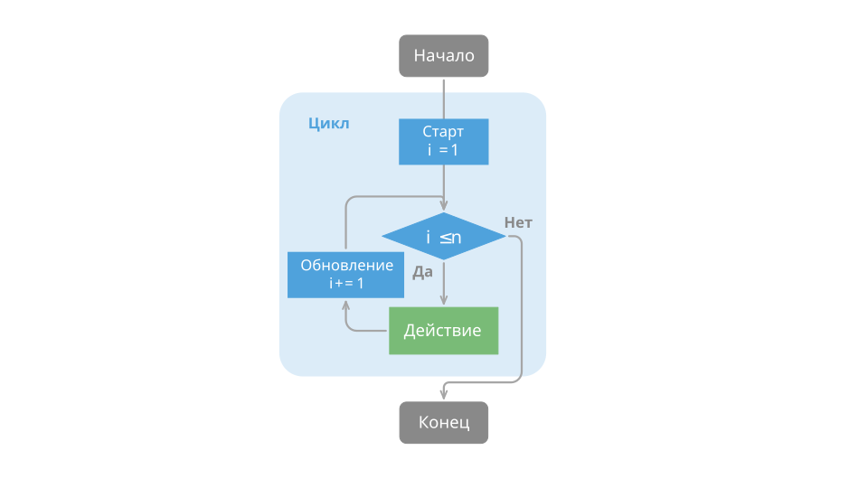
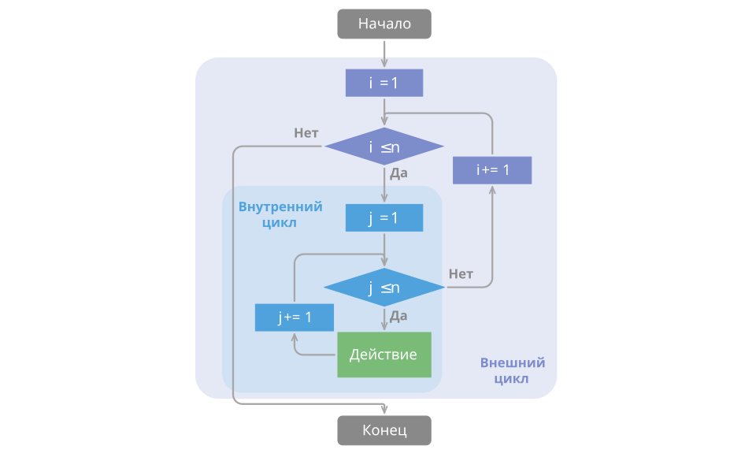
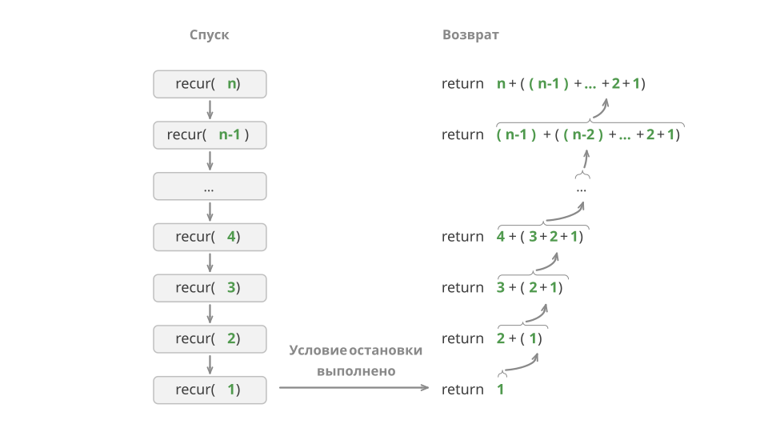
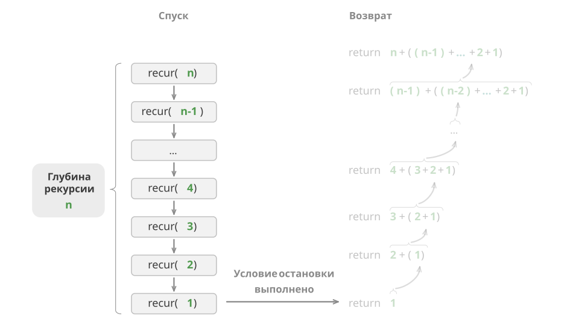

# Итерация и рекурсия

Алгоритмам часто приходится повторять одно и то же действие, и от характера этих повторений во многом зависит сложность алгоритма. Прежде чем перейти к временной и пространственной сложности, разберём два основных способа организовать повторение в программе: итерацию и рекурсию.

## Итерация

<u>Итерация (iteration)</u> — способ управления выполнением программы, при котором одно и то же действие повторяется. Определённый фрагмент кода выполняется снова и снова, пока выполняется заданное условие.

### Цикл for

Цикл `for` — одна из самых распространённых форм итерации. Он **удобен, когда число повторений известно заранее**.

Следующая функция с помощью цикла `for` вычисляет сумму $1 + 2 + \dots + n$. Результат накапливается в переменной `res`. Обратите внимание: в Python диапазон `range(a, b)` включает левую границу и исключает правую. Перебираются значения $a, a + 1, \dots, b-1$:

```src
[file]{iteration}-[class]{}-[func]{for_loop}
```

На рисунке показана блок-схема этой функции.



Число операций в функции прямо пропорционально размеру входных данных $n$. Такую зависимость называют линейной. **Именно эту линейную зависимость в данном случае и описывает временная сложность**. Подробнее мы рассмотрим её в следующем разделе.

### Цикл while

Как и цикл `for`, цикл `while` позволяет организовать итерацию. В начале каждого прохода цикла `while` программа проверяет условие. Если оно истинно, тело цикла выполняется, а если ложно, цикл завершается.

Вычислим с помощью цикла `while` ту же сумму $1 + 2 + \dots + n$:

```src
[file]{iteration}-[class]{}-[func]{while_loop}
```

**Цикл `while` даёт больше свободы, чем цикл `for`**. В цикле `while` мы сами определяем, как задать начальное значение переменной, от которой зависит условие, и как затем её обновлять.

Например, в следующем фрагменте переменная $i$ обновляется дважды за итерацию. Записать это с помощью цикла `for` было бы менее удобно:

```src
[file]{iteration}-[class]{}-[func]{while_loop_ii}
```

Итак, **цикл `for` даёт более компактную запись, а цикл `while` более гибок**. Оба позволяют организовать итерацию. Выбор зависит от задачи.

### Вложенные циклы

Внутрь одного цикла можно поместить другой. Вот пример с циклами `for`:

```src
[file]{iteration}-[class]{}-[func]{nested_for_loop}
```

На рисунке показана блок-схема вложенных циклов.



Теперь число операций пропорционально $n^2$. Иначе говоря, время работы алгоритма квадратично зависит от размера входных данных $n$.

Можно и дальше вкладывать циклы друг в друга. Каждый такой уровень добавляет ещё одно «измерение»: зависимость времени работы станет кубической, затем вырастет до четвёртой степени и так далее.

## Рекурсия

 <u>Рекурсия (recursion)</u> — способ решения задачи, при котором функция вызывает сама себя. В нём выделяют два этапа.

1. **Спуск**. Функция вызывает себя на всё большей глубине, обычно передавая меньшие или более простые аргументы. Спуск продолжается до выполнения условия остановки.
2. **Возврат**. Когда условие остановки выполнено, вызовы начинают завершаться от самого глубокого к самому первому. На обратном пути объединяются результаты отдельных уровней.

В коде рекурсивной функции обычно можно выделить три составляющие.

1. **Условие остановки** определяет, когда спуск сменится возвратом.
2. **Рекурсивный вызов** обеспечивает спуск: функция вызывает себя, обычно с меньшими или более простыми аргументами.
3. **Возврат результата** передаёт результат текущего уровня на предыдущий.

В следующем примере достаточно вызвать `recur(n)`, чтобы вычислить сумму $1 + 2 + \dots + n$:

```src
[file]{recursion}-[class]{}-[func]{recur}
```

На рисунке показан ход рекурсивных вызовов и возвратов.



Итерация и рекурсия могут дать один и тот же результат, однако **за ними стоят два совершенно разных подхода к постановке и решению задачи**.

- **Итерация** решает задачу снизу вверх. Начинаем с простейшего шага и повторяем его или накапливаем результаты шагов, пока не выполним всю задачу.
- **Рекурсия** решает задачу сверху вниз. Исходную задачу разбиваем на меньшие подзадачи того же вида. Их, в свою очередь, разбиваем на ещё более мелкие, пока не дойдём до базового случая, решение которого уже известно.

Вернёмся к примеру с суммой. Обозначим задачу так: $f(n) = 1 + 2 + \dots + n$.

- **Итерация** воспроизводит суммирование в цикле. Перебираем числа от $1$ до $n$ и прибавляем очередное число на каждом шаге. В результате получаем $f(n)$.
- **Рекурсия** сводит задачу к меньшей по правилу $f(n) = n + f(n-1)$. Повторяем это разбиение рекурсивно, пока не дойдём до базового случая $f(1) = 1$.

### Стек вызовов

Каждый раз, когда рекурсивная функция вызывает себя, система выделяет новому вызову память для локальных переменных, адреса возврата и других сведений. Это имеет два следствия.

- Данные, описывающие состояние вызова, хранятся в области памяти, которую называют кадром стека. Она освобождается лишь после возврата из функции. Поэтому **рекурсия обычно требует больше памяти, чем итерация**.
- Вызов функции при рекурсии влечёт дополнительные расходы. **Поэтому рекурсия обычно уступает циклу по скорости**.

Как видно на рисунке, к моменту достижения условия остановки одновременно активны $n$ вызовов. Следовательно, **глубина рекурсии равна $n$**.



На практике языки программирования обычно ограничивают глубину рекурсии. Слишком глубокая рекурсия может привести к переполнению стека.

### Хвостовая рекурсия

**Если рекурсивный вызов — последнее действие функции перед возвратом**, компилятор или интерпретатор может оптимизировать его так, что по расходу памяти функция будет сопоставима с итеративной. Это <u>хвостовая рекурсия (tail recursion)</u>.

- **Обычная рекурсия**. После возврата из вложенного вызова на предыдущем уровне ещё предстоит выполнить код. Поэтому системе нужно сохранить состояние предыдущего вызова.
- **Хвостовая рекурсия**. Рекурсивный вызов — последнее действие перед возвратом. После него на предыдущем уровне больше нечего выполнять, поэтому системе не требуется сохранять состояние предыдущего вызова.

Например, чтобы вычислить $1 + 2 + \dots + n$ с помощью хвостовой рекурсии, передадим накопленную сумму `res` как аргумент функции:

```src
[file]{recursion}-[class]{}-[func]{tail_recur}
```

Ход хвостовой рекурсии показан на рисунке. Сравните, когда выполняется сложение при обычной и при хвостовой рекурсии.

- **Обычная рекурсия** складывает числа на обратном пути: после возврата с очередного уровня выполняется ещё одно сложение.
- **Хвостовая рекурсия** складывает числа при спуске. На обратном пути остаётся лишь передать результат с уровня на уровень.


!!! tip

    Многие компиляторы и интерпретаторы не поддерживают оптимизацию хвостовой рекурсии. Например, в Python по умолчанию такой оптимизации нет, и даже хвостовая рекурсия может привести к переполнению стека.

### Дерево рекурсии

В задачах, где применяется принцип «разделяй и властвуй», рекурсивное решение часто интуитивно понятнее итеративного, а его код легче читать. Рассмотрим последовательность Фибоначчи.

!!! question

    Дана последовательность Фибоначчи $0, 1, 1, 2, 3, 5, 8, 13, \dots$. Найдите её элемент с номером $n$.

Обозначим число Фибоначчи с номером $n$ через $f(n)$. Можно сразу записать два соотношения.

- Первые два члена последовательности заданы равенствами $f(1) = 0$ и $f(2) = 1$.
- Каждое следующее число равно сумме двух предыдущих: $f(n) = f(n - 1) + f(n - 2)$.

Запишем рекурсивные вызовы по этому соотношению, а первые два члена используем как базовые случаи. Тогда вызов `fib(n)` вернёт число Фибоначчи с номером $n$:

```src
[file]{recursion}-[class]{}-[func]{fib}
```

Внутри функции мы делаем два рекурсивных вызова. **От одного вызова отходят две ветви**. По мере их раскрытия возникает <u>дерево рекурсии (recursion tree)</u> с числом уровней порядка $n$, как на рисунке.


В основе рекурсии лежит идея разбиения задачи на меньшие подзадачи. Этот принцип «разделяй и властвуй» играет важнейшую роль.

- В алгоритмах поиска и сортировки, в поиске с возвратом, методе «разделяй и властвуй» и динамическом программировании эта идея используется прямо или косвенно.
- С точки зрения структур данных рекурсия естественно подходит для решения задач на связных списках, деревьях и графах: такие задачи удобно анализировать, разбирая их на части.

## Сравнение итерации и рекурсии

В таблице собраны различия между итерацией и рекурсией в реализации, эффективности и применении.

<p align="center">Таблица <id> &nbsp; Сравнение итерации и рекурсии</p>

|          | Итерация                                   | Рекурсия                                                         |
| -------- | -------------------------------------- | ------------------------------------------------------------ |
| Способ реализации | Цикл                               | Функция вызывает сама себя                                                 |
| Затраты времени | Обычно выполняется быстрее: нет накладных расходов на вызовы           | Каждый вызов функции влечёт накладные расходы                                     |
| Расход памяти | Обычно требуется постоянный объём памяти             | При накоплении вызовов кадры стека могут занять много памяти                           |
| Область применения | Простые повторяющиеся действия. Код нагляден и легко читается | Задачи с разбиением на подзадачи, например на деревьях и графах, а также алгоритмы «разделяй и властвуй» и поиск с возвратом. Структура кода проста и ясна |

!!! tip

    Если следующий материал покажется сложным, вернитесь к нему после главы о стеке.

Как связаны между собой итерация и рекурсия? Вспомним рекурсивное суммирование. Сложение выполняется на обратном пути, поэтому самый первый вызов заканчивает складывать числа последним. **Так же устроен стек: кто вошёл первым, выходит последним**.

Уже сами термины «стек вызовов» и «кадр стека» указывают на тесную связь между рекурсией и стеком.

1. **Спуск**. При вызове функции система помещает в стек вызовов новый кадр. В нём хранятся локальные переменные, аргументы, адрес возврата и другие данные вызова.
2. **Возврат**. Когда функция завершается и возвращает управление, её кадр удаляется из стека. Восстанавливается состояние предыдущего вызова.

Таким образом, **мы можем явно завести стек и воспроизвести с его помощью работу стека вызовов**. Это позволяет заменить рекурсию итерацией:

```src
[file]{recursion}-[class]{}-[func]{for_loop_recur}
```

Как видно из примера, после замены рекурсии итерацией код усложнился. Во многих случаях эти формы взаимозаменяемы, однако преобразование не всегда оправданно по двум причинам.

- Полученный код может оказаться труднее для понимания и чтения.
- В некоторых сложных задачах воспроизвести поведение системного стека вызовов бывает очень трудно.

Итак, **выбор между итерацией и рекурсией зависит от свойств конкретной задачи**. На практике важно взвесить преимущества и недостатки обоих способов и выбрать подходящий для данной ситуации.
