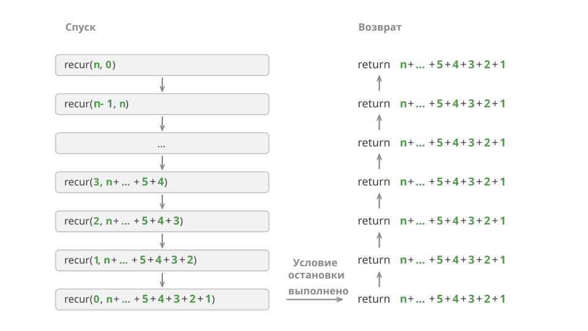
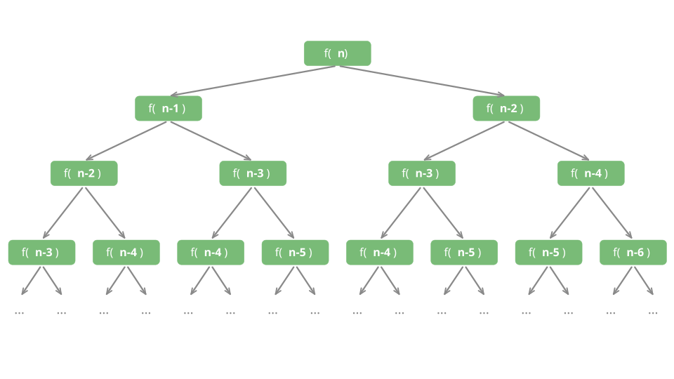

# 2.2 &nbsp; Итерация и рекурсия

Алгоритмам часто приходится повторять одно и то же действие, и от характера этих повторений во многом зависит сложность алгоритма. Прежде чем перейти к временной и пространственной сложности, разберём два основных способа организовать повторение в программе: итерацию и рекурсию.

## 2.2.1 &nbsp; Итерация

<u>Итерация (iteration)</u> — способ управления выполнением программы, при котором одно и то же действие повторяется. Определённый фрагмент кода выполняется снова и снова, пока выполняется заданное условие.

### 1. &nbsp; Цикл for

Цикл `for` — одна из самых распространённых форм итерации. Он **удобен, когда число повторений известно заранее**.

Следующая функция с помощью цикла `for` вычисляет сумму $1 + 2 + \dots + n$. Результат накапливается в переменной `res`. Обратите внимание: в Python диапазон `range(a, b)` включает левую границу и исключает правую. Перебираются значения $a, a + 1, \dots, b-1$:

=== "Python"

    ```python title="iteration.py"
    def for_loop(n: int) -> int:
        """Цикл for"""
        res = 0
        # Сложить числа 1, 2, ..., n-1, n в цикле
        for i in range(1, n + 1):
            res += i
        return res
    ```

=== "C++"

    ```cpp title="iteration.cpp"
    /* Цикл for */
    int forLoop(int n) {
        int res = 0;
        // Сложить числа 1, 2, ..., n-1, n в цикле
        for (int i = 1; i <= n; ++i) {
            res += i;
        }
        return res;
    }
    ```

=== "Java"

    ```java title="iteration.java"
    /* Цикл for */
    int forLoop(int n) {
        int res = 0;
        // Сложить числа 1, 2, ..., n-1, n в цикле
        for (int i = 1; i <= n; i++) {
            res += i;
        }
        return res;
    }
    ```

=== "C#"

    ```csharp title="iteration.cs"
    /* Цикл for */
    int ForLoop(int n) {
        int res = 0;
        // Сложить числа 1, 2, ..., n-1, n в цикле
        for (int i = 1; i <= n; i++) {
            res += i;
        }
        return res;
    }
    ```

=== "Go"

    ```go title="iteration.go"
    /* Цикл for */
    func forLoop(n int) int {
        res := 0
        // Сложить числа 1, 2, ..., n-1, n в цикле
        for i := 1; i <= n; i++ {
            res += i
        }
        return res
    }
    ```

=== "Swift"

    ```swift title="iteration.swift"
    /* Цикл for */
    func forLoop(n: Int) -> Int {
        var res = 0
        // Сложить числа 1, 2, ..., n-1, n в цикле
        for i in 1 ... n {
            res += i
        }
        return res
    }
    ```

=== "JS"

    ```javascript title="iteration.js"
    /* Цикл for */
    function forLoop(n) {
        let res = 0;
        // Сложить числа 1, 2, ..., n-1, n в цикле
        for (let i = 1; i <= n; i++) {
            res += i;
        }
        return res;
    }
    ```

=== "TS"

    ```typescript title="iteration.ts"
    /* Цикл for */
    function forLoop(n: number): number {
        let res = 0;
        // Сложить числа 1, 2, ..., n-1, n в цикле
        for (let i = 1; i <= n; i++) {
            res += i;
        }
        return res;
    }
    ```

=== "Dart"

    ```dart title="iteration.dart"
    /* Цикл for */
    int forLoop(int n) {
      int res = 0;
      // Сложить числа 1, 2, ..., n-1, n в цикле
      for (int i = 1; i <= n; i++) {
        res += i;
      }
      return res;
    }
    ```

=== "Rust"

    ```rust title="iteration.rs"
    /* Цикл for */
    fn for_loop(n: i32) -> i32 {
        let mut res = 0;
        // Сложить числа 1, 2, ..., n-1, n в цикле
        for i in 1..=n {
            res += i;
        }
        res
    }
    ```

=== "C"

    ```c title="iteration.c"
    /* Цикл for */
    int forLoop(int n) {
        int res = 0;
        // Сложить числа 1, 2, ..., n-1, n в цикле
        for (int i = 1; i <= n; i++) {
            res += i;
        }
        return res;
    }
    ```

=== "Kotlin"

    ```kotlin title="iteration.kt"
    /* Цикл for */
    fun forLoop(n: Int): Int {
        var res = 0
        // Сложить числа 1, 2, ..., n-1, n в цикле
        for (i in 1..n) {
            res += i
        }
        return res
    }
    ```

=== "Ruby"

    ```ruby title="iteration.rb"
    ### Цикл for ###
    def for_loop(n)
      res = 0

      # Сложить числа 1, 2, ..., n-1, n в цикле
      for i in 1..n
        res += i
      end

      res
    end
    ```

??? pythontutor "Визуализация выполнения"

    <div style="height: 423px; width: 100%;"><iframe class="pythontutor-iframe" title="Визуализация выполнения" src="https://pythontutor.com/iframe-embed.html#code=def%20for_loop%28n%3A%20int%29%20-%3E%20int%3A%0A%20%20%20%20%22%22%22%D0%A6%D0%B8%D0%BA%D0%BB%20for%22%22%22%0A%20%20%20%20res%20%3D%200%0A%20%20%20%20%23%20%D0%A1%D0%BB%D0%BE%D0%B6%D0%B8%D1%82%D1%8C%20%D1%87%D0%B8%D1%81%D0%BB%D0%B0%201,%202,%20...,%20n-1,%20n%20%D0%B2%20%D1%86%D0%B8%D0%BA%D0%BB%D0%B5%0A%20%20%20%20for%20i%20in%20range%281,%20n%20%2B%201%29%3A%0A%20%20%20%20%20%20%20%20res%20%2B%3D%20i%0A%20%20%20%20return%20res%0A%0A%22%22%22Driver%20Code%22%22%22%0Aif%20__name__%20%3D%3D%20%22__main__%22%3A%0A%20%20%20%20n%20%3D%205%0A%20%20%20%20res%20%3D%20for_loop%28n%29%0A%20%20%20%20print%28f%22%5Cn%D0%A1%D1%83%D0%BC%D0%BC%D0%B0%20%D0%B2%20%D1%86%D0%B8%D0%BA%D0%BB%D0%B5%20for%3A%20res%20%3D%20%7Bres%7D%22%29&codeDivHeight=472&codeDivWidth=350&cumulative=false&curInstr=3&heapPrimitives=nevernest&origin=opt-frontend.js&py=311&rawInputLstJSON=%5B%5D&"> </iframe></div>
    <div style="margin-top: 5px;"><a href="https://pythontutor.com/iframe-embed.html#code=def%20for_loop%28n%3A%20int%29%20-%3E%20int%3A%0A%20%20%20%20%22%22%22%D0%A6%D0%B8%D0%BA%D0%BB%20for%22%22%22%0A%20%20%20%20res%20%3D%200%0A%20%20%20%20%23%20%D0%A1%D0%BB%D0%BE%D0%B6%D0%B8%D1%82%D1%8C%20%D1%87%D0%B8%D1%81%D0%BB%D0%B0%201,%202,%20...,%20n-1,%20n%20%D0%B2%20%D1%86%D0%B8%D0%BA%D0%BB%D0%B5%0A%20%20%20%20for%20i%20in%20range%281,%20n%20%2B%201%29%3A%0A%20%20%20%20%20%20%20%20res%20%2B%3D%20i%0A%20%20%20%20return%20res%0A%0A%22%22%22Driver%20Code%22%22%22%0Aif%20__name__%20%3D%3D%20%22__main__%22%3A%0A%20%20%20%20n%20%3D%205%0A%20%20%20%20res%20%3D%20for_loop%28n%29%0A%20%20%20%20print%28f%22%5Cn%D0%A1%D1%83%D0%BC%D0%BC%D0%B0%20%D0%B2%20%D1%86%D0%B8%D0%BA%D0%BB%D0%B5%20for%3A%20res%20%3D%20%7Bres%7D%22%29&codeDivHeight=800&codeDivWidth=600&cumulative=false&curInstr=3&heapPrimitives=nevernest&origin=opt-frontend.js&py=311&rawInputLstJSON=%5B%5D&" target="_blank" rel="noopener noreferrer">Во весь экран ></a></div>

На рисунке показана блок-схема этой функции.

{ class="animation-figure" }

<p align="center"> Рисунок 2-1 &nbsp; Блок-схема функции суммирования </p>

Число операций в функции прямо пропорционально размеру входных данных $n$. Такую зависимость называют линейной. **Именно эту линейную зависимость в данном случае и описывает временная сложность**. Подробнее мы рассмотрим её в следующем разделе.

### 2. &nbsp; Цикл while

Как и цикл `for`, цикл `while` позволяет организовать итерацию. В начале каждого прохода цикла `while` программа проверяет условие. Если оно истинно, тело цикла выполняется, а если ложно, цикл завершается.

Вычислим с помощью цикла `while` ту же сумму $1 + 2 + \dots + n$:

=== "Python"

    ```python title="iteration.py"
    def while_loop(n: int) -> int:
        """Цикл while"""
        res = 0
        i = 1  # Задать начальное значение переменной условия
        # Сложить числа 1, 2, ..., n-1, n в цикле
        while i <= n:
            res += i
            i += 1  # Обновить переменную условия
        return res
    ```

=== "C++"

    ```cpp title="iteration.cpp"
    /* Цикл while */
    int whileLoop(int n) {
        int res = 0;
        int i = 1; // Задать начальное значение переменной условия
        // Сложить числа 1, 2, ..., n-1, n в цикле
        while (i <= n) {
            res += i;
            i++; // Обновить переменную условия
        }
        return res;
    }
    ```

=== "Java"

    ```java title="iteration.java"
    /* Цикл while */
    int whileLoop(int n) {
        int res = 0;
        int i = 1; // Задать начальное значение переменной условия
        // Сложить числа 1, 2, ..., n-1, n в цикле
        while (i <= n) {
            res += i;
            i++; // Обновить переменную условия
        }
        return res;
    }
    ```

=== "C#"

    ```csharp title="iteration.cs"
    /* Цикл while */
    int WhileLoop(int n) {
        int res = 0;
        int i = 1; // Задать начальное значение переменной условия
        // Сложить числа 1, 2, ..., n-1, n в цикле
        while (i <= n) {
            res += i;
            i += 1; // Обновить переменную условия
        }
        return res;
    }
    ```

=== "Go"

    ```go title="iteration.go"
    /* Цикл while */
    func whileLoop(n int) int {
        res := 0
        // Задать начальное значение переменной условия
        i := 1
        // Сложить числа 1, 2, ..., n-1, n в цикле
        for i <= n {
            res += i
            // Обновить переменную условия
            i++
        }
        return res
    }
    ```

=== "Swift"

    ```swift title="iteration.swift"
    /* Цикл while */
    func whileLoop(n: Int) -> Int {
        var res = 0
        var i = 1 // Задать начальное значение переменной условия
        // Сложить числа 1, 2, ..., n-1, n в цикле
        while i <= n {
            res += i
            i += 1 // Обновить переменную условия
        }
        return res
    }
    ```

=== "JS"

    ```javascript title="iteration.js"
    /* Цикл while */
    function whileLoop(n) {
        let res = 0;
        let i = 1; // Задать начальное значение переменной условия
        // Сложить числа 1, 2, ..., n-1, n в цикле
        while (i <= n) {
            res += i;
            i++; // Обновить переменную условия
        }
        return res;
    }
    ```

=== "TS"

    ```typescript title="iteration.ts"
    /* Цикл while */
    function whileLoop(n: number): number {
        let res = 0;
        let i = 1; // Задать начальное значение переменной условия
        // Сложить числа 1, 2, ..., n-1, n в цикле
        while (i <= n) {
            res += i;
            i++; // Обновить переменную условия
        }
        return res;
    }
    ```

=== "Dart"

    ```dart title="iteration.dart"
    /* Цикл while */
    int whileLoop(int n) {
      int res = 0;
      int i = 1; // Задать начальное значение переменной условия
      // Сложить числа 1, 2, ..., n-1, n в цикле
      while (i <= n) {
        res += i;
        i++; // Обновить переменную условия
      }
      return res;
    }
    ```

=== "Rust"

    ```rust title="iteration.rs"
    /* Цикл while */
    fn while_loop(n: i32) -> i32 {
        let mut res = 0;
        let mut i = 1; // Задать начальное значение переменной условия

        // Сложить числа 1, 2, ..., n-1, n в цикле
        while i <= n {
            res += i;
            i += 1; // Обновить переменную условия
        }
        res
    }
    ```

=== "C"

    ```c title="iteration.c"
    /* Цикл while */
    int whileLoop(int n) {
        int res = 0;
        int i = 1; // Задать начальное значение переменной условия
        // Сложить числа 1, 2, ..., n-1, n в цикле
        while (i <= n) {
            res += i;
            i++; // Обновить переменную условия
        }
        return res;
    }
    ```

=== "Kotlin"

    ```kotlin title="iteration.kt"
    /* Цикл while */
    fun whileLoop(n: Int): Int {
        var res = 0
        var i = 1 // Задать начальное значение переменной условия
        // Сложить числа 1, 2, ..., n-1, n в цикле
        while (i <= n) {
            res += i
            i++ // Обновить переменную условия
        }
        return res
    }
    ```

=== "Ruby"

    ```ruby title="iteration.rb"
    ### Цикл while ###
    def while_loop(n)
      res = 0
      i = 1 # Задать начальное значение переменной условия

      # Сложить числа 1, 2, ..., n-1, n в цикле
      while i <= n
        res += i
        i += 1 # Обновить переменную условия
      end

      res
    end
    ```

??? pythontutor "Визуализация выполнения"

    <div style="height: 459px; width: 100%;"><iframe class="pythontutor-iframe" title="Визуализация выполнения" src="https://pythontutor.com/iframe-embed.html#code=def%20while_loop%28n%3A%20int%29%20-%3E%20int%3A%0A%20%20%20%20%22%22%22%D0%A6%D0%B8%D0%BA%D0%BB%20while%22%22%22%0A%20%20%20%20res%20%3D%200%0A%20%20%20%20i%20%3D%201%20%20%23%20%D0%97%D0%B0%D0%B4%D0%B0%D1%82%D1%8C%20%D0%BD%D0%B0%D1%87%D0%B0%D0%BB%D1%8C%D0%BD%D0%BE%D0%B5%20%D0%B7%D0%BD%D0%B0%D1%87%D0%B5%D0%BD%D0%B8%D0%B5%20%D0%BF%D0%B5%D1%80%D0%B5%D0%BC%D0%B5%D0%BD%D0%BD%D0%BE%D0%B9%20%D1%83%D1%81%D0%BB%D0%BE%D0%B2%D0%B8%D1%8F%0A%20%20%20%20%23%20%D0%A1%D0%BB%D0%BE%D0%B6%D0%B8%D1%82%D1%8C%20%D1%87%D0%B8%D1%81%D0%BB%D0%B0%201,%202,%20...,%20n-1,%20n%20%D0%B2%20%D1%86%D0%B8%D0%BA%D0%BB%D0%B5%0A%20%20%20%20while%20i%20%3C%3D%20n%3A%0A%20%20%20%20%20%20%20%20res%20%2B%3D%20i%0A%20%20%20%20%20%20%20%20i%20%2B%3D%201%20%20%23%20%D0%9E%D0%B1%D0%BD%D0%BE%D0%B2%D0%B8%D1%82%D1%8C%20%D0%BF%D0%B5%D1%80%D0%B5%D0%BC%D0%B5%D0%BD%D0%BD%D1%83%D1%8E%20%D1%83%D1%81%D0%BB%D0%BE%D0%B2%D0%B8%D1%8F%0A%20%20%20%20return%20res%0A%0A%22%22%22Driver%20Code%22%22%22%0Aif%20__name__%20%3D%3D%20%22__main__%22%3A%0A%20%20%20%20n%20%3D%205%0A%20%20%20%20res%20%3D%20while_loop%28n%29%0A%20%20%20%20print%28f%22%5Cn%D0%A1%D1%83%D0%BC%D0%BC%D0%B0%20%D0%B2%20%D1%86%D0%B8%D0%BA%D0%BB%D0%B5%20while%3A%20res%20%3D%20%7Bres%7D%22%29&codeDivHeight=472&codeDivWidth=350&cumulative=false&curInstr=3&heapPrimitives=nevernest&origin=opt-frontend.js&py=311&rawInputLstJSON=%5B%5D&textReferences=false"> </iframe></div>
    <div style="margin-top: 5px;"><a href="https://pythontutor.com/iframe-embed.html#code=def%20while_loop%28n%3A%20int%29%20-%3E%20int%3A%0A%20%20%20%20%22%22%22%D0%A6%D0%B8%D0%BA%D0%BB%20while%22%22%22%0A%20%20%20%20res%20%3D%200%0A%20%20%20%20i%20%3D%201%20%20%23%20%D0%97%D0%B0%D0%B4%D0%B0%D1%82%D1%8C%20%D0%BD%D0%B0%D1%87%D0%B0%D0%BB%D1%8C%D0%BD%D0%BE%D0%B5%20%D0%B7%D0%BD%D0%B0%D1%87%D0%B5%D0%BD%D0%B8%D0%B5%20%D0%BF%D0%B5%D1%80%D0%B5%D0%BC%D0%B5%D0%BD%D0%BD%D0%BE%D0%B9%20%D1%83%D1%81%D0%BB%D0%BE%D0%B2%D0%B8%D1%8F%0A%20%20%20%20%23%20%D0%A1%D0%BB%D0%BE%D0%B6%D0%B8%D1%82%D1%8C%20%D1%87%D0%B8%D1%81%D0%BB%D0%B0%201,%202,%20...,%20n-1,%20n%20%D0%B2%20%D1%86%D0%B8%D0%BA%D0%BB%D0%B5%0A%20%20%20%20while%20i%20%3C%3D%20n%3A%0A%20%20%20%20%20%20%20%20res%20%2B%3D%20i%0A%20%20%20%20%20%20%20%20i%20%2B%3D%201%20%20%23%20%D0%9E%D0%B1%D0%BD%D0%BE%D0%B2%D0%B8%D1%82%D1%8C%20%D0%BF%D0%B5%D1%80%D0%B5%D0%BC%D0%B5%D0%BD%D0%BD%D1%83%D1%8E%20%D1%83%D1%81%D0%BB%D0%BE%D0%B2%D0%B8%D1%8F%0A%20%20%20%20return%20res%0A%0A%22%22%22Driver%20Code%22%22%22%0Aif%20__name__%20%3D%3D%20%22__main__%22%3A%0A%20%20%20%20n%20%3D%205%0A%20%20%20%20res%20%3D%20while_loop%28n%29%0A%20%20%20%20print%28f%22%5Cn%D0%A1%D1%83%D0%BC%D0%BC%D0%B0%20%D0%B2%20%D1%86%D0%B8%D0%BA%D0%BB%D0%B5%20while%3A%20res%20%3D%20%7Bres%7D%22%29&codeDivHeight=800&codeDivWidth=600&cumulative=false&curInstr=3&heapPrimitives=nevernest&origin=opt-frontend.js&py=311&rawInputLstJSON=%5B%5D&textReferences=false" target="_blank" rel="noopener noreferrer">Во весь экран ></a></div>

**Цикл `while` даёт больше свободы, чем цикл `for`**. В цикле `while` мы сами определяем, как задать начальное значение переменной, от которой зависит условие, и как затем её обновлять.

Например, в следующем фрагменте переменная $i$ обновляется дважды за итерацию. Записать это с помощью цикла `for` было бы менее удобно:

=== "Python"

    ```python title="iteration.py"
    def while_loop_ii(n: int) -> int:
        """Цикл while с двумя обновлениями"""
        res = 0
        i = 1  # Задать начальное значение переменной условия
        # Сложить числа 1, 4, 10, ... в цикле
        while i <= n:
            res += i
            # Обновить переменную условия
            i += 1
            i *= 2
        return res
    ```

=== "C++"

    ```cpp title="iteration.cpp"
    /* Цикл while с двумя обновлениями */
    int whileLoopII(int n) {
        int res = 0;
        int i = 1; // Задать начальное значение переменной условия
        // Сложить числа 1, 4, 10, ... в цикле
        while (i <= n) {
            res += i;
            // Обновить переменную условия
            i++;
            i *= 2;
        }
        return res;
    }
    ```

=== "Java"

    ```java title="iteration.java"
    /* Цикл while с двумя обновлениями */
    int whileLoopII(int n) {
        int res = 0;
        int i = 1; // Задать начальное значение переменной условия
        // Сложить числа 1, 4, 10, ... в цикле
        while (i <= n) {
            res += i;
            // Обновить переменную условия
            i++;
            i *= 2;
        }
        return res;
    }
    ```

=== "C#"

    ```csharp title="iteration.cs"
    /* Цикл while с двумя обновлениями */
    int WhileLoopII(int n) {
        int res = 0;
        int i = 1; // Задать начальное значение переменной условия
        // Сложить числа 1, 4, 10, ... в цикле
        while (i <= n) {
            res += i;
            // Обновить переменную условия
            i += 1; 
            i *= 2;
        }
        return res;
    }
    ```

=== "Go"

    ```go title="iteration.go"
    /* Цикл while с двумя обновлениями */
    func whileLoopII(n int) int {
        res := 0
        // Задать начальное значение переменной условия
        i := 1
        // Сложить числа 1, 4, 10, ... в цикле
        for i <= n {
            res += i
            // Обновить переменную условия
            i++
            i *= 2
        }
        return res
    }
    ```

=== "Swift"

    ```swift title="iteration.swift"
    /* Цикл while с двумя обновлениями */
    func whileLoopII(n: Int) -> Int {
        var res = 0
        var i = 1 // Задать начальное значение переменной условия
        // Сложить числа 1, 4, 10, ... в цикле
        while i <= n {
            res += i
            // Обновить переменную условия
            i += 1
            i *= 2
        }
        return res
    }
    ```

=== "JS"

    ```javascript title="iteration.js"
    /* Цикл while с двумя обновлениями */
    function whileLoopII(n) {
        let res = 0;
        let i = 1; // Задать начальное значение переменной условия
        // Сложить числа 1, 4, 10, ... в цикле
        while (i <= n) {
            res += i;
            // Обновить переменную условия
            i++;
            i *= 2;
        }
        return res;
    }
    ```

=== "TS"

    ```typescript title="iteration.ts"
    /* Цикл while с двумя обновлениями */
    function whileLoopII(n: number): number {
        let res = 0;
        let i = 1; // Задать начальное значение переменной условия
        // Сложить числа 1, 4, 10, ... в цикле
        while (i <= n) {
            res += i;
            // Обновить переменную условия
            i++;
            i *= 2;
        }
        return res;
    }
    ```

=== "Dart"

    ```dart title="iteration.dart"
    /* Цикл while с двумя обновлениями */
    int whileLoopII(int n) {
      int res = 0;
      int i = 1; // Задать начальное значение переменной условия
      // Сложить числа 1, 4, 10, ... в цикле
      while (i <= n) {
        res += i;
        // Обновить переменную условия
        i++;
        i *= 2;
      }
      return res;
    }
    ```

=== "Rust"

    ```rust title="iteration.rs"
    /* Цикл while с двумя обновлениями */
    fn while_loop_ii(n: i32) -> i32 {
        let mut res = 0;
        let mut i = 1; // Задать начальное значение переменной условия

        // Сложить числа 1, 4, 10, ... в цикле
        while i <= n {
            res += i;
            // Обновить переменную условия
            i += 1;
            i *= 2;
        }
        res
    }
    ```

=== "C"

    ```c title="iteration.c"
    /* Цикл while с двумя обновлениями */
    int whileLoopII(int n) {
        int res = 0;
        int i = 1; // Задать начальное значение переменной условия
        // Сложить числа 1, 4, 10, ... в цикле
        while (i <= n) {
            res += i;
            // Обновить переменную условия
            i++;
            i *= 2;
        }
        return res;
    }
    ```

=== "Kotlin"

    ```kotlin title="iteration.kt"
    /* Цикл while с двумя обновлениями */
    fun whileLoopII(n: Int): Int {
        var res = 0
        var i = 1 // Задать начальное значение переменной условия
        // Сложить числа 1, 4, 10, ... в цикле
        while (i <= n) {
            res += i
            // Обновить переменную условия
            i++
            i *= 2
        }
        return res
    }
    ```

=== "Ruby"

    ```ruby title="iteration.rb"
    ### Цикл while с двумя обновлениями###
    def while_loop_ii(n)
      res = 0
      i = 1 # Задать начальное значение переменной условия

      # Сложить числа 1, 4, 10, ... в цикле
      while i <= n
        res += i
        # Обновить переменную условия
        i += 1
        i *= 2
      end

      res
    end
    ```

??? pythontutor "Визуализация выполнения"

    <div style="height: 495px; width: 100%;"><iframe class="pythontutor-iframe" title="Визуализация выполнения" src="https://pythontutor.com/iframe-embed.html#code=def%20while_loop_ii%28n%3A%20int%29%20-%3E%20int%3A%0A%20%20%20%20%22%22%22%D0%A6%D0%B8%D0%BA%D0%BB%20while%20%D1%81%20%D0%B4%D0%B2%D1%83%D0%BC%D1%8F%20%D0%BE%D0%B1%D0%BD%D0%BE%D0%B2%D0%BB%D0%B5%D0%BD%D0%B8%D1%8F%D0%BC%D0%B8%22%22%22%0A%20%20%20%20res%20%3D%200%0A%20%20%20%20i%20%3D%201%20%20%23%20%D0%97%D0%B0%D0%B4%D0%B0%D1%82%D1%8C%20%D0%BD%D0%B0%D1%87%D0%B0%D0%BB%D1%8C%D0%BD%D0%BE%D0%B5%20%D0%B7%D0%BD%D0%B0%D1%87%D0%B5%D0%BD%D0%B8%D0%B5%20%D0%BF%D0%B5%D1%80%D0%B5%D0%BC%D0%B5%D0%BD%D0%BD%D0%BE%D0%B9%20%D1%83%D1%81%D0%BB%D0%BE%D0%B2%D0%B8%D1%8F%0A%20%20%20%20%23%20%D0%A1%D0%BB%D0%BE%D0%B6%D0%B8%D1%82%D1%8C%20%D1%87%D0%B8%D1%81%D0%BB%D0%B0%201,%204,%2010,%20...%20%D0%B2%20%D1%86%D0%B8%D0%BA%D0%BB%D0%B5%0A%20%20%20%20while%20i%20%3C%3D%20n%3A%0A%20%20%20%20%20%20%20%20res%20%2B%3D%20i%0A%20%20%20%20%20%20%20%20%23%20%D0%9E%D0%B1%D0%BD%D0%BE%D0%B2%D0%B8%D1%82%D1%8C%20%D0%BF%D0%B5%D1%80%D0%B5%D0%BC%D0%B5%D0%BD%D0%BD%D1%83%D1%8E%20%D1%83%D1%81%D0%BB%D0%BE%D0%B2%D0%B8%D1%8F%0A%20%20%20%20%20%20%20%20i%20%2B%3D%201%0A%20%20%20%20%20%20%20%20i%20%2A%3D%202%0A%20%20%20%20return%20res%0A%0A%22%22%22Driver%20Code%22%22%22%0Aif%20__name__%20%3D%3D%20%22__main__%22%3A%0A%20%20%20%20n%20%3D%205%0A%20%20%20%20res%20%3D%20while_loop_ii%28n%29%0A%20%20%20%20print%28f%22%5Cn%D0%A1%D1%83%D0%BC%D0%BC%D0%B0%20%D0%B2%20%D1%86%D0%B8%D0%BA%D0%BB%D0%B5%20while%20%D1%81%20%D0%B4%D0%B2%D1%83%D0%BC%D1%8F%20%D0%BE%D0%B1%D0%BD%D0%BE%D0%B2%D0%BB%D0%B5%D0%BD%D0%B8%D1%8F%D0%BC%D0%B8%3A%20res%20%3D%20%7Bres%7D%22%29&codeDivHeight=472&codeDivWidth=350&cumulative=false&curInstr=3&heapPrimitives=nevernest&origin=opt-frontend.js&py=311&rawInputLstJSON=%5B%5D&textReferences=false"> </iframe></div>
    <div style="margin-top: 5px;"><a href="https://pythontutor.com/iframe-embed.html#code=def%20while_loop_ii%28n%3A%20int%29%20-%3E%20int%3A%0A%20%20%20%20%22%22%22%D0%A6%D0%B8%D0%BA%D0%BB%20while%20%D1%81%20%D0%B4%D0%B2%D1%83%D0%BC%D1%8F%20%D0%BE%D0%B1%D0%BD%D0%BE%D0%B2%D0%BB%D0%B5%D0%BD%D0%B8%D1%8F%D0%BC%D0%B8%22%22%22%0A%20%20%20%20res%20%3D%200%0A%20%20%20%20i%20%3D%201%20%20%23%20%D0%97%D0%B0%D0%B4%D0%B0%D1%82%D1%8C%20%D0%BD%D0%B0%D1%87%D0%B0%D0%BB%D1%8C%D0%BD%D0%BE%D0%B5%20%D0%B7%D0%BD%D0%B0%D1%87%D0%B5%D0%BD%D0%B8%D0%B5%20%D0%BF%D0%B5%D1%80%D0%B5%D0%BC%D0%B5%D0%BD%D0%BD%D0%BE%D0%B9%20%D1%83%D1%81%D0%BB%D0%BE%D0%B2%D0%B8%D1%8F%0A%20%20%20%20%23%20%D0%A1%D0%BB%D0%BE%D0%B6%D0%B8%D1%82%D1%8C%20%D1%87%D0%B8%D1%81%D0%BB%D0%B0%201,%204,%2010,%20...%20%D0%B2%20%D1%86%D0%B8%D0%BA%D0%BB%D0%B5%0A%20%20%20%20while%20i%20%3C%3D%20n%3A%0A%20%20%20%20%20%20%20%20res%20%2B%3D%20i%0A%20%20%20%20%20%20%20%20%23%20%D0%9E%D0%B1%D0%BD%D0%BE%D0%B2%D0%B8%D1%82%D1%8C%20%D0%BF%D0%B5%D1%80%D0%B5%D0%BC%D0%B5%D0%BD%D0%BD%D1%83%D1%8E%20%D1%83%D1%81%D0%BB%D0%BE%D0%B2%D0%B8%D1%8F%0A%20%20%20%20%20%20%20%20i%20%2B%3D%201%0A%20%20%20%20%20%20%20%20i%20%2A%3D%202%0A%20%20%20%20return%20res%0A%0A%22%22%22Driver%20Code%22%22%22%0Aif%20__name__%20%3D%3D%20%22__main__%22%3A%0A%20%20%20%20n%20%3D%205%0A%20%20%20%20res%20%3D%20while_loop_ii%28n%29%0A%20%20%20%20print%28f%22%5Cn%D0%A1%D1%83%D0%BC%D0%BC%D0%B0%20%D0%B2%20%D1%86%D0%B8%D0%BA%D0%BB%D0%B5%20while%20%D1%81%20%D0%B4%D0%B2%D1%83%D0%BC%D1%8F%20%D0%BE%D0%B1%D0%BD%D0%BE%D0%B2%D0%BB%D0%B5%D0%BD%D0%B8%D1%8F%D0%BC%D0%B8%3A%20res%20%3D%20%7Bres%7D%22%29&codeDivHeight=800&codeDivWidth=600&cumulative=false&curInstr=3&heapPrimitives=nevernest&origin=opt-frontend.js&py=311&rawInputLstJSON=%5B%5D&textReferences=false" target="_blank" rel="noopener noreferrer">Во весь экран ></a></div>

Итак, **цикл `for` даёт более компактную запись, а цикл `while` более гибок**. Оба позволяют организовать итерацию. Выбор зависит от задачи.

### 3. &nbsp; Вложенные циклы

Внутрь одного цикла можно поместить другой. Вот пример с циклами `for`:

=== "Python"

    ```python title="iteration.py"
    def nested_for_loop(n: int) -> str:
        """Вложенные циклы for"""
        res = ""
        # Перебрать i = 1, 2, ..., n-1, n
        for i in range(1, n + 1):
            # Перебрать j = 1, 2, ..., n-1, n
            for j in range(1, n + 1):
                res += f"({i}, {j}), "
        return res
    ```

=== "C++"

    ```cpp title="iteration.cpp"
    /* Вложенные циклы for */
    string nestedForLoop(int n) {
        ostringstream res;
        // Перебрать i = 1, 2, ..., n-1, n
        for (int i = 1; i <= n; ++i) {
            // Перебрать j = 1, 2, ..., n-1, n
            for (int j = 1; j <= n; ++j) {
                res << "(" << i << ", " << j << "), ";
            }
        }
        return res.str();
    }
    ```

=== "Java"

    ```java title="iteration.java"
    /* Вложенные циклы for */
    String nestedForLoop(int n) {
        StringBuilder res = new StringBuilder();
        // Перебрать i = 1, 2, ..., n-1, n
        for (int i = 1; i <= n; i++) {
            // Перебрать j = 1, 2, ..., n-1, n
            for (int j = 1; j <= n; j++) {
                res.append("(" + i + ", " + j + "), ");
            }
        }
        return res.toString();
    }
    ```

=== "C#"

    ```csharp title="iteration.cs"
    /* Вложенные циклы for */
    string NestedForLoop(int n) {
        StringBuilder res = new();
        // Перебрать i = 1, 2, ..., n-1, n
        for (int i = 1; i <= n; i++) {
            // Перебрать j = 1, 2, ..., n-1, n
            for (int j = 1; j <= n; j++) {
                res.Append($"({i}, {j}), ");
            }
        }
        return res.ToString();
    }
    ```

=== "Go"

    ```go title="iteration.go"
    /* Вложенные циклы for */
    func nestedForLoop(n int) string {
        res := ""
        // Перебрать i = 1, 2, ..., n-1, n
        for i := 1; i <= n; i++ {
            for j := 1; j <= n; j++ {
                // Перебрать j = 1, 2, ..., n-1, n
                res += fmt.Sprintf("(%d, %d), ", i, j)
            }
        }
        return res
    }
    ```

=== "Swift"

    ```swift title="iteration.swift"
    /* Вложенные циклы for */
    func nestedForLoop(n: Int) -> String {
        var res = ""
        // Перебрать i = 1, 2, ..., n-1, n
        for i in 1 ... n {
            // Перебрать j = 1, 2, ..., n-1, n
            for j in 1 ... n {
                res.append("(\(i), \(j)), ")
            }
        }
        return res
    }
    ```

=== "JS"

    ```javascript title="iteration.js"
    /* Вложенные циклы for */
    function nestedForLoop(n) {
        let res = '';
        // Перебрать i = 1, 2, ..., n-1, n
        for (let i = 1; i <= n; i++) {
            // Перебрать j = 1, 2, ..., n-1, n
            for (let j = 1; j <= n; j++) {
                res += `(${i}, ${j}), `;
            }
        }
        return res;
    }
    ```

=== "TS"

    ```typescript title="iteration.ts"
    /* Вложенные циклы for */
    function nestedForLoop(n: number): string {
        let res = '';
        // Перебрать i = 1, 2, ..., n-1, n
        for (let i = 1; i <= n; i++) {
            // Перебрать j = 1, 2, ..., n-1, n
            for (let j = 1; j <= n; j++) {
                res += `(${i}, ${j}), `;
            }
        }
        return res;
    }
    ```

=== "Dart"

    ```dart title="iteration.dart"
    /* Вложенные циклы for */
    String nestedForLoop(int n) {
      String res = "";
      // Перебрать i = 1, 2, ..., n-1, n
      for (int i = 1; i <= n; i++) {
        // Перебрать j = 1, 2, ..., n-1, n
        for (int j = 1; j <= n; j++) {
          res += "($i, $j), ";
        }
      }
      return res;
    }
    ```

=== "Rust"

    ```rust title="iteration.rs"
    /* Вложенные циклы for */
    fn nested_for_loop(n: i32) -> String {
        let mut res = vec![];
        // Перебрать i = 1, 2, ..., n-1, n
        for i in 1..=n {
            // Перебрать j = 1, 2, ..., n-1, n
            for j in 1..=n {
                res.push(format!("({}, {}), ", i, j));
            }
        }
        res.join("")
    }
    ```

=== "C"

    ```c title="iteration.c"
    /* Вложенные циклы for */
    char *nestedForLoop(int n) {
        // Всего n * n точек. Строка "(i, j), " занимает до 6+10*2 символов. Ещё один символ нужен для завершающего нуля \0
        int size = n * n * 26 + 1;
        char *res = malloc(size * sizeof(char));
        // Перебрать i = 1, 2, ..., n-1, n
        for (int i = 1; i <= n; i++) {
            // Перебрать j = 1, 2, ..., n-1, n
            for (int j = 1; j <= n; j++) {
                char tmp[26];
                snprintf(tmp, sizeof(tmp), "(%d, %d), ", i, j);
                strncat(res, tmp, size - strlen(res) - 1);
            }
        }
        return res;
    }
    ```

=== "Kotlin"

    ```kotlin title="iteration.kt"
    /* Вложенные циклы for */
    fun nestedForLoop(n: Int): String {
        val res = StringBuilder()
        // Перебрать i = 1, 2, ..., n-1, n
        for (i in 1..n) {
            // Перебрать j = 1, 2, ..., n-1, n
            for (j in 1..n) {
                res.append(" ($i, $j), ")
            }
        }
        return res.toString()
    }
    ```

=== "Ruby"

    ```ruby title="iteration.rb"
    ### Вложенные циклы for ###
    def nested_for_loop(n)
      res = ""

      # Перебрать i = 1, 2, ..., n-1, n
      for i in 1..n
        # Перебрать j = 1, 2, ..., n-1, n
        for j in 1..n
          res += "(#{i}, #{j}), "
        end
      end

      res
    end
    ```

??? pythontutor "Визуализация выполнения"

    <div style="height: 459px; width: 100%;"><iframe class="pythontutor-iframe" title="Визуализация выполнения" src="https://pythontutor.com/iframe-embed.html#code=def%20nested_for_loop%28n%3A%20int%29%20-%3E%20str%3A%0A%20%20%20%20%22%22%22%D0%92%D0%BB%D0%BE%D0%B6%D0%B5%D0%BD%D0%BD%D1%8B%D0%B5%20%D1%86%D0%B8%D0%BA%D0%BB%D1%8B%20for%22%22%22%0A%20%20%20%20res%20%3D%20%22%22%0A%20%20%20%20%23%20%D0%9F%D0%B5%D1%80%D0%B5%D0%B1%D1%80%D0%B0%D1%82%D1%8C%20i%20%3D%201,%202,%20...,%20n-1,%20n%0A%20%20%20%20for%20i%20in%20range%281,%20n%20%2B%201%29%3A%0A%20%20%20%20%20%20%20%20%23%20%D0%9F%D0%B5%D1%80%D0%B5%D0%B1%D1%80%D0%B0%D1%82%D1%8C%20j%20%3D%201,%202,%20...,%20n-1,%20n%0A%20%20%20%20%20%20%20%20for%20j%20in%20range%281,%20n%20%2B%201%29%3A%0A%20%20%20%20%20%20%20%20%20%20%20%20res%20%2B%3D%20f%22%28%7Bi%7D,%20%7Bj%7D%29,%20%22%0A%20%20%20%20return%20res%0A%0A%22%22%22Driver%20Code%22%22%22%0Aif%20__name__%20%3D%3D%20%22__main__%22%3A%0A%20%20%20%20n%20%3D%205%0A%20%20%20%20res%20%3D%20nested_for_loop%28n%29%0A%20%20%20%20print%28f%22%5Cn%D0%A0%D0%B5%D0%B7%D1%83%D0%BB%D1%8C%D1%82%D0%B0%D1%82%20%D0%BE%D0%B1%D1%85%D0%BE%D0%B4%D0%B0%20%D0%B2%D0%BB%D0%BE%D0%B6%D0%B5%D0%BD%D0%BD%D1%8B%D0%BC%D0%B8%20%D1%86%D0%B8%D0%BA%D0%BB%D0%B0%D0%BC%D0%B8%20for%3A%20%7Bres%7D%22%29&codeDivHeight=472&codeDivWidth=350&cumulative=false&curInstr=3&heapPrimitives=nevernest&origin=opt-frontend.js&py=311&rawInputLstJSON=%5B%5D&textReferences=false"> </iframe></div>
    <div style="margin-top: 5px;"><a href="https://pythontutor.com/iframe-embed.html#code=def%20nested_for_loop%28n%3A%20int%29%20-%3E%20str%3A%0A%20%20%20%20%22%22%22%D0%92%D0%BB%D0%BE%D0%B6%D0%B5%D0%BD%D0%BD%D1%8B%D0%B5%20%D1%86%D0%B8%D0%BA%D0%BB%D1%8B%20for%22%22%22%0A%20%20%20%20res%20%3D%20%22%22%0A%20%20%20%20%23%20%D0%9F%D0%B5%D1%80%D0%B5%D0%B1%D1%80%D0%B0%D1%82%D1%8C%20i%20%3D%201,%202,%20...,%20n-1,%20n%0A%20%20%20%20for%20i%20in%20range%281,%20n%20%2B%201%29%3A%0A%20%20%20%20%20%20%20%20%23%20%D0%9F%D0%B5%D1%80%D0%B5%D0%B1%D1%80%D0%B0%D1%82%D1%8C%20j%20%3D%201,%202,%20...,%20n-1,%20n%0A%20%20%20%20%20%20%20%20for%20j%20in%20range%281,%20n%20%2B%201%29%3A%0A%20%20%20%20%20%20%20%20%20%20%20%20res%20%2B%3D%20f%22%28%7Bi%7D,%20%7Bj%7D%29,%20%22%0A%20%20%20%20return%20res%0A%0A%22%22%22Driver%20Code%22%22%22%0Aif%20__name__%20%3D%3D%20%22__main__%22%3A%0A%20%20%20%20n%20%3D%205%0A%20%20%20%20res%20%3D%20nested_for_loop%28n%29%0A%20%20%20%20print%28f%22%5Cn%D0%A0%D0%B5%D0%B7%D1%83%D0%BB%D1%8C%D1%82%D0%B0%D1%82%20%D0%BE%D0%B1%D1%85%D0%BE%D0%B4%D0%B0%20%D0%B2%D0%BB%D0%BE%D0%B6%D0%B5%D0%BD%D0%BD%D1%8B%D0%BC%D0%B8%20%D1%86%D0%B8%D0%BA%D0%BB%D0%B0%D0%BC%D0%B8%20for%3A%20%7Bres%7D%22%29&codeDivHeight=800&codeDivWidth=600&cumulative=false&curInstr=3&heapPrimitives=nevernest&origin=opt-frontend.js&py=311&rawInputLstJSON=%5B%5D&textReferences=false" target="_blank" rel="noopener noreferrer">Во весь экран ></a></div>

На рисунке показана блок-схема вложенных циклов.

{ class="animation-figure" }

<p align="center"> Рисунок 2-2 &nbsp; Блок-схема вложенных циклов </p>

Теперь число операций пропорционально $n^2$. Иначе говоря, время работы алгоритма квадратично зависит от размера входных данных $n$.

Можно и дальше вкладывать циклы друг в друга. Каждый такой уровень добавляет ещё одно «измерение»: зависимость времени работы станет кубической, затем вырастет до четвёртой степени и так далее.

## 2.2.2 &nbsp; Рекурсия

 <u>Рекурсия (recursion)</u> — способ решения задачи, при котором функция вызывает сама себя. В нём выделяют два этапа.

1. **Спуск**. Функция вызывает себя на всё большей глубине, обычно передавая меньшие или более простые аргументы. Спуск продолжается до выполнения условия остановки.
2. **Возврат**. Когда условие остановки выполнено, вызовы начинают завершаться от самого глубокого к самому первому. На обратном пути объединяются результаты отдельных уровней.

В коде рекурсивной функции обычно можно выделить три составляющие.

1. **Условие остановки** определяет, когда спуск сменится возвратом.
2. **Рекурсивный вызов** обеспечивает спуск: функция вызывает себя, обычно с меньшими или более простыми аргументами.
3. **Возврат результата** передаёт результат текущего уровня на предыдущий.

В следующем примере достаточно вызвать `recur(n)`, чтобы вычислить сумму $1 + 2 + \dots + n$:

=== "Python"

    ```python title="recursion.py"
    def recur(n: int) -> int:
        """Рекурсия"""
        # Условие остановки
        if n == 1:
            return 1
        # Спуск: рекурсивный вызов
        res = recur(n - 1)
        # Возврат: передача результата
        return n + res
    ```

=== "C++"

    ```cpp title="recursion.cpp"
    /* Рекурсия */
    int recur(int n) {
        // Условие остановки
        if (n == 1)
            return 1;
        // Спуск: рекурсивный вызов
        int res = recur(n - 1);
        // Возврат: передача результата
        return n + res;
    }
    ```

=== "Java"

    ```java title="recursion.java"
    /* Рекурсия */
    int recur(int n) {
        // Условие остановки
        if (n == 1)
            return 1;
        // Спуск: рекурсивный вызов
        int res = recur(n - 1);
        // Возврат: передача результата
        return n + res;
    }
    ```

=== "C#"

    ```csharp title="recursion.cs"
    /* Рекурсия */
    int Recur(int n) {
        // Условие остановки
        if (n == 1)
            return 1;
        // Спуск: рекурсивный вызов
        int res = Recur(n - 1);
        // Возврат: передача результата
        return n + res;
    }
    ```

=== "Go"

    ```go title="recursion.go"
    /* Рекурсия */
    func recur(n int) int {
        // Условие остановки
        if n == 1 {
            return 1
        }
        // Спуск: рекурсивный вызов
        res := recur(n - 1)
        // Возврат: передача результата
        return n + res
    }
    ```

=== "Swift"

    ```swift title="recursion.swift"
    /* Рекурсия */
    func recur(n: Int) -> Int {
        // Условие остановки
        if n == 1 {
            return 1
        }
        // Спуск: рекурсивный вызов
        let res = recur(n: n - 1)
        // Возврат: передача результата
        return n + res
    }
    ```

=== "JS"

    ```javascript title="recursion.js"
    /* Рекурсия */
    function recur(n) {
        // Условие остановки
        if (n === 1) return 1;
        // Спуск: рекурсивный вызов
        const res = recur(n - 1);
        // Возврат: передача результата
        return n + res;
    }
    ```

=== "TS"

    ```typescript title="recursion.ts"
    /* Рекурсия */
    function recur(n: number): number {
        // Условие остановки
        if (n === 1) return 1;
        // Спуск: рекурсивный вызов
        const res = recur(n - 1);
        // Возврат: передача результата
        return n + res;
    }
    ```

=== "Dart"

    ```dart title="recursion.dart"
    /* Рекурсия */
    int recur(int n) {
      // Условие остановки
      if (n == 1) return 1;
      // Спуск: рекурсивный вызов
      int res = recur(n - 1);
      // Возврат: передача результата
      return n + res;
    }
    ```

=== "Rust"

    ```rust title="recursion.rs"
    /* Рекурсия */
    fn recur(n: i32) -> i32 {
        // Условие остановки
        if n == 1 {
            return 1;
        }
        // Спуск: рекурсивный вызов
        let res = recur(n - 1);
        // Возврат: передача результата
        n + res
    }
    ```

=== "C"

    ```c title="recursion.c"
    /* Рекурсия */
    int recur(int n) {
        // Условие остановки
        if (n == 1)
            return 1;
        // Спуск: рекурсивный вызов
        int res = recur(n - 1);
        // Возврат: передача результата
        return n + res;
    }
    ```

=== "Kotlin"

    ```kotlin title="recursion.kt"
    /* Рекурсия */
    fun recur(n: Int): Int {
        // Условие остановки
        if (n == 1)
            return 1
        // Спуск: рекурсивный вызов
        val res = recur(n - 1)
        // Возврат: передача результата
        return n + res
    }
    ```

=== "Ruby"

    ```ruby title="recursion.rb"
    ### Рекурсия ###
    def recur(n)
      # Условие остановки
      return 1 if n == 1
      # Спуск: рекурсивный вызов
      res = recur(n - 1)
      # Возврат: передача результата
      n + res
    end
    ```

??? pythontutor "Визуализация выполнения"

    <div style="height: 459px; width: 100%;"><iframe class="pythontutor-iframe" title="Визуализация выполнения" src="https://pythontutor.com/iframe-embed.html#code=def%20recur%28n%3A%20int%29%20-%3E%20int%3A%0A%20%20%20%20%22%22%22%D0%A0%D0%B5%D0%BA%D1%83%D1%80%D1%81%D0%B8%D1%8F%22%22%22%0A%20%20%20%20%23%20%D0%A3%D1%81%D0%BB%D0%BE%D0%B2%D0%B8%D0%B5%20%D0%BE%D1%81%D1%82%D0%B0%D0%BD%D0%BE%D0%B2%D0%BA%D0%B8%0A%20%20%20%20if%20n%20%3D%3D%201%3A%0A%20%20%20%20%20%20%20%20return%201%0A%20%20%20%20%23%20%D0%A1%D0%BF%D1%83%D1%81%D0%BA%3A%20%D1%80%D0%B5%D0%BA%D1%83%D1%80%D1%81%D0%B8%D0%B2%D0%BD%D1%8B%D0%B9%20%D0%B2%D1%8B%D0%B7%D0%BE%D0%B2%0A%20%20%20%20res%20%3D%20recur%28n%20-%201%29%0A%20%20%20%20%23%20%D0%92%D0%BE%D0%B7%D0%B2%D1%80%D0%B0%D1%82%3A%20%D0%BF%D0%B5%D1%80%D0%B5%D0%B4%D0%B0%D1%87%D0%B0%20%D1%80%D0%B5%D0%B7%D1%83%D0%BB%D1%8C%D1%82%D0%B0%D1%82%D0%B0%0A%20%20%20%20return%20n%20%2B%20res%0A%0A%22%22%22Driver%20Code%22%22%22%0Aif%20__name__%20%3D%3D%20%22__main__%22%3A%0A%20%20%20%20n%20%3D%205%0A%20%20%20%20res%20%3D%20recur%28n%29%0A%20%20%20%20print%28f%22%5Cn%D0%A1%D1%83%D0%BC%D0%BC%D0%B0%20%D0%BF%D1%80%D0%B8%20%D1%80%D0%B5%D0%BA%D1%83%D1%80%D1%81%D0%B8%D0%B8%3A%20res%20%3D%20%7Bres%7D%22%29&codeDivHeight=472&codeDivWidth=350&cumulative=false&curInstr=3&heapPrimitives=nevernest&origin=opt-frontend.js&py=311&rawInputLstJSON=%5B%5D&textReferences=false"> </iframe></div>
    <div style="margin-top: 5px;"><a href="https://pythontutor.com/iframe-embed.html#code=def%20recur%28n%3A%20int%29%20-%3E%20int%3A%0A%20%20%20%20%22%22%22%D0%A0%D0%B5%D0%BA%D1%83%D1%80%D1%81%D0%B8%D1%8F%22%22%22%0A%20%20%20%20%23%20%D0%A3%D1%81%D0%BB%D0%BE%D0%B2%D0%B8%D0%B5%20%D0%BE%D1%81%D1%82%D0%B0%D0%BD%D0%BE%D0%B2%D0%BA%D0%B8%0A%20%20%20%20if%20n%20%3D%3D%201%3A%0A%20%20%20%20%20%20%20%20return%201%0A%20%20%20%20%23%20%D0%A1%D0%BF%D1%83%D1%81%D0%BA%3A%20%D1%80%D0%B5%D0%BA%D1%83%D1%80%D1%81%D0%B8%D0%B2%D0%BD%D1%8B%D0%B9%20%D0%B2%D1%8B%D0%B7%D0%BE%D0%B2%0A%20%20%20%20res%20%3D%20recur%28n%20-%201%29%0A%20%20%20%20%23%20%D0%92%D0%BE%D0%B7%D0%B2%D1%80%D0%B0%D1%82%3A%20%D0%BF%D0%B5%D1%80%D0%B5%D0%B4%D0%B0%D1%87%D0%B0%20%D1%80%D0%B5%D0%B7%D1%83%D0%BB%D1%8C%D1%82%D0%B0%D1%82%D0%B0%0A%20%20%20%20return%20n%20%2B%20res%0A%0A%22%22%22Driver%20Code%22%22%22%0Aif%20__name__%20%3D%3D%20%22__main__%22%3A%0A%20%20%20%20n%20%3D%205%0A%20%20%20%20res%20%3D%20recur%28n%29%0A%20%20%20%20print%28f%22%5Cn%D0%A1%D1%83%D0%BC%D0%BC%D0%B0%20%D0%BF%D1%80%D0%B8%20%D1%80%D0%B5%D0%BA%D1%83%D1%80%D1%81%D0%B8%D0%B8%3A%20res%20%3D%20%7Bres%7D%22%29&codeDivHeight=800&codeDivWidth=600&cumulative=false&curInstr=3&heapPrimitives=nevernest&origin=opt-frontend.js&py=311&rawInputLstJSON=%5B%5D&textReferences=false" target="_blank" rel="noopener noreferrer">Во весь экран ></a></div>

На рисунке показан ход рекурсивных вызовов и возвратов.

{ class="animation-figure" }

<p align="center"> Рисунок 2-3 &nbsp; Рекурсивное вычисление суммы </p>

Итерация и рекурсия могут дать один и тот же результат, однако **за ними стоят два совершенно разных подхода к постановке и решению задачи**.

- **Итерация** решает задачу снизу вверх. Начинаем с простейшего шага и повторяем его или накапливаем результаты шагов, пока не выполним всю задачу.
- **Рекурсия** решает задачу сверху вниз. Исходную задачу разбиваем на меньшие подзадачи того же вида. Их, в свою очередь, разбиваем на ещё более мелкие, пока не дойдём до базового случая, решение которого уже известно.

Вернёмся к примеру с суммой. Обозначим задачу так: $f(n) = 1 + 2 + \dots + n$.

- **Итерация** воспроизводит суммирование в цикле. Перебираем числа от $1$ до $n$ и прибавляем очередное число на каждом шаге. В результате получаем $f(n)$.
- **Рекурсия** сводит задачу к меньшей по правилу $f(n) = n + f(n-1)$. Повторяем это разбиение рекурсивно, пока не дойдём до базового случая $f(1) = 1$.

### 1. &nbsp; Стек вызовов

Каждый раз, когда рекурсивная функция вызывает себя, система выделяет новому вызову память для локальных переменных, адреса возврата и других сведений. Это имеет два следствия.

- Данные, описывающие состояние вызова, хранятся в области памяти, которую называют кадром стека. Она освобождается лишь после возврата из функции. Поэтому **рекурсия обычно требует больше памяти, чем итерация**.
- Вызов функции при рекурсии влечёт дополнительные расходы. **Поэтому рекурсия обычно уступает циклу по скорости**.

Как видно на рисунке, к моменту достижения условия остановки одновременно активны $n$ вызовов. Следовательно, **глубина рекурсии равна $n$**.

{ class="animation-figure" }

<p align="center"> Рисунок 2-4 &nbsp; Глубина рекурсивных вызовов </p>

На практике языки программирования обычно ограничивают глубину рекурсии. Слишком глубокая рекурсия может привести к переполнению стека.

### 2. &nbsp; Хвостовая рекурсия

**Если рекурсивный вызов — последнее действие функции перед возвратом**, компилятор или интерпретатор может оптимизировать его так, что по расходу памяти функция будет сопоставима с итеративной. Это <u>хвостовая рекурсия (tail recursion)</u>.

- **Обычная рекурсия**. После возврата из вложенного вызова на предыдущем уровне ещё предстоит выполнить код. Поэтому системе нужно сохранить состояние предыдущего вызова.
- **Хвостовая рекурсия**. Рекурсивный вызов — последнее действие перед возвратом. После него на предыдущем уровне больше нечего выполнять, поэтому системе не требуется сохранять состояние предыдущего вызова.

Например, чтобы вычислить $1 + 2 + \dots + n$ с помощью хвостовой рекурсии, передадим накопленную сумму `res` как аргумент функции:

=== "Python"

    ```python title="recursion.py"
    def tail_recur(n, res):
        """Хвостовая рекурсия"""
        # Условие остановки
        if n == 0:
            return res
        # Хвостовой рекурсивный вызов
        return tail_recur(n - 1, res + n)
    ```

=== "C++"

    ```cpp title="recursion.cpp"
    /* Хвостовая рекурсия */
    int tailRecur(int n, int res) {
        // Условие остановки
        if (n == 0)
            return res;
        // Хвостовой рекурсивный вызов
        return tailRecur(n - 1, res + n);
    }
    ```

=== "Java"

    ```java title="recursion.java"
    /* Хвостовая рекурсия */
    int tailRecur(int n, int res) {
        // Условие остановки
        if (n == 0)
            return res;
        // Хвостовой рекурсивный вызов
        return tailRecur(n - 1, res + n);
    }
    ```

=== "C#"

    ```csharp title="recursion.cs"
    /* Хвостовая рекурсия */
    int TailRecur(int n, int res) {
        // Условие остановки
        if (n == 0)
            return res;
        // Хвостовой рекурсивный вызов
        return TailRecur(n - 1, res + n);
    }
    ```

=== "Go"

    ```go title="recursion.go"
    /* Хвостовая рекурсия */
    func tailRecur(n int, res int) int {
        // Условие остановки
        if n == 0 {
            return res
        }
        // Хвостовой рекурсивный вызов
        return tailRecur(n-1, res+n)
    }
    ```

=== "Swift"

    ```swift title="recursion.swift"
    /* Хвостовая рекурсия */
    func tailRecur(n: Int, res: Int) -> Int {
        // Условие остановки
        if n == 0 {
            return res
        }
        // Хвостовой рекурсивный вызов
        return tailRecur(n: n - 1, res: res + n)
    }
    ```

=== "JS"

    ```javascript title="recursion.js"
    /* Хвостовая рекурсия */
    function tailRecur(n, res) {
        // Условие остановки
        if (n === 0) return res;
        // Хвостовой рекурсивный вызов
        return tailRecur(n - 1, res + n);
    }
    ```

=== "TS"

    ```typescript title="recursion.ts"
    /* Хвостовая рекурсия */
    function tailRecur(n: number, res: number): number {
        // Условие остановки
        if (n === 0) return res;
        // Хвостовой рекурсивный вызов
        return tailRecur(n - 1, res + n);
    }
    ```

=== "Dart"

    ```dart title="recursion.dart"
    /* Хвостовая рекурсия */
    int tailRecur(int n, int res) {
      // Условие остановки
      if (n == 0) return res;
      // Хвостовой рекурсивный вызов
      return tailRecur(n - 1, res + n);
    }
    ```

=== "Rust"

    ```rust title="recursion.rs"
    /* Хвостовая рекурсия */
    fn tail_recur(n: i32, res: i32) -> i32 {
        // Условие остановки
        if n == 0 {
            return res;
        }
        // Хвостовой рекурсивный вызов
        tail_recur(n - 1, res + n)
    }
    ```

=== "C"

    ```c title="recursion.c"
    /* Хвостовая рекурсия */
    int tailRecur(int n, int res) {
        // Условие остановки
        if (n == 0)
            return res;
        // Хвостовой рекурсивный вызов
        return tailRecur(n - 1, res + n);
    }
    ```

=== "Kotlin"

    ```kotlin title="recursion.kt"
    /* Хвостовая рекурсия */
    tailrec fun tailRecur(n: Int, res: Int): Int {
        // Добавить ключевое слово tailrec для оптимизации хвостовой рекурсии
        // Условие остановки
        if (n == 0)
            return res
        // Хвостовой рекурсивный вызов
        return tailRecur(n - 1, res + n)
    }
    ```

=== "Ruby"

    ```ruby title="recursion.rb"
    ### Хвостовая рекурсия ###
    def tail_recur(n, res)
      # Условие остановки
      return res if n == 0
      # Хвостовой рекурсивный вызов
      tail_recur(n - 1, res + n)
    end
    ```

??? pythontutor "Визуализация выполнения"

    <div style="height: 423px; width: 100%;"><iframe class="pythontutor-iframe" title="Визуализация выполнения" src="https://pythontutor.com/iframe-embed.html#code=def%20tail_recur%28n,%20res%29%3A%0A%20%20%20%20%22%22%22%D0%A5%D0%B2%D0%BE%D1%81%D1%82%D0%BE%D0%B2%D0%B0%D1%8F%20%D1%80%D0%B5%D0%BA%D1%83%D1%80%D1%81%D0%B8%D1%8F%22%22%22%0A%20%20%20%20%23%20%D0%A3%D1%81%D0%BB%D0%BE%D0%B2%D0%B8%D0%B5%20%D0%BE%D1%81%D1%82%D0%B0%D0%BD%D0%BE%D0%B2%D0%BA%D0%B8%0A%20%20%20%20if%20n%20%3D%3D%200%3A%0A%20%20%20%20%20%20%20%20return%20res%0A%20%20%20%20%23%20%D0%A5%D0%B2%D0%BE%D1%81%D1%82%D0%BE%D0%B2%D0%BE%D0%B9%20%D1%80%D0%B5%D0%BA%D1%83%D1%80%D1%81%D0%B8%D0%B2%D0%BD%D1%8B%D0%B9%20%D0%B2%D1%8B%D0%B7%D0%BE%D0%B2%0A%20%20%20%20return%20tail_recur%28n%20-%201,%20res%20%2B%20n%29%0A%0A%22%22%22Driver%20Code%22%22%22%0Aif%20__name__%20%3D%3D%20%22__main__%22%3A%0A%20%20%20%20n%20%3D%205%0A%20%20%20%20res%20%3D%20tail_recur%28n,%200%29%0A%20%20%20%20print%28f%22%5Cn%D0%A1%D1%83%D0%BC%D0%BC%D0%B0%20%D0%BF%D1%80%D0%B8%20%D1%85%D0%B2%D0%BE%D1%81%D1%82%D0%BE%D0%B2%D0%BE%D0%B9%20%D1%80%D0%B5%D0%BA%D1%83%D1%80%D1%81%D0%B8%D0%B8%3A%20res%20%3D%20%7Bres%7D%22%29&codeDivHeight=472&codeDivWidth=350&cumulative=false&curInstr=3&heapPrimitives=nevernest&origin=opt-frontend.js&py=311&rawInputLstJSON=%5B%5D&textReferences=false"> </iframe></div>
    <div style="margin-top: 5px;"><a href="https://pythontutor.com/iframe-embed.html#code=def%20tail_recur%28n,%20res%29%3A%0A%20%20%20%20%22%22%22%D0%A5%D0%B2%D0%BE%D1%81%D1%82%D0%BE%D0%B2%D0%B0%D1%8F%20%D1%80%D0%B5%D0%BA%D1%83%D1%80%D1%81%D0%B8%D1%8F%22%22%22%0A%20%20%20%20%23%20%D0%A3%D1%81%D0%BB%D0%BE%D0%B2%D0%B8%D0%B5%20%D0%BE%D1%81%D1%82%D0%B0%D0%BD%D0%BE%D0%B2%D0%BA%D0%B8%0A%20%20%20%20if%20n%20%3D%3D%200%3A%0A%20%20%20%20%20%20%20%20return%20res%0A%20%20%20%20%23%20%D0%A5%D0%B2%D0%BE%D1%81%D1%82%D0%BE%D0%B2%D0%BE%D0%B9%20%D1%80%D0%B5%D0%BA%D1%83%D1%80%D1%81%D0%B8%D0%B2%D0%BD%D1%8B%D0%B9%20%D0%B2%D1%8B%D0%B7%D0%BE%D0%B2%0A%20%20%20%20return%20tail_recur%28n%20-%201,%20res%20%2B%20n%29%0A%0A%22%22%22Driver%20Code%22%22%22%0Aif%20__name__%20%3D%3D%20%22__main__%22%3A%0A%20%20%20%20n%20%3D%205%0A%20%20%20%20res%20%3D%20tail_recur%28n,%200%29%0A%20%20%20%20print%28f%22%5Cn%D0%A1%D1%83%D0%BC%D0%BC%D0%B0%20%D0%BF%D1%80%D0%B8%20%D1%85%D0%B2%D0%BE%D1%81%D1%82%D0%BE%D0%B2%D0%BE%D0%B9%20%D1%80%D0%B5%D0%BA%D1%83%D1%80%D1%81%D0%B8%D0%B8%3A%20res%20%3D%20%7Bres%7D%22%29&codeDivHeight=800&codeDivWidth=600&cumulative=false&curInstr=3&heapPrimitives=nevernest&origin=opt-frontend.js&py=311&rawInputLstJSON=%5B%5D&textReferences=false" target="_blank" rel="noopener noreferrer">Во весь экран ></a></div>

Ход хвостовой рекурсии показан на рисунке. Сравните, когда выполняется сложение при обычной и при хвостовой рекурсии.

- **Обычная рекурсия** складывает числа на обратном пути: после возврата с очередного уровня выполняется ещё одно сложение.
- **Хвостовая рекурсия** складывает числа при спуске. На обратном пути остаётся лишь передать результат с уровня на уровень.

{ class="animation-figure" }

<p align="center"> Рисунок 2-5 &nbsp; Ход хвостовой рекурсии </p>

!!! tip

    Многие компиляторы и интерпретаторы не поддерживают оптимизацию хвостовой рекурсии. Например, в Python по умолчанию такой оптимизации нет, и даже хвостовая рекурсия может привести к переполнению стека.

### 3. &nbsp; Дерево рекурсии

В задачах, где применяется принцип «разделяй и властвуй», рекурсивное решение часто интуитивно понятнее итеративного, а его код легче читать. Рассмотрим последовательность Фибоначчи.

!!! question

    Дана последовательность Фибоначчи $0, 1, 1, 2, 3, 5, 8, 13, \dots$. Найдите её элемент с номером $n$.

Обозначим число Фибоначчи с номером $n$ через $f(n)$. Можно сразу записать два соотношения.

- Первые два члена последовательности заданы равенствами $f(1) = 0$ и $f(2) = 1$.
- Каждое следующее число равно сумме двух предыдущих: $f(n) = f(n - 1) + f(n - 2)$.

Запишем рекурсивные вызовы по этому соотношению, а первые два члена используем как базовые случаи. Тогда вызов `fib(n)` вернёт число Фибоначчи с номером $n$:

=== "Python"

    ```python title="recursion.py"
    def fib(n: int) -> int:
        """Числа Фибоначчи: рекурсия"""
        # Базовые случаи: f(1) = 0, f(2) = 1
        if n == 1 or n == 2:
            return n - 1
        # Рекурсивные вызовы: f(n) = f(n-1) + f(n-2)
        res = fib(n - 1) + fib(n - 2)
        # Вернуть результат f(n)
        return res
    ```

=== "C++"

    ```cpp title="recursion.cpp"
    /* Числа Фибоначчи: рекурсия */
    int fib(int n) {
        // Базовые случаи: f(1) = 0, f(2) = 1
        if (n == 1 || n == 2)
            return n - 1;
        // Рекурсивные вызовы: f(n) = f(n-1) + f(n-2)
        int res = fib(n - 1) + fib(n - 2);
        // Вернуть результат f(n)
        return res;
    }
    ```

=== "Java"

    ```java title="recursion.java"
    /* Числа Фибоначчи: рекурсия */
    int fib(int n) {
        // Базовые случаи: f(1) = 0, f(2) = 1
        if (n == 1 || n == 2)
            return n - 1;
        // Рекурсивные вызовы: f(n) = f(n-1) + f(n-2)
        int res = fib(n - 1) + fib(n - 2);
        // Вернуть результат f(n)
        return res;
    }
    ```

=== "C#"

    ```csharp title="recursion.cs"
    /* Числа Фибоначчи: рекурсия */
    int Fib(int n) {
        // Базовые случаи: f(1) = 0, f(2) = 1
        if (n == 1 || n == 2)
            return n - 1;
        // Рекурсивные вызовы: f(n) = f(n-1) + f(n-2)
        int res = Fib(n - 1) + Fib(n - 2);
        // Вернуть результат f(n)
        return res;
    }
    ```

=== "Go"

    ```go title="recursion.go"
    /* Числа Фибоначчи: рекурсия */
    func fib(n int) int {
        // Базовые случаи: f(1) = 0, f(2) = 1
        if n == 1 || n == 2 {
            return n - 1
        }
        // Рекурсивные вызовы: f(n) = f(n-1) + f(n-2)
        res := fib(n-1) + fib(n-2)
        // Вернуть результат f(n)
        return res
    }
    ```

=== "Swift"

    ```swift title="recursion.swift"
    /* Числа Фибоначчи: рекурсия */
    func fib(n: Int) -> Int {
        // Базовые случаи: f(1) = 0, f(2) = 1
        if n == 1 || n == 2 {
            return n - 1
        }
        // Рекурсивные вызовы: f(n) = f(n-1) + f(n-2)
        let res = fib(n: n - 1) + fib(n: n - 2)
        // Вернуть результат f(n)
        return res
    }
    ```

=== "JS"

    ```javascript title="recursion.js"
    /* Числа Фибоначчи: рекурсия */
    function fib(n) {
        // Базовые случаи: f(1) = 0, f(2) = 1
        if (n === 1 || n === 2) return n - 1;
        // Рекурсивные вызовы: f(n) = f(n-1) + f(n-2)
        const res = fib(n - 1) + fib(n - 2);
        // Вернуть результат f(n)
        return res;
    }
    ```

=== "TS"

    ```typescript title="recursion.ts"
    /* Числа Фибоначчи: рекурсия */
    function fib(n: number): number {
        // Базовые случаи: f(1) = 0, f(2) = 1
        if (n === 1 || n === 2) return n - 1;
        // Рекурсивные вызовы: f(n) = f(n-1) + f(n-2)
        const res = fib(n - 1) + fib(n - 2);
        // Вернуть результат f(n)
        return res;
    }
    ```

=== "Dart"

    ```dart title="recursion.dart"
    /* Числа Фибоначчи: рекурсия */
    int fib(int n) {
      // Базовые случаи: f(1) = 0, f(2) = 1
      if (n == 1 || n == 2) return n - 1;
      // Рекурсивные вызовы: f(n) = f(n-1) + f(n-2)
      int res = fib(n - 1) + fib(n - 2);
      // Вернуть результат f(n)
      return res;
    }
    ```

=== "Rust"

    ```rust title="recursion.rs"
    /* Числа Фибоначчи: рекурсия */
    fn fib(n: i32) -> i32 {
        // Базовые случаи: f(1) = 0, f(2) = 1
        if n == 1 || n == 2 {
            return n - 1;
        }
        // Рекурсивные вызовы: f(n) = f(n-1) + f(n-2)
        let res = fib(n - 1) + fib(n - 2);
        // Вернуть результат
        res
    }
    ```

=== "C"

    ```c title="recursion.c"
    /* Числа Фибоначчи: рекурсия */
    int fib(int n) {
        // Базовые случаи: f(1) = 0, f(2) = 1
        if (n == 1 || n == 2)
            return n - 1;
        // Рекурсивные вызовы: f(n) = f(n-1) + f(n-2)
        int res = fib(n - 1) + fib(n - 2);
        // Вернуть результат f(n)
        return res;
    }
    ```

=== "Kotlin"

    ```kotlin title="recursion.kt"
    /* Числа Фибоначчи: рекурсия */
    fun fib(n: Int): Int {
        // Базовые случаи: f(1) = 0, f(2) = 1
        if (n == 1 || n == 2)
            return n - 1
        // Рекурсивные вызовы: f(n) = f(n-1) + f(n-2)
        val res = fib(n - 1) + fib(n - 2)
        // Вернуть результат f(n)
        return res
    }
    ```

=== "Ruby"

    ```ruby title="recursion.rb"
    ### Числа Фибоначчи: рекурсия ###
    def fib(n)
      # Базовые случаи: f(1) = 0, f(2) = 1
      return n - 1 if n == 1 || n == 2
      # Рекурсивные вызовы: f(n) = f(n-1) + f(n-2)
      res = fib(n - 1) + fib(n - 2)
      # Вернуть результат f(n)
      res
    end
    ```

??? pythontutor "Визуализация выполнения"

    <div style="height: 459px; width: 100%;"><iframe class="pythontutor-iframe" title="Визуализация выполнения" src="https://pythontutor.com/iframe-embed.html#code=def%20fib%28n%3A%20int%29%20-%3E%20int%3A%0A%20%20%20%20%22%22%22%D0%A7%D0%B8%D1%81%D0%BB%D0%B0%20%D0%A4%D0%B8%D0%B1%D0%BE%D0%BD%D0%B0%D1%87%D1%87%D0%B8%3A%20%D1%80%D0%B5%D0%BA%D1%83%D1%80%D1%81%D0%B8%D1%8F%22%22%22%0A%20%20%20%20%23%20%D0%91%D0%B0%D0%B7%D0%BE%D0%B2%D1%8B%D0%B5%20%D1%81%D0%BB%D1%83%D1%87%D0%B0%D0%B8%3A%20f%281%29%20%3D%200,%20f%282%29%20%3D%201%0A%20%20%20%20if%20n%20%3D%3D%201%20or%20n%20%3D%3D%202%3A%0A%20%20%20%20%20%20%20%20return%20n%20-%201%0A%20%20%20%20%23%20%D0%A0%D0%B5%D0%BA%D1%83%D1%80%D1%81%D0%B8%D0%B2%D0%BD%D1%8B%D0%B5%20%D0%B2%D1%8B%D0%B7%D0%BE%D0%B2%D1%8B%3A%20f%28n%29%20%3D%20f%28n-1%29%20%2B%20f%28n-2%29%0A%20%20%20%20res%20%3D%20fib%28n%20-%201%29%20%2B%20fib%28n%20-%202%29%0A%20%20%20%20%23%20%D0%92%D0%B5%D1%80%D0%BD%D1%83%D1%82%D1%8C%20%D1%80%D0%B5%D0%B7%D1%83%D0%BB%D1%8C%D1%82%D0%B0%D1%82%20f%28n%29%0A%20%20%20%20return%20res%0A%0A%22%22%22Driver%20Code%22%22%22%0Aif%20__name__%20%3D%3D%20%22__main__%22%3A%0A%20%20%20%20n%20%3D%205%0A%20%20%20%20res%20%3D%20fib%28n%29%0A%20%20%20%20print%28f%22%5Cn%D0%A7%D0%B8%D1%81%D0%BB%D0%BE%20%D0%A4%D0%B8%D0%B1%D0%BE%D0%BD%D0%B0%D1%87%D1%87%D0%B8%20%D1%81%20%D0%BD%D0%BE%D0%BC%D0%B5%D1%80%D0%BE%D0%BC%20%7Bn%7D%20%D1%80%D0%B0%D0%B2%D0%BD%D0%BE%20%7Bres%7D%22%29&codeDivHeight=472&codeDivWidth=350&cumulative=false&curInstr=3&heapPrimitives=nevernest&origin=opt-frontend.js&py=311&rawInputLstJSON=%5B%5D&textReferences=false"> </iframe></div>
    <div style="margin-top: 5px;"><a href="https://pythontutor.com/iframe-embed.html#code=def%20fib%28n%3A%20int%29%20-%3E%20int%3A%0A%20%20%20%20%22%22%22%D0%A7%D0%B8%D1%81%D0%BB%D0%B0%20%D0%A4%D0%B8%D0%B1%D0%BE%D0%BD%D0%B0%D1%87%D1%87%D0%B8%3A%20%D1%80%D0%B5%D0%BA%D1%83%D1%80%D1%81%D0%B8%D1%8F%22%22%22%0A%20%20%20%20%23%20%D0%91%D0%B0%D0%B7%D0%BE%D0%B2%D1%8B%D0%B5%20%D1%81%D0%BB%D1%83%D1%87%D0%B0%D0%B8%3A%20f%281%29%20%3D%200,%20f%282%29%20%3D%201%0A%20%20%20%20if%20n%20%3D%3D%201%20or%20n%20%3D%3D%202%3A%0A%20%20%20%20%20%20%20%20return%20n%20-%201%0A%20%20%20%20%23%20%D0%A0%D0%B5%D0%BA%D1%83%D1%80%D1%81%D0%B8%D0%B2%D0%BD%D1%8B%D0%B5%20%D0%B2%D1%8B%D0%B7%D0%BE%D0%B2%D1%8B%3A%20f%28n%29%20%3D%20f%28n-1%29%20%2B%20f%28n-2%29%0A%20%20%20%20res%20%3D%20fib%28n%20-%201%29%20%2B%20fib%28n%20-%202%29%0A%20%20%20%20%23%20%D0%92%D0%B5%D1%80%D0%BD%D1%83%D1%82%D1%8C%20%D1%80%D0%B5%D0%B7%D1%83%D0%BB%D1%8C%D1%82%D0%B0%D1%82%20f%28n%29%0A%20%20%20%20return%20res%0A%0A%22%22%22Driver%20Code%22%22%22%0Aif%20__name__%20%3D%3D%20%22__main__%22%3A%0A%20%20%20%20n%20%3D%205%0A%20%20%20%20res%20%3D%20fib%28n%29%0A%20%20%20%20print%28f%22%5Cn%D0%A7%D0%B8%D1%81%D0%BB%D0%BE%20%D0%A4%D0%B8%D0%B1%D0%BE%D0%BD%D0%B0%D1%87%D1%87%D0%B8%20%D1%81%20%D0%BD%D0%BE%D0%BC%D0%B5%D1%80%D0%BE%D0%BC%20%7Bn%7D%20%D1%80%D0%B0%D0%B2%D0%BD%D0%BE%20%7Bres%7D%22%29&codeDivHeight=800&codeDivWidth=600&cumulative=false&curInstr=3&heapPrimitives=nevernest&origin=opt-frontend.js&py=311&rawInputLstJSON=%5B%5D&textReferences=false" target="_blank" rel="noopener noreferrer">Во весь экран ></a></div>

Внутри функции мы делаем два рекурсивных вызова. **От одного вызова отходят две ветви**. По мере их раскрытия возникает <u>дерево рекурсии (recursion tree)</u> с числом уровней порядка $n$, как на рисунке.

{ class="animation-figure" }

<p align="center"> Рисунок 2-6 &nbsp; Дерево рекурсии для чисел Фибоначчи </p>

В основе рекурсии лежит идея разбиения задачи на меньшие подзадачи. Этот принцип «разделяй и властвуй» играет важнейшую роль.

- В алгоритмах поиска и сортировки, в поиске с возвратом, методе «разделяй и властвуй» и динамическом программировании эта идея используется прямо или косвенно.
- С точки зрения структур данных рекурсия естественно подходит для решения задач на связных списках, деревьях и графах: такие задачи удобно анализировать, разбирая их на части.

## 2.2.3 &nbsp; Сравнение итерации и рекурсии

В таблице собраны различия между итерацией и рекурсией в реализации, эффективности и применении.

<p align="center">Таблица <id> &nbsp; Сравнение итерации и рекурсии</p>

<div class="center-table" markdown>

|          | Итерация                                   | Рекурсия                                                         |
| -------- | -------------------------------------- | ------------------------------------------------------------ |
| Способ реализации | Цикл                               | Функция вызывает сама себя                                                 |
| Затраты времени | Обычно выполняется быстрее: нет накладных расходов на вызовы           | Каждый вызов функции влечёт накладные расходы                                     |
| Расход памяти | Обычно требуется постоянный объём памяти             | При накоплении вызовов кадры стека могут занять много памяти                           |
| Область применения | Простые повторяющиеся действия. Код нагляден и легко читается | Задачи с разбиением на подзадачи, например на деревьях и графах, а также алгоритмы «разделяй и властвуй» и поиск с возвратом. Структура кода проста и ясна |

</div>

!!! tip

    Если следующий материал покажется сложным, вернитесь к нему после главы о стеке.

Как связаны между собой итерация и рекурсия? Вспомним рекурсивное суммирование. Сложение выполняется на обратном пути, поэтому самый первый вызов заканчивает складывать числа последним. **Так же устроен стек: кто вошёл первым, выходит последним**.

Уже сами термины «стек вызовов» и «кадр стека» указывают на тесную связь между рекурсией и стеком.

1. **Спуск**. При вызове функции система помещает в стек вызовов новый кадр. В нём хранятся локальные переменные, аргументы, адрес возврата и другие данные вызова.
2. **Возврат**. Когда функция завершается и возвращает управление, её кадр удаляется из стека. Восстанавливается состояние предыдущего вызова.

Таким образом, **мы можем явно завести стек и воспроизвести с его помощью работу стека вызовов**. Это позволяет заменить рекурсию итерацией:

=== "Python"

    ```python title="recursion.py"
    def for_loop_recur(n: int) -> int:
        """Моделирование рекурсии с помощью итерации"""
        # Смоделировать стек вызовов с помощью явного стека
        stack = []
        res = 0
        # Спуск: рекурсивный вызов
        for i in range(n, 0, -1):
            # Добавление в стек моделирует спуск
            stack.append(i)
        # Возврат: передача результата
        while stack:
            # Извлечение из стека моделирует возврат
            res += stack.pop()
        # res = 1+2+3+...+n
        return res
    ```

=== "C++"

    ```cpp title="recursion.cpp"
    /* Моделирование рекурсии с помощью итерации */
    int forLoopRecur(int n) {
        // Смоделировать стек вызовов с помощью явного стека
        stack<int> stack;
        int res = 0;
        // Спуск: рекурсивный вызов
        for (int i = n; i > 0; i--) {
            // Добавление в стек моделирует спуск
            stack.push(i);
        }
        // Возврат: передача результата
        while (!stack.empty()) {
            // Извлечение из стека моделирует возврат
            res += stack.top();
            stack.pop();
        }
        // res = 1+2+3+...+n
        return res;
    }
    ```

=== "Java"

    ```java title="recursion.java"
    /* Моделирование рекурсии с помощью итерации */
    int forLoopRecur(int n) {
        // Смоделировать стек вызовов с помощью явного стека
        Stack<Integer> stack = new Stack<>();
        int res = 0;
        // Спуск: рекурсивный вызов
        for (int i = n; i > 0; i--) {
            // Добавление в стек моделирует спуск
            stack.push(i);
        }
        // Возврат: передача результата
        while (!stack.isEmpty()) {
            // Извлечение из стека моделирует возврат
            res += stack.pop();
        }
        // res = 1+2+3+...+n
        return res;
    }
    ```

=== "C#"

    ```csharp title="recursion.cs"
    /* Моделирование рекурсии с помощью итерации */
    int ForLoopRecur(int n) {
        // Смоделировать стек вызовов с помощью явного стека
        Stack<int> stack = new();
        int res = 0;
        // Спуск: рекурсивный вызов
        for (int i = n; i > 0; i--) {
            // Добавление в стек моделирует спуск
            stack.Push(i);
        }
        // Возврат: передача результата
        while (stack.Count > 0) {
            // Извлечение из стека моделирует возврат
            res += stack.Pop();
        }
        // res = 1+2+3+...+n
        return res;
    }
    ```

=== "Go"

    ```go title="recursion.go"
    /* Моделирование рекурсии с помощью итерации */
    func forLoopRecur(n int) int {
        // Смоделировать стек вызовов с помощью явного стека
        stack := list.New()
        res := 0
        // Спуск: рекурсивный вызов
        for i := n; i > 0; i-- {
            // Добавление в стек моделирует спуск
            stack.PushBack(i)
        }
        // Возврат: передача результата
        for stack.Len() != 0 {
            // Извлечение из стека моделирует возврат
            res += stack.Back().Value.(int)
            stack.Remove(stack.Back())
        }
        // res = 1+2+3+...+n
        return res
    }
    ```

=== "Swift"

    ```swift title="recursion.swift"
    /* Моделирование рекурсии с помощью итерации */
    func forLoopRecur(n: Int) -> Int {
        // Смоделировать стек вызовов с помощью явного стека
        var stack: [Int] = []
        var res = 0
        // Спуск: рекурсивный вызов
        for i in (1 ... n).reversed() {
            // Добавление в стек моделирует спуск
            stack.append(i)
        }
        // Возврат: передача результата
        while !stack.isEmpty {
            // Извлечение из стека моделирует возврат
            res += stack.removeLast()
        }
        // res = 1+2+3+...+n
        return res
    }
    ```

=== "JS"

    ```javascript title="recursion.js"
    /* Моделирование рекурсии с помощью итерации */
    function forLoopRecur(n) {
        // Смоделировать стек вызовов с помощью явного стека
        const stack = [];
        let res = 0;
        // Спуск: рекурсивный вызов
        for (let i = n; i > 0; i--) {
            // Добавление в стек моделирует спуск
            stack.push(i);
        }
        // Возврат: передача результата
        while (stack.length) {
            // Извлечение из стека моделирует возврат
            res += stack.pop();
        }
        // res = 1+2+3+...+n
        return res;
    }
    ```

=== "TS"

    ```typescript title="recursion.ts"
    /* Моделирование рекурсии с помощью итерации */
    function forLoopRecur(n: number): number {
        // Смоделировать стек вызовов с помощью явного стека 
        const stack: number[] = [];
        let res: number = 0;
        // Спуск: рекурсивный вызов
        for (let i = n; i > 0; i--) {
            // Добавление в стек моделирует спуск
            stack.push(i);
        }
        // Возврат: передача результата
        while (stack.length) {
            // Извлечение из стека моделирует возврат
            res += stack.pop();
        }
        // res = 1+2+3+...+n
        return res;
    }
    ```

=== "Dart"

    ```dart title="recursion.dart"
    /* Моделирование рекурсии с помощью итерации */
    int forLoopRecur(int n) {
      // Смоделировать стек вызовов с помощью явного стека
      List<int> stack = [];
      int res = 0;
      // Спуск: рекурсивный вызов
      for (int i = n; i > 0; i--) {
        // Добавление в стек моделирует спуск
        stack.add(i);
      }
      // Возврат: передача результата
      while (!stack.isEmpty) {
        // Извлечение из стека моделирует возврат
        res += stack.removeLast();
      }
      // res = 1+2+3+...+n
      return res;
    }
    ```

=== "Rust"

    ```rust title="recursion.rs"
    /* Моделирование рекурсии с помощью итерации */
    fn for_loop_recur(n: i32) -> i32 {
        // Смоделировать стек вызовов с помощью явного стека
        let mut stack = Vec::new();
        let mut res = 0;
        // Спуск: рекурсивный вызов
        for i in (1..=n).rev() {
            // Добавление в стек моделирует спуск
            stack.push(i);
        }
        // Возврат: передача результата
        while !stack.is_empty() {
            // Извлечение из стека моделирует возврат
            res += stack.pop().unwrap();
        }
        // res = 1+2+3+...+n
        res
    }
    ```

=== "C"

    ```c title="recursion.c"
    /* Моделирование рекурсии с помощью итерации */
    int forLoopRecur(int n) {
        int stack[1000]; // Представить стек с помощью большого массива
        int top = -1;    // Индекс вершины стека
        int res = 0;
        // Спуск: рекурсивный вызов
        for (int i = n; i > 0; i--) {
            // Добавление в стек моделирует спуск
            stack[1 + top++] = i;
        }
        // Возврат: передача результата
        while (top >= 0) {
            // Извлечение из стека моделирует возврат
            res += stack[top--];
        }
        // res = 1+2+3+...+n
        return res;
    }
    ```

=== "Kotlin"

    ```kotlin title="recursion.kt"
    /* Моделирование рекурсии с помощью итерации */
    fun forLoopRecur(n: Int): Int {
        // Смоделировать стек вызовов с помощью явного стека
        val stack = Stack<Int>()
        var res = 0
        // Спуск: рекурсивный вызов
        for (i in n downTo 0) {
            // Добавление в стек моделирует спуск
            stack.push(i)
        }
        // Возврат: передача результата
        while (stack.isNotEmpty()) {
            // Извлечение из стека моделирует возврат
            res += stack.pop()
        }
        // res = 1+2+3+...+n
        return res
    }
    ```

=== "Ruby"

    ```ruby title="recursion.rb"
    ### Моделирование рекурсии с помощью итерации ###
    def for_loop_recur(n)
      # Смоделировать стек вызовов с помощью явного стека
      stack = []
      res = 0

      # Спуск: рекурсивный вызов
      for i in n.downto(0)
        # Добавление в стек моделирует спуск
        stack << i
      end
      # Возврат: передача результата
      while !stack.empty?
        res += stack.pop
      end

      # res = 1+2+3+...+n
      res
    end
    ```

??? pythontutor "Визуализация выполнения"

    <div style="height: 549px; width: 100%;"><iframe class="pythontutor-iframe" title="Визуализация выполнения" src="https://pythontutor.com/iframe-embed.html#code=def%20for_loop_recur%28n%3A%20int%29%20-%3E%20int%3A%0A%20%20%20%20%22%22%22%D0%9C%D0%BE%D0%B4%D0%B5%D0%BB%D0%B8%D1%80%D0%BE%D0%B2%D0%B0%D0%BD%D0%B8%D0%B5%20%D1%80%D0%B5%D0%BA%D1%83%D1%80%D1%81%D0%B8%D0%B8%20%D1%81%20%D0%BF%D0%BE%D0%BC%D0%BE%D1%89%D1%8C%D1%8E%20%D0%B8%D1%82%D0%B5%D1%80%D0%B0%D1%86%D0%B8%D0%B8%22%22%22%0A%20%20%20%20%23%20%D0%A1%D0%BC%D0%BE%D0%B4%D0%B5%D0%BB%D0%B8%D1%80%D0%BE%D0%B2%D0%B0%D1%82%D1%8C%20%D1%81%D1%82%D0%B5%D0%BA%20%D0%B2%D1%8B%D0%B7%D0%BE%D0%B2%D0%BE%D0%B2%20%D1%81%20%D0%BF%D0%BE%D0%BC%D0%BE%D1%89%D1%8C%D1%8E%20%D1%8F%D0%B2%D0%BD%D0%BE%D0%B3%D0%BE%20%D1%81%D1%82%D0%B5%D0%BA%D0%B0%0A%20%20%20%20stack%20%3D%20%5B%5D%0A%20%20%20%20res%20%3D%200%0A%20%20%20%20%23%20%D0%A1%D0%BF%D1%83%D1%81%D0%BA%3A%20%D1%80%D0%B5%D0%BA%D1%83%D1%80%D1%81%D0%B8%D0%B2%D0%BD%D1%8B%D0%B9%20%D0%B2%D1%8B%D0%B7%D0%BE%D0%B2%0A%20%20%20%20for%20i%20in%20range%28n,%200,%20-1%29%3A%0A%20%20%20%20%20%20%20%20%23%20%D0%94%D0%BE%D0%B1%D0%B0%D0%B2%D0%BB%D0%B5%D0%BD%D0%B8%D0%B5%20%D0%B2%20%D1%81%D1%82%D0%B5%D0%BA%20%D0%BC%D0%BE%D0%B4%D0%B5%D0%BB%D0%B8%D1%80%D1%83%D0%B5%D1%82%20%D1%81%D0%BF%D1%83%D1%81%D0%BA%0A%20%20%20%20%20%20%20%20stack.append%28i%29%0A%20%20%20%20%23%20%D0%92%D0%BE%D0%B7%D0%B2%D1%80%D0%B0%D1%82%3A%20%D0%BF%D0%B5%D1%80%D0%B5%D0%B4%D0%B0%D1%87%D0%B0%20%D1%80%D0%B5%D0%B7%D1%83%D0%BB%D1%8C%D1%82%D0%B0%D1%82%D0%B0%0A%20%20%20%20while%20stack%3A%0A%20%20%20%20%20%20%20%20%23%20%D0%98%D0%B7%D0%B2%D0%BB%D0%B5%D1%87%D0%B5%D0%BD%D0%B8%D0%B5%20%D0%B8%D0%B7%20%D1%81%D1%82%D0%B5%D0%BA%D0%B0%20%D0%BC%D0%BE%D0%B4%D0%B5%D0%BB%D0%B8%D1%80%D1%83%D0%B5%D1%82%20%D0%B2%D0%BE%D0%B7%D0%B2%D1%80%D0%B0%D1%82%0A%20%20%20%20%20%20%20%20res%20%2B%3D%20stack.pop%28%29%0A%20%20%20%20%23%20res%20%3D%201%2B2%2B3%2B...%2Bn%0A%20%20%20%20return%20res%0A%0A%22%22%22Driver%20Code%22%22%22%0Aif%20__name__%20%3D%3D%20%22__main__%22%3A%0A%20%20%20%20n%20%3D%205%0A%20%20%20%20res%20%3D%20for_loop_recur%28n%29%0A%20%20%20%20print%28f%22%5Cn%D0%A1%D1%83%D0%BC%D0%BC%D0%B0%20%D0%BF%D1%80%D0%B8%20%D0%B8%D1%82%D0%B5%D1%80%D0%B0%D1%82%D0%B8%D0%B2%D0%BD%D0%BE%D0%BC%20%D0%BC%D0%BE%D0%B4%D0%B5%D0%BB%D0%B8%D1%80%D0%BE%D0%B2%D0%B0%D0%BD%D0%B8%D0%B8%20%D1%80%D0%B5%D0%BA%D1%83%D1%80%D1%81%D0%B8%D0%B8%3A%20res%20%3D%20%7Bres%7D%22%29&codeDivHeight=472&codeDivWidth=350&cumulative=false&curInstr=3&heapPrimitives=nevernest&origin=opt-frontend.js&py=311&rawInputLstJSON=%5B%5D&textReferences=false"> </iframe></div>
    <div style="margin-top: 5px;"><a href="https://pythontutor.com/iframe-embed.html#code=def%20for_loop_recur%28n%3A%20int%29%20-%3E%20int%3A%0A%20%20%20%20%22%22%22%D0%9C%D0%BE%D0%B4%D0%B5%D0%BB%D0%B8%D1%80%D0%BE%D0%B2%D0%B0%D0%BD%D0%B8%D0%B5%20%D1%80%D0%B5%D0%BA%D1%83%D1%80%D1%81%D0%B8%D0%B8%20%D1%81%20%D0%BF%D0%BE%D0%BC%D0%BE%D1%89%D1%8C%D1%8E%20%D0%B8%D1%82%D0%B5%D1%80%D0%B0%D1%86%D0%B8%D0%B8%22%22%22%0A%20%20%20%20%23%20%D0%A1%D0%BC%D0%BE%D0%B4%D0%B5%D0%BB%D0%B8%D1%80%D0%BE%D0%B2%D0%B0%D1%82%D1%8C%20%D1%81%D1%82%D0%B5%D0%BA%20%D0%B2%D1%8B%D0%B7%D0%BE%D0%B2%D0%BE%D0%B2%20%D1%81%20%D0%BF%D0%BE%D0%BC%D0%BE%D1%89%D1%8C%D1%8E%20%D1%8F%D0%B2%D0%BD%D0%BE%D0%B3%D0%BE%20%D1%81%D1%82%D0%B5%D0%BA%D0%B0%0A%20%20%20%20stack%20%3D%20%5B%5D%0A%20%20%20%20res%20%3D%200%0A%20%20%20%20%23%20%D0%A1%D0%BF%D1%83%D1%81%D0%BA%3A%20%D1%80%D0%B5%D0%BA%D1%83%D1%80%D1%81%D0%B8%D0%B2%D0%BD%D1%8B%D0%B9%20%D0%B2%D1%8B%D0%B7%D0%BE%D0%B2%0A%20%20%20%20for%20i%20in%20range%28n,%200,%20-1%29%3A%0A%20%20%20%20%20%20%20%20%23%20%D0%94%D0%BE%D0%B1%D0%B0%D0%B2%D0%BB%D0%B5%D0%BD%D0%B8%D0%B5%20%D0%B2%20%D1%81%D1%82%D0%B5%D0%BA%20%D0%BC%D0%BE%D0%B4%D0%B5%D0%BB%D0%B8%D1%80%D1%83%D0%B5%D1%82%20%D1%81%D0%BF%D1%83%D1%81%D0%BA%0A%20%20%20%20%20%20%20%20stack.append%28i%29%0A%20%20%20%20%23%20%D0%92%D0%BE%D0%B7%D0%B2%D1%80%D0%B0%D1%82%3A%20%D0%BF%D0%B5%D1%80%D0%B5%D0%B4%D0%B0%D1%87%D0%B0%20%D1%80%D0%B5%D0%B7%D1%83%D0%BB%D1%8C%D1%82%D0%B0%D1%82%D0%B0%0A%20%20%20%20while%20stack%3A%0A%20%20%20%20%20%20%20%20%23%20%D0%98%D0%B7%D0%B2%D0%BB%D0%B5%D1%87%D0%B5%D0%BD%D0%B8%D0%B5%20%D0%B8%D0%B7%20%D1%81%D1%82%D0%B5%D0%BA%D0%B0%20%D0%BC%D0%BE%D0%B4%D0%B5%D0%BB%D0%B8%D1%80%D1%83%D0%B5%D1%82%20%D0%B2%D0%BE%D0%B7%D0%B2%D1%80%D0%B0%D1%82%0A%20%20%20%20%20%20%20%20res%20%2B%3D%20stack.pop%28%29%0A%20%20%20%20%23%20res%20%3D%201%2B2%2B3%2B...%2Bn%0A%20%20%20%20return%20res%0A%0A%22%22%22Driver%20Code%22%22%22%0Aif%20__name__%20%3D%3D%20%22__main__%22%3A%0A%20%20%20%20n%20%3D%205%0A%20%20%20%20res%20%3D%20for_loop_recur%28n%29%0A%20%20%20%20print%28f%22%5Cn%D0%A1%D1%83%D0%BC%D0%BC%D0%B0%20%D0%BF%D1%80%D0%B8%20%D0%B8%D1%82%D0%B5%D1%80%D0%B0%D1%82%D0%B8%D0%B2%D0%BD%D0%BE%D0%BC%20%D0%BC%D0%BE%D0%B4%D0%B5%D0%BB%D0%B8%D1%80%D0%BE%D0%B2%D0%B0%D0%BD%D0%B8%D0%B8%20%D1%80%D0%B5%D0%BA%D1%83%D1%80%D1%81%D0%B8%D0%B8%3A%20res%20%3D%20%7Bres%7D%22%29&codeDivHeight=800&codeDivWidth=600&cumulative=false&curInstr=3&heapPrimitives=nevernest&origin=opt-frontend.js&py=311&rawInputLstJSON=%5B%5D&textReferences=false" target="_blank" rel="noopener noreferrer">Во весь экран ></a></div>

Как видно из примера, после замены рекурсии итерацией код усложнился. Во многих случаях эти формы взаимозаменяемы, однако преобразование не всегда оправданно по двум причинам.

- Полученный код может оказаться труднее для понимания и чтения.
- В некоторых сложных задачах воспроизвести поведение системного стека вызовов бывает очень трудно.

Итак, **выбор между итерацией и рекурсией зависит от свойств конкретной задачи**. На практике важно взвесить преимущества и недостатки обоих способов и выбрать подходящий для данной ситуации.
