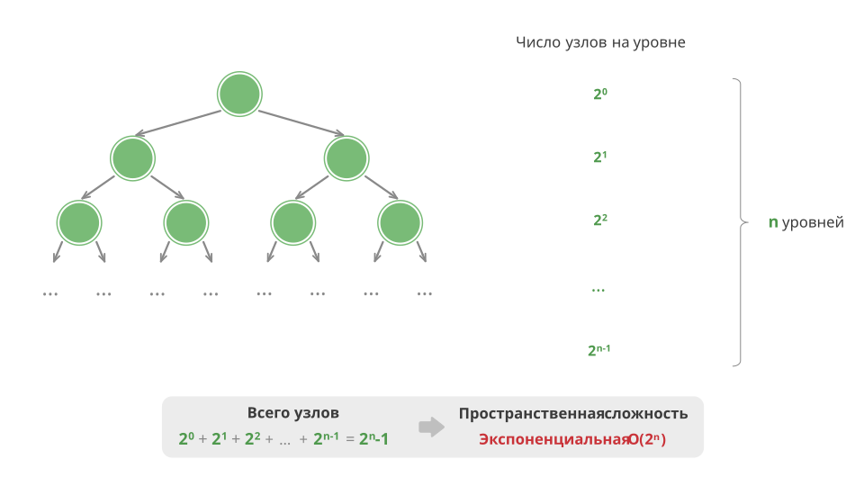

# Пространственная сложность

<u>Пространственная сложность (space complexity)</u> служит для оценки того, как меняется объем памяти, требуемой алгоритму, по мере роста объема данных. Это понятие очень похоже на временную сложность, только вместо времени выполнения рассматривается объем используемой памяти.

## Пространство, связанное с алгоритмом

Память, которую использует алгоритм во время работы, в основном делится на следующие части.

- **Входное пространство**: используется для хранения входных данных алгоритма.
- **Временное пространство**: используется для хранения переменных, объектов, контекста функций и других данных, возникающих во время выполнения алгоритма.
- **Выходное пространство**: используется для хранения выходных данных алгоритма.

Как правило, при анализе пространственной сложности в расчет включают временное пространство и выходное пространство.

Временное пространство можно дополнительно разделить на три части.

- **Временные данные**: используются для хранения различных констант, переменных, объектов и т.д., возникающих во время выполнения алгоритма.
- **Пространство кадров стека**: используется для хранения контекстных данных вызываемых функций. При каждом вызове функции система создает на вершине стека новый кадр. После возврата функции пространство этого кадра освобождается.
- **Пространство инструкций**: используется для хранения скомпилированных инструкций программы и в реальном подсчете обычно не учитывается.

При анализе пространственной сложности программы **обычно учитываются временные данные, пространство стека и выходные данные**, как показано на рисунке ниже.


Ниже приведен соответствующий код:

```snippet
space_categories
```

## Метод вывода

Метод вывода пространственной сложности в целом аналогичен выводу временной сложности: меняется только объект подсчета, с количества операций на размер используемого пространства.

В отличие от временной сложности, **обычно рассматривается только худшая пространственная сложность**. Это связано с тем, что память является жестким ограничением: необходимо гарантировать, что для любых входных данных у программы будет достаточно памяти.

Рассмотрим следующий код. Понятие худшей пространственной сложности здесь имеет два значения.

1. **Ориентир на худшие входные данные**: когда $n < 10$ , пространственная сложность равна $O(1)$ ; но когда $n > 10$ , инициализированный массив `nums` занимает $O(n)$ пространства, поэтому худшая пространственная сложность равна $O(n)$ .
2. **Ориентир на пиковое использование памяти во время выполнения**: например, до выполнения последней строки программа занимает $O(1)$ пространства. При инициализации массива `nums` она занимает $O(n)$ пространства, поэтому худшая пространственная сложность также равна $O(n)$ .

```snippet
worst_case_space
```

**В рекурсивных функциях необходимо учитывать пространство кадров стека**. Рассмотрим следующий код:

```snippet
loop_vs_recursion_space
```

Функции `loop()` и `recur()` имеют временную сложность $O(n)$ , но их пространственная сложность различается.

- Функция `loop()` вызывает `function()` в цикле $n$ раз. На каждой итерации `function()` возвращается и освобождает пространство своего кадра стека, поэтому пространственная сложность по-прежнему равна $O(1)$ .
- Рекурсивная функция `recur()` во время выполнения одновременно содержит $n$ еще не завершившихся экземпляров `recur()` , поэтому занимает $O(n)$ пространства кадров стека.

## Распространенные типы

Пусть размер входных данных равен $n$ . На рисунке ниже показаны распространенные типы пространственной сложности в порядке от меньшей к большей.

$$
\begin{aligned}
& O(1) < O(\log n) < O(n) < O(n^2) < O(2^n) \newline
& \text{Постоянная} < \text{Логарифмическая} < \text{Линейная} < \text{Квадратичная} < \text{Экспоненциальная}
\end{aligned}
$$


### Постоянная сложность $O(1)$

Постоянная сложность обычно встречается у констант, переменных и объектов, количество которых не зависит от размера входных данных $n$ .

Следует заметить, что память, занятая инициализацией переменных или вызовом функций внутри цикла, освобождается при переходе к следующей итерации, поэтому она не накапливается, и пространственная сложность по-прежнему остается $O(1)$ :

```src
[file]{space_complexity}-[class]{}-[func]{constant}
```

### Линейная сложность $O(n)$

Линейная сложность часто встречается у массивов, списков, стеков, очередей и других структур, число элементов в которых пропорционально $n$ :

```src
[file]{space_complexity}-[class]{}-[func]{linear}
```

Как показано на рисунке ниже, глубина рекурсии этой функции равна $n$ , то есть одновременно существует $n$ еще не завершившихся функций `linear_recur()` , которые используют $O(n)$ пространства кадров стека:

```src
[file]{space_complexity}-[class]{}-[func]{linear_recur}
```


### Квадратичная сложность $O(n^2)$

Квадратичная сложность часто встречается у матриц и графов, где число элементов связано с $n$ квадратичной зависимостью:

```src
[file]{space_complexity}-[class]{}-[func]{quadratic}
```

Как показано на рисунке ниже, глубина рекурсии этой функции равна $n$ , и в каждой рекурсивной функции инициализируется массив длины $n$ , $n-1$ , $\dots$ , $2$ , $1$. Его средняя длина равна $n / 2$ , поэтому в сумме используется $O(n^2)$ пространства:

```src
[file]{space_complexity}-[class]{}-[func]{quadratic_recur}
```


### Экспоненциальная сложность $O(2^n)$

Экспоненциальная сложность часто встречается у бинарных деревьев. Как видно на рисунке ниже, полное бинарное дерево с $n$ уровнями содержит $2^n - 1$ узлов и занимает $O(2^n)$ пространства:

```src
[file]{space_complexity}-[class]{}-[func]{build_tree}
```



### Логарифмическая сложность $O(\log n)$

Логарифмическая сложность часто встречается в алгоритмах «разделяй и властвуй». Например, при сортировке слиянием входной массив длины $n$ на каждом шаге рекурсии делится пополам, образуя рекурсивное дерево высоты $\log n$ и используя $O(\log n)$ пространства кадров стека.

Еще один пример - преобразование числа в строку. Если задано положительное целое число $n$ , то количество его цифр равно $\lfloor \log_{10} n \rfloor + 1$ , то есть длина соответствующей строки тоже равна $\lfloor \log_{10} n \rfloor + 1$ , следовательно, пространственная сложность составляет $O(\log_{10} n + 1) = O(\log n)$ .

## Компромисс между временем и пространством

В идеальных условиях хотелось бы, чтобы и временная, и пространственная сложность алгоритма были оптимальными. Однако на практике одновременно оптимизировать и время, и память обычно очень трудно.

**Снижение временной сложности обычно достигается ценой увеличения пространственной сложности, и наоборот**. Подход, при котором жертвуют памятью ради ускорения работы алгоритма, называется обменом пространства на время. Обратный подход называется обменом времени на пространство.

Выбор между этими двумя идеями зависит от того, что важнее в конкретной задаче. В большинстве случаев время ценнее памяти, поэтому стратегия обмена пространства на время используется чаще. Но при очень больших объемах данных контроль пространственной сложности тоже становится крайне важным.
